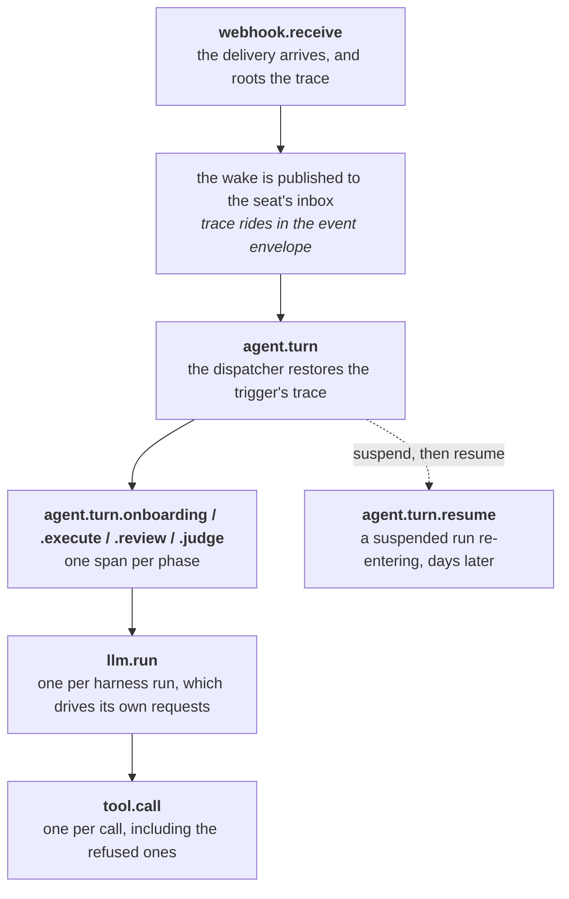

# Deployment

**Crewlet requires no infrastructure services.** The engine is one
binary: its event stream is a NATS JetStream server it embeds, and its store
is two local files it creates and owns exclusively. A single host runs a whole
company with nothing else installed.

One slot changes when a deployment outgrows one node: the stream, which
becomes either a cluster of the members the nodes already embed or a NATS
cluster somebody else runs. This page is mostly about that path. The
coordination KV lives on the stream's own broker, so reaching the leases is
reaching the mail. A node's holds ride a connection of their own, and on an
embedded broker the coordination store holds another beside the queue's; every
one is watched, and any closing for good stops the node, so a node never holds
live leases over a working link while its inbox link is gone, for longer than a
reconnect. It takes or keeps a hold only while its data path answers
([Seat Ownership](../concepts/seat-ownership.md#the-node-whose-broker-is-gone-and-why-it-leaves-too)). The store never becomes shared: it stays one file
per node, which is why everything shared between nodes lives in the KV. See
[Running a Fleet](fleet.md) and [Scaling Out](../concepts/scaling.md).

---

## The single host

**A keyring is required, on one node and on every node.** Every record on every
state log is signed under it, because a record is an instruction the next node
applies and the broker's admission vouches for a connection, never a message
(ADR-0031). An embedded fleet's broker admits only keys derived from it too
(ADR-0094). `crewlet secrets keygen` mints
one and prints the export line; a node without one refuses to start, naming
the field. Every node of a fleet needs the **same** keyring: a node keyed
differently refuses every peer's records, and a browser signed in against one
is signed out on the next request that reaches another. See
[Secret store](../concepts/secret-store.md) for what else it does and for the
zero-downtime rotation runbook: adding a key and flipping `active_key_id`
logs nobody out, and **dropping a key early is what ends live sessions**.

```yaml
# crewlet.yaml (Tier A)
secrets:
  active_key_id: "2026-01"
  keys:
    - id: "2026-01"
      material: "${CREWLET_SECRET_KEY_2026_01}"

stream:
  type: embedded              # a JetStream server inside this process
  store_dir: "/var/lib/crewlet/stream"   # required on a broker member: every data node keeps its state logs here

store:
  path: "/var/lib/crewlet/company.db"    # ONE file, this process only

coordination:
  type: local                 # one node holding its own seat leases
```

```bash
crewlet run -config crewlet.yaml -company company.yaml
```

That is the deployment. Point a reverse proxy at the API port for inbound
webhooks and the dashboard. To expose webhooks to the internet but not the
dashboard, give them a listener of their own:
[Exposing webhooks without the admin API](#exposing-webhooks-without-the-admin-api).

Give that proxy at least **two minutes** of silence in either direction on
the API port's REST and file routes. Requests to `/git/` on the same port
have a sizing of their own, which can be longer — a cold cache sync before
a request's first byte, sized by your largest repository, and three minutes for a push from a client that asks for no side-band — so give `/git/` its own location with what [Gitlet](#gitlet) asks for. Nearly every other request is answered in well under a second; the slowest answer a REST or file route gives is a file upload whose object store fails or stops answering — about a minute and a half: a minute, then thirty seconds abandoning an upload made in parts (95 s measured against an S3 fake whose bucket hung the abandon too) —
and the node stops reading the upload's body while it waits, so the silence
runs both ways. nginx's `proxy_read_timeout` and `proxy_send_timeout`, both
sixty seconds by default, each cut that answer to a `504`; the upload is not
written either way, and the object the store may hold is collected a day later.
A store that keeps throttling an upload holds it to the upload's own deadline (a
throttle is never given up,
[Object store](../concepts/object-store.md#an-s3-bucket--s3)), which a
two-minute proxy also cuts: not written, and the person uploads again.

A node eviction or readmission ([Retention](retention.md#eviction)) may take
up to fifty seconds (twenty to judge it, thirty to write every log), and
`crewlet retention evict` and the dashboard's evict dialog both wait a minute
for the answer; a proxy set below fifty cuts those answers off with a 504.
Nothing is lost: the node finishes the gesture whatever happens to the
connection, and both clients read an answer the engine did not write as one
that never arrived, keeping the operation id to finish it with, but the
operator then has to finish it to see what it did.

Two routes whose work outlasts that need no longer timeout: a check of a
Gitlet node's copy of a repository (`POST /gitlet/repos/{name}/verify`), about
nine seconds a gigabyte, and a model's test
(`POST /llm/providers/{key}/check`), up to three minutes of harness runs. Each
runs on the node's own time and answers within seconds: `200` with what a
quick one found, `202` for one still running, whose outcome is read with
`GET /gitlet/repos/{name}/verify/{id}` or `GET /llm/providers/{key}/check`
until it ends
([API reference](../reference/api-endpoints.md#post-gitletreposnameverify),
[and for a model](../reference/api-endpoints.md#post-llmproviderskeycheck)).

### Every machine's clock

**Keep every machine's clock synchronised** — every node's, and every server's
of an external NATS cluster. Several of the engine's rules judge an instant
one machine stamped by another machine's clock, and every one assumes every
machine's clock keeps within an hour of the fleet's, so any two within two
hours of each other:

- The [object collector](../concepts/object-store.md#collection-and-audit)
  deletes an object no row names only once its key, minted by the node that
  uploaded it, and the store's own record of when it was written are both more
  than a day old by the clock of the node running the collector, while a write
  may still name a key twelve hours old by the clock of the node deciding it.
  That leaves twelve hours, and a collector's clock running further ahead of
  the writer's than that deletes an object a write still names.
- Gitlet's `code-retention` duty removes a
  [retired pack's](../concepts/object-store.md#live-retired-and-derived-references)
  row once the instant the broker stamped on its retirement is a day old by the
  clock of the node holding the duty: two hours and thirty-nine minutes past
  the longest read of the largest pack, so a duty holder's clock running
  further ahead of the broker's than that deletes a pack a clone is still
  reading.
- A turn's hold on a
  [scratch repository](../concepts/gitlet.md#a-scratch-repositorys-idle-expiry)
  or on a seat's branch ([the ref lifecycle](../concepts/gitlet.md#the-ref-lifecycle))
  is recorded on the repository only once it has gone 22 hours without
  activity, or the branch 334 hours unset, by the clock of the node running the
  turn, while the `code-retention` pass judges the same broker-stamped activity
  by its own clock against a day at the shortest, or the branch's fourteen
  days. The two hours between them are all the margin there is, so a turn's
  node whose clock runs further behind the duty holder's than that can lose a
  scratch repository, or a seat's branch, that a live turn still holds.
- A ref drop, the commit a force-push or a deletion moved a branch or tag off,
  is kept fourteen days after the broker's instant on that push, judged by the
  clock of the node expunging the repository
  ([retention and history](../concepts/gitlet.md#retention-and-history)). That
  is a policy's edge rather than a margin: a clock past the bound moves it by
  the clock's error, and history force-pushed away can go that much before or
  after its fortnight.
- A seat's [daily push count](../concepts/gitlet.md#a-seats-push) is kept by
  each repository's committer on the day its own clock reads, and a seat's
  older day is forgotten only once a committer has counted the seat on a day
  beginning a whole day after it ended. That leaves a day, so a committer whose
  clock runs more than a day behind another's counts a seat's pushes on a day
  already forgotten, from nothing, and can land them past
  `code.limits.pushes_per_seat_day`.
- A repository's [pushes by day](../concepts/gitlet.md#counting-pushes) are
  kept as long as its push history, which drops a push once the broker's
  instant on it is 181 days old, so a read's first day is refused once it is
  181 days less two hours old by the clock of the node reading it. A reader
  whose clock runs further behind the broker's than that is counted short for
  the days the history already dropped.
- A [narrowed push history](../concepts/gitlet.md#narrowing-a-push-history)
  reads two hours past each end of a day or window it skips to or stops at,
  since a push's instant, stamped by whichever broker member led the stream,
  can stand before that of a push that landed earlier. A push stamped further
  out of order than that can be left out of a narrowed page, while the
  unnarrowed history lists it.
- A [kept session's](../concepts/code-sandbox.md#each-launchs-session-kept)
  capture is stamped on the run's record by the clock of the node taking it,
  and any other node reads it as still being kept until its life and two
  hours have passed by its own clock, about three hours and fifty-three
  minutes; a read standing by beside it is read as standing until its window
  and two hours have passed, about five hours and fifteen and a half
  minutes.
  Neither wait holds that long on that reading alone: a turn's end holds each
  capture for its life, and each standby for its window and its takeover's
  life, from the moment it first sees it, on its own clock. A reader whose
  clock runs further ahead of the taker's than the two hours can read a
  capture still being kept as abandoned, or a read still standing by as gone.
- A capture's record still to be answered names an object whose key the
  spooling node's clock minted, and the executor log refuses it once it is
  twelve hours old by the clock of the node deciding the record, so a reader
  waits on the record's answer until the key is twelve hours and two hours
  old by its own. A reader whose clock runs further ahead of the log's than
  that stops waiting on a record the log may still take.
- A read of a [box on another node's host](../concepts/code-sandbox.md#local-sandboxes)
  carries how long its asker waits, which the host counts on its own clock,
  and the host takes it until the asker's deadline, by the asker's clock, and
  two hours more by its own. A host whose clock runs ahead of its asker's by
  more than those two hours and the read's wait refuses every such read, and
  its asker hears a host that did not answer: a collection is handed back and
  asked again, and a stop waits for the host.
- A request to a data node's estate service or its Gitlet half, a
  [code search](../concepts/gitlet.md#code-search) and a
  [test of an MCP server](tools-and-mcp.md#testing-a-server) each carry how
  long the asker waits, which the node asked counts from the request's arrival
  on its own clock, time waiting for a free slot included, ending its work a
  reply's margin before; one whose wait ran out while it waited runs nothing.
  It takes the
  request only until the asker's deadline by its own clock, with no allowance,
  so a node whose clock runs ahead of its asker's by more than the wait refuses
  it: the estate's router asks the next data node, and a code search or a test
  hears a node that did not answer.
- A person's stop of a run whose box is on another node's host is given up
  with nothing read once that host has been silent for the host grace by the
  clock of the node asking it, or once the stop is the host grace and two
  hours old by that clock, judged against the instant the deciding node's clock
  stamped on it. The two hours keep the second from ever coming before the host
  grace has passed in real time, so a node whose clock runs further ahead of
  the decider's than that gives a host up early, and writes off the stopped
  run's spend while the host may still be restarting.
- A [joining node](retention.md#the-join-runbook) waits on every node whose
  positions-register row names an artefact and was taken by the coordination
  store within the last forty seconds and two hours, by the joining node's
  clock, which nothing has measured yet at boot. A joiner whose clock runs
  further ahead of the store's than the two hours can leave a draining donor
  unnamed and drop its offer; a stopped node named this way costs the join its
  five seconds of collecting offers.
- The trim and its report age other machines' instants by the clock of the
  node reading them, each the edge of a policy or an alarm, moved by up to the
  two hours rather than a margin: an [eviction's](retention.md#eviction) fence
  window, from the broker's instant on the eviction; the
  [`min_age` floor](retention.md#the-six-terms), from the broker's instant on
  each record; the newest backup's age, stamped by the node that took it,
  against [`backup_max_age`](retention.md#a-company-that-never-backs-up-never-trims),
  which near its one-hour floor can refuse a fresh backup or accept one three
  hours old; [`trim_blocked`](../reference/alarms.md#every-alarm) across a move
  of the trim duty, from the previous holder's instant; and
  [`maintenance_open`](../reference/alarms.md#every-alarm), from the instant
  the entering node stamped, which can be raised at once or two hours late.

Who holds a seat, a duty or a node's presence is not among them, nor how long
its lease has left on Settings › Nodes and in `fleet_health`: a lease is judged,
and its time left read, on the coordination store's clock alone, and every node
takes the store's word for it ([Coordination](../concepts/coordination.md#the-three-valued-answer)).
Nor is whether the trim honours a backup's or a join's pin: the node holding
the trim duty judges it on its own clock, from the moment it first sees it.

NTP keeps machines within milliseconds of each other; a host without it drifts,
and a virtual machine restored from a snapshot can come back hours off.

Every data node reads the fleet's clocks on its position heartbeat, every ten
seconds, off the position register in the coordination store, which it reads on
that beat anyway. Each data node's row there carries the instant the node
stamped on it and the instant the broker stored it at, so each row says how far
that node's clock stands from the one broker member leading the register, which
stores every row, and the median of them is the **fleet's clock**: the median
of every data node's. A node whose own clock stands more than an hour from the
fleet's raises [`clock_skew`](../reference/alarms.md) about itself, and every
node raises it about the broker member once that member's clock does — on an
embedded broker one of the data nodes, which then raises it about its own clock
too; on an external NATS cluster the server leading the register's stream. So
while no node raises it, every data node and that member keep within an hour of
the fleet's clock, and any two of them — every member of an embedded broker
among them — within two hours of each other, inside every margin above. A rule
judged on the clock of a node that runs seats, a turn's hold, a capture's or a
standby's age, a box read's or an MCP test's admission or a stop's give-up above, rests on a
clock the alarm measures only where that node holds data too: a node without
the `data` role writes no row to the register, so nothing measures its clock,
and NTP on it is all that keeps it inside the bound. With two data nodes
neither clock outvotes the other, so both are named once they stand more than
two hours apart. The alarm names a clock that has already drifted rather than
keeping one from drifting, and it cannot see the other servers of an external
NATS cluster disagree with the one it reads, so run an NTP client (chrony,
systemd-timesyncd) everywhere the engine or its broker runs. [Watching a
fleet](fleet.md#watching-a-fleet) says how to read the alarm across the nodes.

### The room the stream's volume needs

The engine keeps fourteen ordered logs on the stream: the tracker's mutation
log, the vector changelog, the knowledge base's log, the executor log, Gitlet's
log, the identity estate's log, the usage log, the artifacts log, the
artifact datastore's log, Ask Crewlet's log, the chat log, the access log, the
atlas log and the advisor log.
Each log's byte ceiling is **reserved** on the volume holding `stream.store_dir` when its stream is
created: the embedded broker grants a ceiling in full, up front, or refuses to
create the stream at all. Its limit is `stream.store_max_bytes` where you set
one, and otherwise three quarters of
that volume's free space.

The node sizes the ceilings together to fit five eighths of what that limit
leaves once the object store's `nats` bucket (below) has its reservation. A log
derived from the disk that would be scaled below 1 GiB is **held at 1 GiB**,
Ask Crewlet's log and the executor log give way down to their own 64 MiB
floor, and any other log whose own default is smaller than a gibibyte is held
at what it asked for, so a fresh node has a floor it cannot go below.

#### The minimum room for a fresh node

With nothing set, a node starting on an empty stream directory reserves:

| What reserves it | At its smallest | Tier A field |
|---|---|---|
| The tracker's mutation log | 1 GiB | `stream.tracker_log_max_bytes` |
| The vector changelog | 1 GiB | `stream.tracker_vectors_max_bytes` |
| The knowledge base's log | 1 GiB | `stream.pages_log_max_bytes` |
| The artifacts log | 1 GiB | `stream.artifacts_log_max_bytes` |
| The artifact datastore's log | 1 GiB | `stream.artifact_data_log_max_bytes` |
| The chat log | 1 GiB | `stream.chat_log_max_bytes` |
| Gitlet's log | 1 GiB | `stream.code_log_max_bytes` |
| The usage log (a fixed default) | 1 GiB | `stream.usage_log_max_bytes` |
| The identity estate's log (a fixed default) | 512 MiB | `stream.iam_log_max_bytes` |
| Ask Crewlet's log (512 MiB by default, scaled down where the broker is short) | 64 MiB | `stream.assistant_log_max_bytes` |
| The executor log (512 MiB by default, scaled down where the broker is short) | 64 MiB | `stream.executor_log_max_bytes` |
| The access log (128 MiB by default, scaled down where the broker is short) | 64 MiB | `stream.access_log_max_bytes` |
| The atlas log (128 MiB by default, scaled down where the broker is short) | 64 MiB | `stream.atlas_log_max_bytes` |
| The advisor log (a fixed default, its floor) | 64 MiB | `stream.advisor_log_max_bytes` |
| **The fourteen logs together** | **8.81 GiB** | |
| The object store's `nats` bucket, reserved before the logs | a quarter of the broker's limit, 2.94 GiB at the minimum | `store.objects.nats_max_bytes` |

So the broker needs a limit of at least **11.75 GiB**, which an embedded
broker sizing itself at three quarters of the volume reaches with **15.67 GiB
free** on the volume holding `stream.store_dir` (about 16.8 GB). With the
objects in S3 (`store.objects.backend: s3`) no bucket is reserved, and the
logs' 8.81 GiB alone needs 11.75 GiB free. These are the least that **boots**:
the mailboxes, the coordination buckets and a joining node's snapshot reserve
nothing and grow into whatever is left, so give a production host far more.

Below the minimum the node refuses to boot with an error naming the log it
could not reserve, the bytes it needed, the bytes the broker had left, the
Tier A field that sets that ceiling, and the least a fresh node of its
configuration reserves, split into the logs and the bucket.

**On a small host**, two settings decide the figure:

- `store.objects.nats_max_bytes` sets the bucket's reservation instead of a
  quarter of the broker's limit. At its smallest, 1 GiB, a fresh node needs a
  limit of **9.81 GiB**, which three quarters of **13.08 GiB free** reaches.
  The bucket then holds at most 1 GiB of the company's files until you raise
  the setting and restart a data node, which raises the reservation where the
  broker can grant it; see
  [Object store](../concepts/object-store.md#its-byte-reservation).
- `stream.store_max_bytes` sets the broker's limit outright, rather than three
  quarters of the free space at boot. It accepts values from 6 GiB, below
  what a fresh node needs, so `crewlet validate` (and the advisories a node
  logs at every start) warn when a data node's embedded broker is given less
  than the minimum for its configuration.

The fixed-default logs' fields also go lower: `stream.iam_log_max_bytes`,
`stream.usage_log_max_bytes`, `stream.assistant_log_max_bytes`,
`stream.executor_log_max_bytes`, `stream.access_log_max_bytes`,
`stream.atlas_log_max_bytes` and `stream.advisor_log_max_bytes` accept 64 MiB.
The other seven fields accept no less than 1 GiB, so setting them only moves the
figure up.
- **A floor is per log, not universal.** Those seven go down to 64 MiB because
  their logs grow slowly, and a ceiling is granted in full at create time, so a
  log at a disk-sized floor costs free space a node needs before it can start,
  for a log that will not fill it. The identity log grows with headcount and
  sign-ins. Ask Crewlet's grows with how many people ask it (a month of a
  ten-person company's questions fits in 64 MiB). The executor log grows with
  the turns the seats run; it names each turn's session rather than holding it,
  so about three weeks of a ten-seat company's turns fit in 64 MiB, but only
  about two days of the hundred-seat reference company's, short of the seven
  days of `min_age` the trim keeps. A company of more than about thirty seats on
  a host this small sets `stream.executor_log_max_bytes` itself, which no
  scaling moves, or gives the broker the room for the default; the
  `log_ceiling_short` alarm names the log that is short. The access log grows
  with what seats are told and the SSH they use (about a month of the reference
  company's records fit in 64 MiB). The atlas log grows with what people record
  about what the company runs on (months of the reference company's edits fit in
  64 MiB). The advisor log grows with what the Advisor records (about ten days
  of the reference company's findings and runs fit in 64 MiB). The usage log is
  a census of node-days (about 18 MB for a ten-seat node's 181 days).
- **More room buys longer logs, up to a point.** Unset, the mutation log and
  the vector changelog each ask for a quarter of the free space (4..64 GiB),
  the knowledge base's log, the artifacts log and the artifact datastore's
  log each for a quarter of the mutation log's, the code log for two thirds
  of the mutation log's, the chat log for 8 GiB, capped at a sixteenth of the
  free space (so the whole of it is asked from 128 GiB free), the identity
  estate's log, Ask Crewlet's and the executor log for a flat 512 MiB each
  and the usage log for a flat 1 GiB. None of the last four is derived from
  the disk: the identity and Ask Crewlet logs grow with headcount, the executor
  log with the turns the seats run, and the usage log is a count of node-days
  rather than a rate, so more disk buys them nothing. The chat log's ask does
  not follow the mutation log's as the knowledge base's does, so if you set
  `stream.tracker_log_max_bytes` for a long blocked trim, set
  `stream.chat_log_max_bytes` for the same horizon (about 32 MB a day at the
  declared census) or the chat log fills first.
  They are scaled down together whenever they ask for more than the logs'
  share — five eighths of what the broker's limit leaves once the `nats`
  bucket has taken its quarter of it, about 35 % of the free space on a first
  boot — which is every volume with less than about 653 GiB free (with the
  mutation log at its 64 GiB clamp the fourteen ask for 229.5 GiB: 64 + 64 + 16 + 16 + 16 + 42⅔ + 1 + ½ + ½ + 8 + ½ + 0.1 + 0.1 + 0.1); from there up each log gets what it
  asked for. With the objects in S3 no bucket is reserved and the share is
  five eighths of three quarters of the broker's limit, about 47 % of the free
  space, so from about 490 GiB free.
- **The code log's ask is paid whether or not anything pushes.** Below about
  653 GiB free it comes out of the other logs' share: at 100 GiB free
  the mutation log and the vector changelog are created at 9.0 GiB each rather
  than 11.0, at 256 GiB at 24.8 rather than 30.6 — windows about a fifth
  shorter for a blocked trim — and the knowledge base's, the artifacts and
  the artifact datastore's logs by the same proportion. A company that hosts
  no code and is short of room sets `stream.code_log_max_bytes: 1073741824`
  before the first boot; the
  [replication guide](replication.md#what-the-code-logs-reservation-costs)
  has the table and what to do once the streams exist.
- **The ceilings are fixed when the streams are created.** Moving the node to
  a bigger volume, or setting `stream.tracker_log_max_bytes`,
  `stream.tracker_vectors_max_bytes`, `stream.pages_log_max_bytes`,
  `stream.code_log_max_bytes`, `stream.artifacts_log_max_bytes`,
  `stream.artifact_data_log_max_bytes`, `stream.iam_log_max_bytes`,
  `stream.usage_log_max_bytes`, `stream.assistant_log_max_bytes`,
  `stream.chat_log_max_bytes` or `stream.executor_log_max_bytes` later,
  changes nothing about streams that already exist; `crewlet retention set-capacity` is what changes a running log's ceiling. A log derived from the
  disk that is created later (one a new version adds) is sized from what the
  existing logs' ceilings leave of that share, so logs that already hold all of
  it leave it the 1 GiB floor.

[Replication](replication.md#how-the-byte-ceilings-are-sized) has the whole
arithmetic and the refusal's text.

---

## The compose stack starts nothing

`docker-compose.yml` in a repo checkout is for the things *around* the
engine (the local integration loops), and nothing else. It has no broker
service, because the engine embeds its own. Every service is behind a profile,
so a bare `docker compose up` brings up nothing:

```bash
cp .env.example .env                              # first time only
docker compose --profile gitlab up -d             # GitLab (code host)
docker compose --profile mattermost up -d --wait  # Mattermost (chat)
```

| Service | Port | Details |
|---------|------|---------|
| GitLab | 8929 / 2424 | `gitlab/gitlab-ee`, configured `external_url http://gitlab.local:8929`: the published port and the URL GitLab builds its own links from are deliberately the same number. 2424 is git-over-SSH and optional; HTTPS plus a token is the path the engine takes |
| Mattermost | 8065 | `${MATTERMOST_LISTEN_PORT:-8065}`. Mattermost accepts a websocket upgrade only from a browser whose `Origin` matches `MM_SERVICESETTINGS_SITEURL` exactly, host and scheme, so move the port and the site URL together or the page loads with the event stream silently dead |

---

## The stream beyond one host

The stream slot has a default and one alternative, differing in who runs the
broker, not in what the engine speaks: `embedded` starts a NATS JetStream
server inside this process, `nats` dials one somebody else runs. The client
code is identical either way, so nothing above the queue can tell which is in
use, and no company config mentions it.

A single host needs neither shape below. A fleet needs exactly one of them,
because two nodes each embedding a *solo* server are two companies that
cannot see each other: the solo server binds no socket at all, which is a
security property as much as a convenience.
### Every node embeds a member of one cluster

One binary, no broker to deploy. Three nodes, each naming itself, its route port and the other two:

```yaml
# crewlet.yaml (Tier A) on the first node. The other two differ only in
# node.id and in which peers they name.
node:
  id: crewlet-1

stream:
  type: embedded
  store_dir: "/var/lib/crewlet/stream"
  cluster:
    name: crewlet                      # identical on every member
    port: 6222                         # this member's route port
    peers:                             # the others' route URLs
      - "nats://crewlet-2.internal:6222"
      - "nats://crewlet-3.internal:6222"
    host: 10.0.0.11                    # bind the route port to the private
                                       #   interface, not to all of them
  replicas: 3                          # a publish is committed by a quorum
                                       #   before Publish returns

coordination:
  type: embedded-kv                    # the leases live on the stream's own
                                       #   broker; nothing else to set

secrets:                               # the SAME keys on every member: each
  active_key_id: "2026-01"             #   one verifies what the others sign,
  keys:                                #   and the broker admits only a peer
    - id: "2026-01"                    #   presenting a key derived from them
      material: "${CREWLET_SECRET_KEY_2026_01}"
```

**Bind the route port to the network the peers are on.** `cluster.host` is the interface the route listener binds; unset binds every interface. The route port admits only a member presenting a credential derived from `secrets.keys` ([below](#the-fleets-broker-admits-only-its-own-nodes)), but that credential crosses the network in clear once per connection (a NATS route carries a password or a certificate, never a signature), and so does every byte after it: the whole event history and every lease. On a host with a public interface an unset `host` publishes both. Set it to the private address, or firewall the port; the engine cannot tell which address is private, so it does not guess.

**A cluster block without a name is refused.** The embedded server takes its route port, bind interface, advertise address and peers only from a *named* cluster, so anything under `cluster:` with no `cluster.name` would start a solo node with no route listener while the rest of the config reading (provisioning budgets, topology validation) calls it clustered. Tier A names the missing field.

**A route port something else already holds is refused at startup, by name.** The broker binds its route listener last, after recovering its store, so the engine probes the port first and refuses in microseconds rather than after a recovery of minutes:

```
stream.cluster.port 6222 is already in use on 10.0.0.11, so this member's
route listener cannot bind and it could never form a route to a peer — free
that port or give this node a different one
```

A port taken between the probe and the bind is refused as soon as the bind fails, with the operating system's error on the end of the same sentence. `stream.leaf.port` is probed and refused the same way.

**`cluster.advertise` is for when what a member binds is not what its peers can dial.** Members learn of each other from members they already have: node 1 tells node 3 where to find node 2, and node 3 dials it. Unconfigured, that address is derived from the connection's remote address, which is wrong behind a mapped container port, a NAT or a load balancer. There, set `advertise` to the address peers should dial (host and port, or a bare host to keep this member's route port):

```yaml
stream:
  cluster:
    host: 0.0.0.0                      # inside the container, bind everything
    advertise: "crewlet-1.internal:6222"  # outside it, this is the address
```

**`node.id` is this member's identity in the cluster and must survive a restart.** It is the NATS server name, which must be unique (a route from a name the cluster already knows is rejected) and stable, because **JetStream places replicas by server name**. A node back under a fresh name is a new peer: its old replicas are orphaned and the stream sits short of quorum waiting for a server that never returns. So a clustered member with no name is refused at startup rather than given a generated one (unique, but only half the requirement).

**It is the resolved id, so the environment is enough.** The precedence is `node.id` in the file, then `CREWLET_NODE_ID`, then the default, so an orchestrator injecting a pod name needs no `node:` block. `node.id: "${CREWLET_NODE_ID}"` (or `"${HOSTNAME}"`) means the same: Tier A expands `${VAR}` before it decodes. A reference expands anywhere in a text field, but must be the whole value of a number or boolean (a port, `stream.replicas`) (see [Environment Variable References](../getting-started/configuration.md#environment-variable-references)).

**One node or three, never two.** Two embedded-KV members have no quorum without each other, so the fleet stops when either restarts, and a rolling upgrade restarts them one at a time. Tier A refuses a two-member config by name, counting this node and the **other** members `stream.cluster.peers` names: an entry recognisably this node's own route, or a repeat, is left out with a warning; an alias of this host it cannot recognise counts as a member. See [Running a Fleet](fleet.md#what-a-fleet-needs).

**A fresh cluster takes seconds to form, and the engine waits rather than hanging.** A member accepts connections once listening, but the metadata group takes seconds to elect a leader (about eight on a quiet three-member cluster), and until then creating a replicated stream *blocks* instead of failing. Three waits at boot, in order, fail for different reasons:

| Wait | Budget | What is happening |
|---|---|---|
| **Starting** | none — reported every 10s | The broker recovers its file store: as long as the store is large, milliseconds on a fresh one |
| **Listeners** | 30s | The broker opens its listeners (its route listener, in a cluster) once started. The same budget bounds the handshake of every connection the engine opens to its own member (the queue's, the coordination store's, a snapshot donor's) |
| **JetStream current** | 60s | The metadata group elects a leader and this member catches up with it |

Then placement retries while the cluster answers "no suitable peers", inside the per-create provisioning budget: **30 seconds** on a solo node, **2 minutes** on a member with peers (the two creates differ underneath). See [A clustered node is given longer to create them](#a-clustered-node-is-given-longer-to-create-them).

**The store recovery is waited out, not bounded.** It takes as long as the store is large (about a second per GiB after a clean stop, a second and a half after a crash, on a fast local disk) and the store holds the company's files as well as its streams. The broker cannot stop a recovery in progress, so a budget would only fail a working boot, and a store larger than it could never start. Instead the boot logs every ten seconds:

```
INFO queue.jetstream  embedded_broker_starting server=node-1 store_dir=/var/lib/crewlet/stream elapsed_seconds=20 detail="the embedded broker is still starting — recovering its file store, …"
```

**`/health` answers `503` until the recovery is over.** The node binds its HTTP listener first, and while it recovers its store, this broker and the replicated estate, `/health` answers `503 {"status": "starting", "phase": "recovering"}`; it turns `200` when the recovery ends, before anything the company configures starts (see [While a node is starting](../reference/api-endpoints.md#while-a-node-is-starting)). A node under an orchestrator needs a startup probe sized for the largest store it may recover and, on a data node in a fleet of more than one, for the replicated-estate snapshot it may fetch: [Sizing the startup probe](#sizing-the-startup-probe) has the arithmetic. A liveness probe alone counts the recovery as failure and restarts the node partway, and the next boot recovers the same store again. A broker that cannot start at all (an unusable store directory, a port somebody holds) does not wait: it [declares itself dead](#a-broker-that-declares-itself-dead) and the boot fails at once with its reason, as does a node whose own `api.port` or `api.public` is taken, which fails before the recovery.

**The listeners keep a budget, and only they do.** Once started, opening listeners is a bind each (under 40 ms with sixteen members starting at once), so thirty seconds fails a boot only when the broker stops reporting ready for an unpredicted reason, and names it.

Every wait is cancellable: Ctrl-C ends it at once, unless the member is still recovering its file store. Then the boot waits for the recovery and logs `embedded_start_cancel_waits`; a second Ctrl-C exits immediately (see [Force stop](../concepts/agent-runtime.md#graceful-shutdown)). Every other error returns at once: a bad subject or conflicting retention does not clear by waiting.

**`store_dir` is required on every member, and the engine refuses to boot one without it.** Empty selects an in-memory member: a restart loses its replicas and the KV buckets carrying the fleet's shared records (token counters, completion ledger, open agent-to-agent asks, claimed scheduled fires, records of executors out in their boxes). Every **member** (every `data` node on the embedded broker, a single node included) sets `store_dir`, because an in-memory member creates every stream it provisions in memory. A leaf and a client of an external cluster hold no streams, so both are refused a `store_dir`; see [Satellite nodes](satellite-nodes.md).

**The company's own records live there whatever backends it names.** Every data node keeps its **identity estate** (people, credentials, sessions) on a state log, and a domain's log is a stream. With `tracker.backend: worklet`, `knowledge.backend: doclet` or a chat that resolves to `chatlet` (all three defaults), work items, pages and messages are there too, as are the pushes of a company hosting its repositories in the engine (`code.backend: gitlet`). An unset `store_dir` recreates those logs empty on restart, and a node whose rows are ahead of a log that restarted from nothing stops serving for good. So the engine refuses to boot without one, and `crewlet validate` refuses it, naming `stream.store_dir`. This holds for a company on Jira and Confluence too: it still has people who sign in.

**One broker per `store_dir`.** An embedded member takes a lock file, `crewlet-broker.lock`, inside its `store_dir` before building its broker and releases it once the broker has stopped; a second broker on the directory is refused before it reads anything, naming the holder (`pid N on HOST since T`). nats-server takes no lock and **accepts** a second server on one directory, which corrupts it silently. Whatever starts the broker holds the lock: the engine, or a `crewlet` command that reaches the fleet's secrets itself while this node's engine is stopped ([Secret Store § Which store the CLI writes](../concepts/secret-store.md#which-store-the-cli-writes)). So a second engine is refused, so is an engine started while such a command holds the lock, and so is a command that meets an engine part way through starting (once the engine holds its database, a command goes through its API). Two engines on one host each name their own `store_dir`. The file is inside the directory because a volume-root `store_dir` has a parent a non-root engine on a read-only root filesystem cannot write. The kernel releases it when its holder exits however it exits, so there is no stale lock to clear.

**Divide `store_max_bytes` when several engines share a filesystem.** Every stream ceiling on the embedded broker is a *reservation*: the broker refuses a stream whose ceiling it cannot back, comparing against this limit. Unset, it sizes itself from the free space on `store_dir` when JetStream comes up (three quarters, measured once), which is wrong with more than one tenant because free space bounds the *sum* of the engines on a disk: two over-commit the volume, three by half again. The failure is not disk-full: on a single node it is `insufficient storage resources available`; on a fleet, where the metadata leader applies the limit when placing the stream, it is `no suitable peers for placement, insufficient storage`. Either way it names whichever stream that node provisioned last, not the cause. On a host running N engines against one filesystem (a test runner, a multi-tenant box), give each its own share:

```yaml
stream:
  store_dir: "/var/lib/crewlet/acme/stream"
  store_max_bytes: 68719476736   # 64 GiB of the volume, this engine's share
```

The limit is measured once, at boot, on both paths: a resized volume does not move it, so restart to see one. Five eighths of the limit in force is what the state logs' derived ceilings may reserve between them; the other three eighths are for streams that reserve nothing and grow against it (seats' mailboxes, event log, dead-letter stream, memory changelog, every coordination bucket). A refusal names the ceiling that did not fit and the Tier A field that sets it on either topology; it adds the limit in force and what is already reserved only where this node can read them, which is the standalone one (on a fleet the refusing room is another member's disk).

#### The fleet's broker admits only its own nodes

Every connection to an embedded broker presents a key derived from `secrets.keys`, and the broker admits exactly four kinds ([ADR-0094](../../adr/0094-the-fleets-broker-admits-only-a-key-derived-from-secrets-keys.md)):

- a **route** from another member, presenting the route credential derived from a key of its keyring;
- a **leaf link** from a node without `data`, presenting the nkey derived from a key of its keyring and signing the member's challenge;
- an **operator** on a member's own host, on the member's loopback client listener, presenting the operator key `crewlet fleet broker credential` writes ([below](#reaching-an-embedded-fleets-broker-with-the-nats-tool));
- the node's **own connections**, in process.

Every node accepts every key of its keyring and presents the active one, so the keyring's [rotation runbook](../concepts/secret-store.md#rotating-the-keyring-with-nothing-in-flight-lost) moves the broker with no step of its own. A clustered member listens on two ports: the route port on the configured interface, and a client port on loopback that NATS opens before it routes; the engine's own connections never dial it and no client is told where it is.

A refused connection is counted in `crewlet.broker.peer.refusals`, by the listener it reached and what it presented (`none`, `unknown`: a key this node does not hold, or `invalid`: a key it holds with a proof its material does not produce), and logged as `broker_peer_refused`: a class's first refusal at once, then at most once a minute with the count since, naming the key presented and where it came from. `unknown` during a rotation is a node whose keyring differs from this one's; `none` is a process that is not a node of this fleet. Every broker logs `broker_keys` at start: the key it presents, the keys it accepts and the listeners it opened.

**What it does not do is encrypt.** `credentials`, `token` and `stream.tls` are **dial-side** options for an external cluster; an embedded broker's links carry no TLS. A route's credential crosses the network in clear once per connection, and so does every byte of fleet traffic after it. Neither end authenticates what answers at the address it dials, so a route's credential goes to whatever holds a peer's address. A private subnet, a security group or a WireGuard mesh between the nodes is what makes this shape safe, and no configuration substitutes; what an impostor on that network could forge is bounded by the signature every record and instruction carries ([ADR-0031](../../adr/0031-every-state-log-record-is-signed.md)).

**A coding box on a member's host network can read that traffic.** A [container box](../concepts/code-sandbox.md#local-sandboxes) joins the Docker network `providers.sandbox.local.network` names (the runtime's default bridge when unset), from which it reaches the broker's ports like any outside process and is refused. Given the HOST's network (`providers.sandbox.local.network: host`, or a `--network host` run argument) it shares the member's network namespace: with Docker's default capabilities it can read the host's traffic, a route's credential at connect time included, and reach the loopback client listener, which admits only the operator's key. On a fleet node keep coding boxes off the host network. A `direct` box is outside every network rule: it runs as the engine's own user ([Code Sandbox → Security model](../concepts/code-sandbox.md#security-model)).

### Reaching an embedded fleet's broker with the nats tool

A few broker gestures have no engine verb, above all resizing every stream and bucket before a raised `stream.replicas` lets a node start ([Replica count](#replica-count)). Make them with the [`nats` tool](https://github.com/nats-io/natscli) on a member's own host, through its loopback client listener, with the operator key:

```bash
# on a clustered member's host, with the token of a principal that holds admin
export CREWLET_API_TOKEN=...
crewlet fleet broker credential -o ./operator.nk
# Wrote the operator key derived from secrets.keys id "2026-01" to ./operator.nk (0600).
#
#   nats --server nats://127.0.0.1:41234 --nkey ./operator.nk <command>

nats --server nats://127.0.0.1:41234 --nkey ./operator.nk stream ls
```

The command derives the key from this host's own Tier A (the seed goes to a file created `0600`, never printed, never over an existing file) and asks this host's node, over `GET /fleet/broker` (which takes `admin`), for its client listener, whose port the OS chooses at every start and which only that host can reach. It refuses an answer from any other node (a `-api` naming a balancer or a peer), and a node with no client listener (a solo member, a member with only a leaf listener, a leaf) says so. A member that serves no API (`api.port: 0`) is asked nothing: the invocation is printed with the address left for you, and the node's `broker_keys` line names it. The key reaches every stream and bucket and never the system account (removing a member goes through [`crewlet fleet broker remove`](../reference/cli.md#crewlet-fleet-broker)), and grants nothing its holder lacks: whoever reads this node's Tier A holds the keyring, which already decrypts the company's document and secrets. It is admitted until its key leaves `secrets.keys`; write it again after a rotation drops it. A member serves the plain JetStream API beside the fleet's domain, so the tool needs no `--js-domain`.

### An external NATS server

The other multi-node shape, for when the broker has to be secured, operated or shared on a schedule of its own:

```yaml
# crewlet.yaml (Tier A)
stream:
  type: nats
  url: "nats://nats-1.internal:4222,nats://nats-2.internal:4222,nats://nats-3.internal:4222"
  credentials: "/etc/crewlet/engine.creds"   # an NKey/JWT creds file — one of
  # token: "${CREWLET_NATS_TOKEN}"           #   credentials, token or tls.cert
                                             #   (or a credential in url) is
                                             #   required
  tls:
    ca: /etc/crewlet/ca.pem                  # the private CA to trust
    cert: /etc/crewlet/client.pem            # this engine's own certificate
    key: /etc/crewlet/client.key

coordination:
  type: embedded-kv

secrets:                                     # required on every node, and the
  active_key_id: "2026-01"                   #   same keys on each of them
  keys:
    - id: "2026-01"
      material: "${CREWLET_SECRET_KEY_2026_01}"
```

**The URL goes to the NATS client verbatim**, so a comma-separated list of a cluster's members is one value to this config and the client fails over between them. `store_dir` is refused here by name: it is where an *embedded* server persists, and an external cluster keeps its own storage. A URL may carry a credential as userinfo (`user:password@`, or a bare `token@`, which the client reads as a bearer token); nothing the engine writes repeats it: a failed dial, a boot refusal and a log line name a server by scheme, host and port alone, and an unparseable address is named as one rather than quoted.

**Authentication is required, on both sides.** This node must present a credential: `credentials`, a NATS credentials file (the NKey/JWT pair an account setup issues per user); `token`, a bearer token, which takes a `${VAR}` reference to stay out of the file and the config revision history; `tls.cert`, a client certificate; or a credential in any `url` entry's userinfo. Set whichever the broker asks for; each is a dial option and the engine stores none. A Tier A presenting none of the four is refused at `stream.credentials`.

And the server must authenticate its clients. Anything a NATS server admits reads every event the company publishes and writes on every subject (a seat's mail, a lease, a state-log record, whose signature only keeps a forged one from being applied), so a server admitting anybody makes everything that can reach its port, a [container coding box](../concepts/code-sandbox.md#local-sandboxes) on a node's host among them, a reader and writer of this company. The dial reads the `INFO` line the server sends first and admits it only where that says `auth_required` (the server holds any authorization: a token, users, nkeys, an operator) or `tls_required` with `tls_verify` (every client must present a certificate the server verifies). Anything else refuses the boot, naming the server by host and port:

```text
engine: stream: connect nats: jetstream: an external NATS server must authenticate its clients: the NATS server at nats://nats-1.internal:4222 requires no authentication (it admits anonymous clients, or binds them to a no_auth_user), so anything that reaches it reads and writes this company: configure authorization, or tls { verify: true } without allow_non_tls, on every server of that cluster
```

A certificate this node presents does not count alone: a server with `tls { }` and no `verify` never asks for one, and admits a client presenting nothing. Neither does `verify` with `allow_non_tls`, which admits a plaintext client with no certificate. A token the server does not require is no authentication either, which is why the server's own word is read rather than this node's. The check judges the server each connection is on when its dial completes (the coordination store's and every second connection included), not one it reconnects to later, so configure every server of the cluster alike: a client fails over to whichever answers.

**`stream.tls` is the transport underneath that authentication**, a separate question from who you are: a broker with `tls { verify: true }` (the hardened default) refuses a connection presenting no client certificate whatever credentials follow. `ca` is the bundle the server's certificate is verified against; empty means the host's root pool, right for a public CA and wrong for the self-signed certificate most internal estates use. `cert` and `key` are this engine's own certificate: both or neither, because validation refuses half a keypair rather than letting the broker reject it with an error naming neither file. There is deliberately **no way to skip verification**: that switch is set during a bring-up and never unset, and the connection it leaves behind carries every event to whoever answers on that address.

**Those files are opened before the dial, and the error names the field.** A missing `ca` reports `tls.ca /etc/crewlet/ca.pem: no such file or directory`, not a connection failure; left to the NATS client, an unreadable certificate reads exactly like *the broker is unreachable* and sends an operator to debug a healthy network path.

**A broker blip is not a node restart.** The engine dials with unlimited reconnects, one second apart, and never gives up on the URL: a node that keeps its seats through a two-second outage is the point of the coordination layer's "unreachable" versus "not mine" distinction. The coordination KV rides this same connection on purpose (one connection, one fate). An outage outlasting the lease TTL (45 s unless `coordination.lease_ttl_seconds` says otherwise) does hand this node's seats to a peer; that is intended, not something a reconnect policy should paper over.

Each attempt gets **5 seconds** to connect and 5 more for TLS and the NATS handshake (a request's term: handshake packets queue at the link's bottleneck, which may hold four seconds of the link's rate; at 2 seconds a node whose connection dropped behind a deep queue could not dial again). The loop tries URLs in turn, so a member that silently drops packets holds every attempt for that long before a live one is asked (one that takes the connection then never answers holds it for the handshake's 5 seconds, one slow at both up to 10), time not spent renewing leases. A pool of three with two members down ahead of the live one reaches it 10 seconds after the drop, up to 20 where both take the connection and hang. That is far inside the default 45-second lease. At the floor, a 15-second lease renewed every 5 seconds, a drop just before a renewal leaves 10 seconds, which two dead members ahead of the live one use up, and the node's seats go to a peer: a fleet at the floor lease on an external cluster keeps `stream.url` to members that are up, or its lease above the floor. A URL resolving to several addresses (a headless Kubernetes service naming every pod) shares those 5 seconds among them, tried in random order so connections spread across members.

**The servers must wait as long for a node's CONNECT.** A NATS server cuts a connection whose CONNECT has not arrived within its authorization timeout (2 seconds by default, counted from when it took the connection). The CONNECT follows the server's INFO across the link, so behind a deep queue it arrives later and a node whose connection dropped there is cut before it can authenticate, every time. Set `authorization { timeout: 5 }` in every server's configuration.

**Nothing on the way may terminate TCP.** The node reads its own sockets to tell a link still carrying a large message from one carrying nothing (what it read, and what the server's kernel acknowledged), so a buffering proxy between node and servers, a service mesh's sidecar among them, acknowledges for the servers and hides which. Exclude the servers' client port from mesh capture, as a [satellite's leaf link](satellite-nodes.md#what-a-satellite-still-needs) does.

**A connection the client gives up on is a node restart.** Reconnecting for ever covers a server that goes away and comes back, not the cases where the NATS client closes the connection *for good*:

- a message larger than a `max_payload` that was lowered under the running node (see [below](#the-largest-message-every-server-must-carry));
- the server refusing this node's credentials, and again on the reconnect after it: `credentials` or `token` changed, revoked or expired, or the server's authorization reloaded so it no longer admits them;
- any other error the server sends that the client does not treat as transient.

The node **stops itself**: it logs `jetstream_connection_closed_for_good` and `engine_fatal`, drains and tears down in the order of `SIGTERM`, and exits with status **1**, printing on stderr what closed, why, and what to change. The one difference from `SIGTERM` is the drain over a lost stream connection: every delivery is acknowledged over it, so no running turn can be, and whichever node takes the seat runs it again; the drain cancels those turns rather than finishing them twice, and ends at once (`drain_cut`). A node still **starting** fails its boot the same way, exit status 1 with the same sentence, `crewlet: engine: stream: jetstream: … closed this node's connection
for good …` — followed by `; the start failed on it at:` and the step that met the closed
connection, rather than that step's bare `nats: connection closed`. Run it under something that restarts a process exiting non-zero (a systemd unit with `Restart=on-failure`, a container restart policy, a Kubernetes deployment) and it comes back by itself once the cause is fixed. The same applies to the second connection the coordination store holds on an embedded broker, whose loss alone leaves every acknowledgement landing, so that drain waits for the running turns as `SIGTERM`'s does, and to this node's own embedded broker going away: a connection to it tries again once a second for as long as a boot gives that broker's listeners once started (30 seconds, solo or clustered), and nothing but a restart brings a broker in this process back. It tries that member and no other: a cluster member advertises its peers' client addresses and a node's connections ignore them, so a node whose own member has stopped exits for its supervisor to restart the two together rather than running a replica short. A snapshot donor's connection is the exception: it serves *peers*, and a node whose donor is down still serves its own company, so its closing never stops the node; the donor [dials again](retention.md) by itself.

**The account needs more than publish and subscribe.** A node idempotently creates what it uses on every start: the eight engine streams (`CREWLET_AGENT`, `CREWLET_EVENTS`, `CREWLET_NOTIFICATIONS`, `CREWLET_CONFIG`, `CREWLET_MEMORY`, `CREWLET_DLQ`, `CREWLET_CUSTODY`, `CREWLET_FAILED`), the fourteen state-log domain streams (`CREWLET_TRACKER_LOG`, `CREWLET_TRACKER_VECTORS`, `CREWLET_PAGES_LOG`, `CREWLET_IAM_LOG`, `CREWLET_USAGE_LOG`, `CREWLET_CODE_LOG`, `CREWLET_ARTIFACTS_LOG`, `CREWLET_ARTIFACT_DATA_LOG`, `CREWLET_ASSISTANT_LOG`, `CREWLET_CHAT_LOG`, `CREWLET_EXECUTOR_LOG`, `CREWLET_ACCESS_LOG`, `CREWLET_ATLAS_LOG`, `CREWLET_ADVISOR_LOG`), a stream per extra subject namespace a company publishes under, two durable consumers per seat mailbox (the inbox and its priority lane, each an ordinary API call, measured at 1.7 ms), the twenty-seven `crewlet_*` KV buckets ([listed with what each holds](../concepts/architecture.md#5-where-state-lives)): three in the lease store, holding the seat and presence leases, the duty leases and the fencing epochs, and twenty-four in the fleet store holding the shared records (the object store's backend record and its collector's report among them), and, on the default `nats` object store, the `crewlet_files` object store bucket (its stream is `OBJ_crewlet_files`). A credential scoped to publishing and consuming fails at boot, on the first stream it tries to create.

**A coordination read costs one ordered pass certified against the stream's key index, and an account needs the consumer, stream-info, message-get and purge APIs.** A node lists coordination records constantly (several fifteen-second duty loops on every tick, an operator's readmission or retention report once each), but no state-log read and no seat's write waits on a listing: the state-log write fence reads its own domain's published trim floor by key (one `$JS.API.STREAM.MSG.GET` to the `positions` stream's leader) and creates no consumer. Each listing is one pass over a temporary consumer (on a replicated bucket, two metadata-raft proposals), beside the stream's info narrowed to the listing's keys (one request per hundred thousand keys), which names every key that has a message.

A pass alone cannot tell that it is complete: a key rewritten under it can land behind the marker that ends it, and every renew is such a rewrite. So a key the index names that the pass missed, or delivered only as a delete marker (on a replicated bucket a replica may have applied a key's delete and not yet its re-creation), is read by itself from the **stream leader** (`$JS.API.STREAM.MSG.GET`), never through the bucket's direct get, which any replica, a lagging one included, may answer: a member that had not yet applied an acknowledged write answered from before it (see [Coordination § Every read is the leader's](../concepts/coordination.md#every-read-is-the-leaders)). A single key is read with that same leader request. A quiet bucket's certification costs the index read plus one leader read per recent removal the pass meets, and under writes one more per key the pass lost. The maintenance duty keeps "recent" recent: it sweeps removal markers older than three hours out of every shared bucket with no age, each with a leader-side `$JS.API.STREAM.PURGE` bounded at the marker's own revision so a key written again since is untouched (see [Coordination](../concepts/coordination.md#removal-markers-are-swept)).

While a bucket's stream is **electing a leader**, a listing answers unavailable rather than a short list, since every member answers the index from its own store until one leads: callers treat it as a store that did not answer, never as "no records". A read only a leader answers (a stream's info, one of its messages, a consumer's info, a page of a listing) is asked again while nobody answers: one more request every two seconds, for as long as its caller waits (the caller's own deadline, or the client's five seconds where it set none) and never past thirty seconds, fifteen requests at most (see [Coordination](../concepts/coordination.md#the-three-valued-answer)). An election on a fleet of three cost a read about two seconds and one more request. Past the broker's page size for the key index, **100,000 keys under one filter**, the index is read a page at a time, each page its own read and the pages overlapping, so a key removed while it is read cannot hide another; see [Coordination](../concepts/coordination.md#the-three-valued-answer).

The engine deliberately does **not** use the batched direct get that would avoid the consumer: any replica serves it, and this estate has reads whose answer is acted on with nothing to arbitrate them. So the account needs the consumer API, `$JS.API.STREAM.INFO`, `$JS.API.STREAM.MSG.GET` and `$JS.API.STREAM.PURGE` alongside the rest of `$JS.API`. If the broker's debug logging is on, that consumer churn produces a steady stream of `JetStream connection closed: Client Closed` lines; see `stream.debug`, off by default for exactly this reason.

#### A clustered node is given longer to create them

A create is a local file-store setup on a solo node and a raft round trip on a cluster member, against a metadata group whose peers are still booting. So the budget branches: **30 seconds** per create solo, **2 minutes** clustered, with the whole coordination bring-up bounded at **2 minutes** and **5 minutes** respectively. A node that exhausts the budget fails to start, and the error names the object it was creating.

**A request the broker never answers is asked again, not waited on.** nats-server drops a routed request without replying in ordinary bring-up situations: a member that is not the metadata leader and holds no assignment for the object returns silently, and the routed API queue is discarded wholesale at its limit. A longer budget buys nothing there.

So the engine distinguishes three answers to "does this object exist": it is there, it is *not* there, and **nobody said**. The first two are acted on; silence is re-asked, at a new leader or past a drained queue. An existence probe unanswered for its whole term falls through to the create, which settles it either way (absent: made; present: returned as a peer having won the race). A node no longer fails to start because it could not hear.

**A dropped stream or consumer lookup is asked again within two seconds; a create after sixteen.** The broker answers a read when it processes it, or returns without a word and never answers later. An object another node just asked for is *in flight* (assigned by the metadata leader, not yet applied by the member chosen to lead it), and until then every other member drops a lookup of it. So a lookup of one of the engine's streams or consumers, of a coordination bucket, or of the object store's bucket waits one second and is re-asked a second later, every two seconds for up to thirty in all. A create is the opposite: the broker keeps its reply until the object has a leader, which can take an election, so a create waits fifteen seconds and is re-sent a second after that.

**A create that is taking a while says so while it is happening.** Any create still running after 10 seconds writes one `WARN` naming it (`coord_kv_bucket_slow`, `natsobj_bucket_slow`, `jetstream_stream_slow`, `jetstream_consumer_slow`), and so does the lookup before it (`jetstream_stream_lookup_slow`, `jetstream_consumer_lookup_slow`): that lookup is the first call to reach the metadata group, so a member stalled against an unsettled group waits there. The read of each state log's ceiling that sizes the logs before any is created is the same kind of lookup (`statelog_ceiling_read_slow`); the ten are asked at once, so a broker that answers none costs one lookup ceiling, not ten. The object store's bucket is looked up and created as one step and writes one line over the two (`natsobj_bucket_slow`). A probe that went unanswered is named as such (`jetstream_stream_lookup_unanswered`, `jetstream_consumer_lookup_unanswered`, `coord_kv_bucket_lookup_unanswered`, `natsobj_bucket_lookup_unanswered`) rather than failing the boot. One line per object: whether more lines follow tells a slow bring-up from a wedged one.

**Every broker line names the member that emitted it.** Lines carry `server=` from `stream.cluster.name`'s member identity, so `queue.nats.server` lines from several embedded brokers in one process are distinguishable; a solo broker has no name and the attribute is empty.

**And it needs room for the state logs.** Every state log reserves its byte ceiling against the account's JetStream storage limit when its stream is created, and the node sizes them to five eighths of what that limit has left. An untiered limit counts every replica, so a `replicas: 3` fleet needs three times the bytes; a tiered one needs its `R3` tier. An account that states no limit leaves the node nothing to size against but its own disk, and a server's own cap then refuses what does not fit, by name. See [Replication](replication.md#how-the-byte-ceilings-are-sized).

#### The largest message every server must carry

**A `max_payload` of at least 8 MiB, on every server.** That is the largest single message the engine sends: an event, a webhook delivery, a state-log record at the largest its log declares (the tracker's, the knowledge base's, the vector changelog's, the usage log's and the code log's are 8 MiB less 4 KiB, which is 8 MiB on the wire once signed). The embedded broker is configured at exactly that; nats-server's own default is 1 MiB. Set `max_payload: 8MB` in the configuration of every server in the cluster (`MB` is mebibytes, exactly the 8388608 bytes needed). A server holds a connection to the **lowest** of its own `max_payload` and the payload limits of the account the engine signs in to and of its user (an account's `limits { max_payload }` in the server's file, or the `payload` limit in an account's or user's JWT on an operator-mode deployment), so where either states one, raise it to 8 MiB or leave it unlimited too.

**And no leaf node between the engine and the cluster that carries less than a leader's reply.** A node reads a state log's records and the dead letters with the stream leader's message read, whose reply carries the message base64-encoded in JSON: about 11.2 MB for a message at 8 MiB. Routes between the cluster's servers and a server's delivery to its own client carry any size, so `stream.url` naming the cluster's own servers needs nothing more. A NATS leaf node between them holds every message to its own `max_payload` and closes the whole link on a larger one, every lease and mailbox the node holds across it going with it. Dial the cluster's servers directly, or give such a leaf node a `max_payload` of at least 12 MB. The engine's own leaves (nodes without `data` on an [embedded fleet](#every-node-embeds-a-member-of-one-cluster)) read a message that large raw, since their links are the engine's.

**And the same limit on every node's connection.** A seat's memory rows are bounded only by the limit of the connection that published them, and a node reads them in pulls no larger than its own connection's limit ([A seat's memory follows it](../concepts/seat-ownership.md#a-seats-memory-follows-it)). Where one server, account or user carries more than another (16 MiB beside 8 MiB, say), a memory row larger than the smaller limit is never sent to a node connected through it, and that node refuses the seat at every placement sweep, saying the next row is larger than a pull its connection carries and naming its `max_payload`.

**A node refuses to start against a server that holds it to less.** Otherwise it would boot, report healthy, serve, and then refuse a webhook delivery, a long phase's telemetry or a state-log record (`record_too_large`). The check is made when the node connects, before anything is provisioned, and the refusal names the setting, the value the server announced and the value this build needs:

```text
engine: stream: connect nats: jetstream: the NATS server at nats://nats-1.internal:4222 announces a max_payload of 1048576 bytes for this node's connection, below the 8388608 bytes this build needs: that is the largest message it sends — an event, a webhook delivery, a state-log record at the largest its log declares — and a server that carries less takes every smaller write and refuses the first large one. Set max_payload: 8MB in the configuration of every server stream.url reaches, and wherever the account this node signs in to, or its user, states a payload limit of its own, raise that too: a server holds a connection to the lowest of them
```

It reads the limit the server **announces** for this connection after sign-in (the account's and user's included) on the member the client reached at boot. That is why the setting is needed on every server: a member configured apart is met later, when the client reconnects to it, and so is a server restarted with a lower limit under a running node. The node logs `jetstream_max_payload_below_contract` at `ERROR` on the reconnect, naming that server and its value, and a message past that server's limit is refused when written: a state-log write answers `record_too_large`, naming the server's `max_payload`.

**Never lower it with a live reload under running nodes.** nats-server applies a reloaded `max_payload` to connections it already holds without telling their clients, so a node believes its server still carries 8 MiB, and the first message past the new limit makes the server close the connection with `Maximum Payload Violation`. Where the NATS client reads that refusal, it treats it as final and does not reconnect, so the node [stops itself](#an-external-nats-server) and exits with status 1, naming the setting:

```text
crewlet: the node stopped itself: engine: stream: jetstream: the NATS server stream.url reaches (nats://nats-1.internal:4222) closed this node's connection for good (nats: Maximum Payload Violation): a message this node sent was larger than the max_payload the server now holds the connection to, a limit lowered under the running node — a live reload, which nats-server applies to the connections it holds without telling them — below the 8388608 bytes this build sends at most. Set max_payload: 8MB in the configuration of every server stream.url reaches, and wherever the account this node signs in to, or its user, states a payload limit of its own, raise that too; a node restarted against a server still below it refuses to start, naming the setting
```

Restarted against a server still below 8 MiB, it refuses to start with the boot refusal above.

The client does not always read the refusal. A message larger than the socket takes at once is still being written when the server closes the connection; when that write fails part way the client closes the connection itself and reconnects. The reconnect reads the lowered limit, so the node goes on as after reconnecting to a member configured apart: it logs `jetstream_max_payload_below_contract`, and every later message past the limit is refused when written, a state-log write answering `record_too_large`.

So a reload that lowers the limit either takes down every node whose next large message reaches it, until the limit is raised again, or leaves them running and refusing every large write.

**No duplicate-window limit below 15 minutes, on any server.** The engine's dead letters, `CREWLET_DLQ`, declare a duplicate window of 15 minutes: it makes a second keep of the same dead letter store nothing (a node handed the record while another's keep was still crossing a slow link) for as long as the longest keep at the slowest link takes. nats-server refuses a stream whose window is above its own `jetstream { limits { duplicate_window } }`, so a server that sets one below 15 minutes refuses the stream when the node first provisions it, and the boot fails. The server answers every invalid stream configuration with the same code, so the refusal names the window as the likely cause beside the server's own words:

```text
engine: stream: ensure stream CREWLET_DLQ: nats: API error: code=500 err_code=10052 description=duplicates window can not be larger then server limit of 10m0s; CREWLET_DLQ declares a duplicate window of 15m0s, and a server whose JetStream limits cap the window below that refuses the stream as an invalid configuration, so the likely cause is jetstream { limits { duplicate_window } } set below 15m0s: raise it to 15m0s or more, or remove it, in the configuration of every server stream.url reaches
```

Raise the limit to `15m` or more, or remove it, on every server `stream.url` reaches. A server that sets none carries the window as it is.

**A large write across a slow link is given its time by the client too.** The NATS client writes a message whole, in one socket write, and gives the connection up when that write misses its write deadline. The client's default of a minute cut a write of more than about 2 MiB across a link at the engine's floor (a mebibyte in thirty seconds) and broke every other request riding the connection. So the engine sets the deadline to the largest write the client makes (a message at 8 MiB behind as much as the client buffers, the 8 MiB it holds while reconnecting included) at that floor: about eight minutes. The cost: a connection that dies in the middle of a large write is given up only when the deadline passes, and nothing else moves on it meanwhile. A small write's own socket write never runs into it. But a caller's own deadline is not checked while its request waits for the connection (which a large write holds for its whole socket write) nor while its own write is in the socket, so a caller on the queue's connection is held behind every large write ahead of it, each for up to about eight minutes, and then for its own. A node's leases are not: they ride a second dial, named `crewlet-leases`, that pings every 1.7 seconds and gives a dead socket up within five ([Coordination](../concepts/coordination.md#backends)). So the server sees two client connections per node, three while it serves a snapshot to a peer: count them against a per-user or per-account connection cap.

**And the server's writes to a node: `write_timeout: retry`, on every server.** nats-server writes everything pending for a connection in one batch under its `write_deadline`, 10 s unless set. A node's connection to `stream.url` is a client connection, which takes the `write_timeout` policy `close` unless the server's configuration sets one. Under `close`, a batch that misses the deadline makes the server mark the connection a slow consumer and close it, however much of the batch had crossed. Routes, leaf connections and gateways default to `retry`, so only a client's connection is cut that way.

At the engine's floor, 10 s carries about 341 KiB. Each of these can be far more:

- one delivery of a message at 8 MiB: a state-log record, an event or a dead
  letter;
- the JSON reply to a leader's read of such a message, about 11.2 MB;
- a pull of many smaller messages flushed together.

So a node on a slow link is cut at its first large delivery, and the cut repeats:

1. The node reconnects.
2. Once its ack wait passes, the same delivery is handed to it again.
3. The server cuts the connection again.

The record never reaches the node's applier, and every lease, watch and request on the connection drops at each cut. Set

```text
write_timeout: retry
```

at the top level of the configuration of every server `stream.url` reaches. A batch still crossing is then written on rather than cut; the server closes a connection only when nothing of a batch crosses within `write_deadline`: a dead link, which is what the deadline is for. The cost is the server's memory: a client that has truly stopped reading holds up to the server's `max_pending`, 64 MB by default, until its deadline passes.

Where you keep `close`, the server's `write_deadline` has to outlast the largest batch at the slowest link a node uses. At the floor that is four minutes for one 8 MiB message, more for the reply to a read of one, more again for a batch, so `retry` is the setting to reach for. Neither setting reaches the engine, so a node cannot check them. The server logs each cut:

```text
Slow Consumer Detected: WriteDeadline of 10s exceeded with <n> chunks of <n> total bytes.
```

An embedded fleet needs none of this: a node's own connection there is in-process, and its links carry leaf connections and routes, whose policy is already `retry`.

**Replication is asked for, not assumed.** `stream.replicas` is the replica count the engine requests for each of those streams and buckets, on an external cluster exactly as on an embedded one. Set it to `3` against a cluster of three or more, or the engine asks for one copy and gets it: streams and a lease bucket that survive a process restart but not the loss of the single server holding them.

Tier A cannot check this number here. It refuses `replicas` above 1 on an *embedded* stream that names no peers, but `stream.url` names an address, not a member list, so how many servers answer behind it is yours to know. Asking for more replicas than the cluster has members fails at boot, on the first stream the engine tries to create.

**On an external cluster `stream.replicas` also picks which storage limit the engine is held to.** There is no `store_max_bytes` on that topology; the limit is the *account's*, and the engine reads it back. A NATS account states it in one of two shapes, never both. An ordinary account has a single limit, which the server charges `replicas × ceiling` against, so the engine divides it by `stream.replicas` before it sizes anything. A **tiered** account states one limit per replica class (`R1`, `R3`, `R5`, ...), already counting replication, so the engine takes the tier for `stream.replicas` whole.

A tiered account with **no tier for the class you asked for** (`R1` and `R5` declared while `stream.replicas: 3`) is neither, and neither is a tier that *is* declared but carries no storage limit: the account's report lists every class it holds objects in whether or not a limit was set, so `R3` being present is not `R3` being declared. The engine reports a budget of **zero** under its own source, `account_no_tier` or `account_tier_no_limit`, rather than as an account that is merely full: the two carry the same number and opposite instructions, since one clears by somebody freeing room and these only by a configuration change. A tier declared **unlimited** states its limit as a negative; the broker creates against it, and the engine sizes from three quarters of its own free disk, the cap a server running its defaults takes, as for any broker that states no limit.

The broker refuses every stream, consumer and bucket create either way, but **not with the same words**, so the engine's own refusal carries the ones you will see. A class the account's limit table has no entry for is never resolved: `no JetStream default or applicable tiered limit present`, before any byte is compared; that covers both the missing tier and a tier the report carries only because the account holds objects in that class. A class it declares with no disk, a memory-only tier, resolves normally and is refused by the byte comparison: `insufficient storage
resources available` on every create that reserves bytes.

What that does to a node depends on **whether its objects already exist**:

*A node that has not provisioned them does not start.* `crewlet run` creates its streams while opening its broker client, and its coordination buckets straight after, all before anything sizes a ceiling, so the first create is refused and the process exits. The first refusal names the class the account carries no limit for and the two levers that move it: `R3` and `stream.replicas`, not `(and it is not
there: stream not found)` appended to the broker's bare text.

*A node whose objects are all already there boots, on numbers the broker never agreed to.* Nothing is created, so nothing is refused. The `statelog_broker_states_no_limit` warning says which shape it is and which lever to move, and the `statelog_ceilings` line below it carries `broker_source=account_no_tier` (or `account_tier_no_limit`) with `broker_limit=0`: the logs are sized against nothing but what they already hold between them, floored at a gibibyte each. It keeps working until it has to make something new (a state-log stream a new version adds, the mailbox for a seat you just added, a coordination bucket), and that create is refused as above.

Either way: set `stream.replicas` to a class the account carries a limit for, or have the cluster's operator declare one for the class you asked for.

---

## Running the Engine + API

### Single Process (embedded API — the single-host default)

Any `api.port > 0` in the Tier A YAML makes `crewlet run` start an **embedded API server inside the engine process** — one process runs the engine, the dashboard, and every webhook route:

```yaml
api:
  port: 80       # 0 (the default) disables the embedded API
  external_url: "https://crewlet.example.com"   # REQUIRED once port is set
  auth:
    admin: serve             # serve | refuse, required once port is set
    tokens: [{id: founder, token: "${CREWLET_API_TOKEN_FOUNDER}",
              grants: [admin]}]   # at least one
secrets:
  active_key_id: k1          # REQUIRED on EVERY node, serving or not
  keys: [{id: k1, material: "${CREWLET_SECRET_KEY_K1}"}]
```

**`secrets.keys` is required on every node**, serving the API or not: every record on every state log is signed and verified under the keyring, the company document a node fetches from its peers is authenticated by its seal, and once a port is set it signs every session cookie and per-run token too. **Three more settings become required once `api.port` is non-zero**: `api.external_url`, `api.auth.admin` and at least one `api.auth.tokens` entry. `crewlet validate` refuses each by name, so a deployment finds out on a laptop rather than at bind time. See [the Tier A example](../getting-started/configuration.md#tier-a) and [Configuration § Auth](../concepts/configuration.md#auth).

**`api.external_url` is where a BROWSER reaches this deployment**, which behind a load balancer or TLS-terminating proxy is not what `api.host` and `api.port` bind. The engine cannot read the scheme off the request (the proxy terminated TLS), so the session cookie's `Secure` flag, its `__Host-` prefix, the origin every write is checked against and the base every webhook URL is built on all come from this one value. Behind a proxy, name the proxy's own block in `api.trusted_proxies` too, or every caller shares the proxy's address: one sign-in throttle curve per login for everybody (a stranger guessing at somebody's login slows that person's own sign-in) and one client in every audit row. `crewlet validate` warns about an `https` external URL with no proxy trusted, and every start of a node serving the API logs the same warning as `config_advisory`, because the engine never terminates TLS itself.

```bash
crewlet run -config crewlet.yaml    # engine + embedded API on :80
```

(`-api-port 8000` on the command line does the same.) Every single-host walkthrough in these docs uses this shape, and the embedded server **is** the webhook target the integrations register (e.g. `http://host.docker.internal:8000/webhooks/gitlab`). **Port 80 buys exactly one thing**: a webhook URL with no `:port` suffix, which matters when the address is pasted into a vendor's UI by hand or must survive a proxy that rewrites ports. It costs a privileged bind: as a non-root process on Linux that needs `sudo sysctl net.ipv4.ip_unprivileged_port_start=80` (persist in `/etc/sysctl.d/`) or `CAP_NET_BIND_SERVICE`.

A company with no inbound webhook at all (chat on Mattermost or the engine's own, no vendor code host or tracker) gets nothing for the privileged bind: the bundled example, `examples/nimbus.config.yaml`, runs every surface on the engine itself and takes `api.port: 8000`. A company that registers a vendor's webhooks is the one port 80 pays for. Either way the seats' `direct` boxes dial that port on loopback for their tools, at the address the node derives from the socket it binds, so nothing has to match it; `CREWLET_MCP_BRIDGE_URL` comes in only once an entry places its runs in `container`, or on a node without `ingress`. Make sure nothing else already owns the port you pick.

Do **not** also start a second node on the same host with such a file: both read the same `api.port`, and the second binder hits `EADDRINUSE` and fails its boot at once, naming the address, before it has recovered anything.

**The listener comes up before the boot does, and serves before the seats do.** `crewlet run` binds `api.port` (and `api.public` and `api.artifacts`, where this node serves them) as soon as it has read its Tier A, before it opens its store. Until the node has started, that socket answers as a starting node: `/health` `503` while the node recovers what it holds and `200` once it has, `/ready` `503`, and every route it will serve `503 starting` with a `Retry-After`, so a vendor or client meets a node about to serve rather than a refused connection (see [While a node is starting](../reference/api-endpoints.md#while-a-node-is-starting)). Then the node's own surface takes the same socket over, logged as `api_listening`, and only after that does it start claiming seats, so `/dashboard` and every webhook route are served before the first seat is claimed. That matters because claiming a seat starts its per-role MCP servers (one subprocess per server per seat, each a spawn, a handshake and a `tools/list`): seven seats and three vendors is twenty-one children.

While seats are being claimed, `/health` lists the seats held so far, and nothing is lost because every seat's mailbox is created before any claiming (see [Event System](../concepts/event-system.md#a-seats-mailbox-exists-before-the-seat-is-running)). A seat's own children start **concurrently** and before its mailbox is attached, so a turn never begins without its tools and a seat attaches in the time its slowest server takes.

### Exposing webhooks without the admin API

By default every route an outside party calls shares `api.port` with everything else: the vendor webhooks, the admin API (`/config`, `/secrets`, `/setup`, `/operator`, the fleet and retention gestures), the read surface, the dashboard, and the sign-in routes under `/auth`. A deployment that must accept GitLab or Slack deliveries from the internet but keep the rest private would have to publish that one port and filter it **by path** in a proxy, an allow-list kept outside the engine, where one forgotten route or too-wide prefix puts `/config` on the internet unseen.

`api.public` splits the two onto separate sockets instead:

```yaml
# crewlet.yaml (Tier A)
api:
  host: "10.0.0.5"     # private: the dashboard, the REST API, the probes
  port: 8000
  external_url: "https://crewlet.internal.example.com"   # where people reach api.port
  public:
    port: 8443         # published: webhooks and the sandbox endpoints only
                       #   (host defaults to every interface)
    external_url: "https://hooks.example.com"   # where vendors reach it
```

| Route | Served on |
|---|---|
| `/webhooks/*` — every vendor delivery, the Slack OAuth landing, the GitHub App return | `api.public` only |
| `/otlp/{token}/v1/{signal}` — sandbox telemetry | `api.public` only |
| `/mcp/{token}` — the executors' tool bridge | `api.public` only |
| `/box/git/*` — a box's git, a coding box's or a check's, on a node whose roles name `gitlet` | `api.public` only |
| `/box/gitlet/*` — a check's box's reads of its commit, on a node whose roles name `gitlet` | `api.public` only |
| everything else: `/health`, `/ready`, `/dashboard` and its assets, the sign-in routes under `/auth`, every REST read, `/ws/stream`, `/config`, `/secrets`, `/setup`, `/iam/*`, `/operator/*`, `/backup`, `/fleet/*`, `/worklet/*`, `/doclet/pages/*` | `api.port` only |

`api.port` answers a public route with `404 no_route` and a hint naming `api.public`, so a vendor pointed at the wrong port learns it from the first delivery. The public listener answers every other route exactly as it answers a path nothing serves: the same `404`, the same generic hint, nothing saying an admin port exists. It requires no credential and decides before the guard runs, so `/config` there is that same `404` whatever credential is sent. The split is the engine's own, from one list (the `/webhooks/`, `/otlp/`, `/mcp/`, `/box/git/` and `/box/gitlet/` prefixes, the routes that authenticate by a provider signature or a signed per-run or per-check token rather than a person's or token's credential), so there is no allow-list to keep in step with a release's new routes.

**Why the sandbox endpoints are public.** A box that does not share its node's loopback — a container on the runtime's network, a box on a satellite in another network or on a seats node without ingress — reaches only what is published. It calls `/otlp/{token}` and `/mcp/{token}` with the signed per-run token in the path, and Gitlet's `/box/git/*` (a coding box with its run's token as git's Basic password, a check's box with its check's), where a check's box also reads the one commit its check measures at `/box/gitlet/*` with the same credential. None of these routes holds a person's credential, so serving them apart keeps the admin API out of a box's reach: `api.port` stays private, or binds loopback behind a proxy, while every box reaches its routes. Point `CREWLET_SANDBOX_OTEL_RECEIVER_URL` and `CREWLET_MCP_BRIDGE_URL` at the public address. The proxy in front may pass the public `Host` on (Caddy's default, or nginx's `proxy_set_header Host $host`) and reach the node on `127.0.0.1` or any other address: the bridge admits a call on the token in its path, whatever name it arrives under ([The tool bridge](../concepts/code-sandbox.md#the-tool-bridge--a-seats-own-tools-from-inside-a-box)).

**`/box/git/*` and `/box/gitlet/*` are mounted only on a node whose roles name `gitlet`**, so on a fleet the balancer in front of the public listener routes both prefixes to the Gitlet nodes, as it routes a person's `/git/` on `api.port` (see [Gitlet → Coding boxes](../concepts/gitlet.md#coding-boxes) and [Check boxes](../concepts/gitlet.md#check-boxes)); a node without the role answers them the mux's `404`. `CREWLET_BOX_GIT_URL` is that route as a box reaches it: the public address with `/box/git` on the end, naming a Gitlet node or the balancer over them (any Gitlet node serves any box). Every node that runs seats sets it when the company hosts code: it is the base of every clone a launch hands its box, and a node without it refuses a run asked to be given repositories (`sandbox_git_url_unset`). A run's git token rides each request as git's Basic password, so the URL is `https://` wherever it leaves the box's own host (see [Code Sandbox → Security model](../concepts/code-sandbox.md#security-model)).

**A proxy in front of the bridge needs a request timeout of at least 15 seconds.** Beside a run's tool calls, the bridge serves the run's poll for its turn's [notes](../concepts/code-sandbox.md#notes-to-a-running-run) (`/mcp/{token}/steer/notes`), held up to ten seconds while no note waits (Envoy's default route timeout of fifteen is the tightest common default). A proxy that cuts sooner turns each held poll into a failed request, which the run's notes plugin waits on before asking again (a second, doubling to thirty), so a note can reach the run up to about thirty seconds late. Nothing is lost: a note waits on the run's record until something reads it, and reaches the run's review either way.

**Why the probes are not.** `/health` describes the node (version, seats, posture) for whoever runs it, and an orchestrator or load balancer can probe a port other than the one it routes traffic to. Point the public load balancer's health check, and the orchestrator's liveness and readiness probes, at `api.port`'s `/health` and `/ready`; on Kubernetes that is the pod's own address, which the kubelet reaches whether or not the port is in the public Service. Readiness is per process, so a draining node leaves rotation on both sockets at once.

What to point where:

- **`api.public.external_url`** is where vendors and sandboxes reach this deployment: the **public** listener's address as your proxy or load balancer publishes it, required once `api.public.port` is set on an `ingress` node. Every webhook the engine registers and every vendor app it provisions is built on it. The per-run sandbox endpoints a box is handed are built instead on `CREWLET_MCP_BRIDGE_URL` and `CREWLET_SANDBOX_OTEL_RECEIVER_URL`, which name the same public address (a `direct` box dials its own node on loopback instead: an `ingress` node's public listener, or `api.port` on a node without the role).
- **`api.external_url`** is where people reach the dashboard: `api.port`'s address as your private network or VPN reaches it. It names the session cookie and is the only `Origin` a write is accepted from, and every link an agent composes for a person (`${crewlet_base_url}` in a tool skill, a page change's `url`, an invitation or a password link) is built on it; the public listener could serve none of them. With no public listener it is the vendors' address too. Both are Tier A, because both are facts about where the operator published this deployment's sockets.
- **The dashboard and the harness** stay on `api.port`: `crewlet` commands that read a node's own Tier A file dial `api.host:api.port`, unchanged.
- **A node without the `ingress` role** serves the network its [probes](../reference/api-endpoints.md#probes-on-a-node-without-ingress) on `api.port` and nothing else, and binds no public port whatever the shared file says about `api.public`, so one Tier A file still serves every role. An executor in a box that does not share its node's loopback reaches its tools through the ingress nodes' bridge, which relays each call to it, so every node's `CREWLET_MCP_BRIDGE_URL` is the same: the public address. A `direct` box on it needs none: the node serves its own boxes the bridge (and, where it forwards to `OTEL_EXPORTER_OTLP_ENDPOINT`, the telemetry receiver) on `api.port` beside the probes, to its own host's loopback alone, provided `api.host` takes every interface or a loopback address. Its `api.port: 0` (or `-api-port 0`) is still the hard off switch for all of it, which leaves its `direct` boxes to the public address too.

`api.host` may stay `0.0.0.0` where the network keeps `api.port` private (a container whose public Service or load balancer forwards only `api.public.port`) or name a private interface where the host itself is reachable. `crewlet validate` refuses a public listener beside `api.port: 0` on a node with the `ingress` role (no probe would answer) and a public port that is also `api.port`, `stream.cluster.port` or `stream.leaf.port` on the same address or with either binding every interface.

**Draining.** Both sockets go through the one drain gate: from the first moment of a drain the webhook routes answer `503` with a `Retry-After` on the public listener, while the sandbox endpoints keep serving runs already in flight, and `api.port` keeps `/health` at `200`. Once the drain completes the public listener closes first and `api.port` after it, each waiting up to five seconds for its requests, so the probes answer until the very end: an open bridge session can hold the public listener for its whole five seconds, and a liveness probe must not fail while it does.
### Separate processes (a split deployment)

Run ingress as its own node to keep the webhook receiver up across engine restarts, or to put the two on separate hosts.

**Two processes need a stream they can both reach.** A solo embedded stream binds no socket, so each process would have its own. Use either shape from [the section above](#the-stream-beyond-one-host): a *clustered* embedded stream (`stream.cluster`), or an external NATS server (`stream.type: nats` plus `stream.url`). They also need shared coordination: Tier A refuses `coordination.type: local` alongside either, by name, rather than let two nodes each claim every seat.

Both nodes can read the same Tier A file. Against an external NATS server only two things are per-node:

- `node.id`, which `CREWLET_NODE_ID` injects without templating.
- `store.path`, the node's own database, locked while the engine runs. Two processes on one host each name their own through a `${VAR}` set per process, as the public port below is.

A clustered embedded stream is the exception: each member also names its own route port, its own peers and, on one host, its own `stream.store_dir`, because a second broker on one directory is [refused](#every-node-embeds-a-member-of-one-cluster).

Give each node its roles at the command line, and its own `-api-port` (two listeners on one host cannot share a port). Only the ingress node's carries the API. The other's carries its [probes](#probes) to the network and, to its own host alone, the routes its own `direct` boxes dial:

```bash
# Terminal 1: the agents and the fleet duties — /health and /ready, and its
# own direct boxes' tool bridge on loopback
crewlet run -config crewlet.yaml -roles data,seats,workers -api-port 8001

# Terminal 2: the webhook receiver and the dashboard
crewlet run -config crewlet.yaml -roles data,ingress -api-host 0.0.0.0 -api-port 8000
```

`-api-port 0` on the first binds nothing, which is fine where nothing probes it, as long as its boxes have the fleet's address (below).

Give each node a distinct `node.id` (or `CREWLET_NODE_ID`); two nodes sharing an id miscount the fleet. See [Running a Fleet](fleet.md).

Every agent seat's executor is its harness's run in a box, which calls the seat's tools back through the [tool bridge](../concepts/code-sandbox.md#the-tool-bridge--a-seats-own-tools-from-inside-a-box).

- A `direct` box is a process of the seats node's host. It dials that node's own `api.port` on loopback, where the node serves the bridge to its own host's loopback alone, so the commands above need no bridge address.
- A `container` box, or a `direct` one on a seats node started with `-api-port 0`, dials `CREWLET_MCP_BRIDGE_URL`. Give **both** nodes the same value: the ingress node's address as a sandbox reaches it (`http://<host>:8000` here, or its public listener's). That node relays each call to the seats node over the broker, so the seats node needs no port for it; with `-api-port 0` it still launches its executors.
- An ingress node started with `-api-port 0` serves no bridge and refuses its own seats' executor launches, naming `api.port`.

**With a [public listener](#exposing-webhooks-without-the-admin-api) on one host,** only the ingress node binds `api.public.port` (a node without `ingress` binds no public port), so the two processes share one Tier A file as they are.

`crewlet migrate` is idempotent and safe to re-run. Each node also auto-migrates its own store file on boot, and two nodes starting together cannot race, since each owns its file. Running the explicit step first makes a schema change an observable step rather than a startup side effect.

Both take the **Tier A** bootstrap file (`crewlet.yaml`); the founder-owned company YAML is seeded separately (`crewlet config import`, or `crewlet run -company`).

`crewlet config import` writes that file as a new revision.

- Against a running node it goes through `PUT /config`, which builds it on the fleet's revision and activates it; every node converges with no restart.
- Against a **stopped** node it cannot move the fleet's activation pointer (in the coordination store). It writes an **offer** to this node's store, built on the company the node knows; the node boots on it and publishes it at next start, but only while the fleet still runs the revision the offer was built on. If the fleet moved on, the offer is withheld rather than published over the newer company, and the node logs `offline_revision_not_published` at warn on every start until it applies the fleet's revision (see [Offline commands make an offer](../concepts/configuration.md#offline-commands-make-an-offer)).

A solo node's fleet cannot move while it is stopped, so there the two differ only in timing. The one exception is a node stopped between an API write landing and its own reconciler recording it: its offline change is built on the revision before that write and withheld, with the warning naming both.
- **`data`** holds the company's durable state — a copy of the replicated estate, the identity directory's included, and the node's own event log; `ingress` and `workers` need it, and a node without it is [stateless](fleet.md#nodes-that-hold-no-data)
- **`seats`** runs the agents — claims seat leases, boots the instances, processes their turns
- **`ingress`** serves the REST API — receives webhooks (Slack, GitLab, Jira, GitHub, Confluence) and publishes them to the event queue
- **`workers`** runs the company-wide [singleton duties](../concepts/seat-ownership.md#singleton-duties): the scheduler tick, the maintenance sweep, the launch-node watch, the integration reconcile, the atlas collect duty, the atlas wake duty, the learning passes, the state logs' trim, the embedding duty, the object store's collector, the identity sweep, the trash reaper, Chatlet's message horizon, the code-retention duty and the delegated decisions sweep

They are one command and build the **same** application: every node learns the company from the active config revision and the live picture from the broadcast event stream. Point `CREWLET_SANDBOX_OTEL_RECEIVER_URL` at an externally reachable `ingress` node, which serves the `/otlp/{token}/v1/{signal}` receiver. A `direct` box needs neither: a node that runs seats, binds `api.port` and forwards to `OTEL_EXPORTER_OTLP_ENDPOINT` gives its own boxes its loopback listener for both. Tokens are per-run and signed with the Tier A keyring, so every node must hold the SAME keyring, or one node's tokens are forged to the other. Rotating it costs nothing in flight: a token names its signing key, so a run keeps working until the key is dropped (runbook: [Secret store](../concepts/secret-store.md)). `CREWLET_MCP_BRIDGE_URL`, which every seat's [executor box](../concepts/llm-backends.md#the-tool-bridge) dials, is likewise the fleet's address, the same on every node: an `ingress` node or a load balancer over several. A bridge session lives in the process holding the run's seat, and the node a call lands on relays it there over the broker, so a `seats` node without `ingress` serves the network no bridge. A `direct` box dials its own node's listener on loopback instead (on a node without `ingress`, `api.port`, served to that host alone). `CREWLET_BOX_GIT_URL`, if the company hosts code, is set on each `seats` node to the Gitlet nodes' public `/box/git` (any of them, or the balancer over them): a run's git token is signed with the same keyring and admitted by the run's row, which every Gitlet node reads.

Point liveness probes at `/health` (stays `200` through a drain) and load-balancer readiness at `/ready` (`503` while draining or before the first config revision applies, cause in its `reason` field). Give the boot a startup probe on `/health`, which answers `503` until the node has recovered what it holds and `200` after, while the rest of the boot runs and `/ready` stays `503`. Every node answers both, whatever its roles; [Probes](#probes) says what `/ready` means on a node that takes no traffic and how long the startup probe must wait. A draining node keeps its listener until the drain completes, so both probes answer throughout, and it refuses any request that would start new work with `503` and a `Retry-After` ([During a drain](../reference/api-endpoints.md#during-a-drain)). A node with nothing in flight drains in milliseconds (one hosting a `direct` executor run whose session moved: once it has saved that session, within 30 s). That is also an `ingress` node's whole drain unless it serves git (a running git request is finished; a new one is refused). Give such a pod a `preStop` sleep of a few seconds if its load balancer must stop sending requests before the listener goes: Kubernetes removes a terminating pod from its Service's endpoints as the hook begins and sends the SIGTERM that starts the drain only after the hook ends. (A balancer probing `/ready` sees the `503` only once the drain has begun, and acts after its own period and threshold.) For git, a client sent to the pod after its drain began is refused at its first request and retries on a peer, but the upload `POST` of a fetch begun on a peer is served and waited for as long as such requests still arrive. The engine will not sleep on its own: a long delay would eat the `terminationGracePeriodSeconds` the drain must finish inside, and only the deployment knows how much grace its longest turn needs.

Both communicate through the stream, and through the coordination KV on the
same broker, never with each other. Both accept `-debug` for verbose
logging.

### The engine's user and Claude Code

**Do not run the engine as root when it hosts Claude Code executors in a `direct` or
`container` box.** Those boxes run the harness as the engine's own user, and a seat's
Claude Code executor starts with `--permission-mode bypassPermissions`, which Claude
Code refuses for uid 0 (`--dangerously-skip-permissions cannot be used with root/sudo
privileges`). Every launch would fail at its seat's first work, so the engine refuses
to apply a company that puts one there: `crewlet validate`, a boot, an apply and a
config write answer with the entry's `run_in` path, and `crewlet llm doctor` reports
it under `executor` as a problem. Run the engine as a non-root user (the container
image already does). An OpenCode entry is not
affected.

### Where a box writes

A `direct` or `container` box is a directory under one **box root**: `providers.sandbox.local.state_dir`, else
`$CREWLET_SANDBOX_LOCAL_HOME`, else `~/.crewlet/sandboxes` under the engine
user's home. A relative `state_dir` is read against the directory the engine
started in. A seat's box is `<box root>/boxes/<id>`.
It holds the run's checkout, the harness's home with a copy of the
entry's login, temporary files (`TMPDIR` and the harness's own temporary root
point inside it) and whatever the run installs and builds, and is removed
when its run ends ([Local sandboxes](../concepts/code-sandbox.md#local-sandboxes)).

Size the box root's volume for every box at once: one per
seat whose executor is at work (one at a time per seat), and one per
run parked on a person's question, which keeps its box until it resumes or its
pause TTL passes (`role.sandbox.pause_ttl_seconds`, else
`providers.sandbox.default_pause_ttl_seconds`, 1800 seconds unless set).

**On a read-only root filesystem, set `state_dir`.** A non-root engine with only a data volume, `/tmp` and its home writable (a hardened container) otherwise makes every box under its home. Give
`state_dir` its own volume the engine's user can write, not the
one holding `store.path` and `stream.store_dir`: a run that fills its volume
stops everything else writing there, and a store and broker with
no room stop the node. Whether that volume should outlive the engine's
container depends on what a run's working tree is worth across a deploy
([below](#a-restart-and-the-executors-on-its-host)).

**Give each engine process 481.17 MiB free in its temporary directory.** A
node that runs seats spools each executor session it keeps or saves, sealed,
beside its scrub's spool, until its upload ends, in a directory of each engine
process's own under the process's temporary directory (`$TMPDIR`, else
`/tmp`). Every spool of one process shares one fixed room of 481.17 MiB, so
two engines on one host need it twice, beside what their runs and tool servers
write there. Nothing checks the room at boot: a take whose spool finds the disk
full keeps nothing, and the turn's next launch continues the newest kept
session ([A session's spools on its
node](../concepts/code-sandbox.md#a-sessions-spools-on-its-node)).

**The box root bounds where a box's files land, not what a `direct` run may
write.** A `direct` run is a process of the engine's own user with no mount
around it, so a command naming `/tmp`, the engine's home or a path on the
data volume writes there, uncounted by the box root's volume
([Security Boundaries](#security-boundaries)). A `container` box writes its
home (the one mounted directory) and the container's own layer, which
its runtime keeps.

### A restart and the executors on its host

A `direct` cell's executor is a process tree of the node's own host,
detached into its own session, so it outlives the engine's process when only
that process dies. But a container restart takes every process in the
container, a stopped or restarted systemd unit kills its whole control group (default `KillMode=control-group`), and a host reboot also takes a
`container` box's launch. So a launch does not survive a
deploy of its node, and none of these needs a setting to
be safe: the node finds the launch **lost** when it is back (its box records
the engine process that last saw it running, which is gone), and
the executor's round is **carried on** in a fresh launch rather than its
truncated output judged as a result. Where the box's directory survived (`providers.sandbox.local.state_dir`
on a disk that outlives the process), the
fresh launch continues in it with the working tree as left, uncommitted changes
included; where it did not (a pod recreated with its
scratch volume), it starts in a new box from whatever the lost one
pushed. Either way what the lost launch did through the seat's tools stands, and
a round is carried on after at most two lost launches (see
[Code Sandbox](../concepts/code-sandbox.md#durability-completion-and-observability)).

A deploy therefore costs an executor its uncommitted work (or unpushed, where its box does not survive) and the launch restart. Keep `state_dir` on a volume that outlives the engine's
container where the working tree is worth keeping.

### When the host runs out of memory

A `direct` box is a process tree in the engine's own
container or systemd unit, so its harness and everything it builds count
against the engine's memory. Size a node running
`direct` boxes for all at once: the engine, its host-run harness calls
(each `providers.llm` entry's `max_concurrent` of them, at 200–400 MB a call)
and one run per seat at work, builds included (see
[Replica count](#replica-count)). A `container` box can be bounded
with `run_args: ["--memory", "4g"]`; one that outgrows it is
killed inside its container and nowhere else. A browser seat's box holds
its browser beside the harness, 300 to 600 MiB as measured
([What the box must carry](../concepts/code-sandbox.md#what-the-box-must-carry)).

When memory runs out, the kernel kills the highest-score process, and on Linux every process a box runs ranks above the engine: the
engine's own `oom_score_adj` plus 1000, held to the kernel's ceiling of 1000
(see [Local sandboxes](../concepts/code-sandbox.md#local-sandboxes)). So the
kernel takes a box's largest process, failing its run, rather than
the engine. Two supervisor defaults take the engine down with the box anyway:

- **systemd** stops the whole unit when the kernel kills any process in it
  (`OOMPolicy=stop`, the default), and a `direct` box's processes are in the
  engine's unit. Set `OOMPolicy=continue` on the engine's unit so a box's
  OOM kill ends only that run; an OOM kill of the engine
  itself still ends the unit, for `Restart=` to bring back. systemd-oomd,
  where enabled for the engine's slice, kills whole units by
  design.
- **Kubernetes** on cgroup v2 sets `memory.oom.group` on every container, so
  the kernel's kill of any process in it, a `direct` box's included, takes
  every process in the container, the engine too. The kubelet's
  `singleProcessOOMKill: true` keeps one kill to one process; without it,
  give the pod a memory limit with room for the engine and every box at
  once.

Docker and Podman set neither, so the engine there loses only the process the kernel picked. On macOS a box
and the engine compete on size alone: macOS gives an unprivileged
process no such priority to set.

### The engine's memory limit

The engine sets the Go runtime's memory limit (`GOMEMLIMIT`) as its runtime
starts, to nine tenths of what its process may hold: the node's memory (the
least of the machine's and every cgroup limit) less what the node holds
outside the runtime. That is the store's [page cache](#the-page-cache) and, on
a node serving Gitlet, 224 MiB for each admitted git transfer, the background
budget its maintenance may hold and its read lane's git processes. Near the
limit the collector works harder rather than let the heap grow, so the
executor's pools are kept at half again their live size, not twice it, and a
Gitlet node keeps the same lines from its background work
([Memory](../concepts/gitlet.md#the-cache-on-a-gitlet-node)). The tenth it
leaves is for what no line counts: the harness runs of a `direct` box, which
the limit guards none of ([When the host runs out of memory](#when-the-host-runs-out-of-memory)),
and native fragmentation. `engine_memory_limit` logs the limit, the memory and
where it was read, what git holds and everything held outside the runtime.

Inside the limit, the payload answers a node builds for its peers (a read of
a box, a history or memory page, an assistant replay, a live relay's batches,
a bridged call's frame, a run's tail, a code search's part, a knowledge
search's slice, an MCP server's test, a data node's page of the estate) and
every collection of a run's box share
one **answer budget** of 256 MiB, each holding its weight (its byte bound times
what it was measured to hold encoding it; a box read five times the files it
reads, up to 160 MiB) from before its read until its reply is written, in
arrival order, so the largest is never passed by smaller ones. An answer whose
asker stops waiting first is answered that the budget was full. A Gitlet node
keeps the budget as a line of its own, 284 MiB with the limit's tenth.
`crewlet.queue.answers.wait` and `crewlet.queue.answers.held_bytes` show it;
the budget is an engine constant, not a setting.

Set `GOMEMLIMIT` yourself, `off` included, and the engine keeps it, logging
`engine_memory_limit_explicit` with the figure it would have set. A node whose
memory cannot be read sets none (`engine_memory_limit_unset`, a warning). A
container resized in place keeps the limit it started with until a restart, as
the git lanes do.

### Probes

Every node with an `api.port` answers `/health` and `/ready` on it, whatever
its roles. The answers are fixed; what `/ready` *means* depends on whether the node takes
traffic:

| | `/health` (liveness) | `/ready` |
|---|---|---|
| A node with `ingress` | `200` while the process is alive, from the moment the node has recovered what it holds (through the rest of its boot, serving life and a drain); `503` before | Should traffic come here: `503` until the node serves, then `503` while draining, unconfigured, on a `shed` or `stuck` posture, or while its own copy of the estate is out of service and it cannot name a data node to route to (`estate_behind`) |
| A node without it | The same, with the node's half of the health envelope | Is it doing its work: also `503` while its broker link is down, it does not hold its presence lease, or (running seats) it has not been admitted to claim them |

A node without `ingress` serves the network **nothing else** on that port:
no API, dashboard, webhook or tool bridge. A box off
its host reaches its tools through an ingress node, which relays each call to
it. Its own `direct` boxes dial the port on loopback, and it serves that host alone
the tool bridge and, where it forwards telemetry, the receiver.
Reasons, precedence and both bodies:
[Probes on a node without ingress](../reference/api-endpoints.md#probes-on-a-node-without-ingress).

**While a node starts**, both kinds answer the same way: `/health` is `503 {"status": "starting",
"phase": "recovering"}` while the node recovers what it holds and
`200 {"status": "starting", "phase": "preparing"}` while it brings up what its
company configures; `/ready` is `503` with `reason: "starting"`. Every
route the node will serve is `503 starting` with a `Retry-After` (a node
without `ingress` serves only its probes and its own boxes' two routes to
a caller on its own host), and every other path is the
`404` it answers once it serves. Bodies:
[While a node is starting](../reference/api-endpoints.md#while-a-node-is-starting).

On Kubernetes that is one probe block for every node, with `api.host: 0.0.0.0`
so the kubelet can reach the pod's address, and `api.port: 8000` (the port the
image's `EXPOSE` documents):

```yaml
# the engine container of any node — ingress, seats, satellite
ports:
  - {name: http, containerPort: 8000}
startupProbe:
  httpGet: {path: /health, port: http}
  periodSeconds: 10
  timeoutSeconds: 5
  failureThreshold: 60     # ten minutes for a node with no join to make —
                           #   a lone data node, or a node without data —
                           #   to recover what it holds. A data node in a
                           #   fleet adds the join: see "Sizing the
                           #   startup probe"
livenessProbe:
  httpGet: {path: /health, port: http}
  periodSeconds: 10
  timeoutSeconds: 5        # /health reads the coordination plane under a
  failureThreshold: 6      #   budget well inside this; a minute of silence
                           #   is a wedged process, not a slow broker
readinessProbe:
  httpGet: {path: /ready, port: http}
  periodSeconds: 5
  timeoutSeconds: 5
```

Liveness tolerates a minute because the engine ends a wedged process itself:
the [watchdog](../concepts/seat-ownership.md#the-wedged-node-and-why-it-leaves)
exits once its watched duty stalls for a seat lease TTL (45 s); a liveness
failure is the backstop for a process that cannot even do that. A rolling update waits on readiness on a
node without `ingress` before replacing the next pod, so a satellite that cannot reach its fleet holds the rollout.

Give every pod a `terminationGracePeriodSeconds` of at least the longer of its
longest turn and 30 s, plus 150 s, plus any `preStop` sleep (the grace
countdown starts before the hook runs, so the sleep is spent from the same grace).
The drain waits, with no engine bound, for running turns and, on a Gitlet pod, for running clones and pushes (finished, not cut), so the
longest of them is the part of the grace it needs. A pod running `direct` executors also saves
their sessions for up to 30 s
([saved as it works](../concepts/code-sandbox.md#a-running-jobs-session-saved-as-it-works)),
however short its turns. What follows the
drain takes milliseconds on a healthy fleet: giving leases back, closing the HTTP listeners (five seconds each,
which an open sandbox bridge session spends whole), flushing the auxiliary
spend, the reads of unit repositories and the day's usage, on a seats pod the sandbox coordinator's own end (a retry still running, whose teardowns are held to one grace from the stop, a session keep still
uploading, and the stamp of each keep it cuts, thirty seconds each), and closing
the store. With each step waiting out its own bound it takes up to about 141 s on a member that runs seats and has lost both its
event stream and its coordination store, about 145 s on a node without
`data`, and about 46 s on a member that runs none (see
[Graceful shutdown](../concepts/agent-runtime.md#graceful-shutdown)); the extra 150 s covers that.
So even a deployment whose turns finish in seconds
needs 150 s, not Kubernetes' 30 s default; 180 s where a pod runs
`direct` executors; 60 s for a pod that runs no seats; and 60 s plus the sleep for an `ingress` pod with the `preStop` sleep described above.

#### Sizing the startup probe

**`/health` answers `503` until the node has recovered what it holds.** The
node binds its listener before its boot, so the port answers from the first
second, but until the node has recovered (its own store and that release's schema migrations, the broker's file store and listeners, JetStream catching up with its peers (on a node without `data`, its
leaf link to a member), the streams and buckets it provisions, the batches of
a stateless node's events its own event log left unsettled, the
replicated estate and its state logs, and a joining node's snapshot) `/health`
answers `503` with `"phase": "recovering"`. Applying those logs is not part of it: it
catches up in the background after the recovery, and what waits for
it is the node's first seat, never `/health`. Kubernetes runs no liveness or
readiness probe until a startup probe has succeeded once, so the startup probe
bounds the recovery, failing the container after
`failureThreshold × periodSeconds`. Without one, the liveness probe above
counts the recovery as a wedged process: six failures, one minute, and the
kubelet restarts the node partway through. The next boot recovers
the same store again, so a store whose recovery takes longer than a
minute never boots.

`/health` is not `200` during recovery on purpose: a recovery that never
finished would have nothing to restart it. Only the
deployment knows its store size, so the startup probe bounds it.

**Nothing the company configures is part of it.** The moment the recovery is
over the node logs `engine_recovered` and `/health` turns `200` with
`"phase": "preparing"`, while the node brings up what its company configures:
the snapshot of the company's secrets its `${VAR}` references resolve from, the
company built from its document, its shared MCP servers (each bounded by its
own [`startup_timeout_seconds`](../getting-started/configuration.md#mcp-servers),
for its start and again for its first tool listing, with no ceiling on the
setting), its sandboxes, Worklet's, Doclet's and Chatlet's halves, its harnesses' credential bundles,
the first apply of the revision it boots on, and the dashboard's projection. A probe
sized by the store knows nothing of these, so none may hold it: the startup
probe passes, liveness takes over and is answered `200`, and
`/ready` stays `503` with `reason: "starting"` until the node serves, so
neither traffic nor a rollout counts the node before then.

**What no probe catches is a part of that which never returns.** A part waiting on
something else is bounded by its own setting (a tool server that times out
costs only its own tools), but the first apply
as a whole has no deadline beyond its parts', since one cut short would publish
a company missing whatever had not come up. So a hung part leaves
the node `preparing`: `/health` `200`, `/ready` `503 starting`, and no restart
(the next boot waits on the same part), so a deployment needs to see it. The same holds for a
secret store that does not answer: the node builds no company until it has read
the store (one built from the environment alone would run on stale or
missing credentials), so it asks again, logging `secret_store_unreadable`, until
the store answers. A value the node's keyring cannot open is the one exception:
no wait changes that, so the boot ends there, naming the secret. A rollout stops
behind such a pod (a Deployment marks it `ProgressDeadlineExceeded` after
its `progressDeadlineSeconds`), and an alert on a pod whose `/ready` has named
`starting` for longer than the startup probe's window plus twice the slowest
shared tool server's `startup_timeout_seconds` names the node. Its log shows
where it stopped: `engine_recovered`, and no `api_listening` after it.

**The arithmetic:** `failureThreshold × periodSeconds` has to cover the
recovery of the largest store the node may hold, plus (on a data node in a
fleet of more than one) the join it may have to make, plus the rest of the
node's own bring-up.

- **The recovery** was measured at about a second and a half per GiB after a
  crash on a fast local disk (see the boot's three waits under
  [Every node embeds a member of one cluster](#every-node-embeds-a-member-of-one-cluster)).
  A slower disk is slower in proportion.
- **The join**, on a data node of a fleet. A data node whose rows the logs can
  no longer bring level (added to a fleet whose logs have been trimmed,
  volume replaced, down longer than a log's replay
  window, or passed by a peer's reanchor) fetches a peer's snapshot of the
  whole replicated estate and installs it before its recovery ends
  ([How a node that fell behind catches up](fleet.md#how-a-node-that-fell-behind-catches-up)),
  and its startup probe waits for that too. `stream.tracker_retention.rejoin_window` (default 30
  minutes) is the budget for a node to become a complete replica, so it is
  the term to allow. Hold the window against the **projected join**
  `crewlet retention status` prints on its `REPLICA` line, a conservative
  projection for the estate the node holds today: if it
  is past the window, raise the window and the probe with it, and
  revisit both as the estate grows. A join cut short (by this probe, a
  rollout or a preemption) keeps nothing it fetched, so the next
  boot restarts the transfer from the first byte: a probe shorter than
  the join is a node that never comes up. **A lone data node never
  transfers** (nobody to donate: its join asks, hears nothing
  and comes up on its history in a moment), and neither does a node
  without `data`, which holds no copy to replace, so neither needs this
  term.
- **The rest of the node's own bring-up** takes seconds on a healthy fleet.
  Allow two minutes: that covers the broker's two bounded
  waits (30 seconds for the listeners and 60 for JetStream to catch up) and
  provisioning on a cluster that can place what it creates.
  Provisioning on a cluster that cannot is held to budgets of its own, up to
  five minutes for the coordination bring-up on a member (see
  [A clustered node is given longer to create them](#a-clustered-node-is-given-longer-to-create-them)),
  so add those minutes if your members routinely boot while their peers are
  still forming.

The block above allows ten minutes (60 × 10 s), sized for a node
with no join: a lone data node, or a node without `data`. Less the two
minutes, that leaves eight minutes, or 480 seconds, of recovery: about 320 GiB
at 1.5 s per GiB, or about 80 GiB on a disk four times slower. A data node in a
fleet adds its `rejoin_window`: with the default 30 minutes and the
same eight minutes of recovery, 40 minutes, or `failureThreshold: 240`. For a
larger store or longer window, raise `failureThreshold` and leave
`periodSeconds` alone, because the period is also how long a finished
recovery can wait before the kubelet sees it.

**Measure your own.** `api_bound` is the moment the port began answering. A
recovery longer than ten seconds logs `embedded_broker_starting` every ten
seconds with its `elapsed_seconds`. A boot that joins logs
`statelog_below_the_floor` (or `statelog_behind_a_reanchor`) when it decides
to, `statelog_join_fetching` when it starts the transfer (naming the donor,
the artefact's size and the projected join), then `statelog_join_progress`
every ten seconds with the bytes received, the total, the elapsed seconds and
the rate, and `statelog_adopted` once the snapshot is installed. The time from
the process's first log line to `engine_recovered` is the recovery the startup
probe must cover, a join included; from there to `api_listening`
(`api_probes_listening` on a node without `ingress`) is the company's part,
which it need not cover. A crash recovery measures no join, so time one separately
(a node added, or a volume replaced) and compare the progress rate
with the projection `crewlet retention status`
prints. Time a node's first boot on a new
release too: it applies that release's schema migrations to its own
store inside the recovery. The default `nats` object store keeps the company's files
in the store with no byte ceiling, so revisit the number as the store grows.

**Err long.** A probe that is too short is a restart loop that never ends; one
too long only delays the restart of a recovery that is genuinely
stuck. A boot that fails outright, such as one with an unusable store
directory, a taken port or a bad config, exits at once with its reason
whatever the probe says.

A StatefulSet of [clustered broker members](fleet.md#the-broker-members-and-leaves)
needs `podManagementPolicy: Parallel`. The default, `OrderedReady`, starts a
member only once the one before it is ready, and no member can be ready alone:
the company revision it applies and the presence lease it holds are both in a
coordination store that writes through a quorum of the members, so the first
waits for peers the StatefulSet will not start until it is ready, and the set
never comes up.

### Replica count

**Run one `crewlet run`, and scale up before you scale out.** A single
engine handles many concurrent turns (agent handlers are
goroutines), so the practical ceiling is your model plans' and keys' rate
limits and host memory. Every model call is a harness process of 200–400 MB:
the reviewer's, the workers' and the side passes', up to each `providers.llm`
entry's `max_concurrent` (4) at once, and beside them one executor run per seat
at work, on the engine host itself for a `direct` cell, which no
`max_concurrent` counts. One node is the
design's degenerate case, not a lesser path: it holds every lease, and
everything a fleet does works the same way.

Multi-node is supported and certified by a chaos suite that kills nodes
mid-turn under load. Reach for it when a node's failure is not acceptable
downtime, when you need to terminate traffic separately from running
agents, or when some seats have to run somewhere specific, not as a
throughput lever: `max_concurrent` is per process, so N nodes is
N × that ceiling.

**[Running a Fleet](fleet.md)** is the guide: node roles, seat placement,
draining, and rolling upgrades. The two things that bite hardest:

> **A fleet needs shared coordination.**
>
> Seat leases live in the coordination slot. `coordination.type: local` is a
> per-process store, so every node would believe it owns the whole company;
> a Tier A file that pairs it with a clustered or external stream
> is refused at load on `coordination.type`. A fleet needs
> `coordination.type: embedded-kv`; see [Running a Fleet](fleet.md). The slot
> governs the *leases* only: the fleet's shared records, and the fencing counter
> the leases mint epochs from (written into those records), are on the KV
> regardless, on the stream's own broker, because they must survive a restart as much as a peer.
>
> **And, when the nodes *are* the broker, a quorum to keep it on.**
>
> One node or three, never two: two embedded members have no quorum without
> each other, so the fleet stops serving the moment either restarts, and Tier
> A refuses that config by name, counting `stream.cluster.peers`.
> `stream.replicas: 3` is the other half: one replica count covers the
> engine's streams *and* the coordination buckets, because both live on the
> same broker, and at 1 the loss of a member takes a seat's mailbox or the
> fleet's leases with it. Against an external NATS cluster the quorum is that
> cluster's to provide; see
> [An external NATS server](#an-external-nats-server).
>
> **Raising it on a fleet that already ran needs the existing objects resized.**
> A booting node never rewrites a replica count: a shared stream's
> configuration has one writer and it is not whichever node started last
> (the one change a boot makes is a data node raising the object bucket's
> [byte reservation](../concepts/object-store.md#its-byte-reservation)), so a
> rolling restart after raising `stream.replicas` finds
> every stream and bucket already there at the old count and adopts it. A node
> that is short refuses to start and says so, naming both counts: a stream
> because an acknowledged publish would be proving fewer copies than
> `stream.replicas` promises, and a coordination bucket because the leases,
> the fencing epochs and the company's secrets would be on fewer disks than
> the config claims. Resize the objects deliberately (`nats stream update
> --replicas=3`, which covers the buckets too, since a bucket *is* a stream), or
> stand the fleet up fresh. On an embedded fleet the order is: bring the fleet
> up at the old count, resize every stream and bucket through one member's
> client listener with the operator key
> ([Reaching an embedded fleet's broker with the nats tool](#reaching-an-embedded-fleets-broker-with-the-nats-tool)),
> then raise `stream.replicas` and restart: a node refuses to start while any
> object is short, so the resize comes first.

**An executor record the engine cannot read.** Every reader of the
executors' records (the boot's epoch floor, which raises each seat's fencing epoch above the highest its records carry before a node claims it; each seat's recovery; the completion poll; the reply-to-parked-executor lookup; a seat's retirement; the dashboard) skips a
record that does not decode and logs it at error as
`sandbox_run_undecodable` with its key; every readable record is worked
as usual, so the node starts and its seats are prepared. The epoch floor reads a
record whole only where it states no standing (one an older version wrote), so
it skips only such a record and floors any other by the standing its last write
stated. Its seat, status and
owner cannot be known, so nothing polls, resumes, ends, deletes or rewrites it: a retirement ends the seat's readable records and leaves
it as it is. A listing that fails as a whole still stops the boot,
naming the bucket. Remove the record once you know its executor is over (its box,
if any, is the provider's to reclaim):

- **An external NATS cluster** (`stream.type: nats`): with the NATS CLI,
  connected as the engine's own account, `nats kv del crewlet_sandbox_runs
  <key>`, the key from the log line.
- **The embedded broker:** there is no supported way to reach its buckets from
  outside the engine, and the engine has no command that removes a run
  record. The record stays, and every listing logs it again.

### What an acknowledged publish has reached

**`stream.sync` decides, and it defaults to `always` at every replica count.**
Every write is fsynced before the broker acknowledges it, so a publish that
returned is on the disk of the member that took it, which is what the
`EventQueue` contract's "durable" means and what the company's own records
depend on. The cost is one fsync per write: **1–3 ms on NVMe**, and 15–40 ms
at the 99th percentile on a network-attached volume.

**It is deliberately not inferred from `replicas`.** The tempting inference
(a replicated member has a quorum instead of a disk, so it can skip the fsync)
is true of *one* failure class and there are five:

| What fails | Does a quorum survive it? |
|---|---|
| One host loses power | Yes — the other two hold the write |
| The process is killed, or panics | Yes — the page cache is the kernel's, and the kernel lives |
| An orderly shutdown | Yes — the store is flushed on the way out |
| A rack or an availability zone loses power | **No** — a majority can go together |
| Correlated power loss across every member | **No** — three copies of one unflushed page cache is one copy |

A three-node fleet in one rack, which a first production deployment
usually is, is exposed to the bottom two rows by construction.

**Declining the fsync is a legitimate trade and it is made explicitly.** Set
`sync` to a duration, such as `30s`, and that duration is the window: the most an
acknowledged write may be behind the disk. Tier A refuses the value in the
four places where it would be recorded and then not honoured:

- **against `stream.type: nats`**, because the field configures the embedded
  server's file store and an external cluster stores its own data (set
  `sync_interval` on that cluster instead);
- **on a leaf** (`stream.leaf.urls`), because a leaf's broker runs no
  JetStream and has no file store at all; the members it joins decide what
  an acknowledged write has reached, in their own `stream.sync`;
- **below `replicas: 3`**, because the disk being traded away is the only copy
  there is, so the window buys nothing;
- **on a cluster whose peers are all on this host**, because the majority the
  window trades for shares one power supply and one page cache.

Give each node a distinct id: `node.id` in the Tier A file, or the
`CREWLET_NODE_ID` environment variable, which is how a container orchestrator
injects a pod name without templating the config. Two nodes sharing an id
miscount the fleet and each compute too small a share.

Each node migrates its **own** store file at boot; there is no shared schema
to bring up first and no migration lock, because no two processes share a
file. [`crewlet migrate`](../reference/cli.md#crewlet-migrate) applies them
ahead of time when you would rather not do it on the startup path.

What a fleet gets right, each of which was a real defect before:

- *Duplicate Slack posts, duplicate Jira comments, two contradictory plans for one webhook.* A seat's inbox is attached only by the node holding its lease, admission is gated on a renew fresh enough to prove exclusivity, and the turn's tool loop re-checks the seat fence as each harness run opens and again before and after each of its tool calls, as the tool bridge does around each call of the seat's executor run — so a node that loses the seat mid-turn stops before its next call rather than running out the turn beside the seat's new owner. A turn that finished but whose delivery was never acked is not re-run, because the [completion ledger](../concepts/seat-ownership.md#the-completion-ledger) records what shipped.
- *Live coding sandboxes torn down mid-run.* Recovery is a per-seat step inside the acquire hook, fenced on the claiming node's epoch, instead of a fleet-wide scan that treated every in-flight run as abandoned.
- *Config activation.* Delivered by the [control plane](../concepts/control-plane.md) — a shared activation pointer whose own revision is the epoch, polled by every node — rather than the competing-consumer subscription that used to let exactly one replica apply a revision while the rest ran the previous company.
- *Token budgets.* Shared counters in the coordination slot, one slot per calendar window, so an org cap of 500 k a day is 500 k a day across the fleet — and they cover **every** completion the engine makes on a seat's behalf, the turn loop (the round-cap extension judge included), the coding sandbox, the turn-start context assembly and the auxiliary learning passes alike.
- *Duplicate auto-drafted skill pages and N× LLM spend on synthesis.* Skill clustering, skill curation and episode compaction are [singleton duties](../concepts/seat-ownership.md#singleton-duties) (they share one `worker:` lease, so a fleet runs each of them on exactly one node), along with the scheduler tick, the launch-node watch, the integration reconcile, the atlas collect duty, the atlas wake duty, the maintenance sweep, the state logs' trim, the embedding duty, the object store's collector, the identity sweep, the trash reaper, Chatlet's message horizon, the code-retention duty and the delegated decisions sweep. Each lease is claimed per tick: a node that stops gracefully gives its duties back as it exits, and one that dies mid-duty hands them back by lapsing, which for the longer duties takes up to their TTL (45 minutes for the maintenance sweep and the trim, three hours for the learning passes).
- *Unbounded table growth.* `scheduled_runs` answers a short-horizon question and is written on every event that asks it. The migrations always said they were swept on a TTL; the sweep exists, behind the `maintenance` duty. Most fleet-shared records — the delivery dedupe, the rate valve, the completion ledger and each node's apply status — are not swept here at all: each lives in a [coordination](../concepts/coordination.md) bucket whose own age is its retention, so the broker expires them. Agent-to-agent channels are the exception and *are* swept by the duty, because a bucket age cannot tell an open ask from an answered one — and so is the chat read state of a human seat the company no longer has, which no age could tell from a person who simply has not opened chat for a while, forgotten 24 hours after a sweep first finds the seat gone — and so are the removal markers every bucket with no age keeps, which the duty sweeps after three hours so a listing never re-reads every record the company has ever removed. The apply status is the one that hides: it is keyed by *node* rather than by event, so it does not look short-horizon — but a node that is scaled in, redeployed or crashed would leave its last report behind, which under generated pod names is one per pod that ever ran, and the bucket's one-minute age is what makes that node *vanish* instead.

Two things are still per-process. `max_concurrent`: Tier A's
`node.max_concurrent` (default 32) gates every turn segment the node runs,
whatever starts it
([ADR-0063](https://github.com/crewlet/crewlet/blob/main/adr/0063-every-turn-on-a-node-passes-the-nodes-admission.md)):
a new turn from its onboarding pass to the park at its executor's launch, and
a resume (a run's collection off the seat's control topic, the review and any
relaunch it sends back, or a person's answer carrying a parked run on, inline or retried) until it
and its settle return. The executor run in its box holds no slot, and each seat
runs at most one at a time. It is per node, so an org's ceiling becomes N × the
configured value: size it per node, not per company. And a spent plan: an entry
whose harness reported its vendor's rate limit sits out on the node that heard
it, until the reset the vendor named (never more than an hour away) or, where it
named none, for a window of 1, 2, 5, then 15 minutes that steps up with each
probe the limit refuses. Every other node learns the same from its own calls
once per window.

For the model underneath all of this, see
[Scaling Out](../concepts/scaling.md).

---

## The store

Two local files per data node, the node's own (`store.path`) and the replicated
estate beside it (`store.replicated_path`), and one on a node without `data`, a
scratch file it deletes at every boot (`store.scratch`). Each is opened by
**Turso** (the only driver, no setting chooses one) and is in the SQLite format,
so any SQLite-compatible client can read it.

**Turso keeps a native library cache, and the engine prepares it before the
first query.** The driver is pure Go (no cgo, no C toolchain), but its engine is
a ~20 MB native library embedded in the driver, extracted on first use into
`$TURSO_GO_CACHE_DIR` (default `~/.cache/turso-go`, or `$TMPDIR/turso-go` when
neither `XDG_CACHE_HOME` nor `HOME` is set) and loaded from there. The cache is
shared by every process on the host and written without a rename, so two
engines starting at once could leave a half-written file that fails
verification for good. Crewlet therefore extracts under a lock in
`<cache>/turso-go/`, and clears and re-extracts an entry that will not verify.

- **The same cache holds dictation's recognizer library**, downloaded on the
  first dictation into `<cache>/sherpa-onnx/` beside `turso-go/` (31 to
  40 MB) when no prepared copy is found, so one variable moves both. See
  [Voice Dictation](dictation.md#where-the-recognizer-comes-from).
- **Point `TURSO_GO_CACHE_DIR` at a writable, persistent path** in an ephemeral
  container. A read-only or per-restart cache costs a 20 MB extraction on every
  start; a cache root that cannot be created fails the store open with an error
  naming the directory.
- **A cache that cannot be repaired names the way out** (there is no second
  driver to fall back to): delete that directory by hand, or point
  `TURSO_GO_CACHE_DIR` at a writable directory of its own.
- **The linux binaries need glibc, and there is no musl build.** The engine is a
  native library loaded with `dlopen`, so the binary is dynamically linked
  against `libc.so.6` even though it is pure Go and built with `CGO_ENABLED=0`.
  On Alpine and other musl systems it fails at `execve`, reported as
  `no such file or directory` about a file that plainly exists. Use a glibc base
  image (the published one is `debian:trixie-slim`) or a glibc host. macOS is
  unaffected.

**Database connections write nothing under `TMPDIR`.** Every connection keeps
the engine's temporary storage in memory (`PRAGMA temp_store = MEMORY`); on the
driver's default, each connection that took a write transaction left a
temporary database (`.tmpXXXXXX/tursodb-temp.db`; the first of `TURSO_TMPDIR`,
`SQLITE_TMPDIR` or `TMPDIR` that is set) until it closed, so a watchdog exit,
crash or `SIGKILL` leaked one per connection, and a node whose temporary
directory was missing or read-only refused every write. The cost is memory: a
sort larger than the 32 MiB page cache keeps the rest in memory until its
statement ends, and a hash join and a de-duplicating table build in memory with
no spill. The reads a node runs all the time are planned not to sort; what can
is a schema migration that indexes a table already holding most of a node's
data. A [backup](backup.md#what-crewlet-backup-produces) and the
[snapshot](retention.md#snapshots) each data node takes for its peers are the
exception: both copy the database with `VACUUM INTO`, which needs a writable
temporary directory while it runs. A data node without one takes no snapshot, so
it has nothing to offer a peer that has fallen behind the log.

**The engine owns the file exclusively.** A second process on the same path is
corruption waiting for a schedule to collide, so nothing shared between nodes
lives here. Seat leases, the activation pointer and per-node apply status, the
completion ledger, webhook dedupe and the rate valve are all in the
[coordination slot](../concepts/coordination.md).

### The connection pool, and the one connection ordinary work cannot take

`store.max_open_conns` sets each file's **ordinary readers**. Left at `0` it is
**derived**, and either way what ordinary work may not occupy is added on top:

```
pool  = readers                 (max(8, GOMAXPROCS) unset; the setting when set —
                                 never fewer than 2 on the replicated estate)
      + 1  reserved for identity work
      + one per pinned writer   (the replicated estate only — one per
                                 state-log domain this node applies)
```

**`max(8, GOMAXPROCS)`.** A read is CPU-bound inside this process (the engine is
embedded), so a connection that cannot get a core buys queue depth, not
concurrency: GOMAXPROCS is the ceiling. 8 is the floor because the dashboard's
socket admits four concurrent queries **per socket** and a company is routinely
watched from more than one tab, so the floor is two full dashboards (not a flat `4`, one socket's worth). The
**unit** is the socket: three tabs offer twelve concurrent queries, which wait
in the pool's own queue past its size, while the one read that must never wait
behind them, resolving who is acting, runs on the reserved connection. See
[Scaling Out § The socket's admission semaphore](../concepts/scaling.md#the-sockets-admission-semaphore).

**The reserved connection is held, not merely counted.** The store **draws it at
open and keeps it**, as a pinned writer does, and only identity work runs on it,
so a socket storm cannot starve the lookups that answer who is acting. See
[Scaling Out § The admission semaphore, and the connection it cannot take](../concepts/scaling.md#the-admission-semaphore-and-the-connection-it-cannot-take)
for why it is held rather than gated by a semaphore: a gate in front of the pool
would stop `database/sql` ever reaching its own limit, which the `pool_starved`
alarm below reads.

**Setting the field sets the readers, and nothing else.** An explicit value
replaces `max(8, GOMAXPROCS)`; the reserved connection and pinned writers are
added on top, so the number you give is the number of connections ordinary reads
may draw. Raise it if the `pool_starved` alarm fires (see
[Alarms](../reference/alarms.md)), which means reads are queuing before they
start.

### The page cache

Each connection keeps its own cache of the file's pages, for the B-tree's
interior pages, so a lookup's descent stays off the file; the file itself sits
in the operating system's page cache. A node gives its store **a sixteenth of
its memory** (the least of the machine's and its cgroup limit), shared by every
connection of both files, the pinned writers included, and never less than
**2 MiB** nor more than **32 MiB** a connection. A data node on up to eight
cores holds 32 connections, so at the default readers:

| Memory | Each connection | All of them |
|---|---|---|
| 2 GiB | 4 MiB | 128 MiB |
| 4 GiB | 8 MiB | 256 MiB |
| 8 GiB | 16 MiB | 512 MiB |
| 16 GiB or more | 32 MiB | 1 GiB |

A keyed read is about a tenth slower at the 2 MiB floor than at 8 MiB or
32 MiB (eight readers over a 1 GiB file). The cache is sized once, at boot,
and logged on `store_opened` as `page_cache_kib`; a node whose memory cannot be
read keeps the floor and logs `store_page_cache_floor`. A Gitlet node keeps it
before Gitlet's shares ([Memory](../concepts/gitlet.md#the-cache-on-a-gitlet-node)).
A command that opens the store by itself, a backup's copy, an adoption's,
keeps the floor.

The load-bearing tables:

- **`agent_diary`**: each agent's private observation log, each note with the vector of the model it came from (a per-agent scan the database ranks; no vector index). Written by the reflect path, which embeds on write; the node holding the seat fills any note left without a vector of the current model. The `## Personal memory` prefetch reads it via hybrid candidate selection (vector top-50 ∪ recency top-50, deduped by row id) handed to an aux-LLM relevance filter. Shared knowledge is **not** stored here: natively it is rows in the replicated estate beside the vectors derived from them, and a Confluence knowledge base has no local copy; see [knowledge system](../concepts/knowledge-system.md).
- **`episodes`**: one row per completed turn, raw and LLM-compacted shapes in the same table; a raw turn carries the vector of the model it came from and a compacted row none (a per-seat scan the database ranks; no vector index). Drained by the episode-lifecycle duty.
- **`synthesized_skills`** + **`synthesized_skill_versions`**: auto-drafted skills the agent can load, plus their refinement history.
- **`counterparty_profiles`**: per-`(observer, subject, platform)` profiles built from observed interactions.
- **`agent_onboarding_markers`**: onboarding bookkeeping, one row per agent.
- **`crewlet_events`**: the observability event store. A phase completion's token counts are promoted out of its payload into columns, so the spend rollup reads nine narrow values a row and can fold the whole window, not a capped prefix. Every row names the node that published it (`node`), which on a data node keeping a stateless node's events in [custody](#custody-the-rows-of-a-node-without-data) is not the node holding it.
- **`crewlet_event_parties`**: which agents each event involves, one row per pair. An *index* of the table above, not state of its own: the dashboard's per-seat activity filter matches on it, because the planner does no OR-optimization and the same predicate over five columns would scan the log. Swept on the same horizon as its events.
- **`company_config`**: the revision payloads this node has met, and its own three facts about them: the revision it boots on (`is_active`: the last one its engine applied, or an offline command's choice, with the activation it applied, `served_at`), the fleet's revision as it last saw it (`is_fleets`), and an offline change not yet published, with what it was built on (`offered`, `offered_over`, `offered_unconfirmed`, `offered_at`). Every row keeps the fleet's latest activation of its revision that this node knows of (`activated_at`). Which one is the *company* is the fleet's business (the activation pointer, in coordination) and every config read answers that; see [A node's own store keeps three facts apart](../concepts/control-plane.md#a-nodes-own-store-keeps-three-facts-apart).

Migrations are **forward-only**: each file in `internal/store/schema/` is applied once and recorded by filename, with no downgrade scripts. Downgrading the binary below the schema it already migrated is not supported; restore a [backup](backup.md) instead. There is no migration lock, because one process owns the file.

Everything else is either:

- **YAML config**: the org structure and every seat's definition
- **In-memory**: agent runtime state, the execution tracker
- **An external tool**: task state (Jira, GitLab issues)
- **The event stream**: routing, with a durable per-subscription backlog

## Gitlet

A node with the `gitlet` [role](../concepts/configuration.md#noderoles), for a
company that sets [`code.backend: gitlet`](../concepts/gitlet.md), serves the
company's repositories on its API listener under `/git/`, from a disposable
cache on its own disk. What such a node needs from its host:

- **git 2.55 or newer on its `PATH`**, the node floor. The node runs the
  host's own git as a subprocess per request and checks its version at boot:
  an older one refuses the boot, naming the version and the path it found.
  Gitlet's clients (a person's git, a CI runner's, a sandbox box's) need
  only 2.40 or newer (the client floor). The published image does
  not install Debian's git: it builds the newest git release from a pinned,
  checksummed tarball ([`scripts/git-pin.env`](https://github.com/crewlet/crewlet/blob/main/scripts/git-pin.env)),
  cross-compiled for each platform, with its HTTPS transport (libcurl, the
  GnuTLS flavour Debian's own git uses) and zlib and nothing else: no
  OpenSSL of its own (libcurl's libssh2 and OpenLDAP still bring OpenSSL 3,
  Debian's `libssl3t64`, into the image and every `git-remote-https`, as beside Debian's git), no PCRE
  (`git grep -P`, `git log -P`) and no Perl, Python or Tcl programs
  (`git send-email`, `git p4`, `gitk`). So a git security fix reaches a Gitlet
  node only as an engine image built from a bumped pin, never as an update to
  the base image's packages; the project checks the pin against
  git's releases every week, verifying each signature, so the
  engine release that carries a git fix is the one to take. It reads its
  system configuration from `/etc/gitconfig` and `/etc/gitattributes`, so an
  image you derive configures it there (`git var
  GIT_CONFIG_SYSTEM` prints the path); Gitlet's own processes read
  neither. A box that runs as the engine (`run_in: direct`) on a node from that
  image runs this git too, so a harness's `git grep -P` fails there; a
  `container` box runs its own image's git. The node serves a clone with git's
  single-pack reuse (the bitmap's preferred pack sent as it is stored, every
  other object packed as git packs any object) rather than multi-pack reuse,
  which costs a clone bytes: the cache keeps a pack a push, each
  completed by receive-pack with whole copies of the objects the push's
  deltas were made against, and multi-pack reuse sends the
  whole copies as stored, 8.5–9% more over a history of
  pushes that add files and 48–57% more over one of pushes that edit them, for
  more CPU too (`internal/gitlet/cache`'s `BenchmarkPackReuse`).
- **A volume for `gitlet.cache_dir`.** The cache holds every repository the node
  serves, whole, and a cold sync writes everything it downloads at the speed
  the object store delivers it, so give it a volume of its own: its own
  filesystem with its own space, never a btrfs subvolume or a ZFS dataset
  drawing on the store's pool. Its derived budget is then seven eighths of the volume (see
  [`gitlet`](../concepts/configuration.md#gitlet)). On a volume it shares, the cache
  first leaves an embedded broker storing its streams there everything that
  broker may still write under its limit (three quarters of the volume's free
  space unless `stream.store_max_bytes` says otherwise) and takes half of what
  is left, so on the single-volume layout (the store, the streams and the cache
  under one directory, as [the example](../getting-started/configuration.md)
  has them) a first boot gives the cache an eighth of the free space, settling
  near a fifth as the broker re-derives its own limit from what the cache has
  since filled. Size for that, or set `stream.store_max_bytes` and
  `gitlet.cache_max_bytes` to divide the volume yourself; the node says what it
  chose, and every figure it chose from, as `code_cache_sized`, at warning
  level when the budget comes out under 1 GiB. Where the broker's claim, the
  request spools (64 MiB for each of `gitlet.max_transfers`) and the revision
  facts' patch spools (512 MiB: two patches at once of up to 256 MiB each)
  leave no room at all (on that layout, a cold cache whose quarter of the free
  space is no more than the spools, as under 18 GiB free on a sixteen-core
  node) the node
  refuses to host code rather than fill the volume the store lives on, and the
  error names the figures and each setting that gives the cache room. The node
  also reads every byte of each repository it serves
  against its checksums, once after it restarts, then once a day while the
  repository is used, one repository at a time, which finds a pack or
  an index the disk damaged after it was written. It reads 1.13 times the
  repository's pack bytes (about a second a gigabyte from the page cache, and
  at the volume's own throughput read cold), so for 1 TB of packs all used
  every day, at most 2.5 hours of a gp3 volume's 125 MB/s baseline a day
  (10.5% of it) for the share read cold, and nothing for a repository nobody
  reads. The cache is
  never backed up, and a backup tool of your own skips it with
  `--exclude-caches`.
- **Nothing to set for `vm.max_map_count`.** A Gitlet node reads its indexes of
  which push introduced each commit through memory it maps from
  their files, and the kernel counts every mapping against `vm.max_map_count`,
  one setting of the whole host (a pod cannot set its own), past which the
  process can map nothing, its heap included, and stops. So the node holds at
  most a quarter of the count mapped (16 382 runs at Linux's default 65 530),
  reads the count at boot and names its bound as `mapped_runs` on
  `code_cache_opened`; a host that raised the count for something else raises
  the bound with it, and one that lowered it below the default lowers what every
  process on it may map, this one's bound included
  ([Which push landed a commit](../concepts/gitlet.md#which-push-landed-a-commit)).
- **A writable `$TMPDIR` short enough for a socket.** Every push's git hands its
  ref updates back to the engine over a unix socket made under `$TMPDIR`, whose
  path is held to 100 bytes (darwin takes 104, Linux 108): a node whose
  `$TMPDIR` is longer refuses to start Gitlet, and says to set a shorter one.
  The engine passes the socket's path and a one-time token to the hook as
  `CREWLET_HOOK_SOCKET` and `CREWLET_HOOK_TOKEN`
  ([Environment variables](../reference/environment-variables.md#set-by-the-engine-never-by-you)).
- **A balancer that does not cut a quiet git request.** git keeps a transfer
  alive by itself while `upload-pack` counts, and the engine writes a
  keepalive every 5 s on a push from its hook onward, so an idle timeout of a
  minute or more on `/git/` is enough for both. Neither keepalive covers the
  silence **before a request's first byte**, which has two parts. The first is
  a cache sync: warm, a few
  milliseconds; on a node that has never served the repository, or whose budget
  evicted it, a **cold** sync downloads one object for every push the
  repository ever took that carried objects, at most 2 048 of them, the live
  packs a repository may hold
  ([the pack bound](../concepts/gitlet.md#limits)); 10 000 would take
  about 70 to 130 s from S3, which answers each request in about 100 to
  200 ms. On a node bringing up
  hundreds of repositories at once it first waits its repository's turn to
  read the rows, eight a node at a time
  ([many repositories at once](../concepts/gitlet.md#the-cache-on-a-gitlet-node)):
  on a node joining with fresh caches the downloads outlast it once its
  repositories hold more than a handful of packs, and on a node restarted over
  the cache it kept, which downloads nothing, it is the whole sync: about four
  seconds for 500 repositories asked at once, each a full page of refs from a
  data node of eight cores, which scans a full page in about 60 ms. The first
  sync of each
  repository after the node restarts also holds that repository's index files
  (about a quarter of its pack bytes) to their checksums before it answers:
  0.2 s a gigabyte of packs from the page cache, and at the volume's own
  throughput read cold, 39 s for the largest repository the defaults admit
  (20 GiB) at a gp3 volume's 125 MB/s baseline. The second is the hold on a
  fetch's answer until its pack begins: Gitlet holds upload-pack's answer so
  that a cache its `pack-objects` finds damaged can be repaired and the fetch
  served, rather than failing it past the first byte. For a client using
  side-band (every git since 1.6) that wait is at most a progress line (about a
  second) or one upload-pack keepalive (5 s), pack-objects' first word, unless
  that word is an error it reports, which holds the answer until the process
  ends; a client that asks for no side-band waits until the raw pack's
  first byte.
  Either size the idle timeout to the cold sync of your largest repository, or
  route `/git/<name>` by repository (a balancer hashing the path to a node,
  with the next one in line when it is down) so each repository stays warm on
  one or two nodes. Routing by repository is never required for correctness.
  All of it holds for a coding box's `/box/git/<name>` on the public
  listener's balancer as well: a box's clone meets the same cold sync and
  the same holds, so give that balancer the same idle timeout, or route the
  box prefix by repository the same way.
  A fetch large enough to spool — a partial clone's checkout asking for more
  than a mebibyte of objects — that finds the node's room for such requests in
  use is silent too: it waits up to 55 s for its turn, a keepalive interval
  inside the minute, and is answered 503 if its turn has not come, so an idle
  timeout of a minute lets the node's own answer through rather than cutting
  the request with the balancer's.
  A client that does not ask for side-band (every git since 1.6 asks, so this
  is a hand-built client) hears nothing during a push from the end of its
  upload to its report: git's own keepalive (`receive.keepAlive`) and the
  engine's travel in side-band only. That stretch is receive-pack indexing and
  checking the pack, then the engine scanning it, storing it, proposing the
  push and waiting for its row. For such clients keep the idle timeout at 3
  minutes or more, whatever the push's size: the proposal is given two
  minutes (a minute's write attempt at the repository's committer and another at its
  runner-up, should the committer stop answering) and a row that resolved
  pending a minute more. A large push adds what its pack's own work may take
  before the engine gives it up: 10 s and a second a mebibyte for git's
  indexing and for each of the engine's three scans of the pack (a coding
  box's push four: its commits' committers are read too), and a minute and
  30 s a mebibyte (the floor every transfer is held to) for the object store's
  put — about 34 s a mebibyte in all, 35 s for a box's. A push into a large
  repository adds what walking its history may take: a commit dated before
  its parent (a clock that is behind) walks every commit of the repository in
  receive-pack's own connectivity check, and, until the node has written the
  repository's commit-graph, in each of the engine's listings and each branch
  update's force check too, and each such walk is given 11 µs an object of the
  repository: 33 s at three million objects, a gigabyte of source history,
  which such a walk takes about two seconds to finish.
- **A token for each CI runner.** A fetch large enough to spool (a blobless
  checkout's lazy fetch, past a mebibyte of wants) holds its room from its
  first spooled byte until git has read it and started answering, its sync
  included, and one credential's may hold a quarter of the node's room at
  once: 256 MiB on a four-core node, each up to 64 MiB, about 1.3 million
  objects. Fetches past that quarter wait their turn behind the token's own,
  up to 55 s each, and a lane's width of git transfer slots of them may wait
  at once — 16 on a four-core node, past which the excess is answered 503 at
  once. How long they wait is how long the ones ahead of them hold their
  room: a moment on a node that holds the repository, and on one that does
  not the cold sync above with each fetch's pack-objects, which can outlast
  the wait; the wait stays 55 s whatever idle timeout the balancer is
  given, so on a cold node the fetches past a token's quarter
  are answered 503, and git does not retry a lazy fetch, so those checkouts
  fail. N runners behind one token, each asking for
  B bytes at once, meet that once N × B passes the quarter: thirteen lazy
  fetches of 20 MB fill a four-core node's 256 MiB, and the fourteenth and
  every one after it fail on such a cold sync. Give each runner a token of its
  own, and the limit is the node's whole room — fifty-three such fetches on a
  four-core node's gibibyte, which a cold sync can fill too; routing by
  repository, above, keeps the syncs warm. A fetch whose body is still
  arriving holds no turn: it holds what its client has sent, and the node
  keeps one fetch's 64 MiB free of those behind the oldest still arriving, so
  a slow client holds others up only once the fetches arriving hold all but
  that of the room — 960 MiB of a four-core node's gibibyte, 192 MiB of a
  token's quarter. `crewlet.code.host.spool.waits` by `outcome` shows the
  waiting ([Metrics](../reference/metrics.md)), and a
  `code_fetch_spool_unserved` line names the token behind any that was not
  served and what held it back; git itself prints only
  `error: RPC failed; HTTP 503`.
- **Memory for its transfers, cores for its reads.** Each clone, fetch or push
  holds a few hundred MiB while it runs (224 MiB at the defaults, plus about
  240 bytes for every object of a repository it clones whole) and a core only
  now and then, so `gitlet.max_transfers` defaults to four a core and no more than
  one for every 512 MiB of the memory the executor's pools leave
  ([Sizing Gitlet nodes](#sizing-gitlet-nodes)); reads and background indexing
  take a core each, `gitlet.max_processes` of them. A large ZIP download is the
  one transfer that takes a core for its whole run, so a node makes one for
  every four of its read slots at once, two at least, and its git holds the
  ZIP's directory of names (at most about 120 MB) beside the file it reads.
  `crewlet.code.git.wait` by `class` is the signal: a `transfer` wait climbing
  is a node serving as many transfers as its memory backs, a `read` wait one out
  of cores ([Metrics](../reference/metrics.md)). `crewlet.code.git.share_wait`
  by `share` says whose transfers wait: `machine` climbing while `person` stays
  flat is CI waiting behind CI, which the node's
  [fair share](../concepts/gitlet.md#fair-share) does on purpose, and both
  climbing is a lane too narrow for its traffic. `crewlet.code.git.cpu` by
  `class` is what each lane's work costs (every git process's CPU, its
  children's included, counted whole as the process ends). A clone can run for
  hours and a background index for a quarter of an hour, each landing in the
  minute it ends in, so read its sum over hours, as the cost of a lane's work,
  never as how busy the node is now: that is the container's own CPU usage.
  A transfer lane full while the node's CPU is low is transfers waiting on
  something other than cores (clients slow to read, pushes waiting on the
  code log or the object store); one full with the CPU high is a node
  short of cores.

### Reaching other forges

A Gitlet node dials out for three things: a repository's **import**, its **pull
mirror**'s syncs and its **push mirror**'s pushes, each run by the
repository's home Gitlet node ([Mirrors and
imports](../concepts/gitlet.md#mirrors-and-imports)). Every one goes out
the same way, which is what the node's network has to allow:

- **HTTPS alone**, to the host the repository's settings name, on its port
  (443 unless the URL says otherwise). No other scheme is dialed, and a
  redirect is not followed: a forge that moved a repository is given its new
  URL in the settings.
- **Public addresses only, by default.** The node resolves the host itself
  before git runs and refuses it when any address it resolves to is loopback,
  link-local, private or unique-local, then hands git exactly the addresses it
  judged, so a name cannot resolve one way when judged and another when
  dialed. A forge on your own network is reached by setting
  [`gitlet.import_allow_private: true`](../concepts/configuration.md#gitlet)
  in that node's Tier A, on every Gitlet node, since any of them may become a
  repository's home. It governs all three, pull and push alike, whatever its
  name says.
- **A proxy, if the node needs one, is the process's own**: the proxy
  `HTTPS_PROXY` names for the forge's URL, less what `NO_PROXY` exempts, read
  as the engine's own HTTP clients read them, is handed to git as its
  `http.proxy`. Through a proxy the proxy resolves and dials the
  forge, so the address rule above is then the proxy's to hold.
- **The certificate authorities are the process's own**: libcurl's own store,
  or the bundle `SSL_CERT_FILE` names and the one directory `SSL_CERT_DIR`
  names (several are refused, since libcurl reads one), which is how a forge
  behind a private certificate authority is trusted. TLS is always verified:
  no setting turns it off.
- **Credentials are variables**, never values in the company file: each
  mirror's or import's `credential` names a variable resolved from the
  [secret store](../concepts/secret-store.md), then the node's environment, at
  each dial, and sent to the forge in a header, never on git's command line.
  A push mirror's is the token of the seat it pushes as at that forge, so set
  it on every Gitlet node's secret store or environment.

### Sizing Gitlet nodes

Size ONE Gitlet node for publishing, and every other for serving. A repository's
bitmapped index is written once, by its
[maintainer](../concepts/gitlet.md#who-maintains-a-repository), and
installed by every other Gitlet node in a few MiB of memory. The maintainer is the
first Gitlet node of the repository's order whose background budget (what the
node can give its background work, advertised on its presence heartbeat) holds
every step of the repository's maintenance: about
840 bytes of memory an object of the repository for its publication (600 for
the bitmap, 240 for a clone beside it;
[Memory](../concepts/gitlet.md#the-cache-on-a-gitlet-node)), and under some six
million objects more for a merge of every object: 790 bytes an object beside
its delta window, six of the largest blob `max_blob_bytes` admits, 300 MiB by
default. A fleet of
alike Gitlet nodes, each a repository's home, whose repositories
every node can publish needs nothing more. Where one repository's publication
is past every node of ordinary size, give one Gitlet node the memory for it: every
repository only that node can hold is published there, whatever its home, and
the rest stay with their homes. A repository at the default `repo_max_bytes`,
20 GiB or some 60 million objects of a source repository's history, needs
about 50 GB: the LARGE Gitlet node (96 GiB of memory and 16 cores, whose
background budget at the default lanes is about 68 GiB once it keeps 224 MiB
for each of its 64 transfers and 896 MiB for each core) publishes it with
room to spare, and each routine publication of it, a layer over a base
charged 350 bytes an object rather than the root's 600, reserves about 35 GB
of that budget while it builds; one such node is all the fleet needs for a bitmap of it
everywhere. A repository NO Gitlet node can hold is still
served, without a bitmap for what was pushed since its last publication, and
its home raises [`code_maintenance_refused`](../reference/alarms.md), its
`code_cache_maintenance_refused` line naming the repository and the charge.
Every figure above is of the memory the executor's pools, the answers in flight, the store's
[page cache](#the-page-cache) and the read lane leave: a Gitlet node keeps them first and sizes
Gitlet by what is left
([Memory](../concepts/gitlet.md#the-cache-on-a-gitlet-node)), 107 MiB for the
transcript reads its API answers and 1 884 MiB where it runs seats too, 284 MiB for the answers in flight, a
sixteenth of its memory for the page cache and 128 MiB a core for git's reads, so give it that much more. They are the executor's in-process pools alone: a node
running seats also holds its harness calls and boxes
([Replica count](#replica-count)). On 2 GiB of memory in all, such a node's pools
alone take it past its memory, and its Go memory limit sits below them: under
concurrent load at the bounds expect GC pressure, then the out-of-memory killer.
It still boots and serves, logging
`code_cache_memory_short` once, but at the default `node.max_concurrent` give a
node running seats beside Gitlet 4 GiB of memory or more in all, or run Gitlet
on a node of its own.

The node that publishes also holds:

- **Every repository it maintains, in its cache.** Each merge and publication
  syncs the repository first, so give that node a cache budget
  ([`gitlet`](../concepts/configuration.md#gitlet)) that keeps the repositories it
  maintains warm; otherwise each publication begins with a download of the
  whole repository (20 GiB at the default `repo_max_bytes`).
- **About ten large repositories at their duty cycle.** It publishes one
  repository at a time, each at most every ten times its last build, so past
  about ten repositories whose builds take minutes each waits for the others,
  its unpublished tail growing meanwhile
  (`crewlet.code.publish.duration` against how often each is due). Give a
  second Gitlet node the same memory, and the repositories spread over the two,
  each in its own order.
- **Its uploads' buffers.** A publication uploads up to sixteen parts of its
  layer and sixteen outputs of its repack at once, and a merge beside it up to
  sixteen outputs: on an `s3` store an 8 MiB first part each, 384 MiB at most,
  256 MiB of them one publication's, out of what the node keeps back for
  serving and the store, not its background budget.

### Running checks on Gitlet nodes

Every Gitlet node runs the company's [checks](../concepts/gitlet.md#who-runs-a-check):
each claims the queued attempts its repositories' git order ranks it first
for, and a box of the company's sandbox catalogue runs each. A `container`
check is a container on the Gitlet node's own machine, so **`gitlet.max_checks`**
bounds how many run there at once:

```yaml
gitlet:
  max_checks: 4      # unset: a quarter of the node's cores, at least one; 0: none
```

- **Unset**, a node runs one container check for every four cores
  (GOMAXPROCS), and at least one: a check runs as many processes as it is let
  (`go test ./...`, `make -j`), so four cores a check leave the node's own git
  lanes (`max_processes`, a core a slot) three quarters of the machine, and a
  parallel build room to be parallel. A node whose checks are most of its work
  raises it; a node that should serve git and nothing else sets **`0`**, and
  the fleet's other Gitlet nodes run its repositories' container checks two
  seconds later, as the next of each repository's order.
- **A node needs `CREWLET_BOX_GIT_URL`** to run any check: the public
  listener with `/box/git` on the end, where a check's box clones its commit,
  and whose `/box/gitlet` sibling a `checkout: none` check reads it at. A node
  without it says `code_checks_not_run` once and runs none.
- **`crewlet.code.checks.running` pinned at
  `gitlet.max_checks`** while [`code_checks_backlog`](../reference/alarms.md)
  stands is a fleet whose container cells are too few for its checks: raise
  `max_checks` where the cores allow it, or add a Gitlet node.

---

## Observability

### The event store

Crewlet persists every engine event (LLM invocations, task lifecycle, agent
states) to the `crewlet_events` table in the same file as everything else.

There is **nothing to set up**: the table is created by the engine's own
migrations on first start, on whichever path `store.path` names. No extension,
no managed service, no separate retention system.

The engine registers the event-store writer as a **publish listener** on the
event queue. Every event is written at publish time, inline on the node that
published it (no queue round-trip, no consumer group), so two nodes can never
write the same row and a group rebalance can never
lose one. Events land with dedicated columns for the common filterable
dimensions (`event_type`, `source`, `category`, `agent_id`, `agent_role`,
`task_id`, `channel_id`, `sender`, `trace_id`) plus a JSON column for
everything else.

So a fleet's event store is *per node*: each data
node holds what it published, and what it keeps for a node without `data`
([custody](#custody-the-rows-of-a-node-without-data), below). A history read is
asked of **every live data node** at query time: the node serving
the dashboard reads its own store and scatters the same question to its peers,
merges what comes back, and names any node that did not answer in the answer's
`coverage` (see
[Reading the fleet's history](../concepts/event-system.md#reading-the-fleets-history)).
A node that has LEFT the fleet takes its turn-level detail with it; the
aggregates (spend, turn counts, page reads) survive it in the replicated
`usage` domain. To keep every node's detail past its
departure, export to an external sink over OTLP; pointing the
nodes at one database is ruled out by exclusive file ownership.
#### Custody: the rows of a node without `data`

A node without the `data` role writes no events of its own: its store is deleted at every boot, and the API runs only where the data is. So it hands every event it would have written to the data nodes, and **exactly
one** of them keeps each one:

1. **It publishes them durably.** Events are buffered for at most a second (a turn never waits on its own audit trail) and published in batches of up to 256 events or 1 MiB onto the custody topic, `crewlet.custody.records`, on the `CREWLET_CUSTODY` stream. Once the broker acknowledges a batch it survives the publishing node; an unpublished batch is resent under the same id, which the broker collapses. The buffer holds 4 096 events while the broker is unreachable; an event that finds it full is dropped and counted (`event_custody_dropped`) rather than holding a turn.
2. **The data nodes take them from one group,** `event-custody`, and each writes the batch it takes into its own event log, where its `GET /events` and the fleet's history reads find it.
3. **One data node keeps each batch.** The group redelivers a batch whose acknowledgement was lost to whichever data node asks next, so after writing a batch a data node *claims* it in the coordination store, create-only. The claim's winner keeps the batch; any other node that wrote it deletes its copy. A batch is acknowledged only once its keeper is decided, or once its keeper's record is one nothing can read (below). A data node that crashed between writing and claiming settles its copy the same way at its next boot.

That last step keeps every figure derived from a node's own log honest: the `usage` domain sums each data node's day, so a batch two data nodes kept would bill a stateless node's spend twice. A node's day counts only what it keeps: a written but unsettled batch counts in none of its days, and one settled as kept is counted from then on, on the day its rows fall, which the node publishes again however far back that is, within the event log's 30-day read floor
([Replication](replication.md#two-compacted-domains-the-embeddings-and-each-data-nodes-day)).

**A kept row still says where it happened.** Every event-log row names the node that *published* it, in its `node` column and as `node` on every event the API returns: the envelope's own origin, not the data node holding the row. A turn's page names the agent host it ran on, where an operator finds its logs.

Until the node that lost the claim has settled its copy (at once when its claim is answered, otherwise at its next pass, a minute later or as soon as it can reach the coordination store) both logs hold the batch's rows. The fleet's history reads hold such a row once, wherever they list or count rows (the event axis's bars and category counts, a trace's or a turn's total, a page of turns' tokens, the integrations' drop and merge counts): each data node counts the rows it keeps and names the ones it has not settled, and the node you asked counts each named row once
([Reading the fleet's history](../concepts/event-system.md#reading-the-fleets-history)).

**A keeper record nothing can read is left alone rather than guessed at.**
Every record in the coordination store's custody bucket is written by a claim, which names its node. A record that does not decode, or names no node, came from elsewhere (written by hand or by a non-Crewlet process, reshaped by a later build, or corrupted) and says neither who keeps the batch nor that nobody does. A data node holding such a batch keeps its copy as it is, counted in none of its days; acknowledges the delivery rather than hand it to the next data node to write once more; and logs
`event_custody_undecidable` naming the batch when the delivery arrives and on every pass after, a minute apart. Its error names where the record is: the bucket `crewlet_custody` under the batch's id. Every other batch settles as usual. Left alone, the batch goes with its rows once it is older than the event log's retention, 31 days after it was written. Removing the record lets the next pass claim the batch afresh, but only once you know no data node kept the batch before its record became unreadable: that node holds its copy as kept and logs nothing, and the claim after the removal would keep a second. Whether you can remove it depends on the broker:

- **An external NATS cluster** (`stream.type: nats`): with the NATS CLI,
  connected as the engine's own account, `nats kv del crewlet_custody
  <batch-id>`, the id from the log line.
- **The embedded broker:** there is no supported way to reach its buckets from outside the engine (a solo server binds no socket, and a clustered member's client port is picked by the server at each start, which no setting names) and no engine command removes a custody record. The batch waits out the event log's retention.

**Upgrade the data nodes first.** A data node writes each event in a batch by its own build's category map and leaves out a type its build does not place, so a node without `data` on a newer build can hand a data node still on this one events it cannot keep, and they reach no event log. With every data node upgraded before the nodes without `data`, nothing is left out.

#### What gets stored, and under which category

`category` is the one column with a closed vocabulary, and it is what the
dashboard's filter and `GET /events?category=` group by. It is a property of
the **event type**, fixed in `internal/events`, and this table is generated
from that map — a guard test fails if the two drift.

| Category | Event types |
|---|---|
| `a2a` | `a2a_channel_closed`, `a2a_channel_opened`, `a2a_message_sent` |
| `auth` | `iam_credential_minted`, `iam_credential_revoked`, `iam_grants_changed`, `iam_invitation_cancelled`, `iam_login_failures`, `iam_mfa_reset`, `iam_password_changed`, `iam_password_reset`, `iam_password_reset_issued`, `iam_recovery_code_used`, `iam_second_factor_throttled`, `iam_session_ended`, `iam_session_generation_bumped`, `iam_session_started`, `iam_stepup_completed`, `statelog_record_tampered`, `statelog_record_unverifiable` |
| `decision` | `contribution_received`, `contribution_requested`, `decision_requested`, `decision_resolved` |
| `learning` | `compaction_completed`, `compaction_requested`, `counterparty_profile_updated`, `episode_written`, `knowledge_read`, `persist_decider_completed`, `prefetch_summary`, `reflection_completed`, `skill_archived`, `skill_promoted`, `skill_refined`, `skill_revived`, `skill_staled`, `skill_synthesized`, `skill_used`, `turn_completed` |
| `lifecycle` | `agent_capability_told`, `assistant_conversation_read`, `assistant_turn_completed`, `backup_requested`, `config_revision_activated`, `config_revision_applied`, `mcp_server_acted`, `model_acted`, `operator_acted`, `org_started`, `own_record_marked`, `org_stopped`, `seat_access_drift_restored`, `seat_grant_changed`, `seat_paused`, `seat_resumed` |
| `notification` | `external_notification`, `notification_skipped`, `notifications_coalesced`, `turn_trigger_skipped`, `wake_held` |
| `system` | `agent_phase_completed`, `agent_phase_started`, `agent_turn_completed`, `agent_turn_joined`, `agent_turn_started`, `agent_turn_steered`, `agent_turn_stopped`, `auxiliary_spend`, `budget_exhausted`, `executor_collected`, `change_merged`, `change_opened`, `code_check_finished`, `code_expunged`, `code_fetched`, `code_imported`, `code_mirror_pushed`, `code_queue_ejected`, `code_target_broken`, `llm_fleet_full`, `llm_fleet_moved`, `llm_fleet_room`, `llm_unavailable`, `phase.tool_skill_blocked`, `prompt.size`, `provider_fallback`, `review_submitted`, `seat_placed`, `seat_provider_parked`, `seat_provider_released`, `seat_released`, `skill_telemetry_write_failed`, `subagent_batched`, `turn.guard_breach` |
| `task` | `executor_asked`, `executor_answered`, `executor_finished`, `executor_failed`, `executor_launched`, `executor_stopped`, `scheduled_fire_superseded`, `scheduled_task_fired`, `task_assigned`, `work_pickup`, `delegated_review` |
| `webhook` | `inbound_delivery` — one row per delivery presented to one seat, from a [webhook route](../reference/api-endpoints.md) or a [Mattermost socket](../integrations/mattermost.md#running-on-a-fleet). The row is filed under the delivery's own label (`webhook:<event>`, `forge:<event>`, `socket:posted`) rather than under `inbound_delivery`, with the provider's exact bytes as its payload |

**The map is also the admission list.** A type that is not in it is not written
and does not reach the activity feed — so the exclusions below are
deliberate and each one says why, and a *new* type that nobody placed fails a
test rather than vanishing quietly.

Each exclusion carries a **cause** as well as a reason. The reason is for you,
when you come looking for a type and do not find it; the cause is the same
decision as a value, so the rule below can be checked rather than remembered.

| Excluded type | Cause | Why |
|---|---|---|
| `agent_turn_progress` | Intermediate state | Fires as each LLM round opens, answers and runs its tools, as a live-only signal; the matching `agent_phase_completed` is its durable record, so persisting this would fill the log with intermediate states of rows it also holds finished. It still drives the live projection. |
| `agent_spawned` | Placement | Placement moves a seat between nodes on every rebalance, so a durable row per claim would fill the log with a fact about **scheduling** rather than about the company. It still drives the live projection, which is what asks "is this seat running, and where". |
| `agent_terminated` | Placement | The counterpart, excluded for the same reason. It is what takes a released instance's call off a live screen rather than leaving it showing whatever it last did; whether the seat still runs anywhere is the seat leases' to say. |
| `raw_webhook` | Already recorded | The delivery is **already** a row (`inbound_delivery`, in the `webhook` category above). This event is the wake an inbound edge publishes for the transports to route, so categorising it too would store every delivery twice — once as what arrived and once as what was forwarded. |
| `a2a_request` | Already recorded | The ask is **already** a row: `a2a_channel_opened` and `a2a_message_sent` record the same exchange under the ids the audit trail is keyed on. This event is the wake it puts on the target seat's inbox — same reason as `raw_webhook`. |
| `a2a_message` | Already recorded | The answer is **already** a row (`a2a_message_sent`). This event is the wake it puts on the requester's inbox. |
| `executor_answer_given` | Already recorded | The command an [answer by turn](../concepts/code-sandbox.md#answering-a-parked-run) puts on the seat's control topic, and never a turn. What the answer became is **already** a row (`executor_answered`), and that a person gave it is their `operator_acted` row, same reason as `a2a_request`. |
| `executor_wait_over` | Already recorded | The wake the engine puts on the seat's control topic once a run [waiting on another run](../concepts/code-sandbox.md#a-seats-runs-see-each-other) or on its own calls may carry on, and never a turn or an answer. The run carrying on is **already** a row (`executor_launched`). |
| `tool_skill_page_changed` | Already recorded | A **nudge** between nodes that one tool-skill page moved, so every node's registry re-reads it rather than only the node that won the webhook. The delivery that caused it is **already** a row (the `webhook` category above), and what the change did is a log line on each node, so a durable row would record one wiki edit once more per member of the fleet. |
| `operator_tools_changed` | Already recorded | A **nudge** between nodes that what one node's [operator catalogue](../reference/api-endpoints.md#operatormcp--your-own-assistant) is built from changed, so every node tells the MCP clients listening on it to list their tools again — the listing may reach any node, and the last nudge follows the last node's change. The apply that moved the catalogue is **already** a row (`config_revision_applied`), so a durable row per node per change would record one revision once more per member of the fleet. |
| `reflection_due` | Already recorded | The **wake** that puts a finished turn in front of [post-turn reflection](../concepts/agent-learning.md) on the seat's holder. The turn is **already** a row (`turn_completed`), and what reflecting on it did is its own (`reflection_completed`) — same reason as `a2a_request`. |
| `custody_batch` | Already recorded | A **carrier**, not an event: a node without the `data` role keeps no event log, so it publishes its events in batches and one data node writes each event inside as the row it is ([custody](#custody-the-rows-of-a-node-without-data)). A row for the batch would describe the transport and repeat every event in it. |
| `seat_inbox_waiting` | Periodic snapshot | A **snapshot** of what waits in the inboxes of the seats one node holds, published every five seconds when a count moved and every thirty when none did, so a durable row per report is readings the next one supersedes; the live projection holds the current one. |
| `budget_meters` | Periodic snapshot | A **snapshot** of the shared token counters, published by every node on a 15-second tick and at once when a budget window first refuses a charge, so a durable row per report is about two million a year per node to answer a question the live projection and `GET /budgets` answer for free. What the audit log holds instead is the spend the counter is charged with, recorded per phase in the `agent_phase_completed` rows, per launch of an executor's run in the `executor_collected` rows and per auxiliary purpose in the `auxiliary_spend` rows every spend query folds, so "what did we spend last month" is answerable and "what was the counter reading at 14:03:15" is not a question anybody asks. It still drives the live projection. |

**Nothing an anonymous caller can pace is written here.** Every categorised
type also records who authors its rate — this company's own work (`engine`), an
admitted caller such as an operator's token, a seat or a signed webhook
delivery (`authenticated`), or anybody who can reach the listener with no
credential at all (`anonymous`). Nothing is in that third group, and the rule
is that nothing may be: this file is on a disk you sized, and every backup,
every snapshot a lagging node installs and every integrity check taken before
either counts is a copy of the whole of it. A failed login is the case to hold
in mind — anyone who can reach the API can author millions a day for free — so
the per-attempt fact is the `crewlet.auth.attempts.failed` counter on the
[metrics](../reference/metrics.md) exporter, and what becomes a row is
`iam_login_failures`: one per node per minute, carrying a count per source and
never what was presented, published by the engine's own flush loop and therefore
paced by the engine. A type kept out for this reason is excluded with the cause
`anonymous_rate`. The rule is enforced by a test over the taxonomy, not by
review.

Two facts the identity design names as deliberately unrecorded have no event
type at all rather than an excluded one: a per-request **authorization
decision** (orders of magnitude more voluminous than everything else here, and
a fact about a poll rather than about the company — a Tier A token refused by
a route is a WARN log line on the node it reached instead) and a **session
touch** (a clock rather than an event; a re-issue moves a deadline inside the
cookie's own signature, so an hour of use writes nothing anywhere). The
exclusion table lists types something publishes, and nothing publishes either
of these.

**Stored is not always fed.** One class of type is written like every other row
and kept out of the dashboard's activity feed — a ring of the whole company's
last few hundred events, since every node's feed is fed fleet-wide. It is in
`GET /events`, a turn's history and a trace like any row, and filterable by its
category.

| Stored, not in the activity feed | Why |
|---|---|
| `auxiliary_spend` | **Accounting, not activity**: what the auxiliary model cost for one key, coalesced per flush ([Budgets and spend § Auxiliary spend](budgets-and-spend.md#auxiliary-spend)). A turn writes several beside its own phases, and a compaction a burst, so in the feed they would push the turns, failures and deliveries a reader is watching out of the ring. |
| `code_check_finished` | **Counted, not watched**: one attempt of a check of a commit that ended, as its row on the code log keeps the ending, published once by the data node that wrote it ([Gitlet § Who records a check](../concepts/gitlet.md#who-records-a-check)). Every push of every change ends each check its repository defines, faster than anybody reads a feed. How a change's checks ended is read where it is asked — the change's checks, the repository's. |
| `code_expunged` | **An audit, not activity**: what an expunge's commit took out of a repository — its objects and bytes, and until when the object store still holds them — published once a commit, by the maintainer that proposed it ([Gitlet § Expunge](../concepts/gitlet.md#expunge)). Most are the maintainer's weekly housekeeping, and a person's purge is already in the feed as that person's `operator_acted`. The repository's detail keeps only its latest expunge, so the event log is where every one is kept. |
| `code_fetched` | **An audit, not activity**: one reader's reads of a `visibility: unit` repository's contents — fetches whose answers carried a pack, a code tool's answers, or a download of a file or a commit's ZIP (`kind` `raw` or `archive`), its bytes sent — coalesced per fifteen-second flush, with how many and their bytes ([Gitlet § Who read it](../concepts/gitlet.md#who-read-it)). A busy company's readers — a CI token fetching on every build, seats reading files a line range at a time — write a record each every flush, faster than anybody reads a feed. Who read a repository is answered by `GET /gitlet/repos/{name}/readers` and by the operator catalogue's readers tool, summed across the fleet. |
| `code_imported` | **An audit, not activity**: where a repository's contents came from — the source it was imported from, the chunks, refs and bytes that landed, and the error where it ended short of its source — published once an import, by the home Gitlet node that ended it ([Gitlet § Mirrors and imports](../concepts/gitlet.md#mirrors-and-imports)). A person's import is already in the feed as that person's `operator_acted`, and a declared one is the company document's. The repository's row keeps only its latest import, so the event log is where every one is kept. |
| `code_mirror_pushed` | **An audit, not activity**: what a repository's home Gitlet node pushed to its push mirror at another forge — the refs it set and onto what, those it deleted and the protected branches it held back with no green commit, each list its first 16 refs beside the count of all of them — published once a push that moved something ([Gitlet § Mirrors and imports](../concepts/gitlet.md#mirrors-and-imports)). A busy repository's mirror pushes as often as once a minute, each where the repository's settings told it to, and nobody acts on one. A push that failed is no event: it is its home's state, which the mirror alarm ([Alarms](../reference/alarms.md)) raises once it outlasts the mirror's refresh. |
| `own_record_marked` | **Bookkeeping, not activity**: the runtime audit's record of a call that kept the caller's own bookkeeping, a chat room's read cursor, an inbox's read and snooze marks or their pins (the chat, inbox and pin tools that take no name), which nobody else's work reads. It is the same record as `operator_acted`, field for field, under a type of its own: a person reading their rooms writes one a room, and in the feed they pushed the company's turns, failures and deliveries out of Live's Activity card and the event log. The audit keeps every one ([The runtime audit](../reference/api-endpoints.md#the-runtime-audit-sourceoperator)). |
| `wake_held` | **Counted, not watched**: an agent seat a change told and did not wake, published once per seat and notice under an id derived from the one its wake would have had, so a redelivery collapses onto it and it never shares an id with a wake. Every comment, chat post and page edit that reaches a seat without asking it anything holds one, so in the feed they would push out the turns and failures a reader is watching; a seat's held wakes are read from the turn ledger they are counted into |

#### Querying events

The dashboard's [Event log](../reference/dashboard-design.md#information-architecture) is the intended reader (filters, traces and event detail), over the same `/ws/stream` query channel the REST routes use.

For ad-hoc SQL, point any SQLite-compatible client at `store.path` while the engine is stopped, or use the read-only endpoints under
[`/events`](../reference/api-endpoints.md) while it runs. Do **not** open the file with a second writer against a running engine.

### Tracing

Crewlet uses **OpenTelemetry** for distributed tracing. Every event carries W3C Trace Context fields (`trace_id`, `span_id`, `parent_span_id`) that propagate automatically through the system.

#### How Traces Flow



**Five span names, and that is the whole set.** `webhook.receive`,
`agent.turn` (plus `agent.turn.resume`), `agent.turn.<phase>`, `llm.run` and
`tool.call`, alongside `schedule.fire` for cron-started work. A phase is one or more runs of its harness, and each run's tool calls are its children: a run's span ends once every call it made has settled, and carries the model, the run's whole token spend, its call count and how it ended (`crewlet.outcome`: `end`, `cap`, `stopped` or `failed`).

Span attributes are thin: the seat, the phase, the model, the round, the tool and its outcome, and token counts. What a turn *did* (prompts and responses verbatim, tool arguments and results, the decision) is in the [event store](#the-event-store); a span carries what no event does, which is **duration**.

Only the harness *run* is spanned — not each request the harness made inside it, which
the engine reads from the harness's own record onto the phase event, and not the
fallback chain and each member tried beneath it, which would nest a span per
member and tell you nothing you could act on. Which member answered is on the phase event.

**A suspended run is two spans, not one.** A [code sandbox](../concepts/code-sandbox.md) run detaches: the phase returns, the process may exit, the seat may move node, and the resume can be days later. So the suspending span ends and the resume opens a new one under a reconstructed parent; the wait shows up as the gap it is.

#### Dashboard Trace View

The dashboard groups a trace's events into a tree. Reach one from any row that carries a `trace_id`, or paste the id into the search box:

- Root event (e.g., webhook) shown as the trace header
- Child events nested underneath with connecting lines
- Click `inspect →` on LLM turn events to view the full prompt/response
- Notification skip reasons shown inline (e.g., "not following this thread")

#### OTLP Export

To export traces to Jaeger, Grafana Tempo, or any OTLP-compatible backend:

```bash
export OTEL_EXPORTER_OTLP_ENDPOINT=http://localhost:4318
```

That is the collector's **base** URL: the engine appends `/v1/traces` itself. Do not include the signal path here; use `OTEL_EXPORTER_OTLP_TRACES_ENDPOINT` for the full URL. A wrong value also reaches the sandbox forwarder, which appends its own signal path, so the collector sees `/v1/traces/v1/traces`.

When either is set the engine installs a batching exporter at startup and flushes it during shutdown, after the drain, so the spans a shutdown produces are exported. Without it, spans are still created and their ids still reach every event, the event store and the dashboard's trace view; nothing ships them anywhere.

The full set of variables, including the protocol, the service name and the sampling ratio, is in
[Environment Variables](../reference/environment-variables.md#opentelemetry-optional).
The engine's exporter and the sandbox OTLP forwarder read the **same** endpoint and headers on purpose, so a harness's spans land in the same backend, nested under the turn that started them.

#### Correlating logs with traces

Every log line emitted inside a span carries `trace_id` and `span_id`, in all three [log formats](#logging), joining a span in Jaeger to the lines written while it was open:

```bash
crewlet run -log-format json | jq 'select(.trace_id == "4bf92f35…")'
```

Lines outside any span carry neither field, never an empty one, so a shipper indexing `trace_id` sees no placeholder.

#### Querying Traces in the Event Store

The `crewlet_events` table stores `trace_id`, `span_id`, and `parent_span_id` as first-class columns, so trace queries are a direct column filter:

```sql
-- All events in a specific trace
SELECT event_time, event_type, source, summary, payload
FROM crewlet_events
WHERE trace_id = '<trace-id>'
ORDER BY event_time ASC;
```

The dashboard API also provides `GET /events/trace/{trace_id}` which returns all events in a trace ordered by timestamp.

### Logging

How loud a node is, in what shape, and where it writes, is Tier A:

```yaml
# crewlet.yaml (Tier A)
logging:
  level: info       # debug, info (default), warn, error
  format: console   # console (default), text, json
  stderr: true      # default. false needs a file below — see "The log file"
  file:             # optional: a durable copy, IN ADDITION to stderr
    path: "/var/log/crewlet/crewlet.log"
    format: json    # empty follows logging.format
    level: debug    # empty follows logging.level
    max_size_mb: 100    # rotate at this size (default 100)
    max_backups: 5      # rotated files kept beside the live one (default 5)
```

That block is the only way the file says it.

The same settings, on the command line, for one run:

```bash
crewlet run -debug                             # shorthand for -log-level debug
crewlet run -log-level debug                   # what -debug is shorthand for
crewlet run -log-level info -log-format json   # for a log shipper
crewlet run -log-file /var/log/crewlet/crewlet.log   # a durable copy
crewlet run -log-file ""                       # and no file, for one run,
                                               #   whatever the Tier A says
```

**A flag overrides the file only when it is actually given.** A flag carries its default whether or not anyone typed it, so `crewlet run` distinguishes "asked for `info`" from "nobody said anything"; otherwise `logging.level: warn` in a file would be dead behind the flag's default. `-debug` only ever *raises*: to quieten a node whose file says `logging.level: debug`, pass `-log-level info`. `-log-file` obeys the same rule in both directions: it replaces `logging.file.path` for one run, and an explicit `-log-file ""` asks a node with a file configured to write none. It moves only the *path*; the shape and rotation caps describe the deployment's disk, so they stay the file's. Each flag given is folded into the document the node runs, so the level, the file and the [advisories every start
logs](../reference/cli.md#every-start-says-what-its-tier-a-is-worth-knowing)
all read one answer: a node started with `-debug` is not told the embedded broker's debug output has nowhere to go, unless `logging.stderr: false` hands the stream to a log file that keeps a quieter `logging.file.level` of its own, which `-debug` does not raise; then the line names that level rather than `-debug`.

**The first lines of a run come out in the flag's shape, not the file's — and before any log file exists.** The `${VAR}` warnings a Tier A document produces are emitted while it is being read, so a node configured `format: json` writes those few lines as `console`, on stderr only, before switching: the log file is named *by* the document still being read, so it cannot be open yet. Flags take effect first because `-debug` is most often turned on to watch the config load fail. If a boot fails on the document itself, stderr is the only place it is recorded; start there before the log file.

**What the document is worth knowing comes out after the file is open.** A Tier A that is valid and carries a consequence (no backup owner, a declined fsync, an acknowledged insecure sign-in posture) is logged at `WARN` on every start as one `config_advisory` line per warning, with `config=bootstrap`, the `path` the remedy is written at and the whole message as `detail`: the same list `crewlet validate` prints, for deployments nobody ran `validate` on. Unlike the `${VAR}` lines above, they come out once the document, with the run's flags folded in, has passed every Tier A rule and the log file is attached, so they are in it. A deployment that has said everything logs none. See
[`crewlet run`](../reference/cli.md#every-start-says-what-its-tier-a-is-worth-knowing).

A value the build does not recognise is treated differently in the two places, on purpose. In a **flag** it resolves to the default: a bad log level must never be why a company will not boot. In the **file** it is refused, with the field path, by `crewlet validate` and at boot: a file is written once and deployed for months, so a misspelled level would run quietly at `info`. Either way the fallback is never *silent*: an unrecognised `-log-level` / `-log-format`, or `$CREWLET_LOG_LEVEL` / `$CREWLET_LOG_FORMAT`, logs a `log_level_unrecognised` / `log_format_unrecognised` warning naming what was written, what the build used instead, and what it accepts.

**A log file is the one logging value that does not fall back at all.** A node that could not open the file it was told to write *refuses to start*, naming the path and the error, rather than running on stderr alone: a durable record silently not delivered has nothing pointing at why. The same applies to `$CREWLET_LOG_FILE` on the other commands. Once the node is up, a file that *becomes* unwritable (a full disk, a volume pulled away) is handled the opposite way: the failure is announced on stderr once, the console sink keeps every line, and the engine keeps running. It is announced again when the file starts taking writes, so the gap has two ends.

#### The three formats

| Format | For | Shape |
|---|---|---|
| `console` (default) | A person watching a terminal | Fixed columns — time, level, component, event — with attributes dimmed, and ANSI colour when the stream is a live terminal |
| `text` | Grepping without a parser | slog's `key=value`: `time=… level=INFO msg=seat_claimed component=seat.host seat=eng.alice` |
| `json` | A log shipper | One JSON object per line |

`console` adapts to its sink. Colour appears only on a live terminal; a redirected stream is read *later*, so its lines carry the full date where a terminal's carry the wall-clock time alone. `CREWLET_LOG_COLOR=always|never` overrides the detection (for a CI viewer that renders ANSI without being a terminal), and `NO_COLOR` suppresses it. A **log file is never a terminal**: a `console`-format file is never coloured and always carries the full date, whatever `CREWLET_LOG_COLOR` says.

#### The log file

`logging.file.path` adds a durable copy of the log. It is a **second destination, not a redirect**: stderr keeps every line. Stderr is the only sink that exists before the document naming the file has been read, it is what a container platform captures, and it is where a boot failure and the [watchdog's exit
notice](../concepts/seat-ownership.md) are written; a node silent there would look stopped. A deployment that wants the file alone redirects stderr in its unit file or container spec.

The two destinations each carry their own shape:

```yaml
logging:
  format: console     # columns and colour, for whoever is watching
  file:
    path: "/var/log/crewlet/crewlet.log"
    format: json      # one object per line, for the shipper
```

Leave `file.format` out and the file follows `logging.format`, so a node that says nothing writes one log in two places.

**The level splits the same way, and both directions are real.** `file.level` is how loud the *file* is; unset, it follows `logging.level`, so `-log-level` and `-debug` move both destinations at once.

```yaml
logging:
  level: warn         # what a person watching sees
  file:
    path: "/var/log/crewlet/crewlet.log"
    level: debug      # what the incident is reconstructed from
```

A `debug` file behind a `warn` console keeps incident detail without burying whoever is watching; a `warn` file behind a `debug` console keeps the durable record small while somebody works. The process admits the **louder** of the two and each destination filters, so `log.Enabled(…, debug)` answers "will this be recorded anywhere": a `debug` file costs the work at every debug call site whatever the console says.
#### Turning stderr off

`logging.stderr: false` silences the ordinary log stream on stderr once a file
has taken it over:

```yaml
logging:
  stderr: false
  file:
    path: "/var/log/crewlet/crewlet.log"
```

Use it where the platform already captures stderr **and** you keep a file
(journald plus a log file, or a container log driver plus a mounted volume),
where every line is otherwise stored twice. By default a file never silences
stderr.

**The tradeoff:** with stderr off the file is the node's *only* destination, so
a file that becomes unwritable loses log lines rather than diverting them. The
engine still says so on stderr, naming the file, the error, and that lines are
lost. Leave stderr on if a gap in the record is worse than storing it twice.

**It is not `2>/dev/null`.** Three kinds of line reach stderr without passing
through the configured handler; this field keeps all three, a shell redirect
drops them:

| What | Why it bypasses the handler |
|---|---|
| Everything before the Tier A document is read | The log file is named *by* that document, so it cannot be open yet |
| The [seat watchdog's](../concepts/seat-ownership.md) exit notice | It writes to stderr directly and calls `os.Exit(75)`; a wedged process has not earned a configured handler. A broker that declared itself dead leaves by the same exit with code `69`, after an `embedded_broker_died` line that does go through the handler |
| "log file *X*: no space left on device" | A sink cannot report its own failure through itself |

**A terminal about to go quiet says so.** Before the switch the engine writes
one plain line to stderr naming the file it hands over to, not through the
logger, so `logging.level` does not filter it. (`log_file_opened` is `info`
telemetry and is filtered on a `logging.level: warn` node, so without the plain
line `crewlet run` would print nothing at all.)

**A node with neither destination is refused**: `logging.stderr:
false` with no `logging.file.path` fails validation and the boot, as does a
`-log-file ""` that takes the file from a document that had switched stderr
off.

The other commands read no `logging:` block, so their stderr stays on.

**Rotation is built in and cannot be turned off**: an unbounded log fills the
store's disk on exactly the deployments nobody watches. The live file rotates at
`max_size_mb` (default 100); rotated files are kept as `crewlet.log.1` (newest)
through `crewlet.log.N`, `max_backups` of them (default 5). The defaults bound
the estate at roughly 600 MB. `max_backups: 0` keeps no history, which suits a
small disk with a shipper tailing the live file.

The size is checked *before* the record that would cross it, so a record is
never split across two files. A single record larger than the whole cap is
written whole into an empty file rather than rotating forever.

Restarting **appends**; it does not rotate, because in a restart loop the
previous incarnation's last lines are the evidence.

Missing directories are created `0700`, the file is `0600`. A shipper running
as another user needs a deliberate `chmod`.

To use `logrotate(8)`, point it at the same path with `copytruncate` (which
keeps the descriptor this process holds) and give `max_size_mb` a value this
node never reaches. A rename-based rule moves the file from under the open
descriptor, and there is no reopen signal: the engine owns its signals for the
graceful drain (see [`crewlet run`](../reference/cli.md#crewlet-run)). Both caps
are bounded: `max_size_mb` at 1 073 741 824 (a pebibyte), `max_backups` at 1000;
a value past either is refused by name (the size is held in bytes, so a larger
one wraps and would rotate on *every line*; a huge backup count stalls the
rotation).

**One file per node.** Two processes on one host (a split `ingress` / `seats`
deployment, or a node beside a `crewlet migrate`) pointed at one path interleave
lines and rotate each other's file, undetected. Put the node id in the path,
which resolves like any Tier A `${VAR}`:

```yaml
logging:
  file:
    path: "/var/log/crewlet/${CREWLET_NODE_ID}.log"
```

Every line is structured whichever format is installed, and carries a
`component` attribute naming the emitting subsystem (`agent.turn`,
`mcp.client`, `seat.host`), which `console` promotes into its own column.

The operator commands are quiet by default (opening a store logs a line per
migration, noise on output meant to be piped or diffed). They take no logging
flags, only `crewlet run` does, so `CREWLET_LOG_LEVEL`, `CREWLET_LOG_FORMAT` and
`CREWLET_LOG_FILE` are their levers: the third appends a `crewlet migrate` or
`crewlet validate` to the node's durable record, which is why a CI step wants
it. It writes only what the command *logs*; printed output still goes to
stdout. `crewlet run` ignores all three: its level, shape and file come from
Tier A and its own flags. See
[Environment Variables](../reference/environment-variables.md#logging).
Nothing silences a warning.

#### The embedded broker's own logs

The embedded NATS server logs through the engine's logger under the component
`queue.nats.server`. Anything it reports as wrong (a JetStream write error, a
slow consumer, stream recovery after an unclean shutdown, cluster election
trouble) keeps its own severity and reaches the log whatever else is
configured. Its boot narration ("Starting nats-server", the JetStream storage
line, "Server is ready") is `debug`.

One error line is `debug` too: the broker's report of a connection it refused
for its credential (`authentication error - User "…"`), written once per
attempt with whatever name the peer sent. The engine reports every such refusal
itself, counted in `crewlet.broker.peer.refusals` and logged as
`broker_peer_refused` once a minute a class, naming the key
([The fleet's broker admits only its own nodes](#the-fleets-broker-admits-only-its-own-nodes)),
so the broker's copy would be the same event at a rate a peer chooses. The
dialling side keeps its level: a member failing to join a peer
(`Route Error 'Authorization Violation'`) is this node's own problem.

The broker's **own debug output is a separate switch**, `stream.debug`, off by
default:

```yaml
stream:
  debug: true     # only when the BROKER is what you are diagnosing
```

`logging.level: debug` and `-debug` set how loud the *engine* is and
deliberately do not turn this on: nats-server's debug output is per *internal
client* rather than per event, and the engine's coordination reads create those
continuously. Every coordination key listing is an ordered consumer created and
deleted, and deleting one writes two lines like:

```
DEBUG queue.nats.server  nats_server detail="JETSTREAM - JetStream connection closed: Client Closed"
```

Two of a node's fifteen-second duty loops list keys every tick, so an idle node
streams these constantly. `Client Closed` is the *graceful* close reason;
nothing leaks.

Both switches must agree: `stream.debug` decides whether nats-server produces
the lines, and a destination at `debug` decides whether anything records them.
`crewlet validate` warns when the first is set and the second is not, and so
does every start, as `config_advisory`, judged with the run's own `-debug` /
`-log-level` folded in, so a node started with `-debug` is not warned unless
`logging.stderr: false` hands the stream to a log file that keeps a quieter
level of its own. The line names the cause and only the changes that would
record the broker: there, `logging.file.level`, never `-debug`. `stream.debug`
is **refused** for `stream.type: nats`: an external cluster logs wherever its
operator configured, so the flag would reach nothing.

**The NATS client's own errors go through the same logger**, on every topology.
What the client reports outside any call (a slow consumer, a permissions
violation, a server refusing this node's credentials on a reconnect) is
`jetstream_client_error` at `WARN` under `queue.jetstream`, carrying the
client's error and nothing read off the subscription (its name is a random
inbox). It is never a bare stderr line outside `logging.file`, any level or a `json` stream. A permissions violation names the refused subject in the error. This
includes the credentials refusal that precedes a
[connection closed for good](#an-external-nats-server).

#### A broker that declares itself dead

nats-server has a **fatal** severity for failures it cannot go on from:
JetStream refusing its store directory, a listener that cannot bind, an
advertise address it cannot read. A standalone server exits the process; the
embedded one does not (the engine owns the process), so the engine does the
same thing:

- **During the boot, the boot fails at once with the broker's own reason**,
  nats-server's sentence rather than a summary:

  ```
  engine: stream: start embedded nats: embedded nats server could not start:
  nats-server: Can't start JetStream: storage directory is not a directory
  ```

  A clustered member is told its route port was taken only when a bind failed on
  `stream.cluster.port` or `stream.leaf.port` because something else holds it.
- **After the boot, the node ends.** It logs `embedded_broker_died` at
  `error` with the broker's reason, then leaves like the
  [seat watchdog](../concepts/seat-ownership.md#a-broker-that-declares-itself-dead):
  a notice on stderr and exit code **69** (the wedge's is 75), so a restart log
  tells them apart. It does not drain, unlike a node whose
  [connection closed for good](#an-external-nats-server): every drain step
  (acknowledging a turn, publishing, returning a seat's lease) rides the dead
  broker, and a declaration closes no connection for those steps to fail on. A
  node left running would answer `/health` while nothing it did could land;
  ended, it restarts and recovers the broker from its store. The same reason on
  every restart is a setting or a disk to fix.

### Per-Agent Token Tracking

Every LLM completion records prompt, completion and total tokens plus a call
count, per agent and per model, with cache reads and writes broken out.

Read them from the dashboard's **Settings › Token spend** and **Company › Budgets**, or
over the socket's query channel: `tokens` for the rollup, `budgets` for the
caps beside the durable counters the engine enforces against. They are the same
functions the REST routes call.

```bash
crewlet budgets show      # the durable counters, read from a running node
```

It talks to a node, not a file: the counters are the fleet's, and on the
default topology live inside the running engine. `-api` names another node;
without it the address comes from the `api` block of the config on the command
line (not read at all when `-api` is given). The credential is
`CREWLET_API_TOKEN`, never a flag. There is no reset command: a window's
allowance returns when the window turns over.

### Token Budgets

Set budgets at two levels, each a mapping of ceilings per calendar window
(`day`, `week` and `month`, each optional), cut on the company's
[clock](../getting-started/configuration.md#the-companys-clock):

- **Org-wide**: the company's `token_budget`, changed by a revision through `/config`
- **Per seat**: an agent seat's `token_budget`, changed with the rest of the
  seat through `/config` (`PUT /config/roles/{handle}` for one seat)

```yaml
token_budget: {day: 3000000, month: 40000000}
```

An absent window is uncapped; a ceiling of `0` is refused, not read as
unlimited. See [Configuration § Token budgets](../getting-started/configuration.md#token-budgets)
for the rules and the ceilings `crewlet validate` warns can never bind.

Every model round is charged against both the seat and the company the moment
its reply arrives (its size is known no sooner), before any tool it asked for
runs, in every window at once (the day, week and month it falls in on the
company's clock). It is admitted only while every capped window of both had room.
A round that does not fit is refused: its tool calls do not run, the turn stops,
and the engine publishes a `budget_exhausted` event naming the refusing scope,
the window (`period`, `window`, `resets_at`) and its figures, beside the turn's
`agent_turn_completed`. The refused round is **counted all the same**, on the
seat's counter and the company's, because the vendor already billed it: the
refusing window reads past its ceiling by the round that crossed it, and every
later round is refused against that figure until the window turns over or the
ceiling is raised. Each scope's check is atomic; a node's charges on one counter
are one write, decided in arrival order. Nothing a charge counted is taken back:
a seat write that fails after the company's landed stops the round as an outage
and leaves it on the company (whose record of a billed round is true), so only
that seat's counter is short of it, logged as `coord_kv_budget_spend_uncounted`,
until the window turns over. In a fleet the counters live in the coordination
slot, so an org cap of 500 k is 500 k across every node, not per process.

A window's allowance returns when it turns over (local midnight, Monday, the
1st), rolled inside the first charge after the boundary, so nothing has to run
and no node has to be up at midnight. There is no reset: make room before then
by raising the ceiling, effective on the next turn. See
[Coordination § Token budgets are windows](../concepts/coordination.md#token-budgets-are-windows).

**A seat out of room waits; its mail is not lost.** Before a delivery is handed
to a seat, the node asks whether one of that seat's capped windows (its own or
the company's) is refusing. If so the seat is **parked**: its inbox is held, the
delivery goes back to the broker, and it is delivered again when the window
turns over (the one that ends last, where several refuse) or at once when a
change to the ceilings applies on that node. The node logs `seat_budget_parked`
with the window and its reset time, and `seat_budget_park_released` when it lifts
the hold. A release with `held_again=true` met a park taken while it was in
flight (a turn on another partition that found the window still spent): that
park holds the seat again and its mail waits for that park's own release. A turn
refused part-way is parked the same way, unless it had already written outside
the engine, in which case it is recorded and not run again. See
[Agent Runtime § The budget park](../concepts/agent-runtime.md#the-budget-park).

**Every seat is counted, capped or not.** A company with no ceiling still has
its spend on the counters in every window, so a ceiling added part-way through a
day judges what the day already spent, and `GET /budgets` shows an uncapped
company's spend.

A refusal is also recorded beside the counter as when the gate last turned a
call away in that window (`refused_at` on [`GET /budgets`](../reference/api-endpoints.md#get-budgets)
and on the [live token meter](../reference/api-endpoints.md#the-live-token-meter));
the next charge the scope admits clears it, as does the window turning over. The
gate turns work away two ways, both recorded: it refuses a round's charge, or,
once a window is already full (a context assembly, a rewrite, an executor's
launch, a person's answers or an earlier round took it there), it turns the work
away before its first call, since that call would be billed and then refused.
The second way covers every refusal of a full window the engine can see coming:
a turn stops its next call, the
[budget park](../concepts/agent-runtime.md#the-budget-park) defers a seat's
delivery, a person's `answer_knowledge` question is refused, and the reflection
stage declines a pass. Each is recorded on the scope a charge would be refused by
(the company's before the seat's), a turn's once per window for each part of the
turn. Because the counter carries every refused round, `GET /budgets`, the live
meter and the park all read a refusing window **over** its ceiling by the round
that crossed it, never just short; `refused_at` is when the gate last said no. A
window filled with nothing asked of it since (a background pass, an executor
whose turn has not resumed, and no later delivery, question or pass for that
scope) carries no `refused_at` until something is, though its `state` is already
`refusing`.

A model call cannot be checked by its own size first. A turn's round is judged
when charged because a verdict still has something to stop: its tools and every
later model call of the turn, each refused before being sent. Four other spends
have nothing left to stop once their size is known, so each is **post-charged**
(added to the counters in the windows it is recorded in, without a verdict)
behind a gate that reads the room left *before* it starts:

- **An executor's launch**: every seat's executor, in its box. The box spends
  while the turn is parked, so its tokens are known only when the launch is
  collected, and they reach the seat's counter and the company's in the windows
  of collection. A launch that takes a counter past its cap is logged as
  `sandbox_spend_over_budget`. Its gate is
  `turn_engine.executor_min_budget_tokens` (default 65 000), with the launch's
  brief counted beside it: every launch, a turn's first and each relaunch, is
  refused while a capped window of the seat or company has less than that left,
  and the seat [parks](../concepts/agent-runtime.md#the-budget-park) until the
  window turns over or a ceiling moves. A ceiling below the floor is refused at
  validation. A launch whose brief takes it past the most room a window can leave
  it (its ceiling less what the launch's own turn spent there first) is held at
  the floor alone, or at that room where the turn's own spend left less than the
  floor, and its first request may take the window past its ceiling.
- **An auxiliary pass**: the reflection, profiling, compaction and summary calls
  the [learning subsystem](../concepts/agent-learning.md) makes for a seat. A
  pass does not start for a seat or company with no room left, and each
  completion is recorded in full on the seat's counter and the company's, past
  the ceiling included.
- **A turn's own auxiliary calls**: the memory filter, knowledge query and
  episode summary the [turn-start prefetch](../concepts/agent-learning.md) asks
  the seat's auxiliary model for before the first phase, and every rewrite the
  turn's ledger, judge and tools need. The gate is the turn's own: a delivery to
  a seat whose window has no room is
  [parked](../concepts/agent-runtime.md#the-budget-park) before it runs, so no
  prefetch starts. Each completion the turn does make is recorded on the seat's
  counter and the company's through the turn's meter, which then holds any window
  the completion filled; the turn makes no further call, auxiliary or not, while
  that window is full, except its task card's rewrite (the turn's record, made
  after its last round).
- **A person's knowledge answer**: the dashboard's ⌘K answer
  ([`answer_knowledge`](../reference/api-endpoints.md#answering-a-question-from-the-companys-knowledge)).
  It is a person's question, not a seat's work, so it is gated on the
  **company's** windows alone (refused `budget_exhausted` before any model call
  when one has no room) and recorded on the company's counter alone, though it
  runs on the auxiliary model of the seat the asker is bound to (so a credential
  bound to no seat is refused it).

In each case the next round the seat or company attempts is refused against the
recorded figure; for a turn's own auxiliary calls and for a launch its resumed
turn collects, that round is refused before it is sent: the turn's meter holds
what the post-charge answered, or reads it once before the resumed turn's first
call.

### Structured Logging

Every significant operation emits structured log entries:

```json
{
  "time": "2026-03-12T10:30:00.412Z",
  "level": "INFO",
  "msg": "onboarding_phase_complete",
  "component": "agent.onboarding",
  "agent": "sarah-chen",
  "turn_id": "9f3c1e70-…",
  "marked": true,
  "rounds": 6,
  "chain": "…",
  "trace_id": "4bf92f3577b34da6a3ce929d0e0e4736",
  "span_id": "00f067aa0ba902b7"
}
```

`trace_id` and `span_id` are present on any line emitted inside a span (every
line a turn produces) and absent entirely otherwise, so a shipper never indexes
an empty placeholder. They are the ids the [tracing](#tracing) section exports,
so you can pivot from a slow span in Jaeger to the lines written while it was
open.

The JSON key for the message is slog's `msg`; its *value* is a short,
machine-parsable event name instead of a sentence.

### Reacting to events

Every state change is an event on the stream, so dashboards, alerting and
external audit sinks subscribe rather than poll. `/ws/stream` is the read
surface for a client; nothing runs inside the process to hook them, because the
engine loads no plugins.

---

## Security Boundaries

- **Scope isolation** — agents can only access knowledge within their permitted scopes
- **Tool availability** — all registered tools available; per-role MCP tools carry role-specific credentials
- **Communication permissions** — agents can only post to channels they're members of
- **Manager handoffs**: agents identify their manager from their identity prompt and reach them through the colleague-surface tools (Slack/Jira/Confluence/A2A); engine-detected failures surface to the operator dashboard as the seat's `last_error`, and a model at its usage limit as the seat state `stopped`/`provider`
- **LLM sandboxing** — tool execution results are validated before returning to the agent
- **Executor runs** — every agent seat's executor is its harness's own fully permissioned run; `direct` runs it on the engine host as the engine's own user, which keeps each box's state apart and not the host, so it is for a dedicated host you are willing to hand to an autonomous agent, the entry that needs the host itself, or a first run on your own machine while its seats take work from you alone, and any other deployment places its seats' runs in `container`, through each `providers.llm` entry's `run_in` or `providers.sandbox.default_run_in` (see [Code Sandbox § Choosing a cell](../concepts/code-sandbox.md#choosing-a-cell))
