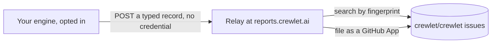

# Engine Issue Reports

A company can choose to tell the project when its engine detects a defect in itself. The engine then files an anonymous issue on [`crewlet/crewlet`](https://github.com/crewlet/crewlet/issues?q=label%3Aauto-report), and the same defect on any number of engines is one issue. It is **off by default**, and only an administrator can turn it on.

This is not telemetry. Nothing is sent about how the company uses the engine: no counts of turns or seats, no timings, no features. A report exists only because a defect crossed a threshold.



The engine holds no GitHub credential. A small relay holds one and files the issue, so nothing on GitHub connects a report to the company that sent it.

## Turning it on or off

**Settings › Diagnostics** has the switch, the exact JSON a report would send, and every report your company has sent. Or set it in the company document:

```yaml
diagnostics:
  issue_reports:
    enabled: true
```

Only an administrator can change it. A lead's write that touches it is refused like any other setting's, and the change is recorded as a revision like any other.

Off means off. Nothing is counted, kept or sent while it is off, and a revision that turns it off cancels a send already under way and forgets what was counted.

Each node keeps a copy of the setting it last applied in an `issue-reports` folder beside its database (the directory of `store.path`), readable by the engine's user alone. While that copy says on, the Go runtime also writes the output of a crash there, so the next start can report a crash that ended the process, an early-boot one included. On a release tag's build, a schema migration that stops the node starting leaves a short note there too: which file, after which, and the database driver's class of refusal. The first revision the next process applies decides what happens to either: on reads it once and deletes it, off deletes it unread. With the copy off, nothing is written there at all.

## Which builds report

Only a build whose code anybody can read sends anything, built from an unmodified tree:

- a release tag such as `v1.2.3`, from a release's binary or image;
- the image of `main`, `ghcr.io/crewlet/crewlet:main`, stamped `main-` and twelve hex digits of its commit;
- `go install`, whose module checksum says which code it is. It records no commit, so the relay resolves its version to one;
- a clean build of this repository's code, whose module pseudo-version, such as `v0.1.1-0.20261106203610-4fa80e3baf3d`, states the commit it recorded.

Any other build stays inert with the setting on, and Settings › Diagnostics says so and why:

- a development build, whose version is `dev` or `(devel)`, any version of no shape above, or one whose hash is not the commit it recorded;
- a build from a tree with uncommitted changes, whatever its version says;
- a build that recorded neither a commit nor a module checksum.

A development build's defect is often its developer's own unmerged change, and a public issue about code nobody else has helps nobody. The relay holds a report to the same rules, and to a commit that is in this repository's history.

## What is sent

A report is a typed record, and this is one in full:

```json
{
  "schema": 2,
  "class": "executor.context_exhausted_loop",
  "fingerprint": "8674191f61126015bcb551cc47a50c70b212966a4bf95390702c7123e5136840",
  "component": "internal/sandbox",
  "site": "internal/sandbox.collectedRecord",
  "engine": {"version": "v0.1.1-0.20261106203610-4fa80e3baf3d", "commit": "4fa80e3baf3d1586ff633771c1961385363c30d8", "go": "go1.27.2", "os": "darwin", "arch": "arm64"},
  "harness": {"name": "claude-code", "version": "2.1.310"},
  "topology": {"nodes": "1", "stream": "embedded", "coordination": "local", "sandbox": "direct"},
  "occurrence": {"count": 3, "first_seen": "2026-11-06T07:00:00Z", "last_seen": "2026-11-06T09:00:00Z"},
  "facts": {"context_window_tokens": 1000000, "session_continued": true, "session_size_bucket": "512KiB-1MiB"}
}
```

| Field | What it holds |
|---|---|
| `class`, `component`, `site` | Which defect, from a fixed catalogue, the engine function it was detected in, from the engine's public source, and that function's package. Each class names one fixed function, except a panic, which names the function that panicked, and a failure loop, which names the function its error left the engine's code through |
| `site_file` | Only where the `site` is not the class's own: the package and base name of the file that function is in, never a path as the build machine spelled it, so the relay can verify it |
| `fingerprint` | A digest of `class`, `component`, `site` and the class's identity values and nothing else, so one defect has one fingerprint on every engine and every version. A class's identity is a short list of its yes-or-no and closed-set values, never a number or a version, and each class has at most 16 combinations of them |
| `engine` | The build: its version, commit (absent on a `go install`, which records none), Go toolchain, operating system and architecture ([which builds report](#which-builds-report)) |
| `harness` | The coding CLI and its release, always for a class that involves one and never for another |
| `topology` | Roughly how many nodes (`1`, `2-3`, `4-8` or `9+`), and three closed choices: `stream`, `coordination` and where the executor `sandbox` runs |
| `occurrence` | How many times (capped at 10000), and the first and last time, rounded down to the hour |
| `facts` | Only the keys the class declares, each an integer, a boolean or a value from a closed set. A size is a bucket |
| `frames` | Only on a panic's report: up to five of the engine's own frames under the panic, the one that panicked first. Each is a function, its file as the package and base name in the public source, and a line, so a maintainer can open the line at the reported commit. Never part of the fingerprint, and never sent for a panic in code that reads input from outside your company before it is authenticated ([what is reported](#what-is-reported)) |

A panic's report adds those frames, and its two facts say what the engine was doing and what kind of panic it was:

```json
{
  "class": "engine.panicked",
  "component": "internal/tools",
  "site": "internal/tools.(*Surface).call.func1",
  "site_file": "internal/tools/surface.go",
  "frames": [
    {"function": "internal/tools.(*Surface).call.func1", "file": "internal/tools/surface.go", "line": 437},
    {"function": "internal/agent/toolloop.(*dispatcher).execute", "file": "internal/agent/toolloop/dispatcher.go", "line": 1141}
  ],
  "facts": {"scope": "tool_call", "panic_kind": "nil_dereference"}
}
```

## What is never sent

No free text your organisation produced leaves the engine: names, handles, item titles or keys, prompts, model or tool output, error messages, paths, hosts, addresses, or ids of your records (seats, turns, items, messages), or config values.

This does not depend on a filter finding those things. A report's type has no field that could hold one: every string in it is an enum, a version held to a strict pattern, or a function or file name from the engine's own source. A panic's value and the rest of its stack, and a failure's message, stay on your node's log: a panic's frames name only the engine's own functions, files and lines, never an argument, a variable or a path on your server. A crash's output is read on your node for the same few names and deleted there. A seat or conversation is told apart only in the memory of the node counting its failures, as a hash, and is forgotten with the process.

## What is reported

| Class | When it is a defect rather than noise |
|---|---|
| `executor.context_exhausted_loop` | One seat's executor runs in one conversation failed because their session no longer fits the model's context, 3 times in a row within 6 hours. The engine retires a session that runs out, so each of them should have run on another session. With `session_continued` false the brief or the window is the likelier cause; with it true a session that ran out was continued anyway, and each is its own issue, per coding CLI. Other seats in the same thread neither add to the count nor reset it. `context_window_tokens` is present only for Claude Code: the window the run was pinned to, from the model it ran |
| `executor.run_stranded` | An executor's run ended with no turn able to resume it, for a reason that is an invariant of the engine's own: its record held no parked state, its turn suspended with no conversation recorded, every attempt to resume a finished job failed for half an hour on an error the engine could not attribute elsewhere, or its parked turn was saved in a format an upgrade retired (`state_retired`). Each reason is its own issue. Every other way a run is lost is its environment's or a person's act, and a panic has its own class |
| `turn.failure_loop` | One seat's turns failed 5 times in a row within an hour at the same function, with an error the engine could not attribute to a provider, a credential, a budget, a box or its environment, and that was no panic, which is reported as `engine.panicked` and never counted here; or a message on a seat's inbox used up its whole delivery budget on such failures, which is reported at once with `message_lost` set. Each function is its own issue. The function is the one the failure left the engine's code through, recorded as the error passes it; where none recorded it, the report names the class's own site, which tells a maintainer where to record the next one |
| `queue.dead_lettered` | A message on a seat's inbox used up its whole delivery budget on hand-backs, the deliveries the engine returned to the queue rather than ran, while no node was draining and every node ran one build. `defer_cause` says why the last was handed back (`seat_moved`, `shedding`, `pause_unread`, `executor_holds`, `hold_refused`, `parked`, `answer_owed` or `draining`), and each cause is its own issue |
| `engine.panicked` | A panic was recovered anywhere the engine contains one, and `scope` says where: a turn, a tool call, a prefetched context block, a delegated worker, the learning pass, a seat's loop, a queue handler or listener, the coordination store, a push's hook, an exchange relayed from another node, or an API request. `panic_kind` says what it was, from a closed list (a nil dereference, an index or slice out of range, a nil map write, a failed type assertion, a division by zero, a closed channel, a panic raised on purpose, or another runtime error); the panic's value is never read. Each function that panics is its own issue. A panic in code that reads input from outside your company before it is authenticated (webhook receivers, sign-in, the credential, token and signature checks, a box's routes, and every route served without a credential) is sent with its function alone and no frames, so the report never shows how to reach it |
| `process.crashed` | The engine's process ended on a crash the Go runtime could not recover from, found by the node's next start ([turning it on or off](#turning-it-on-or-off)). `fatal_kind` says what it was: a panic nothing recovered (with its `panic_kind`), a map used by two goroutines at once, a lock or a wait group misused, a stack past its limit, a native library's fault, every goroutine asleep, or another fatal error; each is its own issue per function. It names the engine function on top of the crashing goroutine and up to five frames. A host that ran out of memory or threads is never reported, and nor is a process stopped from outside (a kill, a node drain, an unclean shutdown). A crash with any frame in code that reads input from outside your company before it is authenticated, or that runs a tool call on arguments a model chose, is never sent: it is kept in your company's record as `Kept private`, and Settings › Diagnostics offers to copy it into a [private report](https://github.com/crewlet/crewlet/security/advisories/new), since whoever can steer such a crash can stop every node |
| `store.migration_failed` | A numbered schema migration of a release tag's build failed on a node's database, and the node reported it on its next successful start. The site is the migration file, `from_migration` the last file the database had applied before it, and `sql_error_class` the database driver's class of refusal (`constraint`, `statement`, `misuse` or `other`); each file is its own issue. A busy, read-only, full or damaged file, and a start that was cancelled, are the host's and never reported, and neither is any build that is not a release, since upgrades between unreleased builds are not supported. The data that made it fail never leaves the node |

A failure the engine can attribute to something outside it is never reported: a spent plan, a refused credential, an unreachable sandbox host, and an outage of the engine's own environment, such as the coordination store not answering, no data node serving, a busy store, the event queue down, or a disk that is full, read-only or failing. Each of those is recorded under a kind of its own rather than `error` ([how a failed turn is classified](../concepts/turn-engine.md#engine-driven-failed-outcome)).

While one of the environment alarms `volume_low`, `wal_large`, `pool_starved`, `clock_skew`, `feed_stopped`, `floor_unknown`, `maintenance_open` or `apply_lag` stands anywhere in the fleet, `turn.failure_loop` and `queue.dead_lettered` count nothing, and a row of failures starts again once it clears: those alarms name a cause the failures share. A node that serves seats only reads the alarms the data nodes publish on their heartbeat. A node that cannot read them counts nothing either. A panic is always counted. Hand-backs are not counted either while a node drains or the fleet runs more than one build, as in a rolling upgrade, since both hand deliveries back on purpose; a node that does not say its build counts as another build.

Nor is a security defect: those go through [`SECURITY.md`](https://github.com/crewlet/crewlet/blob/main/SECURITY.md), privately, and are never in the catalogue.

The catalogue is one table in `internal/issuereport`, published as [`schema/issue-report-catalogue.json`](https://github.com/crewlet/crewlet/blob/main/schema/issue-report-catalogue.json). A reporting tag freezes the shape of each class it publishes, so a release keeps being understood after the code moves on: a later change to one is a new class or a new report schema, and the relay keeps every frozen catalogue. A new report schema also turns the classes it changes off until an administrator accepts it, in Settings › Diagnostics.

## How often

A fingerprint is sent at most once in seven days per company, however many nodes detect it: the record is shared across the fleet in the coordination store, and one node wins the right to send. The relay then finds the open issue by fingerprint and files nothing new, which the Reports list shows as `duplicate`. A report the relay never accepted is shown as `failed`, and may go again a day later.

Reporting never slows a turn and never fails the engine: the queue is bounded and a report past it is dropped until the defect next occurs. Sending retries a few times with jittered backoff and then stops, and a failure is logged with no report content.

## The relay

The relay is a small Cloudflare Worker the project runs at `reports.crewlet.ai`. Its address is a constant of the build, and the company document cannot change it. It:

- accepts only this schema: exact fields, closed sets, patterns, 8 KiB at most. It recomputes the fingerprint and refuses a class the catalogue does not name;
- does not log the client's address or the report, and keeps no storage of its own;
- files the issue through a GitHub App limited to issues on this one repository, under a global cap of 20 new issues a day.

Filed issues are public, and carry the fields above in a table and a line saying they were filed automatically with no organisation data.
