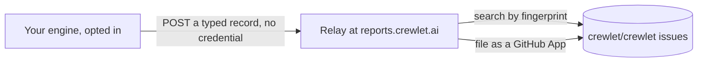

# Engine Issue Reports

A company can choose to tell the project when its engine detects a defect in itself. The engine then files an anonymous issue on [`crewlet/crewlet`](https://github.com/crewlet/crewlet/issues?q=label%3Aauto-report), and the same defect on any number of engines is one issue. It is **off by default**, and only an administrator can turn it on.

This is not telemetry. Nothing is sent about how the company uses the engine: no counts of turns or seats, no timings, no features. A report exists only because a defect crossed a threshold.



The engine holds no GitHub credential. A small relay holds one and files the issue, so nothing on GitHub connects a report to the company that sent it.

## Turning it on or off

**Settings › Diagnostics** has the switch, the exact JSON a report would send, and every report your company has sent. Or set it in the company document:

```yaml
diagnostics:
  issue_reports:
    enabled: true
```

Only an administrator can change it. A lead's write that touches it is refused like any other setting's, and the change is recorded as a revision like any other.

Off means off. Nothing is counted, kept or sent while it is off, and a revision that turns it off cancels a send already under way and forgets what was counted.

## Which builds report

Only a released or clean build sends anything: a release tag such as `v1.2.3`, or a clean module pseudo-version such as `v0.1.1-0.20261106203610-4fa80e3baf3d`, built from an unmodified tree, with its commit recorded. Any other build stays inert with the setting on, and Settings › Diagnostics says so and why:

- a development build, whose version is `dev` or `(devel)`, or any version that is neither of those two shapes. That includes the image of `main`, stamped `main-` and a commit;
- a build from a tree with uncommitted changes, whatever its version says;
- a build that recorded no commit, as `go install` does.

A development build's defect is often its developer's own unmerged change, and a public issue about code nobody else has helps nobody. The relay refuses those versions too.

## What is sent

A report is a typed record, and this is one in full:

```json
{
  "schema": 2,
  "class": "executor.context_exhausted_loop",
  "fingerprint": "e865a51da6c1494ca24e7c7d4922d5050583f27bf7d7682b1d60fd889887e7bb",
  "component": "internal/sandbox",
  "site": "internal/sandbox.collectedRecord",
  "engine": {"version": "v0.1.1-0.20261106203610-4fa80e3baf3d", "commit": "4fa80e3baf3d1586ff633771c1961385363c30d8", "go": "go1.27.2", "os": "darwin", "arch": "arm64"},
  "harness": {"name": "claude-code", "version": "2.1.310"},
  "topology": {"nodes": "1", "stream": "embedded", "coordination": "local", "sandbox": "direct"},
  "occurrence": {"count": 3, "first_seen": "2026-11-06T07:00:00Z", "last_seen": "2026-11-06T09:00:00Z"},
  "facts": {"context_window_tokens": 100000, "session_continued": true, "session_size_bucket": "512KiB-1MiB"}
}
```

| Field | What it holds |
|---|---|
| `class`, `component`, `site` | Which defect, from a fixed catalogue, the engine function it was detected in, from the engine's public source, and that function's package. Each class names one fixed function, except a panic, which names the function that panicked, and a failure loop, which names the function its error left the engine's code through |
| `site_file` | Only where the `site` is not the class's own: the package and base name of the file that function is in, never a path as the build machine spelled it, so the relay can verify it |
| `fingerprint` | A digest of `class`, `component` and `site` and nothing else, so one defect has one fingerprint on every engine and every version |
| `engine` | The build: its version, commit, Go toolchain, operating system and architecture ([which builds report](#which-builds-report)) |
| `harness` | The coding CLI and its release, always for a class that involves one and never for another |
| `topology` | Roughly how many nodes (`1`, `2-3`, `4-8` or `9+`), and three closed choices: `stream`, `coordination` and where the executor `sandbox` runs |
| `occurrence` | How many times (capped at 10000), and the first and last time, rounded down to the hour |
| `facts` | Only the keys the class declares, each an integer, a boolean or a value from a closed set. A size is a bucket |

## What is never sent

No free text your organisation produced leaves the engine: names, handles, item titles or keys, prompts, model or tool output, error messages, paths, hosts, addresses, or ids of your records (seats, turns, items, messages), or config values.

This does not depend on a filter finding those things. A report's type has no field that could hold one: every string in it is an enum, a version held to a strict pattern, or a function or file name from the engine's own source. A panic's message and stack, and a failure's message, stay on your node's log. A seat or conversation is told apart only in the memory of the node counting its failures, as a hash, and is forgotten with the process.

## What is reported

| Class | When it is a defect rather than noise |
|---|---|
| `executor.context_exhausted_loop` | One seat's executor runs in one conversation failed because their session no longer fits the model's context, 3 times in a row within 6 hours. The engine retires a session that runs out, so each of them ran on another session, and the brief or the window is the likelier cause. Other seats in the same thread neither add to the count nor reset it. `context_window_tokens` is present only for Claude Code, whose compaction point the engine sets |
| `turn.failure_loop` | One seat's turns failed 5 times in a row within an hour at the same function, with an error the engine could not attribute to a provider, a credential, a budget, a box or its environment; or a message on a seat's inbox used up its whole delivery budget on such failures, which is reported at once with `message_lost` set. Each function is its own issue. The function is the one the failure left the engine's code through, recorded as the error passes it; where none recorded it, the report names the class's own site, which tells a maintainer where to record the next one |
| `queue.dead_lettered` | A message on a seat's inbox used up its whole delivery budget on hand-backs, the deliveries the engine returned to the queue rather than ran |
| `turn.panicked` | A panic was recovered while handling a turn. Each function that panics is its own issue |

A failure the engine can attribute to something outside it is never reported: a spent plan, a refused credential, an unreachable sandbox host, and an outage of the engine's own environment, such as the coordination store not answering, no data node serving, a busy store, the event queue down, or a disk that is full, read-only or failing. Each of those is recorded under a kind of its own rather than `error` ([how a failed turn is classified](../concepts/turn-engine.md#engine-driven-failed-outcome)).

While one of the environment alarms `volume_low`, `wal_large`, `pool_starved`, `clock_skew`, `feed_stopped`, `floor_unknown`, `maintenance_open` or `apply_lag` stands anywhere in the fleet, `turn.failure_loop` and `queue.dead_lettered` count nothing, and a row of failures starts again once it clears: those alarms name a cause the failures share. A node that serves seats only reads the alarms the data nodes publish on their heartbeat. A node that cannot read them counts nothing either. A panic is always counted.

Nor is a security defect: those go through [`SECURITY.md`](https://github.com/crewlet/crewlet/blob/main/SECURITY.md), privately, and are never in the catalogue.

The catalogue is one table in `internal/issuereport`, published as [`schema/issue-report-catalogue.json`](https://github.com/crewlet/crewlet/blob/main/schema/issue-report-catalogue.json).

## How often

A fingerprint is sent at most once in seven days per company, however many nodes detect it: the record is shared across the fleet in the coordination store, and one node wins the right to send. The relay then finds the open issue by fingerprint and files nothing new, which the Reports list shows as `duplicate`. A report the relay never accepted is shown as `failed`, and may go again a day later.

Reporting never slows a turn and never fails the engine: the queue is bounded and a report past it is dropped until the defect next occurs. Sending retries a few times with jittered backoff and then stops, and a failure is logged with no report content.

## The relay

The relay is a small Cloudflare Worker the project runs at `reports.crewlet.ai`. Its address is a constant of the build, and the company document cannot change it. It:

- accepts only this schema: exact fields, closed sets, patterns, 8 KiB at most. It recomputes the fingerprint and refuses a class the catalogue does not name;
- does not log the client's address or the report, and keeps no storage of its own;
- files the issue through a GitHub App limited to issues on this one repository, under a global cap of 20 new issues a day.

Filed issues are public, and carry the fields above in a table and a line saying they were filed automatically with no organisation data.
