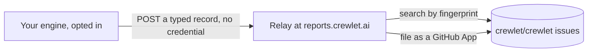

# Engine Issue Reports

A company can opt in to having its engine file an anonymous issue on [`crewlet/crewlet`](https://github.com/crewlet/crewlet/issues?q=label%3Aauto-report) when it detects a defect in itself. The same defect on any number of engines is one issue. It is **off by default**, and only an administrator can turn it on.

This is not telemetry. Nothing is sent about how the company uses the engine (no counts of turns or seats, timings or features). A report exists only because a defect crossed a threshold.



The engine holds no GitHub credential. A small relay holds one and files the issue, so nothing on GitHub links a report to its company.

## Turning it on or off

**Settings › Diagnostics** has the switch, the exact JSON a report would send, and every report your company has sent. Or set it in the company document:

```yaml
diagnostics:
  issue_reports:
    enabled: true
```

Only an administrator can change it. A lead's write that touches it is refused like any other setting's, and the change is a revision like any other.

Off means off. Nothing is counted, kept or sent, and a revision that turns it off cancels a send under way and forgets what was counted.

Each node keeps the setting it last applied in an `issue-reports` folder beside its database (the directory of `store.path`), readable by the engine's user alone. While it says on, the Go runtime also writes a crash's output there, so the next start can report a crash that ended the process, an early-boot one included. A release tag's build also leaves a note there when a schema migration stops the node starting: which file, after which, and the driver's class of refusal. The next process's first revision decides: on reads each once and deletes it, off deletes it unread. With it off, nothing is written.

## Which builds report

Only a build of readable code from an unmodified tree sends anything:

- a release tag such as `v1.2.3`, from a release's binary or image;
- the image of `main`, `ghcr.io/crewlet/crewlet:main`, stamped `main-` and twelve hex digits of its commit;
- `go install`, whose module checksum identifies the code. It records no commit, so the relay resolves its version to one;
- a clean build of this repository's code, whose module pseudo-version, such as `v0.1.1-0.20261106203610-4fa80e3baf3d`, states the commit it recorded.

Any other build stays inert with the setting on, and Settings › Diagnostics says so and why:

- a development build: version `dev` or `(devel)`, any version of no shape above, or a hash that is not the commit it recorded;
- a build from a tree with uncommitted changes, whatever its version says;
- a build that recorded neither a commit nor a module checksum.

A development build's defect is often its developer's own unmerged change. The relay holds a report to the same rules, and to a commit in this repository's history.

## What is sent

A report is a typed record. One in full:

```json
{
  "schema": 2,
  "class": "executor.context_exhausted_loop",
  "fingerprint": "8674191f61126015bcb551cc47a50c70b212966a4bf95390702c7123e5136840",
  "component": "internal/sandbox",
  "site": "internal/sandbox.collectedRecord",
  "engine": {"version": "v0.1.1-0.20261106203610-4fa80e3baf3d", "commit": "4fa80e3baf3d1586ff633771c1961385363c30d8", "go": "go1.27.2", "os": "darwin", "arch": "arm64"},
  "harness": {"name": "claude-code", "version": "2.1.310"},
  "topology": {"nodes": "1", "stream": "embedded", "coordination": "local", "sandbox": "direct"},
  "occurrence": {"count": 3, "first_seen": "2026-11-06T07:00:00Z", "last_seen": "2026-11-06T09:00:00Z"},
  "facts": {"context_window_tokens": 1000000, "session_continued": true, "session_size_bucket": "512KiB-1MiB"}
}
```

| Field | What it holds |
|---|---|
| `class`, `component`, `site` | The defect, from a fixed catalogue; the engine's package it was detected in; and the function, from the public source. Each class names one fixed function, except a panic (the function that panicked) and a failure loop (the function its error left the engine's code through) |
| `site_file` | Only where the `site` is not the class's own: the package and base name of the function's file, never the build machine's path, so the relay can verify it |
| `fingerprint` | A digest of `class`, `component`, `site` and the class's identity values only, so one defect has one fingerprint on every engine and version. Identity is a short list of yes-or-no and closed-set values, never a number or version, at most 16 combinations per class |
| `engine` | The build: version, commit (absent on a `go install`), Go toolchain, operating system and architecture ([which builds report](#which-builds-report)) |
| `harness` | The coding CLI and its release; present for a class that involves one, absent for any other |
| `topology` | Roughly how many nodes (`1`, `2-3`, `4-8` or `9+`), and three closed choices: `stream`, `coordination` and where the executor `sandbox` runs |
| `occurrence` | How many times (capped at 10000), and the first and last time, rounded down to the hour |
| `facts` | Only the keys the class declares, each an integer, a boolean or a closed-set value. A size is a bucket |
| `frames` | Only on a panic's report: up to five of the engine's own frames, the panicking one first. Each is a function, its file (package and base name in the public source) and a line, so a maintainer can open it at the reported commit. Not part of the fingerprint, and never sent for a panic in code that reads input from outside your company before authentication ([what is reported](#what-is-reported)) |

A panic's report adds those frames, and its two facts say what the engine was doing and what kind of panic it was:

```json
{
  "class": "engine.panicked",
  "component": "internal/tools",
  "site": "internal/tools.(*Surface).call.func1",
  "site_file": "internal/tools/surface.go",
  "frames": [
    {"function": "internal/tools.(*Surface).call.func1", "file": "internal/tools/surface.go", "line": 437},
    {"function": "internal/agent/toolloop.(*dispatcher).execute", "file": "internal/agent/toolloop/dispatcher.go", "line": 1141}
  ],
  "facts": {"scope": "tool_call", "panic_kind": "nil_dereference"}
}
```

## What is never sent

No free text your organisation produced leaves the engine: names, handles, item titles or keys, prompts, model or tool output, error messages, paths, hosts, addresses, ids of your records (seats, turns, items, messages), or config values.

No filter is relied on: a report's type has no field that could hold such text. Every string is an enum, a version held to a strict pattern, or a function or file name from the engine's own source. A panic's value, the rest of its stack and a failure's message stay in your node's log. A crash's output is read on your node for the same few names and deleted there. A seat or conversation is told apart only as a hash in the counting node's memory, forgotten with the process.

## What is reported

| Class | When it is a defect rather than noise |
|---|---|
| `executor.context_exhausted_loop` | One seat's executor runs in one conversation failed 3 times in a row within 6 hours because the session no longer fits the model's context. With `session_continued` false the brief or the window is the likelier cause; with it true, a session that ran out was continued anyway. Each is its own issue, per coding CLI. Other seats in the thread neither add nor reset. `context_window_tokens` is present only for Claude Code: the window the run was pinned to, from its model |
| `executor.run_stranded` | An executor's run ended with no turn able to resume it, for an engine-invariant reason: its record held no parked state; its turn suspended with no conversation recorded; every attempt to resume a finished job failed for half an hour on an error the engine could not attribute elsewhere; or its parked turn was saved in a format an upgrade retired (`state_retired`). Each reason is its own issue. Other lost runs are the environment's or a person's act; a panic has its own class |
| `turn.failure_loop` | One seat's turns failed 5 times in a row within an hour at the same function, with an error the engine could not attribute to a provider, credential, budget, box or environment, and that was no panic (reported as `engine.panicked`, never counted here); or a message on a seat's inbox used up its whole delivery budget on such failures, reported at once with `message_lost` set. Each function is its own issue. The function is the one the failure left the engine's code through, as recorded while the error passes; where none recorded it, the report names the class's own site |
| `queue.dead_lettered` | A message on a seat's inbox used up its whole delivery budget on hand-backs (deliveries returned to the queue rather than run), while no node was draining and every node ran one build. `defer_cause` says why the last was handed back (`seat_moved`, `shedding`, `pause_unread`, `executor_holds`, `hold_refused`, `parked`, `answer_owed` or `draining`); each cause is its own issue |
| `engine.panicked` | A panic was recovered where the engine contains one; `scope` says where: a turn, a tool call, a prefetched context block, a delegated worker, the learning pass, a seat's loop, a queue handler or listener, the coordination store, a push's hook, an exchange relayed from another node, an API request, a live socket's frame, a pass of a loop serving every socket (the health tick, the chat fan-out and read-state watch, an artifact room's decision), or the take of a run's session out of its box (`session_take`: the scrub of its archive, or the meter beside it). `panic_kind` is from a closed list (nil dereference, index or slice out of range, nil map write, failed type assertion, division by zero, closed channel, panic raised on purpose, or another runtime error); the panic's value is never read. Each function that panics is its own issue. A panic in code that reads input from outside your company before authentication (webhook receivers, sign-in, credential, token and signature checks, a box's routes, every route served without a credential) is sent with its function alone and no frames |
| `process.crashed` | The process ended on a crash the Go runtime could not recover from, found by the node's next start ([turning it on or off](#turning-it-on-or-off)). `fatal_kind` says what: a panic nothing recovered (with its `panic_kind`), a map used by two goroutines at once, a lock or wait group misused, a stack past its limit, a native library's fault, every goroutine asleep, or another fatal error; each is its own issue per function. It names the engine function on top of the crashing goroutine and up to five frames. Never reported: a host that ran out of memory or threads, or a process stopped from outside (a kill, a node drain, an unclean shutdown). A crash with any frame in code that reads input from outside your company before authentication, or that runs a tool call on arguments a model chose, is never sent: it is kept in your company's record as `Kept private`, and Settings › Diagnostics offers to copy it into a [private report](https://github.com/crewlet/crewlet/security/advisories/new), since whoever can steer such a crash can stop every node |
| `store.migration_failed` | A numbered schema migration of a release tag's build failed on a node's database, reported on the node's next successful start. The site is the migration file, `from_migration` the last file the database had applied, and `sql_error_class` the driver's class of refusal (`constraint`, `statement`, `misuse` or `other`); each file is its own issue. A busy, read-only, full or damaged file and a cancelled start are the host's and never reported, nor is any non-release build (upgrades between unreleased builds are unsupported). The data that made it fail never leaves the node |

A failure the engine can attribute to something outside it is never reported: a spent plan, a refused credential, an unreachable sandbox host, or an outage of the engine's environment (coordination store not answering, no data node serving, a busy store, the event queue down, a full, read-only or failing disk). Each is recorded under a kind of its own rather than `error` ([how a failed turn is classified](../concepts/turn-engine.md#engine-driven-failed-outcome)).

While one of the environment alarms `volume_low`, `wal_large`, `pool_starved`, `clock_skew`, `feed_stopped`, `floor_unknown`, `maintenance_open` or `apply_lag` stands anywhere in the fleet, `turn.failure_loop` and `queue.dead_lettered` count nothing, and a row of failures starts again once it clears, since those alarms name a cause the failures share. A node that serves seats only reads the alarms the data nodes publish on their heartbeat; one that cannot read them counts nothing. A panic is always counted. Hand-backs are also not counted while a node drains or the fleet runs more than one build (a rolling upgrade), since both hand deliveries back on purpose; a node that does not say its build counts as another build.

Security defects are not reported either: they go privately through [`SECURITY.md`](https://github.com/crewlet/crewlet/blob/main/SECURITY.md) and are never in the catalogue.

The catalogue is one table in `internal/issuereport`, published as [`schema/issue-report-catalogue.json`](https://github.com/crewlet/crewlet/blob/main/schema/issue-report-catalogue.json). A reporting tag freezes the shape of each class it publishes, so a release stays understood: a later change is a new class or a new report schema, and the relay keeps every frozen catalogue. A new report schema also turns the classes it changes off until an administrator accepts it in Settings › Diagnostics.

## How often

A fingerprint is sent at most once in seven days per company, however many nodes detect it: the record is shared in the coordination store and one node wins the right to send. The relay finds the open issue by fingerprint and files nothing new, which the Reports list shows as `duplicate`. A report the relay never accepted shows as `failed` and may go again a day later.

Reporting never slows a turn or fails the engine: the queue is bounded and a report past it is dropped until the defect next occurs. Sending retries a few times with jittered backoff, then stops; a failure is logged without report content.

## The relay

The relay is a small Cloudflare Worker the project runs at `reports.crewlet.ai`. Its address is a constant of the build; the company document cannot change it. It:

- accepts only this schema: exact fields, closed sets, patterns, 8 KiB at most. It recomputes the fingerprint and refuses a class the catalogue does not name;
- does not log the client's address or the report, and keeps no storage of its own;
- files the issue through a GitHub App limited to issues on this one repository, under a global cap of 20 new issues a day.

Filed issues are public, and carry the fields above in a table and a line saying they were filed automatically with no organisation data.
