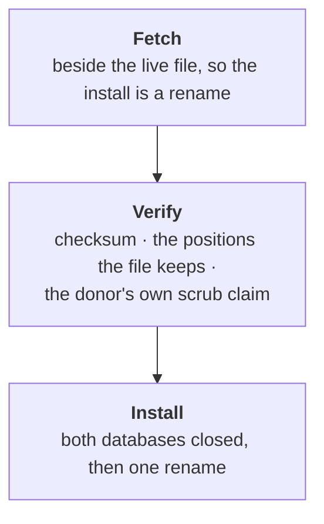

# Replication

Worklet and Doclet, Crewlet's identity directory, its artifacts, artifact
datastores, Ask Crewlet conversations, chat, the seats' executor sessions,
[Gitlet](../concepts/gitlet.md) and the seats' access history are **replicated
state machines**: twelve
domains on one framework, the embeddings and each data node's usage history
riding it as
[compacted domains](#two-compacted-domains-the-embeddings-and-each-data-nodes-day).
One ordered stream per domain is the write-ahead log; every data node applies it
into its own SQL database; the checkpoint commits in the same transaction as the
rows it covers, so a node's position and its rows can never disagree.

This page is for operators: what a write means, what an acknowledgement
promises, how far behind a node can be, and what the design does **not**
promise.

## Three numbers that are not the same number

| Number | Where it lives | What it is for |
|---|---|---|
| **the arbitration anchor** | `statelog_anchor` | The position of the last record this node consumed on a subject, *whatever that record then did*. The broker arbitrates a new write against it. Once the trim removes a subject's last record, a `trimmed` record every node applies removes the anchor too ([ADR-0080](https://github.com/crewlet/crewlet/blob/main/adr/0080-an-anchor-below-the-trim-floor-is-removed-by-a-record.md)); a write to that subject then asks the log what it holds and passes the same zero fence ([Anchors below the log are removed by a record](retention.md#anchors-below-the-log-are-removed-by-a-record)). |
| **`version`** | a column on every object row | The object's accepted state; what a caller's `if_match` compares against. |
| **the barrier comparison** | computed | `MAX(version, scoped_through)`, what a read barrier compares, because a record can change an object without being *about* it. |

The anchor and the version are equal only while every accepted record produces
rows; an apply **gate** is the rule that makes them differ. An evicted node's
append is accepted by the broker at sequence 102 and dropped by every applier:
the version stays 100 on every data node while the broker's last message on the
subject is 102. A writer that took its expectation from the version would be
refused, re-read 100, and burn its whole round budget, for at least the trim's
age floor and unbounded above while any retention term blocks.

**`scoped_through`** is the third. A record bumps `version` only on its **own**
subject; every other row it writes carries `scoped_through`. A barrier comparing
only `version` would let a read past a record that already changed the row about
to be returned.

## A write has three outcomes

`applied`, `pending`, `unknown`; a caller does something different with each.

- **`applied`**: the record is durable at its position **and** this node has
  applied it. Read it back and you will see it.
- **`pending`**: the record is durable and this node has not applied it yet.
  **The write succeeded.** Do not retry it; retrying publishes a second record.
  It is also the answer when:
  - the **caller** stops waiting (its deadline or a cancellation) after the
    broker acknowledged the record;
  - this node cannot finish reading what the record produced because its store
    was busy or closed while it adopted a snapshot. A durable write is never
    answered as a failure.

  `pending` promises every other node will apply the record. So a write the
  broker **collapsed onto another node's copy** of its operation (a retry that
  failed over, inside the log's two-minute duplicate window) is `pending` only
  where that copy's writer still stands at the copy: neither this node's rows nor
  the last record on the writer's eviction subject hold it there. A copy whose
  writer was evicted in flight applies on no node, and a copy whose writer's
  standing cannot be read cannot be vouched for; both are `unknown`, and the
  retry under the same operation id meets that writer's gate. A copy this node
  wrote itself on an earlier attempt counts as its own append.
- **`unknown`**: nothing can be established; the record may or may not be on the
  log. This is the only outcome a retry is correct for, and the retry carries
  the same operation id so the ledger collapses a duplicate. It is also the
  answer when:
  - the acknowledgement was lost and this node could not read the subject's
    newest record as its own before its wait ended (no position: that record may
    be another writer's);
  - the broker **says** the record may yet land: on a clustered stream, a second
    append under an operation id whose first record is proposed and not yet
    applied (`duplicate message id is in process`), or a leader whose store
    closed under a record raft had already committed (`store is closed`).
    Neither is a refusal; the retry under the same id is answered by the
    broker's duplicate acknowledgement once the record lands.

**A clustered leader has another answer to a conditional append that is not a
refusal:** `wrong last sequence` with no sequence in it. It means another write
to the same subject is still in flight at the leader, often this node's own
previous, already acknowledged write. It compared nothing and stored nothing, so
the append is asked again, a millisecond later, doubling to 64 ms, within the
append's own deadline, until the leader decides: the record lands, or `wrong last
sequence: N` says who wrote first. Read as the second answer, it would send a
write with a current expectation round the lost-race path and refuse it again
until the round budget reported a conflict nobody caused. One still in flight at
the append's deadline is treated as unanswered: the log is asked whether this
operation's record is on it, and finding none, the write decides again. The
coordination store's compare-and-sets follow the same rule; see
[Coordination § A compare-and-set waits for the leader to
decide](../concepts/coordination.md#a-compare-and-set-waits-for-the-leader-to-decide).

### Two pendings, and only one says something about the node

- **It waited and the record did not arrive.** This node is behind. The common
  case, and what the rest of this section is about.
- **Nothing waited.** A caller asked for the answer the broker's acknowledgement
  already establishes, because it has no use for the row.

A `pending` that waited reports `waited: true`; otherwise a deliberate skip
would read as a node falling behind under load.

**Exactly one write takes the second path**: a sign-in's session record. The
cookie minted from it carries the record's position, every node that serves the
API (a data node) validates a bearer against its own applier, and a node below
that position serves reads on the signature and the epoch alone, so nothing in
the answer reads the row. The wait would cost a quarter to half a second of
parked browser fetch against a 50 ms credential verify, on the request a person
judges the product by.

Nothing else may take it. A directory write answers `200` only once this node's
rows carry it, because the caller's next read goes to this node.

A lost acknowledgement is resolved from the log before it is called `unknown`:
the write reads the newest record on its subject, and a record carrying its own
operation id is its answer: `applied` where this node applied it and no gate
dropped it (even if this node's ledger lost the row), otherwise refused under
the gate that dropped it, the domain's own or one of the log's (a reanchor's
rule on the checkpoint: `abandoned`, `overtaken`). A gate that drops a record by
who wrote it (an eviction) is asked about the node the record names, not always
the one asking: an append collapsed onto another node's copy is answered by that
copy.

A gesture made of **several** records in order (a cross-project move, a merge of
duplicates, a dependency with its mirror, a subtree's removal or restore) treats
a step answered `unknown` as the end of the walk. Nothing after it is written: no
descendant follows a root whose own move or removal is unknown, a mid-move or
mid-merge mark is not taken down, and a dependency's mirror is not written over
an authored edge nobody can vouch for (a mirror with unknown outcome is reported
one-sided, which the tracker duty repairs). The gesture fails naming the
operation id; running it again under that id answers each landed step from the
ledger and finishes the rest. Steps are named by the task they write, not by
their place in the walk, because a re-run reads its list afresh (a restore's is
what is still in the trash).

"Under that id" depends on who asks:

- A **seat** derives its ids from its turn, the tool, the call's arguments and
  how many different calls to that tool it made first. It reruns a gesture by
  repeating the call with exactly the same arguments, before calling that tool
  with anything else, or the tool that undoes it (`leave_channel` for
  `join_channel`), which counts with it.
- The **operator's MCP** has no turn: every write's answer carries its `op_id`,
  and a call that brings it back is that operation again
  ([`/operator/mcp`](../reference/api-endpoints.md#operatormcp--your-own-assistant)).
  The id names the call's tool and a digest of its arguments; brought back with
  any other, it is refused before anything is written.
- The dashboard's
  [act route](../reference/api-endpoints.md#operatoract--the-dashboards-write-surface)
  and the `/worklet` and `/doclet/pages` routes take the key in an
  `Idempotency-Key` header (the act route refuses a write without one) and
  answer the `op_id` they wrote under. The purge and node-gate routes take theirs
  as `?op_id=`.
- A caller that sends neither starts a new operation, which finishes nothing: a
  repeated create files a second item. A create whose item landed and whose
  dependencies did not says so; finish the dependencies with `update_work_item`
  rather than filing again.

### What a retry is judged by: the instant its operation was minted

Every data node keeps an **operation ledger**: which operations its own applier
applied, and where. The ledger, not the broker, makes a retry safe; the broker
collapses a repeated id only inside its two-minute duplicate window, and a turn
re-run after a crash or a repeated `unknown` routinely comes later.

A retry of an operation the ledger records is **answered, not decided again**:
`applied`, at the position the first copy landed, however late. Deciding again
would run against rows that already hold it (a retried purge finds its task gone,
a version-conditioned update finds the version moved by its own first copy). A
retried create comes back as the task the first copy filed, under the key it
took: the new item's id is derived from the operation, so a re-run making the
**same** call files one item. Only a create that took its key number and never
filed its task is finished on a fresh number, leaving a gap in the numbering
(ENG-8 skipped) rather than two items sharing a key.

That holds only where a re-run's calls are the same calls. A turn's ids derive
from its unit of work, the tool, the verb, the object, the call's arguments and
how many different calls to that tool the run made before (see
[the turn engine](../concepts/turn-engine.md#a-turns-two-identities)), and a
re-run's model is sampled again: a differently worded title or comment is a
different operation, so the re-run files a second item or comment. The engine
cannot tell a reworded call from a new one.

When a write's acknowledgement was lost and the ledger answers, unless the broker
acknowledged this very attempt at the position the ledger names, the record there
may be an earlier copy's, decided on another node against other rows. The write
is answered as that copy and nothing the attempt computed is used; a key is read
from the item's row or minted again on a fresh number.

An operation id names **one** write, and a ledger row answers only for a write to
the object it landed on. The same id sent with a write to a different object is
refused **`op_reused`**, naming where it landed (whether the ledger finds it
first or the broker's duplicate window collapses the second append onto the
first record). A different write takes a fresh id.

The ledger **travels inside a snapshot**. A node that
[adopted one](retention.md) holds a row for every operation its donor applied and
answers retries as the donor would; an operation neither holds never applied, so
a turn woken by work queued before the join files its writes like any other.

The ledger can **lose rows**, and a watermark says how far back it may have. Each
data node deletes its rows thirty days after applying them and records how far
back each pass deleted. An operation minted before the watermark whose row is
gone is answered **`unknown`** before anything is published, so a retry a month
on is never applied twice. It is `unknown` rather than **refused** because a
retry's rows already hold what its first copy did, which is what makes a re-run
refuse (a move finds its task already in the target project, a create finds its
object); "no" would be the ledger's silence read as an answer. Only a refusal
about the node itself (it holds a record it cannot read, or the object is deleted
for good) stands either way. A **create** can say more, because its item's id
derives from the operation: where this node holds the item the first copy filed,
it answers with that item and its key; where it does not, `unknown` with no
number minted, since the first copy may be on the log beyond what this node
applied. A multi-record gesture meeting such a step stops and says so;
re-running it under the same id **on this node** stops at the same step every
time, because the row it needs is the one the loss took, and a node whose ledger
lost nothing that far back can finish it. Thirty days is sized for the slowest
real retrier, a scheduled seat carrying an operation id across a long weekend. A
later retry is told `unknown`; the operation's own record, if it landed, is on
the log. The watermark travels with the ledger, so an adopting node inherits its
donor's.

One ledger forgets one kind sooner. The identity estate keeps a **session's**
operations for an hour, not the month (a sign-in is answered inside its own
request and never asked again, a sign-out decides again rather than retrying, and
those rows are the busiest thing the domain writes), and that sweep records a
watermark for the session kind alone, beside the ledger's own. A retry is weighed
against the later of the two for its kind: a session operation minted over an
hour ago is `unknown`, while every other identity operation (an invitation's
redemption, a create retried under its key, a token's mint) is vouched for over
the whole thirty days.

The deciding instant is when the operation was **minted**, and it travels inside
the id: every id the engine mints is time-ordered, leading bits its mint time,
followed by a name saying what the operation is (`01a0…-7…-….update-<task>`). A
retry reuses the id, so the instant, including a turn re-run on another node
(its ids derive from the unit of work and the instant it began, not from the
run). The exception is a unit of work older than the ledger (a trigger
dispatched, or a turn resumed from its executor, more than twenty-nine days after
the work began): an id minted at that start no ledger can vouch for, so that
attempt mints at its own instant and records it in the coordination store, and a
later attempt at the same work inherits it while recent enough (see
[Turn Engine](../concepts/turn-engine.md#a-turns-two-identities)). An operation
id the engine did not mint carries no instant and is read as older than
everything the ledger ever lost: on a node whose ledger ever lost a row, a write
under it answers `unknown` unless that ledger holds its row. So the routes that
accept an id from outside, a purge's and a node gate's retry, refuse one the
engine did not mint.

The fleet's clocks must agree to within the margin the sweep leaves, its thirty
days, because the watermark may have been set by another node's clock (as the
trim's age term assumes). Keep them synchronised.

`pending` is what a busy fleet produces most under load: the applier is seconds
behind a burst and a small write's five-second wait (the applier's stall grace
divided by twelve) expires. The record is safe; a caller treating `pending` as a
failure would double every write it made during a burst.

### `applied` is not permanent

Two deliberate gates can drop a record **after** a node applied it:

- **The eviction gate.** A record written by a node the fleet evicted before the
  record's position is dropped everywhere; a node that applied it before learning
  of the eviction drops it on replay. Every record names its publishing node and
  the generation it was decided in; the write path refuses to append a record
  without them, because a record naming nobody is one this gate can never drop.
- **The deletion gate.** A record about a task a purge destroyed (a turn's record
  of what it spent on the task included), a purged page, or a repository whose
  purge has finished (the last step of a
  [repository purge](../concepts/gitlet.md#deletion-and-purge) leaves only its
  deletion marker) applies nowhere, for ever. This stops a redelivery months later
  resurrecting rows an operator removed.

The code log adds one rule of the same spirit that is not a gate: the
**activation fence**. Each configuration activation's reconcile of `code.repos`
publishes one fence record first, and a configuration record decided under an
older activation than the newest one the log has fenced applies as nothing,
identically on every node, so a node applying an older revision late cannot walk
a newer one's repositories back (see
[The reconcile and the activation fence](../concepts/gitlet.md#the-reconcile-and-the-activation-fence)).

### Every node that can write is one the trim waits for

No check decides whether a node may write, because every node that can is
already one the trim waits for. Only a data node runs the logs and writes to
them; a node without the `data` role holds no estate and reaches it through a
data node
([how a request reaches the estate](../concepts/scaling.md#how-a-request-reaches-the-estate)).
Every data node is in every log's
[counted set](retention.md#the-six-terms) by the position its heartbeat
publishes, from the first, written as its logs start; a running node whose
position has not landed is counted at position zero by its presence lease. So the
trim never removes a record a node that may still write has not applied, and the
one way out while running, an eviction, is the eviction gate's.

One interval is uncovered: a node's own boot, before its first position lands (a
few milliseconds, longer if that write is refused), when it holds no presence
lease and is counted only by the position an earlier run left, or not at all if
it never ran. A node fetching a snapshot then keeps the tail it needs with a pin
of its own. A write it makes there is still fenced by the floor it reads, so a
purge that passes it is refused rather than overwritten; what the interval gives
up is the counted set's cover for a floor read stale.

### Who a refusal names

A write refused `evicted` with a position (the record there is the operation's
own) is on the log and holds its operation id for the log's **duplicate window**
(two minutes for every shipped log): the same id sent again inside it by any node
collapses onto that record and is refused `evicted` again, because the record is
judged by the node that *wrote* it. So another data node takes the write under a
fresh id, or the same one once the window has passed; neither applies twice,
since the record in the way applies nowhere. An `evicted` refusal with no
position was made before anything was appended; another node takes the write
under the same id at once.

A refusal can name a position that is **not** the operation's own record: the
answer was lost, the subject's newest record is another operation's, and the gate
holds the asking node there (its eviction or the object's purge marker is below
that record). It says only where the gate was judged; the write's own append may
never have landed, and if it did it lies below that record and applies nowhere.
The refusal is about the asking node, so another node takes the write under the
same id. If the asking node's append did land, the broker collapses that copy
onto it inside the window and the refusal names the asking node as the copy's
writer, as below. That the append applies nowhere is read from the asking node's
operation ledger, so where the ledger cannot vouch for the operation (minted
before the point it may have lost rows to), the answer is an unvouched `unknown`,
not a refusal.

When the record in the way is **another node's** (the asking node's append was
collapsed onto that node's copy), the refusal names that node as the copy's
writer, because the reason is *its* standing. The asking node passed its own
checks, so it takes the write once the window has passed; a node gesture refused
this way says so in its `hint` and offers the same operation id again. That holds
for every gate that drops a record for what its writer was or did (`evicted`,
`abandoned`, `overtaken`) and no other: a copy dropped because its task or page
was purged is refused `deleted` and names no writer, because the purge refuses
the asking node's own write exactly as it did the copy.

### A record whose scope meets a deferred scope is deferred too

A record this build cannot decode is **retained**, not dropped: the bytes are the
only copy, and a rolling upgrade puts records on the wire the older half has
never heard of. The rule that keeps that safe:

> If a record's declared scope meets a deferred record's scope, it is deferred
> too.

So an object's rows on any node are always a **prefix** of its own record
sequence: record 5 never applies while record 3 has not. That lets a reader say
"this node is behind" rather than "this node has a hole in this object's
history".

## What an acknowledgement promises

`stream.sync` decides it, and the default is the strong value.

| Setting | An acknowledged write has reached |
|---|---|
| `always` (default) | the disk, on every replica that acknowledged. |
| a duration, e.g. `30s` | the replicas' memory, and their disks within that window. |

The five failure classes, and which the design survives at each topology:

| Failure | Single node | Clustered, one host | Clustered across hosts | External NATS |
|---|---|---|---|---|
| **F1** the process is killed | survived | survived | survived | survived |
| **F2** the host loses power | survived only with `sync: always` | survived for any one host | survived for any one host | whatever that cluster promises |
| **F3** the disk is lost | not survived | survived | survived | whatever that cluster promises |
| **F4** the filesystem corrupts | not survived | survived for any one host's disk | survived for any one host's disk | whatever that cluster promises |
| **F5** the site is lost | not survived | not survived | **only if the hosts are in different sites, which the engine does not know and does not claim** | ask your NATS operator |

On `stream.type: nats` the engine **refuses** `stream.sync` rather than warning:
it is a server option on a server the engine does not run, and a field naming a
mechanism it cannot reach would let an operator hold a durability belief nothing
delivers. Ask the NATS operator for `sync_interval: always`; `crewlet validate`
says it cannot check it.

A declined `stream.sync` is refused **on a leaf** (`stream.leaf.urls`) too: a
leaf's broker runs no JetStream and has no file store; the members it joins
decide what an acknowledged write has reached, in their own `stream.sync`. A
satellite's durability is the members' row of the table above.

## Above the floor and below it — two different regimes

This is the sentence the backup schedule hangs on.

**Above the trim floor**, the log holds every record on R replicas and every data
node holds the applied rows. Losing a node loses nothing.

**Below the trim floor the log may already hold nothing — the trim has licensed
deleting it — and each data node's replicated estate is the only copy of that
history** — one per data node, independent, none replicated. Losing history below
the floor takes every data node's disk, and it is covered **only** by the backup
gate.

That is why the trim refuses to advance past a floor no backup has reached. The
backup schedule is a **correctness input**, not hygiene. See
[Retention](retention.md).

## Adopting a peer's copy

A node below the floor has nothing left to replay. It asks the fleet for a
**snapshot** (one member's replicated database file) and installs it wholesale
before anything reads from it, at boot and also while running: a node that falls
below the floor pauses its appliers, joins the same way, and restarts them over
the installed file. The transfer is verified against a checksum and the positions
the file itself keeps, because a manifest claiming a position the file does not
hold describes a different artefact.

Every data node runs every state-log domain whatever its other roles, so a
donor's artefact covers everything the recipient applies and is installed whole:



An artefact that names **no** position for a domain the recipient runs (a donor
on an older build, mid-upgrade) is refused outright, from the manifest, before
anything is transferred; see
[Running a fleet](fleet.md#who-can-donate-to-whom).

## A node resumes from its rows, never from its reader

Each data node reads each log through a durable broker consumer of its own, named
after the node. Its position is a second, weaker number than the checkpoint: it
moves *after* the commit, and the broker keeps it when the node's database does
not. The node resumes from the checkpoint, but that can only drop what arrives
below it; nothing node-side can make the broker redeliver a record it was told
was applied.

So at every boot the node compares the two, and a consumer that disagrees with
the rows is deleted and created again at the checkpoint. Each rebuild is logged as
`jetstream_domain_consumer_rebuilt`, naming the `drift`:

| `drift` | What it means | What it would have cost |
|---|---|---|
| `acknowledged_past_checkpoint` (a `WARN`) | The broker was told records past the checkpoint were applied, so this node's replicated database is older than its reader (deleted, or restored from a backup). | The node never hydrates, and every write on the missing objects refuses `behind`. On the vector log, where nothing checks for gaps, the skipped records' rows are just missing. |
| `delivered_past_checkpoint` | Records past the checkpoint were handed to a process that has since stopped. | The node stays behind until the 30-second ack window returns them. |
| `in_flight_for_a_gone_reader` | Deliveries at or below the checkpoint are held for a process that has since stopped. | Each holds a slot of the in-flight ceiling for 30 seconds; when they fill it, nothing new arrives. |
| `behind_checkpoint` | The rows moved without the reader, as when adopting a snapshot at boot. | Every record in between is delivered only to be dropped. |

A clean restart logs none of these.

A node below the trim floor is not ahead of its rows either, although its reader
reports records past the checkpoint as read: the broker moves a reader over the
records the trim removed, to the first the log still holds. The node reads the
log's first sequence to tell the two apart. If it cannot, it judges the raw
positions and rebuilds, and the `acknowledged_past_checkpoint` warning then says
the first sequence was unreadable, so it may be either case.

A rebuild is a delete and a create on the broker; on a fleet whose broker is not
answering either can fail. Then:

- **`behind_checkpoint` and `in_flight_for_a_gone_reader`**: the node asks the
  broker which reader it now holds, keeps that one, and logs
  `jetstream_domain_consumer_rebuild_failed` as a `WARN`. Neither drift handed
  over a record past the checkpoint, so this costs what the table says and loses
  nothing. The next boot rebuilds it.
- **`acknowledged_past_checkpoint` and `delivered_past_checkpoint`**: the boot
  fails and names the domain. A node left on that reader could wait for ever.
- **Any drift where the broker holds no reader after the failure, or cannot say
  which it holds**: the boot fails too. A guessed reader might no longer exist,
  and every read through it would fail while the node reported itself up.

A rebuild touches only this node: no peer and no retention term reads its
consumer (the trim works from the positions each data node publishes from its own
rows). What it makes safe is **losing the replicated database while the broker
keeps its estate**: a node started on an empty `crewlet-replicated.db` replays
each log from the broker, or adopts a peer's snapshot where the trim already
removed the start of one, and no longer waits on records its old reader
acknowledged.

## Replication lag is two positions

Every data node publishes both:

- **`seq`**: the record it has *consumed*: its checkpoint, the contiguous prefix
  it has moved over.
- **`applied_through`**: the prefix it has actually *applied*, lower whenever a
  record was retained rather than applied.

Folded into one, a node applying nothing while its position advances would look
like one fully caught up.

Beside them rides **`stream_created_at`**, the creation instant of the stream the
node's rows are keyed to. A generation cannot say which stream a sequence is on (a
stream deleted and remade keeps the generation and counts from 1 again), so this
lets a [reanchor](retention.md#re-anchoring-a-recreated-or-restored-log) tell a
peer further along the lost stream from one on the new one. **`checkpoint_stored_at`**
names the record the checkpoint stands on, the broker's instant for it, which a
sequence alone cannot: after a broker restored from an older copy is written past
a node's rows, the log holds another record at the same sequence. It lets a
reanchor tell a peer whose history is the log's from one holding history the log
lost.

`crewlet
retention status` prints `seq` and `applied_through` per node and per
domain, beside the generation the position is in (`GEN`); a position from a
generation the log has left prints `left gen N` in place of a lag, since its
sequence compares with nothing the log holds. It marks a node that reported
`log_diverged`. The two instants are on the retention answer's JSON
(`stream_created_at`, `checkpoint_stored_at`), not in the table.

**Lag does not move a node's seats, at any size.** A node that is behind keeps
every seat it holds and claims no new ones until it is level. Six states take a
log's copy out of service (see [a copy
that is behind, and a copy that is wrong](../concepts/seat-ownership.md#a-copy-that-is-behind-and-a-copy-that-is-wrong)),
one log at a time, every log judged
([ADR-0079](https://github.com/crewlet/crewlet/blob/main/adr/0079-a-domains-fault-takes-only-its-own-copy-out-of-service.md));
none is a distance, and none moves a seat: that log's operations go to the other
data nodes, and the node's other logs keep answering from its own copies. What
lag does bound is how fresh an answer a read can ask for
([Read Consistency](consistency.md)).
### The burst degradation, priced

One applier per domain, one goroutine, one totally ordered log. The measured
drain is at least 2 000 rows/s and the steady-state load of the reference
company is 0.244 rows/s — 0.012 %. What binds is the burst, not the average.

That floor is deliberately conservative: every figure below derives from it. An
applier writes a record's child rows (tags, watchers, relations, dependency
mirrors, the inverted index's postings) as **multi-row inserts chunked to the
engine's probed bind-parameter limit**, at most 1 000 rows a statement. The
pinned driver accepts more parameters than the probe's own 32 766 ceiling, so
the 1 000-row cap binds: a seven-column and a three-column row both batch 1 000
to a statement, and an 8 000-row apply is 8 statements.
Unloaded, that shape drains about four times faster than one statement per row;
on a loaded CI runner under the race detector, about 1.5 times. The floor is the
loaded figure, so a fleet sized against it has margin. `make bench` re-measures
the unloaded side: on four vCPUs multi-row drained 52 000–63 000 rows/s and one
statement a row 16 000–17 400, and the applier itself about 5 900 single-row
records a second, each with its anchor, ledger row and checkpoint.

So **every 2 000 rows a burst's records write is about a second of applier
occupancy on every data node that applies them**. Two bursts are ordinary: a
cross-project move re-keys a subtree of up to 1 000 tasks one record at a time,
on every data node; a node back from hours away replays everything it missed,
on that node alone. While an applier is more than five seconds behind a burst,
two things degrade on its node without tripping any alarm:

- an unrelated single-object write's five-second wait expires and returns
  **`pending`** with its position and its lag — correct, and designed for;
- a barriered read answers `behind` with a computed `retry_after` of the
  seconds the backlog still holds.

Both are the system working. `crewlet retention status` publishes the longest
apply transaction and the longest batch actually observed.

**The occupancy is per domain, not per node.** Every domain's applier writes
the same replicated database, and a node hands its write lock to writers in the
order they asked. A burst is applied one transaction at a time (at most 4 000
rows, about two seconds), and a waiting writer takes the lock as soon as the one
ahead commits. So a burst in Worklet delays Doclet's apply by the transactions
already queued ahead of it, at most one per other writer on that node, never by
the whole burst.

A writer that does not reach the front within `store.busy_timeout_seconds`
fails retryably and rejoins the line, logged as `store_tx_retry` naming the
knob. One that still has not reached the front after a second wait gives up with
the store's busy mark; a tool or a person's surface answers `unavailable` with
a `Retry-After`, never a fault, and the same write made again lands.

**The default does not scale with the number of domains, on purpose.** Five
seconds is half the dashboard's 10 s query timeout; a busy wait *longer* than
the timeout above it turns lock contention into a request that fails with
nothing to show. What a waiter can legitimately queue behind is about one
bounded transaction (about two seconds) per other applier on the node, so with
every state-log domain applying and a burst in flight the legitimate wait is
already past five seconds. (The usage domain's transactions are a node-day's
handful of rows and weigh nothing outside a replay.) Chat's hourly prune is a
bulk one: a prune record removes up to an hour of one room's history in one
transaction, about 3 300 rows where the whole declared census talks in one room
and about 8 300 near the supported 50 000 messages a day — some four seconds
alone, so a queue four deep reaches the ten seconds two attempts of the default
allow. A company running chat near that rate should set
`store.busy_timeout_seconds: 7` before it sees the line: two attempts cover
fourteen seconds, leaving three under the dashboard's query timeout.

So `store_tx_retry` on a node applying a burst is a **signal to raise the knob,
not a fault**: the work lands one round later. Raise it toward, never past, the
query timeout, and before widening anything else: a longer per-waiter bound
lets one stuck holder block the line longer, and this way the line still drains
in order.

**No apply transaction is ever aborted by a commit elsewhere in the database,
and none is ever re-run because of one.** Every write transaction takes the lock
when it begins, not at its first write, so no commit can land between an
applier's read and its write. The `crewlet.statelog.apply.tx.aborts` counter in
[Metrics](../reference/metrics.md) therefore reads zero on a healthy node; a
non-zero count is the retry budget spent on something else.

## What a rolling upgrade blocks

A record at a version this build cannot decode is retained, and so is everything
whose scope meets it. That is bounded: the **deferral grace** is 30 minutes,
past which `deferred_old` fires, naming the log, the position of the oldest
record held and the record version it was written at against the one this build
reads. The node takes its copy of that log out of service at the same moment
(both are measured from the position heartbeat's first sighting of the record).
Every log's copy is judged on its own
([ADR-0079](../../adr/0079-a-domains-fault-takes-only-its-own-copy-out-of-service.md)):
only that log's copy goes; what the estate routes to it is answered by the other
data nodes, the node's copies of every other log keep serving, and its seats
stay. The identity log is the one whose requests are not all routed: what this
node answers from its own identity rows (the sign-ins, sessions and tokens of
anybody the held record may be about, and every directory decision) answers 503
from the moment the record is held, not only past the grace, until this node can
read it. It is **one alarm** however many logs hold such a record, listing each
in its `domains` with that log's own record and how long its own grace has run.
Log lines are written per log, so a second log's record passing the grace, and
the first log's clearing while the second's stands, are each said.

So a rolling upgrade should finish inside that window. One that stalls
half-done leaves old nodes holding records they cannot apply and refusing reads
about the objects those records touched, and writes to them, with `deferred`
naming what to do: finish the upgrade. What a record touched includes where it
sits: a knowledge space's settings record covers every page in that space, a
page purge covers the whole space it re-files the page's children in, and a task
purge covers every task it rewrites (its dependents, the blockers it waits on,
the tasks related to it or referencing it, and its subtree), each by name, or by
its project once there are too many to name. It covers every **key** the task
held, current and former, too, because the purge hands each one on to another
task holding it, and which task depends on the order the key's claims were
applied in. So every record that can change who holds a key names that key: a
task's create, a move that re-keys it, and its purge. A node holding back a
newer peer's create of a task under a key therefore holds back a later create of
the same key and the purge of its claimant, and hands the key to the same task
as every other node.

**A record is written at the lowest version that can apply it whole**, never at
the newest the build knows, so what an older node holds back is exactly the
objects whose shape changed ([the next section](#which-records-an-upgrade-holds-back)
lists them). Every barrier and every generation record stays at version 1 for
good: an older node retaining those would hold a deferral for every
linearizable read, or never make the transition a reanchor announced. So does
every record that installs a gate, for a harder reason: a node that deferred an
eviction would go on applying everything the evicted node appends, so a gate
record no build can decode stops that build's applier instead, and its shape
may only ever grow by addition.

**The upgraded node applies what it retained at its next boot**, before its
applier consumes anything new: every retained record it can now read, in log
order, each released in the transaction that applied it. A record whose scope
met a retained one is applied after it, so the objects' rows are a prefix of
their history again, not a hole. A record still above the new build's version
stays retained, with everything it covers, until a build that reads it boots.

**The object store's collection waits too.** A collection deletes nothing while
a data node it counts runs a state log its own build does not register, or
while its own copy of the estate carries a newer build's migrations after a
rollback: that log's rows or those tables may name files its build's
declarations do not ([What a build cannot
see](../concepts/object-store.md#what-a-build-cannot-see)). A rollout finishing
within the day's grace costs nothing, and a node rolled back past a log keeps
every file until a build that knows the log runs on it again.

### Which records an upgrade holds back

Only the ones that need the newer build. A record is stamped with the
**lowest** version that can read it: 1 when it carries nothing a later build
added, otherwise the version of the newest field it carries. During a rolling
upgrade an old node applies everything the new nodes write except records that
use something new, and retains those whole rather than apply them with the new
part dropped, which would leave its copy of that object different from its
peers' for good. An upgrade that adds no record field holds nothing back. The
wake such a record sends is held back the same way: an old node's wake feed
hands the record to a node on the newer build rather than acknowledge it for
the fleet, and a roll that outlasts the hour has it kept as a dead letter until
a node that reads it starts
([Dead letters](../concepts/event-system.md#dead-letters)).

**Every strict domain states that as a table**, and the table is the rule rather than a description of
it. Each field a record has gained since the base format is one row of the
domain's `RecordFields`: the version it arrived at, the operation it rides (or
every one) and its path from the record's root. A writer stamps the highest
version among the rows its record carries (present with any value but null),
and a build reads exactly up to its table's highest row, so it never accepts a
version no field introduced and then drops the field it was minted for. A
version, once a build has read it, means one thing for ever: a version whose
field is gone is **retired** and stays empty rather than going to the next
field. The conformance suite every domain passes holds each table to the
records its encoder actually writes.

A domain's table starts **empty**, version 1 being everything its first build
writes, and gains a row per field its records gain, so a table holds that
domain's history. The code log's rows show what each costs a roll. An older
data node retains each record carrying the field, and every later record whose
scope meets one (the same repository's or change's), until upgraded:

- Version 2: whom an agent's write was made for
  ([ADR-0109](../../adr/0109-a-turn-somebody-woke-is-held-to-the-apps-they-use.md)).
  Only an agent's write made in a turn somebody woke carries it. The older node
  applies the rest, stamped 1 still: a person's push, a change's mergeability
  and a seat's own work, wherever no such record came before them.
- Version 3: when a revision's facts were measured and the globs each matched
  path owner and each ask of one is for. It rides every revision's facts a home
  of that build records, so an older data node retains each of them, and every
  later record of its repository, within minutes of the first such home's pass.
  A roll that upgrades every data node before any Gitlet node holds none back;
  any other roll, a fleet whose nodes hold the data themselves among them,
  finishes inside the deferral grace, past which each older data node takes its
  copy of the code log out of service until upgraded
  ([What a rolling upgrade blocks](#what-a-rolling-upgrade-blocks)).
- Version 5: how many commits a push a rule refused offered. Rides only such a
  push that offered commits.
- Version 6: a check's test counts and its output's lines. Rides most check
  endings.
- Version 7: the train a failed check's ejection names. Rides only those
  ejections.
- Version 8: whether the target's gate requires a check a person's CI reports,
  and an ejection naming a required check the train's base defines in no form
  that runs. Rides only those reports and ejections.
- Version 9: the change a revert's push opens naming the change it reverts.
  Rides only those pushes.
- Version 10: a comment's edit or delete. Rides only those records.

For versions 6 to 10 a roll that upgrades the data nodes first holds back none.
A release that adds a field to a record gives it the next version of its
domain's table. A gate record is the exception: an older node stops on it
rather than retains it, so a row adding a field to one is marked as a gate's
and its writer waits for the fleet's census of the versions its nodes read
before publishing it.

### Values the engine computes are recomputed once

Some columns are computed from rows a node already holds, not copied from any
record, and the apply maintains each as it goes:

- tracker: how often a task was reopened (`reopens`), how much of a project's
  open work has been started (`task_counts.active`), the hand-off count on each
  history row, and when a task last changed (`updated_at`);
- identity estate: the seat an invitation holds (`iam_invites.seat_id`, read
  out of the invitation's own document so a seat hold is one indexed lookup);
- Gitlet: each repository's changes by state and their tallies by owner and
  visibility, the repositories tallied by owner, visibility, kind and status,
  and each repository's pushes by day and quarter-hour and by pusher and day.

When the rules that compute them differ from those a node's rows were derived
under (a build that adds such a column or changes how one is computed, a node
that just adopted a snapshot from a peer on a different build, or a checkpoint
a reanchor created), the node's next boot recomputes them from its rows, in the
same transaction that records which rules the rows now follow, before it
applies anything new. It happens once per change, on every data node; the
`statelog_rederived` log line names the domain, the rule versions it moved
between and how many rows it wrote.

## Two compacted domains: the embeddings and each data node's day

Two domains keep no history. Their streams keep **one message per subject** (a
keyed table, not a log), so a node that joins replays the current value of each
object and nothing before it, a gap is a coverage number rather than a fault,
and neither gates a node's seats or claims that two nodes hold identical rows.
Each copy is still judged: one that is wrong rather than behind (its applier
stopped, its rows below its log) goes out of service on its own, with nothing
else on the node. The spend and activity screens a wrong usage copy would have
drawn are answered from a peer's, and a search ranks without the vectors a wrong
vectors copy holds, saying so. A peer's answer to a long window arrives in pages
of about 2 MiB, each cut only between two records, so a screen over ninety days
is never one message; a node whose own usage copy serves reads the window whole,
in one transaction. Either way each statement reads one company day (or, for a
page's readers, one page), so a page costs its own rows and not the window's.

| Domain | Stream | One subject per | Written by | Kept for |
|---|---|---|---|---|
| **vectors** | `CREWLET_TRACKER_VECTORS` | embedded source | the fleet's one embedding duty | 90 days per message; the rows until the source is forgotten |
| **usage** | `CREWLET_USAGE_LOG` | (node, company day, seat, schedule or person) | **every data node, for its own days only** | 181 days |

**`usage` is what makes history fleet-wide.** Each data node derives its own
day from its own event log every 15 seconds while the day moves, and publishes
each object's whole cumulative value. A day holds:

- the spend by phase, worker, model and provider slot;
- the turns that ended and how (failed, reviewed, first pass, sent back, a
  duration histogram);
- the calls its seats' turns made to each MCP server's tool and how they ended;
- the pages its seats read;
- the schedules it fired, and the fires its seats did not run because a later
  fire of the schedule ran in their place.

A node without `data` keeps no event log of its own: what its seats did is
handed to the data node that keeps its events, and counted in that node's day.
Every data node applies every data node's days, so any data node answers for the
fleet, a node that leaves takes nothing with it (its days stay in every peer's
rows) and a node that joins later replays them from the stream. Because the node
is part of the subject, no two nodes ever write one object and nothing is
arbitrated; an apply replaces the object's rows.

A day is cut on the company's clock (`timezone`). A node re-derives today and
yesterday every tick, so the turn that ended a second before midnight reaches
the fleet. What it has not yet published whole (the day before the newest it
fingerprinted, or an older day a tick could not settle) it keeps as a watermark
in its own store (`usage_watermark`), and every start re-derives each day from
that one. So the tail of the day a node stopped in, written after its last tick,
reaches the fleet when it comes back, if that day began less than the event
log's 30-day read floor before the node derives it again (a day that began more
than 30 days back keeps the value it was last published at, even when the node
was down for less than 30 days); a day more than 7 days back, the dispatch
ledger's retention, is derived without its schedules, which the ledger may
already have swept. An orderly stop also flushes today and yesterday once more
on its way out, after every writer of a usage row on the node has stopped, so a
node stopped in an orderly way and never started again leaves its last day
whole. A node that crashes and never comes back loses up to one 15-second tick.

A node's day counts the rows it **keeps**. A [custody](deployment.md#custody-the-rows-of-a-node-without-data)
batch a data node has written but not yet settled may be another data node's to
keep, so no day counts it until it settles; counted on both, every reader summing
the fleet would bill a stateless node's spend twice. Every count of a day is
read off rows inside it:

- a turn's reviews, send-backs and duration, and its place in the seat's turn
  ledger (what woke it, whether it moved work, only wrote words or did nothing,
  and what it spent: `usage_turn_ledger`; an executor turn's are settled when
  its run is collected, the run's own writes and model tokens included);
- its refused calls by class (`usage_tool_refusals`).

Both come off the one record that ends the turn, which states the whole turn
however its other records were spread over the data nodes (a turn whose end
states no tally, one a build before that record ended or one resumed from a park
such a build made, is read off its records, as that build read it). So once a
batch settles as kept its rows count on the days they fall on and on no other,
which can be days back after a long partition. The settle records the oldest of
them (the node's own `usage_rederive` rows) and the next tick derives every day
from it again, never a day older than the event log's 30-day read floor: its
rows may already be swept, and a short derivation would replace the whole day on
every data node with less, so such a day keeps the value it was last published at
and the node logs `usage_rederive_past_floor` once.

A day derived again is cut on the instants it was first cut on (the node's
`usage_day_windows`), so moving the company's `timezone` never moves rows
between days already published: the day the clock moves on is longer or shorter
instead. For the hours between the old clock's midnight and the new one's, a
node's usage day label is not the company's local date:

- Moved west, those hours belong to the first day cut on the new clock, which
  starts where the old clock's last day ended, so the label runs one ahead. A
  move of more than a day makes it two ahead for its first hours, and makes that
  first day more than two days long.
- Moved east, those hours stay on the old clock's last day, so the label runs
  one behind. A move of more than a day leaves the date in between with no
  instants at all: the node publishes no record for it, and the label runs two
  behind until the old clock's day ends.

A chart that buckets by label shows the node's spend for those hours on the
neighbouring date.

And no day, today and yesterday included, is ever published **below** what the
fleet already holds of it. Inside the read floor a day only grows, so a
derivation smaller in any figure (fewer turns, failed turns, reviews,
send-backs or long turns, fewer tokens, calls, page reads or fires) means the
node's own event log lost rows that record counted: a store
[restored](backup.md) beside a usage log copied later, one started empty, or a
turn whose end states no tally and whose earliest records the event log's sweep
removed (a parked turn's records reach back to wherever it started). So what a
node publishes is its derivation **joined** with the fleet's record: every
figure at the larger of the two. On an ordinary day that is the derivation
itself; after a loss the figures the fleet held more of stay at the fleet's
while every other keeps moving, and the node logs `usage_rederive_short` once.
A seat's handle and role are the derivation's wherever it states them and the
fleet's where it does not, so a seat since removed from the org chart keeps its
name in the history even where this node's rows of the day (spend alone, which
carries no handle) name nobody. A handle never changes, so the fleet's is never
another seat's, and a label carried this way is not a short derivation.
A join cannot recover what was lost: a figure the fleet held more of counts the
node's new rows only once its own count passes the fleet's. The node derives no
day until its usage applier has replayed the log to its end, so the rows it
joins with are the fleet's and not a restore's.

And every day again after a **reanchor** of the usage log on any data node. A
restored log is followed from its end, so the node that re-anchored never
applies what was published after the restore and before its reanchor; a node
sends a day only when it moves, so a day published in that tail would stay at
its pre-restore value there. So when any data node's generation of the usage
log rises in the positions register past the generations a node last answered,
that node publishes every day its event log still holds again, under operation
ids no copy from before the rise carries (the broker's duplicate window would
otherwise collapse them onto the copy that was skipped), and logs
`usage_republish_started`, then `usage_republish_settled`; see [Retention §
Re-anchoring](retention.md#re-anchoring-a-recreated-or-restored-log).

History older than 181 days leaves in the same transaction that applies the day
that makes it old, on every data node alike; there is no sweep.
The decision is [ADR-0020](https://github.com/crewlet/crewlet/blob/main/adr/0020-a-nodes-own-day-is-a-compacted-domain.md).

## The six capacity ceilings

1. **The broker's storage limit** — `stream.store_max_bytes`. Every ceiling
   below is a *reservation* checked against this number. Unset, the embedded
   broker takes three quarters of the free space on `stream.store_dir` when its
   JetStream comes up, measured once. **Divide it when more than one engine
   shares a filesystem**: free space bounds their sum, not each of them.
2. **Each log's byte ceiling**: `stream.tracker_log_max_bytes`,
   `stream.tracker_vectors_max_bytes`, `stream.pages_log_max_bytes`,
   `stream.code_log_max_bytes`, `stream.artifacts_log_max_bytes`,
   `stream.artifact_data_log_max_bytes`, `stream.iam_log_max_bytes`,
   `stream.usage_log_max_bytes`, `stream.assistant_log_max_bytes`,
   `stream.chat_log_max_bytes`, `stream.executor_log_max_bytes`,
   `stream.access_log_max_bytes`, `stream.atlas_log_max_bytes` and
   `stream.advisor_log_max_bytes`, sized together as
   [below](#how-the-byte-ceilings-are-sized). The identity, usage, Ask
   Crewlet, executor, access, atlas and advisor logs' are **not derived from
   the disk**, since a volume has no opinion on what drives them (sign-ins,
   node-days held, how many people ask, the turns the seats run, what seats are
   told and the SSH they use, what people record about what the company runs
   on, what the Advisor records); each takes a flat default and its own floor.
   A full log **refuses** appends rather than shedding old records; see
   [Retention](retention.md). On every log that claims identity (the
   tracker's, the knowledge base's, Gitlet's, the identity estate's, the
   artifacts log's, the artifact datastore's, Ask Crewlet's, chat's and the
   executor log's), ordinary writes are refused short of it, the top being
   [kept for gate records](retention.md#the-gate-reserve) so that an eviction
   can still unpin a full log.
3. **The trim floor** — how far back the log can be replayed from, which bounds
   how long a node may be away.
4. **The store's own size** — every data node is a full replica, so the corpus
   is held once per data node.
5. **Applier occupancy** — the 16 seconds above.
6. **The snapshot repository** — one artefact per node, sized in
   [Retention](retention.md). An artefact's manifest names a position per
   domain, and a joiner refuses one that names no position for a domain **it
   runs**, because a checkpoint for a domain the file has no rows for is worse
   than no artefact at all. That is why adding a domain is a coordinated
   upgrade (see [Running a fleet](fleet.md#draining-and-rolling-upgrades), and
   [above](#adopting-a-peers-copy) for the other direction).

### How the byte ceilings are sized

A byte ceiling is a **reservation**. The broker grants it in full when it
creates the stream, before a single record is written, and refuses to create a
stream whose ceiling it could not honour. So the state logs compete for one
number, and a node sizes them together, once, when it creates their streams:
**all fourteen** this build registers (the tracker's, the vectors', the
knowledge base's, the identity estate's, the usage log, the artifacts log, the
artifact datastore's log, Ask Crewlet's log, chat's, the executor log, Gitlet's,
the access log, the atlas log and the advisor log). Every data node runs every
one whatever its other roles, and a stream keeps the ceiling of the node that
created it, so whichever node creates them first sets the ceilings the fleet
keeps:

| Step | What happens |
|---|---|
| **What the broker can grant** | Read from the broker itself. An embedded broker's limit is `stream.store_max_bytes` where set, otherwise three quarters of the free space on the volume holding `stream.store_dir`, counting what its own streams already hold there; an external one's is the NATS account's JetStream limit. What counts against it is the ceilings already granted, not the bytes stored. |
| **The logs' share** | Five eighths of that, with the ceilings the logs' own streams already hold counted as theirs, so a restart divides the same share the first boot did. Where the broker states no limit, three quarters of the stream volume's free space stands in for it (the cap a NATS server running its defaults gives itself, which the engine cannot read; the whole free space overstated it by a third). The share is then five eighths of that stand-in less what the broker has already reserved for other streams (the `nats` object bucket's reservation, say), and nothing is added for the logs: a reservation never spends free space, so that figure already contains what the logs hold. Where the broker's budget cannot be read at all, the share is five eighths of the same three quarters. The other three eighths are for everything that reserves nothing: every mailbox, every coordination bucket and the snapshot a joining node reads. Five eighths because a re-embedding of the reference company's fifth-year corpus has to fit the vector changelog beside the other eleven logs' asks on a 64 GiB volume with nothing else reserved, which half did not once the code log was registered; and no more than two thirds, which would leave the mailboxes and coordination less than the `nats` bucket's quarter. |
| **Each log's ask** | Its Tier A field when you set one. Unset: the mutation log asks for a quarter of the stream volume's free space (4..64 GiB). The knowledge base's log asks for a quarter of the mutation log's ceiling (the one you set, or the one it derived) because both hold a trailing window of records and the knowledge base's grows at about a quarter of the
rate (1..16 GiB from a volume alone); the artifacts log (`stream.artifacts_log_max_bytes`, 1..256 GiB) for the same quarter, for the same reason: a publish is a human-scale event whose records are a version's manifest, not its bytes, which the object store keeps; the artifact datastore's
log (`stream.artifact_data_log_max_bytes`, 1..512 GiB) for the same quarter (1..16 GiB from a volume alone), the largest share the pool can give it beside a vector changelog that holds a model change, although its records carry the rows themselves, every cell an artifact page or a seat writes, and a busy sheet writes at the tracker's rate or above it: a company whose pages write heavily sets the field, which accepts twice the artifacts log's bound for that reason; the vector changelog for the same quarter of the volume the mutation log derives, whatever the mutation log is set to, because its peak is the whole corpus rather than a window of it; the code
log (`stream.code_log_max_bytes`) for two thirds of the mutation log's ceiling, set or derived (2⅔..42⅔ GiB from a volume alone), because it too holds a trailing window of records, at a share weighed against what it costs the other logs, since every node reserves it whether or not the company hosts code — and that is below what a company whose seats work through changes writes to it: a company's push records (1 667 bytes a seat's push from its coding box, measured), the records that compact their packs and sweep what each compaction retired (152 bytes a push, measured) and publish their layers, the barriers its git clients' reads append (176 bytes a read) and the records of its changes (each change's open, reviews, comments and merge, every revision's facts and mergeability its home records, and its queue's and its checks' records where they run, all measured
— take nearly twice to about eight times what its tracker writes and its seats' reads take a day, so a company whose seats open changes sizes the code log for them in two steps, which [What the code log's reservation costs](#what-the-code-logs-reservation-costs) gives — a push record never carries its pack, so how large the repositories grow is the object store's to hold, not this
log's; the chat log for 8 GiB (`stream.chat_log_max_bytes`, 1..256 GiB), the excursion a completely blocked trim may spend, rather than a ratio to the mutation log's, because chat grows faster than the tracker and following it would make chat the largest ask here; it is capped at a sixteenth of the free space, so the whole of it is asked from 128 GiB free; flat asks: the identity estate's log 512 MiB (`stream.iam_log_max_bytes`, 64 MiB..16 GiB); Ask Crewlet's log 512 MiB (`stream.assistant_log_max_bytes`, 64 MiB..64 GiB); the executor log 512 MiB (`stream.executor_log_max_bytes`, 64 MiB..64 GiB); the access log 128 MiB (`stream.access_log_max_bytes`, 64 MiB..64 GiB); the atlas log 128 MiB (`stream.atlas_log_max_bytes`, 64 MiB..64 GiB); the advisor log 64 MiB, its floor (`stream.advisor_log_max_bytes`, 64 MiB..64 GiB); the usage log 1 GiB (`stream.usage_log_max_bytes`, 64 MiB..64 GiB). Ask Crewlet's, executor, access and atlas logs give way down to the 64 MiB floor where the broker is short. None of these seven grows with anything the volume has a say in (the usage log is a count of node-days, which more disk does not grow). The code log asks whether or not the company hosts any code, and below about 653 GiB free its ask is room the others give up in the fit below (the figures are under [What the code log's reservation costs](#what-the-code-logs-reservation-costs)); a company that hosts no code and is short of broker room sets `stream.code_log_max_bytes: 1073741824`, its floor, **before the first boot**. |
| **The fit** | A log whose stream already exists takes the ceiling it **holds** off the logs' share first, whatever its field says now. A ceiling you set for a log being created comes off next, and is never scaled. The unset ones being created share what is left in proportion to what each asked for; none goes below 1 GiB but Ask Crewlet's, the executor log's, the access log's, the atlas log's and the advisor log's, which give way down to their fields' 64 MiB floor, and none is created above what it would get if no log existed yet, the figure every later boot reports its stream against. The 1 GiB is a floor on scaling DOWN, never a raise: any other unset ask already below it, the identity log's, is held at exactly what it asked for, whatever the pool. |

#### What the code log's reservation costs

The code log asks on every node that runs a state log, whether or not the
company hosts any code, and on a first boot with less than about 653 GiB free
the fourteen asks are more than the logs' share of it — five eighths of what an
embedded broker can grant once the object store's `nats` bucket has
taken its quarter of the broker's limit, about 35 % of the free space —
so its share
comes out of the others'. The ceilings a first boot creates with every field unset,
without the code log and with it:

| Free on the stream volume | Mutation log and vector changelog, each | Knowledge base's log, artifacts log and artifact datastore's log, each | Code log |
|---|---|---|---|
| 50 GiB | 5.2 → 4.2 GiB | 1.3 → 1.1 GiB | 2.8 GiB |
| 100 GiB | 11.0 → 9.0 GiB | 2.8 → 2.3 GiB | 6.0 GiB |
| 256 GiB | 30.6 → 24.8 GiB | 7.6 → 6.2 GiB | 16.6 GiB |
| 400 GiB | 48.0 → 39.0 GiB | 12.0 → 9.8 GiB | 26.0 GiB |
| 600 GiB | 64 → 58.8 GiB | 16 → 14.7 GiB | 39.2 GiB |
| 653 GiB and up | 64 GiB | 16 GiB | 42⅔ GiB |

A shorter mutation log is a shorter blocked trim survived before it refuses appends — about a fifth (18.0 %) shorter on any first boot between about 85 and 130 GiB free, a little less below that and a little more above it, up to about 19 % (18.7 %) until about 268 GiB free. The band ends where the chat log's ask stops growing at its 8 GiB, and from where the mutation log nears its own 64 GiB clamp the code log costs it less and less, until nothing is scaled at all.

A smaller vector changelog is less room for a full re-embedding, which republishes the whole corpus at once — 8.46 GB at the reference company's fifth year. The changelog is created at 9.0 GiB on 100 GiB free, where it would be 11.0 GiB without the code log: that re-embedding then leaves 13 % of it free, where without the code log it leaves about 28 %. It raises `log_headroom`, which fires within a tenth of a ceiling, on any first boot below about 98 GiB free, where the line would be about 81 GiB without the code log, and it does not fit below about 88 GiB (about 74 GiB without the code log) ([the designed excursions](retention.md#the-storage-forecast)).

A company that hosts no code and is short of broker room sets `stream.code_log_max_bytes: 1073741824` before the first boot: a ceiling you set comes off the logs' share whole and is never scaled, so the others divide all but that gibibyte (at 100 GiB free, the mutation log and the vector changelog are each created at 10.7 GiB, which a year-five re-embedding leaves about 26 % free, and the line below which it alarms moves to about 84 GiB). Once the streams exist they keep their ceilings, and the same trade is two [`crewlet retention set-capacity`](retention.md#changing-a-logs-ceiling) calls: the code log's lowered, then the log you want longer raised.

**The code log's share is two thirds because every node reserves it**, before the company document says whether the company hosts any code, not because that is what the code log writes. Below about 653 GiB free it is room the other logs give up: a first boot's mutation log about a fifth shorter, and a year-five re-embedding still fits the vector changelog at 100 GiB free with 13 % of it to spare. A share at the code log's byte rate would cost every company far more, codeless ones included: at twice the mutation log's ceiling a first boot on 100 GiB free creates the mutation log about 40 % shorter than without the code log, and at three times about 50 % shorter, and the vector changelog beside it too small for a year-five re-embedding. So the share stays two thirds, and a company whose seats work through changes sets its own, as below.

The code log's share, two thirds of the mutation log's ceiling, is **below what a company whose seats work through changes writes to it**. At the reference company — 3 000 pushes a day, every one a seat's, priced as its coding box's, 1 667 bytes alone in its record, and 300 [changes](../concepts/gitlet.md#changes) a day, ten pushes each — the code log takes 22.7–100.5 MB a day against the 12.1 MB its tracker writes and its seats' reads take: nearly twice to about eight times what its tracker writes and its seats' reads take a day. Its pushes are 5.0 MB of that, the records that [compact](../concepts/gitlet.md#compaction) their packs, publish their layers and sweep what each compaction retired 0.6–4.0 MB, its git clients' barriers 2.4–5.0 MB, and its changes' records 14.7–86.6 MB: each change's open, its ask of a reviewer, a review asking for changes with two findings and the answer to them, two comments and a thread resolved, an approving review and its merge, and every revision's facts and mergeability, routed to nobody until the refresh that turns the change ready (which goes to whoever may merge it); after the ask only the readiness is kept, at their measured sizes (an open 3 160 bytes, a review asking for changes with two findings 5 070, an approving review 2 380, a comment 1 950, a merge 2 040, a revision's facts 1 460, its mergeability 1 030). The most adds a queue entry per change, which its home's [merge queue](../concepts/gitlet.md#the-merge-queue) tests in a train of its own: three checks queued on the train's candidate, claimed, boxes named and ended, and lands (a train 1 290 bytes, a candidate's check queued 1 010, a landing 1 530), a recheck of every change at each of its home's ten-minute passes over a working day while its target moves (recording only what moved); three checks of every revision, queued in one dispatch record, each claimed, boxed and ended, plus the refreshes their endings drive and a moved target's checks file read again dispatching no head; and a check of every change's landing on its tip (three checks queued, claimed, boxed, ended, and the target's green row moved onto it). So under a blocked trim a code log at two thirds of the mutation log's ceiling fills **in a little over a third of the mutation log's time where its seats open changes, and in under a tenth where its checks run and its targets move**.

**A company whose seats will work through changes sizes the code log in two steps.** Before the first boot neither log exists, so the company has no day of its own to measure and the reference company's is the figure there is: set `stream.code_log_max_bytes` at twice the mutation log's ceiling, that day's least — a company whose checks run and whose targets move writes up to about eight times it, which its own day then shows. A ceiling you set comes off the logs' share whole, so the derived logs pay for it, as the paragraph above on a share at the byte rate says: at 100 GiB free a code log set at twice the mutation log beside it is 13.3 GiB, and the mutation log and the vector changelog are each created at 6.6 GiB, too small for a year-five re-embedding, until a larger stream volume buys that room back. Once the streams exist, read the two logs' `bytes_per_day` in `crewlet retention status` — [`crewlet.statelog.log.bytes_per_day`](../reference/metrics.md) whose `domain` is `code` against the one whose `domain` is `tracker`, which count every record each log takes — and move the code log to that ratio of the mutation log's ceiling with [`crewlet retention set-capacity`](retention.md#changing-a-logs-ceiling).

**A half suffices while the code log takes at most half of what the mutation log takes a day**, the same two `bytes_per_day` side by side, so a code log at half the mutation log's ceiling fills no sooner while a trim is blocked. That is only ever a company whose seats open no changes: at the reference company the changes' records alone, 14.7 MB a day at their least, are more than the mutation log's whole day.

**The half is of the ceiling the mutation log is created with, never of what it asks for.** A ceiling you set comes off the logs' share whole and is never scaled, while the derived ones are scaled together into what it leaves, so on any first boot below about 623 GiB free, half the mutation log's ask is more than half of what that log is created with beside it — at 100 GiB free, 12½ GiB beside a mutation log of 6.9 GiB. Before the first boot, set `stream.code_log_max_bytes` from the table above: about 53 % of the mutation log's figure for your volume — a little more than half, because the room the code log gives back lengthens the mutation log too — and no more than 32 GiB, half the 64 GiB it asks for at most (at 100 GiB free, 4.7 GiB, beside which the mutation log is created at 9.5 GiB rather than 9.0). Where you set `stream.tracker_log_max_bytes`, the mutation log is created at exactly that, and the half is of it. Once the streams exist, the half is of the ceiling the mutation log holds — [`crewlet.statelog.log.max_bytes`](../reference/metrics.md) whose `domain` is `tracker`, its `max_bytes` in [`crewlet retention status`](retention.md#the-one-number-to-watch) — and a [`crewlet retention set-capacity`](retention.md#changing-a-logs-ceiling) call lowers the code log to it; a second raises the log you want longer with the room that gives back, and where that log is the mutation log, the half is of the ceiling you raise it to.

**A stream that already exists keeps its ceiling.** Sizing decides only what a missing stream is created with: a booting node never rewrites a running stream's configuration, and the broker never re-checks a granted reservation. A log created larger than today's sizing would make it boots as it is, and the node logs `jetstream_stream_capacity_differs` with both numbers — its ceiling, and what this sizing would create it with if no log existed yet. This is harmless. To reclaim it (or to raise any log), use [`crewlet retention set-capacity`](retention.md#changing-a-logs-ceiling).

**And it counts at that ceiling when another log is created beside it.** A log a new version adds, or one whose stream was deleted, is sized from what the existing logs leave of the share, not from what they would ask for today, so it fits inside that, past it only by the 1 GiB floor and a ceiling you set for it. What the existing logs already hold is not reduced: when they hold more than the share (a ceiling set and later unset, a log created while the volume had more room, one raised with `crewlet retention set-capacity`), the logs reserve that much past it too, and a log created beside them gets the floor. When a log is created below what it would have had on an empty broker, the node says so with `statelog_ceiling_short_of_fit`, naming each log it created short, the ceiling it got (`created`) and the one it would have had (`fit`), and what each existing log holds (`held`); once the node is up, `crewlet retention set-capacity` gives an existing log's reservation back and raises the new one. It is never created above that `fit`, even where the existing logs leave more: a log created past it would be reported as a capacity difference on every later boot.

**A ceiling the broker would not report is counted as absent.** Before sizing, a node asks the broker for every registered log's ceiling at once, each asked again every two seconds for up to thirty while nobody answers. A read still unanswered after that, or one the broker refused, counts that log as one this boot would create. A log that does exist keeps the ceiling it holds, but every log this boot creates is sized without knowing what it holds, so it can come out larger or smaller than a boot that read it would make, and keeps that ceiling. The node logs `statelog_ceiling_unread` naming the stream; once it is up, `crewlet retention set-capacity` changes any log's ceiling.

**A boot that still cannot reserve a log says why.** When even the floors, or a ceiling you set, do not fit, the node refuses to boot with an error naming the stream, the bytes it needed, the bytes the broker had left and what sets that limit, and the Tier A field the ceiling came from:

```
engine: the broker refused to reserve the pages log's ceiling:
CREWLET_PAGES_LOG needed 1073741824 bytes and the broker had 536870912 bytes
left to reserve (… of its …-byte limit already reserved), and that limit is
stream.store_max_bytes where you set one, and otherwise three quarters of the
free space on the volume holding stream.store_dir (/var/lib/crewlet/stream),
counting what the broker's streams already hold there.
stream.pages_log_max_bytes is unset, so the ceiling was derived and scaled
into what the state logs that already exist leave of their share of the
broker, and it goes no lower than 1073741824 bytes. Give the broker more room;
a fresh node of this configuration reserves at least 12616466431 bytes of the
broker: 9462349824 for the state logs at their floors and 3154116607 for the
nats object bucket, a quarter of the broker's limit unless
store.objects.nats_max_bytes sets it; the state logs that already exist keep
the ceilings they were created with, and no Tier A setting changes them: …
```

The Tier A sentence says which of three things the ceiling was: **set** (`… sets the ceiling`, with what would have fitted), **derived** from the volume and scaled, or the log's own **fixed default** — the identity log's and the usage log's, which do not follow the volume. Ask Crewlet's log and the executor log are fixed defaults that are also **scaled**: where the broker is short each gives way down to its field's 64 MiB floor, so a company that never turns Ask Crewlet on does not need room for it, and a fresh node on a small volume boots with the executor log beside the other ten.

Remedies:

- Give the broker more room: raise `stream.store_max_bytes` where you set one, or free space on the volume, which the broker measures again at the next start. The refusal quotes how much a fresh node reserves; [Deployment](deployment.md#the-minimum-room-for-a-fresh-node) breaks that down and names the settings that lower it on a small host (`store.objects.nats_max_bytes` above all).
- Where the refused log's ceiling is above the smallest value its own field accepts, set that field smaller. The refusal offers it only then, and names the floor: 1 GiB for the tracker's, the vectors', the knowledge base's, Gitlet's, the artifacts log's, the artifact datastore's and the chat log's fields; 64 MiB for `stream.iam_log_max_bytes`, `stream.usage_log_max_bytes`, `stream.assistant_log_max_bytes`, `stream.executor_log_max_bytes`, `stream.access_log_max_bytes`, `stream.atlas_log_max_bytes` and `stream.advisor_log_max_bytes`. So a refused identity log at its 512 MiB default, or a refused usage log at its 1 GiB, is offered a smaller one.

A log that already exists cannot be shrunk from here. Its ceiling changes only through `crewlet retention set-capacity`, which runs on a node whose state logs are up, and every mode starts them, `maintenance` and `seal` included: a node refused here cannot run it.

## Reading a node's state-log lines

Every line the state log writes about its own work carries `component=statelog`, so filtering on it narrows a node's log to its replication:

| Line | Level | What it says |
|---|---|---|
| `statelog_apply_retrying` | `WARN` | The applier hit a failure it retries in place. Written once, when the run starts. |
| `statelog_apply_faulted` | `ERROR` | The failure outlived the retry budget (30 seconds): this node's rows stop moving, its reads refuse and it takes its copy of that domain out of service (that domain's operations go to the other data nodes; its seats stay) until a retry succeeds. Written once per run, when it crosses the budget. Meanwhile the node's status and every refused read name the current error, and `crewlet.statelog.apply.retries` counts the attempts. |
| `statelog_apply_recovered` | `INFO` | The run is over, with how long it lasted (`after`) and the last error: every part that failed has succeeded again (a fetch answered, a checkpoint verification settled, the checkpoint transaction committed), or a transaction of the loop's own committed, which ends the run whatever failed. A commit beside the loop does not end a run a failed fetch began. A later failure starts a new run, written again from `statelog_apply_retrying`. |
| `statelog_apply_unwound` | `INFO` | The applier gave back to the broker, unapplied, every record held past its checkpoint (`records`; `position` is the checkpoint), because the log may since be another history: a fetch failed, or the log's end was read below what the node held. The broker redelivers them and the record at the checkpoint is compared with the log's before anything past it applies, so a broker restored from an older copy stops the domain with `statelog_log_diverged` instead of applying two histories into one copy. |
| `statelog_release_failed` | `WARN` | Records given back could not be handed to the broker (`records`, the first at `position`), so it redelivers them only after their 30-second acknowledgement window, and a strict log waits behind them. |
| `statelog_applier_stopped` | `ERROR` | The applier stopped for good (a gate this build cannot read, a hole that will not close, a recreated stream, a record from a generation this node never entered), naming the stream, the position its rows froze at and why. Every read of that domain refuses and the node takes its copy out of service: its operations go to the other data nodes, its seats stay; a domain that gates seat admission (the tracker, the knowledge base, chat) admits a new seat only on a data node whose copies of each are sound. Resumed by a build that can read what this one could not, at its next boot; for a recreated stream by [`crewlet retention reanchor`](retention.md#re-anchoring-a-recreated-or-restored-log) of that stream, in place with no restart; for a log a peer re-anchored by the snapshot this node [adopts on its own](retention.md#a-node-a-peer-re-anchored-past). Written once per stop. |
| `statelog_adopted` | `INFO` | The node replaced its replicated database with a peer's snapshot, naming the donor, the artefact's `sha256` (the donor's `statelog_snapshot_sent` carries the same) and when it was taken (`taken_at`), which is how old the installed history is. |
| `statelog_record_gated` | `WARN` | A durable record this node's applier **dropped**: it applies on no node, and this line is its only witness. Each data node's applier writes it once per record, when the dropping transaction commits. Names the `domain`, the record's `position` and `kind`, its publisher (`writer`, empty if none) and the `gate`. The domain's gates: `evicted` (the `writer` was [evicted](retention.md#eviction) below this position and not readmitted); `deleted` (the record is about a task, its turns included, a page or a repository a purge destroyed, whose marker holds every writer's record on it for ever). The framework's: `abandoned` (written in a generation a reanchor skipped because only an evicted peer held it; [retention](retention.md#a-node-a-peer-re-anchored-past)) and `overtaken` (written by a node in the old generation after a restored reanchor's own record, before it learned of the move; [retention](retention.md#re-anchoring-a-recreated-or-restored-log)). A record held by several gates is logged under the first the applier asks (the framework's two, the writer's eviction, the object's marker), so a refused write can name another (`statelog_write_gated` names the current holder). Counted by `crewlet.statelog.records_gated` under the same `gate`, which the `records_gated` alarm reads. |
| `statelog_write_gated` | `WARN` | A write **refused** because what it appended applies nowhere. Names the `domain`, `subject`, `op_id`, the `gate`, a `position` and a `writer`. When `writer` is another node, the record at `position` is *that* node's copy of the operation, which this append collapsed onto (not a record this node published), and under every gate but `deleted` the refusal is about that node and names it ([above](#who-a-refusal-names)). When `writer` is this node, `dropped` says which record `position` names: `true`, this write's own, dropped by the gate; `false`, another operation's (the newest on the subject when the write's answer was lost), at which the gate holds this node, so whatever the write appended lies below it and applies nowhere, if it landed. A `false` position may be a healthy peer's record that applied everywhere; only `dropped=true` names a record of the write. The gate is the one holding the record now, which can differ from the applier's: once a task or page is purged, a record an eviction dropped on it is refused `deleted`. A refusal, counted under `crewlet.statelog.publish.refusals` by reason, not a second drop: the drop is the `statelog_record_gated` line, which `crewlet.statelog.records_gated` and the `records_gated` alarm count. |
| `statelog_publish_unknown` | `WARN` | A write could not tell whether its record landed. The operation id is in the line; retry under that id, never a fresh one. |
| `statelog_resolve_copy_unvouched` | `WARN` | A write collapsed onto another node's copy of its operation was answered `unknown`, not `pending`, because that copy's `writer` could not be shown to stand at the copy's `position`: this node's rows hold it under a gate (the whole answer once this node has applied the copy, the case where a read after the wait failed), or, before it has applied it, the last record on the writer's eviction subject evicts it below the copy, or that record is above both the copy and this node's rows and what held at the copy cannot be read. `why` says which, or names the failed read. Names the `domain`, `subject` and `op_id`; retry under that id once this node has applied the copy, and the writer's own gate answers it. |
| `statelog_write_unvouched` | `WARN` | A write was answered `unknown` rather than published or refused (a `refusal` field says what the decision refused), because its operation was minted (`minted_at`) before this node's operation ledger may have lost rows to its thirty-day sweep, and the ledger cannot say whether it landed. Retrying here answers the same; a node whose ledger lost nothing that far back can answer it, and the operation's record, if it landed, is on the log. |
| `statelog_reanchor_started`, `statelog_reanchored` | `WARN` | A generation transition of ONE domain. Both name `domain`, the one `stream` it moved, the new generation, the stream's live creation instant (`stream_created_at`), the case (`case`: `recreated`, followed from its first surviving record; `restored`, from its end; `abandoned`, from this node's own checkpoint with the records of the generation an evicted peer held void) and the new checkpoint (`cursor`). The start also names the instant the rows were keyed to (`keyed_to`), this node's checkpoint (`position`), where the log ends (`last_seq`) and the generation its rows stood at (`from_generation`; every generation strictly between it and the new one is abandoned); the completion gives the stream's high-water mark before the reanchor (`prev_last_seq_seen`). A restored reanchor run with `-discard` names, on the start as `discarding` and the completion as `discarded`, the sequence of the newest post-restore record it applied on no node (0 if none). No other domain's checkpoint moves, and the applier resumes without a restart. |

The snapshotter, the donor and the adopter write under the same component. The lines the engine writes *around* those loops — `statelog_stream_recreated` and `statelog_below_the_floor` among them — carry `component=engine`, because the component names the code that wrote a line.

Four are about a peer's reanchor ([a node a peer re-anchored past](retention.md#a-node-a-peer-re-anchored-past)):

- `statelog_generation_passed` (`WARN`): the heartbeat found a log re-anchored past this node's generation, naming both (`generation`, `fleet_generation`); from then the domain refuses.
- `statelog_behind_a_reanchor` (`WARN`): the join asks the fleet for a snapshot at the new generation, naming the domains and the generations.
- `statelog_generation_holder_unread` (`WARN`): a beat could not read whether the node that opened that generation is evicted, which decides whether the refusal names the adoption or a reanchor; it leaves it naming what it did.
- `statelog_generations_unread` (`WARN`): a beat read the positions register but could not establish which generation the fleet is on (the trim floors unread, or an eviction record unreadable). Such a beat judges neither that nor the truncation below and leaves both verdicts where they were: the peer whose rows hold what a log lost is usually the peer that then re-anchors past it, so judging the truncation alone would lift that fence on the very beat that could not yet say the passed verdict replaces it.

Two are about a broker restored from an older copy:

- `statelog_log_diverged` (`ERROR`): the log holds, at this node's checkpoint, another record than the one it consumed there — the restored log was written past this node's rows. Written once, at boot or by the heartbeat; from then the domain applies nothing past its checkpoint and refuses until it is [re-anchored](retention.md#re-anchoring-a-recreated-or-restored-log) or its rows are replaced.
- `statelog_checkpoint_unverified` (`WARN`): a heartbeat could not read the record at the checkpoint to compare it; the applier asks again before it applies past it.

Three are the same restore seen from a node whose rows are the copy's age:

- `statelog_log_truncated` (`ERROR`): the heartbeat found a peer whose rows hold records the log lost — past its end, or reporting `log_diverged` — naming it (`peer`, `peer_seq`, `last_seq`, `peer_diverged`); from then the node's writes of that domain refuse `log_truncated` while its reads go on.
- `statelog_log_truncated_cleared` (`WARN`): that ending, once the peer has re-anchored, been rebuilt or been evicted.
- `statelog_truncation_unread` (`WARN`): a beat could not establish it either way and leaves the verdict where it was, as does a `statelog_generations_unread` beat, which does not ask.

## Three things CI cannot prove

1. **Durability under real power loss.** The fsync counting and the fault-injection suites test the code path; a real machine losing power at a real disk's worst moment is not reproducible in CI.
2. **Behaviour of an external NATS cluster.** The engine does not run it and cannot assert its settings.
3. **Search capacity under production load.** The scan benchmark has a concurrency axis, but the supported corpus at your concurrency is a projection until it runs on your hardware.

## What the design does not promise

N nodes applying one ordered log deterministically produce N identical copies **including of an apply bug**. A replica set protects against machine loss and against nothing else.

A bug that corrupts silently and is noticed after the backup window has rolled costs history. That is why the trim refuses to advance past a floor no backup has reached, and why the restore test has a cadence rather than being a thing somebody did once.

## See also

- **[Read consistency](consistency.md)** — the four levels and the fifteen refusals.
- **[Retention](retention.md)** — the trim, the six terms, snapshots and the join runbook.
- **[Backups & restore](backup.md)** — the artefact, and what its interval actually means.
- **[Running a fleet](fleet.md)** — topologies, seat placement, rolling upgrades.
