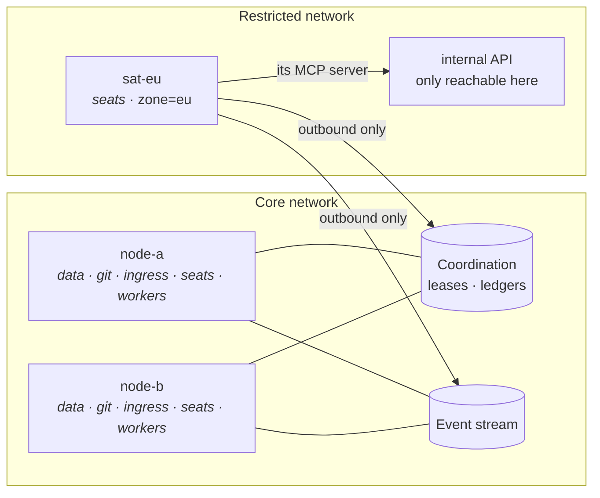

# Running One Agent Somewhere Else

Use this when one seat must run where the rest of the company is not: an internal API visible to one VPC, an MCP server driving a licensed binary on one host, a GPU, a lab network, or a database behind a jump host.

Do not move the company. Start one more Crewlet process on that host, tell it what it is, and pin that one role to it. The API, webhooks, scheduler and other agents stay where they are. This shape is a **satellite**: a node that runs agents, holds no company-wide duty, and terminates no inbound traffic.

A satellite has two shapes, set by the `data` role:

| | `roles: [seats]` — **stateless** | `roles: [data, seats]` — **holds data** |
|---|---|---|
| Its store | Scratch: deleted at every boot, no copy of the tracker, the knowledge base or chat | Its own full copy of the replicated estate |
| Its broker | A **leaf** of the members': no JetStream, no replica, no vote | A cluster **member**, holding replicas (a data node on a leaf is refused) |
| Disk it needs | Its seats' memory and working rows only | The whole company's history |
| Its seats' tools | Read and write through a data node, over the broker | Read and write its own copy, through the same router |
| Replacing it | Delete it and start another | A member leaving and joining |

Its **broker kind** comes from its `stream` block, never its roles: `stream.leaf.urls` makes it a leaf. Every node advertises its kind on its presence (`crewlet fleet broker list`, or the Broker column on **Settings › Nodes**). See [The broker: members and leaves](fleet.md#the-broker-members-and-leaves).

**Stateless suits a small, disposable agent host**: it rebuilds from its Tier A file alone, holds no raft state, and restarts in seconds whatever the company's size. Its seats need a data node to answer; see [what a satellite still needs](#what-a-satellite-still-needs).

> A satellite is a normal `crewlet run` with roles subtracted, not a lighter agent-only binary. Either shape must reach the fleet's broker. If it cannot from where you want the agent, this is not the mechanism.

**A stateless satellite cannot serve git in this release.** The `gitlet` role serves repositories on the API listener, so it needs `ingress`, and `ingress` needs `data`; a node without `data` that names `gitlet` is refused at validation. Serve git from the core nodes; a satellite that holds data can take `[data, gitlet, ingress, seats]` like any core node.

---

## What actually moves

Pinning a seat moves the whole seat: an agent is a place where things run, not a routable request handler:
| Moves to the satellite | Stays on the core |
|---|---|
| The agent instance, its state and its turns | The HTTP API, the dashboard, every integration's webhooks |
| **Its per-role MCP servers**, spawned as child processes of the node that claimed the seat | Every [singleton duty](../concepts/seat-ownership.md#singleton-duties) (the scheduler tick, the launch-node watch, the maintenance sweep, the identity sweep, the trim, the embeddings, the learning passes, the integration reconcile, the atlas collect duty, the atlas wake duty, the object store's collector, the trash reaper, Chatlet's message horizon, the code-retention duty and the delegated decisions sweep), on whichever core node holds `workers` |
| Its LLM calls, its knowledge searches, its tool calls | Every other seat's agents and MCP servers |
| Its executor runs' launches, and a `direct` or `container` box itself, on the satellite's own host | The company config, the leases and the ledgers — all shared, in the coordination slot |

The MCP row is the point of this feature. A seat's stdio MCP servers are
children of the process holding its lease, so "pin the seat" and "run its
tools over there" are the same act. The mechanism cannot be a routing trick:
the tools are not somewhere a request can be forwarded to, the *agent* has to
be there.

Work reaches it normally. A trigger is published to the seat's inbox topic and
the node holding the seat's lease consumes it, so publishers need not know
where the agent is, and a Slack message routed to that agent works as before.

Whether a satellite is also a **replica** is the `data` role's answer alone. A
satellite that holds data applies every shared state log of the company
(Worklet, Doclet, the search vectors, the identity directory, every data
node's usage history, the artifacts, their datastores, Ask Crewlet's
conversations, Chatlet, the seats' executor sessions and Gitlet) into its own
database, as a core node does. A stateless one applies none and asks a data
node instead. See [what a satellite holds](#what-a-satellite-holds) before
choosing a host for either.



---

## Set it up

Three steps: say what the node is, say where the role belongs, start it.

### 1. Give the satellite a Tier A config

Only the Tier A file lives on the satellite. The company (roles, prompts,
providers, integrations) comes from the fleet, so there is no company YAML to
copy. A `company.yaml` in its working directory (the `-company` default)
changes nothing: a bootstrap seed is never imported over the fleet's company.

A **stateless** satellite on an embedded fleet:

```yaml
# crewlet.yaml, on the satellite host
node:
  id: "${CREWLET_NODE_ID}"        # distinct and stable — sat-eu-1
  roles: [seats]                  # agents only: no data, no API, no duties
  labels:
    zone: eu                      # what a role will select on
  max_concurrent: 4               # this host runs one or two seats, not a
                                  #   company's worth — see below

store:
  path: "/var/lib/crewlet/sat-eu-1.db"
  scratch: true                   # deleted at every boot — required without
                                  #   the data role, and it says so twice

stream:
  leaf:
    urls:                         # any member's leaf listener will do
      - "nats-leaf://node-a.internal:7422"
      - "nats-leaf://node-b.internal:7422"

coordination:
  type: embedded-kv               # the fleet's replicated KV, reached over
                                  #   the same link

secrets:                          # REQUIRED on every node, this one too
  active_key_id: k1
  keys:
    - {id: k1, material: "${CREWLET_SECRET_KEY_K1}"}   # the SAME keys
                                  #   every other node of the fleet holds
```

There is no `stream.store_dir` here and there must not be: a leaf runs no
JetStream, and Tier A refuses one beside `stream.leaf.urls`. Its streams live
on the members, so the durability rule is theirs: `crewlet validate` refuses a
member with no `stream.store_dir` and asks nothing of a leaf's stream.

The members open the listener with `stream.leaf.port`. A member that opens one
must persist (`stream.store_dir`), as every fleet member must: the nodes that
join keep nothing, so it keeps everything they do.

```yaml
# on node-a and node-b — alongside their existing cluster block
stream:
  store_dir: /var/lib/crewlet/stream
  leaf:
    port: 7422                    # where stateless nodes join
```

A leaf port something else already holds is refused at member start, by name,
as a taken route port is (see [Every node embeds a member of one
cluster](deployment.md#every-node-embeds-a-member-of-one-cluster)). NATS only
logs a failed bind and the member never becomes ready, so the engine probes
the port first:

```
leaf listener port taken: stream.leaf.port 7422 is already in use on
every interface, so no stateless node could join the fleet through this
member — free that port or give this node a different one
```

On an **external** NATS cluster there is no leaf to configure: a stateless
node dials the cluster as every node does, and keeps `store.scratch: true` and
`roles: [seats]`.

A satellite that **holds data** is the same file with `roles: [data, seats]`,
a durable store (no `scratch`) and a cluster member's `stream.cluster` block
and `stream.store_dir` instead of `stream.leaf` — see
[Running a Fleet](fleet.md). It joins the broker as a voter: mind the
[five-member ceiling](fleet.md#the-broker-members-and-leaves) before adding
one to a fleet that already has five.

The `secrets:` block is required on a satellite too, though it holds no
estate, serves no API and signs no session cookie:

- Its leaf link is admitted only on a key derived from it; a satellite on
  another keyring is refused by every member and fails its boot naming the key
  it presented.
- The company document it fetches is sealed under the fleet keyring.
- Every request it sends a data node's estate service is signed under it (the
  data node runs a write as the actor the request names, and broker admission
  vouches for a connection, never a request).
- Every seat's executor run gets a per-run token signed under it.

`crewlet validate` refuses a Tier A file without it, naming `secrets.keys`.
Generate a key once with `crewlet secrets keygen` and give every node the same
material.

`${VAR}` references resolve in `node.labels` and `node.id` like anywhere else,
so an orchestrator injects both from the environment. There is a `-roles` flag
for the same reason; labels have no flag, because `${VAR}` covers it.

`api.port` can stay set, so one config file works for both shapes: a node
without the `ingress` role binds it for its [probes](#probe-it) — `/health`
and `/ready` — and serves no API, dashboard or webhook on it
(`api_probes_listening`). Every other path answers `404`, or `401` for a write
or an always-guarded prefix, as an unknown path does on an ingress node. A
pinned seat adds no reachable route either. Its executor's box calls the
seat's tools back over
[`/mcp/{token}`](../concepts/llm-backends.md#the-tool-bridge):

- A `direct` box (a process on the satellite's host) dials the satellite's
  `api.port` on loopback, where the satellite serves the bridge to its own
  host alone. A satellite no other node can reach runs its `direct` seats with
  nothing to set, provided `api.host` takes every interface or a loopback
  address.
- A box in any other cell dials the fleet's bridge address (the ingress
  nodes), and the ingress node relays the call to the satellite over the
  broker connection it already dialled. Give the satellite the same
  `CREWLET_MCP_BRIDGE_URL` as every other node wherever such a box runs.
- With `api.port: 0` the satellite binds nothing, for a host that must accept
  no connection of any kind. The price is no probe, and its `direct` boxes
  needing that address too; its seats' executors still reach their tools.

### 2. Pin the role

In the company config (Tier B), on the role that has to run there:

```yaml
roles:
  - name: EU Support
    handle: eu-support
    goal: "Answer in-zone customer requests"
    placement:
      labels: {zone: eu}
```

`labels` requires **every** pair to be present and equal on the node.
`node: sat-eu-1` pins to one node id instead. Give both and both must hold; a
placement only narrows.

Prefer a **label** over a node id. A label says what the host *is*, so a
replacement host with the same label picks the seat up; a node id names a
process and strands the seat when that process is gone.

### 3. Start it

On a **stateless** satellite there is one command:

```bash
crewlet run                     # roles come from the file
```

Its store is created fresh at the binary's own schema on every start, so
there is nothing to migrate. `crewlet migrate` refuses a scratch store, as do
the offline `config` and `search eval` commands, since anything they wrote
would be gone at next boot. `crewlet secrets`, `crewlet llm`, the provisioners
and every other command that resolves the company's `${VAR}`s refuse it too:
the company's secrets live on the fleet's store, never in a node's own file,
and a command reaches that store itself only from a node that holds data. From
a satellite, name a running data node with `-api`, with one of its Tier A
tokens in `CREWLET_API_TOKEN`. Configure the company through the API of a node
that holds data.

A satellite that **holds data** is migrated on the satellite first:

```bash
crewlet migrate                 # this host's own store file
crewlet run
```

`crewlet migrate` is **per node, not per fleet**: there is no shared database.
It applies pending schema migrations to the two local store files its Tier A
config names (the node's own and the replicated estate beside it), which every
node owns exclusively. A satellite without `data` has a scratch store, and `migrate` refuses it.

To keep roles out of the file:

```bash
crewlet run -roles seats
```

---

## Verify it landed

The **Settings › Nodes** screen reads the lease table, so it shows the same
picture from whichever node you reach. Look for the satellite in *Nodes* with
its roles and labels, and for the pinned handle in *Seat ownership* against
that node.

From the logs on the satellite:

```
seat_claimed    seat=eu-support epoch=3
inbox_attached  seat=eu-support epoch=3 elapsed_ms=5.1
```

### Probe it

A satellite with `api.port` set answers the two probes every node does, so an
orchestrator can restart a wedged one and wait for one to join before
replacing the next:

```bash
curl -s http://sat-eu-1.internal:8000/ready
# {"ready":true,"node":"sat-eu-1","configured":true,"draining":false,"posture":"serve"}
```

`/health` is liveness: `200` while the process is alive, through a drain and
through a broker link that is down. It carries the node's half of the
[health envelope](../reference/api-endpoints.md#probes-on-a-node-without-ingress):
id, roles, posture and applied epoch, the seats it holds, and `shutting_down`.
While booting it answers as every starting node does
([While a node is starting](../reference/api-endpoints.md#while-a-node-is-starting)):
`503` with `"phase": "recovering"` until it has linked to a fleet member and
provisioned what it uses (a satellite holds no store, so that is all its
recovery). Each step is bounded: a minute for the link, five minutes for each
bring-up (the event streams, the coordination buckets, the object store's
bucket); past any of them it exits. Then `200` with `"phase": "preparing"`
while its company's tools come up.

`/ready` answers whether the node is **doing its work**, since a satellite
takes no traffic to steer. It is `503` until all of these hold, naming the
first that does not in `reason`:

| `reason` | What it means here |
|---|---|
| `starting` | Not started yet: the listener is bound and answers the boot's answers. |
| `draining` | Stopping: turns finish and it claims nothing new. |
| `broker_unlinked` | Its data path or its lease link does not reach the fleet's broker: a leaf link down (on an external cluster, a connection reconnecting), or the fleet's JetStream not answering across it (below); `detail` names which. Its seats can neither receive nor publish, or it holds nothing. |
| `unconfigured` | No company revision has reached it yet. |
| `shed` or `stuck` | Its [config posture](../concepts/control-plane.md#operator-surface): it cannot apply the revision its peers run. |
| `no_presence` | It does not hold its presence lease, so peers do not count it and nothing routes to it. |
| `admission_withheld` | No data node has yet answered that a copy of the estate admits a seat, or the node cannot serve the seats it holds, so it claims nothing. A fresh satellite sits here until admitted, and returns here while no data node is reachable. |

### Its alarms

A satellite without `data` runs no state log, so it evaluates only the
[alarms](../reference/alarms.md#how-an-alarm-reaches-you) it measures of
itself: `objective_burn` (its seats' runs carrying their sessions, and their
artifact publishes), `volume_low`, `wal_large` and `pool_starved` (its scratch
store). Each reaches you from the satellite: its own `alarm_raised` line and
`crewlet.alarm.active` gauge, its row on **Settings › Nodes** and `GET /fleet`,
and the administrators' notices. `/health` counts them, and no alarm makes a
probe fail: neither restarting the node nor withdrawing its seats clears one.
The data nodes raise every other alarm, among them the model, MCP server and
`executor_resume_blocked` alarms of the satellite's seats.

Two failures to know by sight:

- **`seats_unplaceable`** — no live node matches the selector, or the only one
  that does cannot serve its seats and has withdrawn (`seats_shed_unserviceable`
  on that node says why). Usually a typo (`zone: EU` does not match
  `zone: eu`; comparison is exact) or a satellite that has not started. The
  seat is unserved while every other node's sweep looks healthy, which is why
  this is logged.
- **The label change did not take.** Labels are advertised on the presence
  lease, so a change takes effect one heartbeat after the **restart** that made
  it; editing the file is not enough.

---

## What a satellite holds

Worklet, Doclet, the search vectors, the identity directory, every data node's
usage history, the artifacts, their datastores, Ask Crewlet's conversations,
Chatlet, the seats' executor sessions and Gitlet are
[replicated state machines](replication.md). Each is one ordered log the whole
fleet shares, and every **data** node applies every log into its own copy of
the rows: it answers about each locally and can donate a snapshot of all of
them to a data node that fell behind. No key narrows it.

**A stateless satellite holds none of it.** Its store is scratch, and every
question its seats ask about the estate, the identity directory's included, is
a request to a data node. Whose Slack member or Jira account counts as a
colleague depends on who holds each human seat and whether they are suspended,
so it asks a data node that, floored on the identity log, and rereads every
thirty seconds. Until it has read the directory once it withholds its human
seats from routing, because the org chart alone would attribute a suspended
person's word to their seat.

**A satellite that holds data holds all of it**, the identity directory
included: people, their addresses and logins, the verifiers of their
passwords, recovery codes and machine tokens, seat bindings, grants, the
invitations that enrolled them and their signed-in sessions. This is not a new
exposure:

- **Names and addresses are sealed** under the fleet keyring; a password,
  recovery code or machine token is stored only as a verifier. Logins, grants,
  seat bindings and session rows are in the clear.
- **The host already holds the fleet keyring**, which no node runs without. It
  opens the company document, the company's
  [secret store](../concepts/secret-store.md), every vendor credential in it,
  and every person's sealed name and address. The host could decrypt every
  company secret whether or not it held the directory.

So choose a satellite's host as you would any node's: somewhere you would
trust with the company's secrets. If a seat must run somewhere you would not,
a satellite is not the mechanism; the host is a full fleet member whatever
roles it has.

Two rules follow for a satellite that holds data:

- **Every domain, or none.** A data node that could not start one of the
  domains refuses to start. A node applying half the logs serves rows derived
  from one while another's records pile up unapplied, indistinguishable from a
  node that is merely behind.
- **Every live data node counts for every log's trim.** A live data node that
  has published no position for a log is counted at position zero and holds
  that log's floor until its row lands. A stateless satellite is never
  counted. (See the counted set in [Retention](retention.md#the-six-terms).)

At boot every data node logs the logs it started, whether or not it serves
HTTP; on a `roles: [data, seats]` satellite, which serves no API on its port,
this is the one place to look:

```
statelog_started  node=sat-eu-1 domains="[tracker vectors pages iam usage artifacts artifactdata assistant chat executor code access atlas advisor]"
```

---

## What a satellite still needs

It is a full engine process with roles subtracted. Before choosing a host:

- **Outbound reach to the coordination slot and to the stream.** Seat leases,
  the activation pointer, the ledgers and the seat's inbox live there. Its own
  store file is local.
- **For a stateless satellite, a data node that answers.** Its seats' tracker,
  knowledge-base and chat tools, searches, tool-skill walks and the record of
  each executor box's session (read back at the seat's next launch) are
  requests to a data node over the broker: no inbound port, the same link. It
  is admitted to claim seats only once a data node answers that its copy is
  level with its logs; while none does, its tools fail naming the estate
  nobody served.
  - **Each answer is one message.** A read that answers a list stops at
    4 MiB of rows, half of a message, and says where it stopped the way
    that read says any page is short (a cursor, `more`, `truncated`), so a
    long list arrives in pages rather than as a reply too large to send. A
    read whose caller needs one snapshot whole (the seat registry, a
    window's sums) is refused past that size instead, naming what to narrow.
  - Its turns' events go to a data node's event log (the audit trail cannot
    live in a store deleted at next boot), so `GET /events` on that data node
    shows them.
  - Its seats' memory rides the compacted changelog and is rehydrated into the
    fresh store after a restart, a table at a time (a refined skill's versions
    arrive after the skill).
  - **Hydration time** is what its bytes take: a seat's 29 round trips cost
    about 2.9 seconds across a 100 ms leaf link (145 ms at 5 ms, 29 ms at
    1 ms) before its rows' bytes; a year of episodes about two and a half
    minutes across a 100 ms, 100 Mbit/s link.
  - **When it refuses.** Only when nothing arrives for its stall (9.1 seconds
    for a pull across a link) while the leaf link carries nothing, or nothing
    is delivered to a table's replay for a minute, whichever copies of the
    changelog it is placed on. It logs once a minute that it is still running
    (`memory_hydration_slow`). A row larger than the node's connection carries
    refuses a seat whatever the time.
  - **Behind a megabyte-sized download or event** it waits as long as the link
    keeps moving: the node reads its link's own socket (below) and counts it
    moving while it carries, either direction, at least seven tenths of the
    floor of thirty seconds a mebibyte (about 24 KB a second). A quiet link's
    own traffic (presence reads, pings, heartbeats) stays under two fifths of
    the floor.
  - A replay that hears nothing on a moving link is placed again once the link
    has read 8.5 MB since its last word, and refused after about 253 seconds
    of silence; its other requests are held up to 248 seconds past their own
    bounds
    ([across a link, silence is the link's](../concepts/seat-ownership.md#a-seats-memory-follows-it)).
  - **One window.** Its pulls share the link's window with the object store's
    uploads, downloads and listings, both ways: what the link carries in four
    seconds at the floor, one 128 KiB piece of a file either way. So a request
    sent behind them is answered inside its five-second term at any rate the
    engine allows
    ([one window per link](../concepts/object-store.md#the-fleets-own-bucket--nats-the-default)).
    An event delivered to one of the node's seats crosses whole, outside the
    window: a request whose reply crosses behind one waits for it (as with
    what the node sends whole, next item). A hydration's next row waiting
    there is waited for while the link moves; a lease renewal never waits
    there, since it rides a link of its own (next item). The
    node's placement pass waits for hydration (see
    [a seat's memory follows it](../concepts/seat-ownership.md#a-seats-memory-follows-it)).
  - **A restart loses** what the changelog had not acknowledged, since the
    deleted store takes it along: a graceful stop flushes each seat for five
    seconds (some 700 notes with their vectors across a leaf link to another
    region, or a few thousand smaller rows), less what the seat's last cycle
    still had crossing, which the flush waits for first; a crash flushes
    nothing.
  - **After every boot**, each seat it takes carries back what its hydration
    brought in, in one turn a cycle that its seats share. That turn gets what
    is left of the several thousand rows a cycle carries across such a link
    after every seat's own rows (carried first). While those outlast a cycle,
    the turn still comes once in every lap of the seats (see
    [what a crash and a handoff lose](../concepts/seat-ownership.md#a-seats-memory-follows-it)).
- **A fair queue at the link's bottleneck, each way.** The satellite holds its
  uploads, downloads, walks, memory replays and memory publishes to one window
  across its link, both ways together, four seconds at the floor, so a small
  request behind them is answered inside its five-second term even at thirty
  seconds a mebibyte. The floor is the rate the link gives the node's broker traffic
  beside its own background reads: a link at exactly thirty seconds a mebibyte
  whose presence reads take two fifths of it carries a full window in 6.7
  seconds. A first-in-first-out queue adds whatever else it holds to that
  wait: another flow's bulk (a harness's own upload or download) keeps it full
  until it drains (a 256 KiB buffer is 7.5 seconds at the floor, a cellular
  modem's megabytes of buffer minutes). So:
  - The queue at each direction's bottleneck is fair (`fq_codel` or CAKE),
    which sends a sparse flow's packets ahead of a bulk flow's. The host's own
    queue discipline counts only where the host is the bottleneck: a host
    whose interface is faster than its link queues at the modem or router, and
    keeps the queue its own only by shaping egress just below the uplink's
    rate and ingress just below the downlink's (CAKE in `ingress` mode on an
    IFB device).
  - A first-in-first-out queue protects only the lease link, and only where
    the two directions' queues together hold no more than four seconds of the
    link's rate, 140 KB at the floor: a renewal then waits at the bottleneck
    and never in the data link's sockets. The data link's requests are held to
    their term only behind fair queues.
  - The node's broker traffic gets at least the floor beside its background
    reads.

  Whatever the queues do, no hold, hydration or transfer is refused while the
  link is moving. Neither discipline reorders one flow's bytes, and a
  satellite's data link is one flow, so what it sends whole (an event or dead
  letter of up to 8 MiB, a fleet record of up to 6 MiB) holds every request
  after it on that link for the whole crossing: about four minutes at the
  floor for 8 MiB. Its leases ride the other link, which a fair queue carries
  beside it.
- **Two leaf links on the one leaf port, both reaching the fleet.** A
  satellite joins the members twice, with the same key: its **data link**,
  which its mailboxes, publishes, transfers and reads ride, and its **lease
  link**, which only its holds ride (claims, renewals, releases, presence),
  each landing on whichever member answers
  ([ADR-0174](../../adr/0174-a-nodes-holds-ride-a-connection-nothing-else-rides.md)).
  It takes or keeps a hold only while a probe of the fleet's JetStream over its
  data link answers (a request every five seconds, about 164 bytes a second):
  refused at once while the data link is down, five seconds after a probe goes
  unanswered on a quiet link, thirty after the fleet answers "not available",
  and at the link's own ping tolerance (four minutes on the shipped pings) when
  the link moves but nothing answers. A satellite whose data link dies silently
  frees its seats within 55 seconds at the shipped 45-second lease, and
  one on a member cut off from its peers within 80
  ([ADR-0173](../../adr/0173-a-node-takes-or-keeps-a-hold-only-while-its-data-path-answers.md)).
  Its lease link is probed the same way and moved to the next member five
  seconds after the one it is on stops answering, judged afresh where it lands
  and never by what the satellite's own server answers while the link is down;
  while no member answers, its leases lapse on their TTL.
- **Its share of the fleet's presence reads.** Every node reads every node's
  presence a few times a heartbeat over its data link: under two fifths of a
  floor-rate link in a fleet of up to 16 nodes at the floor lease, or 32 at the
  shipped lease. A larger fleet needs a faster link for its satellites.
- **No slow link for a `[data, seats]` member.** A member's renewals are
  proposals across its cluster routes beside every replicated append, which no
  connection of its own takes off them, and a member reached at the floor
  cannot hold its raft quorum. The slow-link shape is the stateless `[seats]`
  satellite.
- **A leaf link that reaches the members' own sockets.** A message on the link
  can be megabytes and take minutes to cross at the slowest pace the engine
  allows. The node tells a link carrying one from an idle link by reading its
  own socket (bytes read, and bytes the member's kernel acknowledged), never
  by a timeout. A TCP-terminating proxy acknowledges what it buffered, not
  what the member took, so behind one the node cannot tell a member that
  stopped reading from a buffer still draining. So send the leaf link to the
  members' leaf port (7422 by default) directly: exclude that port from a
  service mesh's capture (Istio's `traffic.sidecar.istio.io/excludeOutboundPorts`,
  Linkerd's `config.linkerd.io/skip-outbound-ports`) and put no buffering load
  balancer in front of it. NAT, a firewall and a VPN that forwards packets are
  not such proxies. The same holds for every node's dial to an
  [external NATS server](deployment.md#an-external-nats-server).
  - The loopback tunnel the engine runs inside the node needs nothing from
    you: its port serves the node's own leaf alone, refuses every other caller
    on the host, and closes a connection that sends nothing.
  - A leaf whose link dropped links again behind a queue of up to two seconds
    round trip. Past that, nats-server's fixed two-second wait for a member's
    answer to the leaf's handshake ends every attempt, until the queue drains.
- **The harness of every model its seats name, installed and signed in on that
  host.** Each [`providers.llm` entry](../concepts/llm-backends.md) is a
  harness the node runs, calling its own vendor over outbound HTTPS. With no
  egress at all it can still work if the role's models are OpenCode entries
  whose model names an on-premises server.
- **The MCP servers its role declares, installed on that host.**
- **The same keyring** every other node holds: the satellite opens the company
  document and the [secret store](../concepts/secret-store.md) with it and
  signs every estate-service request; without it the node refuses to start
  (see [what a satellite holds](#what-a-satellite-holds) for the host
  implications).
- **Nothing inbound.** No ingress rule, no public URL: the satellite dials out
  to the broker and coordination slot and is never dialled back, so it works
  in a zone the rest of the fleet is not in. Only the orchestrator's probes
  reach `api.port`: a pinned seat's executor box has its tool calls relayed
  over the broker by an ingress node, so the box never dials this node.
  `api.port: 0` closes the probes too.

---

## What it costs

**A pinned seat is unserved whenever nothing matches it.** The engine will not
widen a selector to keep a seat running. When the satellite is down, that
agent is down, and the fleet says so (`seats_unplaceable`) rather than running
it somewhere it does not belong. If that is not acceptable, run **two**
satellites carrying the same label: the seat moves between them. The fair
share is computed per placement group, so the pinned seat does not eat into
anything else's capacity and nothing eats into its: a satellite's share of
unpinned seats is a separate bound from its share of its own, so it keeps room
for the seat it exists for and claims it first. A seat whose teardown failed
on the satellite is charged against the unpinned seats before the pinned one.

**A satellite is eligible for unpinned seats too.** It takes its share of the
seats nobody pinned, on top of its pinned seat and never instead of it, and
those seats' MCP servers may not work in a restricted network. There is no
"only take pinned seats" switch. To keep general work off it, pin the general
work to the core: one label and a YAML anchor rather than a block per role:

```yaml
roles:
  - name: CEO
    handle: ceo
    goal: "Set direction"
    placement: &core {labels: {tier: core}}       # anchor, on first use

  - {name: Engineer, handle: eng, goal: "Build", placement: *core}
  - {name: Designer, handle: design, goal: "Design", placement: *core}

  - name: EU Support
    handle: eu-support
    goal: "Answer in-zone customer requests"
    placement: {labels: {zone: eu}}
```

Give the core nodes `labels: {tier: core}` and the satellite only
`{zone: eu}`, and each group stays on its own side. (Declare the anchor on a
real `placement` field as above: a top-level holder key is rejected, since the
company schema forbids unknown fields.)

**Two more, inherited from running a fleet at all:**

- `node.max_concurrent` is per process, so the satellite has its own ceiling.
  Size it for one agent, not the company: the default of 32 suits a node
  holding a company's worth of seats, and a satellite running one seat wants a
  much smaller number.
- A rolling upgrade across a lease-protocol bump makes new nodes wait for old
  ones. Upgrade the satellite in the same rollout as the core — see
  [mixed-version fleets](../concepts/seat-ownership.md#mixed-version-fleets).
- A satellite upgraded before the core's data nodes has every request that
  sets a field they do not declare refused there rather than run short, and
  its turns' ends wait for a data node of its build: upgrade the data nodes
  first. A satellite still on the older build is then refused the answers it
  would carry into another request once a newer field is set in them, until it
  is upgraded too — see [A build reads what it is asked whole](../concepts/scaling.md#a-build-reads-what-it-is-asked-whole-or-runs-none-of-it).

---

## Agent seats and their boxes

Every agent seat's executor runs in a [box](../concepts/code-sandbox.md), so a
seat pinned here brings three facts the engine cannot check for you:

- The satellite **launches** the run, on its own host: `direct` needs the
  harness installed there, and `container` the container runtime and an image
  with the harness in it.
- A box is the satellite's own: it polls, collects and reclaims it itself,
  with no duty, and a seat that moves to another node asks the satellite to
  read the box back (see
  [Code Sandbox](../concepts/code-sandbox.md#durability-completion-and-observability)).
- `CREWLET_SANDBOX_OTEL_RECEIVER_URL` must name an address the *sandbox* can
  reach, which means an ingress node. It is explicit config, never derived
  from whichever node launched the run, so a satellite never advertises itself
  by accident. `CREWLET_MCP_BRIDGE_URL`, which every executor box not on the
  satellite's loopback dials, is the same: an ingress node's address, the same
  value on every node, and the ingress node relays the call to the satellite
  over the broker. The one address a satellite derives is its own loopback
  listener, handed only to its own `direct` boxes (for the bridge, and for
  telemetry where the satellite forwards to `OTEL_EXPORTER_OTLP_ENDPOINT`) and
  served to its own host alone, so it advertises nothing to the network.

Pinning an agent seat to a node that cannot run its executor's cell gives a
seat that claims cleanly and fails every run. The engine
knows what a node *says it is*, never what it can talk to.

---

## See also

- [Running a Fleet](fleet.md) — the general case: node roles, fair-share
  placement, draining and rolling upgrades
- [Scaling Out](../concepts/scaling.md) — what a node is, what the fleet
  shares, and what the design does not promise
- [Seat Ownership](../concepts/seat-ownership.md) — how the lease makes
  "only this node runs that agent" true
- [Tools & MCP](tools-and-mcp.md) — declaring the MCP servers a role's
  seat will spawn wherever it runs
