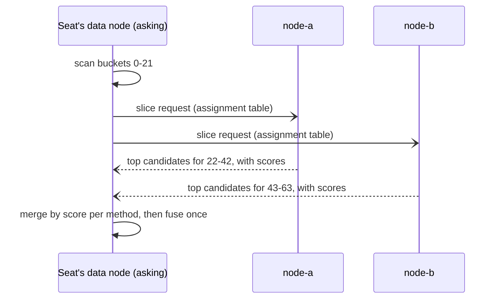

# Search

How the knowledge search is answered, what it costs, and what a fleet can do
when the corpus outgrows one node's CPU.

> **This page is about the KNOWLEDGE corpus**: pages and work items, behind
> the `knowledge.Searcher` seam and the `search_knowledge` tool. Chat is
> searched too, but none of this applies to it: it has its own index and **no
> semantic half**, and no query fuses the two. See
> [Chatlet § Search](../concepts/chatlet.md#search) and
> [ADR-0071](../../adr/0071-chat-is-a-keyword-corpus-and-takes-no-vectors.md).
> Chat search is also the only search here with a **viewer**: every chat search
> is answered for its asker. The node that ranks it resolves the rooms that
> person may read and ranks over those alone, the index refuses a query that
> names no rooms rather than read it as every room, and an answer says how many
> rooms it searched.

Search is answered from **a data node's own tables**. Every data node holds the
whole corpus ([Scaling](../concepts/scaling.md)), so it answers with no lookup
leaving the machine and no dependence on a peer. A node without the `data` role
holds none of it and asks a data node ([When the estate does not
answer](#when-the-estate-does-not-answer)). A fleet can divide the **work**, not
the data.

---

## The two halves, and the bucket both of them carry

A hybrid search runs two rankers and fuses them:

- **Lexical**: BM25 over the engine's own inverted list, in this node's database.
- **Semantic**: a two-stage vector search over the replicated vectors; the first
  stage probes the corpus's semantic index when it has one.

Every indexed document carries a **search shard**: a stable hash of its identity
into 64 fixed buckets, written beside the row in both estates by the same
function. See
[Every document carries a bucket](../concepts/knowledge-system.md#every-document-carries-a-bucket)
for what it is a function of and what it deliberately is not.

A search can be told to read only part of that range. On a single node nothing
tells it so: it reads every bucket.

---

## Three modes, and what an answer says it served

Every ranked search, knowledge and tracker item search alike, takes one of three
modes, with one vocabulary on every surface:

| Mode | Ranks by | Label on a screen |
|---|---|---|
| `hybrid` (the default) | both halves, fused by reciprocal rank fusion | Hybrid |
| `keyword` | the query's words, BM25 alone | Keyword |
| `semantic` | the query's meaning, the vector scan alone | Meaning |

**The two halves do not read the same text.** The keyword half indexes a
source's title and whole body. The semantic half ranks one vector per source,
computed from its **opening**: title then body, whitespace collapsed, the first
8 KiB of the two together, or less where the model's own per-input bound is
smaller (see
[Where the vectors come from](../concepts/knowledge-system.md#where-the-vectors-come-from)).
A passage deep in a long page is found by `hybrid` and `keyword` through its
words, never by `semantic`. `crewlet search eval` reports, per corpus, how many
sources and how much text lie past the window (see
[What the quality of this can and cannot be promised](../concepts/knowledge-system.md#what-the-quality-of-this-can-and-cannot-be-promised)).

A semantic ranking needs the **query** in the documents' embedding space. The
asking node computes the vector once through the company's embeddings provider
(same model and width as the corpus) and sends it with the request, so no
participant makes a provider call. It caches **1 024 query vectors per node**
(about 12 MiB at 3 072 dimensions), least recently used out first, emptied when
`providers.embeddings.model` changes so a retired model's vector is never ranked
against rows being refilled. A phrase the ⌘K palette embedded is a cache hit for
the same phrase searched as knowledge and for the turn-start prefetch. Computing
a query's vector is bounded at **two seconds**, twice the scan's one-second
budget, so a slow provider costs a search its meaning half rather than holding
the asker.

**A query is at most 400 bytes**, on every surface: a seat's `search_knowledge`,
`search_work_items`, `search_messages` and `answer_knowledge`, the operator's
tools, the API's `knowledge`, `work_search` and `GET /chatlet/search`
(`bad_params`, naming the size and the limit), and the dashboard, which sends
nothing past it and says why. Chat search shares this bound and nothing else on
this page. A longer query is **refused, never cut**: a search on its first part
answers another question, and past 400 bytes it is a pasted thread no ranker
improves. This is the opposite of a long page, deliberately: a source is
embedded as its opening because one vector stands for one source, while a
query's vector is computed from the **whole** query. Every model this build
knows takes at least 2 032 bytes an input; on a model stated with a narrower
window (`max_input_tokens`), a longer query is embedded in pieces at the model's
bound, in one request, and the pieces' vectors pooled.

**A mode asked for is not always a mode served, and every answer says which.**
It carries `served_mode` (the ranking the hits came from), `modes` (what this
backend can serve as asked, right now), `degraded` (why those differ from what
was asked) and `coverage` ([below](#when-part-of-the-corpus-is-not-scanned)):

| `degraded` | What happened | Hybrid serves | Semantic serves |
|---|---|---|---|
| `no_embeddings` | No embeddings provider, or `knowledge.vectors: false`. | its keyword half | nothing |
| `embedding_failed` | The provider did not produce the query's vector in time. Nothing to configure; the next search asks again, and a failure is never cached. | its keyword half | nothing |
| `semantic_partial` | Part of the fleet ran without its vector scan. | both, meaning over less of the corpus | meaning over less of the corpus |
| `unsupported` | The backend has no such ranker (Confluence, whose own CQL search is keyword). | the keyword answer | nothing |

**Semantic never falls back to keyword.** Someone asking for meaning wants pages
sharing no word with the query, which a keyword ranking cannot find, so it
answers no hits and says why rather than label a keyword answer as meaning.
Hybrid does fall back: the words are half of what was asked.

**The modes on offer are known before anybody types.** A search with an empty
phrase is the seam's PROBE: it runs and reads nothing, and answers `modes` and,
for the mode asked, the `degraded` the CONFIGURATION decides (`no_embeddings`,
`unsupported`; never the per-search `embedding_failed`). The dashboard's Doclet
search probes `semantic` and disables a mode the answer does not list, with the
reason as that mode's second line in the menu. The same answer sets the
dashboard's DEFAULT: Hybrid where served, otherwise the first mode listed
(Keyword with no embeddings provider), so nobody gets a degradation of a choice
they never made. The wire default is unchanged: a request naming no mode is
`hybrid`.

A keyword search sends no vector, so a participant runs no vector scan for it;
the rankers a query needs travel with it, and the asking node fuses only those.

## How big a corpus one node scans

The semantic scan has a **one-second budget**. What fits depends on how many
searches the node runs *at the same moment* (seats taking turns, the dashboard,
a person) and on the **first stage**: the full scan of every sign code, or the
corpus's semantic index, which reads only the lists nearest the query (see
[the knowledge system](../concepts/knowledge-system.md#the-first-stage-is-an-index-over-the-codes)).
Measured in one run at 3 072 dimensions on four cores, p95, over 40 000 sources
of the test fixture's topical corpus, where the index's training chose to read
**half** its lists:

| Searches in flight | Full scan, per document | Inside one second | Index, per document | Inside one second |
|---|---|---|---|---|
| 1 (an idle node) | 2.90 µs | ≈ 345 000 | 1.84 µs | ≈ 545 000 |
| 8 | 7.34 µs | ≈ 136 000 | 5.48 µs | ≈ 183 000 |

The second row is a node running a company. The metric
`crewlet.tracker.search.concurrency` says which row your node is on; see
[Metrics](../reference/metrics.md). The index's column is **per probe share**: an
index reading an eighth of its lists (what training chooses at 120 000 sources)
reads a quarter of the rows this one does, and a corpus with no index is on the
scan's column. So is a search **narrowed** to a small share of the corpus (pages
in a mostly-task corpus, or one container): it reads lists until it has seen as
many of its own rows as an unfiltered search reads, and past half the lists it
runs the scan, which reads every row its filter keeps. `crewlet search
eval` names the first stage and the share. These figures are one machine's
benchmarks (the scan's own benchmark measured 2.58 µs and 6.14 µs on a quieter
host), so treat them as a projection until benchmarked on yours;
[Replication](replication.md#three-things-ci-cannot-prove) says the same.

Past the row your node is on, a single node's search exceeds its budget and
`search_slow` fires. A fleet divides the scan, below.

---

## When a fleet divides the scan

Above **10 000 documents**, a company with more than one data node divides the
buckets between them. Each scans its own contiguous range, returns its best
candidates *with their scores*, and the asking data node merges them.

The division is computed, not configured, and every node computes the same one:
sort the live data nodes' ids, give each a contiguous range, hand the remainder
to the first few. 64 buckets over three data nodes is 22, 21, 21.

Below that floor the asking data node answers alone. A broker round trip is
about a millisecond, and a semantic scan of 10 000 documents measures 49 ms p95
on an idle node and 125 ms with eight searches in flight. Under the floor the
scan's fixed cost dominates (per-document cost at 10 000 is nearly twice that at
40 000), and a fan-out makes every node pay it again, spending more wall clock
arranging the work than it saves.

**More nodes is not always faster; the limit is CPU, not count.** Measured on
four cores over 4 000 documents with every participant in one process: 89 ms at
one replica, 64 ms at two, 70 ms at four, 98 ms at eight. A real fleet spreads
scans across machines, so the turn is further out, but the shape holds, which is
why the floor is priced in scan time rather than node count. Recall against the
single-scan answer was exactly 1.000 at every width.

### What travels, and what does not

The request carries the query and the whole assignment table; each node answers
only for its own row. Nothing is durable: no stream, consumer, acknowledgement
or record afterwards. A request nobody serves never existed. Deliberate: a
search writing two records and an audit row per keystroke would make the audit
log a function of how often somebody typed.

---

## Why the merge is by score, and then fused once

Each node returns its top candidates **per method, with scores**. The asking
node merges each method's candidates into one global list by score, and only
then fuses the two global lists by reciprocal rank fusion at k = 60.

The order matters. Reciprocal rank fusion combines *different rankers over one
corpus*; over *one ranker across disjoint slices* it ranks by placement: a
document ranked first on a weak slice contributes 1/61 = 0.0164 and a far
stronger one ranked second on a strong slice contributes 1/62 = 0.0161, so a
0.10 outranks a 0.98.

Merging by score first removes the problem. It is also **exact**: the slices are
disjoint, so the global top-N is contained in the union of per-slice top-N, and
a search fanned out four ways returns the identical order as one fanned out no
ways.

**The scores are comparable, for a different reason per method.** Semantic
similarity is comparable by construction: one model, one metric, one vector
space. BM25 would not be if each node used its own slice's statistics, and it
does not: every data node holds the whole corpus, so document frequency and
document count come from its complete tables whatever buckets it scanned. **The
scan is bucket-limited; the statistics are global.**

---

## When part of the corpus is not scanned

A node that is restarting, overloaded or gone does not answer its assignment.
The asking data node holds the whole corpus and could have answered alone, which
is why a short answer must say so: one fewer result looks identical to a corpus
with one fewer document. There are three more ways not to cover an assignment.

- **Lexical index still building.** Every data node holds the whole corpus, but
  the **lexical index over it is each node's own**, built by its own walk on its
  own schedule. A node that joined minutes ago holds every document and can find
  none. It answers its range and says so, and the coordinator counts its buckets
  missing rather than merging an almost-empty answer under complete coverage. It
  clears when that node finishes its first lap. It applies to the asking node
  too: a freshly booted node reports its own range missing on the search that
  finds it so, and gives that range to its peers for the half minute after.
- **Copy out of service.** A node whose copy is out of service for what the
  search reads (the tracker for a work-item search, the knowledge base for a
  knowledge search) is wrong rather than behind (its applier stopped, its rows
  below the log), and its index is over rows that stopped being the fleet's. It
  answers its range saying so and is counted missing the same way
  ([ADR-0079](https://github.com/crewlet/crewlet/blob/main/adr/0079-a-domains-fault-takes-only-its-own-copy-out-of-service.md)).
- **Vectors copy out of service.** The node still covers its range with the
  keyword half and answers without the vector scan, reported as
  `semantic_partial`, not as a missing range.

The index-building and out-of-service cases **last** (a first lap takes minutes;
a copy stays out until it recovers or its node adopts a snapshot) while every
node holds the whole corpus, so the others can scan that share. A node that
hears a participant answer that it covered nothing (or skipped the vector scan
for its vectors copy) gives that node, **itself included** when its own scan said
so, **no range for half a minute** for searches of the same kind (the same
sources, or any search ranking by meaning), and divides every bucket among the
rest; when every node is known not to cover, all are asked again. Only the
search that hears it is partial; the next is complete, and the node is asked
again once the half minute is up, which brings a recovered node back.

Every partial answer is **labelled in the answer itself**, not a log line on the
asking node: every answer carries
`coverage{nodes:[{id,answered,error}], complete, buckets_missing}`: every
participant, whether it covered its range and if not why (silent inside the
budget, still building its index, its copy out of service, or the fleet could
not be asked), and whether the asking node scanned that range in its place. A
seat's own `search_knowledge` and `search_work_items` answers say so in words,
because a seat reading five results of what should be eight would conclude the
other three do not exist. The `search_scoped` alarm reports the fraction of
searches answered that way; see [Alarms](../reference/alarms.md).

The four search alarms are kept apart because they cost different things:

| Alarm | What happened | What the answer lost |
|---|---|---|
| `search_scoped` | A node did not cover its assignment: silent, its lexical index not past its first lap, or its copy of what the search reads out of service. | A range of the corpus went unscanned. |
| `search_degraded` | A semantic ranking was asked for and did not run: a node's vector scan failed or its vectors copy is out of service, or the provider could not compute the query's vector. | Over the range it *did* scan, only what shares words with the query was found. |
| `search_slow` | The deliberate searches this node coordinated (a seat's `search_knowledge` or `search_work_items`, a person's) are over their one-second p95 target. | Nothing yet. The corpus has outgrown what one node's share can scan in the budget. |
| `prefetch_slow` | The knowledge scans this node coordinated for turns' prefetches are over their half-second p95 budget. | Nothing yet. Every turn whose prefetch it scans waits that long before its first token. |

A turn's prefetch and a deliberate search are timed apart, in
`crewlet.tracker.search.scan.duration`'s `path` (`prefetch` and `interactive`),
because they have different budgets: a turn waits for its prefetch before doing
anything, so that scan is held to half of what a person searching on purpose waits.
Each is timed by the node that coordinated the scan, whichever node's turn or
request asked. A Confluence knowledge base is searched by the wiki and timed by
neither.

**A company with no embeddings provider is not degraded** for the alarm:
`search_degraded` counts semantic rankings asked for and failed, never a keyword
search nor a company with nothing to rank by meaning; an alarm red for a
deployment's life is one nobody reads. The answer still says `no_embeddings`,
because its reader can configure a provider.

**The asking data node never needs the broker for what it can scan itself.** It
scans its own range directly. When it has given itself no range (its last search
said it could not cover that kind, so peers took its share), it still scans in
their place whatever range the peers leave uncovered (broker unreachable, peer
silent, peer covered nothing) before it answers; otherwise a broker hiccup would
be a fleet-wide outage of a read every data node can serve alone. While its own
vectors copy is out of service it answers those ranges by the keyword half,
reported as `semantic_partial`; the peers that did not answer are named in the
coverage, which stays complete. A range goes missing only when neither its
assigned node nor the asking node could cover it (the asking node's own index
still building, or its own copy out of service), which its coverage entry for
each missing range says.

### When the estate does not answer

The bucket division is how the corpus is scanned. A node without the `data` role
asks a data node (each holds the whole estate) to run the search, and a search
none could run is answered with **no mode served** and none of the corpus
covered (`served_mode` empty, `coverage.complete` false), not an empty list: a
seat is told the knowledge base could not be searched, never "nothing matched".
A work-item search no data node could run is an error the caller is told, for the
same reason. Bucket coverage says something narrower: a search that ran, with a
range unscanned.

---

## The index also derives a page's backlinks

The lexical index reads every page body and task description to tokenise it, and
the same read extracts the page ids the body links to (`/doclet/pages/<id>` or
the dashboard's `#/doclet/pages/<id>`, outside code) into this node's
`page_links` table. That is where a page's **Linked from** comes from (the
`page` answer's `linked_from`), so it has the index's staleness: a body saved a
moment ago lists its links once the next lap reads it. Links are read from pages
and tasks both, so they are answered by a data node whose copies of **both** the
knowledge base and the tracker are in service (the node asked, when its own copy
of either is out of service, is another one;
[ADR-0079](https://github.com/crewlet/crewlet/blob/main/adr/0079-a-domains-fault-takes-only-its-own-copy-out-of-service.md)),
and `linked_from_status: unavailable` when no data node's are.

Until a node has finished its first lap over both pages and tasks it cannot say
what links to a page, and the `page` answer says `linked_from_status: building`
rather than an empty list, which would read as "nothing links here".

**An upgrade that changes what the index derives needs no rebuild command.**
Every indexed row records the derivation it was built under (`kb_docs.derivation`,
compared against the build's `search.IndexDerivation`), and a row built under an
older one is re-derived on the next lap like a row whose source moved. Until
that lap finishes the node reports `building`.

---

## If search is slow

1. **Check `search_degraded` first.** A failing embeddings provider makes every
   search worse and cheaper at once, which does not look like a slowdown.
2. **Check the corpus against the fleet.** `search_slow` fires against the
   interactive p95 target. Adding a data node divides the buckets again with no
   configuration and no rebuild; a node without `data` takes no range.
3. **Check `recall_below_floor`.** A corpus whose vectors are behind answers
   semantically from a fraction of itself.
4. **Check the first stage.** `crewlet search eval` says whether searches probe
   the corpus's index or scan, and why: unfiltered, and for each narrowed shape
   how many searches scanned. A corpus scans below 1 024 sources, while a model
   change is re-embedding it, and when its training measured that no index
   reading half its lists or fewer meets the recall floor in every shape. That is
   a property of the corpus; `ivf_recall_below_floor` says when the codes, not
   the index, fall short.

There is nothing to tune: the index's list count follows the corpus, how many
lists a search reads is its training's measurement, and there is no shard count
to set and no routing table. The bucket count is fixed for a deployment's life:
changing it re-buckets every document, costing a full index rebuild rather than
a rebalance.
