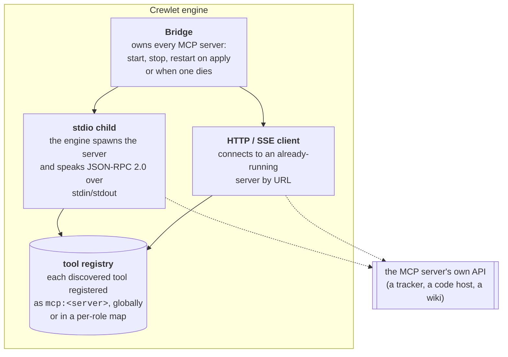

# Tools & MCP Integration

Agents interact with external systems and internal engine operations through tools. Crewlet supports both built-in tools and dynamically discovered MCP tools.

---

## Built-in Tools

The engine registers these into each epoch's tool registry with the origin `builtin`. A tool whose dependency is absent (no store, no knowledge backend, no A2A channel) is omitted rather than registered and broken; [Agent Runtime § Built-in Tools](../concepts/agent-runtime.md#built-in-tools) says when each one is registered.

| Tool | Description |
|------|-------------|
| `lookup_colleague` | Resolve any colleague identifier (handle, role name, a human's contact ID) to one seat, case-insensitively, with partial and fuzzy fallbacks; ambiguous queries return the candidate list so the LLM picks rather than guessing. A person the identity directory withholds shows no accounts, and their ids name nobody |
| `reflect_and_persist` | Capture a durable fact in the agent's private diary (`kind`: `long` or `short`) |
| `refresh_memory` | Re-run the personal-memory filter mid-turn after gathering richer context |
| `query_episodes` | Recall the agent's own past turns: by meaning, by conversation, or most recent first |
| `use_skill` | Load one of the agent's own [synthesized skills](../concepts/agent-learning.md#5-synthesizer-skill-induction) on demand |
| `refine_skill` | Replace a synthesized skill's body with a corrected procedure; the previous version is kept |
| `mark_onboarded` | Stamp the agent's onboarding marker after reading the relevant onboarding pages (offered to the onboarding pass) |
| `a2a_ask` | Ask one AI colleague one question over the private A2A channel (see [Turn Engine § Colleague-surface tools](../concepts/turn-engine.md#colleague-surface-tools)) |
| `search_knowledge` | Re-run the shared-knowledge search mid-turn, once the agent knows what the task actually needs. `mode` picks the ranking — `hybrid` by default, `keyword` or `semantic` (see [Search](search.md#three-modes-and-what-an-answer-says-it-served)) — and an answer ranked other than it was asked says so in a sentence: a `semantic` search with nothing to rank by meaning runs nothing, and says that tells the seat nothing about whether a page exists. Registered wherever the company has a knowledge backend at all |
| `load_tool_skill` | Load the full body of a [Tool Skill](../concepts/tool-skills.md) by key. A key nobody published is answered with the near keys ("did you mean") and the keys that exist, at most 30 |

`delegate`, the tool that hands work to short-lived [workers](../concepts/turn-engine.md#workers), is not registered here: it is built per turn for the executor, because it carries that turn's grant.

### Worklet and Doclet

Twenty-three more, registered **only where the company runs Worklet or Doclet**
(`tracker.backend: worklet` / `knowledge.backend: doclet`, which are the
defaults). A company on Jira and Confluence gets none of them, and that is the
point: a seat offered a tool against a tracker its company does not run would
reach for it and fail at the call, and a model shown a tool that always fails
learns to distrust the whole catalogue. The seventeen below are the item, file and page
tools; the other six read the catalogue, the projects and the activity feed,
and [Worklet](worklet.md#what-a-seat-can-do) lists the tracker's
eighteen in full.

| Tool | Description |
|------|-------------|
| `list_work_items` | The board, filtered — what you are assigned, what is open in a project, whether something was already filed |
| `get_work_item` | One item's description, thread, history and links, by key or id |
| `create_work_item` | File one. `project` defaults to the seat's own unit's, and is required when the unit owns none. `status` says where it starts (default `todo`). With no `assignee` it goes to the project's default assignee, else to triage for the lead, and the answer's `assignee` says which. `ask` (with an optional `decision`) files it as a question to that person, in one record |
| `update_work_item` | Move it — status, assignee (with an optional `reason` the new assignee reads), priority, labels, links, one checklist change — with an optional `if_match` that refuses on a concurrent edit |
| `comment_on_work_item` | Post to the thread. Mentions wake the seats they name; the turn's own key makes a re-run turn post once. `ask` puts a question to somebody and `decision` structures it as options; `answers` with `choice` answers one |
| `merge_work_item` | Fold a duplicate into the item that survives — linked, its subtasks re-parented, and closed as `cancelled` |
| `move_work_item` | Move a top-level item and its subtasks to another project, re-keyed there with the old keys still resolving — the project lead's, as a re-route is |
| `search_work_items` | Find an item by what it says, ranked over titles and descriptions. `mode` picks the ranking as `search_knowledge`'s does — `hybrid` by default, `keyword` or `semantic` — and the answer names the mode it served, with a `degraded` sentence when that is not the one asked for |
| `list_project_files` | A project's files — reports, specs, notes — in path order, a page at a time |
| `read_project_file` | One file's text, a page at a time from an offset; bytes as base64 on request |
| `write_project_file` | Put a file at a path, creating it or replacing it, with an optional `if_version`. Writing exactly what the file already holds, with the same type, stores nothing and answers `outcome: unchanged` |
| `remove_project_file` | Take a file out of a project; its content is deleted from storage — the project lead's, as removing an item is |
| `list_pages` | Browse the knowledge base by container, parent or title |
| `get_page` | One page's body, breadcrumb, children and history |
| `write_page` | Create one. Titles are addresses and are unique per container; a `parent` must be a page in the same container that is not in the trash; a body links another page by id, `[its title](#/doclet/pages/<page id>)`, which is what "Linked from" reads. `status` is `published` (the default) or `draft`, which is listed in its container and returned by no search until it is published, and any other value is refused; an empty body files a folder, a page that only groups the pages under it |
| `save_page` | Edit one, stating the version you read: there is no per-field merge that makes overwriting prose safe. A `parent` moves it, and may not be the page itself or one beneath it; an empty one moves it to the container's top. `watch` is `true` to follow the page or `false` to stop, and anything else is refused rather than read as no change |
| `comment_on_page` | Remark on a page, or replace one of your own with `edit` |

What `get_page`, `get_work_item` and `read_project_file` hand back that
somebody wrote (a page body and its comments, a description and its thread,
a file's text) arrives **fenced** and labelled with its writers and how far
the reader may rely on them, beside a `provenance` envelope that labels the
whole answer; see
[text somebody else wrote](../concepts/agent-runtime.md#text-somebody-else-wrote).
A body sent back to a write still wrapped in the fence it was read in is
stored without it.

The writes on each side count as a **delivery** for the turn's own
did-this-reach-anybody gate, and each raises the floor the turn's next read
carries, so whichever copy answers that read — this node's or another data
node's — has applied the write first: a turn that files an item and then
lists the project sees what it just filed.

Every write answers with its `outcome` — `applied`, `pending` or `unknown`,
the [three values every write has](replication.md#a-write-has-three-outcomes)
— and the `position` it is durable at. A write whose outcome is **unknown** is
never answered with the id, key, version or revision of something that may not
exist, on any write tool on either surface: the call fails, saying that the
write may have landed and may not, under which operation, and what to do. That
includes `create_work_item`, whose unknown answer names the key this attempt
minted, if it minted one, as the key the item has *if* it was filed — never as
a receipt — and a comment, whose id, mentions and ask are not reported beside
a remark nobody can say was posted. An `update_work_item` whose change is
unknown writes none of the dependency changes it was also asked for: it stops
there, and the same call made again answers the change first and writes them
after. And the `version` an update answers with is always the item's own and
its newest — the one to send back as `if_match` — never another item's that
the same call wrote, and never one its own dependency change has already moved
the item past, when a call changes both; its `position` is likewise the call's
last write, so waiting for it waits for all of them. A write that **a data
node never answered**, and no other ran, is unknown too, never a refusal: the
node that stayed silent may have run it, so it is not "not made", and the
answer says what settles it for that call — the same operation again where the
call carried one, a read before writing again where it did not.

Where this node's operation ledger cannot vouch for the operation — it was
minted before the ledger may have lost rows, as an `op_id` your assistant sends
back more than thirty days after the write that first answered with it — the
answer says this node cannot tell, because the same operation asked here
answers the same way until the write reaches this node, and tells the caller to
look before writing it again; a gesture that stopped part of the way through at
such a step is not told to repeat itself either. A seat's own write under a
plain lost acknowledgement is told to repeat the call with exactly the same
arguments, before any different call to the same tool — that is the same
operation, and it lands once. Reworded, it is a new one. Where the ledger
cannot vouch for it, that same repeat is still safe — it publishes nothing this
node cannot vouch for — but it answers the same way until the write reaches
this node, so looking says sooner. The two writes that state a whole value
rather than change one — `write_project` and `write_work_catalogue` — say
instead that repeating them is harmless: each call is a new operation stating
the same thing.

A create or an update that declares its labels first (`labels_create_missing`)
and cannot tell whether that declaration landed stops there too, and is
answered under its own name as the write it did *not* make — the item not
filed, the change not made — because the declaration comes before the item's
own write. The same call made again answers the declaration and then makes the
write, once; where this node's ledger cannot vouch for the declaration, the
answer says to declare the tags with `write_project` first, which is harmless
if they already landed, and then to make the same call — and says what that
call will do. Its own write dates from the same instant as the declaration, so
this node cannot vouch for it either: it answers with the item an earlier
attempt filed, or the change this node still holds a record of, and otherwise
answers `unknown` again, which then means looking for the write
(`list_work_items`, `get_work_item`) rather than making it another way — or,
from the operator's surface, making the same call with its `op_id` through
another node whose ledger reaches back that far.

The same tools are served to **your** AI assistant over
[`/operator/mcp`](../reference/api-endpoints.md#operatormcp--your-own-assistant),
and eleven more beside them that no seat is given: the saved views, the
catalogue write, a person's own queue, inbox and pins, the trash, and the board
drag. Each call is decided by the same authority table a seat's is, and each
write is attributed to who the request is, never to a name the caller chooses:
a person writes **as the seat they hold** — every person holds one — and so
does a token the identity directory binds to a seat, with kind `human`, while a
credential nobody is bound through writes under its own login (`token:<id>`),
with kind `operator` — the credential
itself is recorded beside either as the write's `operator_id`. Five more are a
person's decisions about the company rather than its work, and are served only
there too: `pause_seat` and `resume_seat`, and `steer_turn` (a note to a
running turn, decided on the seat its executor's record names once the executor
is out in its box, and before that once a probe of the fleet names the turn's seat — a
probe nobody answers is `unavailable`), each for the seat's holder, its lead
or an administrator; `answer_executor`, for the person who asked for the work a parked
executor asks about, or a lead of its seat; and `answer_knowledge`, which
asks the company's knowledge a question on the auxiliary model of the asker's
seat, so it needs either app (it searches the pages only for a `doclet`
holder and the board only for a `worklet` holder) **and** a credential bound
to a seat. That set
is ONE operator catalogue, built for every call from what the node runs now,
and every operator transport serves it — MCP at `/operator/mcp` and the
dashboard's [`/operator/act`](../reference/api-endpoints.md#operatoract--the-dashboards-write-surface)
— so what a person can do is the same whichever way they reach the company.
The MCP transport is **stateless**: every call is decided by the credential of
the request carrying it, never by the one that opened a session, so a grant
withdrawn mid-conversation stops the next call and an `Mcp-Session-Id` is a
handle rather than a proof.

Over MCP, each tracker write's answer also carries the **`op_id`** of the
operation the call was, and the write tools take it back as an argument: an
assistant has no turn to repeat, so sending the same call with that `op_id` is
how it finishes a write that came back `unknown` or stopped part of the way
through, instead of filing it twice. An `op_id` is that one call and no other:
it carries a digest of the call's arguments, and brought back with any other
argument, or to another tool, it is refused before anything is written. A seat
is never offered the argument — its turn is its identity — and a seat's call
that sends one is refused. The dashboard's transport,
[`/operator/act`](../reference/api-endpoints.md#operatoract--the-dashboards-write-surface),
takes the operation in an `Idempotency-Key` header instead, and refuses a
write without one (`400 op_id_invalid`, naming the header) and an `op_id`
argument beside it: the key is scoped to the principal that sent it, so a
retry is the same request sent again with the same key, and a key somebody
else learned names a different operation for them.

Note the deliberate split between personal and shared writes: `reflect_and_persist` is **personal-only** (it writes to the agent's private `agent_diary`), while team-shared content is a knowledge-base page: `write_page` on Doclet, or the vendor's own MCP tools on Confluence (see [Knowledge System](../concepts/knowledge-system.md)). `use_skill` resolves the agent's own synthesized skills; shared procedures are knowledge-base pages.

**On a vendor tracker there are still no task builtins.** `create_task`,
`assign_task`, `update_task` and `list_tasks` are not registered against Jira
or GitLab issues — an agent works those through the vendor's own MCP tools, so
the engine mirrors no state it would have to keep in step. See
[The Tracker](../concepts/task-engine.md).

### Artifacts

Seventeen more, registered on every node that takes artifact uploads (one
with an object store, a coordination store and a data node to reach), whatever
tracker or knowledge base the company runs: thirteen for artifacts, their
folders and the company's brand, and four for an artifact's datastore. Each tool
is named for its authority row, and the operator catalogue serves the same
seventeen, so an operator's own assistant publishes, files and writes rows
exactly as a seat does.

| Tool | Description |
|------|-------------|
| `list_artifacts` | The artifacts the caller can open, by `scope` (`mine`, `shared`, `company`, `agents`, `all`), `kind` and `query`, a page at a time (`max_keys`, `continuation_token`). Folders read as S3 prefixes: `prefix` is a folder's path (`Marketing/Q4/`, empty for the top level), and with `delimiter: "/"` the answer is that one level, its artifacts in `contents` and its subfolders in `common_prefixes`. Every row names its `folder` |
| `get_artifact` | One artifact: its head, its newest versions, its files and a page of one file's source. The answer says the caller's `role` and whether they may publish (`writer`) |
| `list_dashboard_sources` | The engine sources a dashboard's `engine` datasets may read: each one's parameters, columns, who may read it and how it refreshes. Holds no row; a source is answered as each board's viewer |
| `get_artifact_format` | The exact format a kind's files are checked against at publish (`brand`, `slides`, `doc`, `design`, `dashboard`): every key of its index with its type and rule, its bounds and closed sets, and for a brand kit an example that reads clean. Generated by each format package from the form its strict decode reads with, so it cannot drift from what a publish admits. Holds no row; readable by everybody |
| `get_company_brand` | The company's adopted brand: its colours by role (light and dark, each with the kit token that carries it), its typefaces, its logos as the kit's `crewlet-logo` markup and as ready `from_brand` copies, the brand slide theme's colours, the version adopted and by whom, the artifact kit version to link, and its voice, fenced under the `company` trust. `brand` is null when none is adopted. Readable by everybody, under every ceiling |
| `create_artifact` | A new artifact of any kind (`html`, `doc`, `slides`, `dashboard`, `sheet`), from inline `content` and `files`, a project file, the adopted brand's logos and faces (`from_brand`), a build in the turn's box (`source.sandbox`), or for a deck a `starter` plan (a theme, `brand` among them, and the slides it opens with). `folder` files it in a folder that exists, by id or path. When a person asked for it, they are made its editor |
| `publish_artifact` | A new version on a stated `base_version`: `edits` (exact `old_str` and `new_str` pairs), `content`, `files` (null removes one; `from_brand` copies a logo or a face), a build's whole `source`, or `restore_version` |
| `update_artifact` | The title, description, icon or one version's label |
| `share_artifact` / `unshare_artifact` | Grant a seat, a unit (`unit:<key>`) or the company (`company`) one role up to editor, or withdraw it. The owner's |
| `upload_artifact_asset` | Add an image, data file or font to the asset store of an artifact that declares the `assets` capability; the answer's `reference` is the path the page uses |
| `create_artifact_folder` | A folder inside a folder that exists (`parent`, by id or path), or a path of them created as needed; a chain that exists already is answered as it is. Only a person creates a top-level folder |
| `move_artifact` | File up to 25 artifacts in a folder (by id or path), or take them to the top level (`folder: ""`), each decided and written on its own, with a result per artifact |
| `read_artifact_data` | An artifact's datastore: with no `collection`, its schema (every collection, its columns and who may read and write it); with one, a page of rows (`since` for what changed after an earlier `through`) or one row by `doc` |
| `query_artifact_data` | Rows of one collection whose indexed fields match every filter in `where`, ordered by `order_by` and paged |
| `write_artifact_data` | A batch of 1 to 100 ops (`set`, `merge`, `delete`, `increment`, `append`, `add`, `remove`), all or none, each decided by its collection's rules; `if_version` writes a row only if nobody changed it since, and a conflict hands back the rows as they are now |
| `set_artifact_schema` | Every collection the datastore keeps after a change, with its columns and rules. An agent may tighten a collection's rules and never loosen them: lowering a role, lifting `humans_only`, an append mode or immutability, removing a condition, pointing an `assigned_to_viewer` column at another assignee, or dropping a protected column or a collection is refused to an agent and left to a person |

**Every verb is decided twice inside a turn somebody woke.** The tool reads the
stored artifact and asks the authority table for the seat, then for whoever the
turn is acting for (the **requester ceiling**): an agent never shows an
artifact to a requester who could not open it, and never writes for one what
they could not write. The exception is an artifact the agent owns, which
anybody who can message the agent may ask it to edit, as with all other agent
work; reading and sharing are never exempt. A turn woken by somebody the
company does not know opens no artifact at all. A caller with no relation to an
artifact is told it does not exist, in exactly the words an id nothing holds is
answered with. An agent is held to `contributor` on artifacts it does not own
unless `artifacts.agents_manage_others` lifts it.

**A folder grants nothing, and its name is the ceiling's too.** Filing asks
editor on the artifact and contributor on the destination, each through the
requester ceiling, and never changes who may open the artifact. A folder
reference resolves only among the folders the seat and whoever the turn is
acting for can both see: a missing one is refused naming the nearest paths they
both see (never created), an ambiguous one is refused naming each candidate, and
a turn woken by somebody the company does not know sees no folder and files in
none. A turn segment makes at most **5** folder records; a chain that already
exists is answered without counting. Renaming, moving and removing folders are
a person's gestures in the dashboard.

**The adopted brand is everybody's to read.** It is the face the company shows
on everything it publishes, so `get_company_brand` answers under every ceiling
and only the version an administrator adopted, never a kit's newer draft. Its
voice is the one free text: it arrives fenced as `brand_voice` under the
`company` trust, which governs tone and wording and never the task, the tools,
the recipients or access. A `from_brand` copy is made by the publish pipeline
from the adoption's snapshot as a new object of the version, so a later
adoption changes no version already published.

**The datastore's rows are the ceiling too.** A row is answered only when the
person the turn is acting for could read it as well, by the collection's own
read rule over their role and their record, and a datastore write is stamped
with the lower of the agent's role and theirs, so the applier's column rules
refuse for them exactly what they could not write themselves (an agent's own
artifact excepted, as above, for writes; never for reads). What a write hands
back is a read, and is bounded like one even where the write itself was not: a
conflict's current rows are only those the requester could read, so an edit to
the agent's own artifact asked by somebody it is not shared with answers the
conflict with no rows at all. Every row a data tool answers is fenced as text
its writers wrote (`artifact_row`, naming the row's creator and last writer), a
conflict's current rows included. A turn writes at most **1,000** datastore
ops; a retry of a call it lost the answer to is not counted again.

**An artifact in the trash serves no content.** `get_artifact`,
`read_artifact_data` and `query_artifact_data` refuse it, naming the trash and
its owner, and read nothing, exactly as the dashboard's file and data routes
do; a write to it is refused until a person restores it.

**An administrator's override is recorded before anything is shown.** On the
operator surface, a person holding `admin` reads any artifact through the admin
path, and every such read (`get_artifact`, `read_artifact_data`,
`query_artifact_data`, and the live files a stale publish answers with) writes
the elevated-read record first, which the artifact's history shows its owner
and editors. A read whose record cannot be written shows nothing. An
administrator who holds a share reads and writes as that share.

**An agent working on an artifact is in its room.** A seat that reads an
artifact or its data (`get_artifact`, `read_artifact_data`,
`query_artifact_data`) appears in the artifact's room as an agent, viewing, and
one that writes it (`publish_artifact`, `update_artifact`,
`upload_artifact_asset`, `write_artifact_data`, `set_artifact_schema`,
`move_artifact`) as
editing, focused on the version, collection or row the call named, for 45
seconds after its last call, and only once the call was allowed. The people
looking at the artifact see which agent is working on which row.

**A publish names its base.** One over a version somebody published since is
refused `stale_version` and handed the live version, who published it and
when, the paths that changed since the caller's base and the first page of each
changed text file, fenced as text that author wrote. The text is a read of the
live version: where this turn could not read the artifact (a publish to the
agent's own work asked by somebody it is not shared with, or an
administrator's read whose record could not be written), the refusal carries
the numbers, the author and the paths alone, and says so in
`live_files_withheld`. No tool takes `force`:
discarding a colleague's newer version is a present person's decision in the
dashboard. Trash, restore, purge, transfer and pins are not tools either.

**Where the bytes come from.** Inline content is at most 1 MiB decoded per
call. A build in the turn's box and a project's file are streamed: their digests
are declared to an upload the publish pipeline reserves first, each file is put
through the engine, and the version is decided only after every byte is read
back verified. A sandbox is never handed an upload URL; the engine lists the
directory through the box itself, holds every path to the workspace, and
refuses one file more than a version holds rather than truncating. The engine
reads a box only for the run working in it — a call the run makes over its own
bridge while its record reads `running` — attached as a reader, never resumed.
A call from another seat's turn, or from a run parked on a question, collected
or torn down, is refused `not_running`; a caller that is not an agent seat is
refused `forbidden`; and a seat's call on a node that runs no sandbox is refused
`unavailable`
([Code Sandbox](../concepts/code-sandbox.md#how-a-coding-task-runs)). So a
seat's executor publishes a build larger than the inline bound from its box
before it finishes.

**Per turn**, an agent makes at most 20 publishes, 10 of them on one artifact,
and writes at most 128 MiB; past either the call is refused `turn_quota` and
told to stop and report. A version outside its policy or its format is refused
with every finding at once, the first 20 listed and the rest counted, and a
closed format's refusal points at `get_artifact_format`. Any write tool (an
artifact's or another) that answers a policy refusal (`invalid`) four times in
a row on one target (an artifact, a work item; the whole tool where a call
names none) appends a plain instruction to stop retrying, raise a blocker on
the work item if there is one or tell whoever asked, and end the branch; a
success on that target ends the run. The run is logged as
`tool_policy_refusal_loop` and counted once in
`crewlet.tools.policy_refusal_loops` when it reaches the limit
([ADR-0059](../../adr/0059-a-tools-contract-is-its-validators-and-every-fault-comes-back-at-once.md));
the call itself still runs, so a version that is
finally right still publishes. File text another principal wrote is
[fenced](../concepts/agent-runtime.md#text-somebody-else-wrote), and a long one
is condensed by the seat's auxiliary model unless the call passes `offset`.
**Publishing delivers nowhere**: no artifact tool counts as a delivery, so a
seat asked in a chat thread posts the `url` every answer carries with its chat
tools. The bundled `skill:artifacts` [Tool Skill](../concepts/tool-skills.md)
teaches the design contract and how to shape and fill a datastore (a schema
before rows, batched writes, blind cells and guarded long text, `humans_only`
for approvals), and is enforced on the five tools that write bytes, a schema
or rows; `skills/crewlet-artifacts/SKILL.md` carries the same contract for your
own assistant, installed as the
[`company-architect` skill](../getting-started/ai-authoring.md#the-company-architect-skill)
is (copy the directory into your assistant's skills folder).

### Chatlet

Nine more, on the same terms and on the third axis: they are registered **only
where the company runs the engine's own chat** (`chat.backend: chatlet`, the
default). A company on Slack or Mattermost gets none of them and reaches its
workspace through that vendor's own MCP tools instead, for the reason the
tracker section gives — a seat offered a tool against a surface its company
does not run reaches for it and fails at the call. They are the `chatlet` app's
([Identity and access](../concepts/identity-and-access.md)), which every seat
holds.

| Tool | Description |
|------|-------------|
| `post_message` | Say something new in a room, as a top-level message. `@handle` reaches one colleague; `@channel` in the text is what addresses the whole room, and the receipt says so back |
| `reply_in_thread` | Answer a message under its own thread, beside the question. Threads are one level deep, so a reply to a reply carries the same root |
| `send_dm` | Say something privately to one colleague or a few, opening the conversation if it is not open. Never the place for an answer that was asked for in the open |
| `read_channel` | Read a room, newest first, or one thread in it, oldest first. The rest of the room is not handed to a seat at turn start, so it reads it here when its answer depends on what was said before |
| `list_channels` | The rooms this seat is in, most recently active first, with what each is for and the last thing said in it |
| `search_messages` | Find a message by what it **says**, ranked across every room this seat may read — at most forty to an answer, twenty unless asked — and an answer from an index still being built says so rather than reading as nothing said. `read_channel` is the other half: one room, in order, from a point you name |
| `react_to_message` | Put one emoji on a message (`message_id`), or take yours back |
| `join_channel` / `leave_channel` | Move this seat's own membership, and nobody else's. A private room cannot be joined this way, and a unit's own room can be neither joined nor left — its membership is the org chart's, and either gesture would be undone by the next apply |

Every tool that takes a `channel` takes the room's id or its **name** — `#eng`
and `eng` are the same room. A name is the room's address, unique across the
company, so it resolves for any room the seat may read whether or not it is
in it: a public room, or a unit's own room, which is where a decision's
outcome is often promised. A private room's name resolves only for its
members, and to anybody else answers exactly as a name nobody holds.

A message's `links`, at most eight on `post_message`, `reply_in_thread` and
`send_dm`, are each an absolute `http`, `https` or `mailto` address, kept
exactly as sent. A relative reference, a dashboard route (`#/...`) or any
other scheme is refused, naming every entry that is not one (`links[1]`): no
reader of the message could open it as it stands.

What `read_channel`, `search_messages` and `list_channels` hand back that
somebody said — every message and snippet, under its author, and a room's
topic and purpose as the room's own label — arrives
[fenced](../concepts/agent-runtime.md#text-somebody-else-wrote), and a body
sent back to `post_message`, `reply_in_thread` or `send_dm` still wrapped in
the fence it was read in is posted without it.

**Three of them count as a delivery** for the turn's did-this-reach-anybody
gate — `post_message`, `reply_in_thread` and `send_dm` — and the obligation is
*source-scoped*: a turn woken in a room owes an answer **in** a room. A
reaction is deliberately not one of them. It wakes nobody and discharges
nothing, because a seat that could answer every obligation with a thumb would.
A turn's write is made once however often the turn is re-run: its key is
derived from the turn's unit of work and the call, and a join after a leave is
a new join rather than the first one's retry.

The same nine are served to **your** AI assistant and to the dashboard over the
[operator surface](../reference/api-endpoints.md#the-chat-gestures-only-a-person-makes),
as the seat the person behind the call holds, and eight more that no seat is
given:
`create_channel`, `open_dm`, `update_channel`, `add_channel_members`,
`set_channel_members`, `edit_message`, `delete_message` and `mark_chat_read`. A seat corrects what it
said by replying rather than rewriting it; a room, its settings and its
membership are the company's furniture; and a read cursor is a person's
attention, which a seat — woken rather than reading — does not have. Every one
of them is made as a seat, so a credential acting as itself is refused them
all, the reads included.

See [Chatlet](../concepts/chatlet.md) for who a message wakes, which of them owes a
reply, and the two things the axis deliberately does not do.

### Groups, and who may call each one

Holding a tool is not being allowed to call it. Every call to a built-in is
decided against the tool's own row in the engine's authority table, so an
agent offered `update_artifact` still edits only an artifact it holds the
editor role on. The engine files each built-in an agent can be offered in one
group, and names the **gate** its authority row decides:

| Group | `group` | What its tools are for |
|---|---|---|
| Work items | `work` | Worklet, the company's tracker: read, file, discuss and move work |
| Projects | `projects` | Each project's settings, and the files kept in it |
| Knowledge | `knowledge` | The company's pages in Doclet, and the search over its knowledge |
| Chat | `chat` | Chatlet rooms and direct messages |
| Artifacts | `artifacts` | Documents, slides, sheets and dashboards agents make and share, and the data behind them |
| Colleagues | `colleagues` | Finding a colleague, and asking another agent a question |
| Memory and skills | `memory` | The agent's own notes, past turns and skills |
| MCP discovery | `discovery` | `list_mcp_server_tools` and `activate_tool`, which the engine hands every executor and onboarding pass so it can reach its MCP servers' tools |

| `gate` | Who may call it |
|---|---|
| `everybody` | Any agent. Also the discovery pair's, which no authority row decides |
| `self` | The calling agent, about its own diary, past turns, skills and onboarding, and nobody else's |
| `worklet` | An agent that uses Worklet. `my_work` is here too: it reads the caller's own day and takes no name for anybody else's |
| `worklet_asked` | An agent that uses Worklet, or one an open ask on the item names |
| `project_lead` | The lead of the project the work item or the file is in |
| `doclet` | An agent that uses Doclet |
| `chatlet` | An agent that uses Chatlet |
| `artifacts` | An agent that authors artifacts |
| `artifact_viewer` | Anybody the artifact is shared with, as a viewer or more |
| `artifact_editor` | The artifact's editors who also author artifacts |
| `artifact_owner` | The artifact's owner |

An administrator passes every app gate. A group whose surface the company does
not run is not there at all: a company on Jira holds no Worklet tool, and one
on Slack no Chatlet tool.

The gate is a word for the row, never a second decision: the engine's tests
hold each built-in's gate to its row's class, app and artifact role, so a
change to who may call a tool changes the gate with it. `GET /tools` and the
`tools` push carry `group` and `gate` on every row (both empty on an MCP
server's tool, whose calls no authority row decides), and `GET /mcp-servers`
lists the built-ins group by group, the discovery pair included (see the
[API reference](../reference/api-endpoints.md#get-mcp-servers)).

### Per-Role MCP Servers (GitHub)

Roles with GitHub credentials in `mcp_env.github` get a per-role instance of the [remote GitHub MCP server](https://github.com/github/github-mcp-server) (declared as a `shared: false` `http` entry in `mcp_servers`), giving them the full GitHub toolset for reading/reviewing/tracking code (issues, PRs, repos, code search, actions); code authoring is the seat's executor run's, with its own shell and git in its [box](../concepts/code-sandbox.md). See [GitHub Integration](../integrations/github.md).

### Where a tool comes from

Every registered tool records **who registered it**, and that is recorded at
registration because it cannot be recovered afterwards: a tool an MCP server
serves is structurally identical to one the engine ships — same name, same
schema, same call signature. With nothing recorded, a tool missing because its
server failed to start reads as a missing builtin, which sends an operator to
debug the wrong subsystem.

`GET /tools` reports it as each tool's `source`, and the dashboard's **Settings › MCP Tools** screen
groups on it:

| `source` | Where the tool came from |
|---|---|
| `builtin` | Shipped by the engine. The agent-to-agent tools are builtins too — `a2a_ask` is registered by the same walk, so "a2a" is a capability rather than an origin |
| `mcp:<server>` | Discovered on an MCP server. `<server>` is the **bare** template name, never the per-role instance: two seats' children of one template are the same integration to a reader grouping the catalogue |

Those two are the whole grammar. A server that fails to start is visible as a
**missing group**, rather than its tools quietly going absent from the builtins —
and, above the catalogue on the same screen, as a row of its own: every node
re-publishes its MCP servers as they are at each beat on its presence heartbeat
(per server, its instances counted), so **MCP servers** shows each server as
*Running*, *Partly failing*, *Failing*, *Waiting for credentials*, *Not
started*, *Not reported* or *Disabled* (turned off, [below](#turning-a-server-off)) with one cell per live node and the first failure's
reason and seat, and the first waiting instance's sentence and seat
(`GET /mcp-servers`, which takes `admin` because it shows each server's
configured launch, as `/config` does; the heartbeat carries each reason
bounded, and the whole
text is the node's `mcp_server_failed` log line, or `server_exited` for one
that [went down after starting](#a-server-that-dies-or-will-not-start)). Clicking a server opens its own page:
its state, reach and launch, every node's reason as the node reported it rather
than clamped to the grid's two lines, and the catalogue narrowed to its tools —
which, for a server that never started, says it registered none and why.

### Adding a server from the dashboard

**Add an MCP server** on Settings › MCP Tools (`admin`) writes
the same `mcp_servers` entry you would write in YAML: a name, a command and its
arguments (stdio) or an address (http), `shared` or one per seat, and the
environment or headers — values as `${NAME}` pointers into the secret store,
which the form offers as you type `$`. It checks the whole company with the
server in it before storing, and adds it after every server already declared.
A name the configuration already carries is refused; a name only a node still
runs, from a revision it has not applied past yet, is free: the create is
judged against the configuration alone. The name, the prefix, the keys and the
address are held to [the naming rules](#naming-a-server-and-its-tools).
Over the API it is `PUT /config/mcp-servers/{name}` with `If-None-Match: *` —
see [configure via the API](configure-via-api.md). A per-seat server still needs
a seat to declare credentials for it under `mcp_env`, which is written in the
org builder.

### Turning a server off

`enabled: false` on an `mcp_servers` entry turns the server off and keeps
everything else. Nothing runs it:

- the shared instance, or every seat's instance, that was running is stopped
  on the apply that turns it off;
- no seat is granted it, so its tools leave every seat's surface and its
  `mcp:<server>` leaves every seat's `tool_sources`;
- no executor box is given it, even where a seat's `sandbox.mcp.servers` lists
  it.

Everything that names it stays, and is checked as before: the entry, every
seat's and unit's `mcp_env` block for it, and every box listing. A `${VAR}` it
would need is nobody's concern while it is off, so one that resolves to nothing
holds nothing back and is not reported. Its row on Settings › MCP Tools reads
*Disabled* (`state: disabled` on [`GET /mcp-servers`](../reference/api-endpoints.md#get-mcp-servers)),
and an integration's Agents tab says the agent's tool is not running where
every server that reads the integration's credential is off.

Set it back to `true`, or remove the key (on is the default), and the next apply
starts it with the credentials its seats kept. Removing a server instead means
clearing every block that names it first, and losing what they held.

### Saying what a server is for

`description` is one line, at most 200 characters with no line breaks or tabs,
saying what the server is for. Each agent's prompt names its MCP servers under
`## Tools to discover` before it shows any of their tools, and prints the
description beside the name:

```text
- MCP server `handbook`: Searches the engineering handbook and the runbooks
```

A name like `internal` says nothing about what is behind it; the description is
what tells an agent which server to look in before it spends a call listing
one. Editing it reaches the next turn and restarts nothing, since no server
process reads it. It is also on the server's row of `GET /mcp-servers`.

### Naming a server and its tools

An entry's name, its `tool_prefix`, the keys of the values it is started with
and its address are each held to what every client that reads them can use. A
write that breaks one is refused at the field, saying what to write instead:

| Field | Rule | Why |
|---|---|---|
| `name` | Lowercase letters, digits and hyphens, starting and ending with a letter or a digit, at most 32 characters; not `crewlet` | It is the origin of every tool the server serves (`mcp:<name>`), the key seats declare its credentials under, a segment of the routes that act on it, and, for a server an executor's box runs, the middle of every tool name the box's coding CLI hands its model (`mcp__<name>__<tool>`) |
| `tool_prefix` | Letters, digits, `_` and `-`, at most 49 characters | It is put in front of every tool the server serves, and a tool's whole name is at most 50 characters ([below](#a-tools-name)) |
| A key of an http server's `headers`, of a seat's or a unit's `mcp_env` block for it, or of its `seat_credentials` | An HTTP header name (RFC 9110's token): letters, digits and `-`, and no space, colon or quote | The value is sent as a request header |
| A key of a stdio server's `env`, of a block for it, or of its `seat_credentials` | An environment variable name: letters, digits and `_`, not starting with a digit | The value is an environment variable of the server's process |
| `url` | `https`, or plain `http` only to this host or a private network, with no user name or password in it | Every request carries the server's credentials, which plain http to a public host hands to every network on the way, and an address is shown wherever the server is: a credential goes in a header |

Plain http is accepted for an address the public internet does not route
(loopback, private, link-local, shared or otherwise reserved, judged by the
same rule every outbound dial is), a one-label name (a container's or a pod's service name), `localhost`, and
names under `.localhost`, `.local` (a Kubernetes cluster's `svc.cluster.local`
included), `.home.arpa` and `.internal`: by what the address says, never by
what it resolves to. An address written with a `${VAR}` in it is judged once
that resolves, by the same rule: a server whose resolved address breaks it is
not started, and fails on its row with the reason (the address itself is
never quoted, since a resolved one can carry a secret), and no executor's box
is given it.

These are admission rules: a revision stored before them still applies, and
`crewlet validate` and the warnings on a config read name each one, at the
path a write keeping it is refused at.

#### A tool's name

Every tool is filed under the server's `tool_prefix` and its own name, run
together, in one namespace with the built-ins and every other server's tools.
Each coding CLI then puts its own prefix in front before its model sees the
tool (Claude Code's `mcp__crewlet__`), and a model takes a tool name of at most
64 characters, of letters, digits, `_` and `-` alone. So a tool is not
offered, and never shortened to fit, since a shortened name is a new name two
tools can share, when:

| `reason` | The tool |
|---|---|
| `characters` | holds any other character in its name |
| `too_long` | is longer than 50 characters with the prefix: what the longest prefix a built-in CLI profile puts in front of the engine's tools leaves of 64. A profile with a longer prefix lowers it, for every company |
| `builtin` | has a built-in tool's name, and built-ins are filed first |

And a tool is **shadowed** where another server's tool of the same name is
offered in its place: among one node's servers the first server by name keeps
it, and in a seat's surface a shared server's tool keeps it against the seat's
own server's. A `tool_prefix` on either server offers both.

Each node reports these per server on its heartbeat, at most 8 of each with
how many there are in all, and
[`GET /mcp-servers`](../reference/api-endpoints.md#get-mcp-servers) gives each
server's `refused_tools` and `shadowed_tools` across the fleet, each with a
sentence saying what would offer it, beside `refused_count` and
`shadowed_count`. The node's own log names each one as well
(`mcp_tool_refused`, `tool_name_collision`).

### The curated catalogue, and a community registry

Adding a server starts from the **curated catalogue**: the MCP servers this
build knows, each with its address or launch line, the headers or variables it
reads, how a static credential's value is spelled, the sign-ins its vendor
offers, what an admin has to do at the vendor first, and the day its facts
were last read from the vendor (`read_at`). It is a table compiled into the
engine and reviewed in pull requests, so every node answers it the same, with
or without egress. `GET /mcp-servers/catalogue` serves it (see the
[API reference](../reference/api-endpoints.md#get-mcp-serverscatalogue)).

| Entry | Server | Sign-in |
|---|---|---|
| `github` | GitHub's remote server | the GitHub integration (each agent's own app token), or a token header |
| `datadog` | Datadog's remote server, at your site's address | the Datadog integration, OAuth, or the `DD_API_KEY` and `DD_APPLICATION_KEY` headers |
| `rovo` | Atlassian's Rovo remote server | OAuth, or an API token an organization admin has allowed |
| `linear` | Linear's remote server | OAuth, or an API key header |
| `notion` | Notion's remote server | OAuth |
| `sentry` | Sentry's remote server | OAuth |
| `stripe` | Stripe's remote server | OAuth, or an agent API key header |
| `cloudflare` | The Cloudflare API server | OAuth, or an API token header |
| `gitlab` | `glab mcp serve`, one per agent | the GitLab integration |
| `slack` | `slack-mcp-server` 1.3.0, one per agent | the Slack integration |
| `mattermost` | `mcp-server-mattermost` 0.6.1, one per agent | the Mattermost integration |
| `atlassian` | `mcp-atlassian` 0.23.1 for Jira and Confluence, one per agent | the Atlassian integration |
| `tavily` | `tavily-mcp` 0.2.22 | its API key variable |
| `postgres` | Postgres MCP Pro (`postgres-mcp` 0.3.0), restricted to reads | its connection string variable |

A local entry launched through a package runner names the exact release its
facts were read against, and every page here that launches the same package
names the same release: one test holds the catalogue and the pages together,
so a bump moves them at once.

**The same table recognises a configured server.** A server whose address or
command matches an entry is drawn on Settings › MCP & tools with that entry's
title and vendor mark, and `GET /mcp-servers` names it (`title`, `catalogue`,
`vendor`). For the entries an integration serves, that recognition is also
what binds each agent's own credential to a per-agent server (see
[Seat credentials the engine binds](#seat-credentials-the-engine-binds)). An
address is matched by whole host labels, never a substring.

**A community registry is off until the company names one.** Set
`mcp_registry.url` to the https address of a registry that speaks the
[MCP Registry](https://registry.modelcontextprotocol.io) v0.1 API. That is
usually a mirror the company curates: the official registry is a preview,
and its own guidance is that a host reads a subregistry of it rather than it.

```yaml
mcp_registry:
  url: https://registry.modelcontextprotocol.io
```

The add flow then offers a search of it beside the catalogue. What a registry
lists is somebody else's description of somebody else's server, so:

- every result is marked **not reviewed**, and carries no read date, no
  integration and no fixed value; it is drawn with a vendor's mark only when
  its address is that vendor's own host;
- it is a draft for the same add flow, test and save as an address typed by
  hand, and nothing it says starts a process or skips a step;
- a result is offered only with a Streamable HTTP address that is https and
  fixed, or a package from the public npm or PyPI registry at an exact
  release, launched as `npx -y <package>@<release>` or
  `uvx <package>==<release>`. A listing that needs a runner argument, a
  package from another registry, a templated address, a field past its bound
  or text with a direction override is left out, and the answer counts it;
- a search reads at most a mebibyte and 20 results and gives up after 10
  seconds, and the engine dials the registry alone: never an icon, a
  repository or an address a listing names, and no redirect (a registry that
  moved is reported with where it points, for you to write);
- the address must be https, a private one included, because the launch lines
  a registry answers are only as trustworthy as the connection they came over.

### What a tool can do

Beside the origin, every catalogue row carries the **behavioural hints** the
tool was registered with (what an MCP server advertised, plus whatever an
operator overrode on top), where calling it lands, and, for a built-in, its
group and who may call it:

| Field | What it says |
|---|---|
| `annotations.read_only` | The tool modifies no state |
| `annotations.destructive` | The tool may perform irreversible updates |
| `annotations.idempotent` | Repeat calls have no additional effect |
| `annotations.open_world` | The tool reaches entities outside the local system |
| `delivers` | **Where** a call puts something in front of somebody outside the turn — empty for a tool that reaches nobody |
| `group` | The built-in's [group](#groups-and-who-may-call-each-one), empty on an MCP server's tool |
| `gate` | Who may [call the built-in](#groups-and-who-may-call-each-one), empty on an MCP server's tool |

**Each hint is three-valued** — `yes`, `no`, `unknown` — and `unknown` is a
first-class answer, not a soft `no`: it means the server did not advertise the
hint at all. The engine reads them that way everywhere. An unannotated tool is
**not** a known read, because treating unknown as read-only would exempt most
of a fresh server from the [delivery fence](../concepts/turn-engine.md) the
moment it is added.

`delivers` is not "was this served by MCP". A proven read-only MCP tool
delivers nowhere, and the engine's own work-item comment tool delivers although
it is a builtin — the surface is a first-party declaration made at
registration, and for an MCP tool it is the **server**, because nothing else
about it says where its call lands.

The **Tools** screen renders all of this: the strongest thing a tool's hints
positively assert, whether it reaches outside the company, where it delivers,
and how many arguments its schema declares. A tool whose server advertised
nothing shows as `unknown` rather than as a read — which is the row to check
before granting a seat a new server.

### A call is held to the schema its tool advertises

Every call to one of the engine's own tools is checked against the JSON schema
that tool hands the model, before the tool runs, whoever makes it (a seat's
executor run over the tool bridge, a phase on the engine's host, a worker, an
operator's assistant over `/operator/mcp`, or the work API), with
every finding named in one pass by its path and the shape the tool reads there
([ADR-0059](../../adr/0059-a-tools-contract-is-its-validators-and-every-fault-comes-back-at-once.md)).
A third-party MCP server holds its own schema and is not checked here.

- **A value the tool would misread is refused before anything runs.** That
  covers:
  - a string or a number where `true` or `false` belongs;
  - an object or a list where a string belongs;
  - a fraction where a whole number belongs;
  - `"5 days"` where a number belongs;
  - a number spelt outside decimal notation (`"0x10"`, `"1_000"`);
  - a word where a number belongs;
  - anything but a list or a string where a list belongs.

  Each of these was read as something else (`"true"` as false, 2.5 as 2), so
  it would write wrong data. The refusal (`invalid`) lists every finding of
  the call, so one corrected call answers them all.
- **What the tool decides on itself runs as before.** That covers a missing
  required argument, a value outside a closed set, a number past its bound and
  a list too long. A refusal from the tool carries every finding of the call.
- **An argument the tool does not take is refused at the top level,** as the
  engine's own tools always refused one (and the refusal carries every
  finding). An unknown key inside an object argument is noted, not refused. If
  the tool answers successfully while something was not read as sent, a note
  names it. A model or an MCP client reads the note after the answer. An act
  or work API answer, which a person reads, never carries it. The call is logged as `tool_args_outside_schema` and
  counted in `crewlet.tools.args_outside_schema`, by tool.
- **An argument sent as `null` is one nobody sent,** to the check and to the
  tool alike: the call reads as though it were left out, so it changes
  nothing, and a `null` for an argument the tool does not take is not
  refused. A `null` is a value only where the tool's schema declares it one,
  and there it clears what it names: an update's `due`, `start`,
  `estimate_minutes` and `points`, and a project's `target_date`. Inside an
  object argument a `null` is the object's to read, as a custom field's value
  in `fields` is cleared by one.
- **The lenient readings are kept.** A number or a boolean where a string
  belongs, one string or a comma-separated one where a list belongs, and a
  numeric string where a number belongs are read exactly as before.

### When a tool refuses

A tool that cannot do what it was asked answers with a **failed result** rather
than an error: the turn is fine, this call is not, and the sentence goes back to
the model so it can try again with a better argument. That sentence is written
for a model and tuned against how models behave, so it is not a contract anybody
else can parse.

The engine's **own** tools therefore also say what *kind* of refusal it was — a
machine-readable class beside the sentence, which is what a surface that is not
a model acts on:

| Class | What it means | What a caller should do |
|---|---|---|
| `invalid` | The request is wrong — an argument outside its grammar, a value past a limit of its own, or an argument naming *another* object that cannot take part (a parent in the trash, an archived task type) — and the sentence names which | Send something different |
| `not_found` | The item, page, skill or colleague the call is *about* does not exist | Stop; it is gone or was never there |
| `forbidden` | This caller may not do this here — outside a turn, somebody else's inbox or priorities, a view protected for its owner, a project's policy without the lead's authority, a reserved container | Ask whoever the sentence names |
| `stale_version` | The object changed after the caller read it | Read it again and decide from what it says now |
| `conflict` | The write lost its race to other writers, or the object the call is about is in a state that refuses it until somebody changes it — a room or a project archived, an item frozen in the trash, an artifact in the trash or being purged, a restore with nothing in the trash, or its own contents at their cap (a message carrying all its emoji, a label another version holds, a project keeping all its tags) — which the sentence names | Read it again; a race clears on its own, and a state is changed by whoever the sentence names, after which the same call lands |
| `exists` | What the call would create is already there | Edit the existing one |
| `already_answered` | The question this answers has an answer | Read the answer |
| `reassignment_budget` | The item has been handed on as often as it may be | Do not reassign it again |
| `inbox_full` | A person's inbox list is at its ceiling | Mark older entries read |
| `quota_exceeded` | The write would take what is kept past a limit on it: the company's storage — an artifact's bytes, a datastore's footprint — which the sentence names with the setting an operator raises, or a cap on what one datastore holds — a collection's rows, one participant's rows, a store's collections and documents — which the sentence names. No permission lifts it | Remove what is no longer needed, or ask whoever sets the limit to raise it |
| `notes_full` | The running turn a note is for already holds as many notes as may wait unread | Send it again once the turn has read them, at its next step |
| `notes_spent` | The running turn has taken as many notes as a turn takes | Do not send it again; put the rest on the work item |
| `not_running` | The run or turn the call addresses is not running, or not waiting for this | Nothing to act on |
| `budget_exhausted` | The company's token budget has no room left in one of its windows, so a call that would spend tokens was not made; nothing was spent. A person's answer carries a `remedy` naming the ceiling | Wait for the window the sentence names to turn over, or raise its ceiling |
| `unavailable` | This node cannot serve the call right now, or the company does not run what it needs — the node is behind its log, the log refused the read or the append (a maintenance or sealed fleet included), the coordination store did not answer, the event broker did not answer or this node's connection to it is reconnecting, this node's store was busy with other writes, the backend is not configured. A **condition**, which waiting clears. **Never** "it does not exist" | Retry, or use the backend the company does run |
| `internal_error` | This node failed at something of its own — a read of its own store that broke. Nothing about the call was wrong, and waiting does **not** clear it; the sentence is fixed and the error itself is in the node's log, never in the answer | Tell whoever runs the node; a retry fails the same way |

An argument that merely *names* something missing — a `parent`, a `waiting_on`
item, an `assignee` nobody has — is `invalid`, not `not_found`: the fix is the
argument, and the call is not about that object. The same holds for a state: a
`parent` in the trash is `invalid`, the argument to change, while editing the
item that is in the trash is `conflict`, its state. That is the
[one rule](../reference/api-endpoints.md#which-class-a-refusal-is) every
domain's refusals are classed by, on every surface.

**`invalid` is claimed, never assumed.** A write Worklet refuses on
what it was asked — a field value it will not round, a parent in the trash, a
value past its cap — is marked as such where the refusal is written, and so is
one the item or project it is about refuses by its state, which is `conflict`. Any
failure that is *not* marked is read as the node's, in one of two ways: a
condition waiting clears — the log refused the append, the coordination store
or the event broker did not answer, this node's store was busy with other
writes — is `unavailable`, and a fault of the node's own — a read of
its own store that broke — is `internal_error`. So a person is never told to
change an input that was never wrong, and never invited to retry against a
store that will fail the same way until somebody fixes it.

**A call refused before any tool ran is classed too.** A tool name nothing
registered is `not_found`; a real tool this phase was not offered, or one a
skill guard holds back until its skill is loaded, is `forbidden`.

**An MCP server's failure carries no class.** Its prose is the server's, and
the engine will not guess a class from text it did not write; a reader that
needs one treats an unclassified failure as the server's own. A person's
surface answers one — and a first-party tool that failed without a class — as
`internal_error`: neither has a remedy the caller can apply. What the engine
refuses **about** a server is classed: a call to one that is not running
(down and being restarted, or stopped), or whose session ended with the call
in flight, is `unavailable`, in the engine's own words. See
[A server that dies, or will not start](#a-server-that-dies-or-will-not-start).

---

## Extending the engine

There is no plugin API and no runtime loading. Crewlet ships as one
binary, and nothing under `internal/` is importable from outside the module —
so an extension cannot be a library the engine loads.

**The extension point is MCP**, deliberately. A tool server is a separate
process (or a remote URL), it carries its own credentials, it can be written in
any language, and a server that crashes takes down a tool group rather than the
engine. Everything above about `mcp_servers` is that surface.

Two things MCP does not cover, and what to do instead:

- **A new chat or tracker third-party app.** Routing an inbound delivery to a seat needs
  a parser, and that is an in-tree Go interface — the
  [notification spine](../concepts/event-system.md) is backend-neutral by
  design, but a third-party app contributes a client, a parser and a transport as code.
  That is a pull request, not a config entry. The eight this build serves are
  [Mattermost](../integrations/mattermost.md), [Slack](../integrations/slack.md),
  [Jira](../integrations/jira.md), [Confluence](../integrations/confluence.md),
  [GitLab](../integrations/gitlab.md), [GitHub](../integrations/github.md) and
  [Datadog](../integrations/datadog.md), plus Atlassian's own Forge relay —
  every one of them routes end to end. A config block the engine cannot honour
  is refused rather than ignored, because a silently dropped integration block
  looks exactly like one that is working until somebody notices the messages
  never arrived.
- **Company-wide periodic work.** An MCP server is called by an agent; it does
  not get a tick of its own. Schedule it as [cron work](../concepts/scheduling.md)
  against a seat, which gives it an agent, a turn, and the engine's own
  at-most-once delivery across a fleet — rather than a loop that would run once
  per node.

---

## MCP Integration

Instead of building hardcoded API wrappers for external tools (Jira, Slack, Confluence, GitHub, etc.), Crewlet uses the **Model Context Protocol (MCP)** for dynamic tool discovery. This gives agents access to the full capabilities of external tools — not just a curated subset.

### Architecture



A stdio server is a process **tree**, not a process: `npx` execs a launcher that
execs the real server, so the engine puts each child in its own process group
and signals the group. Killing only the pid it spawned leaves the grandchild
holding the credentials and the port.

### Two Transport Modes

1. **Stdio (Crewlet launches the server)** — The engine spawns MCP servers as child processes (e.g., `uvx mcp-atlassian==0.23.1`), each in the directory the engine was started in, so a tool that takes a relative path, or one that confines paths to its working directory, reads from there. Crewlet manages the full lifecycle: a shared server is started by the apply that declares it and a per-role one when its seat is claimed, each is restarted when its resolved spec moves or when it dies (see [A server that dies, or will not start](#a-server-that-dies-or-will-not-start)), and each is stopped when it is no longer declared, when its seat is released, or at shutdown (see [Shared vs per-role servers](#shared-vs-per-role-servers)). Communication uses JSON-RPC 2.0 over stdin/stdout.

2. **HTTP/SSE (externally provided)** — The engine connects to an already-running MCP server via URL. Supports JSON and SSE response modes with automatic session management and reconnection.

### Handshake and server diagnostics

On connect the engine (identifying itself as `crewlet` in the handshake) negotiates the newest protocol the server speaks: it probes the modern `server/discover` method first and falls back to the legacy `initialize` handshake automatically. Servers built on older MCP SDKs may log a one-time "unknown method" warning when they see the probe — harmless, and it stays out of your console because of the rule below.

A stdio server's **stderr is never passed through raw**. Every line the child process writes (startup banners, tracebacks, that probe warning) becomes a structured `server_stderr` DEBUG event attributed to the server, instead of foreign log lines interleaving with the engine's own stream. When a server fails to start, the last lines it wrote are surfaced with the failure as a single `server_stderr_tail` ERROR event — that tail usually names the real cause (bad token, missing binary, import error). Run with `-debug` to watch a server's full stderr live.

### A server that dies, or will not start

Every server the engine runs is watched from the moment it starts until it is
stopped. For a stdio server the engine waits on the process it launched, so a
child that exits (a crash, an out-of-memory kill, a package runner that quit
while its real server held the pipes) is noticed when it happens, not when the
next call fails. For either transport, a session the connection reports ended
counts too: the server closed its output while its process ran on, or a
remote server forgot the session.

**Its tools stay listed, and refuse.** A call to one gets a failed result in
the engine's own words, classed `unavailable` (see
[When a tool refuses](#when-a-tool-refuses)). It names the server, what took it
down (for a stdio child, its exit status) and when the next restart is, and it
never reports a broken pipe. A call that was in flight when the server went
down is refused the same way, and so is one in flight when the engine stopped
the server (a revision removed or replaced it, or its seat was let go). Unless
the tool is annotated read-only, that result is also marked as possibly having
taken effect, because the call was sent and no answer came back, so the agent
checks before it repeats a write.
The tools stay in the catalogue rather than leaving it, so a turn that already
holds them is told what happened, and the prompt does not change on every
crash.

**The engine restarts it on its own**, once it has reaped whatever the old
process left behind. The schedule, which is also the one a start that failed
is retried on:

- A server's first death is restarted at once, whether it came up on its
  first start or on a retry of a start that failed, and so is any death after
  its child had been up for **five minutes or more**. It was healthy, and a
  turn that needs it is being refused.
- Every other attempt waits: **15 seconds** after a failed attempt, or after a
  restarted child that died again within five minutes, then **twice as long**
  after each attempt that does not bring it back, up to **5 minutes**. Each wait is
  spread by up to a fifth either way so a fleet does not retry one vendor in
  lockstep, which makes the longest six minutes. 15 seconds is one seat
  heartbeat and 5 minutes the interval a seat's persistent failure is repeated
  at, so a server that never comes back logs its failure about that often.

A restart that lists the same tools changes nothing anywhere: every registry
keeps the same tools, now answered by the new process. A restart that lists
**different** tools (a newer package version fetched on relaunch, a server
whose tool list depends on its vendor) refiles the catalogue it belongs to: a
shared server's into the company's catalogue and every held seat's surface, a
per-role child's into its seat's. The next turn sees what the server serves
now, and a shared server's new catalogue is pushed to every open dashboard's
**Settings › MCP Tools**.

**A shared server whose start failed is retried on the same schedule**, 15
seconds after the failed start and doubling from there. A vendor that was down
at boot, or a DNS blip, costs that server's tools until it answers, not until
somebody next applies the configuration. When it comes up, its tools reach
every seat without an apply. A per-role child whose start failed is retried on
the same schedule by its seat (see
[Shared vs per-role servers](#shared-vs-per-role-servers)). A spec that can
never launch (no command, no URL) is not retried, since nothing about it
changes until a revision does.

**An apply asks every server it finds down to try again at once**, shared or a
held seat's own, and starts its schedule again. It does not wait for the
attempt, and it does not restart the server: the spec has not moved, so there
is nothing to restart it into. Re-activating the revision is therefore the
gesture for a vendor you know is back. The down server's tools stay where the
apply files them, in the same order as when it is up, refusing until it is
back.

**A per-role child is restarted only by the node that holds its seat.** The
child is the seat's identity at the vendor, so before every restart it makes on
its own the engine checks that this node can still prove it holds the seat's
lease, the same check the seat's own reconcile makes before it starts a child.
When it cannot, the restart is held back and asked again one heartbeat later,
until the node proves the lease again or lets the seat go. Letting the seat go
stops the child and every restart it had due. The seat's own reconcile leaves
a child that died to this watch rather than starting a second copy beside it,
unless the child's resolved spec has moved (a revision edited it, or a
credential it resolves was sealed or rotated). Then the reconcile restarts it
into the new spec, as it does a running child whose spec moved, since a restart
from the old spec would bring back what the revision replaced. A child whose
start failed is the reconcile's to retry, as before.

On the [heartbeat](../concepts/coordination.md#what-a-node-says-about-itself),
and so in **MCP servers** on Settings › MCP Tools (`GET /mcp-servers`), a
server that is down counts as failed, with what took it down, until it is back.

| Log event | Level | What it means |
|---|---|---|
| `server_exited` | error | A server's session ended under the engine: `cause` (for a stdio child, its exit status), `up_seconds`, and the child's last stderr lines in `stderr_tail` |
| `server_restart_failed` | error | An attempt the engine made on its own failed: `attempt`, `error`, and `retry_in_seconds` until the next |
| `server_restart_held_back` | warn | A per-role child's restart is waiting for its node to prove it holds the seat |
| `server_start_retry_scheduled` | info | A shared server's start failed and will be retried |
| `server_restarted` | info | The server is back: `attempt`, `down_seconds`, and what took it down in `was` |
| `server_catalogue_changed` | info | It came back with different tools: `added`, `removed` |

A server that keeps logging `server_exited` soon after each `server_restarted`
is crashing on something it is asked to do or on its own environment, and its
`stderr_tail` usually says which. A run of `server_restart_failed` is a server
that cannot start at all, which is the same diagnosis as a failed first start
(`server_stderr_tail` above).

---

## Per-agent identity

Each Role names its per-server credentials directly in `mcp_env`, so every agent authenticates as itself in external tools. The engine applies these as **env vars** for `stdio` servers and **HTTP headers** for `http` servers — it stays tool-agnostic, reading only `mcp_env` (and, for the Slack transport, `integrations.slack`):

```yaml
roles:
  - name: Senior Engineer
    integrations:                          # per-agent transport identity (inbound webhook
      slack:                               #   verification + the working indicator)
        bot_token: "${ALICE_SLACK_BOT}"
        signing_secret: "${ALICE_SLACK_SIGNING}"
    mcp_env:
      atlassian:
        JIRA_USERNAME: "${ALICE_JIRA_USER}"
        JIRA_API_TOKEN: "${ALICE_JIRA_TOKEN}"
      slack:
        SLACK_MCP_XOXB_TOKEN: "${ALICE_SLACK_BOT}"   # same token, the Slack MCP subprocess
        SLACK_MCP_CHANNELS_CACHE: "/var/cache/crewlet/slack/alice-channels.json"   # this seat's own
      github:
        Authorization: "Bearer ${GITHUB_APP_TOKEN_SENIOR_ENGINEER}"   # its own GitHub App
```

The GitHub entry names a token the engine issues rather than one an operator
stores: `${GITHUB_APP_TOKEN_<HANDLE>}` is the installation token of the seat's
own GitHub App, answered for that seat's servers alone and renewed before it
expires, by restarting the servers that carry it. See [Acting as the
app](../integrations/github.md#acting-as-the-app-the-seats-token).

A Slack-enabled agent names its bot token in **both** `role.integrations.slack.bot_token` and `role.mcp_env.slack.SLACK_MCP_XOXB_TOKEN`: the two are different consumers — the notification transport vs. the Slack MCP subprocess — and both reference the same `${VAR}`, so no secret is duplicated. Beside the token, each Slack seat names a channel cache no other seat uses: the Slack server keeps the channels its bot can see in a file named after the workspace alone, so seats that name none share one, and each is shown the private channels and DMs of whichever bot wrote it last ([Slack](../integrations/slack.md#configure-in-yaml) has the detail). The Atlassian token (`JIRA_API_TOKEN` / `CONFLUENCE_API_TOKEN`) and a GitHub credential (`Authorization: Bearer …`) likewise live wherever the consuming MCP server reads them. `mcp-atlassian` takes an API token only beside the account it belongs to (`JIRA_USERNAME` / `CONFLUENCE_USERNAME`): given a token alone it starts with none of that product's tools, and says why only on its stderr. A Data Center personal access token goes under `JIRA_PERSONAL_TOKEN` / `CONFLUENCE_PERSONAL_TOKEN` instead, on its own.

When the engine launches a per-role MCP server instance, it merges the base server config with the role's `mcp_env` (applied as **env vars** for `stdio` servers, **HTTP headers** for `http` servers).

### Seat credentials the engine binds

For an integration the engine manages an account on (Atlassian, Datadog,
GitHub, GitLab, Mattermost, Slack), a seat's own credential is never named in
`mcp_env`. The engine seals it under a name it derives from the handle and
binds it to every per-seat server (`shared: false`) that reads that
integration's credential, whatever the server is called, for each seat that is
on at that integration. The binding wins over any value a unit or seat wrote
for the same key.

Which variable or header a server reads is the server's own, so the
`mcp_servers` entry says it under `seat_credentials`:

```yaml
mcp_servers:
  - name: tracker
    transport: http
    shared: false
    url: "https://mcp.example.com/"
    seat_credentials:
      - kind: atlassian          # atlassian | datadog | github | gitlab | mattermost | slack
        field: EMAIL             # optional: Atlassian's TOKEN or EMAIL; empty is the credential itself
        key: X-Atlassian-User    # the variable (stdio) or header (http) the server reads
      - kind: atlassian
        key: Authorization
        prefix: "Bearer "        # text before the value
        as: header               # optional; must match the transport
```

An entry that declares nothing is bound by what the engine recognises it as,
by its command or its address, through the
[curated catalogue](#the-curated-catalogue-and-a-community-registry)'s
recognition:

| Server | Recognised by | Reads |
|---|---|---|
| Datadog's remote server | a `datadoghq.` or `ddog-gov.` host | `DD_APPLICATION_KEY` |
| GitHub's remote server | `api.githubcopilot.com` | `Authorization: Bearer <installation token>` |
| GitHub's local server | a `github-mcp-server` command or image | `GITHUB_PERSONAL_ACCESS_TOKEN` |
| `glab mcp serve` | the `glab` command with `mcp` | `GITLAB_TOKEN` |
| GitLab's community servers | `server-gitlab` or `gitlab-mcp` | `GITLAB_PERSONAL_ACCESS_TOKEN` |
| `slack-mcp-server` | the package name | `SLACK_MCP_XOXB_TOKEN` |
| The Mattermost server | `mcp-server-mattermost` | `MATTERMOST_TOKEN` |
| `mcp-atlassian` | the package or image name | `JIRA_API_TOKEN`, `JIRA_USERNAME`, `CONFLUENCE_API_TOKEN`, `CONFLUENCE_USERNAME` |

A declaration replaces the recognised keys rather than adding to them. A
per-seat server named after one of these integrations that neither declares
nor is recognised is reported on the integration as **tool declared but no
credential binding**: it would start for every agent and act as nobody. The
integration's Agents tab reports each seat's tool as live, waiting for its
credential, or missing because no per-seat server reads it.

### Per-Unit Config

A unit declares its tracker project and knowledge container *identity* under `project` / `space` (used for inbound webhook routing and as the team's write home; not a tool credential, and it does not scope knowledge reads). The two keys are vendor-neutral: they name a Worklet project and a Doclet container, or a Jira project and a Confluence space, depending on which backends the company runs. Real per-agent tool credentials still live in `mcp_env`, which the unit's direct agent seats inherit:

```yaml
units:
  - name: Backend
    id: backend                     # the unit's key; `name` above is display
    type: team
    lead: tech-lead                 # the lead seat's handle
    project: "BACK"                 # the unit's tracker project (integration identity)
    mcp_env:
      atlassian:
        JIRA_URL: "${JIRA_URL}"     # shared by the whole unit
    roles:
      - name: Tech Lead
        mcp_env:
          atlassian: { JIRA_USERNAME: "${TL_JIRA_USER}", JIRA_API_TOKEN: "${TL_JIRA_TOKEN}" }
      - name: Engineer
        mcp_env:
          atlassian: { JIRA_USERNAME: "${ENG_JIRA_USER}", JIRA_API_TOKEN: "${ENG_JIRA_TOKEN}" }
```

Inheritance: the unit's `mcp_env` is the base and a seat's own values override it variable by variable, so a seat that sets one variable of a server keeps the unit's other variables for that server. Only the unit's **direct agent** seats inherit it. A child unit inherits nothing (it declares its own block), and a human seat inherits nothing, because a human seat runs no tools and may not carry an `mcp_env`. The unit's `project` / `space` identity is separate from these credentials.

---

## Shared vs per-role servers

`shared:` decides which of two quite different things a server is, and the
difference is a lifetime as much as a scope.

| | `shared: true` (default) | `shared: false` |
|---|---|---|
| What it is | One child for the company | A **template**: one child per role that declares credentials for it |
| Whose identity | Nobody's — it carries no seat's credentials | That seat's, from `role.mcp_env[name]` |
| Who can call it | Every seat | Only the seat whose child it is |
| Lifetime | The config **epoch** — reconciled on every apply, stopped when a revision drops it | The seat's **lease** — spawned when this node claims the seat, reconciled in place on every apply while it holds it, killed when it releases it |
| Use it for | A shared knowledge base, a read-only reference server | A tracker, a chat backend, a code host — anywhere the action must be attributable to *this* agent |

**An `mcp_servers` edit takes effect on the next turn, not at the next
restart** — and so does a seat's `mcp_env`, and a credential a server
resolves. Applying a revision reconciles every child this node runs, the
shared ones and the per-role ones of every seat it holds, against the spec the
revision produces with each `${VAR}` resolved through the secret snapshot that
apply just re-read. A child whose resolved spec did not change is left alone,
and one that was added, removed or re-pointed — or whose credential was sealed
or rotated since it started — starts, stops or restarts **only that child**, so
the credential re-handshake a restart would cost is paid only by what actually
changed. A seat mid-turn finishes on the tool surface it started with, and its
next turn renders the new one, the same next-turn promise
[tool skills](../concepts/tool-skills.md), embeddings and the org chart make.
Re-activating an unchanged revision is therefore how a rotated per-agent
credential reaches the agent's own server, the same
[rotation gesture](../concepts/control-plane.md#rotation) every other holder
answers to.

A per-role child is reconciled just *after* the apply rather than inside it,
by the node holding its seat, as the `seat_tools` step of
[the convergence](../concepts/configuration.md#what-follows-a-published-company):
a server the revision no longer declares for the seat is retired, one it now
declares is started, and one whose resolved spec moved is restarted, while the
seat keeps its lease throughout. A seat the revision removes altogether has
every child retired by the same step, before placement releases the seat, so
its credentials stop acting at the vendor as soon as the company stops
declaring the agent. The apply refiles each held seat's catalogue
against the new revision and returns, and each seat then restarts or starts
its own children in the background and refiles its catalogue again when it is
done. A start can take up to twice `startup_timeout_seconds` (two minutes by
default), once to connect and once to list its tools, when a vendor is down
or a package fetch hangs, and an apply that waited would hold up everything
after it with the new revision already
current, a role it adds among them, whose inbox drops mail until it exists. A
restart stops the old child before it starts the new one, so a turn that starts
in between still lists the old child's tools, and a call to one is refused,
classed `unavailable`, as a server no longer running on this node; the seat's
next turn has the new child.

**A server is started only with what its configuration references.** Every
`${VAR}` a server is started with must resolve to a value before it starts —
its own `env` or `headers`, its `url`, and, for a seat's child of a per-role
template, the seat's own `mcp_env` block for it, its unit's block included —
on the engine host, as a shared server or a seat's child, and in a coding
agent's box alike. An unresolved one is never handed to the server as an empty
string, which a vendor's server either refuses or, worse, starts with and acts
as nobody; the one exception is a key the server [declares
optional](#a-key-that-may-go-without-its-value), which is left out instead.
What the engine does depends on whether anything will fill the variable:

| The variable | The server | Where it shows |
|---|---|---|
| Is one a [provisioning pass](../concepts/integration-reconcile.md) mints for this seat, a GitLab or Datadog account's token, an Atlassian account's token or address, or a Mattermost bot's token where `integrations.mattermost.provisioning` is set, and nothing that pass last reported stops it | **Waiting**, not failed. It starts once the seal reaches the node: the pass that sealed it asks the node it ran on for a pass over its seats at once, and re-activates the revision so every other node's apply does the same | `mcp_server_awaiting_credential` (info), naming the variable and the integration that mints it; on **Settings › MCP Tools** the server's row counts it as *waiting*, the server reads *Waiting for credentials* where nothing else is wrong, and its page lists what each node's instance waits for |
| Is one such a pass mints, and its last report says it cannot until a person acts — its own credential is missing or refused, an administrator has an app or a setting to switch on, or this seat's account could not be made or was switched off by somebody else — or the integration is being disconnected | **Failed**, with the finding that pass recorded: the same finding the integration's card shows. It is a wait with no end until somebody acts, so it is not reported as one | `mcp_server_credential_missing` (error) when the seat's pass meets it; the server's row counts it as failed from the first heartbeat after the integration reports it, whenever that is, and as waiting again from the first after it clears |
| Is one nothing this engine runs mints — a secret nobody stored, a reference to a name nobody holds, or a variable set to an empty value; for a shared server, every variable is this | **Failed**, naming the variable and the remedies: seal it (`crewlet secrets set`, or for a seat's credential the integration's own `provision` command where it has one), which a running node re-activates the company for as it stores it (`POST /config/reload` for a value stored with the engine stopped), or set it in the engine's own environment and restart the engine — a running engine never reads an `export` made after it started; for one set to an empty value, seal a value, which a running node re-activates the company for; and, where the server can run without it, list the key holding it under the server's `optional_keys` — offered for the server's own settings, and never for a seat's own credential, which is the identity its child acts as, or for a variable the `url` needs, since a server is dialled at its `url` | `mcp_server_credential_missing` (error); the server's row counts it as failed, with the same sentence |

Which variables a pass mints is read from the plan the pass mints by — each
provisioning pass's run takes its plan from the one place the engine reads it
from — so the two cannot disagree. None of these is retried on the restart
schedule below: nothing about a held-back server changes until the secret
snapshot does, and every change to the snapshot runs the seat's pass again,
and reconciles the shared servers — a revision, the re-activation a `crewlet
secrets set` through a running node makes, the re-activation a provisioning pass makes, and (for a
seat) the pass the sealing node asks for itself, which does not wait on that
re-activation. A shared server held back is therefore never handed to its
bridge, whose supervision would retry it, and starts on the apply that follows
its secret's arrival. What a person does at an integration is the one change
no pass sees, which is why a held-back child's row is judged again on every
heartbeat against what the integration last reported. A server already
running whose credential stops resolving — a sealed token deleted by a
disconnect that removed the seats' accounts, or by hand — is
stopped by the same rule (`mcp_server_retired`, naming the variable), rather
than left acting at the vendor on the value it started with. The seat's mailbox
does not wait for a held-back child: an identity that does not exist at the
vendor yet, or waits on a person, is nothing the seat's first turn can be asked
about there.

**A key that may go without its value is declared, and left out.** A host
setting passed through by name may legitimately be unset; listed under the
server's `optional_keys`, its key is left out of what the server is started
with when its value does not resolve, rather than holding the server back —
see [A key that may go without its value](#a-key-that-may-go-without-its-value).

**A credential provisioned after the seat was claimed still reaches its
child.** A seat is claimed as soon as its node can run it, and an integration
that mints each agent's identity — a Mattermost bot token, an Atlassian API
token — can seal it a moment later. The child waits for it, as above, and
starts once the seal reaches the node holding the seat. An apply that lands
while the seat is still being claimed is folded into the claim rather than
lost, so the seat's mailbox opens only once its children are started from the
newest snapshot.

**A per-role child belongs to a seat, not to a node.** In a fleet each node
claims a slice of the company, and it spawns children only for the seats it
holds — so the company's processes are spread across the fleet rather than run
N times over. It also means a seat that moves to a peer takes its identity with
it: the credentials in a child *are* that seat, and one left running after the
lease moved would let the old node keep acting as an agent it no longer serves.

**Each seat gets its own surface**, and that is a correctness property rather
than tidiness. Two children of one template publish the *same tool names*, so a
single shared catalogue would keep whichever registered last and hand it to
everyone — every seat calling one child, acting under one agent's identity in
the tracker, invisibly, because the call looks identical from the engine's
side. A claimed seat therefore gets its own registry (the company's catalogue
plus its own children's tools) and its own bridge (holding only its own
children).

**A seat that declares no `mcp_env` for a template gets no child.** A template
with nobody's identity in it is a server nobody can act through, and offering
its tools anyway would put entries in the prompt whose every call fails
authentication.

**A server that will not start costs its own tools and nothing else.** The seat
keeps its builtins, the other servers keep working, and the operator sees that
server's **group missing** from the Tools room — which points at the right
subsystem, where builtins quietly shrinking would not. It is logged as
`mcp_server_failed` with the reason. Failing the apply instead would take a
working company offline because one vendor's binary was absent from an image.

**A seat's child that will not start is retried while the seat is held**: 15
seconds after the first failed attempt, then twice as long after each attempt
that fails, up to five minutes. Each wait is spread by up to a fifth either way
so a fleet's seats do not retry one vendor in lockstep, which makes the longest
six minutes (`mcp_seat_retry_scheduled` gives each one). The base is one seat
heartbeat and the ceiling the interval a stuck seat's alarm repeats at, so a
vendor that recovers is noticed within six minutes, and a server that never
will repeats its failure about as often as that alarm. An apply retries at
once and starts the series again. A spec that can never launch — no command, no URL —
is not retried, since nothing about it changes until a revision does, and
neither is a server held back for a value that does not resolve (above), since
nothing about it changes until the secret snapshot does and every change to the
snapshot runs a pass of its own. It is
the schedule every server is retried on: a shared server whose start failed,
and any child that dies after starting, follow it too (see
[A server that dies, or will not start](#a-server-that-dies-or-will-not-start)).

**No child is started for a seat this node cannot prove it holds.** A pass
that an apply or a retry runs, rather than the claim, starts nothing unless the
seat's lease is still live by this node's clock — a peer may own the seat once
it has lapsed, and the child would be a second copy of that agent. Releasing
the seat ends a start in flight rather than waiting out its startup timeout,
and disarms the retry, so nothing is started behind the release.

---

## YAML Configuration

**All** tool servers go in `mcp_servers` — including the Jira/Confluence (`atlassian`), Slack, and GitHub servers. The `integrations.jira` / `.confluence` / `.slack` / `.github` sections carry only non-tool config (admin credentials, webhook secrets) — MCP servers are never declared there. Per-agent identity comes from `role.mcp_env[name]` — env vars for `stdio` servers, HTTP headers for `http` servers:

```yaml
mcp_servers:
  # stdio, shared by all agents; it advertises no annotations, so these say
  # its tools only read (see Tool annotation overrides below)
  - name: tavily
    description: Searches and reads the public web
    command: npm
    args: ["exec", "--yes", "--", "tavily-mcp@0.2.22"]
    env: { TAVILY_API_KEY: "${TAVILY_API_KEY}" }
    tool_annotations:
      tavily_search:   { read_only: true, open_world: true }
      tavily_extract:  { read_only: true, open_world: true }
      tavily_crawl:    { read_only: true, open_world: true }
      tavily_map:      { read_only: true, open_world: true }
      tavily_research: { read_only: true, open_world: true }
  # stdio, per-role (Jira + Confluence share one mcp-atlassian)
  - name: atlassian
    shared: false
    command: uvx
    args: ["mcp-atlassian==0.23.1"]
    env: { JIRA_URL: "https://mycompany.atlassian.net" }
  # stdio, per-role Slack; its write tools exist only when switched on
  - name: slack
    shared: false
    command: npm
    args: ["exec", "--yes", "--", "slack-mcp-server@1.3.0", "--transport", "stdio"]
    tool_prefix: "slack_"
    env: { SLACK_MCP_ADD_MESSAGE_TOOL: "true", SLACK_MCP_REACTION_TOOL: "true" }
  # http, per-role remote GitHub MCP (token supplied per agent)
  - name: github
    transport: http
    shared: false
    url: "https://api.githubcopilot.com/mcp/"

roles:
  - name: Senior Engineer
    integrations:
      slack: { bot_token: "${ALICE_SLACK_BOT}", signing_secret: "${ALICE_SLACK_SIGNING}" }
    mcp_env:
      atlassian: { JIRA_USERNAME: "${ALICE_JIRA_USER}", JIRA_API_TOKEN: "${ALICE_JIRA_TOKEN}" }
      slack:
        SLACK_MCP_XOXB_TOKEN: "${ALICE_SLACK_BOT}"
        SLACK_MCP_CHANNELS_CACHE: "/var/cache/crewlet/slack/alice-channels.json"
      github:    { Authorization: "Bearer ${ALICE_GH_TOKEN}" }
```

The Slack entry's two `env` switches are not tuning: `slack-mcp-server` registers no tool that posts until `SLACK_MCP_ADD_MESSAGE_TOOL` is set, so without it a Slack seat reads every message and answers none. They belong in the entry's `env` rather than in an `--enabled-tools` argument: a list given only on the command line registers the tool, but the call reads the environment and refuses every post. The seat's `SLACK_MCP_CHANNELS_CACHE` is its own for the reason the previous section gives ([Slack](../integrations/slack.md#configure-in-yaml) has the detail of both).

Environment variables, HTTP header values and an http server's `url` support `${VAR}` references — both whole-value (`"${TOKEN}"`) and embedded (`"Bearer ${TOKEN}"`) — so secrets stay out of config files. A reference resolves from the [secret store](../concepts/secret-store.md) first and the engine's process environment behind it, when the engine builds the server — so the value is baked into the running child's environment or its connection's headers, and a rotation reaches it only when that server is rebuilt (see [Secret Store § Propagation](../concepts/secret-store.md#propagation) for which gesture rebuilds which child). Every one must resolve before the server is started, except under a key listed in the server's `optional_keys`, which is left out instead ([above](#a-key-that-may-go-without-its-value)). `command` and `args` are passed as written.

### What a stdio server's environment is

A stdio server is handed an **explicit** environment, never the engine's own. The engine's environment is where Tier A's `${VAR}` references resolve from — the keyring that signs every session cookie and state-log record, every `api.auth.tokens` value, any credential in an external `stream.url` — and where the engine reads its collector credential (`OTEL_EXPORTER_OTLP_HEADERS`), often beside an operator's own provisioning tokens (`GITLAB_ADMIN_TOKEN`, `MATTERMOST_ADMIN_TOKEN`); a tool server pulled off a package registry has no business holding any of it: a server that logs its environment on a crash, forwards it to its own children or reports it in telemetry would carry it off. So a child gets exactly these layers, the last winning:

| Layer | What | Why |
|---|---|---|
| The host allowlist | `PATH`, the locale (`LANG`, `LANGUAGE`, `LC_ALL`, `LC_CTYPE`, `LC_NUMERIC`), `TERM`, `TZ`, the TLS trust variables (`SSL_CERT_FILE`, `SSL_CERT_DIR`, `REQUESTS_CA_BUNDLE`, `CURL_CA_BUNDLE`, `NODE_EXTRA_CA_CERTS`) and the proxy variables (`HTTP_PROXY`, `HTTPS_PROXY`, `ALL_PROXY`, `NO_PROXY`, `http_proxy`, `https_proxy`, `all_proxy`, `no_proxy`) | What a process needs to run at all. It is the same list every child the engine starts is handed — a harness and a local sandbox get it too |
| The engine user's locations | `HOME`, `USER`, `LOGNAME`, `TMPDIR` and the XDG base directories (`XDG_CONFIG_HOME`, `XDG_CACHE_HOME`, `XDG_DATA_HOME`, `XDG_STATE_HOME`, `XDG_RUNTIME_DIR`) | A server launched through `npx` or `uvx` runs as the engine's user and keeps its package cache under that user's `HOME` |
| A container runtime's own settings — **only** when the server's `command` is `docker` or `podman` | Every `DOCKER_*`, `CONTAINER_*`, `CONTAINERS_*` and `PODMAN_*` variable, `REGISTRY_AUTH_FILE` and `DBUS_SESSION_BUS_ADDRESS` | A server published as an image (`command: docker`, `args: ["run", "-i", "--rm", …]`) *is* the runtime's CLI, and a rootless runtime finds its daemon through `DOCKER_HOST`: without it the CLI dials the system socket and fails at the daemon with a permission error that names nothing you set. It is the same rule the [local sandbox](../concepts/code-sandbox.md) drives the runtime with. What the image itself receives is what `args` passes it — a bare `-e NAME` there copies `NAME` from this environment, so name it in `env:` |
| What the config declares | The server's `env:`, then the seat's `mcp_env` for it, which wins variable by variable | The server's settings and its identity, resolved as above — a key in `optional_keys` whose value does not resolve is not set at all |

**Anything else a server reads is declared.** A server that reads a variable the table does not carry — a vendor SDK's conventional key, a private registry's `NPM_CONFIG_REGISTRY`, an `LD_LIBRARY_PATH` its runtime needs — gets it by naming it in `env:`, and a `${VAR}` reference there is how the host's own value is passed through. A host setting that may be unset is listed under `optional_keys`, or the server is not started on a host that does not set it ([A key that may go without its value](#a-key-that-may-go-without-its-value)):

```yaml
mcp_servers:
  - name: tavily
    command: npx
    args: ["-y", "tavily-mcp@0.2.22"]
    env:
      TAVILY_API_KEY: "${TAVILY_API_KEY}"            # the store, then the host
      NPM_CONFIG_REGISTRY: "${NPM_CONFIG_REGISTRY}"  # a host setting, passed on by name
    optional_keys: [NPM_CONFIG_REGISTRY]             # left out where the host sets none
    # it advertises no annotations, so these say its tools only read
    # (see Tool annotation overrides below)
    tool_annotations:
      tavily_search:   { read_only: true, open_world: true }
      tavily_extract:  { read_only: true, open_world: true }
      tavily_crawl:    { read_only: true, open_world: true }
      tavily_map:      { read_only: true, open_world: true }
      tavily_research: { read_only: true, open_world: true }
```

A server that worked by reading an undeclared variable out of the engine's environment fails to authenticate or to install until that line is added, and its own last words on stderr — surfaced as `server_stderr_tail` — usually name the variable.

**This is not isolation, and it does not claim to be.** The server runs as the engine's user, so it can read whatever that user can: the Tier A file and the engine's own `/proc/<pid>/environ` among it. What the explicit environment removes is the engine *handing* its secrets to code that never asked for them. Keeping a server you do not trust away from them takes a different user or a container around the server itself — and, since declaring a stdio server is running its `command` on every engine host that runs seats, `admin` is a permission to give as you would give shell on those hosts (see [What admin runs](../concepts/identity-and-access.md#what-admin-runs)).

### A key that may go without its value

A host setting passed through by name — a private registry's
`NPM_CONFIG_REGISTRY` in the example above, unset on most hosts — is a
reference that may legitimately resolve to nothing, and nothing in a value can
say so. The server says so instead, by listing the **key** under
`optional_keys`; every other reference it is started with is required
([Shared vs per-role servers](#shared-vs-per-role-servers)).

A key listed there whose value does not resolve — any reference in it — is
**left out, whole**: the child is started without the variable, or the request
sent without the header, the way Kubernetes starts a container without an
`optional` secret reference. It is never passed on empty and never as half of
itself (`"Bearer ${TOKEN}"` with `TOKEN` unset would be `"Bearer "`, a
credential that looks set).

- **By key, not by variable.** A key is what the server reads: seats point one
  key at variables of their own (`${ALICE_X}`, `${BOB_X}`), and one variable can
  sit under a key that may go without it and another that may not.
- **The list is the server's, and covers every value it is started with** — its
  own `env` or `headers` and every seat's or unit's `mcp_env` block for it,
  which land in the same environment or the same headers. A seat's key
  replaces the server's whole before anything is resolved, so a seat's value
  that resolves to nothing leaves the key out rather than handing back the
  server's own value for it — which, for a key carrying an identity, would
  start the seat's child as whoever the template names.
- **An http header is one header in any case**, as HTTP has it:
  `optional_keys: [authorization]` declares the `Authorization` header, and a
  seat's `authorization` replaces its template's `Authorization` rather than
  going out beside it. Two spellings of one header where nothing says which is
  sent — two keys of one map, or a unit's block and one of its members' — are
  refused when the document is written.
- **A value a [provisioning pass](../concepts/integration-reconcile.md) mints
  for the seat is waited for, whatever the declaration**: the declaration is
  for a value nothing will supply, and that one is coming. Left out instead,
  the seat's child would start without its identity and act as nobody until
  the seal.
- **The `url` is never optional**: a server is dialled at it.
- **An entry that leaves nothing out is refused** when the document is written:
  a variable's name where its key belongs, a variable only the `url`
  references, a key no value the server is started with carries, or a key
  whose values reference nothing. Unchecked, it would leave the key it was
  meant for required, and the server not started on every host that does not
  set its value.
- **Not the shell's `${VAR:-}`.** The reference grammar deliberately parses no
  shell expansion, so a sandbox setup step's script survives the engine's
  resolution untouched; a declaration beside the values says the same thing
  without reaching into anybody's scripts.

`empty_env_vars`, the warning a stdio child's start logs naming a key whose
value is empty, is therefore never about a reference: it means a value the
configuration writes as an empty string.

### Tool annotation overrides

The engine derives some behaviour from a tool's [capabilities](../concepts/tool-capabilities.md) — for example, the worker guard denies tools that write to a shared surface, classified from the MCP `readOnlyHint` / `destructiveHint` / `openWorldHint` annotations the server advertises. Most servers advertise these; for one that doesn't, supply them per server via `tool_annotations` (keyed by bare tool name). `tavily-mcp` 0.2.22 advertises none: its five tools only read the web, and unannotated each counts as a possible delivery, so a turn that only searched can pass the [delivery check](../concepts/tool-capabilities.md#the-delivery-check-did-this-answer-reach-anybody):

```yaml
mcp_servers:
  - name: tavily
    command: npm
    args: ["exec", "--yes", "--", "tavily-mcp@0.2.22"]
    env: { TAVILY_API_KEY: "${TAVILY_API_KEY}" }
    tool_annotations:
      tavily_search:   { read_only: true, open_world: true }
      tavily_extract:  { read_only: true, open_world: true }
      tavily_crawl:    { read_only: true, open_world: true }
      tavily_map:      { read_only: true, open_world: true }
      tavily_research: { read_only: true, open_world: true }
```

Keys accept snake_case (`read_only`) or the MCP camelCase (`readOnlyHint`); overrides win over whatever the server advertised. A key naming no tool the server lists overrides nothing: the server's row on **Settings › MCP Tools** names every key no started instance lists (`unlisted_annotations` in [`GET /mcp-servers`](../reference/api-endpoints.md#get-mcp-servers)), and each instance's `tools_discovered` log line names the keys its own listing does not answer, which a key can do rightly, since a per-role child lists only the tools its seat's credentials reach. Because every tool server is now an `mcp_servers` entry, including `atlassian`, `slack`, and `github`, `tool_annotations` is declared there for all of them. This is the *only* place tool names appear in config for behaviour purposes, the engine itself never hardcodes them. See [Tool Capabilities](../concepts/tool-capabilities.md) for the full mechanism.

---

## How Tool Calls Work

From the LLM's perspective, builtin tools and MCP tools are identical — both appear as JSON schema tool definitions, served together to the seat's harness as the tools of one MCP server, `crewlet`, which the harness calls in its own loop and the engine answers through the dispatch below ([Tool calls on this host](../concepts/llm-backends.md#tool-calls-on-this-host)). The model does not know whether a tool is a function inside the engine or an MCP server talking to a tracker. The name `crewlet` is therefore reserved: no `mcp_servers` entry may take it.

**Tool resolution order:**

1. **Per-role MCP tools** — checked first (role-specific credentials)
2. **Global tools** — builtin tools + global MCP tools

**Tool output is returned to the LLM in full, as the tool wrote it.** A binary body is described in one line rather than inlined, and nothing else is rewritten — results are **never length-truncated**: a truncated result silently hides content the agent reasons over. The same principle applies across the engine: the turn's own trigger text, the turn-start prefetch blocks (personal memory, similar prior work — but for a recalled turn's ask and its account of what it did, each past 600 bytes where the bullets are shown or past about 11 KB where the episode summary reads them, below — synthesized skills, counterparty profiles), the tool catalogue and every `list_mcp_server_tools` listing, the draft handed to Review, the agent diary and the conversation ledger as **stored**, coalesced notification digests, and the knowledge-base search query all carry their full text.

**Where a bound is genuinely unavoidable, the engine never just cuts the text.** A cut keeps an opening, and a reader — a model or a person — takes an opening for the whole: a message's greeting for the message, a report's summary for the report. So text somebody acts on is carried whole where it is bounded upstream, and where it is not, one of four shapes applies, chosen deliberately:

| Shape | Where | Why |
|---|---|---|
| **Condense** | the prior-work ledger's payloads past their budget (an argument value, a failed call's error, a round's produced text) and a conversation's older turns; a long chat thread's middle at turn start; the round-cap judge's view of the task and the last text; a delegated worker's answer past its share of the next task; a source document `answer_knowledge` reads; a turn card's one-line account; a recalled turn's ask and its account of what it did, each past 600 bytes (`## Similar prior work` when its bullets are shown rather than summarised, and `query_episodes`) or past about 11 KB (a sixth of one auxiliary call's input, so three turns' asks and accounts fit one call) before the episode summary reads them (`learning.summarize_episodes` on), every rewrite of one answer held to one thirty-second deadline; an episode's long task or outcome before the monthly compaction; an executor's report or failure past what its record carries | The text has to fit, and what fits must still be what the text **said**. It is rewritten by the seat's own auxiliary model (`llm_auxiliary`, falling back to `llm`) through `internal/compact`, charged to the seat like any auxiliary call, labelled as condensed wherever it is shown, and cached per text. Where no model can condense it, the fallback is never a cut: whole entries are left out and counted, a size and a digest stand in its place, or it is carried whole |
| **Refuse** | `reflect_and_persist` and `mark_onboarded` notes, `refine_skill` bodies and reasons, a `secrets` value, a Slack app manifest name, a counterparty trait, a search or `answer_knowledge` query past 400 bytes, a purge reason too long for its one-line record, an executor's `ask_and_wait` question past 300 bytes, or its context past 16 KiB, refused to the executor before anything is recorded so it rewrites them; an executor's report or result line read back from its box past 32 MiB (its event and error streams are read as streams and from their end instead, and the refused piece is described by its size); in the dashboard, a title, a view's name, a question or a save note past the engine's cap, said under the field before the press | The value is *stored* or *sent on*, so half of it is a lasting half-fact. The caller can shorten it and retry, and the refusal names the field and the limit |
| **Describe, don't quote** | a task's description and a long custom-field value on a history row (`N bytes`), free text past 600 bytes on a row, a set on a row (what joined and left rather than both sides), a vendor's refusal body (an HTML page's title rather than its markup) | A history row is a log line kept forever on every data node; it says what moved and by how much, and the change record beside it holds the text |
| **Say it, in whole units** | a launch's transcript (whole lines from its start and its end, 64 KiB and 192 KiB, its middle counted — the plan opens it and a crash explains itself at the bottom), the end of its error stream (2 MiB, its unread start said by size) and its delivered refs (16 KiB of whole refs, the rest counted); an MCP server's stderr tail and a control command's output (whole lines, counted); error text on an event (`events.ClipDiagnostic`, 64 KiB, head kept); a vendor refusal past 2 KiB (marked); a knowledge snippet or an inbox excerpt (a preview of something one click away, marked) | The full text genuinely cannot travel — an unbounded subprocess, or an event the queue would REFUSE, which costs the operator the whole record rather than its tail — or it is a preview of something the reader can open; so it carries a marker, and where a reader can get the rest, says how |

The embeddings input — the text a provider turns into a vector — is the one bound on what a machine is given rather than what a reader sees. The bound is the embedding *model's* own, carried per model with the vendor's documented limits ([Configuration § Providers](../getting-started/configuration.md#providers)), and the provider refuses an input past it before sending anything. What a longer text becomes is each caller's choice: the knowledge corpus embeds a document's opening, because the opening is what a search for the document is about, while a turn's ask, an episode and a diary note are split between words into pieces whose vectors are pooled into one, so all of the text is represented. Either way only the vector's input is bounded; the stored and displayed text stays complete.

Two rules run through the table. **Bound the render, never the record** — the stored row is usually the only copy, so a cut at write time is not a shortened rendering. And **drop whole units where you must**: an entry, a line, a member, never the middle of a sentence.

A cut with none of these properties is a bug, not a budget: a "character budget" on a prompt block is not a ceiling, it is a silent decision about which of the agent's own memories it is allowed to see.

See [Agent Runtime](../concepts/agent-runtime.md) for the full execution loop.
