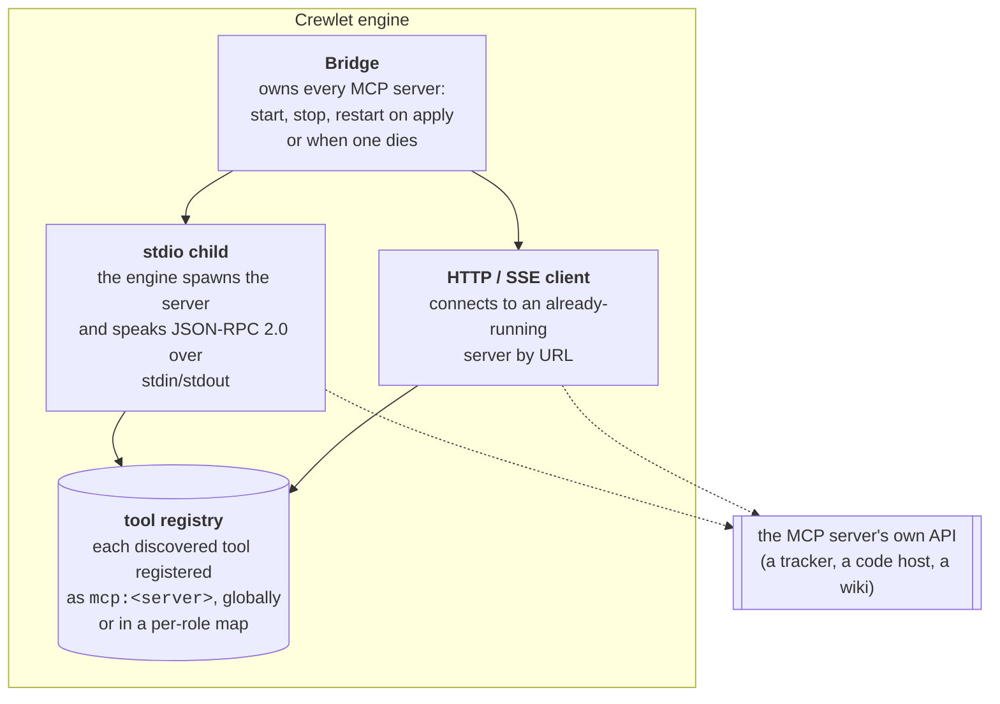

# Tools & MCP Integration

Agents interact with external systems and internal engine operations through tools. Crewlet supports both built-in tools and dynamically discovered MCP tools.

---

## Built-in Tools

The engine registers these into each epoch's tool registry with the origin `builtin`. A tool whose dependency is absent (no store, no knowledge backend, no A2A channel) is omitted rather than registered and broken; [Agent Runtime § Built-in Tools](../concepts/agent-runtime.md#built-in-tools) says when each one is registered.

| Tool | Description |
|------|-------------|
| `lookup_colleague` | Resolve any colleague identifier (handle, role name, a human's contact ID) to one seat, case-insensitively, with partial and fuzzy fallbacks; ambiguous queries return the candidate list so the LLM picks rather than guessing. A person the identity directory withholds shows no accounts, and their ids name nobody |
| `reflect_and_persist` | Capture a durable fact in the agent's private diary (`kind`: `long` or `short`; `about`: `company`, the default, `preference`, `capability` or `platform`, any other refused) |
| `refresh_memory` | Re-run the personal-memory filter mid-turn after gathering richer context |
| `query_episodes` | Recall the agent's own past turns: by meaning, by conversation, or most recent first |
| `list_sessions` | List the agent's own [executor sessions](../concepts/code-sandbox.md#a-seat-reads-its-own), the latest begun first, or search them by the words of what each turn was asked, its conversation and how it ended. Registered where the company keeps executor sessions, on a node with an object store |
| `read_session` | Read a page of one of the agent's own sessions' transcript, narrowed to some kinds of entry or to the entries holding every word of `match`. Registered beside `list_sessions` |
| `use_skill` | Load one of the agent's own [synthesized skills](../concepts/agent-learning.md#5-synthesizer-skill-induction) on demand |
| `refine_skill` | Replace a synthesized skill's body with a corrected procedure; the previous version is kept |
| `mark_onboarded` | Stamp the agent's onboarding marker after reading the relevant onboarding pages (offered to the onboarding pass) |
| `a2a_ask` | Ask one AI colleague one question over the private A2A channel (see [Turn Engine § Colleague-surface tools](../concepts/turn-engine.md#colleague-surface-tools)) |
| `search_knowledge` | Re-run the shared-knowledge search mid-turn, once the agent knows what the task actually needs. `mode` picks the ranking — `hybrid` by default, `keyword` or `semantic` (see [Search](search.md#three-modes-and-what-an-answer-says-it-served)) — and an answer ranked other than it was asked says so in a sentence: a `semantic` search with nothing to rank by meaning runs nothing, and says that tells the seat nothing about whether a page exists. Registered wherever the company has a knowledge backend at all |
| `load_tool_skill` | Load the full body of a [Tool Skill](../concepts/tool-skills.md) by key. A key nobody published is answered with the near keys ("did you mean") and the keys that exist, at most 30 |

`delegate`, the tool that hands work to short-lived [workers](../concepts/turn-engine.md#workers), is not registered here: it is built per turn for the executor, because it carries that turn's grant.

### Worklet and Doclet

Twenty-four more, registered **only where the company runs Worklet or Doclet**
(`tracker.backend: worklet` / `knowledge.backend: doclet`, which are the
defaults). A company on Jira and Confluence gets none of them, and that is the
point: a seat offered a tool against a tracker its company does not run would
reach for it and fail at the call, and a model shown a tool that always fails
learns to distrust the whole catalogue. The eighteen below are the item, file and page
tools; the other six read the catalogue, the projects and the activity feed,
and [Worklet](worklet.md#what-a-seat-can-do) lists the tracker's
nineteen in full.

| Tool | Description |
|------|-------------|
| `list_work_items` | The board, filtered — what you are assigned, what is open in a project, whether something was already filed |
| `get_work_item` | One item's description, thread, history and links, by key or id |
| `create_work_item` | File one. `project` defaults to the seat's own unit's, and is required when the unit owns none. `status` says where it starts (default `todo`). With no `assignee` it goes to the project's default assignee, else to triage for the lead, and the answer's `assignee` says which. `ask` (with an optional `decision`) files it as a question to that person, in one record |
| `update_work_item` | Move it — status, assignee (with an optional `reason` the new assignee reads), priority, labels, links, one checklist change — with an optional `if_match` that refuses on a concurrent edit |
| `comment_on_work_item` | Post to the thread. Mentions wake the seats they name; the turn's own key makes a re-run turn post once. `ask` puts a question to somebody and `decision` structures it as options; `answers` with `choice` answers one |
| `request_access` | Ask a person for one more kind of access from a closed list, as a decision on the work item that needs it; the person previews the exact change and applies it, or declines. |
| `merge_work_item` | Fold a duplicate into the item that survives — linked, its subtasks re-parented, and closed as `cancelled` |
| `move_work_item` | Move a top-level item and its subtasks to another project, re-keyed there with the old keys still resolving — the project lead's, as a re-route is |
| `search_work_items` | Find an item by what it says, ranked over titles and descriptions. `mode` picks the ranking as `search_knowledge`'s does — `hybrid` by default, `keyword` or `semantic` — and the answer names the mode it served, with a `degraded` sentence when that is not the one asked for |
| `list_project_files` | A project's files — reports, specs, notes — in path order, a page at a time |
| `read_project_file` | One file's text, a page at a time from an offset; bytes as base64 on request |
| `write_project_file` | Put a file at a path, creating it or replacing it, with an optional `if_version`. Writing exactly what the file already holds, with the same type, stores nothing and answers `outcome: unchanged` |
| `remove_project_file` | Take a file out of a project; its content is deleted from storage — the project lead's, as removing an item is |
| `list_pages` | Browse the knowledge base by container, parent or title |
| `get_page` | One page's body, breadcrumb, children and history |
| `write_page` | Create one. Titles are addresses and are unique per container; a `parent` must be a page in the same container that is not in the trash; a body links another page by id, `[its title](#/doclet/pages/<page id>)`, which is what "Linked from" reads. `status` is `published` (the default) or `draft`, which is listed in its container and returned by no search until it is published, and any other value is refused; an empty body files a folder, a page that only groups the pages under it |
| `save_page` | Edit one, stating the version you read: there is no per-field merge that makes overwriting prose safe. A `parent` moves it, and may not be the page itself or one beneath it; an empty one moves it to the container's top. `watch` is `true` to follow the page or `false` to stop, and anything else is refused rather than read as no change |
| `comment_on_page` | Remark on a page, or replace one of your own with `edit` |

What `get_page`, `get_work_item` and `read_project_file` hand back that
somebody wrote (a page body and its comments, a description and its thread,
a file's text) arrives **fenced** and labelled with its writers and how far
the reader may rely on them, beside a `provenance` envelope that labels the
whole answer; see
[text somebody else wrote](../concepts/agent-runtime.md#text-somebody-else-wrote).
A body sent back to a write still wrapped in the fence it was read in is
stored without it.

The writes on each side count as a **delivery** for the turn's own
did-this-reach-anybody gate, and each raises the floor the turn's next read
carries, so whichever copy answers that read — this node's or another data
node's — has applied the write first: a turn that files an item and then
lists the project sees what it just filed.

Every write answers with its `outcome` — `applied`, `pending` or `unknown`,
the [three values every write has](replication.md#a-write-has-three-outcomes)
— and the `position` it is durable at. A write whose outcome is **unknown** is
never answered with the id, key, version or revision of something that may not
exist, on any write tool on either surface: the call fails, saying that the
write may have landed and may not, under which operation, and what to do. That
includes `create_work_item`, whose unknown answer names the key this attempt
minted, if it minted one, as the key the item has *if* it was filed — never as
a receipt — and a comment, whose id, mentions and ask are not reported beside
a remark nobody can say was posted. An `update_work_item` whose change is
unknown writes none of the dependency changes it was also asked for: it stops
there, and the same call made again answers the change first and writes them
after. And the `version` an update answers with is always the item's own and
its newest — the one to send back as `if_match` — never another item's that
the same call wrote, and never one its own dependency change has already moved
the item past, when a call changes both; its `position` is likewise the call's
last write, so waiting for it waits for all of them. A write that **a data
node never answered**, and no other ran, is unknown too, never a refusal: the
node that stayed silent may have run it, so it is not "not made", and the
answer says what settles it for that call — the same operation again where the
call carried one, a read before writing again where it did not.

Where this node's operation ledger cannot vouch for the operation — it was
minted before the ledger may have lost rows, as an `op_id` your assistant sends
back more than thirty days after the write that first answered with it — the
answer says this node cannot tell, because the same operation asked here
answers the same way until the write reaches this node, and tells the caller to
look before writing it again; a gesture that stopped part of the way through at
such a step is not told to repeat itself either. A seat's own write under a
plain lost acknowledgement is told to repeat the call with exactly the same
arguments, before any different call to the same tool — that is the same
operation, and it lands once. Reworded, it is a new one. Where the ledger
cannot vouch for it, that same repeat is still safe — it publishes nothing this
node cannot vouch for — but it answers the same way until the write reaches
this node, so looking says sooner. The two writes that state a whole value
rather than change one — `write_project` and `write_work_catalogue` — say
instead that repeating them is harmless: each call is a new operation stating
the same thing.

A create or an update that declares its labels first (`labels_create_missing`)
and cannot tell whether that declaration landed stops there too, and is
answered under its own name as the write it did *not* make — the item not
filed, the change not made — because the declaration comes before the item's
own write. The same call made again answers the declaration and then makes the
write, once; where this node's ledger cannot vouch for the declaration, the
answer says to declare the tags with `write_project` first, which is harmless
if they already landed, and then to make the same call — and says what that
call will do. Its own write dates from the same instant as the declaration, so
this node cannot vouch for it either: it answers with the item an earlier
attempt filed, or the change this node still holds a record of, and otherwise
answers `unknown` again, which then means looking for the write
(`list_work_items`, `get_work_item`) rather than making it another way — or,
from the operator's surface, making the same call with its `op_id` through
another node whose ledger reaches back that far.

The same tools are served to **your** AI assistant over
[`/operator/mcp`](../reference/api-endpoints.md#operatormcp--your-own-assistant),
and eleven more beside them that no seat is given: the saved views, the
catalogue write, a person's own queue, inbox and pins, the trash, and the board
drag. Each call is decided by the same authority table a seat's is, and each
write is attributed to who the request is, never to a name the caller chooses:
a person writes **as the seat they hold** — every person holds one — and so
does a token the identity directory binds to a seat, with kind `human`, while a
credential nobody is bound through writes under its own login (`token:<id>`),
with kind `operator` — the credential
itself is recorded beside either as the write's `operator_id`. Seven more are a
person's decisions about the company rather than its work, and are served only
there too: `pause_seat` and `resume_seat`, and `steer_turn` (a note to a
running turn, decided on the seat its executor's record names once the executor
is out in its box, and before that once a probe of the fleet names the turn's seat — a
probe nobody answers is `unavailable`), each for the seat's holder, its lead
or an administrator; `answer_executor`, for the person who asked for the work a parked
executor asks about, or a lead of its seat; and `answer_knowledge`, which
asks the company's knowledge a question on the auxiliary model of the asker's
seat, so it needs either app (it searches the pages only for a `doclet`
holder and the board only for a `worklet` holder) **and** a credential bound
to a seat; and, where the company hosts its code, `code_repo_readers`, who
read a `visibility: unit` repository, an administrator's audit, and
`code_mark_inbox`, a person's marks over their own code notices, served beside
the code writes (a seat is woken, never shown an inbox). That set
is ONE operator catalogue, built for every call from what the node runs now,
and every operator transport serves it — MCP at `/operator/mcp` and the
dashboard's [`/operator/act`](../reference/api-endpoints.md#operatoract--the-dashboards-write-surface)
— so what a person can do is the same whichever way they reach the company.
The MCP transport is **stateless**: every call is decided by the credential of
the request carrying it, never by the one that opened a session, so a grant
withdrawn mid-conversation stops the next call and an `Mcp-Session-Id` is a
handle rather than a proof.

Over MCP, each tracker write's answer — and each [artifact and
datastore](#artifacts) write's, by the same rule — also carries the
**`op_id`** of the operation the call was, and the write tools take it back as
an argument: an assistant has no turn to repeat, so sending the same call with
that `op_id` is how it finishes a write that came back `unknown` or stopped
part of the way through, instead of filing it twice. An `op_id` is that one
call and no other:
it carries a digest of the call's arguments, and brought back with any other
argument, or to another tool, it is refused before anything is written. A seat
is never offered the argument — its turn is its identity — and a seat's call
that sends one is refused. The dashboard's transport,
[`/operator/act`](../reference/api-endpoints.md#operatoract--the-dashboards-write-surface),
takes the operation in an `Idempotency-Key` header instead, and refuses a
write without one (`400 op_id_invalid`, naming the header) and an `op_id`
argument beside it: the key is scoped to the principal that sent it, so a
retry is the same request sent again with the same key, and a key somebody
else learned names a different operation for them.

Note the deliberate split between personal and shared writes: `reflect_and_persist` is **personal-only** (it writes to the agent's private `agent_diary`), while team-shared content is a knowledge-base page: `write_page` on Doclet, or the vendor's own MCP tools on Confluence (see [Knowledge System](../concepts/knowledge-system.md)). `use_skill` resolves the agent's own synthesized skills; shared procedures are knowledge-base pages.

**On a vendor tracker there are still no task builtins.** `create_task`,
`assign_task`, `update_task` and `list_tasks` are not registered against Jira
or GitLab issues — an agent works those through the vendor's own MCP tools, so
the engine mirrors no state it would have to keep in step. See
[The Tracker](../concepts/task-engine.md).

### Artifacts

Seventeen more, registered on every node that takes artifact uploads (one
with an object store, a coordination store and a data node to reach), whatever
tracker or knowledge base the company runs: thirteen for artifacts, their
folders and the company's brand, and four for an artifact's datastore. Each tool
is named for its authority row, and the operator catalogue serves the same
seventeen, so an operator's own assistant publishes, files and writes rows
exactly as a seat does.

| Tool | Description |
|------|-------------|
| `list_artifacts` | The artifacts the caller can open, by `scope` (`mine`, `shared`, `company`, `agents`, `all`), `kind` and `query`, a page at a time (`max_keys`, `continuation_token`). Folders read as S3 prefixes: `prefix` is a folder's path (`Marketing/Q4/`, empty for the top level), and with `delimiter: "/"` the answer is that one level, its artifacts in `contents` and its subfolders in `common_prefixes`. Every row names its `folder` |
| `get_artifact` | One artifact: its head, its newest versions, its files and a page of one file's source. The answer says the caller's `role` and whether they may publish (`writer`) |
| `list_dashboard_sources` | The engine sources a dashboard's `engine` datasets may read: each one's parameters, columns, who may read it and how it refreshes. Holds no row; a source is answered as each board's viewer |
| `get_artifact_format` | The exact format a kind's files are checked against at publish (`brand`, `slides`, `doc`, `design`, `dashboard`): every key of its index with its type and rule, its bounds and closed sets, and for a brand kit an example that reads clean. Generated by each format package from the form its strict decode reads with, so it cannot drift from what a publish admits. Holds no row; readable by everybody |
| `get_company_brand` | The company's adopted brand: its colours by role (light and dark, each with the kit token that carries it), its typefaces, its logos as the kit's `crewlet-logo` markup and as ready `from_brand` copies, the brand slide theme's colours, the version adopted and by whom, the artifact kit version to link, and its voice, fenced under the `company` trust. `brand` is null when none is adopted. Readable by everybody, under every ceiling |
| `create_artifact` | A new artifact of any kind (`html`, `doc`, `slides`, `dashboard`, `sheet`), from inline `content` and `files`, a project file, the adopted brand's logos and faces (`from_brand`), a build in the turn's box (`source.sandbox`), or for a deck a `starter` plan (a theme, `brand` among them, and the slides it opens with). `folder` files it in a folder that exists, by id or path. When a person asked for it, they are made its editor |
| `publish_artifact` | A new version on a stated `base_version`: `edits` (exact `old_str` and `new_str` pairs), `content`, `files` (null removes one; `from_brand` copies a logo or a face), a build's whole `source`, or `restore_version` |
| `update_artifact` | The title, description, icon or one version's label |
| `share_artifact` / `unshare_artifact` | Grant a seat, a unit (`unit:<key>`) or the company (`company`) one role up to editor, or withdraw it. The owner's |
| `upload_artifact_asset` | Add an image, data file or font to the asset store of an artifact that declares the `assets` capability; the answer's `reference` is the path the page uses |
| `create_artifact_folder` | A folder inside a folder that exists (`parent`, by id or path), or a path of them created as needed; a chain that exists already is answered as it is. Only a person creates a top-level folder |
| `move_artifact` | File up to 25 artifacts in a folder (by id or path), or take them to the top level (`folder: ""`), each decided and written on its own, with a result per artifact |
| `read_artifact_data` | An artifact's datastore: with no `collection`, its schema (every collection, its columns and who may read and write it); with one, a page of rows (`since` for what changed after an earlier `through`) or one row by `doc` |
| `query_artifact_data` | Rows of one collection whose indexed fields match every filter in `where`, ordered by `order_by` and paged |
| `write_artifact_data` | A batch of 1 to 100 ops (`set`, `merge`, `delete`, `increment`, `append`, `add`, `remove`), all or none, each decided by its collection's rules; `if_version` writes a row only if nobody changed it since, and a conflict hands back the rows as they are now |
| `set_artifact_schema` | Every collection the datastore keeps after a change, with its columns and rules. An agent may tighten a collection's rules and never loosen them: lowering a role, lifting `humans_only`, an append mode or immutability, removing a condition, pointing an `assigned_to_viewer` column at another assignee, or dropping a protected column or a collection is refused to an agent and left to a person |

**Every verb is decided twice inside a turn somebody woke.** The tool reads the
stored artifact and asks the authority table for the seat, then for whoever the
turn is acting for (the **requester ceiling**): in that turn no tool shows an
artifact to a requester who could not open it, or writes for one what they
could not write — and authors nothing for one who does not use the artifacts
app ([An agent uses only the apps of the person it works
for](../concepts/identity-and-access.md#an-agent-uses-only-the-apps-of-the-person-it-works-for)).
The exception is an artifact the agent owns, which anybody who uses the app
and can message the agent may ask it to edit, as with all other agent work;
reading and sharing are never exempt. A turn woken by somebody the company
does not know opens no artifact at all, and authors none. The bound is the turn's, not the agent's: a
colleague it asks reads for the agent, the turn the answer wakes is the agent's
own, and what the agent already knows is no read
([Sharing](../concepts/artifacts.md#sharing)). A caller with no relation to an
artifact is told it does not exist, in exactly the words an id nothing holds is
answered with. An agent is held to `contributor` on artifacts it does not own
unless `artifacts.agents_manage_others` lifts it.

**A folder grants nothing, and its name is the ceiling's too.** Filing asks
editor on the artifact and contributor on the destination, each through the
requester ceiling, and never changes who may open the artifact. A folder
reference resolves only among the folders the seat and whoever the turn is
acting for can both see: a missing one is refused naming the nearest paths they
both see (never created), an ambiguous one is refused naming each candidate, and
a turn woken by somebody the company does not know sees no folder and files in
none. A turn segment makes at most **5** folder records; a chain that already
exists is answered without counting. Renaming, moving and removing folders are
a person's gestures in the dashboard.

**The adopted brand is everybody's to read.** It is the face the company shows
on everything it publishes, so `get_company_brand` answers under every ceiling
and only the version an administrator adopted, never a kit's newer draft. Its
voice is the one free text: it arrives fenced as `brand_voice` under the
`company` trust, which governs tone and wording and never the task, the tools,
the recipients or access. A `from_brand` copy is made by the publish pipeline
from the adoption's snapshot as a new object of the version, so a later
adoption changes no version already published.

**The datastore's rows are the ceiling too.** A row is answered only when the
person the turn is acting for could read it as well, by the collection's own
read rule over their role and their record, and a datastore write is stamped
with the lower of the agent's role and theirs, so the applier's column rules
refuse for them exactly what they could not write themselves (an agent's own
artifact excepted, as above, for writes; never for reads). What a write hands
back is a read, and is bounded like one even where the write itself was not: a
conflict's current rows are only those the requester could read, so an edit to
the agent's own artifact asked by somebody it is not shared with answers the
conflict with no rows at all. Every row a data tool answers is fenced as text
its writers wrote (`artifact_row`, naming the row's creator and last writer), a
conflict's current rows included. A turn writes at most **1,000** datastore
ops; a retry of a call it lost the answer to is not counted again.

**An artifact in the trash serves no content.** `get_artifact`,
`read_artifact_data` and `query_artifact_data` refuse it, naming the trash and
its owner, and read nothing, exactly as the dashboard's file and data routes
do; a write to it is refused until a person restores it.

**An administrator's override is recorded before anything is shown.** On the
operator surface, a person holding `admin` reads any artifact through the admin
path, and every such read (`get_artifact`, `read_artifact_data`,
`query_artifact_data`, and the live files a stale publish answers with) writes
the elevated-read record first, which the artifact's history shows its owner
and editors. A read whose record cannot be written shows nothing. An
administrator who holds a share reads and writes as that share.

**An agent working on an artifact is in its room.** A seat that reads an
artifact or its data (`get_artifact`, `read_artifact_data`,
`query_artifact_data`) appears in the artifact's room as an agent, viewing, and
one that writes it (`publish_artifact`, `update_artifact`,
`upload_artifact_asset`, `write_artifact_data`, `set_artifact_schema`,
`move_artifact`) as
editing, focused on the version, collection or row the call named, for 45
seconds after its last call, and only once the call was allowed. The people
looking at the artifact see which agent is working on which row.

**A publish names its base.** One over a version somebody published since is
refused `stale_version` and handed the live version, who published it and
when, the paths that changed since the caller's base and the first page of each
changed text file, fenced as text that author wrote. The text is a read of the
live version: where this turn could not read the artifact (a publish to the
agent's own work asked by somebody it is not shared with, or an
administrator's read whose record could not be written), the refusal carries
the numbers, the author and the paths alone, and says so in
`live_files_withheld`. No tool takes `force`:
discarding a colleague's newer version is a present person's decision in the
dashboard. Trash, restore, purge, transfer and pins are not tools either.

**Where the bytes come from.** Inline content is at most 1 MiB decoded per
call. A build in the turn's box and a project's file are streamed: their digests
are declared to an upload the publish pipeline reserves first, each file is put
through the engine, and the version is decided only after every byte is read
back verified. A sandbox is never handed an upload URL; the engine lists the
directory through the box itself, holds every path to the workspace, and
refuses one file more than a version holds rather than truncating. The engine
reads a box only for the run working in it — a call the run makes over its own
bridge while its record reads `running` — attached as a reader, never resumed.
A call from another seat's turn, or from a run parked on a question, collected
or torn down, is refused `not_running`; a caller that is not an agent seat is
refused `forbidden`; and a seat's call on a node that runs no sandbox is refused
`unavailable`
([Code Sandbox](../concepts/code-sandbox.md#how-a-coding-task-runs)). So a
seat's executor publishes a build larger than the inline bound from its box
before it finishes.

**Per turn**, an agent makes at most 20 publishes, 10 of them on one artifact,
and writes at most 128 MiB; past either the call is refused `turn_quota` and
told to stop and report. A file whose bytes the object store has no room for
is refused [`store_full`](#when-a-tool-refuses), naming the file: nothing is
published, and the same call is refused the same until an operator makes
room. A version outside its policy or its format is refused
with every finding at once, the first 20 listed and the rest counted, and a
closed format's refusal points at `get_artifact_format`. Any write tool (an
artifact's or another) that answers a policy refusal (`invalid`) four times in
a row on one target (an artifact, a work item; the whole tool where a call
names none) appends a plain instruction to stop retrying, raise a blocker on
the work item if there is one or tell whoever asked, and end the branch; a
success on that target ends the run. The run is logged as
`tool_policy_refusal_loop` and counted once in
`crewlet.tools.policy_refusal_loops` when it reaches the limit
([ADR-0059](../../adr/0059-a-tools-contract-is-its-validators-and-every-fault-comes-back-at-once.md));
the call itself still runs, so a version that is
finally right still publishes. File text another principal wrote is
[fenced](../concepts/agent-runtime.md#text-somebody-else-wrote), and a long one
is condensed by the seat's auxiliary model unless the call passes `offset`.
**Publishing delivers nowhere**: no artifact tool counts as a delivery, so a
seat asked in a chat thread posts the `url` every answer carries with its chat
tools. The bundled `skill:artifacts` [Tool Skill](../concepts/tool-skills.md)
teaches the design contract and how to shape and fill a datastore (a schema
before rows, batched writes, blind cells and guarded long text, `humans_only`
for approvals), and is enforced on the five tools that write bytes, a schema
or rows; `skills/crewlet-artifacts/SKILL.md` carries the same contract for your
own assistant, installed as the
[`company-architect` skill](../getting-started/ai-authoring.md#the-company-architect-skill)
is (copy the directory into your assistant's skills folder).

### Chatlet

Nine more, on the same terms and on the third axis: they are registered **only
where the company runs the engine's own chat** (`chat.backend: chatlet`, the
default). A company on Slack or Mattermost gets none of them and reaches its
workspace through that vendor's own MCP tools instead, for the reason the
tracker section gives — a seat offered a tool against a surface its company
does not run reaches for it and fails at the call. They are the `chatlet` app's
([Identity and access](../concepts/identity-and-access.md)), which every seat
holds.

| Tool | Description |
|------|-------------|
| `post_message` | Say something new in a room, as a top-level message. `@handle` reaches one colleague; `@channel` in the text is what addresses the whole room, and the receipt says so back |
| `reply_in_thread` | Answer a message under its own thread, beside the question. Threads are one level deep, so a reply to a reply carries the same root |
| `send_dm` | Say something privately to one colleague or a few, opening the conversation if it is not open. Never the place for an answer that was asked for in the open |
| `read_channel` | Read a room, newest first, or one thread in it, oldest first. The rest of the room is not handed to a seat at turn start, so it reads it here when its answer depends on what was said before |
| `list_channels` | The rooms this seat is in, most recently active first, with what each is for and the last thing said in it |
| `search_messages` | Find a message by what it **says**, ranked across every room this seat may read — at most forty to an answer, twenty unless asked — and an answer from an index still being built says so rather than reading as nothing said. `read_channel` is the other half: one room, in order, from a point you name |
| `react_to_message` | Put one emoji on a message (`message_id`), or take yours back |
| `join_channel` / `leave_channel` | Move this seat's own membership, and nobody else's. A private room cannot be joined this way, and a unit's own room can be neither joined nor left — its membership is the org chart's, and either gesture would be undone by the next apply |

Every tool that takes a `channel` takes the room's id or its **name** — `#eng`
and `eng` are the same room. A name is the room's address, unique across the
company, so it resolves for any room the seat may read whether or not it is
in it: a public room, or a unit's own room, which is where a decision's
outcome is often promised. A private room's name resolves only for its
members, and to anybody else answers exactly as a name nobody holds.

A message's `links`, at most eight on `post_message`, `reply_in_thread` and
`send_dm`, are each an absolute `http`, `https` or `mailto` address, kept
exactly as sent. A relative reference, a dashboard route (`#/...`) or any
other scheme is refused, naming every entry that is not one (`links[1]`): no
reader of the message could open it as it stands.

What `read_channel`, `search_messages` and `list_channels` hand back that
somebody said — every message and snippet, under its author, and a room's
topic and purpose as the room's own label — arrives
[fenced](../concepts/agent-runtime.md#text-somebody-else-wrote), and a body
sent back to `post_message`, `reply_in_thread` or `send_dm` still wrapped in
the fence it was read in is posted without it.

**Three of them count as a delivery** for the turn's did-this-reach-anybody
gate — `post_message`, `reply_in_thread` and `send_dm` — and the obligation is
*source-scoped*: a turn woken in a room owes an answer **in** a room. A
reaction is deliberately not one of them. It wakes nobody and discharges
nothing, because a seat that could answer every obligation with a thumb would.
A turn's write is made once however often the turn is re-run: its key is
derived from the turn's unit of work and the call, and a join after a leave is
a new join rather than the first one's retry.

The same nine are served to **your** AI assistant and to the dashboard over the
[operator surface](../reference/api-endpoints.md#the-chat-gestures-only-a-person-makes),
as the seat the person behind the call holds, and eight more that no seat is
given:
`create_channel`, `open_dm`, `update_channel`, `add_channel_members`,
`set_channel_members`, `edit_message`, `delete_message` and `mark_chat_read`. A seat corrects what it
said by replying rather than rewriting it; a room, its settings and its
membership are the company's furniture; and a read cursor is a person's
attention, which a seat — woken rather than reading — does not have. Every one
of them is made as a seat, so a credential acting as itself is refused them
all, the reads included.

See [Chatlet](../concepts/chatlet.md) for who a message wakes, which of them owes a
reply, and the two things the axis deliberately does not do.

### The company's code

Thirty-nine more — thirteen that read, two of them a repository's changes,
one a commit's checks and one a search across every repository, and
twenty-six that change a branch, a repository, a change or a commit's checks,
purge a repository or import one — registered wherever
the company hosts its git repositories in the engine (`code.backend: gitlet`; see
[Gitlet](../concepts/gitlet.md)) — on every
node, whatever its roles, since a node holding no copy of the code log and no
`gitlet` role reaches both through the nodes that do. They are offered on the
terms the node's `/gitlet/` reads are: a node whose runtime was already running
when Gitlet was turned on offers them once it restarts into it, and one
that turned it off keeps them until that restart ([Turn it
on](gitlet.md#turn-it-on)). A company that hosts no code is given none of them,
and the operator catalogue serves the same thirty-nine, so an operator's own
assistant reads and changes the company's code exactly as a seat does — the
person as the human seat they hold, while they hold the Gitlet permission —
and reports their own CI's checks,
purges a repository's unreachable objects and imports a repository from
another host, which no seat does. The thirteen reads are reads: none counts as
a delivery, a [worker](../concepts/turn-engine.md#workers) may be handed any of
them, and the operator catalogue records no call to one. The twenty-six
writes each deliver to Gitlet, so a turn woken about work on a repository that
answered by moving a branch, opening a change or reviewing one delivered; no
worker is ever handed one, since it
would write with its parent's grant; and every call to one on the operator
catalogue is recorded as any write is. A seat is offered twenty-three of them —
every write but `code_report_check`, `code_purge_unreachable` and
`code_import_repo`, each a person's alone — where
its `role.code.access` is `full_access`. Below it, no repository's grant lets
the seat change anything ([Who may read and
push](../concepts/gitlet.md#who-may-read-and-push)), so it is offered only
what its tier reaches of a change's conversation beside the thirteen reads,
and its prompt says nothing about changing code, rather than carrying tools it
would be refused on every repository on every round: a `read_only` seat —
what a seat that sets none runs at — comments on a change
(`code_comment_on_change`), and a `review` seat also asks for reviews
(`code_request_review`), reviews (`code_review_change`) and dismisses the
findings it raised (`code_resolve_finding`).

| Tool | Description |
|------|-------------|
| `code_list_repos` | The repositories the caller may read, by name, a page at a time (`limit` 1 to 100, 25 by default; `next` back as `cursor`), each with its owner, visibility, search mode, default branch and the commit it points at, the caller's access, its last push and its protection rules without their merge gates, filtered by `status` (`importing`, `active` or `archived`; all three when left out). A repository the caller may not read — or, in a turn a colleague seat woke, the colleague may not — is not listed, so a page can hold fewer rows than `limit`, or none, and still name a `next`. A repository whose rules alone are past one answer is listed without them, `protections_left_out` saying so, and the page ends at it |
| `code_get_repo` | One repository in detail — its rules, each with its merge gate and who last set it and when (`set_by`, `set_by_kind`: `agent`, `operator`, or `config` for a rule the company document declares, which names nobody; `set_at`), its size, live packs, branch and tag counts, the caller's access and last push, where its expunges stand (`expunge`: a purge asked and not yet served, the last one committed), and where it stands with other hosts (`remotes`: its mirrors, by address and variable name, and the import its create filled it from, with its chunks and the sentence it ended short on) — and a page of its branches with the commit each points at, 100 a page, narrowed to a namespace with `branches_prefix` (`seats/<handle>/`, `release/`). Rules past one answer beside the detail end at `protections_next`, which comes back as `protections_cursor` for the rest of them, a page at a time and alone, so a repository with every rule at its bounds is read whole. Asked by a person or a token, the answer carries the URL their git clones the repository from, on `api.external_url`; a seat is given none, because it reads through these tools |
| `code_resolve` | A branch, a tag, a whole ref or `HEAD` (the default branch) to the commit it points at now, so the calls after it can name that commit by its id: a call naming a commit by id resolves no ref, and reads the same commit however the branch moves meanwhile |
| `code_read` | A file's lines at a commit, a page at a time (`start_line`, `end_line`, `cursor`), or a directory's listing (`recursive` for every file below it); a binary file is answered by its size. A path that is not valid UTF-8 is named, and asked for, as `path_b64` |
| `code_diff` | What changed between two commits: the per-file stat, filtered by up to 64 `paths`, or one `file`'s patch, a page at a time, with renames detected unless `renames` is false |
| `code_compare` | How two commits relate: their merge base, whether either contains the other, how many commits each has that the other lacks, and the first page of what `head` changed since the merge base |
| `code_landed_in` | Whether a commit reached a branch (`target`, resolved to its tip now and never a commit id), the push that landed it there and kept it there, the push that introduced the commit, and what the Gitlet node's index of pushes covers ([Which push landed a commit](../concepts/gitlet.md#which-push-landed-a-commit)) |
| `code_log` | The commits that changed a file or a directory (`path`), or every commit, newest first from a commit (`rev`): each with its parents, its author and address as the commit states them, its two dates, its subject and the push that introduced it, `limit` a page (1 to 100, 25 by default; `next` back as `cursor`). `grep` keeps the commits whose message holds its words — a literal, in any case, never a pattern — and `since` (RFC 3339) those committed from then on. A page ends sooner where its subjects fill it, and one the Gitlet node's time ended says so: it lists what it found and names where the next page begins ([A path's history](../concepts/gitlet.md#a-paths-history)) |
| `code_blame` | Which commit last changed each line of a file (`path`) at a commit (`rev`): every line with its commit, the line it was in that commit and its old path where the file was renamed since, and each commit once with its author, date, subject and the push behind it — at most 500 lines a call (`start_line`, `end_line`), a page at a time (`next` back as `cursor`) ([Who changed a line](../concepts/gitlet.md#who-changed-a-line)) |
| `code_list_changes` | Changes — a branch proposed into another, named like `web!42` — newest first, `limit` a page (1 to 50, 20 by default; `next` back as `cursor`): each with its title, state, branches, head and revision, owner, work item, version and, while it is live, its [merge readiness](../concepts/gitlet.md#merge-readiness) in a line. A call names what to list — a `repo`, a `work` item (named as `code_open_change` names one: a Worklet item's key, `ENG-42`, or its id, or any tracker's identity, `<backend>:<id>` — never `none`, since a change carrying no item is listed by its repository, owner or state; a key is resolved to the item's identity through the tracker, and an identity, a Worklet id bare or as `native:<id>` included, is listed as named, so a change still lists its siblings by the item it carries after that item's task is purged), a `state`, a `reviewer`, or `needs`: `review` or `fix` (a reviewer's or an owner's, the caller's own by default), `me` (both of the caller's) or `person` — and narrows it by the rest and an `owner` ([Reading changes](../concepts/gitlet.md#reading-changes)). A change of a repository the caller may not read — or, in a turn a colleague seat woke, the colleague may not — is not listed, so a page can hold fewer than `limit`, or none, and still name a `next` |
| `code_get_change` | One change, named by `change` — its number on `repo`, or its reference, `web!42` — a `part` at a time: `summary` (its row, description, authors, conversation counts and revisions, newest first, a page at a time), `merge_readiness` (each precondition, whom an unmet one waits on, who clears each standing blocker, and its head's recorded merge into its target), `files` and `diff` (a `revision`'s files from the base its facts record — its latest by default — and one `file`'s patch; with `since_revision`, what changed from that revision to it, kept to the files either touches: what to re-review), `findings` (each with `at`, where its lines are in the `revision` asked about — moved, outdated or gone), `reviews` and `comments`, each a page at a time (`next` back as `cursor`) ([A revision's facts](../concepts/gitlet.md#a-revisions-facts)) |
| `code_get_check_failures` | What a check of a commit said, named by `change` (its head, checked for its target) or `sha` (with `checked_for` where it was checked for more than one branch) and by `name`, its latest attempt unless `attempt` names another: its state and why it ended, its summary, the tail of its output and the failures its reports named, a page at a time (`next` back as `cursor`), and — where a failed run kept one — its log's size and `log.cursor`, which reads the log 32 KiB a page. Each cursor names the attempt it pages, so the pages stay on it while a later attempt ends or the change's head moves ([Reading a failed check](gitlet.md#reading-a-failed-check)) |
| `code_search` | The lines matching a search across every repository the caller may read that keeps a search index (`search: indexed`), or those its `repo:` filters name — a `search: grep` one only when named, at most eight. `query` is the filters, `repo:<name>`, `path:<glob>` and `ref:<ref>` (the default branch otherwise), then the text, at most 400 bytes: the one grammar a person's [search](gitlet.md#finding-code) reads. `mode` (`literal`, the default; `regex`, RE2 within a line; or `word`), `ignore_case`, and one `repo`, `path` and `ref` beside the text, joined to its filters. Each hit is a repository, a path, a line, its text and the file's blob id, read at the commit `tips` names; `coverage` names every repository that was not searched and why, and `truncated` with no `next` that lines went unread — narrow it with `repo:` or `path:`. A page at a time (`next` back as `cursor` with the same search): each page's search starts after the last line of the page before, at the commit that line was read at, and asks for what one answer holds, so a page costs the lines past its place and paging reaches every matching line. In a seat's turn every repository it names is resolved and held as a `repo` is, and a ref it names in each, once a turn; a ref that may be a seat's branch is searched only in repositories the search names |
| `code_commit_files` | A small change to a branch's files, built on Gitlet and landed as one push: `files`, one operation a path — `put` (`content`, or `blob_oid` of a file the repository holds; `mode` 100755 for an executable, 120000 for a link whose target is `content`), `edit` (`old`, which must occur exactly once, and `new`), `delete`, `move` (`to`) or `mode` (100644 or 100755) — onto the head the caller read (`expected_head`), or creating the branch from `base`. At most 1 000 operations, each path at most 64 components deep, and 1 MiB a call of operations and `message` as JSON spells them, where `<`, `>` and `&` take six bytes each; a change to build or test belongs in an executor |
| `code_revert` | The revert of one `commit` onto a branch's head (`expected_head`), under git's own message or a `message` of at most 1 MiB as JSON spells it. One that conflicts commits nothing, and answers each conflicted path with its stages' ids — base, ours, theirs, each readable with `code_read` — and the start of the file as git marked it |
| `code_cherry_pick` | One `commit`'s change onto a branch's head (`expected_head`), its message naming the commit it came from unless a `message` replaces it, held to `code_revert`'s bound; a conflict is answered as `code_revert`'s |
| `code_create_branch` | A branch created `at` a commit the repository holds |
| `code_delete_branch` | A branch deleted at the head the caller read (`expected_head`); its commits stay in the history, and the push history names its last head |
| `code_create_repo` | A repository: a project owned by a unit (`owner`), or the caller's own scratch repository, `<handle>.<name>`, which `code.scratch` caps and expires once it sits idle. Either starts at `search: grep` |
| `code_update_repo` | One change a call: the settings (`description`, `default_branch`, `visibility`, `search` — `indexed` or `grep`, never `indexed` on a scratch repository — a project's `owner`, a project's `path_owners` — globs added to and taken from one owner at a time — and, a person's alone, a project's `mirror_from` and `mirror_to`, each set whole or removed by `{}`), `archived` (read-only, and back), or `rename_to` (the old name redirects to the new one for 30 days) |
| `code_delete_repo` | A repository deleted, restorable until its purge |
| `code_restore_repo` | A deleted repository brought back as it was, before its purge |
| `code_protect_branch` | The protection of one `pattern` (`refs/heads/<glob>`, `refs/tags/<glob>`) changed — `direct_push` (`persons` or `none`), `allow_force` and `allow_delete`, each named replacing that control and each left out kept as the rule has it (`persons`, off, off on a new rule) — or taken away (`remove`); and a branch's [merge gate](../concepts/gitlet.md#merge-gates) changed a field at a time — `merge_by`, `approvals`, `landing`, `owners_approve`, `delete_source`, `agents_edit_checks` each replacing that field, `checks` and `approvals_unless` an item at a time (`{"add": [...], "remove": [...]}`), `human_paths` a glob at a time (`{"put": [{"glob", "unless"}], "remove": [glob]}`), the rest kept — or taken away (`remove_gate`). It answers the rule as it now stands. A seat tightens a protection and only a person loosens one ([Who may change a protection](../concepts/gitlet.md#who-may-change-a-protection)) |
| `code_open_change` | A [change](../concepts/gitlet.md#changes) opened: a `branch` proposed into a `target` (the repository's default branch when left out), with a `title`, a `body`, as a `draft` or not, carrying a work item — the turn's own unless `work_item` names another, by a Worklet item's key (`ENG-42`), any tracker's identity (`<backend>:<id>`) or `none` — and, once it is open, asking the `reviewers` it names in a second write; an ask that did not finish leaves the change open and says why (`reviewers_not_asked`). It answers the change's reference (`web!42`) and its `version`. Every `@handle` the title and body name that is a seat of the company is told ([Who a change wakes](../concepts/gitlet.md#who-a-change-wakes)) — at most 32 a write, more refused naming the bound — as it is by the `title` or `body` an update sets, a review's summary and findings, and a comment's body |
| `code_update_change` | One thing about a change a call, held to the `version` the caller read (`expected_version`): what it says — any of `title`, `body` and `work_item` together — or `draft` (a draft, or ready for review), or its `target` |
| `code_close_change` | A change closed without merging it (`reason`), or with `reopen` a closed one opened again at its branch's head — held to `expected_version` as an update is |
| `code_request_review` | Reviewers asked of a change (`reviewers`, at most 32), or an ask withdrawn (`withdraw`), with a `note`. A seat asked must review the repository and not have written the change; a person asked must hold the Gitlet permission, and one without it is refused `not_permitted` ([Asking for review](../concepts/gitlet.md#asking-for-review)) |
| `code_review_change` | A review of a change's revision — its latest unless `revision` names one — as ONE record: a `verdict` (`approve`, `request_changes` or `comment`), a `summary`, up to 64 `findings` (each a `path`, a `side` — `new`, its head, by default, or `old`, its base — its lines, a `severity`, a `category`, a `title`, a `body` and a `suggestion`, the lines to put in place of its own) on files the revision changes, and `carries`, the reviewer's own standing findings that still stand: a review of a later revision supersedes every other one of theirs ([Reviews](../concepts/gitlet.md#reviews)). It answers the review's id and its findings' ids in the order raised |
| `code_comment_on_change` | A comment: a thread of its own — on a line, with an `anchor` (`path`, `line`, `side`, `revision`) — or a reply to a `thread` or a `finding`; with `thread`, `resolve` marks the thread resolved (`true`) or open again (`false`), after the reply where there is one |
| `code_resolve_finding` | Findings answered (`findings`, at most 64): `resolved`, `wont_fix` or `disputed` — an author's, which leave a blocker standing for its raiser to judge — or `dismissed` — its raiser's, a maintainer's or a person's, which clears it — with a `note` and, for `resolved`, the `commit` that answers them ([Findings](../concepts/gitlet.md#findings)) |
| `code_apply_suggestions` | The suggestions of the `findings` named (at most 64) — each a finding of the change that still stands, suggests lines and is on the new side — put in place of the lines they are anchored to on the change's source branch at the head the caller read (`expected_head`), as ONE commit of the caller's (`message`, a sentence naming the change by default): each where its finding was shown, all of them or none — an outdated one (`stale_version`, naming it) or two that overlap (`invalid`) apply nothing ([A review's suggestions applied](../concepts/gitlet.md#a-reviews-suggestions-applied)). Then each finding is answered `resolved` with the commit, in a second write; the applier becomes an author of the change, whose approval no longer counts |
| `code_rebase_change` | The change rebased onto its target's tip from the head the caller read (`expected_head`): its commits the target does not hold replayed oldest first, each keeping its author and author date, and its branch moved to them by one forced push of the caller's, held to the branch's protections as a force-push is. The first commit that conflicts stops it with nothing changed (`invalid`, naming the commit and each conflicted path); a change of more than 1 000 such commits, or holding a merge commit, is refused (`invalid`) ([A change rebased](../concepts/gitlet.md#a-change-rebased)) |
| `code_merge_change` | The change merged into its target from the head the caller read (`expected_head`), by `method` (`merge`, the default, `squash` or `fast_forward`), as one record its committer decides against the target's merge gate — or, on a target whose gate requires a check, put in its queue and answered with its place. A change its gate does not allow yet is refused `not_ready`, naming every unmet precondition and who each waits on; `delete_branch` (unsaid: a seat's branch unless a rule keeps it), `close_task` (the work item closed as a second write once it merges, decided as `update_work_item` is) and a person's `override_reason` ([Merging a change](gitlet.md#merging-a-change)) |
| `code_dequeue_change` | The change's entry taken out of its target's merge queue, at its enqueuer's, its owner's, a maintainer's or a person's ask; a change no queue holds is refused `not_found` (`not_queued`), since an entry no longer live never comes back by itself |
| `code_revert_change` | A merged change reverted by a change of its own: what its merge brought into its target undone onto the target's tip as one commit of the caller's, on a new branch (`seats/<handle>/revert-<n>`, or `revert-<n>` for a person) whose push opens "Revert <repo>!<n>" into the same target. A revert that does not apply cleanly is refused (`invalid`, naming each conflicted path), one of a change that is not merged `conflict`, and a revert branch already there `exists`; `merge` merges the revert's change as a second write, a merge it could not make said beside it ([Reverting a change](gitlet.md#reverting-a-change)) |
| `code_rerun_checks` | A commit's checks run again — named by `change` or `sha` as `code_get_check_failures` names them — each named in `checks` with the attempt the caller read as its latest (at most 16 a call), or with `all_failed` every check whose latest attempt ended without passing: each queued at the next attempt, at most ten. A seat reruns only an attempt its infrastructure or a stop ended (`errored`, `cancelled`), on a repository it may write or a change it wrote; a failure is refused it `rerun_genuine`. A check a person's CI reports is refused `native_check`: its CI runs it again |
| `code_report_check` | A person's own CI's check of a commit, reported onto the commit's checks — `status` `running` when it starts, then `passed`, `failed`, `errored` or `cancelled` with its `summary`, `tail`, `failures` and `url` — by `sha` (for `checked_for`, the default branch when left out) or `change`. A person's alone, never a seat's, and refused `native_check` for a check the engine has queued at that commit ([External CI](gitlet.md#external-ci)) |
| `code_purge_unreachable` | A repository's unreachable objects purged — every object no branch or tag reaches, such as a secret force-pushed away — by its maintainer, with no grace for what a ref drop left. A person's alone, with a fresh proof of who they are, never a seat's, and a token bound to nobody is refused. Answered once the request is recorded: the request, where it landed, the node that serves it, and what still holds the objects after (`holds`: the nodes' caches until each syncs past it, every backup taken before it commits — on the `nats` object store, before the store deletes them — and the object store for a day after, a versioned S3 bucket for as long as its own rules keep a deleted object's old version); the same call again is the same request, and one asked while another is open widens it. `code_get_repo`'s `expunge` says when it is served |
| `code_import_repo` | A project repository created and filled from one at another host — `url`, an https URL its home Gitlet node fetches — or, with `mirror`, kept in step with it as a pull mirror, which takes no push. `name`, `owner` (as `code_create_repo` takes one), `visibility` and `default_branch` as a create's; `credential` the NAME of the variable holding the source's token — one `code.remote_credentials` declares for the source's host, or the create is refused `not_permitted` — which the node resolves from the secret store and then its environment each time it dials; a token in its place is refused before anything is sent. A person's alone, never a seat's, and a token bound to nobody is refused. Answered once the create is recorded, the repository `importing` until its home has landed the source; the same call made again is the same create |

**One more is not in that table: `code_checkout`,** which an executor's run
alone is offered, beside `ask_and_wait`, and only on a node that serves
Gitlet. Neither the registry nor the operator catalogue holds it, so no
other phase and no person can call it. It checks one repository (`repo`) out
into the run's box, on a `branch` from a `base` (the seat's own branch from
its head by default), to `read` or `write` (`access`, by default write where
the seat may push the branch), with an optional cone of `paths`, a `change` to
work on, or an `open_change` to open from what the run pushes once it
succeeds. The repository is granted on the run's record before the call
answers, with the commands that clone it, and the box's git reaches nothing
the run did not check out ([Code
Sandbox](../concepts/code-sandbox.md#repositories-on-gitlet)).

**Every revision is a commit id or a ref.** A whole or abbreviated commit id
(7 or more hex digits) costs nothing; anything else — a branch, a tag, a
whole ref, `HEAD` — is resolved to the commit it points at as part of the
call, and every answer names what each ref resolved to and where. A branch
named like an abbreviation is named by its whole ref (`refs/heads/<name>`).

**What a turn pays.** What a repository is and what a ref points at are rows,
read at linearizable as every seat tool's reads are; what a commit id names is
the same object on every node, so a read by one is asked of the repository's
[home Gitlet node](../concepts/gitlet.md#the-home-gitlet-node) with no level of
its own — only a floor its copy is first brought to: this node's own pushes to
that repository, and the push that last moved each ref the call names. Never
where the call read its refs: that read is linearizable, and its position is
past every push, so a copy holding them all would be brought there for
nothing. A turn reads each repository it names once, at its first call naming
it — and again only after a read finds the name no longer names what it did:
another repository declared under it, or the one it named gone — and resolves
the refs a call names in one read, however many: a diff of two branches pays
one barrier, and reads both as they stood at the same moment. So a seat that
resolves a branch with `code_resolve` once and passes the commit id on pays
one barrier for the repository and one for the branch, however many files it
then reads. The operator surface has no turn, and reads the repository once a
call.

**Who may read** takes the Gitlet permission first: every code tool is the
`gitlet` app's, which every agent seat holds as it holds every app, and a
person's assistant is refused each one, naming `gitlet`, before anything is
read where its person or its token lacks it
([ADR-0110](../../adr/0110-reaching-a-repository-takes-the-gitlet-permission.md)).
Behind it, who may read is decided per repository, by the node that answers,
from its own chart: a person and a credential bound to no seat read every
repository, and a seat what its tier and its relation to the repository allow, so a
`visibility: unit` repository is absent from an outside seat's listing and
every read of it is refused `not_permitted` in Gitlet's own sentence
([Who may read and push](../concepts/gitlet.md#who-may-read-and-push)). No
argument names who reads. A node that cannot judge — one holding no chart yet,
a Gitlet node still filling its copy — answers about itself, and the call is told
to try again rather than that it may not read.

**And again for whoever woke the turn.** Inside a turn somebody woke, each call
is decided for them too, as the artifacts tools decide theirs: a turn a person
holding the Gitlet permission woke reads what the seat may, a turn a colleague
seat woke only what both seats may — every other repository absent from its
listing, and a read of one refused naming the colleague — and a turn a
stranger, a person who may not act in the company now or a person without the
Gitlet permission woke reads nothing: every code tool is refused before
anything is read, and the seat is told why and that an administrator can give
the person Gitlet
([Reads made for somebody else](../concepts/gitlet.md#reads-made-for-somebody-else)).
The bound is that turn's alone: a colleague the seat asks reads for the seat,
and the turn the answer wakes is the seat's own work.
An operator's own assistant calls the tools in no turn, for its caller alone.

**A repository's text is fenced.** A file's lines — a blame's among them —
and a patch are text its committers wrote — importers and outside contributors
among them — whom a read by commit id cannot name, so each arrives
[fenced](../concepts/agent-runtime.md#text-somebody-else-wrote) as `repo_file`
or `repo_patch` at trust `external`, naming no writer; so does every commit's
subject a history or a blame names, as `repo_commit`, a message its pusher
wrote. Every other string of an answer — a path, a ref, a description, a
commit's author and address — has the fence's escapes applied.

**A change's text names its writer.** A change's description, a review's
summary, a finding's body and suggestion, and a comment arrive fenced as
`change_description`, `change_review` and `change_comment` under the seat or
the person who wrote them, whom the change's rows record, at the trust that
writer earns from the reader — a description at `colleague` at the most once
the change has moved past its open, since an edit may have rewritten it by
somebody its row does not name. A patch `code_get_change` reads is a
repository's text, fenced as `code_diff`'s is.

**What a check said is nobody's.** A check's summary, the tail of its output,
each failure's message and every page of its kept log are what the commit's
code and its tests printed — or what a person's CI sent — so
`code_get_check_failures` and `code_get_change`'s `checks` part answer each
fenced as `check_log` at trust `external`, naming no writer.

**A change is read by its revisions.** A change's rows are read at
linearizable as a repository's are — once a call: a call that reads the change
twice, its findings beside the revision they are placed in or two revisions
to compare, makes its later reads at the position the first answered. Where
the turn has not read the repository yet — its first call naming it, and
every call on the operator surface, which has no turn — that first read
reads the repository too, so a change tool's call costs one barrier, never a
read of the repository and then one of the change. A call that needs only
where the change stands — its files, a patch, its findings, a write of its
conversation — reads its row and its head revision alone; the summary and
`merge_readiness` read its description, its authors, its conversation and
its readiness, which no other part answers. Its
files, a file's patch, what changed since an earlier revision and where a
finding's lines are now are reads by commit id of the heads and bases the
change's revisions recorded, asked of the home Gitlet node at the floor of the
pushes that moved them — never at the position the rows were read at. A
revision whose base its home has not recorded yet is answered as not yet
readable, a minute after its push at the most on a live change.

**A write is a push, and a retry is the same one.** Each of the five that
change a branch is an [engine-built commit](../concepts/gitlet.md#engine-built-commits):
the repository's Gitlet node builds it beside its copy and lands it as one push,
held to every rule a person's push is — the caller's grant, the protections,
the repository's bounds — and each of the five that change a repository is one
request a data node decides ([Repositories made by
tools](../concepts/gitlet.md#repositories-made-by-tools)). Who may is the
Gitlet permission first, then the repository's grant, decided where the change
is: a person holding the permission maintains every repository a tool made,
and a seat what its tier and its relation to the repository allow; a token
bound to nobody writes nothing. In a turn somebody woke, the write is decided
for them too, where it is decided: a colleague seat's turn changes only what
both seats may, and the seat's own work (its own `seats/<handle>/` branches
and the repositories it owns, never their name, visibility, owner or status);
a person's who holds the permission what the seat may; and a stranger's, a
person's who may not act in the company now or one's without the permission,
nothing at all, the seat's own work included. The change tools are held the
same way: a colleague must hold the access the write needs on the repository
(`review` to have a seat review a change, `read` for every other change
write), and a stranger or a person without the permission has a seat write
nothing of a change
([Writes made for somebody else](../concepts/gitlet.md#writes-made-for-somebody-else)).
Every call names one
operation — derived from the turn or a request's own key, or on the operator
catalogue the `op_id` the call was answered — so the same call made again,
after an answer that said the outcome is unknown, is the same push, and its
commit the same commit. A seat's write names its turn, the work item it is
charged to and the model the call was made on, on its push. A refusal is
answered in the class every write surface renders, by the one rule every
domain's are: a rule refusing the caller (its grant, a protection, its pushes
for the day) `forbidden`; the repository in a state that refuses the push
until somebody changes it (archived, or a pull mirror) `conflict`; the
repository at a limit on what it keeps (its bytes, its refs) `quota_exceeded`;
a change to make another way `invalid` — a conflict among them, its marked
text fenced as `repo_file` — and a ref whose path another ref holds `exists`;
a head that moved `stale_version`; and what waiting clears `unavailable`.

**A change's writes are each one write, decided where the change is.** A
change's lifecycle — an open, an edit, a draft's state, a retarget, a close, a
reopen — is decided by the repository's committer, and its conversation — an
ask for review, a review, a comment, an answer to findings — by the data node
that commits the repository, each from its own chart: whoever may push a
branch opens a change from it; its owner, a maintainer or any person steers
it; a seat that reviews the repository and did not write the change reviews
it; an author answers a finding, and its raiser, a maintainer or a person
dismisses one ([Changes](../concepts/gitlet.md#changes), [Reviews and
findings](../concepts/gitlet.md#reviews-and-findings)). Each call reads the
change once, at linearizable, for the id its write names it by, and the write
is decided at or past that read; an edit, a draft's state, a retarget, a close
and a reopen are also held to the `version` the caller read
(`expected_version`), and refused `stale_version` where the change moved since.
A call that makes a second write — an open asking its reviewers, a reply
marking its thread — makes it as a step of its own operation once the first
landed, and says on its answer if the second did not finish (`reviewers_not_asked`,
`thread_not_set`), the first standing all the same. A finding, and a comment
on a line, is anchored where its lines were read — the revision's head on the
`new` side, its recorded base on the `old` — so a later revision carries it to
where those lines went, its blob read in one read of the revision's diff, on
a file the revision changes. A refusal is answered in the class every write
surface renders: a rule of the change `forbidden`, a change that moved
`stale_version`, a branch already heading a live change `exists`, the change or
its repository in a state that refuses the write until somebody changes it (a
change closed or merged, a repository archived or a pull mirror) `conflict`,
and what is gone `not_found`. A merge follows the same rule: a draft, or a
change no longer open, is `conflict` too, and a merge that would take its
repository past the most it may keep `quota_exceeded`.

**A scratch repository a turn names stays while the turn does.** Every call
that names a scratch repository — a read or a write — first holds it from the
idle expiry for as long as the turn runs or its executor is parked, and a
create holds the repository it makes before it is made
([A scratch repository's idle expiry](../concepts/gitlet.md#a-scratch-repositorys-idle-expiry)).

**One page is one answer, never cut.** A Gitlet node answers a page of at most
56 KiB of JSON and says where the next begins; a listing these tools cut
themselves — repositories, branches — is cut whole-row and names where the next
page begins. A history's and a blame's pages are cut as the tools send them,
every subject's and every line's fence counted, so a hundred fenced subjects
are several pages and never one answer too large; a subject, an author or a
line too long for any answer is described by its size (`subject_bytes`,
`author_bytes`, `text_bytes`) rather than cut. A page whose text spells so many
fence markers that, escaped, it outgrows one answer is refused naming a
narrower read: a line range, fewer commits, or a file's lines in place of its
patch.

**And one no seat is given: `code_repo_readers`**, which the operator
catalogue serves beside the thirteen reads, on their terms — who read a
`visibility: unit` repository's contents over a range of company days (`from`
and `to`, both inclusive, the thirty days ending today where the call names
neither, at most 181 apart; `next` back as `cursor`): every credential and the
person it acted as, and every seat, that fetched the repository or read it
through these tools, with how often and how many bytes, summed over every node,
and on the first page how many readers a day's record had no room to name
([Who read it](../concepts/gitlet.md#who-read-it)). A `visibility: company`
repository's readers are not recorded, and its answer says so. It is an
**admin's**: its answer names the people who read a unit's code, so a person
who is not an admin is refused it before anything is read — and a seat is
never offered it, a seat watching who reads the code being a model watching the
people it works for. `GET /gitlet/repos/{name}/readers` answers the same pages
to a script.

**Nor is `code_mark_inbox`**, which the operator catalogue serves beside the
code writes: a person's own marks over their code notices — the ones the
`inbox` question answers under `source: "code"` — read, unread, snoozed, or
read through a position on the code log, one gesture at a time, exactly as
`mark_inbox` marks Worklet's. Each domain keeps the marks over its own
notices on its own log, so each has its tool. It writes the caller's own record
and nobody else's, and takes `gitlet` as `mark_inbox` takes `worklet`: a person
without it is listed no code notice to mark. A seat is never offered it: a seat
is woken, never shown an inbox ([How a person learns they have work](../concepts/humans-in-the-org.md#how-a-person-learns-they-have-work)).

### The deployment's health

Two read-only tools, `fleet_health` and `code_status`, read the deployment as
an administrator does: every live node with the alarms its own table has
firing, and the Gitlet nodes' caches and hottest repositories. They are one list
on both surfaces, like the code tools: a person's assistant holds them on the
`admin` permission, and an agent seat is offered them only where its role
carries the grant (`health_tools: true`) — every other seat's registry holds
them too, and its surfaces leave them out because the authority table refuses
it them. Neither sets a threshold of its own; what is wrong is the alarm
table's to say. `fleet_health` answers a page of nodes at a time by id
(`limit` 1 to 100, 25 by default; `next` back as `cursor`), so a fleet of any
size is read rather than refused; `firing` narrows it to the nodes whose own
table has an alarm firing — what an alarm's wake asks it — counting the nodes
that cannot say as `unevaluated`, and `node` reads one node. `code_status`
pages its Gitlet nodes the same way, the hot list on the first page alone, and
`node` reads one Gitlet node; a page asks only the Gitlet nodes it lists, and waits
for none other, so its cost and its wait do not grow with the fleet — the
fleet's first page alone asks every Gitlet node, for its hot list. In a turn
somebody woke, a seat reads them only for somebody
of the company who may act: a turn a stranger woke, or a person who may not
act in the company now, is answered nothing by either, and `code_status` asks
of them what a code read asks, the Gitlet permission, so a turn a person
without it woke is answered nothing by `code_status`. The repositories
`code_status` names are read as the code tools read them — held to the seat's
grant, and in a turn a colleague seat woke to that colleague's too
([Reads made for somebody else](../concepts/gitlet.md#reads-made-for-somebody-else)).
See [The health tools](fleet.md#the-health-tools).
### Groups, and who may call each one

Holding a tool is not being allowed to call it. Every call to a built-in is
decided against the tool's own row in the engine's authority table, so an
agent offered `update_artifact` still edits only an artifact it holds the
editor role on. The engine files each built-in an agent can be offered in one
group, and names the **gate** its authority row decides:

| Group | `group` | What its tools are for |
|---|---|---|
| Work items | `work` | Worklet, the company's tracker: read, file, discuss and move work |
| Projects | `projects` | Each project's settings, and the files kept in it |
| Knowledge | `knowledge` | The company's pages in Doclet, and the search over its knowledge |
| Chat | `chat` | Chatlet rooms and direct messages |
| Artifacts | `artifacts` | Documents, slides, sheets and dashboards agents make and share, and the data behind them |
| Code | `code` | The company's repositories on Gitlet: their files and history, branches, changes, reviews and checks ([The company's code](#the-companys-code)) |
| Health | `health` | The deployment's health: `fleet_health` and `code_status` ([The deployment's health](#the-deployments-health)) |
| Servers | `servers` | The company's servers over SSH: `ssh_read` and `ssh_operate` ([SSH](../integrations/ssh.md#the-agents-tools)) |
| Colleagues | `colleagues` | Finding a colleague, and asking another agent a question |
| Memory and skills | `memory` | The agent's own notes, past turns and sessions, and skills |
| MCP discovery | `discovery` | `list_mcp_server_tools` and `activate_tool`, which the engine hands the onboarding pass and a worker so it can reach its MCP servers' tools (an executor holds every tool its seat does from its launch, and its harness defers a server's tools itself) |

| `gate` | Who may call it |
|---|---|
| `everybody` | Any agent. Also the discovery pair's, which no authority row decides |
| `self` | The calling agent, about its own diary, past turns, sessions, skills and onboarding, and nobody else's |
| `worklet` | An agent that uses Worklet. `my_work` is here too: it reads the caller's own day and takes no name for anybody else's |
| `worklet_asked` | An agent that uses Worklet, or one an open ask on the item names |
| `project_lead` | The lead of the project the work item or the file is in |
| `doclet` | An agent that uses Doclet |
| `chatlet` | An agent that uses Chatlet |
| `artifacts` | An agent that authors artifacts |
| `gitlet` | An agent that uses Gitlet: every Code tool. What it may do to a repository is then its grant there |
| `artifact_viewer` | Anybody the artifact is shared with, as a viewer or more |
| `artifact_editor` | The artifact's editors who also author artifacts |
| `artifact_owner` | The artifact's owner |
| `health_tools` | An agent whose role carries the `health_tools` grant, since the deployment's health is an administrator's read |
| `ssh_read` | An agent whose SSH access is on with a server |
| `ssh_operate` | An agent whose SSH access is at `operate`. Every call also waits for an administrator or a named approver |

An administrator passes every app gate. A group whose surface the company does
not run is not there at all: a company on Jira holds no Worklet tool, one on
Slack no Chatlet tool, and one that hosts no code no Code tool. Every Code
tool's gate is `gitlet`, which every agent seat holds as it holds every app
([ADR-0110](../../adr/0110-reaching-a-repository-takes-the-gitlet-permission.md)):
which repository a call may then read or change is decided per repository by
Gitlet itself, from the seat's `role.code.access` and its relation to the
repository ([Who may read and push](../concepts/gitlet.md#who-may-read-and-push)),
never by the gate.

**And for whoever woke the turn.** An agent holds every app, so every app
gate admits it in a turn of its own. Inside a turn somebody woke, a call whose
gate names an app (`worklet`, `worklet_asked`, `doclet`, `chatlet`,
`artifacts`, `gitlet`, `artifact_editor`) is also decided for the app of whoever woke it.
A person who does not use the app, a person who may not act now and somebody
the company does not know are refused, and the agent is told which app the
person lacks ([An agent uses only the apps of the person it works
for](../concepts/identity-and-access.md#an-agent-uses-only-the-apps-of-the-person-it-works-for)).
The `worklet_asked` gate admits the person the ask names, app or not.

The gate is a word for the row, never a second decision: the engine's tests
hold each built-in's gate to its row's class, app and artifact role, so a
change to who may call a tool changes the gate with it. `GET /tools` and the
`tools` push carry `group` and `gate` on every row (both empty on an MCP
server's tool, whose calls no authority row decides), and `GET /mcp-servers`
lists the built-ins group by group, the discovery pair included (see the
[API reference](../reference/api-endpoints.md#get-mcp-servers)).

### Per-Role MCP Servers (GitHub)

Agent seats on at the GitHub integration get a per-role instance of the [remote GitHub MCP server](https://github.com/github/github-mcp-server) (declared as a `shared: false` `http` entry in `mcp_servers`), giving them the full GitHub toolset for reading/reviewing/tracking code (issues, PRs, repos, code search, actions); code authoring is the seat's executor run's, with its own shell and git in its [box](../concepts/code-sandbox.md). See [GitHub Integration](../integrations/github.md).

### Where a tool comes from

Every registered tool records **who registered it**, and that is recorded at
registration because it cannot be recovered afterwards: a tool an MCP server
serves is structurally identical to one the engine ships — same name, same
schema, same call signature. With nothing recorded, a tool missing because its
server failed to start reads as a missing builtin, which sends an operator to
debug the wrong subsystem.

`GET /tools` reports it as each tool's `source`, and the dashboard's **Settings › MCP & tools** page
reads it: a built-in is on its **Built-in tools** tab, and a server's tool on that
server's own page:

| `source` | Where the tool came from |
|---|---|
| `builtin` | Shipped by the engine. The agent-to-agent tools are builtins too — `a2a_ask` is registered by the same walk, so "a2a" is a capability rather than an origin |
| `mcp:<server>` | Discovered on an MCP server. `<server>` is the **bare** template name, never the per-role instance: two seats' children of one template are the same integration to a reader grouping the catalogue |

Those two are the whole grammar. A server that fails to start is visible as a
server with no tools rather than its tools quietly going absent from the
built-ins, and as a row of its own: every node re-publishes its MCP servers as
they are at each beat on its presence heartbeat (per server, its instances
counted), so the **Servers** tab shows each server as *Running*, *Partial*,
*Failed*, *Waiting*, *Not started*, *Not reported* or *Disabled* (turned off,
[below](#turning-a-server-off)), with what last went wrong in its
[class's](#why-a-server-failed) few words (`GET /mcp-servers`, everybody's,
though only an administrator reads each server's launch and the sentences: see
[Who sees what](#who-sees-what); the heartbeat carries each reason bounded,
and the whole text is the node's `mcp_server_failed` log line, or
`server_exited` for one that
[went down after starting](#a-server-that-dies-or-will-not-start)). Clicking a
server opens its own page: see [The MCP & tools page](#the-mcp--tools-page).

### What every server lists

A per-agent server (`shared: false`) starts one child per seat, on the node that
holds the seat, so no single node runs the company's whole catalogue. Every node
therefore publishes what its own instances list, per server, and every node keeps
a watched copy of what the others publish. That is what puts a per-agent server's
tools in the catalogue (`GET /tools` and the dashboard's `tools` push) on every
node, including one that runs none of its children, and what one server's page
reads (`GET /mcp-servers/{name}`, everybody's in
[two readings](#who-sees-what), see the
[API reference](../reference/api-endpoints.md#get-mcp-serversname)).

- **What a listing holds.** Per server, the union of the node's instances: each
  tool's name as it is offered and as the server names it, its title and
  description, its hints with your [overrides](#tool-annotation-overrides)
  applied, how many instances list it, and a digest of the server's own
  definition. The server's identity and instructions from its handshake ride
  beside them. Each tool's input and output schemas are stored once under that
  digest, however many nodes and seats list the tool. A tool the server's entry
  [blocks](#setting-each-tools-level) is listed too, marked blocked, so its page
  shows it, and it stays out of the catalogue: no agent is offered it.
- **The digest is the server's definition.** It covers the name the server uses,
  the title, the description, both schemas and the hints the server declared,
  and nothing of yours: changing a `tool_prefix` or an override never reads as
  the server changing a tool.
- **Risk.** The page shows each tool's risk as the engine reads its hints:
  `read_only` for a tool that says it changes nothing, `additive` for one that
  writes and says it is not destructive, and `destructive` for everything else,
  a tool that declares no hints included. A tool reaches past the company unless
  it says it does not.
- **Written when it changes.** A node reads its listing off its servers at every
  heartbeat and writes it only when it moved, so a quiet company writes nothing.
- **Live nodes only.** A listing counts while its node holds its presence at the
  epoch it was written under. A node that drains stops counting the moment it
  gives up its presence and removes its listings when it shuts down, one that
  dies stops counting the moment its presence lapses, and the
  [maintenance sweep](../concepts/coordination.md#what-the-fleet-shares) removes
  what it left behind, along with a schema no listing has named for two sweeps.
- **Bounded.** Everything in a listing came from a remote server, so a listing
  names at most 256 tools (the count travels whole), a description is cut to
  1,024 bytes, the instructions to 4,096, and a tool's schemas past 64 KiB are
  listed without being stored. A listing stores at most 1 MiB of schemas in
  all, kept in tool-name order while they fit; a tool past that is listed
  without its arguments.

In the catalogue, a listed tool is added under a name nothing on the node
already holds: one tool per name, as a model is offered, so a name a built-in
or another server's tool wins shows that tool. A server's page lists every tool
its server lists, whichever wins the name.

### Who sees what

Over the API, what each MCP server is doing and which tools it serves is
everybody's: an agent without a tool is the first thing somebody asks about,
and the answer is usually here. `GET /mcp-servers`, a server's
`GET /mcp-servers/{name}` and the catalogue, `GET /mcp-catalogue`, answer a
member in a reading of their own (`reading: "member"`): each server's name,
title, what it is for and whether it is on, its state and its counts on each
node, why an instance failed in [a class](#why-a-server-failed) and since
when, each instance's seat and state, every tool it lists with its hints,
risk and arguments, the tools not offered under their names, how it signs in
(`none`, `headers` or `integration`) and the integration it reads, how often
each tool was called over the last week and how those calls ended, and the
curated catalogue.

A member's reading names no launch line, header, variable, account or call:
no command, arguments or address; no failure's or wait's sentence, which can
quote what a server said or name the variables an instance waits for; not the
headers or variables a seat's credential goes in, nor the seats whose boxes
are given the server; not the server's instructions or what removing it would
take with it; not who called a tool (each tool's `seats`) nor any one call
(`calls`, which names a seat, a turn and an outcome); not which servers each
agent holds or how many tools they hand it (`agents`), which is read off the
grants, as a seat's tool sources on the org chart are; and no community
registry or search. An administrator, whoever
`config.read` admits, reads all of it (`reading: "admin"`), and every change
is theirs. A member's answer is built from types of its own, copied field by
field, so a field added to the administrator's answer reaches no member until
it is added to theirs; the
[API reference](../reference/api-endpoints.md#a-members-reading-of-mcp--tools)
lists every field each reading carries.

### How a server is used

A server's page also answers how its tools were used over the last seven company
days, today included (`usage` and `calls` on `GET /mcp-servers/{name}`, see the
[API reference](../reference/api-endpoints.md#get-mcp-serversname)).

- **Every call is filed under the server whose tool it named.** A call the
  engine refused before any tool ran (the tool was not offered where it was
  called, or a [required skill](../concepts/tool-skills.md#required-skills--load-before-use-enforcement)
  was not loaded yet) is still that server's, so
  a server's refused calls are counted. A call to a name nothing registered is
  no server's.
- **Four outcomes, each call in exactly one.** `answered`; `failed`, the server
  answered with a failure of its own; `unavailable`, the server never saw the
  call because it was not running or its session ended under it; and
  `refused`, the engine refused it before it ran.
- **Counts per tool, fleet-wide, for 181 days.** Each turn counts its own calls
  as it runs (every phase's, every delegated worker's and its executor run's,
  as the bridge recorded them) and states them on the record that ends it. Each
  data node sums its turns' counts into the seat's day in the replicated
  [`usage` domain](replication.md#two-compacted-domains-the-embeddings-and-each-data-nodes-day),
  so the counts survive the node that made the calls. A call counts on the day
  its turn ended; a turn still running or parked has counted nothing yet. Each
  tool's row carries the calls, the four outcomes, the time the calls that ran
  took between them (a mean is that over the calls less the refused ones), the
  newest call that ran, and the seats that made them.
- **Recent calls are the turns' own detail.** The newest 50 calls in the same
  days are read out of the phase records that made them, on every data node at
  query time, with which nodes answered. Each names the seat, the turn, the
  tool, the instant, the outcome, the class of a refusal and how long it took.
  **Never its arguments or its result:** those are a model's and a server's
  words and can hold a credential or a customer's data, and they stay on the
  turn for whoever may read that seat's trail.
- **The turns that called a tool** are `GET /turns?server=<name>&tool=<tool>`
  (or `server=` alone for every tool of the server), read off the same counts
  each turn's ending states.
- **No argument is ever counted.** The counts are numbers per tool; nothing a
  call carried is stored for them.

### The MCP & tools page

**Settings › MCP & tools** (`#/settings/mcp-tools`) is where an operator runs
the company's MCP servers and reads the engine's own tools. It is every
member's: a member reads each server's condition, its tools with their levels
and how often they were called, and an administrator also reads each launch
line, the alarms, the recent calls, who each server reaches and each agent's
tools, answers the calls held for approval, and makes every change. The page draws what the engine
answers (`GET /mcp-servers` and a server's `GET /mcp-servers/{name}`) and
decides nothing itself: a server's state, a tool's risk, a failure's class and
an alarm's fix, who a server reaches, a tool's level and an agent's tool count
are the engine's.

- **Servers.** For an administrator, **Needs attention** lists each server an
  [alarm](#a-servers-alarms) stands on, with the one fix the engine names:
  **Restart** (every instance, or the named agent's), **See its sign-in** (the
  server's Connection tab, which links its integration's Agents tab) or
  **Change its prefix** (the server's tool prefix, in the edit wizard, for
  names no agent is offered) or **Answer it** (the calls the server's tools
  hold for approval). Four figures follow (servers, running, MCP tools, and
  for an administrator the calls and the changed tools waiting on them), then
  a row per server with
  how it connects, its state, its tool count, the agents the engine grants it,
  and what last went wrong.
- **Agent access**, an administrator's: every agent by every server, with the
  tools it may call on each, its total, and the agents over the tool budget
  ([Each agent's tools, and the budget](#each-agents-tools-and-the-budget)).
- **A server's page** (`#/settings/mcp-tools/servers/{name}`). **Overview** is
  each instance and its condition, when the server last answered, its latest
  [test](#testing-a-server) with **Test now**, what it reported itself as, and
  for an administrator the instructions it reports in its handshake (shown to
  read, not handed to the agents: a seat's harness reads the entry's
  [description](#saying-what-a-server-is-for)). **Connection** is the address
  (any credential in it withheld) or the command, its timeouts and tool
  prefix, how the engine signs in, and every header or variable by name with
  the `${VAR}` it reads and whether it is stored, never a value, each with
  **Replace** ([Storing a header or variable](#storing-a-header-or-variable)).
  **Tools** is every tool the fleet lists with the engine's
  [risk](#what-a-tool-can-do), its calls this week and its
  [level](#setting-each-tools-level), the server's default, and the names not
  offered with the engine's reason. **Access**, an administrator's, is who
  gets the server and why each agent reaches it
  ([Choosing which agents get a server](#choosing-which-agents-get-a-server)).
  **Activity** is the week's calls per tool, and for an administrator the
  newest calls and the calls held for approval. For an administrator the
  Overview also lists each call the server's tools hold for approval,
  answerable in place
  ([Asking a person before a tool runs](#asking-a-person-before-a-tool-runs)).
- **Changes.** A server's menu offers [**Test**](#testing-a-server), **Edit**,
  [**Restart**](#restarting-a-server-now), **Disable** or **Enable**
  ([Turning a server off](#turning-a-server-off)) and **Remove**
  ([Removing a server](#removing-a-server)), which first shows what a dry run
  says names the server and the stored values only it reads, and holds the
  removal until you clear those in the same change. **Add server** and **Edit**
  open the wizard below.
- **Built-in tools.** The engine's own tools by
  [group](#groups-and-who-may-call-each-one), each with what it can do and who
  may call it; a tool opens in the drawer with its arguments. A tool's own
  address (`#/settings/mcp-tools/{tool}`) opens a built-in there and a
  server's tool on its server's Tools tab.

### Adding a server from the dashboard

**Add server** on Settings › MCP & tools (`admin`) is a wizard that writes the
same `mcp_servers` entry you would write in YAML, and stores the values it is
sent write-only. Its steps:

1. **Source.** A server from the [curated catalogue](#the-curated-catalogue-and-a-community-registry)
   (what the company already runs is listed apart as added, never offered
   twice); an **address**, which the engine checks before anything is added
   ([`POST /mcp-probe`](../reference/api-endpoints.md#post-mcp-probe)) and
   says what answers there, the sign-in it asks for and how many tools it lists
   to nobody; a **pasted** `mcpServers` block (Claude, Cursor), VS Code
   `servers` block or registry `server.json`, which is read for its servers
   and their header or variable names and never run, the values in it left
   out for you to type where they are stored; or a **community** listing from
   the registry the company names, marked *Not reviewed*.
2. **Name**, and what the server is for.
3. **Connection.** The address, or the command, its arguments and its
   variables, and the tool prefix.
4. **Sign-in.** The vendor's integration where the catalogue names one (each
   agent gets its own instance, signed in as itself, and which agents get it
   is set on that integration's Agents tab); [OAuth](#signing-in-with-oauth),
   with how the engine registers (Crewlet's published identity, registering
   automatically, or your own client with its id and secret), the scopes and
   the callback address to allowlist; a header;
   [client credentials](#signing-in-as-a-service-identity), a service
   identity's client id and secret; or none. What the address check or the
   catalogue found is chosen already and said, and a registration the
   vendor's metadata rules out is not offered.
5. **Who gets it.** One connection for the company or one per agent, and
   every agent or the teams and agents you choose
   ([Choosing which agents get a server](#choosing-which-agents-get-a-server)).
   An integration's server takes its agents from the integration instead.
6. **Tool approvals.** The server's default level and each tool's level,
   over the tools a test of the draft lists, each starting at the level the
   engine gives it ([Setting each tool's level](#setting-each-tools-level)).
7. **Test.** The entry as it would be written, with the values you typed,
   tested before anything is stored ([Before you save](#testing-a-server)). A
   per-agent server is tested as the agent you choose. The test is sent
   without the draft's levels: they decide how a call runs, never what the
   server lists. A service identity is tested by signing in with the secret
   you typed; a person's OAuth sign-in is not, since a draft is never sent
   the company's grant, so its test stops where the server asks for one.
8. **Review.** The engine's dry run of the entry: a problem is placed on the
   field it names, the step that holds it marked, and nothing is saved. A
   destructive tool left at Always allow is pointed out.

Saving writes the entry (`PUT /config/mcp-servers/{name}` with
`If-None-Match: *` for a new name, see
[configure via the API](configure-via-api.md)), then stores each value you
typed through [the values route](#storing-a-header-or-variable): tested, sealed
write-only, and the key pointed at the variable the engine chooses. So no value
is ever written into the entry, and a value the server refuses stores nothing:
the entry stays saved and the wizard open on what is left, and saving again
sends only that. A per-agent server's own value is stored untested, since the
engine tests it as each agent, and so is the secret of your own client for a
person's OAuth sign-in, which is first sent when the grant renews. A client's
secret is never written into the entry: a service identity's entry is written
reading the variable the secret is then stored under. A new server a person
signs in to with OAuth opens its **Sign in** next. The entry carries `access`
only where you chose teams or agents, and `tools` only where you set a level.

**Edit** opens the same wizard on a saved server, at the step its action is
about. The name stays, a stored value shows as stored and is replaced only if
you type a new one, and every field of the entry the wizard does not draw
(timeouts, annotations, `optional_keys`, `enabled`) is written back as it
was.
A configuration another system manages refuses both. A name the configuration
already carries is refused on add; a name only a node still runs, from a
revision it has not applied past yet, is free. The name, the prefix, the keys
and the address are held to [the naming rules](#naming-a-server-and-its-tools).
Editing a server that signs in with OAuth draws its sign-in as its `oauth`
block says it and writes back what you do not change; a stored client secret
stays stored unless you type a new one.

### Choosing which agents get a server

A server reaches an agent through one grant, `access` on its `mcp_servers`
entry, and through nothing else:

```yaml
mcp_servers:
  - name: search                 # no access: every agent seat
    command: search-mcp
  - name: linear
    transport: http
    url: https://mcp.linear.app/mcp
    headers: {Authorization: "Bearer ${LINEAR_KEY}"}
    access:
      units: [eng]               # every agent seat in eng and in every unit beneath it
      seats: [pm]                # and this agent seat by name
      except: [eng-intern]       # but not this one, though eng holds it
```

- **Absent, every agent seat** gets the server, including one added later.
  `access: {}` names nobody, which the configuration answers with an advisory
  (turn the server off with `enabled: false` if nothing should run it).
- **Written, exactly the seats it names.** A unit is named by its key (its
  `id`), and stands for every agent seat in it and in every unit beneath it,
  so an agent that joins the team gets what the team has. A seat is named by
  its handle. `except` leaves out seats a named unit holds. Names are matched
  exactly, as `lead:` and `manages:` are.
- **One grant for both kinds of server.** A shared server's one instance
  offers its tools to the seats it is granted to and no other: the tools are
  cut from every other seat's surface, its `tool_sources` and its prompt. A
  per-agent server (`shared: false`) starts a child for each seat it is granted
  to, and for nobody else.
- **A server reading each agent's own vendor credential is granted by the
  integration instead**: the agents on at its lane
  (`roles[].integrations.<lane>.enabled`, the integration's Agents tab) get it,
  because that lane is where the engine provisions, seals and binds each
  agent's credential. Such a server takes no `access`, and one written is
  refused. These are the servers that declare `seat_credentials` and the ones
  the engine recognises (see [Seat credentials the engine binds](#seat-credentials-the-engine-binds)).
- **A seat's `mcp_env` block holds values and grants nothing.** It is what the
  seat's child of a server it already gets is started with. A block for a
  server that does not reach the seat is refused, naming the block, and so is a
  unit's block for a server that reaches none of the unit's own agents and an
  executor box's `sandbox.mcp.servers` entry for a server the seat is not
  granted: a change to a grant fails the write instead of leaving a block that
  looks like one. A server turned off is held to the same rule, since it keeps
  its grant for the day it is turned back on. The blocks the engine reads by
  their own name (`github`, `gitlab`, `datadog`, `atlassian`, `jira`,
  `confluence`) are the engine's as well as a server's, and are not held to it.
- **A grant names only what the company holds**: a unit key that is no unit's,
  a handle that is no seat's or is a person's (a person runs no tools), a name
  listed twice, or a seat both named and left out, is refused at its entry.
  Removing a seat or a unit a grant still names is refused the same way, so a
  later seat or unit taking the same handle or key is never granted by a grant
  written for another: change the server's `access` first.

These are admission rules: a stored revision that breaks one still runs, by the
grant as written, and every node reports it as a warning on each apply. A
server's page answers who it reaches and why on its detail
([`GET /mcp-servers/{name}`](../reference/api-endpoints.md#get-mcp-serversname),
`reaches`, for an administrator).

#### Granting a server from the dashboard

An administrator chooses who gets a server on its **Access** tab, and on the
**Who gets it** step of the add and edit wizard. **Every agent** leaves
`access` out; **Chosen teams and agents** opens the company's teams, each
listing every agent beneath it at any depth: ticking a team writes its key to
`units`, ticking an agent outside a chosen team writes it to `seats`, and
unticking an agent a chosen team reaches writes it to `except`. Save writes
the entry through the configuration's own pipeline, and a name the engine
refuses is said on the form with the engine's words. The tab's table lists
every agent with the server's `reaches`: why the grant reaches it (every
agent, through which team, granted to it, or on at its integration) or that it
does not, and how many of the server's tools it may call. A server an integration signs in for shows no
picker: its agents are the ones turned on on that integration's Agents tab,
which the tab links to. The Access tab is the administrator's, since `reaches`
is.

### Setting each tool's level

Each tool a server lists runs at a level, set by `tools` on its `mcp_servers`
entry: `allow` runs it, `approve` asks a person before each call, `blocked`
never offers it.

```yaml
mcp_servers:
  - name: tracker
    transport: http
    url: https://mcp.example.com/mcp
    headers: {Authorization: "Bearer ${TRACKER_MCP_TOKEN}"}
    tool_prefix: tr_
    tools:
      levels:
        delete_project: blocked      # the server's own name, before tool_prefix
        merge_projects: approve
        list_projects: allow
  - name: billing
    command: billing-mcp
    tools:
      default: blocked               # every tool levels does not name
      levels:
        list_invoices: allow
        refund: approve
```

- **A tool nothing sets starts at the level its hints give it.** With no
  level of its own and no `default`, a tool its server marks read-only
  (`readOnlyHint: true`) runs at `allow`, and every other tool asks first, at
  `approve`, one whose hints say nothing included: a tool that declares
  nothing is read as destructive. The hints read are the ones your
  `tool_annotations` leave, so an override that marks a tool read-only lets it
  run. The server's detail shows each tool's level and the `risk` it is read
  at, and the test of a draft answers each tool's `starting_level`, so a new
  server's levels can be decided before it is added.
- **`allow` offers the tool and runs it.**
- **`approve` offers the tool and holds each call for a person.** The tool is
  filed, listed and offered like any other, and a call to it is never made
  until somebody answers it: see [Asking a person before a tool
  runs](#asking-a-person-before-a-tool-runs).
- **`blocked` never offers the tool.** A blocked tool is never filed: it is in
  no seat's surface, so no agent is offered it, lists it or can call it,
  whether the call comes from a phase on the engine host (through
  `crewlet mcp-relay` and the tool loop) or from an executor's box (through the
  bridge), on a shared server and on every seat's child of a per-agent one.
  The discovery tools do not list it either.
- **`levels` names a tool by the server's own name for it**, the one its
  listing gives before `tool_prefix`: `delete_project`, not
  `tr_delete_project`. A name the server does not list sets nothing; the
  server's detail names every such level (`unlisted_levels`), and so does the
  answer to a write of the levels (`unlisted`).
- **`default` is the level of every tool `levels` does not name**, including a
  tool the server adds later. Unset, each such tool starts at the level its
  hints give it, as above; `default: allow` runs every tool `levels` does not
  hold back.
- **Every tool is still shown to an administrator.** The server's detail
  ([`GET /mcp-servers/{name}`](../reference/api-endpoints.md#get-mcp-serversname))
  lists every tool with the `level` it runs at and whether `tools.levels` names
  it (`custom`), and `baseline` is the default (null where the entry sets
  none), so a tool blocked from the page can be let through again from it. The
  `tools` push every reader shares lists only the tools an agent can be
  offered.
- **An executor box reaches a server whole.** A server a role's
  `sandbox.mcp.servers` lists is dialled by the harness inside the box itself,
  past the engine, so a level could not hold there, and a tool at `approve`
  would run without anybody asked. So a box listing is refused for a server
  whose every tool is not certain to run at `allow`: one whose entry says
  `default: allow` and holds no tool back. A server whose entry sets no `tools`
  is not one, since each tool it does not mark read-only starts at `approve`:
  every server a box lists says `default: allow`. A level written on a server
  a box lists is refused at that box's entry. The seat still reaches the server's
  tools over the bridge, each at its level. A stored revision that breaks the
  rule runs, its boxes given no such server, and warns.
- **A change of level restarts the server's instances**, as a change to its
  `tool_prefix` or `tool_annotations` does: a server's tools are filed when the
  engine starts it.

The server's Tools tab writes the levels with
[`PUT /mcp-servers/{name}/tools`](../reference/api-endpoints.md#put-mcp-serversnametools),
a change of the named tools only, at an administrator's recent step-up, as one
revision of the company document.

#### Setting levels from the dashboard

A server's **Tools** tab shows each tool's level beside its risk. An
administrator changes one tool's level with its select, sends a tool with a
level of its own (marked **Custom**) back to the server's default, sets every
tool the search and filter show at once (**Set N shown**), and sets the
server's default in the **Default for this server** card, where **By each
tool's hints** leaves `default` unset. Each change is one write of
`PUT /mcp-servers/{name}/tools`, by the server's own name for each tool, at a
recent step-up, which the dashboard asks for and then sends the change. A
member reads each tool's level in words. The wizard's **Tool approvals** step
sets the levels of a server being added: it lists the tools the draft's test
found, each at the `starting_level` the engine answered, and writes only the
levels changed from it.

### Asking a person before a tool runs

A call an agent makes to a tool at `approve` is never made until a person
answers it ([ADR-0077](../../adr/0077-a-tool-call-that-needs-approval-parks-its-run-in-the-shape-a-runs-ask-does.md)).

- **From an executor's run, the call parks the run.** The bridge records the
  call on the run's own record as the question it waits on, in the shape a
  run's own question has ([Mid-run clarification](../concepts/code-sandbox.md#mid-run-clarification-ask_and_wait)):
  who called which tool on which server, the three answers, and the work item
  the run is on. The harness is told the call was not made and to commit,
  push and end its turn, and the run parks with its seat free for other work.
  The question is put to the seat's lead, and shows in their Inbox.
- **From any other phase, the call is refused.** The reviewer, delegated
  workers, the onboarding pass and the side passes run inside one turn on the
  engine host and have no run to park, so the call is refused as `forbidden`
  and the model is told that the seat's own run, its executor, may ask.
- **What the call would send stays sealed.** The arguments ride the run's
  record encrypted under the fleet keyring, never in the question, the run's
  call log or the turn's ledger, and are shown only to who may approve the
  call: an administrator (the MCP answer's `approvals`) and the seat's lead
  (the run on the executors board).
- **An administrator or the seat's lead answers it**, with
  [`POST /mcp-approvals/{id}`](../reference/api-endpoints.md#post-mcp-approvalsid),
  a person and never Ask Crewlet:
  - **Allow once** makes the call, and the run carries on with what it
    returned.
  - **Always allow** also sets the tool to `allow` on the server's entry, by
    the server's own name for it, as a configuration write at a recent
    step-up, before the call is made. A team's limit holding the tool at
    `approve` still holds for that team ([Narrowing a server for a
    team](#narrowing-a-server-for-a-team)).
  - **Deny** makes no call; the run carries on told the call was refused.

  A chat reply in the conversation the run was started from never answers a
  held call, and `answer_executor` refuses one.
- **The call is made at most once.** The node holding the seat records the
  first answer it takes, refuses a second (`409 stale_version` at the route),
  marks the call on the run's record before it makes it, and records what it
  returned. A later attempt at the same answer — after a node restart, or
  after the run's relaunch was refused once the call was made, by the seat's
  budget, say — hands the run that result, or says the call may or may not
  have taken effect; it never makes it again, whatever changed since. Before
  an attempt begins making it, a tool blocked or changed since the call was
  held is not called, and the run is told why; so is one a required tool
  skill covers that the session carrying the run on has not loaded — a skill
  made required while the call waited, say — which leaves the answer unused:
  the run can load the skill and call again, which asks afresh. Once its
  result is recorded, the call is added to the run's calls (the bridged tool
  log kept beside its record) as the tool answered it and without its
  arguments or result, once. The result and the log are two writes, so the
  record keeps the call's entry with the result: where the second write never
  lands, because it failed or its node stopped, a stopped or lost turn's
  account and a later attempt's run read the call off the record, and the
  relaunch that carries the run on adds it to the log, at most once. A reply
  the approved call made counts as the turn's reply wherever the engine reads
  whether the turn replied, its delivery check and a stopped or lost turn's
  account among them.
- **The run carries on where it stopped**, in its own session, told the
  answer and the call's result (the first 16 KiB of it): continued from the
  session the turn kept of it, in whichever box the relaunch gets — its own,
  or a new one, told what a new box changes — or, where nothing of it was
  kept, as the box it left holds it while that box is kept. Only where
  neither can be continued does a fresh run start, told the call, the answer
  and the result ([A relaunch continues the turn's
  session](../concepts/code-sandbox.md#a-relaunch-continues-the-turns-session)).
- **A call that waits raises an alarm.** One that has waited ten minutes, a
  third of the default pause TTL a parked run's box is kept for, raises
  `mcp_approval_waiting` on its server ([A server's alarms](#a-servers-alarms)),
  and every answer is audited as an `mcp_server_acted` with the tool and the
  answer, never the arguments.

#### Answering a held call from the dashboard

A held call is answered where it shows: in the Inbox and on Home, as the run's
decision, on the live run's banner and the agent's page, and on its server's
Overview tab, each as a row naming the agent,
the tool on its server, the work item, and (for whoever may approve it) what
the call would send. **Allow once**, **Always allow** and **Deny** answer it
through `POST /mcp-approvals/{id}`; Always allow asks for a step-up first,
when the session's proof is not recent. The row then says what the answer did
and stays until the list is read again. A call waiting past the grace raises
the server's alarm, whose fix opens the waiting calls on the server's page,
and the server's **Activity** tab lists the calls held for approval with how
each was answered while its run still holds it. The **Servers** tab's
**Waiting on you** figure counts the calls waiting for an answer, and the
servers whose changed tools wait for a review.

### Narrowing a server for a team

An administrator grants a server and sets its tools' levels on its entry. A
team's lead narrows that for their own teams with `mcp_limits`, on a unit or a
seat, keyed by the server's name:

```yaml
units:
  - name: Platform
    id: platform
    lead: platform-lead
    mcp_limits:
      search: {enabled: false}         # not started for, or offered to, anybody beneath Platform
      tracker:
        tools:
          close_items: approve         # the server's own name, before tool_prefix
          delete_project: blocked
    roles:
      - name: SRE
        handle: sre
        mcp_limits:
          tracker: {tools: {merge_projects: blocked}}
```

- **`enabled: false` turns the server off** for the seat, or for every agent
  seat beneath the unit at any depth: nothing of it starts for them and none of
  its tools is offered to them. The grant stands, so the seat's `mcp_env`
  values and its box listing are kept for the day the limit is lifted, as they
  are for a server turned off on its entry. `enabled: true` is refused: only
  the server's entry turns it on.
- **`tools` holds a tool at `approve` or `blocked`**, by the server's own name
  for it. `allow` is refused: only the server's entry lets a tool run.
- **The strictest wins.** A seat is held to its own block, to the block of
  every unit it sits in outward to the top, and to the server's entry: a server
  any of them turns off is off, and a tool runs at the strictest level any of
  them sets. A limit cannot bring back a tool the entry blocks, nor let a tool
  the entry holds at `approve` run unasked, and a team's lead cannot loosen
  what a lead above them set.
- **A lead may only narrow.** A unit's lead writes the limits of the seats and
  units they lead as they write any other field of their team
  ([A lead edits their own team](../concepts/identity-and-access.md#a-lead-edits-their-own-team)).
  A write that lifts or loosens a limit any agent seat is held to is an
  administrator's, however it does it: removing an `enabled: false`, moving a
  tool from `blocked` to `approve`, removing a tool's limit, moving a seat out from under
  a unit's limits, or removing the unit around it. The refusal is `403
  unauthorized`, naming each seat it would widen (`why: widens`) and the limit
  as the seat is held to it (`mcp_limits.<server>.enabled`,
  `mcp_limits.<server>.tools.<tool>`). Lifting a limit the entry already holds
  as far widens nothing, and neither does lifting one from a server the seat is
  not granted.
- **A limit names a server the company declares.** A block for no server is
  refused, and a removal of a server clears every limit naming it
  ([Removing a server](#removing-a-server)). A limit on a server not yet
  granted to the team is kept, and holds from the day the grant does. A block
  that holds nothing back (`{}`) is refused, and so is a limit on a person's
  seat, which runs no tools.
- **An executor box reaches a server whole**, so a box listing is refused for
  a server a seat's limits hold a tool of back: take the server out of the
  box, and the seat reaches its tools over the bridge, each at its level. A
  server a limit turns off is kept in the box listing and not given to the box.
- **Each seat's limits are on the server's detail.** `reaches` on
  [`GET /mcp-servers/{name}`](../reference/api-endpoints.md#get-mcp-serversname)
  carries `limited` for every seat a limit holds: whether it is off for the
  seat and every tool held back, each naming the unit whose limit holds it
  (null for the seat's own).

These limits are admission rules beside the lead's own: a stored revision that
breaks one runs, its limits holding as written (a level this build cannot read
blocks the tool), and warns.

#### Seeing a team's limits on the dashboard

An administrator sees what the limits hold a server to on its page, as the
engine resolved them for each agent: the **Access** tab says under an agent's
reason that the server is turned off for it, or how many of its tools are held
back, and by whose lead (a team's, or the agent's own); the **Tools** tab
marks a tool *Held back*, naming on hover each team or agent it is held back
for and the level. A lead writes the limits on their teams and agents through
the configuration's entity routes (`PUT /config/units/{id}`,
`PUT /config/roles/{handle}`); the page offers a lead no control of its own,
since a lead who is not an administrator reads no server's reach.

### When a server changes a tool

A tool's level is decided on the tool as its server defined it then, and holds
for that definition alone
([ADR-0078](../../adr/0078-a-tools-level-holds-only-for-the-definition-it-was-decided-on.md)).
A server controls its own definitions and may change one at any moment, so a
tool it changes, or adds, asks a person before each call until somebody looks
at the change.

- **A server's first listing is accepted as it is.** You chose the server with
  it in front of you (the add flow tests it and shows each tool's starting
  level), so the node that lists the server first records each tool's
  definition as accepted.
- **A changed or added tool asks first.** A tool the server lists under any
  other definition (its title, description, schema or annotations changed),
  or one it adds after its first listing, is held at Needs approval while its
  level would let it run unasked: an executor's call parks its run on a
  person's answer and every other phase is refused it, exactly as for a tool
  at `approve` ([Asking a person before a tool runs](#asking-a-person-before-a-tool-runs)).
  A tool that asks anyway, or is blocked, is not held further; its change
  only waits to be reviewed. An executor's box is given no server a tool of
  which waits, since a box reaches a server whole; the seat reaches its tools
  over the bridge, where each call is decided.
- **A tool the server stops listing keeps its row**, marked removed, until
  somebody accepts that it went. A tool listed again after that is one the
  server added.
- **A change that claims less risk is flagged as loosened**: a destructive
  tool that now says it is not, a tool that now says it is read-only, or one
  that no longer says it reaches past the company. Read off the hints the
  server declared, never your overrides, since the question is what the
  server now claims, and it is the direction a server would move a tool it
  wanted run unasked.
- **The server's page lists every change**: `changes` on
  [`GET /mcp-servers/{name}`](../reference/api-endpoints.md#get-mcp-serversname)
  names each tool with what moved (`added`, `removed`, or the parts:
  `title`, `description`, `schema`, `annotations`), the definition accepted
  beside the one listed now, whether it is loosened, whether it holds the
  tool, and when the fleet first saw it. A held tool's row answers its level
  as `approve` with `held: true`.
- **A change is shown whole.** A server's listing keeps the first KiB of each
  description, enough for a list, while the definition's digest covers every
  byte, so a server may change a sentence past that cut. Each definition is
  therefore also kept whole, once under its digest: its title, the title its
  hints carry, its description (up to 64 KiB of words) and its schemas (up to
  64 KiB). A change is served from those, so its before and after differ
  where the server changed them. A definition waiting for a review is kept
  before any other within the 1 MiB a listing keeps of its definitions, and
  the accepted one is kept for as long as its acceptance stands. A part the
  engine can still not show (a definition past those bounds, or past that
  budget) is named in the change's `unshown`, and the review says it changed
  and is not shown, never that nothing changed.
- **Accept it or keep it blocked** with
  [`POST /mcp-servers/{name}/changes`](../reference/api-endpoints.md#post-mcp-serversnamechanges),
  naming each change by the digest of the definition you reviewed, at a
  recent step-up. A definition the server swapped in since your review is
  refused and nothing is decided, so a server cannot have a change accepted
  that nobody read. Keeping a tool blocked sets its level to `blocked` and
  records the definition you decided on. Always allow on a held call accepts
  the definition the call was made under.
- **The engine lists a running server again** when the `ttlMs` its listing
  states runs out, held between one minute (a server cannot make the engine
  list it constantly) and fifteen minutes (nor opt out of being watched),
  fifteen minutes when it states none, and when it says its tool list
  changed, no sooner than a minute after its last listing.
- **A change that holds a tool raises `mcp_tools_changed`** on its server at
  once ([A server's alarms](#a-servers-alarms)), naming the tool and whether it
  now claims less risk. A removal, or a change to a tool that asks anyway,
  raises nothing. Every review is audited as an `mcp_server_acted`, action
  `review_changes`, naming the tools accepted and kept blocked.

#### Reviewing a changed tool from the dashboard

A server's **Tools** tab marks a changed tool *Changed*, a tool it added *New*
and one it no longer lists *Removed*, counts the changes over the list with
**Review**, and filters them with **Changed**; the tab itself is marked while
any wait. The alarm's fix opens the same review. **Review** shows each change,
one that now claims less risk first and flagged: a description or title as a
text diff, the arguments a line each (or the schemas whole, where what moved
is inside an argument or in the output), and each hint that moved with its old
word and its new. A part the engine cannot show is said to have changed and
not to be shown. **Accept change** (for a new tool, **Accept the new tool**) and **Keep
blocked** decide it by the digest of the definition shown, and a removal is
accepted with **Accept that it went**. A definition the server swapped since it
was shown is refused and read again. The **Servers** tab's **Waiting on you**
counts the servers with changes to review beside the calls waiting for an
answer.

A server that rewords its tools often leaves several such changes at once, so
when two or more of them only reword a read-only tool, **Accept N wording
changes** accepts them together. A change qualifies when only its title or
description moved, every part it moved is shown, it claims no less risk, and
the tool is read-only both as the server declares it and as it runs here, your
overrides applied. A rewording can still change what a tool says it does, so
the action first lists each tool with the words it changed, one line each
(hover a cut line for the whole of it), and nothing is decided until you press
**Accept N changes** there; **Cancel** returns to the review. That press sends
every tool's reviewed digest in one decision, so a definition the server
swapped since is refused by name and nothing is decided. Every other change (new or changed arguments, changed hints, a claim
of less risk, a tool that writes, a tool added or removed) is decided one by
one.

### Each agent's tools, and the budget

An agent is handed every tool the servers it is granted offer, and a model
chooses less reliably from a long list. For an administrator,
[`GET /mcp-servers`](../reference/api-endpoints.md#get-mcp-servers) counts each
agent's MCP tools (`agents`) and flags every agent holding more than
`tool_budget`, 100:

- **One row per agent seat**, in the chart's order, with the unit it sits in
  and every server whose grant reaches it, on or off, each with why
  ([Choosing which agents get a server](#choosing-which-agents-get-a-server)),
  how many tools it offers the agent and the server's state.
- **A tool counts where an agent can be offered it.** Every tool a server
  lists at a level other than `blocked` counts, one at `approve` included,
  since the agent is offered it and each call waits. A blocked tool and a tool
  refused its name ([A tool's name](#a-tools-name)) do not, since no agent is
  offered either, and a server turned off counts nothing, since it is granted
  to nobody. The agent's own limits count as they hold it
  ([Narrowing a server for a team](#narrowing-a-server-for-a-team)): a tool a
  limit blocks for it does not count, and a server a limit turns off for it
  counts nothing. The engine's own tools are not counted (`builtin_tools` says how
  many every agent holds).
- **Each name counts once.** Two of an agent's servers listing a tool under
  the same name hand it one tool, so its total (`mcp_tools`) can be less than
  its servers' counts added up.
- **What the grant hands the agent, whatever its servers are doing now.** A
  server that is down still counts the tools it listed, which come back when it
  does, so an outage moves no agent across the budget. A per-agent server's
  children each list what their own agent's credential reaches, and each agent
  it reaches is counted the server's whole listing: the most any of them is
  offered, so the count errs toward flagging an agent rather than missing one.
- **Past the budget is a warning, never a refusal.** A seat's harness keeps an
  MCP server's tools out of the requests that do not need them, so nothing
  breaks; the model's choice is what suffers. To bring an agent back under it,
  [block](#setting-each-tools-level) the tools it does not need, narrow who
  the busiest servers reach, or have its team's lead
  [limit](#narrowing-a-server-for-a-team) them for the team.

The budget is 100: Windsurf loads at most 100 tools across all of a person's
MCP servers, under the 128 VS Code is widely reported to stop at. It is the
engine's, carried on the answer, and no setting moves it.

#### Each agent's tools on the dashboard

The page's **Agent access** tab draws `agents`: one row per agent, a column
per server with the tools it offers the agent there (or the server's state,
where it is not running), the agent's total, and **Over 100** beside an agent
the engine flags. A callout names every agent over the budget. Choosing an
agent opens its tools: its total against the budget, and each server it
reaches with why and how many of its tools sit at each level. The tab is the
administrator's, since `agents` is.

### Turning a server off

`enabled: false` on an `mcp_servers` entry turns the server off and keeps
everything else. Nothing runs it:

- the shared instance, or every seat's instance, that was running is stopped
  on the apply that turns it off;
- no seat is granted it, so its tools leave every seat's surface and its
  `mcp:<server>` leaves every seat's `tool_sources`;
- no executor box is given it, even where a seat's `sandbox.mcp.servers` lists
  it.

Everything that names it stays, and is checked as before: the entry, every
seat's and unit's `mcp_env` block for it, and every box listing. A `${VAR}` it
would need is nobody's concern while it is off, so one that resolves to nothing
holds nothing back and is not reported. Its row on Settings › MCP & tools reads
*Disabled* (`state: disabled` on [`GET /mcp-servers`](../reference/api-endpoints.md#get-mcp-servers)),
and an integration's Agents tab says the agent's tool is not running where
every server that reads the integration's credential is off.

Set it back to `true`, or remove the key (on is the default), and the next apply
starts it with the credentials its seats kept. Removing a server instead takes
every block that names it with it, and what they held: see
[Removing a server](#removing-a-server).

### Removing a server

A server is named from three places beside its own entry: every seat's and
unit's `mcp_env` block keyed on its name, every seat's and unit's
`mcp_limits` block keyed on it, and every seat's `sandbox.mcp.servers` entry
listing it. A field naming a server the company does not declare is refused,
whichever it is: an `mcp_env` block for no server is read by nothing, a limit
on no server would hold back whichever server later takes the name, and a box
entry for no server gives the seat's executor nothing. So a server leaves the
document with everything that names it, in one revision.

`DELETE /config/mcp-servers/{name}` is that write. Sent with no body (or as a
`?dry_run=true` check) it is refused with the list of every field that names
the server, each located where it is written; sent with `"clear": true` it
removes the server and clears all of them. An `mcp_env` block the engine reads
for an integration under the same name (`github`, `gitlab`, `datadog`,
`atlassian`, `jira`, `confluence`) stays, since the integration still reads it
once the server is gone.

The values a server and its blocks read are `${VAR}` references into the
credential store. Once it is gone some of them are read by nothing, and the
dry run lists the ones the store holds under `dependants.secrets`; name any of
them in `"delete_secrets"` and they are deleted once the removal is written.
Only those: a value another server, a seat's integration or a model still
reads is refused, since deleting it would sign that reader out. Deleting a
value also takes `secrets.write`, so Ask Crewlet can remove a server for you
and leaves its values to you. The whole request and its answers are in
[the API reference](../reference/api-endpoints.md#delete-configmcp-serversid-remove-an-mcp-server-and-clear-what-names-it).

A server the company is [signed in to with OAuth](#signing-in-with-oauth) gives
its sign-in up with it: once the removal is written, the grant is revoked at
the vendor where it offers that and forgotten, as a sign-out does, and the dry
run says so (`dependants.oauth`).

### Saying what a server is for

`description` is one line, at most 200 characters with no line breaks or tabs,
saying what the server is for. A seat's executor is handed it as the server's own
MCP instructions, which its harness puts in front of its model beside the server's
tools; the onboarding pass and a worker, which reach their MCP tools by discovery,
see their MCP servers named under `## Tools to discover` before any of their
tools, with the description beside each name:

```text
- MCP server `handbook`: Searches the engineering handbook and the runbooks
```

A name like `internal` says nothing about what is behind it; the description is
what tells an agent which server to look in before it spends a call listing
one. Editing it reaches the next turn and restarts nothing, since no server
process reads it. It is also on the server's row of `GET /mcp-servers`.

### Naming a server and its tools

An entry's name, its `tool_prefix`, the keys of the values it is started with
and its address are each held to what every client that reads them can use. A
write that breaks one is refused at the field, saying what to write instead:

| Field | Rule | Why |
|---|---|---|
| `name` | Lowercase letters, digits and hyphens, starting and ending with a letter or a digit, at most 32 characters; not `crewlet` | It is the origin of every tool the server serves (`mcp:<name>`), the key seats declare its credentials under, a segment of the routes that act on it, and, for a server an executor's box runs, the middle of every tool name the box's harness hands its model (`mcp__<name>__<tool>`) |
| `tool_prefix` | Letters, digits, `_` and `-`, at most 49 characters | It is put in front of every tool the server serves, and a tool's whole name is at most 50 characters ([below](#a-tools-name)) |
| A key of an http server's `headers`, of a seat's or a unit's `mcp_env` block for it, or of its `seat_credentials` | An HTTP header name (RFC 9110's token): letters, digits and `-`, and no space, colon or quote | The value is sent as a request header |
| A key of a stdio server's `env`, of a block for it, or of its `seat_credentials` | An environment variable name: letters, digits and `_`, not starting with a digit | The value is an environment variable of the server's process |
| `url` | `https`, or plain `http` only to this host or a private network, with no user name or password in it | Every request carries the server's credentials, which plain http to a public host hands to every network on the way, and an address is shown wherever the server is: a credential goes in a header |

Plain http is accepted for an address the public internet does not route
(loopback, private, link-local, shared or otherwise reserved, judged by the
same rule every outbound dial is), a one-label name (a container's or a pod's service name), `localhost`, and
names under `.localhost`, `.local` (a Kubernetes cluster's `svc.cluster.local`
included), `.home.arpa` and `.internal`: by what the address says, never by
what it resolves to. An address written with a `${VAR}` in it is judged once
that resolves, by the same rule: a server whose resolved address breaks it is
not started, and fails on its row with the reason (the address itself is
never quoted, since a resolved one can carry a secret), and no executor's box
is given it.

These are admission rules: a revision stored before them still applies, and
`crewlet validate` and the warnings on a config read name each one, at the
path a write keeping it is refused at.

#### A tool's name

Every tool is filed under the server's `tool_prefix` and its own name, run
together, in one namespace with the built-ins and every other server's tools.
Each harness then puts its own prefix in front before its model sees the
tool (Claude Code's `mcp__crewlet__`), and a model takes a tool name of at most
64 characters, of letters, digits, `_` and `-` alone. So a tool is not
offered, and never shortened to fit, since a shortened name is a new name two
tools can share, when:

| `reason` | The tool |
|---|---|
| `characters` | holds any other character in its name |
| `too_long` | is longer than 50 characters with the prefix: what the longest prefix a built-in harness profile puts in front of the engine's tools leaves of 64. A profile with a longer prefix lowers it, for every company |
| `builtin` | has a built-in tool's name, and built-ins are filed first |

And a tool is **shadowed** where another server's tool of the same name is
offered in its place: among one node's servers the first server by name keeps
it, and in a seat's surface a shared server's tool keeps it against the seat's
own server's. A `tool_prefix` on either server offers both.

Each node reports these per server on its heartbeat, at most 8 of each with
how many there are in all, and
[`GET /mcp-servers`](../reference/api-endpoints.md#get-mcp-servers) gives each
server's `refused_tools` and `shadowed_tools` across the fleet, each with a
sentence saying what would offer it, beside `refused_count` and
`shadowed_count`. The node's own log names each one as well
(`mcp_tool_refused`, `tool_name_collision`).

### The curated catalogue, and a community registry

Adding a server starts from the **curated catalogue**: the MCP servers this
build knows, each with its address or launch line, the headers or variables it
reads, how a static credential's value is spelled, the sign-ins its vendor
offers, what an admin has to do at the vendor first, and the day its facts
were last read from the vendor (`read_at`). It is a table compiled into the
engine and reviewed in pull requests, so every node answers it the same, with
or without egress. `GET /mcp-catalogue` serves it (see the
[API reference](../reference/api-endpoints.md#get-mcp-catalogue)).

| Entry | Server | Sign-in |
|---|---|---|
| `github` | GitHub's remote server | the GitHub integration (each agent's own app token), or a token header |
| `datadog` | Datadog's remote server, at your site's address | the Datadog integration, OAuth, or the `DD_API_KEY` and `DD_APPLICATION_KEY` headers |
| `rovo` | Atlassian's Rovo remote server | OAuth, or an API token an organization admin has allowed |
| `linear` | Linear's remote server | OAuth, or an API key header |
| `notion` | Notion's remote server | OAuth |
| `sentry` | Sentry's remote server | OAuth |
| `stripe` | Stripe's remote server | OAuth, or an agent API key header |
| `cloudflare` | The Cloudflare API server | the Cloudflare integration (each agent's own scoped token), OAuth, or an API token header |
| `digitalocean` | DigitalOcean's MCP router | the DigitalOcean integration (each agent's own token), OAuth, or a token header |
| `google-cloud-monitoring` | Google's Cloud Monitoring server | the Google Cloud integration (each agent's own hour-long token), or a bearer token header |
| `google-cloud-logging` | Google's Cloud Logging server | the Google Cloud integration (each agent's own hour-long token), or a bearer token header |
| `google-cloud-compute` | Google's Compute Engine server | the Google Cloud integration (each agent's own hour-long token), or a bearer token header |
| `google-cloud-gke` | Google's Google Kubernetes Engine server | the Google Cloud integration (each agent's own hour-long token), or a bearer token header |
| `google-cloud-run` | Google's Cloud Run server | the Google Cloud integration (each agent's own hour-long token), or a bearer token header |
| `google-cloud-sql` | Google's Cloud SQL server | the Google Cloud integration (each agent's own hour-long token), or a bearer token header |
| `google-cloud-storage` | Google's Cloud Storage server | the Google Cloud integration (each agent's own hour-long token), or a bearer token header |
| `google-cloud-resource-manager` | Google's Resource Manager server | the Google Cloud integration (each agent's own hour-long token), or a bearer token header |
| `expo` | Expo's hosted server | OAuth, as the person who signs it in. Each agent's own robot token signs in the EAS CLI instead, through its `sandbox.env` (see [Expo](../integrations/expo.md#the-agents-expo-tools)) |
| `aws` | AWS's MCP Server, one per agent | the AWS integration: the engine signs each request as the agent's own IAM role, so no credential is entered or sent (see [AWS](../integrations/aws.md#the-agents-tools)) |
| `gitlab` | `glab mcp serve`, one per agent | the GitLab integration |
| `scaleway` | `scw mcp server serve`, one per agent, serving the products the agent levels reach | the Scaleway integration (each agent's own API key). scw 2.65.2 has to be installed on every engine host that runs agent seats (see [Scaleway](../integrations/scaleway.md#the-agents-scaleway-tools)) |
| `slack` | `slack-mcp-server` 1.3.0, one per agent | the Slack integration |
| `mattermost` | `mcp-server-mattermost` 0.6.1, one per agent | the Mattermost integration |
| `atlassian` | `mcp-atlassian` 0.23.1 for Jira and Confluence, one per agent | the Atlassian integration |
| `tavily` | `tavily-mcp` 0.2.22 | its API key variable |
| `postgres` | Postgres MCP Pro (`postgres-mcp` 0.3.0), restricted to reads | its connection string variable |

A local entry launched through a package runner names the exact release its
facts were read against, and every page here that launches the same package
names the same release: one test holds the catalogue and the pages together,
so a bump moves them at once.

**The same table recognises a configured server.** A server whose address or
command matches an entry is drawn on Settings › MCP & tools with that entry's
title and vendor mark, and `GET /mcp-servers` names it (`title`, `catalogue`,
`vendor`). For the entries an integration serves, that recognition is also
what binds each agent's own credential to a per-agent server (see
[Seat credentials the engine binds](#seat-credentials-the-engine-binds)). An
address is matched by whole host labels, never a substring.

**A community registry is off until the company names one.** Set
`mcp_registry.url` to the https address of a registry that speaks the
[MCP Registry](https://registry.modelcontextprotocol.io) v0.1 API. That is
usually a mirror the company curates: the official registry is a preview,
and its own guidance is that a host reads a subregistry of it rather than it.

```yaml
mcp_registry:
  url: https://registry.modelcontextprotocol.io
```

The add flow then offers a search of it beside the catalogue. What a registry
lists is somebody else's description of somebody else's server, so:

- every result is marked **not reviewed**, and carries no read date, no
  integration and no fixed value; it is drawn with a vendor's mark only when
  its address is that vendor's own host;
- it is a draft for the same add flow, test and save as an address typed by
  hand, and nothing it says starts a process or skips a step;
- a result is offered only with a Streamable HTTP address that is https and
  fixed, or a package from the public npm or PyPI registry at an exact
  release, launched as `npx -y <package>@<release>` or
  `uvx <package>==<release>`. A listing that needs a runner argument, a
  package from another registry, a templated address, a field past its bound
  or text with a direction override is left out, and the answer counts it;
- a search reads at most a mebibyte and 20 results and gives up after 10
  seconds, and the engine dials the registry alone: never an icon, a
  repository or an address a listing names, and no redirect (a registry that
  moved is reported with where it points, for you to write);
- the address must be https, a private one included, because the launch lines
  a registry answers are only as trustworthy as the connection they came over.

### What a tool can do

Beside the origin, every catalogue row carries the **behavioural hints** the
tool was registered with (what an MCP server advertised, plus whatever an
operator overrode on top), where calling it lands, and, for a built-in, its
group and who may call it:

| Field | What it says |
|---|---|
| `annotations.read_only` | The tool modifies no state |
| `annotations.destructive` | The tool may perform irreversible updates |
| `annotations.idempotent` | Repeat calls have no additional effect |
| `annotations.open_world` | The tool reaches entities outside the local system |
| `delivers` | **Where** a call puts something in front of somebody outside the turn — empty for a tool that reaches nobody |
| `group` | The built-in's [group](#groups-and-who-may-call-each-one), empty on an MCP server's tool |
| `gate` | Who may [call the built-in](#groups-and-who-may-call-each-one), empty on an MCP server's tool |

**Each hint is three-valued** — `yes`, `no`, `unknown` — and `unknown` is a
first-class answer, not a soft `no`: it means the server did not advertise the
hint at all. The engine reads them that way everywhere. An unannotated tool is
**not** a known read, because treating unknown as read-only would exempt most
of a fresh server from the [delivery fence](../concepts/turn-engine.md) the
moment it is added.

`delivers` is not "was this served by MCP". A proven read-only MCP tool
delivers nowhere, and the engine's own work-item comment tool delivers although
it is a builtin — the surface is a first-party declaration made at
registration, and for an MCP tool it is the **server**, because nothing else
about it says where its call lands.

The **Tools** screen renders all of this: the strongest thing a tool's hints
positively assert, whether it reaches outside the company, where it delivers,
and how many arguments its schema declares. A tool whose server advertised
nothing shows as `unknown` rather than as a read — which is the row to check
before granting a seat a new server.

### A call is held to the schema its tool advertises

Every call to one of the engine's own tools is checked against the JSON schema
that tool hands the model, before the tool runs, whoever makes it (a seat's
executor run over the tool bridge, a phase on the engine's host, a worker, an
operator's assistant over `/operator/mcp`, or the work API), with
every finding named in one pass by its path and the shape the tool reads there
([ADR-0059](../../adr/0059-a-tools-contract-is-its-validators-and-every-fault-comes-back-at-once.md)).
A third-party MCP server holds its own schema and is not checked here.

- **A value the tool would misread is refused before anything runs.** That
  covers:
  - a string or a number where `true` or `false` belongs;
  - an object or a list where a string belongs;
  - a fraction where a whole number belongs;
  - `"5 days"` where a number belongs;
  - a number spelt outside decimal notation (`"0x10"`, `"1_000"`);
  - a word where a number belongs;
  - anything but a list or a string where a list belongs.

  Each of these was read as something else (`"true"` as false, 2.5 as 2), so
  it would write wrong data. The refusal (`invalid`) lists every finding of
  the call, so one corrected call answers them all.
- **What the tool decides on itself runs as before.** That covers a missing
  required argument, a value outside a closed set, a number past its bound and
  a list too long. A refusal from the tool carries every finding of the call.
- **An argument the tool does not take is refused at the top level,** as the
  engine's own tools always refused one (and the refusal carries every
  finding). An unknown key inside an object argument is noted, not refused. If
  the tool answers successfully while something was not read as sent, a note
  names it. A model or an MCP client reads the note after the answer. An act
  or work API answer, which a person reads, never carries it. The call is logged as `tool_args_outside_schema` and
  counted in `crewlet.tools.args_outside_schema`, by tool.
- **An argument sent as `null` is one nobody sent,** to the check and to the
  tool alike: the call reads as though it were left out, so it changes
  nothing, and a `null` for an argument the tool does not take is not
  refused. A `null` is a value only where the tool's schema declares it one,
  and there it clears what it names: an update's `due`, `start`,
  `estimate_minutes` and `points`, and a project's `target_date`. Inside an
  object argument a `null` is the object's to read, as a custom field's value
  in `fields` is cleared by one.
- **The lenient readings are kept.** A number or a boolean where a string
  belongs, one string or a comma-separated one where a list belongs, and a
  numeric string where a number belongs are read exactly as before.

### When a tool refuses

A tool that cannot do what it was asked answers with a **failed result** rather
than an error: the turn is fine, this call is not, and the sentence goes back to
the model so it can try again with a better argument. That sentence is written
for a model and tuned against how models behave, so it is not a contract anybody
else can parse.

The engine's **own** tools therefore also say what *kind* of refusal it was — a
machine-readable class beside the sentence, which is what a surface that is not
a model acts on:

| Class | What it means | What a caller should do |
|---|---|---|
| `invalid` | The request is wrong — an argument outside its grammar, a value past a limit of its own, or an argument naming *another* object that cannot take part (a parent in the trash, an archived task type) — and the sentence names which | Send something different |
| `not_found` | The item, page, skill or colleague the call is *about* does not exist | Stop; it is gone or was never there |
| `forbidden` | This caller may not do this here — outside a turn, somebody else's inbox or priorities, a view protected for its owner, a project's policy without the lead's authority, a reserved container | Ask whoever the sentence names |
| `stale_version` | The object changed after the caller read it | Read it again and decide from what it says now |
| `conflict` | The write lost its race to other writers, or the object the call is about is in a state that refuses it until somebody changes it — a room or a project archived, an item frozen in the trash, an artifact in the trash or being purged, a restore with nothing in the trash, or its own contents at their cap (a message carrying all its emoji, a label another version holds, a project keeping all its tags) — which the sentence names | Read it again; a race clears on its own, and a state is changed by whoever the sentence names, after which the same call lands |
| `exists` | What the call would create is already there | Edit the existing one |
| `already_answered` | The question this answers has an answer | Read the answer |
| `reassignment_budget` | The item has been handed on as often as it may be | Do not reassign it again |
| `inbox_full` | A person's inbox list is at its ceiling | Mark older entries read |
| `quota_exceeded` | The write would take what is kept past a limit on it: the company's storage — an artifact's bytes, a datastore's footprint — which the sentence names with the setting an operator raises, or a cap on what one datastore holds — a collection's rows, one participant's rows, a store's collections and documents — which the sentence names. No permission lifts it | Remove what is no longer needed, or ask whoever sets the limit to raise it |
| `notes_full` | The running turn a note is for already holds as many notes as may wait unread | Send it again once the turn has read them, at its next step |
| `notes_spent` | The running turn has taken as many notes as a turn takes | Do not send it again; put the rest on the work item |
| `not_running` | The run or turn the call addresses is not running, or not waiting for this | Nothing to act on |
| `budget_exhausted` | The company's token budget has no room left in one of its windows, so a call that would spend tokens was not made; nothing was spent. A person's answer carries a `remedy` naming the ceiling | Wait for the window the sentence names to turn over, or raise its ceiling |
| `store_full` | The object store has no room for the content the call would store — the fleet's NATS bucket holds as many bytes as it [reserves](../concepts/object-store.md#its-byte-reservation), or an S3-compatible bucket's provider [refuses the write for room](../concepts/object-store.md#an-s3-bucket--s3) — so nothing was stored or recorded. Waiting alone does not clear it | Tell an operator, who makes the room the sentence names — on NATS, moves the files to a bucket, raises the bucket's reservation on an external broker, or lets the collector remove what nothing names; on S3, frees space or raises the quota on the bucket's provider, or lets the collector remove what nothing names; the same call is refused the same until then |
| `vendor_forbidden` | The vendor a built-in reaches refused the agent's own credential with a 403, and the engine's grant of the permission the tool declares it needs is not in place, as the seat access ledger last observed it at the vendor. Every built-in declares that need (`search_knowledge` on a Confluence knowledge base needs read access to the spaces it searches; every other built-in reaches no vendor), and the refusal names it from the declaration, never from the vendor's words: it says the permission is not in the agent's Crewlet grant, that the fix is in Crewlet rather than at the vendor, and that an administrator adds it under Settings, Integrations, the integration's card, Agents. A refusal of the company's connection (a seat with no credential of its own searches as the company) is the company's, said as such; a 403 the grant does cover, or one whose grant cannot be read, stays a plain failure; and a 401 is the credential itself, expired or revoked, never a missing permission. |
| `unavailable` | This node cannot serve the call right now, or the company does not run what it needs — the node is behind its log, the log refused the read or the append (a maintenance or sealed fleet included), the coordination store did not answer, the event broker did not answer or this node's connection to it is reconnecting, this node's store was busy with other writes, the backend is not configured. A **condition**, which waiting clears. **Never** "it does not exist" | Retry, or use the backend the company does run |
| `internal_error` | This node failed at something of its own — a read of its own store that broke. Nothing about the call was wrong, and waiting does **not** clear it; the sentence is fixed and the error itself is in the node's log, never in the answer | Tell whoever runs the node; a retry fails the same way |

An argument that merely *names* something missing — a `parent`, a `waiting_on`
item, an `assignee` nobody has — is `invalid`, not `not_found`: the fix is the
argument, and the call is not about that object. The same holds for a state: a
`parent` in the trash is `invalid`, the argument to change, while editing the
item that is in the trash is `conflict`, its state. That is the
[one rule](../reference/api-endpoints.md#which-class-a-refusal-is) every
domain's refusals are classed by, on every surface.

**`invalid` is claimed, never assumed.** A write Worklet refuses on
what it was asked — a field value it will not round, a parent in the trash, a
value past its cap — is marked as such where the refusal is written, and so is
one the item or project it is about refuses by its state, which is `conflict`. Any
failure that is *not* marked is read as the node's, in one of two ways: a
condition waiting clears — the log refused the append, the coordination store
or the event broker did not answer, this node's store was busy with other
writes — is `unavailable`, and a fault of the node's own — a read of
its own store that broke — is `internal_error`. So a person is never told to
change an input that was never wrong, and never invited to retry against a
store that will fail the same way until somebody fixes it.

**A call refused before any tool ran is classed too.** A tool name nothing
registered is `not_found`; a real tool this phase was not offered, or one a
skill guard holds back until its skill is loaded, is `forbidden`.

**An MCP server's failure carries no class.** Its prose is the server's, and
the engine will not guess a class from text it did not write; a reader that
needs one treats an unclassified failure as the server's own. A person's
surface answers one — and a first-party tool that failed without a class — as
`internal_error`: neither has a remedy the caller can apply. What the engine
refuses **about** a server is classed: a call to one that is not running
(down and being restarted, or stopped), or whose session ended with the call
in flight, is `unavailable`, in the engine's own words. See
[A server that dies, or will not start](#a-server-that-dies-or-will-not-start).

---

## Extending the engine

There is no plugin API and no runtime loading. Crewlet ships as one
binary, and nothing under `internal/` is importable from outside the module —
so an extension cannot be a library the engine loads.

**The extension point is MCP**, deliberately. A tool server is a separate
process (or a remote URL), it carries its own credentials, it can be written in
any language, and a server that crashes takes down a tool group rather than the
engine. Everything above about `mcp_servers` is that surface.

Two things MCP does not cover, and what to do instead:

- **A new chat or tracker third-party app.** Routing an inbound delivery to a seat needs
  a parser, and that is an in-tree Go interface — the
  [notification spine](../concepts/event-system.md) is backend-neutral by
  design, but a third-party app contributes a client, a parser and a transport as code.
  That is a pull request, not a config entry. The eight this build routes are
  [Mattermost](../integrations/mattermost.md), [Slack](../integrations/slack.md),
  [Jira](../integrations/jira.md), [Confluence](../integrations/confluence.md),
  [GitLab](../integrations/gitlab.md), [GitHub](../integrations/github.md) and
  [Datadog](../integrations/datadog.md), plus Atlassian's own Forge relay, and
  every one of them routes end to end. [Cloudflare](../integrations/cloudflare.md),
  [Expo](../integrations/expo.md), [DigitalOcean](../integrations/digitalocean.md)
  [Google Cloud](../integrations/google-cloud.md) and [SSH](../integrations/ssh.md) receive nothing yet: they provision each agent's credential and its tool only. A config block the engine cannot honour
  is refused rather than ignored, because a silently dropped integration block
  looks exactly like one that is working until somebody notices the messages
  never arrived.
- **Company-wide periodic work.** An MCP server is called by an agent; it does
  not get a tick of its own. Schedule it as [cron work](../concepts/scheduling.md)
  against a seat, which gives it an agent, a turn, and the engine's own
  at-most-once delivery across a fleet — rather than a loop that would run once
  per node.

---

## MCP Integration

Instead of building hardcoded API wrappers for external tools (Jira, Slack, Confluence, GitHub, etc.), Crewlet uses the **Model Context Protocol (MCP)** for dynamic tool discovery. This gives agents access to the full capabilities of external tools — not just a curated subset.

### Architecture



A stdio server is a process **tree**, not a process: `npx` execs a launcher that
execs the real server, so the engine puts each child in its own process group
and signals the group. Killing only the pid it spawned leaves the grandchild
holding the credentials and the port.

### Two Transport Modes

1. **Stdio (Crewlet launches the server)** — The engine spawns MCP servers as child processes (e.g., `uvx mcp-atlassian==0.23.1`), each in the directory the engine was started in, so a tool that takes a relative path, or one that confines paths to its working directory, reads from there. Crewlet manages the full lifecycle: a shared server is started by the apply that declares it and a per-role one when its seat is claimed, each is restarted when its resolved spec moves or when it dies (see [A server that dies, or will not start](#a-server-that-dies-or-will-not-start)), and each is stopped when it is no longer declared, when its seat is released, or at shutdown (see [Shared vs per-role servers](#shared-vs-per-role-servers)). Communication uses JSON-RPC 2.0 over stdin/stdout.

2. **HTTP/SSE (externally provided)** — The engine connects to an already-running MCP server via URL. Supports JSON and SSE response modes with automatic session management and reconnection.

### Handshake and server diagnostics

On connect the engine (identifying itself as `crewlet` in the handshake) negotiates the newest protocol the server speaks: it probes the modern `server/discover` method first and falls back to the legacy `initialize` handshake automatically. Servers built on older MCP SDKs may log a one-time "unknown method" warning when they see the probe — harmless, and it stays out of your console because of the rule below.

A stdio server's **stderr is never passed through raw**. Every line the child process writes (startup banners, tracebacks, that probe warning) becomes a structured `server_stderr` DEBUG event attributed to the server, instead of foreign log lines interleaving with the engine's own stream. When a server fails to start, the last lines it wrote are surfaced with the failure as a single `server_stderr_tail` ERROR event — that tail usually names the real cause (bad token, missing binary, import error). Run with `-debug` to watch a server's full stderr live.

### A server that dies, or will not start

Every server the engine runs is watched from the moment it starts until it is
stopped. For a stdio server the engine waits on the process it launched, so a
child that exits (a crash, an out-of-memory kill, a package runner that quit
while its real server held the pipes) is noticed when it happens, not when the
next call fails. For either transport, a session the connection reports ended
counts too: the server closed its output while its process ran on, or a
remote server forgot the session.

**Its tools stay listed, and refuse.** A call to one gets a failed result in
the engine's own words, classed `unavailable` (see
[When a tool refuses](#when-a-tool-refuses)). It names the server, what took it
down (for a stdio child, its exit status) and when the next restart is, and it
never reports a broken pipe. A call that was in flight when the server went
down is refused the same way, and so is one in flight when the engine stopped
the server (a revision removed or replaced it, or its seat was let go). Unless
the tool is annotated read-only, that result is also marked as possibly having
taken effect, because the call was sent and no answer came back, so the agent
checks before it repeats a write.
The tools stay in the catalogue rather than leaving it, so a turn that already
holds them is told what happened, and the prompt does not change on every
crash.

**The engine restarts it on its own**, once it has reaped whatever the old
process left behind. The schedule, which is also the one a start that failed
is retried on:

- A server's first death is restarted at once, whether it came up on its
  first start or on a retry of a start that failed, and so is any death after
  its child had been up for **five minutes or more**. It was healthy, and a
  turn that needs it is being refused.
- Every other attempt waits: **15 seconds** after a failed attempt, or after a
  restarted child that died again within five minutes, then **twice as long**
  after each attempt that does not bring it back, up to **5 minutes**. Each wait is
  spread by up to a fifth either way so a fleet does not retry one vendor in
  lockstep, which makes the longest six minutes. 15 seconds is one seat
  heartbeat and 5 minutes the interval a seat's persistent failure is repeated
  at, so a server that never comes back logs its failure about that often.

A restart that lists the same tools changes nothing anywhere: every registry
keeps the same tools, now answered by the new process. A restart that lists
**different** tools (a newer package version fetched on relaunch, a server
whose tool list depends on its vendor) refiles the catalogue it belongs to: a
shared server's into the company's catalogue and every held seat's surface, a
per-role child's into its seat's. The next turn sees what the server serves
now, and a shared server's new catalogue is pushed to every open dashboard.

**A shared server whose start failed is retried on the same schedule**, 15
seconds after the failed start and doubling from there. A vendor that was down
at boot, or a DNS blip, costs that server's tools until it answers, not until
somebody next applies the configuration. When it comes up, its tools reach
every seat without an apply. A per-role child whose start failed is retried on
the same schedule by its seat (see
[Shared vs per-role servers](#shared-vs-per-role-servers)). A spec that can
never launch (no command, no URL) is not retried, since nothing about it
changes until a revision does.

**An apply asks every server it finds down to try again at once**, shared or a
held seat's own, and starts its schedule again. It does not wait for the
attempt, and it does not restart the server: the spec has not moved, so there
is nothing to restart it into. Re-activating the revision is therefore one
gesture for a vendor you know is back; [restarting the server](#restarting-a-server-now)
is the direct one, and it restarts a server that is serving too. The down server's tools stay where the
apply files them, in the same order as when it is up, refusing until it is
back.

**A per-role child is restarted only by the node that holds its seat.** The
child is the seat's identity at the vendor, so before every restart it makes on
its own the engine checks that this node can still prove it holds the seat's
lease, the same check the seat's own reconcile makes before it starts a child.
When it cannot, the restart is held back and asked again one heartbeat later,
until the node proves the lease again or lets the seat go. Letting the seat go
stops the child and every restart it had due. The seat's own reconcile leaves
a child that died to this watch rather than starting a second copy beside it,
unless the child's resolved spec has moved (a revision edited it, or a
credential it resolves was sealed or rotated). Then the reconcile restarts it
into the new spec, as it does a running child whose spec moved, since a restart
from the old spec would bring back what the revision replaced. A child whose
start failed is the reconcile's to retry, as before.

On the [heartbeat](../concepts/coordination.md#what-a-node-says-about-itself),
and so on the **Servers** tab of Settings › MCP & tools (`GET /mcp-servers`), a
server that is down counts as failed, with what took it down, until it is back.

| Log event | Level | What it means |
|---|---|---|
| `server_exited` | error | A server's session ended under the engine: `cause` (for a stdio child, its exit status), `up_seconds`, and the child's last stderr lines in `stderr_tail` |
| `server_restart_failed` | error | An attempt the engine made on its own failed: `attempt`, `error`, and `retry_in_seconds` until the next |
| `server_restart_held_back` | warn | A per-role child's restart is waiting for its node to prove it holds the seat |
| `server_start_retry_scheduled` | info | A shared server's start failed and will be retried |
| `server_restarted` | info | The server is back: `attempt`, `down_seconds`, and what took it down in `was` |
| `server_catalogue_changed` | info | It came back with different tools: `added`, `removed` |
| `server_restart_requested` | info | A person's [restart](#restarting-a-server-now) ended its session, and a fresh one is starting at once |
| `mcp_restart_applied` | info | A node restarted, or tried now, what a person's restart asked of it: `restarted` and `retried` instances, `by` |

A server that keeps logging `server_exited` soon after each `server_restarted`
is crashing on something it is asked to do or on its own environment, and its
`stderr_tail` usually says which. A run of `server_restart_failed` is a server
that cannot start at all, which is the same diagnosis as a failed first start
(`server_stderr_tail` above).

### A server's health

Every node keeps each instance it runs in its own memory (a shared server's
one child, and each held seat's own), and a server's page asks the nodes
holding its instances when you open it, rather than every node publishing
every child on every heartbeat. So
[`GET /mcp-servers/{name}`](../reference/api-endpoints.md#get-mcp-serversname)
lists each **instance**: the seat it runs for, the node running it, whether it
is running, failed or waiting, since when, how many times it was restarted,
the tools it serves, why it failed if it did, its last failure even once it is
back, and when it last answered (a start that listed its tools, or a tool call
that came back). Each node asked is named with whether it answered within two
seconds; a node that did not is never read as one holding nothing.

The heartbeat still carries what every reader needs on every beat, bounded:
per node and server, since when its longest-failed instance has been down
(the same instant across every retry of one outage), the class of the failure
it names, and how many times its instances came back. A count that climbs
while the server stays up is a server that flaps.

The page also carries what the engine decides from the configuration, so no
screen works it out again: how the engine signs in to the server (an
integration's per-agent credential, values the configuration sets, or
nothing), that a local server runs on the engine host, the startup and per-call
timeouts in force (120 and 300 seconds where none is set), the integration a
per-agent server reads and the keys it is started with, the seats whose box is
given the server and the cell each box runs in, and two placements expected to
fail: a server on a private network given to an `e2b` box, which runs outside
the company's network, and a local server given to a box that runs its own
image (`container` or `e2b`), whose image or setup steps must provide the
command. A server's address is shown with any credential in it withheld: in its
query, a path segment, its fragment or a user name.

### Why a server failed

A failure the engine records about a server carries a **class** beside its
sentence, decided where the facts are: the HTTP status a remote server
answered, what became of a local server's process, the dial. The page words
each class and its remedy; the sentence is the engine's, with what the server
or its process said (redacted, and cut to 512 bytes).

| Class | What happened |
|---|---|
| `blocked_address` | An address a remote party named is one the engine does not dial: private, loopback or cloud metadata |
| `dns` | The host did not resolve |
| `unreachable` | Nothing answered: a refused or timed out connection, a gateway answering 5xx for a server behind it, or a handshake past `startup_timeout_seconds` |
| `tls` | The server's certificate is expired, self-signed or names another host |
| `needs_sign_in` | A 401 asking for a Bearer token the engine did not send |
| `credential_rejected` | Any other 401: the credential was refused or has expired |
| `missing_permission` | A 403: the credential signs in and may not do what was asked |
| `no_endpoint` | A 404 or 405: no MCP endpoint at that address (a retired SSE address answers this way) |
| `not_mcp` | The address answered with a web page (a login page, a proxy, a captive portal), or a 400 that is not about the protocol's version |
| `old_protocol` | The server speaks none of the protocol versions the engine does |
| `rate_limited` | A 429: the server asked the engine to slow down |
| `empty_tools` | The server answered and listed no tool |
| `command_not_found` | A local server's command is not on the host's `PATH`, or is a path to nothing |
| `exited` | A local server's process exited, before it answered or after it had been serving |

A failure that fits none of them has no class, and its sentence says what
happened: the engine never guesses a class, since a wrong remedy sends you to
fix the wrong thing.

### Restarting a server now

**Restart** on a server's page
([`POST /mcp-servers/{name}/retry`](../reference/api-endpoints.md#post-mcp-serversnameretry))
restarts every instance of the server on every node, or one agent's instance
on the node holding that agent's seat. An administrator may restart a server
without stepping up, since it changes no configuration and no credential; Ask
Crewlet prepares one for your approval.

The request is a stamp every node hears: each restarts the instances whose
state began before it. A serving instance's session ends and a fresh one starts
at once; an instance that is down is tried now, its schedule started again
rather than at its next attempt up to six minutes away; and an agent's instance
whose first start failed gets a pass now. A restart naming a seat is carried out
only by the node that holds the seat and can prove it. Calls in flight when a
session ends are refused as possibly having taken effect, as for any server
that goes down. A restart is never logged as the server failing, and it is
recorded in the runtime audit as `mcp_server_acted`, refused ones included.

### A server's alarms

A server that stays down, an agent whose instance waits too long for its
credential, a tool no agent can be handed, a call waiting too long for a
person's approval, and a tool held because the server changed it each raise an
[alarm](../reference/alarms.md), one per kind listing every server it stands
on. Every data node judges them from every live node's heartbeat, so they read
the same whichever node you ask, and a server turned off raises none.

| Alarm | Raised when |
|---|---|
| `mcp_server_failing` | No instance of the server is serving, and one has been down for longer than the restart schedule's ceiling plus a heartbeat (5m 15s) |
| `mcp_server_partial` | Some instances serve, and one that does not has been down that long: one node, one agent's credentials or one child that keeps dying, rather than the server |
| `mcp_server_waiting_long` | An agent's instance has been held back, unstarted, for longer than an integration waits between two passes plus a heartbeat (5m 15s), for a credential that integration mints |
| `mcp_tools_refused` | A tool the server lists cannot be offered under its name ([A tool's name](#a-tools-name)): raised as soon as a node lists it, since no wait changes a name |
| `mcp_approval_waiting` | An agent's run has waited ten minutes for a person to approve a call to one of the server's tools ([Asking a person before a tool runs](#asking-a-person-before-a-tool-runs)), a third of the default pause TTL, so an answer still carries the run on in the box it left; read off the runs' own records, its entry naming the seat whose run waits |
| `mcp_tools_changed` | A tool the server changed since its level was decided, or added after its first listing, asks before each call though its level would run it unasked ([When a server changes a tool](#when-a-server-changes-a-tool)): raised at once, read off the fleet's listings and what was accepted of them, naming whether a change claims less risk than before |

The outage is measured from the instance that went down first, kept across
every retry of it, so a server whose last serving instance goes down moves from
`mcp_server_partial` to `mcp_server_failing` at once rather than waiting the
span again; the wait is measured likewise across the passes that hold the
instance back. Inside those spans the engine is still bringing the instance
back on its own, or the integration is still minting.

Each alarm reaches you as every alarm does: the `crewlet.alarm.active` gauge,
an `alarm_raised` and an `alarm_cleared` log line for each server (the server
named as `entry`), and the health count. [`GET /mcp-servers`](../reference/api-endpoints.md#get-mcp-servers)
carries the standing ones in `alarms`, each server with the one gesture that
fixes it: a restart (of the whole server where nothing serves, of the one
agent's instance where the rest serve), the integration minting the agent's
credential, the server's `tool_prefix`, the answer to the calls waiting
(`approve`, each call in `approvals`), or the review of its changed tools
(`review`, each change in the server's `changes`). An administrator's Inbox lists each
one under **Needs you**, linked to the server's page.

### Testing a server

**Test** on a server's page
([`POST /mcp-servers/{name}/check`](../reference/api-endpoints.md#post-mcp-serversnamecheck))
tells you whether the server works from where it runs, stage by stage, without
waiting for an agent to call it. Each node brings up a connection of its own,
exactly as it starts the server, walks it and closes it: for a remote server
the address, the name lookup, the connection, TLS, the MCP handshake and the
tool listing, and for a local one the launch, the handshake and the listing,
each timed. **A test never calls a tool**, and the server keeps serving beside
it. A shared server is tested on every node; a per-agent server is tested for
the seat you name, on the node holding that seat, with that agent's own
credentials. An administrator may test without stepping up, and Ask Crewlet
prepares one for your approval.

Where a test stops, it says at which stage and why, in the classes of
[Why a server failed](#why-a-server-failed): a name nobody resolves at the
lookup, a refused dial at the connection, a certificate at TLS, a sign-in, a
refused credential or a page that is not an MCP server at the handshake, a
command not found or a process that exited at the launch, with the process's
own last words. A server that answers and lists no tool it can be offered under
is reported as working, with the finding `empty_tools`. The tools it lists are
shown as an agent would be offered them, each with its risk, the level it would
start at (Always allow for a tool asserted read-only, Needs approval for every
other), and the reason a tool would not be offered under its name.

The latest test of each server is kept for the whole fleet and shown on its
page to every administrator, whichever node serves them; a later test replaces
it, and removing the server removes it. A test never shows a header or
variable value the server is started with, and never an address with a key in
it. Each test is recorded in the runtime audit as `mcp_server_acted`.

**Before you save.** The add and edit flows test the entry you are writing
([`POST /mcp-checks`](../reference/api-endpoints.md#post-mcp-checks)) as the
configuration would run it once saved, with the values you typed for it and
not stored yet: each is read through the variable it will be stored under. The
entry and every value cross the fleet sealed under its keyring, bound to the
one test. Since a draft
runs a command on the engine host or dials an address with your values, it asks
for the same rights a write does (`config.write` and `secrets.write`, with a
recent step-up), and it is held to the configuration's own checks first. A
draft's test is not kept, and neither is any value typed for it.

**Checking an address.** When you type a remote server's address, the add
flow checks it ([`POST /mcp-probe`](../reference/api-endpoints.md#post-mcp-probe))
with no credential: whether an MCP server answers there, whether it lists its
tools to anybody, needs a header, or asks for an OAuth sign-in, and, from its
OAuth metadata, which authorization server it uses, the scopes it offers and how
the engine would register at it. The address you type may be on a private
network, as a configured server's may. Every other address the check follows
was named by the server, in its sign-in challenge or its metadata: the engine
fetches those only through its public-address guard unless they are on the
address's own origin, over https, following no redirect, so a server cannot
point the engine at an internal address. One that tries is reported as
`blocked_address`.

**A server's redirect.** A remote server that answers with a redirect to an
address on another origin (scheme, host and port) is not followed, by a test or
by the server's own connection: the failure names the address it pointed at,
which you can configure as the server's address if you trust it. A redirect on
the server's own origin, such as a moved path, is followed, and the headers you
configured are only ever sent to that origin.

### Storing a header or variable

A server's **Connection** tab lists every header (a remote server) or variable
(a local one) it is sent, by name: the variable each reads, whether the secret
store holds it and who stored it last, never its value. **Replace** (or
**Set**, for a key the store holds nothing for) stores a new one
([`PUT /mcp-servers/{name}/values/{key}`](../reference/api-endpoints.md#put-mcp-serversnamevalueskey)):
what the server is sent under the key, whole, as the curated catalogue's format
says (`Bearer <API key>`, for one).

1. **Tested first.** The server is tested as it would run with the new value,
   where it runs, before anything is stored ([Testing a server](#testing-a-server)).
   The test is sent the server's entry as the fleet's active configuration
   states it, so a value stored straight after its entry is written is tested
   before any node has applied that write.
   A value the server refuses stores nothing, and you are told the stage and
   the reason. You can store a value untested, for a server you cannot reach
   yet.
2. **Write-only.** The value is sealed in the
   [secret store](../concepts/secret-store.md) on a row no reveal answers:
   the engine reads it for the `${VAR}` that names it, and neither
   `crewlet secrets get -reveal` nor the API's reveals hand it back, to anybody.
   To change it, store a new one.
3. **One gesture.** The key is pointed at the variable in the configuration
   (`Authorization: "${MCP_LINEAR_AUTHORIZATION}"`) as one revision, or, where
   it already read a variable of its own, that revision is re-activated, so the
   running server is restarted with the new value either way.

The variable is the key's own where it already reads one that nothing else in
the configuration reads; otherwise it is `MCP_<SERVER>_<KEY>`. For a per-agent
server, a value can be one agent's (`MCP_<SERVER>_<KEY>_<AGENT>`, written into
that seat's `mcp_env` block, and tested as that agent), and only for an agent
the server is already granted to. A key an integration fills for each agent
(GitHub's token, for one) is never stored here.

The secret of the OAuth client a server signs in with is stored the same way,
under the key `oauth.client_secret` (its own variable, else
`MCP_<SERVER>_OAUTH_CLIENT_SECRET`), and listed on the Connection tab's
**Sign-in** card rather than among the headers (`as: oauth` in the detail's
`values`), with **Set** or **Replace**: it is sent to the server's authorization server,
never to the server. A [service identity's](#signing-in-as-a-service-identity)
is tested by signing in with it. The company's own client of a person's
[sign-in](#signing-in-with-oauth) is first sent when the grant next renews,
which a test does not do, so it is stored with `test=false`. A server whose
sign-in has no secret (`client: cimd` or `dcr`) refuses the key.

Storing a value is an administrator's, at a recent step-up, and Ask Crewlet
never does it: a value it typed would sit in its conversation. A configuration
another system manages refuses it; set the credential where that system
reads it. Each store is recorded in the runtime audit as `mcp_server_acted`
with the action `store_value`, naming the key and the variable.

### Signing in with OAuth

Many remote MCP servers (Linear, Notion, Sentry, Atlassian, Cloudflare, Stripe)
sign you in with OAuth rather than a key in a header. Crewlet signs **the
company** in once, as a person who can approve the server's access at its
vendor, and keeps that one grant for every agent the server reaches:

```yaml
mcp_servers:
  - name: linear
    transport: http
    url: https://mcp.linear.app/mcp
    oauth:
      client: cimd
```

`oauth.client` says how the engine registers at the server's authorization
server, which [checking the address](#testing-a-server) tells you:

| `client` | How |
|---|---|
| `cimd` | The engine's published client metadata document: its client id is the address `/webhooks/mcp-oauth/client-metadata.json` on your engine's public address, which the vendor reads. Nothing is registered and nothing is kept. Needs `api.external_url` on https |
| `dcr` | The engine registers a client at the vendor when the sign-in starts (dynamic registration) and keeps what it is issued with the grant |
| `own` | A client you registered at the vendor beforehand: its `client_id`, and its `client_secret` (a `${VAR}`) where it has one |

`scopes` lists what to ask for; absent, the engine asks for the ones the server
lists. A sign-in is the company's, so `oauth` is refused on a per-agent server
(`shared: false`), on a local server, beside an `Authorization` header (the
sign-in sends it), and in a seat's `sandbox.mcp.servers`: a box is handed a
server's values once, at its launch, and an access token runs out within the
hour, so a box reaches the server through the bridge instead.

**Signing in.** Until somebody signs in, the server is not started and its
state is `needs_sign_in`. **Sign in** on its Connection tab's **Sign-in** card,
or on the `mcp_oauth_needs_sign_in` alarm (on Settings › MCP & tools and in the
Inbox)
([`POST /mcp-servers/{name}/oauth`](../reference/api-endpoints.md#post-mcp-serversnameoauth))
takes an administrator who stepped up recently, never Ask Crewlet. It opens
the vendor's consent page in a new tab and waits there until the engine says
the sign-in is approved or why it failed; a tab your browser holds back is
offered as a link. The engine
reads the server's sign-in metadata, refuses an authorization server that does
not offer PKCE with S256, and sends your browser to the vendor's consent page.
When you approve, the vendor sends the browser back to
`/webhooks/mcp-oauth` on your engine's public address, the engine exchanges the
code, keeps the grant, and every node starts the server. A vendor that only
sends people back to addresses it allowlists (Atlassian, for one) is given the
two addresses the Servers answer names: `callback_url` and
`client_metadata_url`.

**What is kept, and where.** The refresh token, and the client a registration
issued, are sealed in the company's secret store under a name of the engine's
own that no `${VAR}` reaches and no person can list, reveal or delete through
Settings, Secrets. Who signed in and when, the authorization server, the scopes
and when the grant runs out are on the **Sign-in** card of the server's
Connection tab, never a token. The access token is
issued as the server is used and kept in each node's memory alone, never
stored, logged or answered; each node renews its own as it runs out, one node
at a time across the fleet, so a vendor that retires a refresh token at every
renewal never sees a retired one again. A server that refuses a token is sent
one renewed token once, and its refusal stands after that. A grant is sent only
to the address it was issued for: change the server's `url` to another address
and the server waits for a sign-in there, rather than taking the company's
token with it.

**When a sign-in stops working.** A vendor that refuses a renewal for good (the
grant was revoked, or the person's access ended) is asked no more: the server
is stopped, its state is `needs_sign_in`, and the alarm
`mcp_oauth_needs_sign_in` quotes the vendor's words. A grant whose vendor
states when it runs out raises `mcp_oauth_expiring` seven days before. Either
way, signing in again replaces the grant, and the agents keep the server from
then on.

**Signing out.** **Revoke** on the server's **Sign-in** card
([`DELETE /mcp-servers/{name}/oauth`](../reference/api-endpoints.md#delete-mcp-serversnameoauth))
revokes the grant at the vendor where it offers revocation, forgets it here,
and stops the server on every node. The page says whether the vendor revoked
it; where the vendor offers no revocation, revoke the app's access in the
vendor's own settings too.

### Signing in as a service identity

Some vendors offer a **service identity**: an OAuth client you register at the
vendor that signs in as itself, with its client id and secret and no person
behind it (OAuth's client credentials grant). The engine signs in as that
client whenever the server needs a token:

```yaml
mcp_servers:
  - name: vendor
    transport: http
    url: https://mcp.vendor.example.com/mcp
    oauth:
      grant: client_credentials
      client_id: crewlet-agents
      client_secret: ${VENDOR_CLIENT_SECRET}
      scopes: [read]
```

`grant: client_credentials` needs `client_id` and `client_secret` (a `${VAR}`),
and refuses `client`: a service identity is always your own client, so nothing
is registered. An entry written through the API (`PUT /config/mcp-servers/{name}`,
which the dashboard's wizard sends) may leave `client_secret` out: the write
points it at `${MCP_<SERVER>_OAUTH_CLIENT_SECRET}`, the variable the secret is
then stored under from the server's page, so the secret itself is never typed
into the configuration. `scopes` are what each token asks for; absent, the vendor issues
the client's default. Every rule of a [sign-in](#signing-in-with-oauth) holds
too: a remote, shared server, no `Authorization` header beside it, and never in
a seat's `sandbox.mcp.servers`. `grant` left out is `authorization_code`, a
person's sign-in.

**Nobody signs in.** The server starts as soon as it is configured. Its `oauth`
view on the Servers answer says `grant: client_credentials` and is always
`connected`, and **Sign in** answers `409`. Each node reads the server's
sign-in metadata the first time it needs a token, refuses an authorization
server that lists the grants it issues without `client_credentials` or takes a
client's secret by no method the engine sends one by, and asks the token
endpoint for a token for this server. The secret goes by HTTP basic
authentication, or in the request body where that is all the vendor takes,
and only to a token endpoint on the server's own address or a public https
address.

**What is kept.** Nothing but your configuration. Each node holds the access
token it is issued in its memory alone, never stored, logged or answered, asks
for a new one shortly before it runs out, and once more when the server
refuses it. There is no refresh token, grant record or sealed row, so a
sign-out or a removal has nothing of a service identity's to revoke.

**When the vendor refuses.** A refusal (a revoked or rotated secret, a client
not allowed the grant, a scope it will not issue) fails the server's instances
in the vendor's own words, classed `credential_rejected` or
`missing_permission`, and raises `mcp_server_failing` as any failure does. The
refusal is held for the restart schedule's wait, so the vendor is asked again
at most once a wait rather than at every request; a new client id, secret or
scopes is asked about at once. Store a new secret from the server's page
([Storing a header or variable](#storing-a-header-or-variable)), which tests it
by signing in with it first.

---

## Per-agent identity

Each Role names its per-server credentials directly in `mcp_env`, so every agent authenticates as itself in external tools. A block holds values for a server the seat [is granted](#choosing-which-agents-get-a-server) and grants nothing itself. The engine applies these as **env vars** for `stdio` servers and **HTTP headers** for `http` servers — it stays tool-agnostic, reading only `mcp_env` (and, for the Slack transport, `integrations.slack`):

```yaml
roles:
  - name: Senior Engineer
    integrations:                          # per-agent transport identity (inbound webhook
      slack:                               #   verification + the working indicator)
        bot_token: "${ALICE_SLACK_BOT}"
        signing_secret: "${ALICE_SLACK_SIGNING}"
    mcp_env:
      atlassian:
        JIRA_USERNAME: "${ALICE_JIRA_USER}"
        JIRA_API_TOKEN: "${ALICE_JIRA_TOKEN}"
      slack:
        SLACK_MCP_XOXB_TOKEN: "${ALICE_SLACK_BOT}"   # same token, the Slack MCP subprocess
        SLACK_MCP_CHANNELS_CACHE: "/var/cache/crewlet/slack/alice-channels.json"   # this seat's own
      github:
        Authorization: "Bearer ${GITHUB_APP_TOKEN_SENIOR_ENGINEER}"   # its own GitHub App
```

The GitHub entry names a token the engine issues rather than one an operator
stores: `${GITHUB_APP_TOKEN_<HANDLE>}` is the installation token of the seat's
own GitHub App, answered for that seat's servers alone and renewed before it
expires, by restarting the servers that carry it. See [Acting as the
app](../integrations/github.md#acting-as-the-app-the-seats-token).

A Slack-enabled agent names its bot token in **both** `role.integrations.slack.bot_token` and `role.mcp_env.slack.SLACK_MCP_XOXB_TOKEN`: the two are different consumers — the notification transport vs. the Slack MCP subprocess — and both reference the same `${VAR}`, so no secret is duplicated. Beside the token, each Slack seat names a channel cache no other seat uses: the Slack server keeps the channels its bot can see in a file named after the workspace alone, so seats that name none share one, and each is shown the private channels and DMs of whichever bot wrote it last ([Slack](../integrations/slack.md#configure-in-yaml) has the detail). The Atlassian token (`JIRA_API_TOKEN` / `CONFLUENCE_API_TOKEN`) and a GitHub credential (`Authorization: Bearer …`) likewise live wherever the consuming MCP server reads them. `mcp-atlassian` takes an API token only beside the account it belongs to (`JIRA_USERNAME` / `CONFLUENCE_USERNAME`): given a token alone it starts with none of that product's tools, and says why only on its stderr. A Data Center personal access token goes under `JIRA_PERSONAL_TOKEN` / `CONFLUENCE_PERSONAL_TOKEN` instead, on its own.

When the engine launches a per-role MCP server instance, it merges the base server config with the role's `mcp_env` (applied as **env vars** for `stdio` servers, **HTTP headers** for `http` servers).

### Seat credentials the engine binds

For an integration the engine manages an account or a credential on
(Atlassian, AWS, Cloudflare, Datadog, DigitalOcean, Expo, GitHub, GitLab, Google Cloud,
Mattermost, Scaleway, Slack), a
seat's own credential is never named in
`mcp_env`. The engine seals it under a name it derives from the handle and
binds it to every per-seat server (`shared: false`) that reads that
integration's credential, whatever the server is called, for each seat that is
on at that integration. The binding wins over any value a unit or seat wrote
for the same key.

Which variable or header a server reads is the server's own, so the
`mcp_servers` entry says it under `seat_credentials`:

```yaml
mcp_servers:
  - name: tracker
    transport: http
    shared: false
    url: "https://mcp.example.com/"
    seat_credentials:
      - kind: atlassian          # atlassian | cloudflare | datadog | digitalocean | expo | github | gitlab | google_cloud | mattermost | scaleway | slack
        field: EMAIL             # optional: Atlassian's TOKEN or EMAIL, Scaleway's SECRET_KEY or ACCESS_KEY; empty is the credential itself
        key: X-Atlassian-User    # the variable (stdio) or header (http) the server reads
      - kind: atlassian
        key: Authorization
        prefix: "Bearer "        # text before the value
        as: header               # optional; must match the transport
```

An entry that declares nothing is bound by what the engine recognises it as,
by its command or its address, through the
[curated catalogue](#the-curated-catalogue-and-a-community-registry)'s
recognition:

| Server | Recognised by | Reads |
|---|---|---|
| Datadog's remote server | a `datadoghq.` or `ddog-gov.` host | `DD_APPLICATION_KEY` |
| The Cloudflare API server | `mcp.cloudflare.com` | `Authorization: Bearer <seat token>` |
| DigitalOcean's MCP router and services | `mcp.digitalocean.com` or a host under it | `Authorization: Bearer <seat token>` |
| Google's managed Google Cloud servers | the host of each: `monitoring`, `logging`, `compute`, `container`, `run`, `sqladmin`, `storage` and `cloudresourcemanager`, each `.googleapis.com` | `Authorization: Bearer <the agent's issued access token>` |
| GitHub's remote server | `api.githubcopilot.com` | `Authorization: Bearer <installation token>` |
| GitHub's local server | a `github-mcp-server` command or image | `GITHUB_PERSONAL_ACCESS_TOKEN` |
| `glab mcp serve` | the `glab` command with `mcp` | `GITLAB_TOKEN` |
| GitLab's community servers | `server-gitlab` or `gitlab-mcp` | `GITLAB_PERSONAL_ACCESS_TOKEN` |
| `slack-mcp-server` | the package name | `SLACK_MCP_XOXB_TOKEN` |
| The Mattermost server | `mcp-server-mattermost` | `MATTERMOST_TOKEN` |
| `mcp-atlassian` | the package or image name | `JIRA_API_TOKEN`, `JIRA_USERNAME`, `CONFLUENCE_API_TOKEN`, `CONFLUENCE_USERNAME` |
| `scw mcp server serve` | the `scw` command with `mcp` | `SCW_SECRET_KEY`, `SCW_ACCESS_KEY` |

A declaration replaces the recognised keys rather than adding to them. A
per-seat server named after one of these integrations that neither declares
nor is recognised is reported on the integration as **tool declared but no
credential binding**: it would start for every agent and act as nobody. The
integration's Agents tab reports each seat's tool as live, waiting for its
credential, or missing because no per-seat server reads it.

### Per-Unit Config

A unit declares its tracker project and knowledge container *identity* under `project` / `space` (used for inbound webhook routing and as the team's write home; not a tool credential, and it does not scope knowledge reads). The two keys are vendor-neutral: they name a Worklet project and a Doclet container, or a Jira project and a Confluence space, depending on which backends the company runs. Real per-agent tool credentials still live in `mcp_env`, which the unit's direct agent seats inherit:

```yaml
units:
  - name: Backend
    id: backend                     # the unit's key; `name` above is display
    type: team
    lead: tech-lead                 # the lead seat's handle
    project: "BACK"                 # the unit's tracker project (integration identity)
    mcp_env:
      atlassian:
        JIRA_URL: "${JIRA_URL}"     # shared by the whole unit
    roles:
      - name: Tech Lead
        mcp_env:
          atlassian: { JIRA_USERNAME: "${TL_JIRA_USER}", JIRA_API_TOKEN: "${TL_JIRA_TOKEN}" }
      - name: Engineer
        mcp_env:
          atlassian: { JIRA_USERNAME: "${ENG_JIRA_USER}", JIRA_API_TOKEN: "${ENG_JIRA_TOKEN}" }
```

Inheritance: the unit's `mcp_env` is the base and a seat's own values override it variable by variable, so a seat that sets one variable of a server keeps the unit's other variables for that server. Only the unit's **direct agent** seats inherit it. A child unit inherits nothing (it declares its own block), and a human seat inherits nothing, because a human seat runs no tools and may not carry an `mcp_env`. The unit's `project` / `space` identity is separate from these credentials.

---

## Shared vs per-role servers

`shared:` decides which of two quite different things a server is, and the
difference is a lifetime as much as a scope.

| | `shared: true` (default) | `shared: false` |
|---|---|---|
| What it is | One child for the company | A **template**: one child per agent seat it is [granted to](#choosing-which-agents-get-a-server) |
| Whose identity | Nobody's — it carries no seat's credentials | That seat's, from `role.mcp_env[name]` |
| Who can call it | Every agent seat it is granted to | Only the seat whose child it is |
| Lifetime | The config **epoch** — reconciled on every apply, stopped when a revision drops it | The seat's **lease** — spawned when this node claims the seat, reconciled in place on every apply while it holds it, killed when it releases it |
| Use it for | A shared knowledge base, a read-only reference server | A tracker, a chat backend, a code host — anywhere the action must be attributable to *this* agent |

**An `mcp_servers` edit takes effect on the next turn, not at the next
restart** — and so does a seat's `mcp_env`, and a credential a server
resolves. Applying a revision reconciles every child this node runs, the
shared ones and the per-role ones of every seat it holds, against the spec the
revision produces with each `${VAR}` resolved through the secret snapshot that
apply just re-read. A child whose resolved spec did not change is left alone,
and one that was added, removed or re-pointed — or whose credential was sealed
or rotated since it started — starts, stops or restarts **only that child**, so
the credential re-handshake a restart would cost is paid only by what actually
changed. A seat mid-turn finishes on the tool surface it started with, and its
next turn renders the new one, the same next-turn promise
[tool skills](../concepts/tool-skills.md), embeddings and the org chart make.
Re-activating an unchanged revision is therefore how a rotated per-agent
credential reaches the agent's own server, the same
[rotation gesture](../concepts/control-plane.md#rotation) every other holder
answers to.

A per-role child is reconciled just *after* the apply rather than inside it,
by the node holding its seat, as the `seat_tools` step of
[the convergence](../concepts/configuration.md#what-follows-a-published-company):
a server the revision no longer declares for the seat is retired, one it now
declares is started, and one whose resolved spec moved is restarted, while the
seat keeps its lease throughout. A seat the revision removes altogether has
every child retired by the same step, before placement releases the seat, so
its credentials stop acting at the vendor as soon as the company stops
declaring the agent. The apply refiles each held seat's catalogue
against the new revision and returns, and each seat then restarts or starts
its own children in the background and refiles its catalogue again when it is
done. A start can take up to twice `startup_timeout_seconds` (two minutes by
default), once to connect and once to list its tools, when a vendor is down
or a package fetch hangs, and an apply that waited would hold up everything
after it with the new revision already
current, a role it adds among them, whose inbox drops mail until it exists. A
restart stops the old child before it starts the new one, so a turn that starts
in between still lists the old child's tools, and a call to one is refused,
classed `unavailable`, as a server no longer running on this node; the seat's
next turn has the new child.

**A server is started only with what its configuration references.** Every
`${VAR}` a server is started with must resolve to a value before it starts —
its own `env` or `headers`, its `url`, and, for a seat's child of a per-role
template, the seat's own `mcp_env` block for it, its unit's block included —
on the engine host, as a shared server or a seat's child, and in an executor's
box alike. An unresolved one is never handed to the server as an empty
string, which a vendor's server either refuses or, worse, starts with and acts
as nobody; the one exception is a key the server [declares
optional](#a-key-that-may-go-without-its-value), which is left out instead.
What the engine does depends on whether anything will fill the variable:

| The variable | The server | Where it shows |
|---|---|---|
| Is one a [provisioning pass](../concepts/integration-reconcile.md) mints for this seat, a GitLab or Datadog account's token, a Cloudflare seat's API token, a Scaleway seat's secret key or access key, an Expo robot's or a DigitalOcean seat's token once a person pastes it, an Atlassian account's token or address, or a Mattermost bot's token where `integrations.mattermost.provisioning` is set, and nothing that pass last reported stops it | **Waiting**, not failed. It starts once the seal reaches the node: the pass that sealed it asks the node it ran on for a pass over its seats at once, and re-activates the revision so every other node's apply does the same | `mcp_server_awaiting_credential` (info), naming the variable and the integration that mints it; on **Settings › MCP & tools** the server's row counts it as *waiting*, the server reads *Waiting* where nothing else is wrong, and its page lists each waiting instance |
| Is one such a pass mints, and its last report says it cannot until a person acts — its own credential is missing or refused, an administrator has an app or a setting to switch on, or this seat's account could not be made or was switched off by somebody else — or the integration is being disconnected | **Failed**, with the finding that pass recorded: the same finding the integration's card shows. It is a wait with no end until somebody acts, so it is not reported as one | `mcp_server_credential_missing` (error) when the seat's pass meets it; the server's row counts it as failed from the first heartbeat after the integration reports it, whenever that is, and as waiting again from the first after it clears |
| Is one nothing this engine runs mints — a secret nobody stored, a reference to a name nobody holds, or a variable set to an empty value; for a shared server, every variable is this | **Failed**, naming the variable and the remedies: seal it (`crewlet secrets set`, or for a seat's credential the integration's own `provision` command where it has one), which a running node re-activates the company for as it stores it (`POST /config/reload` for a value stored with the engine stopped), or set it in the engine's own environment and restart the engine — a running engine never reads an `export` made after it started; for one set to an empty value, seal a value, which a running node re-activates the company for; and, where the server can run without it, list the key holding it under the server's `optional_keys` — offered for the server's own settings, and never for a seat's own credential, which is the identity its child acts as, or for a variable the `url` needs, since a server is dialled at its `url` | `mcp_server_credential_missing` (error); the server's row counts it as failed, with the same sentence |

Which variables a pass mints is read from the plan the pass mints by — each
provisioning pass's run takes its plan from the one place the engine reads it
from — so the two cannot disagree. None of these is retried on the restart
schedule below: nothing about a held-back server changes until the secret
snapshot does, and every change to the snapshot runs the seat's pass again,
and reconciles the shared servers — a revision, the re-activation a `crewlet
secrets set` through a running node makes, the re-activation a provisioning pass makes, and (for a
seat) the pass the sealing node asks for itself, which does not wait on that
re-activation. A shared server held back is therefore never handed to its
bridge, whose supervision would retry it, and starts on the apply that follows
its secret's arrival. What a person does at an integration is the one change
no pass sees, which is why a held-back child's row is judged again on every
heartbeat against what the integration last reported. A server already
running whose credential stops resolving — a sealed token deleted by a
disconnect that removed the seats' accounts, or by hand — is
stopped by the same rule (`mcp_server_retired`, naming the variable), rather
than left acting at the vendor on the value it started with. The seat's mailbox
does not wait for a held-back child: an identity that does not exist at the
vendor yet, or waits on a person, is nothing the seat's first turn can be asked
about there.

**A key that may go without its value is declared, and left out.** A host
setting passed through by name may legitimately be unset; listed under the
server's `optional_keys`, its key is left out of what the server is started
with when its value does not resolve, rather than holding the server back —
see [A key that may go without its value](#a-key-that-may-go-without-its-value).

**A credential provisioned after the seat was claimed still reaches its
child.** A seat is claimed as soon as its node can run it, and an integration
that mints each agent's identity — a Mattermost bot token, an Atlassian API
token — can seal it a moment later. The child waits for it, as above, and
starts once the seal reaches the node holding the seat. An apply that lands
while the seat is still being claimed is folded into the claim rather than
lost, so the seat's mailbox opens only once its children are started from the
newest snapshot.

**A per-role child belongs to a seat, not to a node.** In a fleet each node
claims a slice of the company, and it spawns children only for the seats it
holds — so the company's processes are spread across the fleet rather than run
N times over. It also means a seat that moves to a peer takes its identity with
it: the credentials in a child *are* that seat, and one left running after the
lease moved would let the old node keep acting as an agent it no longer serves.

**Each seat gets its own surface**, and that is a correctness property rather
than tidiness. Two children of one template publish the *same tool names*, so a
single shared catalogue would keep whichever registered last and hand it to
everyone — every seat calling one child, acting under one agent's identity in
the tracker, invisibly, because the call looks identical from the engine's
side. A claimed seat therefore gets its own registry (the company's catalogue
plus its own children's tools) and its own bridge (holding only its own
children).

**A template starts a child for the seats it is granted to and no other**,
whatever `mcp_env` blocks a seat holds ([Choosing which agents get a server](#choosing-which-agents-get-a-server)).
A seat granted a template whose values it does not supply has its child held
back for the value it is missing, named on the server's page, rather than
started with an empty credential (see
[A key that may go without its value](#a-key-that-may-go-without-its-value)).

**A server that will not start costs its own tools and nothing else.** The seat
keeps its builtins, the other servers keep working, and the operator sees that
server's **group missing** from the Tools room — which points at the right
subsystem, where builtins quietly shrinking would not. It is logged as
`mcp_server_failed` with the reason. Failing the apply instead would take a
working company offline because one vendor's binary was absent from an image.

**A seat's child that will not start is retried while the seat is held**: 15
seconds after the first failed attempt, then twice as long after each attempt
that fails, up to five minutes. Each wait is spread by up to a fifth either way
so a fleet's seats do not retry one vendor in lockstep, which makes the longest
six minutes (`mcp_seat_retry_scheduled` gives each one). The base is one seat
heartbeat and the ceiling the interval a stuck seat's alarm repeats at, so a
vendor that recovers is noticed within six minutes, and a server that never
will repeats its failure about as often as that alarm. An apply retries at
once and starts the series again. A spec that can never launch — no command, no URL —
is not retried, since nothing about it changes until a revision does, and
neither is a server held back for a value that does not resolve (above), since
nothing about it changes until the secret snapshot does and every change to the
snapshot runs a pass of its own. It is
the schedule every server is retried on: a shared server whose start failed,
and any child that dies after starting, follow it too (see
[A server that dies, or will not start](#a-server-that-dies-or-will-not-start)).

**No child is started for a seat this node cannot prove it holds.** A pass
that an apply or a retry runs, rather than the claim, starts nothing unless the
seat's lease is still live by this node's clock — a peer may own the seat once
it has lapsed, and the child would be a second copy of that agent. Releasing
the seat ends a start in flight rather than waiting out its startup timeout,
and disarms the retry, so nothing is started behind the release.

---

## YAML Configuration

**All** tool servers go in `mcp_servers` — including the Jira/Confluence (`atlassian`), Slack, and GitHub servers. The `integrations.jira` / `.confluence` / `.slack` / `.github` sections carry only non-tool config (admin credentials, webhook secrets) — MCP servers are never declared there. Per-agent identity comes from `role.mcp_env[name]` — env vars for `stdio` servers, HTTP headers for `http` servers:

```yaml
mcp_servers:
  # stdio, shared by all agents; it advertises no annotations, so these say
  # its tools only read (see Tool annotation overrides below)
  - name: tavily
    description: Searches and reads the public web
    command: npm
    args: ["exec", "--yes", "--", "tavily-mcp@0.2.22"]
    env: { TAVILY_API_KEY: "${TAVILY_API_KEY}" }
    tool_annotations:
      tavily_search:   { read_only: true, open_world: true }
      tavily_extract:  { read_only: true, open_world: true }
      tavily_crawl:    { read_only: true, open_world: true }
      tavily_map:      { read_only: true, open_world: true }
      tavily_research: { read_only: true, open_world: true }
  # stdio, per-role (Jira + Confluence share one mcp-atlassian)
  - name: atlassian
    shared: false
    command: uvx
    args: ["mcp-atlassian==0.23.1"]
    env: { JIRA_URL: "https://mycompany.atlassian.net" }
  # stdio, per-role Slack; its write tools exist only when switched on
  - name: slack
    shared: false
    command: npm
    args: ["exec", "--yes", "--", "slack-mcp-server@1.3.0", "--transport", "stdio"]
    tool_prefix: "slack_"
    env: { SLACK_MCP_ADD_MESSAGE_TOOL: "true", SLACK_MCP_REACTION_TOOL: "true" }
  # http, per-role remote GitHub MCP (token supplied per agent)
  - name: github
    transport: http
    shared: false
    url: "https://api.githubcopilot.com/mcp/"

roles:
  - name: Senior Engineer
    integrations:
      slack: { bot_token: "${ALICE_SLACK_BOT}", signing_secret: "${ALICE_SLACK_SIGNING}" }
    mcp_env:
      atlassian: { JIRA_USERNAME: "${ALICE_JIRA_USER}", JIRA_API_TOKEN: "${ALICE_JIRA_TOKEN}" }
      slack:
        SLACK_MCP_XOXB_TOKEN: "${ALICE_SLACK_BOT}"
        SLACK_MCP_CHANNELS_CACHE: "/var/cache/crewlet/slack/alice-channels.json"
      github:    { Authorization: "Bearer ${ALICE_GH_TOKEN}" }
```

The Slack entry's two `env` switches are not tuning: `slack-mcp-server` registers no tool that posts until `SLACK_MCP_ADD_MESSAGE_TOOL` is set, so without it a Slack seat reads every message and answers none. They belong in the entry's `env` rather than in an `--enabled-tools` argument: a list given only on the command line registers the tool, but the call reads the environment and refuses every post. The seat's `SLACK_MCP_CHANNELS_CACHE` is its own for the reason the previous section gives ([Slack](../integrations/slack.md#configure-in-yaml) has the detail of both).

Environment variables, HTTP header values and an http server's `url` support `${VAR}` references — both whole-value (`"${TOKEN}"`) and embedded (`"Bearer ${TOKEN}"`) — so secrets stay out of config files. A reference resolves from the [secret store](../concepts/secret-store.md) first and the engine's process environment behind it, when the engine builds the server — so the value is baked into the running child's environment or its connection's headers, and a rotation reaches it only when that server is rebuilt (see [Secret Store § Propagation](../concepts/secret-store.md#propagation) for which gesture rebuilds which child). Every one must resolve before the server is started, except under a key listed in the server's `optional_keys`, which is left out instead ([above](#a-key-that-may-go-without-its-value)). `command` and `args` are passed as written.

### What a stdio server's environment is

A stdio server is handed an **explicit** environment, never the engine's own. The engine's environment is where Tier A's `${VAR}` references resolve from — the keyring that signs every session cookie and state-log record, every `api.auth.tokens` value, any credential in an external `stream.url` — and where the engine reads its collector credential (`OTEL_EXPORTER_OTLP_HEADERS`), often beside an operator's own provisioning tokens (`GITLAB_ADMIN_TOKEN`, `MATTERMOST_ADMIN_TOKEN`); a tool server pulled off a package registry has no business holding any of it: a server that logs its environment on a crash, forwards it to its own children or reports it in telemetry would carry it off. So a child gets exactly these layers, the last winning:

| Layer | What | Why |
|---|---|---|
| The host allowlist | `PATH`, the locale (`LANG`, `LANGUAGE`, `LC_ALL`, `LC_CTYPE`, `LC_NUMERIC`), `TERM`, `TZ`, the TLS trust variables (`SSL_CERT_FILE`, `SSL_CERT_DIR`, `REQUESTS_CA_BUNDLE`, `CURL_CA_BUNDLE`, `NODE_EXTRA_CA_CERTS`) and the proxy variables (`HTTP_PROXY`, `HTTPS_PROXY`, `ALL_PROXY`, `NO_PROXY`, `http_proxy`, `https_proxy`, `all_proxy`, `no_proxy`) | What a process needs to run at all. It is the same list every child the engine starts is handed — a harness and a local sandbox get it too |
| The engine user's locations | `HOME`, `USER`, `LOGNAME`, `TMPDIR` and the XDG base directories (`XDG_CONFIG_HOME`, `XDG_CACHE_HOME`, `XDG_DATA_HOME`, `XDG_STATE_HOME`, `XDG_RUNTIME_DIR`) | A server launched through `npx` or `uvx` runs as the engine's user and keeps its package cache under that user's `HOME` |
| A container runtime's own settings — **only** when the server's `command` is `docker` or `podman` | Every `DOCKER_*`, `CONTAINER_*`, `CONTAINERS_*` and `PODMAN_*` variable, `REGISTRY_AUTH_FILE` and `DBUS_SESSION_BUS_ADDRESS` | A server published as an image (`command: docker`, `args: ["run", "-i", "--rm", …]`) *is* the runtime's CLI, and a rootless runtime finds its daemon through `DOCKER_HOST`: without it the CLI dials the system socket and fails at the daemon with a permission error that names nothing you set. It is the same rule the [local sandbox](../concepts/code-sandbox.md) drives the runtime with. What the image itself receives is what `args` passes it — a bare `-e NAME` there copies `NAME` from this environment, so name it in `env:` |
| What the config declares | The server's `env:`, then the seat's `mcp_env` for it, which wins variable by variable | The server's settings and its identity, resolved as above — a key in `optional_keys` whose value does not resolve is not set at all |

**Anything else a server reads is declared.** A server that reads a variable the table does not carry — a vendor SDK's conventional key, a private registry's `NPM_CONFIG_REGISTRY`, an `LD_LIBRARY_PATH` its runtime needs — gets it by naming it in `env:`, and a `${VAR}` reference there is how the host's own value is passed through. A host setting that may be unset is listed under `optional_keys`, or the server is not started on a host that does not set it ([A key that may go without its value](#a-key-that-may-go-without-its-value)):

```yaml
mcp_servers:
  - name: tavily
    command: npx
    args: ["-y", "tavily-mcp@0.2.22"]
    env:
      TAVILY_API_KEY: "${TAVILY_API_KEY}"            # the store, then the host
      NPM_CONFIG_REGISTRY: "${NPM_CONFIG_REGISTRY}"  # a host setting, passed on by name
    optional_keys: [NPM_CONFIG_REGISTRY]             # left out where the host sets none
    # it advertises no annotations, so these say its tools only read
    # (see Tool annotation overrides below)
    tool_annotations:
      tavily_search:   { read_only: true, open_world: true }
      tavily_extract:  { read_only: true, open_world: true }
      tavily_crawl:    { read_only: true, open_world: true }
      tavily_map:      { read_only: true, open_world: true }
      tavily_research: { read_only: true, open_world: true }
```

A server that worked by reading an undeclared variable out of the engine's environment fails to authenticate or to install until that line is added, and its own last words on stderr — surfaced as `server_stderr_tail` — usually name the variable.

**This is not isolation, and it does not claim to be.** The server runs as the engine's user, so it can read whatever that user can: the Tier A file and the engine's own `/proc/<pid>/environ` among it. What the explicit environment removes is the engine *handing* its secrets to code that never asked for them. Keeping a server you do not trust away from them takes a different user or a container around the server itself — and, since declaring a stdio server is running its `command` on every engine host that runs seats, `admin` is a permission to give as you would give shell on those hosts (see [What admin runs](../concepts/identity-and-access.md#what-admin-runs)).

### A key that may go without its value

A host setting passed through by name — a private registry's
`NPM_CONFIG_REGISTRY` in the example above, unset on most hosts — is a
reference that may legitimately resolve to nothing, and nothing in a value can
say so. The server says so instead, by listing the **key** under
`optional_keys`; every other reference it is started with is required
([Shared vs per-role servers](#shared-vs-per-role-servers)).

A key listed there whose value does not resolve — any reference in it — is
**left out, whole**: the child is started without the variable, or the request
sent without the header, the way Kubernetes starts a container without an
`optional` secret reference. It is never passed on empty and never as half of
itself (`"Bearer ${TOKEN}"` with `TOKEN` unset would be `"Bearer "`, a
credential that looks set).

- **By key, not by variable.** A key is what the server reads: seats point one
  key at variables of their own (`${ALICE_X}`, `${BOB_X}`), and one variable can
  sit under a key that may go without it and another that may not.
- **The list is the server's, and covers every value it is started with** — its
  own `env` or `headers` and every seat's or unit's `mcp_env` block for it,
  which land in the same environment or the same headers. A seat's key
  replaces the server's whole before anything is resolved, so a seat's value
  that resolves to nothing leaves the key out rather than handing back the
  server's own value for it — which, for a key carrying an identity, would
  start the seat's child as whoever the template names.
- **An http header is one header in any case**, as HTTP has it:
  `optional_keys: [authorization]` declares the `Authorization` header, and a
  seat's `authorization` replaces its template's `Authorization` rather than
  going out beside it. Two spellings of one header where nothing says which is
  sent — two keys of one map, or a unit's block and one of its members' — are
  refused when the document is written.
- **A value a [provisioning pass](../concepts/integration-reconcile.md) mints
  for the seat is waited for, whatever the declaration**: the declaration is
  for a value nothing will supply, and that one is coming. Left out instead,
  the seat's child would start without its identity and act as nobody until
  the seal.
- **The `url` is never optional**: a server is dialled at it.
- **An entry that leaves nothing out is refused** when the document is written:
  a variable's name where its key belongs, a variable only the `url`
  references, a key no value the server is started with carries, or a key
  whose values reference nothing. Unchecked, it would leave the key it was
  meant for required, and the server not started on every host that does not
  set its value.
- **Not the shell's `${VAR:-}`.** The reference grammar deliberately parses no
  shell expansion, so a sandbox setup step's script survives the engine's
  resolution untouched; a declaration beside the values says the same thing
  without reaching into anybody's scripts.

`empty_env_vars`, the warning a stdio child's start logs naming a key whose
value is empty, is therefore never about a reference: it means a value the
configuration writes as an empty string.

### Tool annotation overrides

The engine derives some behaviour from a tool's [capabilities](../concepts/tool-capabilities.md) — for example, the worker guard denies tools that write to a shared surface, classified from the MCP `readOnlyHint` / `destructiveHint` / `openWorldHint` annotations the server advertises. Most servers advertise these; for one that doesn't, supply them per server via `tool_annotations` (keyed by bare tool name). `tavily-mcp` 0.2.22 advertises none: its five tools only read the web, and unannotated each counts as a possible delivery, so a turn that only searched can pass the [delivery check](../concepts/tool-capabilities.md#the-delivery-check-did-this-answer-reach-anybody):

```yaml
mcp_servers:
  - name: tavily
    command: npm
    args: ["exec", "--yes", "--", "tavily-mcp@0.2.22"]
    env: { TAVILY_API_KEY: "${TAVILY_API_KEY}" }
    tool_annotations:
      tavily_search:   { read_only: true, open_world: true }
      tavily_extract:  { read_only: true, open_world: true }
      tavily_crawl:    { read_only: true, open_world: true }
      tavily_map:      { read_only: true, open_world: true }
      tavily_research: { read_only: true, open_world: true }
```

Keys accept snake_case (`read_only`) or the MCP camelCase (`readOnlyHint`); overrides win over whatever the server advertised. A key naming no tool the server lists overrides nothing: the server's row on **Settings › MCP & tools** names every key no started instance lists, on the server's Tools tab (`unlisted_annotations` in [`GET /mcp-servers`](../reference/api-endpoints.md#get-mcp-servers)), and each instance's `tools_discovered` log line names the keys its own listing does not answer, which a key can do rightly, since a per-role child lists only the tools its seat's credentials reach. Because every tool server is now an `mcp_servers` entry, including `atlassian`, `slack`, and `github`, `tool_annotations` is declared there for all of them. This and a server's `tools` levels ([Setting each tool's level](#setting-each-tools-level)) are the *only* places tool names appear in config for behaviour purposes, the engine itself never hardcodes them. See [Tool Capabilities](../concepts/tool-capabilities.md) for the full mechanism.

---

## How Tool Calls Work

From the LLM's perspective, builtin tools and MCP tools are identical — both appear as JSON schema tool definitions, served together to the seat's harness as the tools of one MCP server, `crewlet`, which the harness calls in its own loop and the engine answers through the dispatch below ([Tool calls on this host](../concepts/llm-backends.md#tool-calls-on-this-host)). The model does not know whether a tool is a function inside the engine or an MCP server talking to a tracker. The name `crewlet` is therefore reserved: no `mcp_servers` entry may take it.

**Tool resolution order:**

1. **Per-role MCP tools** — checked first (role-specific credentials)
2. **Global tools** — builtin tools + global MCP tools

**Tool output is returned to the LLM in full, as the tool wrote it.** A binary body is described in one line rather than inlined, and nothing else is rewritten — results are **never length-truncated**: a truncated result silently hides content the agent reasons over. The same principle applies across the engine: the turn's own trigger text, the turn-start prefetch blocks (personal memory, similar prior work — but for a recalled turn's ask and its account of what it did, each past 600 bytes where the bullets are shown or past about 11 KB where the episode summary reads them, below — synthesized skills, counterparty profiles), the tool catalogue and every `list_mcp_server_tools` listing, the draft handed to Review, the agent diary as **stored**, coalesced notification digests, and the knowledge-base search query all carry their full text.

**Where a bound is genuinely unavoidable, the engine never just cuts the text.** A cut keeps an opening, and a reader — a model or a person — takes an opening for the whole: a message's greeting for the message, a report's summary for the report. So text somebody acts on is carried whole where it is bounded upstream, and where it is not, one of four shapes applies, chosen deliberately:

| Shape | Where | Why |
|---|---|---|
| **Condense** | the prior-work ledger's payloads past their budget (an argument value, a failed call's error, a round's produced text) and a conversation's older turns; a long chat thread's middle at turn start; the round-cap judge's view of the task and the last text; a delegated worker's answer past its share of the next task; a source document `answer_knowledge` reads; a turn card's one-line account; a recalled turn's ask and its account of what it did, each past 600 bytes (`## Similar prior work` when its bullets are shown rather than summarised, and `query_episodes`) or past about 11 KB (a sixth of one auxiliary call's input, so three turns' asks and accounts fit one call) before the episode summary reads them (`learning.summarize_episodes` on), every rewrite of one answer held to one thirty-second deadline; an episode's long task or outcome before the monthly compaction; an executor's report or failure past what its record carries | The text has to fit, and what fits must still be what the text **said**. It is rewritten by the seat's own auxiliary model (`llm_auxiliary`, falling back to `llm`) through `internal/compact`, charged to the seat like any auxiliary call, labelled as condensed wherever it is shown, and cached per text. Where no model can condense it, the fallback is never a cut: whole entries are left out and counted, a size and a digest stand in its place, or it is carried whole |
| **Refuse** | `reflect_and_persist` and `mark_onboarded` notes, `refine_skill` bodies and reasons, a `secrets` value, a Slack app manifest name, a counterparty trait, a search or `answer_knowledge` query past 400 bytes, a purge reason too long for its one-line record, an executor's `ask_and_wait` question past 300 bytes, or its context past 16 KiB, refused to the executor before anything is recorded so it rewrites them; an executor's report or result line read back from its box past 32 MiB (its event and error streams are read as streams and from their end instead, and the refused piece is described by its size); in the dashboard, a title, a view's name, a question or a save note past the engine's cap, said under the field before the press | The value is *stored* or *sent on*, so half of it is a lasting half-fact. The caller can shorten it and retry, and the refusal names the field and the limit |
| **Describe, don't quote** | a task's description and a long custom-field value on a history row (`N bytes`), free text past 600 bytes on a row, a set on a row (what joined and left rather than both sides), a vendor's refusal body (an HTML page's title rather than its markup) | A history row is a log line kept forever on every data node; it says what moved and by how much, and the change record beside it holds the text |
| **Say it, in whole units** | a launch's transcript (whole lines from its start and its end, 64 KiB and 192 KiB, its middle counted — the plan opens it and a crash explains itself at the bottom), the end of its error stream (2 MiB, its unread start said by size) and its delivered refs (16 KiB of whole refs, the rest counted); an MCP server's stderr tail and a control command's output (whole lines, counted); error text on an event (`events.ClipDiagnostic`, 64 KiB, head kept); a vendor refusal past 2 KiB (marked); a knowledge snippet or an inbox excerpt (a preview of something one click away, marked) | The full text genuinely cannot travel — an unbounded subprocess, or an event the queue would REFUSE, which costs the operator the whole record rather than its tail — or it is a preview of something the reader can open; so it carries a marker, and where a reader can get the rest, says how |

The embeddings input — the text a provider turns into a vector — is the one bound on what a machine is given rather than what a reader sees. The bound is the embedding *model's* own, carried per model with the vendor's documented limits ([Configuration § Providers](../getting-started/configuration.md#providers)), and the provider refuses an input past it before sending anything. What a longer text becomes is each caller's choice: the knowledge corpus embeds a document's opening, because the opening is what a search for the document is about, while a turn's ask, an episode and a diary note are split between words into pieces whose vectors are pooled into one, so all of the text is represented. Either way only the vector's input is bounded; the stored and displayed text stays complete.

Two rules run through the table. **Bound the render, never the record** — the stored row is usually the only copy, so a cut at write time is not a shortened rendering. And **drop whole units where you must**: an entry, a line, a member, never the middle of a sentence.

A cut with none of these properties is a bug, not a budget: a "character budget" on a prompt block is not a ceiling, it is a silent decision about which of the agent's own memories it is allowed to see.

See [Agent Runtime](../concepts/agent-runtime.md) for the full execution loop.
