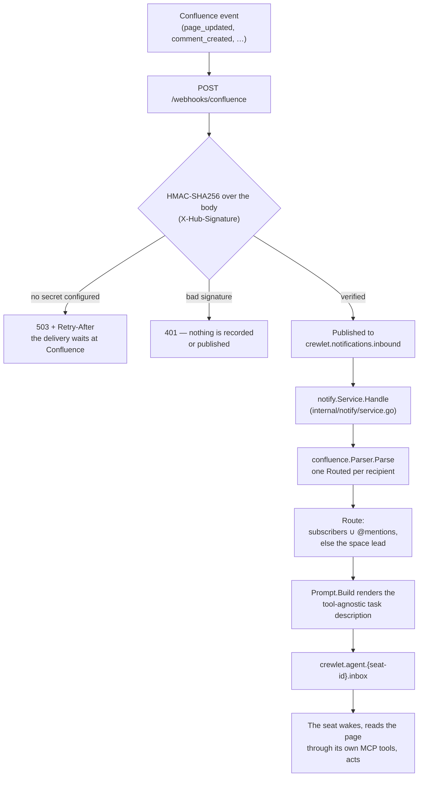

# Confluence Integration

Crewlet integrates with Confluence bidirectionally: agents read and write Confluence pages via MCP tools, and Confluence pushes content change events to agents via webhooks.

> **Confluence is one of two knowledge backends, and it is not the default.**
> The engine ships its own, Doclet (`knowledge.backend: doclet`, the default), with every page a record on the engine's pages log, applied on every data node, and searched by keyword over each data node's own BM25 index (and by meaning where `knowledge.vectors` is on, the default for a company with an embeddings provider). Set `knowledge.backend: confluence` (or declare this block, which derives it) to run Confluence instead. It buys one thing Doclet lacks: search runs **as the agent's own Atlassian user**, so Confluence's page permissions are the boundary rather than the engine. Exactly one backend per company: a config naming both is refused. See [Knowledge System](../concepts/knowledge-system.md).

> **Prerequisites — the Atlassian side is set up by hand.** Atlassian offers no API for provisioning users, so the operator creates the Atlassian site (Cloud or Data Center) and each agent's Atlassian account and API token manually, then wires the tokens into `mcp_env` as shown below. `crewlet confluence provision` registers the inbound hooks on either deployment; on Cloud the [Crewlet Forge app](https://github.com/crewlet/forge) is the supported alternative (see [Webhooks](#webhooks-confluence-pushes-to-agents)).

---

## Setting it up from the dashboard

**Connect** on the Atlassian page (Confluence or Jira in Company › Integrations) collects the site address, the account email and the API token and generates the webhook credential your deployment needs (a signing secret for Data Center, a shared token for Cloud); the reconcile loop then registers the hooks on its next tick, running the same pass `crewlet confluence provision` runs.

See [Running the provisioning pass](../reference/api-endpoints.md#running-the-provisioning-pass).

## Configuration

The `integrations.confluence` block is **non-tool config** — the admin/service account for org-level REST calls and the inbound webhook secret. Org-wide knowledge spaces live in the separate `knowledge:` block. The Confluence MCP *tool* server is a separate `mcp_servers` entry, shared with Jira under the name `atlassian`:

```yaml
integrations:
  confluence:
    url: "${CONFLUENCE_URL}"                        # Confluence instance URL (Cloud or Data Center)
    token: "${CONFLUENCE_API_TOKEN}"                # API token (admin/service account)
    email: "${CONFLUENCE_EMAIL}"                    # Cloud only — admin email for Basic Auth
    webhook_secret: "${CONFLUENCE_WEBHOOK_SECRET}"  # Data Center: required, HMAC-SHA256

knowledge:
  backend: confluence                               # this company's knowledge base
  scope: ["HANDBOOK"]                               # org-wide containers every agent can search

mcp_servers:
  - name: atlassian                               # shared by Jira + Confluence
    shared: false                                 # per-agent: each role supplies its own token
    command: uvx
    args: ["mcp-atlassian==0.23.1"]
    env:
      CONFLUENCE_URL: "${CONFLUENCE_URL}"         # declare explicitly — the engine does not inject it
```

> **Note:** Instead of `url`, you can provide `cloud_id` (Atlassian Cloud ID) — the base URL is constructed automatically. Provide one or the other, not both.

**Which deployment a `url` names is derived, by the rule the [Jira](jira.md#configuration) client uses.**

- A site under `atlassian.net`, `jira.com` or Government Cloud's `atlassian-us-gov-mod.net` is Cloud. It serves Confluence under `/wiki`, which the engine appends unless the address already ends in it.
- A gateway a `cloud_id` is read through (`api.atlassian.com`, or Government Cloud's `api.atlassian-us-gov-mod.com`, chosen by the Cloud `site_url`) is Cloud and already names the product: nothing is appended.
- Any other host is what `integrations.atlassian.deployment` declares, Data Center when nothing is declared, served at the address as written.
- An [Atlassian Isolated Cloud](https://support.atlassian.com/organization-administration/docs/ip-addresses-and-domains-for-atlassian-cloud-products/) site has a base domain of its own, so it is Cloud by that declaration, not by host, and nothing is appended: write its `url` out whole, `/wiki` included.
- A `url` whose host is a `${VAR}` is judged when it resolves, so validation asks for a Data Center's `webhook_secret` up front only when the company declares `data_center`.

> **Human-clickable links agents share:** with `cloud_id`, the `mcp-atlassian` tools return `api.atlassian.com/ex/confluence/{cloud_id}/...` gateway URLs, which colleagues can't open. To have agents share a clickable `…atlassian.net/wiki/spaces/…/pages/…` link, set a [skill variable](../concepts/tool-skills.md#skill-variables) (`skill_variables.confluence_base_url: "https://mycompany.atlassian.net/wiki"`) for your mention/link Tool Skill to reference. (The bundled `examples/tool-skills/platform-mentions.md` does not: it links to Worklet and Doclet through `${crewlet_base_url}`, so a company on Confluence gives its link rule a skill of its own.) This is *enforced-reading guidance* (the required-skill guard puts the rule and base in context before the agent can post), not a rewrite of tool results: `mcp-atlassian` builds result links from `CONFLUENCE_URL` and reads no site-URL env. It is independent of `site_url`, which the notification transport and knowledge search use for their own links.

On **Cloud**, `crewlet confluence provision` registers token-bearing hooks on `/webhooks/confluence/{event}` through an endpoint Atlassian has never documented; the [Forge app](https://github.com/crewlet/forge) is the supported alternative and delivers to `POST /webhooks/forge`. `webhook_secret` signs Data Center deliveries; `webhook_token` authenticates Cloud ones. See [Webhooks](#webhooks-confluence-pushes-to-agents).

Jira and Confluence use the **same** `mcp-atlassian` server: declare it **once** in `mcp_servers` as `atlassian` and set the address of each product the company uses in its `env`, `JIRA_URL` and `CONFLUENCE_URL`; the engine does not derive them from the `jira:` / `confluence:` sections. Leave out the one the company does not run: every `${VAR}` a server is started with must resolve, so a `JIRA_URL: "${JIRA_URL}"` set nowhere holds every seat's `atlassian` server back rather than starting it with Jira off ([Tools & MCP](../guides/tools-and-mcp.md#a-key-that-may-go-without-its-value) has the declaration for a setting a server can run without).

---

## MCP Server (Agents Control Confluence)

The `atlassian` MCP server gives agents full wiki capabilities: searching spaces, reading pages, creating and updating content, managing attachments, adding comments. Set `CONFLUENCE_URL` in the server's `env`. The release is pinned for the reasons the [Jira page](jira.md#mcp-server-agents-control-jira) gives, which also says which tools read files on the engine host and what that asks of the directory the engine runs in.

### Key MCP Tools

Agents see these tools in their tool list (discovered dynamically via MCP):

| Tool | Description |
|------|-------------|
| `confluence_search` | Search pages and blog posts using CQL |
| `confluence_get_page` | Read a page's content (Confluence storage format) |
| `confluence_create_page` | Create a page in a space |
| `confluence_update_page` | Update a page's content |
| `confluence_get_page_children` | List child pages |
| `confluence_get_comments` | Read page comments |
| `confluence_add_comment` | Add a comment to a page |

### Per-Unit Confluence Space (identity)

A unit declares the Confluence space it **owns** under `space`. This is *integration identity*: it routes inbound page webhooks to the unit lead and is the team's write / skill-promotion home. It is **not** a tool credential (those stay per-role in `mcp_env.atlassian`) and it **does not** scope knowledge reads (read scope is the org-wide `knowledge.scope`; see [Scoped spaces](#scoped-spaces)).

```yaml
units:
  - name: Engineering
    id: engineering   # the unit's key; `name` above is display
    type: department
    lead: cto         # the lead seat's handle
    space: "ENG"      # unit identity: routing + write home (NOT read scope)
    roles:
      - name: CTO
        mcp_env:
          atlassian: { CONFLUENCE_USERNAME: "${CTO_CONFLUENCE_USER}", CONFLUENCE_API_TOKEN: "${CTO_CONFLUENCE_TOKEN}" }
      - name: Architect
        mcp_env:
          atlassian: { CONFLUENCE_USERNAME: "${ARCHITECT_CONFLUENCE_USER}", CONFLUENCE_API_TOKEN: "${ARCHITECT_CONFLUENCE_TOKEN}" }

  - name: Product
    id: product
    type: department
    lead: vp-product
    space: "PROD"
    roles:
      - name: VP Product
        mcp_env:
          atlassian: { CONFLUENCE_USERNAME: "${VP_PRODUCT_CONFLUENCE_USER}", CONFLUENCE_API_TOKEN: "${VP_PRODUCT_CONFLUENCE_TOKEN}" }
```

Each role keeps its own `CONFLUENCE_USERNAME` and `CONFLUENCE_API_TOKEN` in `mcp_env.atlassian`, the credential the mcp-atlassian server and the query-time searcher authenticate with. The server needs both: given a token and no username it logs that Confluence authentication is incomplete on its stderr (which reaches only the engine's log) and starts without a single Confluence tool, which the engine reports as a server that started, so the seat has no way to read or write a page. On Data Center a personal access token goes under `CONFLUENCE_PERSONAL_TOKEN` instead, the one name the server reads it from. The unit's `space` is read by the engine (routing + skill-promotion), not passed to the MCP server.

---

## Webhooks (Confluence Pushes to Agents)

Data Center signs one hook with `webhook_secret`; Cloud carries a token in one hook per event, or uses the **Crewlet Forge app**.

### Confluence Cloud — a token-bearing hook per event (the default)

`crewlet confluence provision -public-url https://your-engine.example.com` registers one hook per event on your Cloud site and mints a shared token into `integrations.confluence.webhook_token`. Every hook's URL is `https://your-engine.example.com/webhooks/confluence/<event>?token=…`, and the route compares the token constant-time.

**Read this before relying on it.** Confluence Cloud has no webhook page in its administration UI and no documented API for registering one (the request, CONFCLOUD-36613, has been open since 2015). The endpoint the engine uses, `/wiki/rest/webhooks/1.0/webhook`, answers on Cloud with an ordinary API token and does deliver, but **Atlassian has never stated its support status and can change or remove it without notice.** Every fact below was measured against a live site, because no document exists:

- **A Cloud delivery carries no signature.** The endpoint accepts a `secret` on registration and silently ignores it. Nothing varying with the body arrives, so there is nothing to verify an HMAC against.
- **Userinfo in the URL is dropped**, and no registration field becomes a header.
- **The query string is delivered verbatim.** It is the only channel through which anything secret reaches the engine, which is why the token rides there.
- **The payload names no event.** Which fired is known only from which hook was registered, so the engine registers one hook per event with the event in the path.
- **The endpoint validates no event names.** A registration for an event Confluence never emits answers 201 and never fires.

So the Cloud token is exactly what [Datadog's](datadog.md) is: **a shared token doing a signing key's job with none of the guarantees.** A replayed delivery is indistinguishable from a fresh one, and anyone holding the token can forge a page event. Treat `webhook_token` as a signing key, rotate it the same way (`-recreate-webhooks` re-registers every hook with a fresh one), and keep it a `${VAR}`. The engine never logs the query string on this route.

**A value this deployment already sealed is reused, not reminted.** A `${VAR}` that already resolves is used as is; one that resolves to nothing is minted into, **unless** the fleet already holds a value under that name, which is read back instead. The read-back matters to the reconcile loop: a `${VAR}` resolves from a snapshot taken at apply time, so between a pass sealing a value and the snapshot being rebuilt the resolver answers empty, and without the read-back the loop would mint on every tick, re-registering every hook with a token the running engine does not hold (on Cloud, the entire authentication). Every node holds the keyring a minted value is sealed under, so a pass never registers a hook with nothing to authenticate it: a tokenless Cloud hook would be an open endpoint anybody could drive a turn through.

The token is the entire check, so its length is its strength: **Crewlet refuses one shorter than 26 characters**, the length `crewlet confluence provision` and the dashboard's Generate button mint (130 bits of base32). `crewlet validate` and `PATCH /config` reject a short literal, and the route answers 503 for a short **resolved** value, so a `${VAR}` pointing at a weak token is refused exactly where the weak token itself would be.

If you would rather not carry the risk of an undocumented endpoint, the Forge app below is the supported route, and an Automation rule is the documented way to reach this same route.

The account whose token is in `integrations.confluence.token` needs **Confluence administrator** rights to register hooks.

### Confluence Cloud, an Automation rule as the sender (documented alternative)

Confluence Automation's **Send web request** action is Atlassian's documented way for a Cloud site to call an outside URL, and it reaches the same per-event route as the hooks above. Unlike a registered hook it can carry the token in a **header**: `POST /webhooks/confluence/<event>` reads `X-Crewlet-Token` first and falls back to `?token=` only when the header is absent, so a rule and a registered hook share one route and one credential.

One rule per event, built in **Space settings** (or **Global automation**) with the trigger that matches the path:

| Trigger | Path | Body |
|---|---|---|
| a page is published | `/webhooks/confluence/page_created` | the page body below |
| a page is edited | `/webhooks/confluence/page_updated` | the page body below |
| a comment is added | `/webhooks/confluence/comment_created` | the comment body below |

The action is **Send web request** with:

- **URL**: `https://your-engine.example.com/webhooks/confluence/<event>` (the path above)
- **Method**: `POST`
- **Headers**: `X-Crewlet-Token` set to the value of `integrations.confluence.webhook_token`, with **Hidden** ticked, and `Content-Type: application/json`
- **Body**: custom data, on one line. The page body:

```
{"page":{"id":"{{page.id}}","title":{{page.title.asJsonString}},"version":{"number":"{{page.version.number}}"}},"space":{"key":"{{space.key}}"},"userAccountId":"{{initiator.accountId}}"}
```

and the comment body:

```
{"comment":{"id":"{{comment.id}}","parent":{"id":"{{page.id}}","title":{{page.title.asJsonString}},"contentType":"page"}},"space":{"key":"{{space.key}}"},"userAccountId":"{{initiator.accountId}}"}
```

**The version number and the comment id keep two events from collapsing into one.** This route has no per-delivery identifier, so it claims a hash of the body (see [Delivery deduplication](#delivery-deduplication)), and a body of only a page id and title is byte-identical for two saves of one page five minutes apart: the second would answer `200 {"status":"duplicate"}` and wake nobody. `{{page.version.number}}` changes on every save and `{{comment.id}}` is unique per comment.

The engine answers `200` and logs `webhook_received source=confluence`; a wrong or missing token answers `401`. Use the rule's validate step and one real edit to confirm the smart values render on your site.

Costs and cautions:

- **It is metered.** Every run is an Automation step, pooled per organisation. A site that reaches its allowance stops running rules, silently from the engine's side, so a quiet feed can mean a spent allowance.
- **A failed request is not retried.** Automation is fire-and-forget on a non-2xx answer, so events during an engine outage are gone, where a registered hook and the Forge app both retry.
- **A hidden header does not survive a copy.** Duplicating, exporting or importing a rule drops the hidden value: re-enter the token on the copy.
- **It is the same shared token.** Everything above about `webhook_token` applies: a header is not a signature, so treat it as a signing key and rotate it the same way.

### Confluence Cloud — the Forge app (supported alternative)

Install the [Crewlet Forge app](https://github.com/crewlet/forge) from the Atlassian Marketplace (or via a private installation link). The Forge app forwards these Confluence events to the Crewlet backend:

- `avi:confluence:created:page` — new page created
- `avi:confluence:updated:page` — page content or title changed
- `avi:confluence:trashed:page` — page moved to trash
- `avi:confluence:deleted:page` — page permanently deleted
- `avi:confluence:created:comment` — new comment on a page
- `avi:confluence:updated:comment` — comment edited
- `avi:confluence:created:blogpost` — new blog post
- `avi:confluence:updated:blogpost` — blog post updated

Events are delivered via Forge Remote to `POST /webhooks/forge`, each with a Forge Invocation Token. The engine accepts one only when it is for `integrations.forge_app_id` **and** names the site this block's `cloud_id` names, which may differ from Jira's. The token names its site by cloud id only, so a company on the relay gives `cloud_id` (with `site_url` for links) rather than the site's `url`. Setup records both from the [Atlassian organization](#configuration) when no address is given; until the block has a `cloud_id`, Confluence events on the route answer `503`. Meanwhile each refused event is lost: Forge retries a refused event up to four times, 60 seconds apart ([Forge Remote](https://developer.atlassian.com/platform/forge/remote/sending-product-events/)), then drops it, and nothing replays it later. The Atlassian card on the Integrations page, and setup's answer, name the field to set. See [`/webhooks/forge`](../reference/api-endpoints.md#webhooksforge). Label events are not forwarded.

### Confluence Data Center — Direct Webhook Registration

Data Center supports webhook registration via the admin UI or REST API:

1. Go to **Administration** > **Further Configuration** > **Webhooks**
2. Set URL to `https://your-server.com/webhooks/confluence`
3. Select events: `page_created`, `page_updated`, `comment_created`
4. Set a **Secret** for HMAC-SHA256 signature verification

Or register dynamically via the REST API:

```
POST /rest/webhooks/1.0/webhook
Content-Type: application/json

{
  "name": "crewlet",
  "url": "https://your-server.com/webhooks/confluence",
  "events": ["page_created", "page_updated", "comment_created"],
  "active": true,
  "secret": "your-shared-secret"
}
```

Inbound requests are verified with **HMAC-SHA256** against the `X-Hub-Signature` header, at the route, before the delivery is recorded or published, as the GitHub and GitLab webhooks do. `POST /webhooks/confluence` is exempt from the API's bearer token because it authenticates by provider HMAC.

`webhook_secret` is **required** for Data Center webhooks: without one the endpoint answers **503** with a `Retry-After`, as its peers do, rather than accepting deliveries it cannot verify. It is deliberately not a 4xx: the sender's request is fine, and a 4xx would tell it to discard a delivery nobody else has a copy of. The delivery waits at Confluence and flows once the secret is set. Cloud is unaffected: its deliveries arrive on the per-event token route or through the Forge app on `/webhooks/forge`, and neither carries this signature.

### Delivery deduplication

Data Center deliveries are claimed fleet-wide on the `X-Atlassian-Webhook-Identifier` the instance sends, stable across its own retries, so a redelivery answers `200 {"status":"duplicate"}` and wakes nobody. The claim lasts five minutes. A route whose provider sends no such header (the Cloud token route and the Forge relay always, and a Data Center build that does not set one) is claimed on a **hash of the raw body** instead.

**On the Cloud token route the body is the whole key**, so what the sender puts in it decides what counts as one event. Confluence's own registered hooks carry the content id, its version and a timestamp, so they are distinct per event. An Automation rule carries only what its body template names, which is why the recipe above includes the page version and the comment id: without them, two saves of one page within the claim window are indistinguishable and the second wakes nobody. Byte identity is preferred to derived coordinates: every field left out of a coordinate set is a way for two *different* events to collapse into one, and a collapsed event is a message nobody answers. A hash cannot do that.

---

## Per-agent access

A seat's Confluence access rides on the same Atlassian service account as its Jira access, described in [Jira: Per-agent access](jira.md#per-agent-access): one account, one product grant per product, one API token whose scopes are the union of the products the seat is on. What differs is how a space is granted, and that is the site's choice:

```yaml
roles:
  - name: SRE
    integrations:
      confluence:
        enabled: true              # off until turned on
        space_role: <space role id>  # where the site has role-based access
        spaces: [ENG]              # empty: every space the company names
```

- **A site with role-based access** (Atlassian's space roles, a beta): the seat holds one space role in each listed space, chosen from the site's own roles read live: Viewer, Collaborator, Manager, Admin and any custom role.
- **A site without it**: the seat holds space permissions by operation, under Confluence's names (View, Add pages, Delete pages, Add comments, Export space, Admin and the rest), stored as `operations: [read:space, create:page]`. View is granted first and removed last, because Confluence requires it for every other permission and removes them all with it. A set without View is refused on save and reported by the sync, naming View; the Agents tab keeps it checked while anything else is, from the lane's `required_level`.
- **Space keys** are compared as Confluence matches them: a global space's key in any case (`eng` is `ENG`), a personal space's `~` key exactly as written.
- **Product access only**, offered first on either kind of site: the account has Confluence and holds no space role or permission of its own, so the site's and each space's permissions alone decide what it sees. Leave `space_role`, `operations` and `spaces` out. Moving a seat to it removes its space roles or permissions; a `spaces` list needs a role or permissions.

Admin, and any custom role or permission set that administers a space, is an administration grant: a raise to it carries a warning and asks for a fresh step-up. Off removes the seat's space access and replaces its token with one without Confluence's scopes (`read:confluence-content.all`, `write:confluence-content`, `read:confluence-space.summary`, `read:confluence-user`), or revokes it when the seat is off on Jira too. Space access is managed with the site credential in `integrations.confluence`, whose account needs to administer the company's spaces.

---

## Query-Time Confluence Search

Crewlet keeps no local copy of Confluence content. Shared knowledge is searched **live at query time**: the auxiliary model turns a turn's trigger into a short text query (once per turn) and the searcher runs it as CQL against `/rest/api/content/search`. There is no startup walk, no vector index and no webhook-driven re-index of page bodies.

The query text is **capped and escaped** before it reaches the CQL literal: a pathologically long fragment is a slow query and a sign the auxiliary model misbehaved, and an unescaped quote would end the literal early.

The search backs the `## Relevant knowledge` prefetch and the `search_knowledge` builtin (see [Knowledge System](../concepts/knowledge-system.md#relevant-knowledge-prefetch)). Agents that want to search or read Confluence directly use the `confluence_search` and `confluence_get_page` MCP tools.

### Authentication

The query-time search authenticates **as the agent's own Atlassian user**, reusing the per-agent token configured for direct Confluence MCP calls in `role.mcp_env["atlassian"]`:

- **Cloud** — `CONFLUENCE_USERNAME` + `CONFLUENCE_API_TOKEN`.
- **Data Center** — `CONFLUENCE_PERSONAL_TOKEN`.

The credential is read from `mcp_env.confluence` if a seat has one, otherwise from the shared `mcp_env.atlassian` (the `mcp-atlassian` server covers both products, so the documented entry is named `atlassian`; a product-specific block exists only where somebody made one).

> **One account, one answer.** Jira, Confluence and the Atlassian provisioner share one reader for "does this seat have an Atlassian credential". In the **shared** block each product also accepts the other's `*_API_TOKEN`: on Cloud one API token belongs to the account and authenticates both, so `mcp_env.atlassian.JIRA_API_TOKEN` counts for Confluence. A `*_PERSONAL_TOKEN` never crosses, because a Data Center PAT is issued by one product and refused by the other. `Authorization: Bearer …` is accepted too.

Roles without a per-agent Confluence token fall back to the **org token** (`integrations.confluence.token`), which sees whatever that account sees. That is why an unscoped search is then **refused** rather than run: searching the whole instance on a shared credential is how one seat reads a page its own account never could.

### Page-level restrictions — enforced natively by Confluence

Because the search runs as the agent's own Atlassian user, **Confluence enforces its page permissions natively**: a page the agent's user cannot see does not appear in the result set. There is no engine-side restricted-page handling: no `has_restrictions` flag, no empty-content audit rows, no separate ACL store.

To control what an agent can read, set Confluence page/space permissions on that agent's Atlassian user, as for a human team member. To make a restricted page agent-readable, grant the agent's user access (or move the content to a space the agent can reach).

### Scoped spaces

The CQL query is narrowed by a `space IN (...)` clause built from **one** source: the org-wide `knowledge.scope` list, the same for every agent. A unit's own `space` is *identity* (routing + writes) and **does not** narrow reads.

**Scoping is optional, and empty is the useful default.** If `knowledge.scope` is empty, the search falls back on the auth model: a role with its **own** Confluence credentials searches **unscoped** (the `space IN (...)` clause is dropped and Confluence ACLs bound the results to every space its account can read), while a **credential-less** role, which would otherwise search the org admin's entire view, searches **nothing**. With per-agent tokens everywhere you can omit `knowledge.scope` and let Confluence ACLs scope reads; set it only to *narrow* the search to a curated floor.

```yaml
knowledge:
  backend: confluence
  scope: ["HANDBOOK", "GENERAL"]   # optional read-scope floor — omit to rely on per-agent ACLs

units:
  - name: Engineering
    space: "ENG"    # ENG is Engineering's WRITE / routing home — it does NOT scope reads
```

Read scope is computed at query time from the normalised `knowledge.scope`, so a live config edit takes effect with no restart. With the config above, *every* agent's search is scoped to `{HANDBOOK, GENERAL}` regardless of unit; an Engineering agent is **not** restricted to `ENG`.

**Unreviewed auto-drafted skills never reach an agent.** A hit whose ancestor chain includes `Auto-Drafted Skills` is dropped, and so is one whose title still carries the `[Auto-draft] ` prefix: two tests, because the first can silently stop matching (an instance that answered without the ancestor expand). A lead publishes a draft by **moving it out** of that parent, the review gesture; the prefix is cleared with it.

**The tool-skills space is not knowledge.** Pages in `knowledge.skills_container` (default `TS`) are machinery: a seat told to read one would follow an instruction written for a different phase of a different turn. They are excluded from search and from routing, while still indexed into the skill registry.

### When Confluence search is unavailable

The `## Relevant knowledge` prefetch stays empty (logged, never an error) whenever the search cannot run: no `confluence` block, an org token that did not resolve, an unreachable instance, a refused query. **A turn must not die because a wiki was slow**, so every failure path is an empty result.

A cheap **no-I/O pre-gate** applies too: when a search is a guaranteed no-op (no scope AND no per-seat credential), the turn-start prefetch skips the auxiliary model call that would have generated the query, the expensive half.

The search needs a Confluence connection and a model for query generation. It needs **no** database and **no** embeddings provider.

---

## How It Works

Confluence serves two roles in a Crewlet company: **knowledge source** (agents search and read docs) and **knowledge sink** (agents publish results back).

### Inbound: Confluence Content Changes Wake Agents



### Routing Strategy

A wiki page event names only who edited it (no assignees), so routing has three signals, and the last is a fallback: it says "this concerns your team", never "this is yours".

1. **Subscribers** — seats that have **touched this page before**. A seat is subscribed when it *edits* the page or when somebody *@mentions* it there.
2. **@mentions** — a comment or page body containing `<ri:user
   ri:account-id="…"/>` markup routes to the seats named. The Confluence UI does not allow mentioning service accounts, but **the API can insert mention markup**, so agents commenting through their MCP tools can direct a page to a colleague.
3. **Space leads** — if neither produced a recipient, every unit lead mapped to the space key gets it, minus the actor.

**Steps 1 and 2 are one tier, not a precedence.** A mention is a directed ask and a subscription a declared interest; suppressing either loses a recipient who wanted the event. Both fire, and a seat both mentioned and subscribed gets exactly **one** notification (under the mention, the stronger reason). Only the lead fallback is exclusive: it exists for when nobody was found.

"Resolved to a known agent" means the account maps to an **agent seat in the org**, not to an agent on the node that received the webhook: a recipient owned by another node is routed normally, since the notification is addressed by handle and consumed by whichever node owns the seat. Humans resolve to nothing, deliberately: Confluence already notified them natively, and counting one as a delivered recipient would suppress the space-lead fallback in favour of a notification the engine then skips.

#### The subscription list is the engine's, not Confluence's

Confluence keeps watchers, but reading them is the wrong design here:

- the watcher list is mostly **people**, already notified by Confluence and resolving to nothing the engine can wake;
- reading it costs **a call per event**, on a path that must stay cheap;
- a **per-role token frequently cannot read another user's watch state**, so the answer would be "nobody watching" on exactly the deployments this documents.

So the engine keeps its own list on the coordination store, since a seat subscribed by a mention one node handled must be found by whichever node handles the next event. Membership is one question per event ("which of my seats is subscribed to this page?"), so cost does not grow with a page's history.

A seat is on the list by its handle, and is woken under it.

The list is bounded by the **coordination bucket's retention**, not a per-page expiry: a page nobody has touched inside that window drops its subscribers, which is the right forgetting. Every node reads the same list, a single embedded node included, so there is no shape that routes by mentions and space leads alone.

#### An edit subscribes you; a comment does not

This asymmetry is the delegation loop, and the rule Confluence applies to people. Editing a page is a claim on it; commenting is often handing it over. A lead answering "@teammate, this is yours" must **not** subscribe itself, or every later event comes straight back. The mention subscribes the teammate; the comment does not subscribe the lead.

Pages in the **Tool Skills space** subscribe nobody: their events are machinery, excluded from routing entirely.

#### Self-ignore: an agent is never notified about its own action

Every routing step excludes the user who triggered the webhook. This matters most for **space-lead routing**: a lead acting in the space it leads (e.g. a CEO commenting in the leadership space) is the *default* recipient of the resulting `comment_created` / `page_updated` webhook, and would be woken to "acknowledge" it, posting another comment that triggers another webhook, an endless loop.

When the **only** candidate recipient is the trigger user (the sole subscriber, or the sole space lead), the event is **dropped** rather than falling through to a later step. The notification service adds a transport-agnostic backstop: any inbound notification whose `actor_external_id` resolves to the recipient itself is skipped (recorded as a `NotificationSkipped` event). `actor_external_id` is the **one** actor key every integration stamps, and the actor is *resolved* through the handle registry rather than string-matched, so a seat's bot identity and its member identity compare equal. Both layers depend on each agent authenticating as a **distinct Atlassian user** (per-role `CONFLUENCE_API_TOKEN`) so the engine can tell whose action it was. See the per-role-token note below.
### Lead-fallback prompt hint

When a lead receives an event via `routed_via = "space_lead"` (no recipient from steps 1-2), the notification prompt says why: nobody is named on the page and no seat has worked on it. Its `## How to handle this` section tells the lead:

- **Staying silent is the ordinary outcome.** Documentation changing is not a request: act only if the change bears on work in flight, and do not comment to acknowledge it (acknowledgement comments make a wiki's comments unread).
- **Delegate by mention.** If the page belongs to a teammate, `@mention` them in a **comment** instead of answering. The mention subscribes them, so the next event reaches them. Commenting does not subscribe the lead; *editing* would, so a lead that answers by hand keeps receiving every later event.

The hint is suppressed for `watcher` / `mention` routings, which carry their own signal of involvement. A **subscriber** is told it follows the page because it edited it or was mentioned on it, and gets the "staying silent" section without the delegation sentence (it stays subscribed, so that sentence would be false for it). A **mention** is the one routing framed as an ask, and the turn engine holds it to an answer (see [Who is waiting](../concepts/turn-engine.md#who-is-waiting-and-how-they-get-an-answer)).

**Example 1**: Agent SWE edits a page, which subscribes it. A human then comments:
- Agent SWE gets the notification (`routed_via: watcher`)
- Unit leads do NOT get it, since a subscriber was found

**Example 2**: Agent PM comments on a page mentioning `@Agent CTO` via the API:
- Agent CTO gets the notification (`routed_via: mention`) and is subscribed
- The next event on the page reaches Agent CTO (`routed_via: watcher`)
- Agent PM is **not** subscribed by having commented, see [An edit subscribes you; a comment does not](#an-edit-subscribes-you-a-comment-does-not)

> **Important: per-role tokens are what make subscriptions work.** Subscription by edit or mention is attributed to the Atlassian user who acted, so it distinguishes agents only when each authenticates as a **distinct** user (per-role `CONFLUENCE_API_TOKEN` in `mcp_env`). With one shared service account, every edit has the same user, one seat's subscription is every seat's, and the self-ignore rule silences the page for all. See [Jira Integration](jira.md) for the `mcp_env` pattern.

> **Commenting deliberately does not subscribe you.** Only an *edit* subscribes its author. That is what makes delegation work (a lead handing a page over by comment must not stay subscribed) and matches Confluence for people. A seat that wants a page it only commented on must edit it or be mentioned on it.

> **@mentions via API only.** The Confluence UI does not allow `@mentioning` service accounts, but the API can insert mention markup (`<ri:user ri:account-id="..."/>`) when agents comment via MCP tools; the transport extracts and routes them. A human directing a comment to an agent must use the agent's display name in the text (not @mention); the notification still routes to the page's subscribers, and to the space lead if it has none.

### Outbound: Agents Write to Confluence

Agents use MCP tools directly to create or update pages. Common patterns:

- **Decision records**: after a DACI decision resolves, the driver agent publishes an ADR page
- **Sprint reports**: a PM agent summarizes completed Jira tickets into a page
- **Incident postmortems**: an agent publishes a structured postmortem
- **Meeting notes**: agents document outcomes of multi-agent discussions

---

## Publishing Local Pages from Your Machine (CLI)

Operators publish locally authored markdown ([Tool Skills](../concepts/tool-skills.md) and [knowledge docs](../concepts/knowledge-system.md#publishing-knowledge-docs)) with `crewlet confluence import`. Each `.md` file is routed by its frontmatter: a `trigger:` makes it a Tool Skill page (in the Tool Skills space); everything else is a knowledge doc whose **space is its parent-directory name** and **title is its first `# H1`**.

```bash
crewlet confluence import <company.yaml> ./docs-to-publish
```

(The bundled Nimbus example has no `confluence:` block because it runs Doclet. To use it as the positional argument, add the block at the top of this page to a copy and switch its `knowledge.backend` to `confluence`. `examples/nimbus-docs/` holds the pages it publishes.)

- The **first positional argument is the Tier B company YAML**, the second the directory. Credentials come from its `confluence:` block, resolved through the company's secret store, then the environment: through the running engine with a Tier A token in `CREWLET_API_TOKEN`, or with the engine stopped from the fleet's store (`-config` names a different Tier A document, `-api URL` reads through another node). On a cluster member with the engine stopped, a run that publishes is refused before reading or writing anything; `-dry-run`, which reads no stored value, runs anywhere. See [where a command reads the company's values](../reference/cli.md#where-a-command-reads-the-companys-values).
- **Every target space is checked before any page is written**, so a typo in a directory name cannot leave a half-published run. The importer never *creates* a space: it is a container the whole company works in, and guessing it is not this command's job.
- **A page that exists is updated in place**, matched by title within its space. Confluence has no external-id field, so a page renamed in the UI is orphaned and a re-import creates a second one. This is a backend limitation, reported rather than worked around with a marker.
- **Frontmatter may declare `parent:` and `labels:`.** `parent:` is the **title** of a page in the same space to nest this one under; `labels:` are the author's own page labels. The plan is ordered parents-first so a `parent:` naming a page **published by the same run** resolves; a cycle stops the walk naming the files; a parent nobody publishes is a note and the page goes at the space root (a doc in the wrong place beats an unreadable one). **An existing page is never re-parented**, since people move pages deliberately. Labels are lower-cased and de-duplicated at parse time (what Confluence stores); a label that will not attach is a note, not a page failure.
- **Every skill page this command writes gets the `crewlet-skill` label.** It is provenance (the importer wrote the page), not identity, and `-prune` needs it.
- **Page failures are isolated.** A restricted page or one 403 does not cost the other forty; the run reports what failed and exits non-zero.
- `-space KEY` publishes tool skills into a space other than `knowledge.skills_container`; empty reads `$CREWLET_TOOL_SKILLS_SPACE`, then the config field. A company that has [turned tool skills off](../concepts/tool-skills.md#configuration) with `skills_container: ""` has nowhere for a skill file to go, so a tree containing one stops the walk naming both the setting and this flag.
- `-prune` deletes skill pages this tool published that no local file publishes any more: labelled, parsing as a skill, and with a key this run's tree does not carry. All three are required: the label protects a lead's hand-authored page, the parse protects an ordinary page in the same space, and the key comparison makes a renamed skill a delete-and-create rather than a duplicate. **A prune that cannot enumerate the space deletes nothing** and fails the run, because the orphan set is derived by subtraction and a partial read would delete live pages. Deleted pages go to the space's trash, restorable in the UI.
- Add `-dry-run` to print the plan and write or delete nothing.

Publish first, then start the engine. The importer reads credentials from the **Tier B company YAML**, so it works before a node is configured, and the engine's boot-time sync then finds the pages already there.

`crewlet confluence resync <company.yaml>` is the read-only diagnostic beside it: it runs the **same** walk and admission as every node's skill sync, against a throwaway registry, and prints the keys that loaded plus any page that declares a `trigger:` and does not parse. It answers "why is this skill not applied", not "make it apply": it does **not** reach into a running engine, which applies a page change on every node through the page webhook and catches up on its periodic walk, every 10 minutes give or take a fifth (see [Keeping every node current](../concepts/tool-skills.md#keeping-every-node-current)). `-space` targets a space other than the configured one, to check a container before pointing the company at it. It exits non-zero on a page meant to be a skill that failed to decode, because otherwise the only symptom is guidance that never appears. See the [CLI reference](../reference/cli.md#crewlet-confluence-resync).

---

## Teaching Agents to Use Confluence

MCP tools give agents the *capability*; they also need to know *when* and *why*. Three layers carry this guidance, keeping it configurable per org and per role rather than hardcoded. All agents get the same Confluence MCP tools; their prompts and accessible spaces decide how they use them.

### 1. Behavioral guidelines (per role, in YAML)

These render directly into the role's executor system prompt, with no DB seed step.

```yaml
roles:
  - name: Architect
    behavioral_guidelines:
      - "Search Confluence (ENG space) for existing architecture docs before proposing changes"
      - "Publish all architecture decisions to Confluence under 'Architecture Decisions'"
  - name: PM
    behavioral_guidelines:
      - "After each sprint, summarize completed work in a Confluence page under 'Sprint Reports'"
      - "When creating a new project, check Confluence for existing requirements docs first"
```

### 2. The `Onboarding` page convention (per unit)

Each unit's space can host an `Onboarding` page that fresh agents are nudged to read on their first turn. A dedicated first-turn pass runs before the executor, its prompt listing every `Onboarding` page on the agent's unit chain (org root, each ancestor unit, own unit); the agent reads them, captures conventions via `reflect_and_persist`, and calls `mark_onboarded`, after which the pass does not run again until the org chain changes. See [Turn Engine § First-turn onboarding](../concepts/turn-engine.md#first-turn-onboarding).

### 3. Query-time Confluence search (engine side)

The `## Relevant knowledge` block runs a live Confluence search for the seat: the searcher has the auxiliary LLM generate a CQL query from the trigger and runs it against the Confluence REST API, optionally narrowed to the org-wide `knowledge.scope` (empty means unscoped, with the agent's own Confluence ACLs bounding results). The `search_knowledge` builtin runs the same search on a query the executor writes. See [Knowledge System § Relevant-knowledge prefetch](../concepts/knowledge-system.md#relevant-knowledge-prefetch). Agents that search or read pages themselves use the `confluence_search` and `confluence_get_page` MCP tools.

### Mentioning Other Agents in Confluence Comments

Agents mention each other via the API by putting Atlassian user markup in comment bodies, using the `confluence_add_comment` tool with this HTML:

```html
<p>Hey <ac:link><ri:user ri:account-id="ACCOUNT_ID"/></ac:link>, please review this page.</p>
```

Replace `ACCOUNT_ID` with the target agent's Atlassian account ID. The parser extracts the mention, routes the notification to that agent, and subscribes them so later events reach them too.

**A [Tool Skill](../concepts/tool-skills.md) carries this syntax**: a Confluence-sourced prompt fragment triggered for any role with `atlassian` in its `mcp_env`. Its summary is in the per-phase catalogue and the full body loads on demand via `load_tool_skill`, so agents know how to mention others without paying the token cost every turn.

---

## Integration with Jira

With both Jira and Confluence configured, agents can cross-reference:

- **Jira ticket → Confluence page**: search Confluence for related documentation, architecture decisions or runbooks.
- **Confluence page → Jira ticket**: create Jira tickets for each action item of a requirements page.
- **Linked artifacts**: add Confluence page links to Jira tickets and vice versa, for traceability.

Both integrations share the `mcp-atlassian` MCP server, so all Jira and Confluence tools are in the same tool list.

---

The Confluence MCP *tool* server is declared separately in `mcp_servers` (the `atlassian` entry under [Configuration](#configuration)). The MCP server is what an **agent** calls; the `integrations.confluence` block is what the **engine** reads: the inbound webhook, the knowledge search and the tool-skill walk. For Cloud, install the [Crewlet Forge app](https://github.com/crewlet/forge), which delivers webhooks over Forge Remote.
