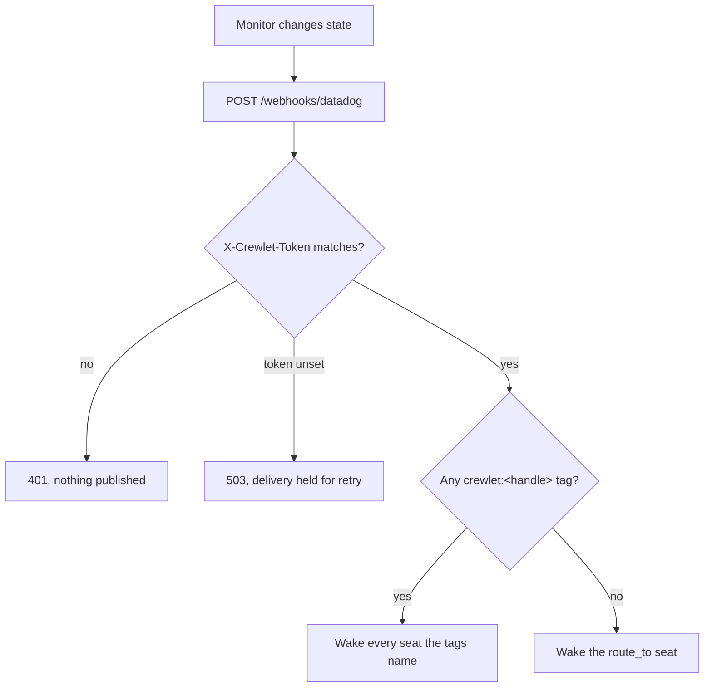

# Datadog

Datadog reaches Crewlet through its **Webhooks integration**, which posts a monitor's payload to a URL. A firing monitor becomes an inbound event on the same path as everything else, so a seat is woken by an alert exactly as it is by a comment on a merge request.

The engine registers that webhook itself and keeps its address current, so the only thing left for you at Datadog is naming it in the monitors you want an agent woken by.

## Setting it up from the dashboard

Company › Integrations connects Datadog without a shell: it takes an API key
and an application key, asks for the monitor tag key and the fallback seat,
generates the shared token, seals it, points the config at it and activates.
The next reconcile pass registers the webhook at Datadog. Everything below
describes what that writes, and is what you edit by hand if you would rather.

The tag key comes filled in as `crewlet` and most companies leave it, since
the two routing questions it and the fallback seat answer are asked in order:
which tag on a monitor names an owner, and who is woken when none does.

See [Setting an integration up](../reference/api-endpoints.md#setting-an-integration-up)
for the routes behind it.

### Testing the keys before you save them

The form offers one **Test keys** control, after the application key. Datadog
accepts or refuses the two keys together, so there is no separate test for the
API key: the control is enabled once both keys are typed (the region always
has a value), and one press checks both and shows one result. Editing either
key, or the region, clears that result. Nothing is stored by a test.

The engine checks in stages, with read-only calls, and stops at the first that
fails, so the result names the key to replace:

| Stage | Call | Result when Datadog refuses it |
|---|---|---|
| The API key, on its own | `GET /api/v1/validate` | "Datadog refused the API key: Forbidden." |
| Both keys | `GET /api/v1/org` | "The API key is valid, but Datadog refused the application key: Forbidden." |
| Reading users | `GET /api/v2/users`, one row | "Both keys are valid, but the application key lacks a permission Crewlet needs: reading users (Forbidden)." |
| Reading roles | `GET /api/v2/roles`, one row | the same, naming reading roles |
| Reading webhooks | `GET` of the configured webhook by name | the same, naming reading webhooks. A webhook that does not exist yet is not a failure: the first reconcile pass creates it |

When every stage passes, the result reads "Works. Both keys are valid for the
FairSplit organization in datadoghq.eu, and can read users, roles and
webhooks." That is the whole claim: the reconcile also **writes** users, roles,
application keys and the webhook, and a test cannot prove those permissions
without making a change at Datadog, so a write the application key is not
allowed surfaces on the first reconcile pass instead. A timeout, a `429` or a
`5xx` at any stage is reported as Datadog not answering rather than as a
refusal. The keys travel only in Datadog's request headers, and Datadog's own
reason is repeated only when it is short and does not contain either key.

## Giving each agent its own Datadog identity

`integrations.datadog.provisioning` carries the organization credential pair,
and it is **required when the integration is enabled**: it is what registers
the webhook that makes alerts arrive at all. An enabled block without it serves
a route, checks a token and receives nothing, because nothing at Datadog was
ever told this deployment exists, so the configuration is refused rather than
reported connected.

The same pair buys one more thing: a **service account per agent seat**, each
holding the Datadog role the seat names and its own application key, so an
agent reading Datadog does it as itself.

```yaml
integrations:
  datadog:
    enabled: true
    webhook_token: ${DATADOG_WEBHOOK_TOKEN}
    route_to: sre-lead
    provisioning:
      site: datadoghq.eu          # checked against Datadog's own regions
      api_key: ${DATADOG_API_KEY} # says which organization
      app_key: ${DATADOG_APP_KEY} # says which user acts
      email_domain: agents.example.invalid

roles:
  - handle: sre
    integrations:
      datadog:
        enabled: true
        role: 4f0e2b3c-1a2b-11ef-8e8e-da7ad0900002   # a role id from GET /api/v2/roles
```

Both keys are needed together. Datadog refuses a write carrying only the API
key, with a message that names neither, so the engine asks for the pair or
neither. The user behind the application key needs Datadog's **User Access
Manage** permission (to create accounts, change their roles and disable them)
and **Service Account Write** (to mint and delete their keys); Datadog Admin
Role holds both.

### Each agent's access is a Datadog role

Each agent seat is turned on or off, and given its access, on the integration's
**Agents** tab (or the agent's own page, which uses the same control). The tab
writes one revision of the company document, under the seat's
`roles[].integrations.datadog` block:

| Field | Meaning |
|---|---|
| `enabled` | Whether the agent has a Datadog service account at all. Required in every block; a seat with no block is off, and a new agent seat is off until somebody turns it on. |
| `role` | The id of a role your organization has, exactly as `GET /api/v2/roles` returns it. |

The access picker offers **every role the organization has**, read live from
Datadog, under Datadog's own names: the three Datadog creates in every
organization first (`Datadog Read Only Role`, `Datadog Standard Role`,
`Datadog Admin Role`), then every custom role by name. What a custom role
grants is set at Datadog, so the tab says so rather than grading it.

Moving a seat to **Datadog Admin Role** manages users, keys and billing, so the
review warns about it and saving asks for a fresh step-up. Lowering a seat, or
keeping one where it is, never does.

A role id the organization no longer has (deleted or replaced at Datadog) is
**a finding on the seat, never a fallback**: the step that needs it stops and
the tab asks you to choose one of the roles the organization has now.
Creating an account under whatever role happened to match would grant an
agent access nobody asked for.

### What each change does at Datadog

| You do | Crewlet does at Datadog |
|---|---|
| Turn a seat on | Creates `crewlet-<handle>@<email_domain>` as a service account **already holding** the seat's role (one that existed for a moment without a role would inherit the organization's default), then mints its application key and seals it. |
| Change its role | Adds the account to the new role (`POST /api/v2/roles/{id}/users`), then takes it out of every other role (`DELETE` on the same relation). Adding first means the account is never without a role and never holds more than it held before plus what you asked for. |
| Turn it off | Records in the account's `title` that this engine turned it off and disables it, then deletes every application key on the account and clears the sealed key. The disable comes first so the agent stops at once; a key delete that fails is retried on every pass until no key is left. Datadog keeps the account and everything it authored. |
| Turn it back on | Enables the account, clears the marker, and mints and seals a new key. No person is needed. |
| Remove it (only while off) | Nothing at Datadog: Datadog never deletes a user, so the account stays disabled with its history, and Crewlet stops managing it. Remove is a separate, confirmed action and never follows from editing the document. |
| Rotate its key | Mints a new key, seals it, then deletes the key it replaced. Only keys this engine minted are deleted; a key somebody put on the account by hand is theirs to remove. A seat given a key because none was sealed for it follows the same order: the new key is sealed before an older one is deleted. |

### The key is the engine's, and named for the seat

The application key is sealed under one name the engine derives for the seat,
`DATADOG_APP_KEY_<HANDLE>` (for example `DATADOG_APP_KEY_SRE`). The company
document never names it, and nothing written to the document can point a
seat's key at any other variable, so a seat's key can no longer overwrite the
organization's own key. A key is minted, and **if it cannot be sealed it is
deleted again** at once: Datadog shows an application key's value exactly
once, so a key that was minted and not sealed would be live and held by
nobody.

### The agent's Datadog tool

An account at Datadog is half of an agent's access; the other half is the tool
it reads Datadog through. Declare Datadog's MCP server once, as a per-seat
server named `datadog`, carrying the organization's API key:

```yaml
mcp_servers:
  - name: datadog
    transport: http
    shared: false                       # one instance per agent seat that is on
    url: https://mcp.datadoghq.com/v1/mcp
    headers:
      DD_API_KEY: ${DATADOG_API_KEY}    # the organization's API key, the same for every seat
```

The engine adds each seat's own key to that seat's instance under
`DD_APPLICATION_KEY`, the header Datadog's server reads, so no seat block names
it. The Agents tab reports per seat whether the tool is live, waiting for its
key, or missing because the company declares no `datadog` server. An admin
also has to turn on **MCP Access** in Datadog's organization settings, and the
seat's role needs `mcp_read` (and `mcp_write` for write tools).

### Every pass reads each account back

Each pass reads every account this engine manages, including the account of a
seat that has since left the document: its roles, whether it is disabled and by
whom, and whether it still holds a key.

- **A role changed at Datadog** by somebody else is restored to the seat's
  role and reported as `drift_restored`, with the before and after. The tab
  offers **Keep the vendor's setting**, which writes Datadog's role into the
  document instead.
- **An account somebody else disabled** at Datadog is never turned back on by a
  pass, in case it was incident response. The tab offers **Turn back on** or
  **Keep off**. Only an account carrying this engine's own marker is ever
  re-enabled without being asked.
- **An account deleted at Datadog** is dropped from the engine's records, and
  the next pass creates a fresh one if the seat is on.
- **A seat whose account holds no key** (deleted at Datadog) is given a new one
  on the next pass. A key this engine minted whose value nothing holds is
  deleted and replaced rather than reported.
- **A seat that leaves the document** is treated as off: its account is
  disabled, kept, and listed on the tab with **Remove**.

A refusal names the step that failed, Datadog's own reason, what to do about
it and who does it, with a link to the organization's user administration.
The step is retried on every pass and on **Retry**.

### Disconnecting

Disconnecting **disables** the accounts this engine created when you tick
"also remove the accounts Crewlet created". Disabled rather than deleted,
because deleting a Datadog user detaches it from everything it authored. It
deletes every application key first, then writes the marker, then disables the
account.

- A live key on a disabled account is a credential that **works again the
  moment anybody re-enables the account**, so the keys go first.
- The marker is what lets a reconnect turn the account back on. It lives on the
  **account** rather than on the integration's status row, because that row is
  forgotten the moment the disconnect succeeds; a field on the account survives
  the disconnect, a fleet losing its coordination store, and a restore from
  backup. Accounts disabled before the marker existed carry none and stay
  manual.
- **The marker is written whatever state the account is in, and before the
  disable**, so a disconnect retried after a partial failure, or one over an
  account somebody had already disabled, still records that this engine turned
  it off. An interrupted run leaves an account **marked but still enabled**,
  which the next connect simply clears.

This is the rule every app that disables rather than deletes follows; see
[three apps disable rather than delete](../concepts/integration-reconcile.md#three-apps-disable-rather-than-delete-and-one-rule-covers-all-three).


## Configuration

```yaml
integrations:
  datadog:
    enabled: true
    webhook_token: "${DATADOG_WEBHOOK_TOKEN}"
    route_to: sre-lead        # required: where an alert naming no owner goes
    webhook_name: crewlet     # optional: monitors name it as @webhook-crewlet
    handle_tag: crewlet       # optional: the monitor tag key that names a seat
    provisioning:             # required when enabled: registers the webhook
      site: datadoghq.com
      api_key: "${DATADOG_API_KEY}"
      app_key: "${DATADOG_APP_KEY}"
```

| Field | Required | Meaning |
|---|---|---|
| `enabled` | yes | Turn the integration on. |
| `webhook_token` | yes | Compared against the `X-Crewlet-Token` header on every delivery. A route with nothing to check against answers **503** rather than accepting one, and so does one whose token is shorter than **26 characters** — see [Verification is weaker here](#verification-is-weaker-here-and-that-is-the-providers-ceiling). |
| `route_to` | yes | The handle of an **agent** seat this company declares, or the literal `none`. An alert wakes that seat when no monitor tag names an owner; `none` dismisses those alerts on purpose. A value that is not a handle is refused wherever it is written, and so is a handle none of the company's seats has, or one naming a human seat — every write carries the whole document, seats included. No seat may itself be handled `none`, or it would be silenced by its own name. See [Routing](#routing-is-by-ownership-not-by-mention). |
| `provisioning` | yes | The organization credential pair and the region it was issued in: `site`, `api_key`, `app_key`, all three required. The engine registers the webhook with them, so an enabled block missing any is refused. `site` must be a region Datadog serves — a key issued in one is refused by every other, and the hostname is the only thing that tells them apart. |
| `webhook_name` | no | The name of the webhook the engine keeps at Datadog, and therefore the handle a monitor writes: `@webhook-crewlet` by default. Give two deployments watching one organization two names, or each rewrites the other's address on every pass. Cannot contain a space, an `@` or a comma. **Renaming leaves the old definition in place** — see below. |
| `handle_tag` | no | The monitor tag key that names a seat. Defaults to `crewlet`. Cannot contain a colon, a comma or a space, because Datadog uses those to separate a key from its value and one tag from the next. |

**Renaming `webhook_name` is a two-step change, and the engine does the first step and then tells you about the second.** The name is also the handle your monitors write, so every monitor still saying `@webhook-crewlet` keeps delivering through the old definition — same address, same token, still working. The engine therefore does not delete it: doing so would silence exactly those monitors. Nor could anything find it for you afterwards, because Datadog answers a `GET` on the webhooks collection with `405` and there is no listing to enumerate.

So the engine **remembers the name it registered under**, and the first pass after a rename reports the definition left behind: Company › Integrations carries it as a note on a **Connected** integration, naming both the old definition and the new one. Nothing is broken, which is why it is an advisory rather than a fault. Repoint the monitors to the new handle, then delete the old definition at Datadog and the note clears itself. A disconnect withdraws only the name the field currently holds.

A disconnect also **reads before it deletes**: a definition under your `webhook_name` that posts somewhere other than this deployment's own `/webhooks/datadog` address is not this engine's, so it is reported and left alone rather than removed.

## Routing is by ownership, not by mention

Every other inbound surface routes by **identity**: a comment names a login, an issue names an account id, a chat message names a user. A Datadog alert names none of those. It is a monitor changing state, and the only thing on it that can say whose problem that is, is the **monitor's tags**.

Datadog's `@` syntax in a monitor message is not an alternative. It is Datadog's own notification-target grammar, resolved against its integrations before the delivery is made: `@webhook-crewlet` is what reaches your engine at all, and writing `@sre-lead` there earns a Datadog warning about an unknown target rather than a routed alert.

So routing has two tiers and a floor:

1. **A tag naming the seat.** A monitor tagged `crewlet:backend-lead` wakes that seat. A monitor may carry the tag more than once, and each named seat is woken, so one alert can reach a whole team.
2. **The company's `route_to` seat**, when no tag names anybody.



**`route_to` is required, and that is deliberate.** An alert is the one delivery that can legitimately name no party, because a monitor is not addressed to anyone. Without a floor those alerts would be accepted, verified, counted on the dashboard and delivered to nobody, which is the worst state an alerting integration can be in: it looks exactly like coverage. `crewlet validate` refuses an enabled block without one.

**The dashboard form opens on `none`**, and required is still required — the default makes the question answerable, not optional. Every other choice on that field is one of *this company's* seats, and picking one for you is picking whose phone rings for every alert nobody labelled: a decision about somebody's working life, made by a form, from a roster it has no basis for ranking. Of the two ways to be wrong it is also the recoverable one — an alert that wakes nobody is a gap you close later, where an alert waking the wrong agent is work already misrouted.

**`none` is an answer, and it is not the same as leaving the field blank.** A company may want only the monitors it has labelled to wake anybody, and everything else to stay with whatever Datadog already does about it — that is a decision, and `route_to: none` is how it is written down. Blank is a question nobody answered, and an alert reaching nobody through it is a silent hole in the coverage. Because `none` means nobody, **no seat may be handled `none`**: one that was would be silenced by its own name, on a screen reporting the configuration exactly as written, so `crewlet validate` refuses it.

**And it has to name somebody who can be woken.** A handle no seat has resolves to nothing, and one naming a **human** seat resolves fine and is then dropped as a self-action — both leave the configuration reading as correct on every screen while every untagged alert lands nowhere, which is the state the requirement exists to prevent. So validation checks the value against the company's own roster: it must be `none`, or the handle of an agent seat this company declares. A monitor **tag** naming an unknown handle is different and stays visible as an undeliverable notification, because a tag is somebody's typo in Datadog rather than a line in this document.

A tag naming a seat that does not exist is **not** silently dropped. It is delivered as far as it can go and recorded as an undeliverable notification with the handle on it, because a typo in a monitor tag is something you have to be able to see.

### What a seat is asked

The prompt differs by why the seat was reached, because the two are not the same job:

- A seat named by a **tag** owns the monitor. It is told this is its service and its call.
- A seat reached through **`route_to`** is told that nothing named an owner, and asked to establish whether the alert is theirs before working it, handing it on if it is not.

A **recovery** reaches the same seats as the alert it recovers from: the seat woken to investigate is the one that has to be told to stand down. What differs is the ask. A firing alert is asked to decide whether it is real and, if it is, to say what is affected and what is being done in the channel the team reads — or to say the threshold is the thing to fix, which is a complete answer too. A recovery is asked to confirm the recovery is real (a monitor with no data recovers exactly like one whose problem was fixed) and to close out anything that was reported about it, where it was reported, with the cause if known.

A monitor's trigger, recovery and re-trigger are **one conversation**, so a seat sees that this is the fourth time tonight rather than four unrelated pages. The thread is keyed on the monitor's own id (`$ALERT_ID` in the [payload template](#the-payload-template)), not on its title, because a Datadog title carries the alert state and would put a trigger and its recovery in two threads.

## Verification is weaker here, and that is the provider's ceiling

Every other inbound route verifies an HMAC over the request body. Datadog cannot do that: its webhook attaches custom headers, but only with **fixed values**, so there is nothing varying with the payload to sign.

The strongest check available is therefore a constant-time comparison of a shared token. The difference is real and worth stating rather than glossing:

- a replayed delivery is indistinguishable from a fresh one
- anyone holding the token can forge an alert

Treat `webhook_token` as a signing key. It is doing that job with none of the guarantees. Rotate it the same way, and keep it a `${VAR}` rather than a literal.

Because the token is the entire check, its length is the entire strength, so **Crewlet refuses one shorter than 26 characters** — the length the dashboard's own Generate button mints (130 bits of base32). The refusal happens in two places on purpose: `crewlet validate` and `PATCH /config` reject a short literal, and the route itself answers 503 for a short **resolved** value, so pointing a `${VAR}` at a weak token is not a way around it. The same floor applies to Confluence Cloud's `webhook_token`, which is in the same position for the same reason.

## What you do in Datadog

The webhook itself is not on this list. The reconcile pass creates it under
`webhook_name`, points it at `<webhook address>/webhooks/datadog` —
`api.public.external_url` when the deployment has a [public listener](../guides/deployment.md#exposing-webhooks-without-the-admin-api),
`api.external_url` otherwise — attaches the
`X-Crewlet-Token` header and writes the payload template below, and it rewrites
that definition whenever the address or the token changes. A disconnect
withdraws it.

What is left is naming it on the monitors you care about:

1. Add `@webhook-crewlet` to a monitor's notification message. Without it Datadog posts nothing, however healthy the webhook is.
2. Tag the monitors you want routed to a particular seat with `crewlet:<handle>`.

You can see what the engine wrote under **Integrations → Webhooks**. Editing it
there is temporary: the next pass restores the definition above, which is what
keeps the address correct when the deployment moves. A definition that already
matches is left alone rather than rewritten, so a converged pass writes nothing
at Datadog at all.

### What the reconcile reports

Three states the pass reaches and, until recently, could say nothing about —
each one leaving the surface reporting `ready` while alerts went nowhere:

| What it found | What it reports | What clears it |
|---|---|---|
| No webhook was registered because this deployment has no inbound address | `ingress_blocked` | set the key the finding names: `api.public.external_url` behind a public listener, `api.external_url` otherwise |
| No webhook was registered because `webhook_token` resolved to nothing | `credential_missing` | set `integrations.datadog.webhook_token` |
| **Enabled** service accounts at this company's own email domain that match **no seat** | `registration_orphaned` | disable or delete them in Datadog — nothing here touches them, and either one clears the finding |

A finding a person settles **at Datadog** carries a link to the organization's user administration; one the engine owns carries none, because sending somebody to a vendor page over a fault on this side costs them the trip and teaches them the link means nothing.

What happens to each agent's own account (an account disabled by hand, a key deleted at Datadog, a role changed by somebody else) is reported per seat on the **Agents** tab rather than as a finding on the card; see [Every pass reads each account back](#every-pass-reads-each-account-back).

#### Accounts this engine made and no longer manages

A live organization accumulates them: an account made by hand at this engine's `.invalid` domain, or one made by an engine before it kept a record of the accounts it creates. No seat claims them and no record names them, so no seat's row mentions them and the card read **Connected** over an organization full of them. (A seat that leaves the document is not one of these: its account is recorded, so it is turned off and listed on the Agents tab with **Remove**.)

**Only the enabled ones.** An account that is already disabled has reached the end state this advisory asks for — its remedy is *disable or delete the ones you do not want* — so reporting it asks an operator for work somebody has done. Mostly this engine had done it: a disconnect with account removal **disables** the accounts it removes, so the ordinary reconnect-with-a-smaller-roster cycle turned every correct teardown into a row on the card. That is what one measured pile was: **36 accounts, every one of them disabled and inert**, burying whatever else the card had to say. Skipping them also makes the instruction work — the filter looked only at the address, so an operator who read the note and disabled an account watched the finding come back unchanged on the next tick; now either half of *disable or delete* clears it. The **enabled** orphan is the genuine finding and still reports: that is an identity which can still act, matching nothing any pass will ask for again. Disabled ones are visible where they belong, in Datadog's own user list filtered to disabled — nothing here has anything to add about them.

They are reported in **one** finding, with the addresses in the detail: the decision is the same for all of them, it is a person's, and a row each would bury everything else on the card. It is an **advisory** — phase `ready`, owed to an admin — because nothing is broken and nothing this engine runs will ever change it, so reporting it as a wait would leave somebody watching a retry with nothing to retry.

**Nothing removes them.** An account is a colleague at Datadog with history attached, so deleting one because a handle changed is not a decision a timer makes — the same rule a disconnect follows when it declines to delete a company's credentials.

Which accounts count as this engine's is decided in two steps, and the domain alone is not enough: Datadog's user filter is a free-text substring match, so a listing under a real domain carries the company's own people. A **`.invalid`** domain (the default, reserved by [RFC 2606](https://www.rfc-editor.org/rfc/rfc2606) precisely so nothing can deliver there) is conclusive — no person has a mailbox at one. Under any other domain the **`crewlet-` prefix** is the marker, so a service account somebody else created at a domain you own is left alone. The rest of the address is the seat's **handle** (see [A seat's account is named after its handle](../concepts/integration-reconcile.md#a-seats-account-is-named-after-its-handle)), which is immutable — Datadog cannot change an account's address at all. Other prefixes at a `.invalid` domain are deliberately not enumerated: such a list would have to be kept in step with every name anybody gives an account there, and the `.invalid` clause catches them all without naming any.

### The payload template

Datadog posts an **empty body** unless the webhook defines a payload template, and the template belongs to whoever creates the webhook rather than being fixed by the third-party app. There is therefore no canonical Datadog alert shape: there is the shape this engine writes, and this is it.

```json
{
  "id": "$ID",
  "monitor_id": "$ALERT_ID",
  "title": "$EVENT_TITLE",
  "body": "$EVENT_MSG",
  "alert_transition": "$ALERT_TRANSITION",
  "priority": "$PRIORITY",
  "tags": "$TAGS",
  "link": "$LINK",
  "scope": "$ALERT_SCOPE",
  "event_type": "$EVENT_TYPE"
}
```

`$TAGS` is what routing runs on, so an alert cannot be routed to its owner without it. `$LINK`, `$EVENT_TITLE` and `$ALERT_SCOPE` are what let a seat be told where to look rather than only that something happened.

`$ID` and `$ALERT_ID` are both here because they answer different questions. `$ID` identifies the **notification** and is what the webhook edge deduplicates a retry on. `$ALERT_ID` identifies the **monitor**, and it is what makes a trigger and its recovery one conversation — a Datadog title carries the state (`[Triggered] API latency`, then `[Recovered] API latency`), so keying the thread on the title split every incident in two. An alert delivered by a definition written before this line existed carries no `monitor_id`, and falls back to the title.

Every value is quoted, including `$PRIORITY`. An unquoted variable that expands to nothing yields `"priority": ,`, which is not JSON and which Datadog posts anyway. The engine still accepts a bare number, so a template somebody unquoted by hand does not lose its alerts until the next pass restores this one.

Every field is optional on the way in. A template somebody edited is a configuration mistake, and dropping a firing monitor over one is the worst available response: the alert is real whether or not its priority came through.

## Deduplication

Datadog stamps each notification with an `id` that is stable across its own retries, and the route claims on it, so a retried alert is answered as a duplicate rather than waking a seat twice.

A payload carrying no `id` is processed **without** a claim. There is nothing stable to key on, and delivering a firing monitor twice is better than dropping it.
