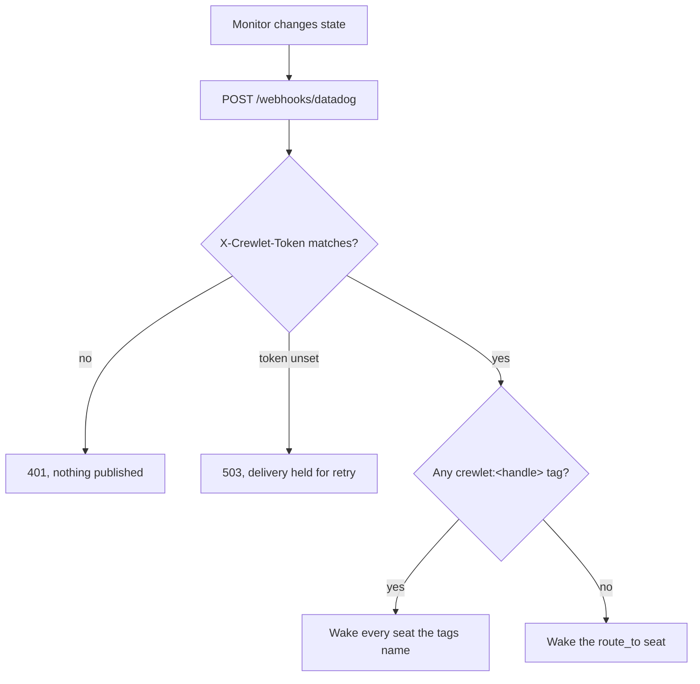

# Datadog

Datadog reaches Crewlet through its **Webhooks integration**, which posts a monitor's payload to a URL. A firing monitor becomes an inbound event on the same path as everything else, so an alert wakes a seat as a comment on a merge request does.

The engine registers that webhook itself and keeps its address current. At Datadog you only name it in the monitors you want to wake an agent.

## Setting it up from the dashboard

Company › Integrations connects Datadog without a shell: it takes an API key and an application key, asks for the monitor tag key and the fallback seat, generates the shared token, seals it, points the config at it and activates. The next reconcile pass registers the webhook at Datadog. Everything below describes what that writes, and is what you edit by hand instead.

The tag key comes filled in as `crewlet`; most companies leave it. The two routing questions are asked in order: which tag on a monitor names an owner, and who is woken when none does.

Routes behind it: [Setting an integration up](../reference/api-endpoints.md#setting-an-integration-up).

### Testing the keys before you save them

The form has one **Test keys** control, after the application key. Datadog accepts or refuses the two keys together, so there is no separate API-key test. The control is enabled once both keys are typed (the region always has a value); one press checks both and shows one result. Editing either key, or the region, clears the result. A test stores nothing.

The engine checks in stages with read-only calls and stops at the first failure, so the result names the key to replace. The result is one sentence beside the control, with its facts (Datadog's own reason among them) below it:

| Stage | Call | Result when Datadog refuses it |
|---|---|---|
| The API key, on its own | `GET /api/v1/validate` | "Datadog refused the API key." |
| Both keys | `GET /api/v1/org` | "The API key is valid, but Datadog refused the application key." |
| Reading users | `GET /api/v2/users`, one row | "Both keys are valid, but the application key lacks a permission for reading users." |
| Reading roles | `GET /api/v2/roles`, one row | the same, naming reading roles |
| Reading webhooks | `GET` of the configured webhook by name | the same, naming reading webhooks. A webhook that does not exist yet is not a failure: the first reconcile pass creates it |
| What the atlas reads | one row each of the monitors, the service catalogue, the hosts and the Synthetic tests, together | never a refusal: the result still reads "Works.", with one warning for each listing the application key may not read, naming the permission that restores it ([what the atlas reads](#what-the-atlas-reads)) |

When every stage passes, the result reads "Works. Both keys are valid.", with the organization, the site and "They can read: Users, roles and webhooks" below it. That is the whole claim: the reconcile also **writes** users, roles, application keys and the webhook, and a test cannot prove those permissions without changing something at Datadog, so a write the application key is not allowed surfaces on the first reconcile pass. A timeout, a `429` or a `5xx` at any stage is reported as Datadog not answering, not as a refusal. The keys travel only in Datadog's request headers; Datadog's own reason is repeated only when short and free of either key.

## Giving each agent its own Datadog identity

`integrations.datadog.provisioning` carries the organization credential pair and is **required when the integration is enabled**: it registers the webhook that makes alerts arrive at all. Without it the route would check a token and receive nothing, so the configuration is refused rather than reported connected.

The same pair also creates a **service account per agent seat**, holding the Datadog role the seat names and its own application key, so an agent reads Datadog as itself.

```yaml
integrations:
  datadog:
    enabled: true
    webhook_token: ${DATADOG_WEBHOOK_TOKEN}
    route_to: sre-lead
    provisioning:
      site: datadoghq.eu          # checked against Datadog's own regions
      api_key: ${DATADOG_API_KEY} # says which organization
      app_key: ${DATADOG_APP_KEY} # says which user acts
      email_domain: agents.example.invalid

roles:
  - handle: sre
    integrations:
      datadog:
        enabled: true
        role: 4f0e2b3c-1a2b-11ef-8e8e-da7ad0900002   # a role id from GET /api/v2/roles
```

Both keys are needed together: Datadog refuses a write carrying only the API key, with a message naming neither, so the engine asks for the pair or neither. The user behind the application key needs **User Access Manage** (create accounts, change their roles, disable them) and **Service Account Write** (mint and delete their keys); Datadog Admin Role holds both.

### Each agent's access is a Datadog role

Each agent seat is turned on or off, and given its access, on the integration's **Agents** tab (or the agent's own page, same control). The tab writes one revision of the company document, under the seat's `roles[].integrations.datadog` block:

| Field | Meaning |
|---|---|
| `enabled` | Whether the agent has a Datadog service account. Required in every block; a seat with no block is off, and a new agent seat is off until turned on. |
| `role` | The id of a role your organization has, exactly as `GET /api/v2/roles` returns it. |

The access picker offers **every role the organization has**, read live from Datadog under its own names: the three Datadog creates in every organization first (`Datadog Read Only Role`, `Datadog Standard Role`, `Datadog Admin Role`), then every custom role by name. What a custom role grants is set at Datadog, so the tab does not grade it.

Moving a seat to **Datadog Admin Role** (it manages users, keys and billing) is warned about in the review, and saving asks for a fresh step-up. Lowering a seat, or keeping it where it is, never does.

A role id the organization no longer has is **a finding on the seat, never a fallback**: the step that needs it stops and the tab asks you to choose one of the current roles. Falling back to a matching role would grant access nobody asked for.

### What each change does at Datadog

| You do | Crewlet does at Datadog |
|---|---|
| Turn a seat on | Creates `crewlet-<handle>@<email_domain>` as a service account **already holding** the seat's role (one briefly without a role would inherit the organization's default), then mints its application key and seals it. |
| Change its role | Adds the account to the new role (`POST /api/v2/roles/{id}/users`), then takes it out of every other role (`DELETE` on the same relation). Adding first means the account is never without a role and never holds more than before plus what you asked for. |
| Turn it off | Records in the account's `title` that this engine turned it off and disables it, then deletes every application key on the account and clears the sealed key. Disabling first stops the agent at once; a failed key delete is retried every pass until no key is left. Datadog keeps the account and everything it authored. |
| Turn it back on | Enables the account, clears the marker, and mints and seals a new key. No person is needed. |
| Remove it (only while off) | Nothing at Datadog: Datadog never deletes a user, so the account stays disabled with its history, and Crewlet stops managing it. Remove is a separate, confirmed action and never follows from editing the document. |
| Rotate its key | Mints a new key, seals it, then deletes the key it replaced. Only keys this engine minted are deleted; a key put on the account by hand is theirs to remove. A seat given a key because none was sealed follows the same order: seal the new key before deleting an older one. |

### The key is the engine's, and named for the seat

The application key is sealed under one name the engine derives, `DATADOG_APP_KEY_<HANDLE>` (for example `DATADOG_APP_KEY_SRE`). The company document never names it, so nothing written to it can point a seat's key at another variable or overwrite the organization's own key. If a minted key **cannot be sealed it is deleted** at once: Datadog shows a key's value exactly once, so an unsealed key would be live and held by nobody.

### The agent's Datadog tool

The account is half of an agent's access; the other half is the tool it reads Datadog through. Declare Datadog's MCP server once, as a per-seat server named `datadog`, carrying the organization's API key:

```yaml
mcp_servers:
  - name: datadog
    transport: http
    shared: false                       # one instance per agent seat that is on
    url: https://mcp.datadoghq.com/v1/mcp
    headers:
      DD_API_KEY: ${DATADOG_API_KEY}    # the organization's API key, the same for every seat
```

The engine adds each seat's own key to its instance under `DD_APPLICATION_KEY`, the header Datadog's server reads; no seat block names it. The Agents tab reports per seat whether the tool is live, waiting for its key, missing (the company declares no `datadog` server), or not running (the server is turned off, `enabled: false`). An admin also has to turn on **MCP Access** in Datadog's organization settings, and the seat's role needs `mcp_read` (and `mcp_write` for write tools).

### Every pass reads each account back

Each pass reads every account this engine manages, including that of a seat that has left the document: its roles, whether it is disabled and by whom, and whether it still holds a key.

- **A role changed at Datadog** by somebody else is restored to the seat's role and reported as `drift_restored`, with the before and after. The tab offers **Keep the vendor's setting**, which writes Datadog's role into the document instead.
- **An account somebody else disabled** is never turned back on by a pass, in case it was incident response. The tab offers **Turn back on** or **Keep off**. Only an account carrying this engine's own marker is re-enabled unasked.
- **An account deleted at Datadog** is dropped from the engine's records; the next pass creates a fresh one if the seat is on.
- **A seat whose account holds no key** (deleted at Datadog) is given a new one on the next pass. A key this engine minted whose value nothing holds is deleted and replaced, not reported.
- **A seat that leaves the document** is treated as off: its account is disabled, kept, and listed on the tab with **Remove**.

A refusal names the failed step, Datadog's own reason, what to do and who does it, with a link to the organization's user administration. The step is retried on every pass and on **Retry**.

### When Datadog limits the engine's calls

Datadog answers a call past a rate limit with `429`, saying when the limit resets (`X-RateLimit-Reset`, in seconds) and which limit it is (`X-RateLimit-Name`). Every engine call waits that out before resending: up to 30 seconds at a time, up to 3 times, never past the deadline of the pass or test that made it. A longer wait is left to the next pass, and the step reports which limit is spent and when it resets. A rate limit is never reported as a refused key.

Datadog sets limits per endpoint and its support raises them on request. The same headers on any answer show the applicable limit and how much is left.

### What the atlas reads

The engine reads the organization for the company's [atlas](../concepts/atlas.md#what-integrations-read) with the same key pair, once an hour unless the company's `atlas.refresh_interval_seconds` says otherwise. Every call is a `GET`; nothing at Datadog changes.

| Listing | Call | Permission | What the atlas gains |
|---|---|---|---|
| The organization | `GET /api/v1/org` | none beyond the keys | its name and id, on the Datadog account |
| Monitors | `GET /api/v1/monitor`, 100 a page | `monitors_read` | each monitor with its name, its state and since when; the service its `service:` tags name and the host its `host:` tags name are watched by it |
| Service catalogue | `GET /api/v2/services/definitions`, 100 a page | `apm_service_catalog_read` | each service, and the repositories its definition links as type `repo` |
| Hosts | `GET /api/v1/hosts`, 100 a page | `hosts_read` | each host that reported in the last three hours, with its environment suggested from its `env` tag where every source agrees (`prod` or `production`, `staging`, `dev` or `development`, `test`) |
| Synthetic tests | `GET /api/v1/synthetics/tests`, 100 a page | `synthetics_read` | for each running test, the address it requests (without credentials, query or fragment) and that address's host name or server are watched by the test's monitor |

**A monitor's state is the health of what it watches.** A monitor in Alert shows itself, its services and its hosts as Alerting on the atlas; Warn and No Data show them as Needs a look. The state is read with the listing, so the atlas follows a change within one refresh interval. A monitor matches an entry only by an exact key: the `service:` and `host:` tags it carries, and a Synthetic test's own address. Its query is never read, so a monitor that scopes a host only inside its query watches nothing until it carries the tag.

**Each listing takes its own permission, and a missing one never fails the read.** The application key acts as its owner, so it reads what that user's roles allow. A refused listing is left out, the source's standing on the atlas names it with the permission to grant, and what an earlier read recorded stays. Grant the permission to a role of the key owner and the next read includes the listing. A listing of more than 20,000 rows is left out the same way.

**What is never read.** A monitor's query and message, a Synthetic test's request headers, body, variables and credentials, a service definition's contacts and description, every creator and every email address or handle, host metadata, and every tag but `service:` and `host:` on a monitor and `env:` on a host. A monitor's name is kept as plain text: square brackets become parentheses and angle brackets are dropped. A value shaped like a credential is refused and counted on the source's standing, never stored.

A read of 2,000 monitors, 500 hosts, 200 services and 300 tests is 35 calls. It shares each endpoint's rate limit with the reconcile loop and waits a limit out as every call does ([below](#when-datadog-limits-the-engines-calls)). A read that fails part way records nothing, and a monitor, service or host that two complete reads at least a day apart both miss is retired from the atlas.

### Disconnecting

Disconnecting **disables** the accounts this engine created when you tick "also remove the accounts Crewlet created". It disables rather than deletes, because deleting a Datadog user detaches it from everything it authored. Order: delete every application key, write the marker, disable the account.

- A live key on a disabled account **works again the moment anybody re-enables the account**, so the keys go first.
- The marker is what lets a reconnect turn the account back on. It lives on the **account**, not the integration's status row (forgotten once the disconnect succeeds), so it survives the disconnect, a fleet losing its coordination store, and a restore from backup. Accounts disabled before the marker existed carry none and stay manual.
- **The marker is written whatever state the account is in, and before the disable**, so a disconnect retried after a partial failure, or over an account somebody had already disabled, still records that this engine turned it off. An interrupted run leaves an account **marked but still enabled**, which the next connect clears.

Every app that disables rather than deletes follows this rule; see [three apps disable rather than delete](../concepts/integration-reconcile.md#three-apps-disable-rather-than-delete-and-one-rule-covers-all-three).


## Configuration

```yaml
integrations:
  datadog:
    enabled: true
    webhook_token: "${DATADOG_WEBHOOK_TOKEN}"
    route_to: sre-lead        # required: where an alert naming no owner goes
    webhook_name: crewlet     # optional: monitors name it as @webhook-crewlet
    handle_tag: crewlet       # optional: the monitor tag key that names a seat
    provisioning:             # required when enabled: registers the webhook
      site: datadoghq.com
      api_key: "${DATADOG_API_KEY}"
      app_key: "${DATADOG_APP_KEY}"
```

| Field | Required | Meaning |
|---|---|---|
| `enabled` | yes | Turn the integration on. |
| `webhook_token` | yes | Compared against the `X-Crewlet-Token` header on every delivery. A route with nothing to check against answers **503**, and so does one whose token is shorter than **26 characters** — see [Verification is weaker here](#verification-is-weaker-here-and-that-is-the-providers-ceiling). |
| `route_to` | yes | The handle of an **agent** seat this company declares, or the literal `none`. An alert wakes that seat when no monitor tag names an owner; `none` dismisses those alerts on purpose. Refused wherever written: a value that is not a handle, a handle none of the company's seats has, or one naming a human seat (every write carries the whole document, seats included). No seat may itself be handled `none`, or its own name would silence it. See [Routing](#routing-is-by-ownership-not-by-mention). |
| `provisioning` | yes | The organization credential pair and its region: `site`, `api_key`, `app_key`, all three required; an enabled block missing any is refused. `site` must be a region Datadog serves: a key issued in one region is refused by every other, and only the hostname tells them apart. |
| `webhook_name` | no | The name of the webhook the engine keeps at Datadog, and so the handle a monitor writes: `@webhook-crewlet` by default. Give two deployments watching one organization two names, or each rewrites the other's address every pass. Cannot contain a space, an `@` or a comma, and is at most 255 characters. **Renaming leaves the old definition in place**: see below. |
| `handle_tag` | no | The monitor tag key that names a seat. Defaults to `crewlet`. Cannot contain a colon, a comma or a space, which Datadog uses to separate a key from its value and one tag from the next. |

**Renaming `webhook_name` is a two-step change: the engine does the first step and tells you about the second.** Monitors still saying `@webhook-crewlet` keep delivering through the old definition (same address, same token), so the engine does not delete it, which would silence them. Nor could anything find it later: Datadog answers a `GET` on the webhooks collection with `405`, so there is no listing.

The engine **remembers the name it registered under**, and the first pass after a rename reports the definition left behind: Company › Integrations shows a note on a **Connected** integration naming both the old and the new definition. Nothing is broken, so it is an advisory, not a fault. Repoint the monitors to the new handle, then delete the old definition at Datadog and the note clears. A disconnect withdraws only the name the field currently holds.

A disconnect also **reads before it deletes**: a definition under your `webhook_name` that posts somewhere other than this deployment's own `/webhooks/datadog` address is not this engine's, so it is reported and left alone.

## Routing is by ownership, not by mention

Other inbound surfaces route by **identity**: a comment names a login, an issue an account id, a chat message a user. A Datadog alert names none of those. The only thing on it that says whose problem it is, is the **monitor's tags**.

Datadog's `@` syntax in a monitor message is not an alternative: it is Datadog's own notification-target grammar, resolved before the delivery. `@webhook-crewlet` is what reaches your engine, and writing `@sre-lead` earns a Datadog warning about an unknown target, not a routed alert.

So routing has two tiers and a floor:

1. **A tag naming the seat.** A monitor tagged `crewlet:backend-lead` wakes that seat. A monitor may carry the tag more than once, and each named seat is woken, so one alert can reach a whole team.
2. **The company's `route_to` seat**, when no tag names anybody.



**`route_to` is required, deliberately.** A monitor is addressed to no one, so an alert can legitimately name no party. Without a floor those alerts would be accepted, verified, counted on the dashboard and delivered to nobody, which looks exactly like coverage. `crewlet validate` refuses an enabled block without one.

**The dashboard form opens on `none`**; still required. The form cannot rank your seats, and an alert waking nobody is a gap you close later, while one waking the wrong agent is work already misrouted.

**`none` is an answer; blank is not.** `route_to: none` records that only labelled monitors wake anybody; blank is a silent hole. **No seat may be handled `none`**: its own name would silence it, so `crewlet validate` refuses it.

**It has to name somebody who can be woken.** A handle no seat has resolves to nothing, and a **human** seat is dropped as a self-action; either leaves untagged alerts landing nowhere. Validation checks the value against the roster: `none`, or an agent seat this company declares. A monitor **tag** naming an unknown handle is a typo in Datadog, not a line in this document: it is not dropped but recorded as an undeliverable notification with the handle on it.

### What a seat is asked

The prompt differs by why the seat was reached:

- A seat named by a **tag** owns the monitor. It is told this is its service and its call.
- A seat reached through **`route_to`** is told that nothing named an owner, and asked to establish whether the alert is theirs before working it, handing it on if not.

A **recovery** reaches the same seats as the alert it recovers from, since the seat woken to investigate must be told to stand down. A firing alert is asked to decide whether it is real and, if so, to say what is affected and what is being done in the channel the team reads, or to say the threshold is the thing to fix, which is also a complete answer. A recovery is asked to confirm the recovery is real (a monitor with no data recovers like one whose problem was fixed) and to close out anything reported about it, where it was reported, with the cause if known.

A monitor's trigger, recovery and re-trigger are **one conversation**, so a seat sees that this is the fourth time tonight. The thread is keyed on the monitor's own id (`$ALERT_ID` in the [payload template](#the-payload-template)), not its title, because a Datadog title carries the alert state and would split a trigger and its recovery into two threads.

## Verification is weaker here, and that is the provider's ceiling

Other inbound routes verify an HMAC over the request body. Datadog cannot: its webhook attaches custom headers only with **fixed values**, so nothing varies with the payload to sign.

The strongest available check is a constant-time comparison of a shared token. The difference is real:

- a replayed delivery is indistinguishable from a fresh one
- anyone holding the token can forge an alert

Treat `webhook_token` as a signing key, without the guarantees: rotate it the same way, and keep it a `${VAR}` rather than a literal.

The token is the entire check, so its length is the entire strength: **Crewlet refuses one shorter than 26 characters**, the length the dashboard's Generate button mints (130 bits of base32). It is refused in two places: `crewlet validate` and `PATCH /config` reject a short literal, and the route answers 503 for a short **resolved** value, so pointing a `${VAR}` at a weak token is no way around it. The same floor applies to Confluence Cloud's `webhook_token`.

## What you do in Datadog

The webhook itself is not on this list. The reconcile pass creates it under `webhook_name`, points it at `<webhook address>/webhooks/datadog` (`api.public.external_url` when the deployment has a [public listener](../guides/deployment.md#exposing-webhooks-without-the-admin-api), `api.external_url` otherwise), attaches the `X-Crewlet-Token` header, writes the payload template below, and rewrites the definition whenever the address or token changes. A disconnect withdraws it.

What is left is naming it on the monitors you care about:

1. Add `@webhook-crewlet` to a monitor's notification message. Without it Datadog posts nothing, however healthy the webhook is.
2. Tag the monitors you want routed to a particular seat with `crewlet:<handle>`.

You can see what the engine wrote under **Integrations → Webhooks**. Edits there are temporary: the next pass restores the definition, which keeps the address correct when the deployment moves. A matching definition is left alone, so a converged pass writes nothing at Datadog.

### What the reconcile reports

Three states the pass reaches, each of which would otherwise leave the surface `ready` while alerts went nowhere:

| What it found | What it reports | What clears it |
|---|---|---|
| No webhook was registered because this deployment has no inbound address | `ingress_blocked` | set the key the finding names: `api.public.external_url` behind a public listener, `api.external_url` otherwise |
| No webhook was registered because `webhook_token` resolved to nothing | `credential_missing` | set `integrations.datadog.webhook_token` |
| **Enabled** service accounts at this company's own email domain that match **no seat** | `registration_orphaned` | disable or delete them in Datadog — nothing here touches them, and either one clears the finding |

A finding settled **at Datadog** carries a link to the organization's user administration; one the engine owns carries none, since sending somebody to a vendor page over a fault on this side wastes the trip.

What happens to each agent's own account (disabled by hand, key deleted at Datadog, role changed by somebody else) is reported per seat on the **Agents** tab, not as a card finding; see [Every pass reads each account back](#every-pass-reads-each-account-back).

#### Accounts this engine made and no longer manages

Accounts made by hand at this engine's `.invalid` domain, or by an engine before it recorded its accounts: no seat claims them and no record names them. (A seat that leaves the document is not one; see above.)

**Only the enabled ones.** A disabled account has already reached the end state the advisory asks for (*disable or delete*), and a disconnect with account removal **disables** accounts, so reporting them would turn every correct teardown into a card row (one pile: **36 accounts, all disabled and inert**). An **enabled** orphan is the genuine finding: an identity that can still act and matches nothing any pass will ask for. Disabled ones show in Datadog's user list filtered to disabled.

They are one finding, addresses in the detail. It is an **advisory** (phase `ready`, owed to an admin): nothing is broken and nothing this engine runs will change it, so there is no retry to watch.

**Nothing removes them.** An account has history attached; deleting one is not a decision a timer makes.

Which accounts count as this engine's takes two steps, because Datadog's user filter is a free-text substring match, so a listing under a real domain carries the company's own people. A **`.invalid`** domain (the default, reserved by [RFC 2606](https://www.rfc-editor.org/rfc/rfc2606) so nothing can deliver there) is conclusive: no person has a mailbox there. Under any other domain the **`crewlet-` prefix** is the marker, so a service account somebody else created at a domain you own is left alone. The rest of the address is the seat's **handle** (see [A seat's account is named after its handle](../concepts/integration-reconcile.md#a-seats-account-is-named-after-its-handle)), which is immutable, since Datadog cannot change an account's address. Other prefixes at a `.invalid` domain need no list: that clause catches them all.

### The payload template

Datadog posts an **empty body** unless the webhook defines a payload template, which belongs to whoever creates the webhook. There is no canonical Datadog alert shape, only the one this engine writes:

```json
{
  "id": "$ID",
  "monitor_id": "$ALERT_ID",
  "title": "$EVENT_TITLE",
  "body": "$EVENT_MSG",
  "alert_transition": "$ALERT_TRANSITION",
  "priority": "$PRIORITY",
  "tags": "$TAGS",
  "link": "$LINK",
  "scope": "$ALERT_SCOPE",
  "event_type": "$EVENT_TYPE"
}
```

`$TAGS` is what routing runs on, so an alert cannot reach its owner without it. `$LINK`, `$EVENT_TITLE` and `$ALERT_SCOPE` tell a seat where to look.

`$ID` identifies the **notification**; the webhook edge deduplicates a retry on it. `$ALERT_ID` identifies the **monitor** and makes a trigger and its recovery one conversation: a Datadog title carries the state (`[Triggered] API latency`, then `[Recovered] API latency`), so keying on it would split every incident in two. An alert from a definition written before `monitor_id` existed carries none and falls back to the title.

Every value is quoted, including `$PRIORITY`: an unquoted variable that expands to nothing yields `"priority": ,`, which is not JSON and which Datadog posts anyway. The engine still accepts a bare number, so a hand-unquoted template loses no alerts until the next pass restores this one.

Every field is optional on the way in: a firing alert is real even if its priority did not come through, so it is never dropped over an edited template.

## Deduplication

Datadog stamps each notification with an `id` stable across its own retries, and the route claims on it, so a retried alert is answered as a duplicate rather than waking a seat twice.

A payload with no `id` is processed **without** a claim: nothing stable to key on, and delivering a firing monitor twice beats dropping it.
