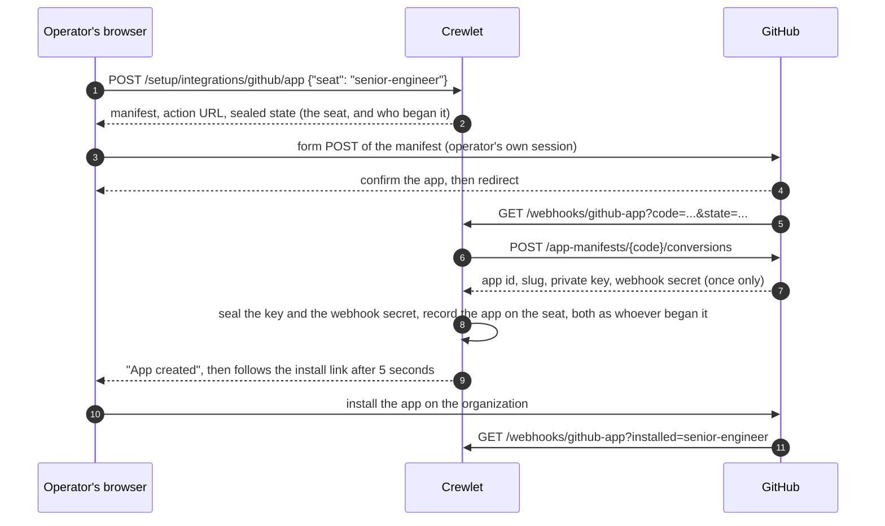

# GitHub Integration

GitHub is a **served code host**: a delivery from github.com or a GitHub
Enterprise Server wakes the seat it concerns, and `crewlet github provision`
registers the webhooks that carry it. A company can run it beside
[GitLab](gitlab.md) — they are two hosts with different repositories on them,
which is what a migration and an open-source presence both look like.

Three surfaces, and they are deliberately separate:

- **Inbound** — `integrations.github` plus `POST /webhooks/github`. This is
  how a review request, an assignment, a comment or a red workflow run
  reaches an agent.
- **Tools** — the [GitHub MCP server](https://github.com/github/github-mcp-server),
  a `shared: false` entry in `mcp_servers` with each agent's token in
  `role.mcp_env.github`. This is how an agent reads, reviews and tracks.
- **Identity.** One GitHub App per agent, in `role.integrations.github`. An app
  carries exactly one bot identity, so each agent has its own, created and
  installed from the dashboard and bounded by the GitHub App permissions set on
  the integration's Agents tab. The agent acts
  as that app everywhere through one token the engine issues it,
  `${GITHUB_APP_TOKEN_<HANDLE>}`. See
  [One GitHub App per agent](#one-github-app-per-agent) and
  [Acting as the app](#acting-as-the-app-the-seats-token).

GitHub tools are for **reading, reviewing and tracking** code: diffs,
comments, reviews, run status. **Authoring** code changes is the seat's
executor run's, with its own shell and git in its
[box](../concepts/code-sandbox.md), which clones, pushes and opens a pull
request as the agent's own app.

---

## Setting it up from the dashboard

Connect GitHub in Company › Integrations. The engine generates the webhook
secret and the reconcile loop registers the hook on its next tick, running the
same pass `crewlet github provision` runs with the same secret store behind
it. The connect step asks for a personal access token nowhere — only the
organization, which is the one answer nobody else has.

The form asks one question about coverage — *which GitHub activity should
reach your agents* — with two answers. It opens on **repositories where an
agent's app is installed**, which is what most companies want and needs
nothing further: each app carries its own webhook, so connecting and
installing is the whole setup. The other answer, **every repository in your
organization including new ones**, needs an organization token with
`admin:org_hook`; the form asks for it only under that answer, and requires it
there. See [What a company hears about](#what-a-company-hears-about-said-out-loud).

The loop keeps checking after that, so a grant you change at GitHub is
reflected on the screen within a tick without anything to press.

Giving each agent its own bot identity is a separate, per-seat flow that the
loop cannot run for you, because it needs your GitHub session: see
[One GitHub App per agent](#one-github-app-per-agent).

See [Running the provisioning pass](../reference/api-endpoints.md#running-the-provisioning-pass).

## Configuration

```yaml
integrations:
  github:
    enabled: true
    # Omit url for github.com. An Enterprise Server names itself here.
    url: "https://github.example.com"
    webhook_secret: "${GITHUB_WEBHOOK_SECRET}"   # required when enabled
    token: "${GITHUB_ENGINE_TOKEN}"              # read credential; see below
    provisioning:                                # read by the engine's pass and the CLI
      org: acme
      repos: [acme/api, acme/web]
      org_webhook: auto
```

- **`url` is optional and its absence is meaningful.** Leave it unset for
  github.com, whose API lives on a different *host* (`api.github.com`) rather
  than a path on the web UI. An Enterprise Server names itself and the REST
  base is derived as `<url>/api/v3` — there is no second address to keep in
  step, and pasting the API base in instead of the instance URL is accepted
  rather than doubled.
- **`webhook_secret` is required** when enabled, and it is the
  *organization's*: it verifies the bare route and any seat with no app of its
  own. A company whose agents all hold their own apps still sets one, because
  enabling this block turns on the organization route. Every delivery to
  `POST /webhooks/github` is verified as HMAC-SHA256 over the raw body
  against `X-Hub-Signature-256`; a route with nothing to verify with answers
  **503** rather than accepting the delivery. Unlike GitLab's, this secret
  has no required shape — GitHub takes any string and signs with it verbatim
  — so there is no wrong *shape* to catch, only a wrong value.
- **`POST /webhooks/github/{handle}`** is the same route, addressed to one
  seat, and is what a [per-agent GitHub App](#one-github-app-per-agent)
  delivers to.

  **It verifies against that seat's own secret.** GitHub generates a signing
  secret per app, at conversion time, and returns it once, so an agent's
  deliveries are signed with its app's secret rather than the organization's.
  The route reads the seat's own `webhook_secret` first and falls back to
  `integrations.github.webhook_secret`, which is what a single organization
  app pointed at one seat signs with. With neither, the route answers **503**.

  GitHub delivers to **every** app installed on a repository, each delivery
  carrying its own `X-GitHub-Delivery`. A repository five agents work
  therefore produces five deliveries of one comment. Those are not
  duplicates to collapse — they are five agents being told, which is the
  point of each holding its own app — and without the seat in the path
  nothing downstream can tell them apart from a redelivery of one. The
  handle travels on the published event as `handle`.

  The bare `POST /webhooks/github` stays for a single app serving a whole
  organisation, where a delivery names no seat and the organization's secret
  is the only one that could have signed it. The seat is never a way past the
  signature check: what the handle selects is which credential the delivery is
  checked against, not whether it is checked.
- **`token` (optional)** is the credential the **organization-level**
  reconcile reads and registers hooks with, and
  [`crewlet github provision`](#provisioning--crewlet-github-provision)
  requires it. A company whose agents each hold their own app needs none: each
  app carries its own hook, and participant fan-out is read through those
  apps. See [Participants](#participants-are-computed-not-read). With no token
  the organization pass reads nothing and says so as a note, which is not a
  fault: there is nothing it was going to do for such a company.

  **Installing an agent's App is not a substitute for it.** An
  organization-wide hook needs the `admin:org_hook` scope, which only a user
  token carries — no App installation grants it, at any permission. So an
  operator who was told *no webhook on `<org>`* and installed the per-agent
  app, exactly as the card was asking, watched the warning stay put. A card
  must never prescribe an install as the remedy for a missing org hook, and
  a company whose agents carry their own apps is not blocked at all — it has
  coverage, narrower than the whole organization, reported
  [as such](#what-a-company-hears-about-said-out-loud).

  It is **offered but never on the connect step**, and it is required by an
  ANSWER rather than in general: choose organization-wide coverage on the form
  and it is the one thing standing between that answer and its being true;
  choose the other and it is a credential the company never uses. The form
  hides it until that choice is made and then requires it, and the API refuses
  the same submission, so a caller that skips the form cannot store a choice
  the engine could not carry out.

  Asking every company for a
  hand-minted personal access token before anything works put a permanent note
  on cards with nothing wrong with them; having no field for it at all left the
  warning pointing at a setting the dashboard could not set. It now appears
  with the finding that needs it.
- **`provisioning:`** says where hooks are registered and which organization
  these agents work in, and it is read by the engine's own pass as well as by
  the CLI. `org` is the GitHub organization holding the repositories, and it is
  also the account a [per-agent app](#one-github-app-per-agent) is registered
  under; `repos` are `owner/repo` entries to hook individually; `org_webhook`
  is `auto` / `true` / `false`, described under [Webhooks](#webhooks). The
  config default is `auto`; the **dashboard form** opens on `true`, because a
  fallback nobody was told about leaves a company believing it has one hook
  when it has several.

### Seat identity is derived, never declared

A GitHub delivery names people by **login**, and nothing in the org chart
says which account a seat holds. At boot the engine calls `GET /user` with
each seat's own credential and registers whatever account answers.

A declared login beside the token would be cheaper and is the wrong shape: a
declaration that disagrees with the credential is a misroute nothing can
detect, and it would make the engine name a variable the seat's own tools do
not read. The credential is read from `role.mcp_env.github` under whichever
key that seat's tool stack uses — `GITHUB_TOKEN`,
`GITHUB_PERSONAL_ACCESS_TOKEN`, `GH_TOKEN`, or an `Authorization` header
(the `Bearer` and `token` schemes are both stripped).

The lookup is **cached against the credential**, not the seat: identity is a
function of the token, so a config apply that changed something else costs no
requests, and a rotated token costs exactly one.

A seat whose lookup fails is left unresolved rather than failing the boot —
GitHub may be rate-limiting — and the engine says so per seat
(`github_seat_identity_unresolved`). That seat receives no GitHub events
until the next apply re-resolves it. A company with **no** resolved seats
logs `github_has_no_seat_identities`, because the integration is completely
inert in that state and nothing else would say so.

**A seat with no token here is not a broken seat.** On the current design each
agent carries its own [GitHub App](#one-github-app-per-agent), and a seat that names
no `mcp_env.github` credential is acting through it — so the reconcile reports
that seat as *unclaimed* rather than as a failed identity, and the provisioning
command prints it under "act through their own GitHub App" rather than under a
list of things to fix. The three outcomes a seat can have are therefore
**resolved** (a token named an account), **unclaimed** (no token, which is
expected) and **refused** (a token this run could not turn into an account,
and the only one that becomes a finding).

**A seat's own app token is never looked up.** A seat that acts as its app
names `Bearer ${GITHUB_APP_TOKEN_<HANDLE>}` for its GitHub tool server
([Acting as the app](#acting-as-the-app-the-seats-token)). That value is the
app acting, not an account to learn: GitHub answers `GET /user` for no
installation token, and the app's account is its slug. So the scan passes that
key over, the seat counts as unclaimed exactly like one that names nothing,
and its identity is its app's (see
[How a seat's app is recognised](#how-a-seats-app-is-recognised)). Until the
app exists, a company whose only identities are such seats logs
`github_seat_identities_waiting` naming them, at info, rather than
`github_has_no_seat_identities`. A scheme with nothing after it (`Bearer ${TOKEN}`
with `TOKEN` unset) is no credential either, and is never sent.

That distinction was missing, and its absence was loud: every agent seat in a
company on the app design was reported as a failed identity, permanently
degraded, with the integration card saying each of them could receive no
GitHub events while all of them were working.

### Human seats

A human seat holds no tool credential. It is addressed by
`contact.github_login` in the org chart, which the party registry registers
directly — so a person can be mentioned in a comment and reached by the
engine's notification spine without ever holding a token here.

A human seat carries no `integrations.github` block either. That block is a
seat's own app, the identity an agent acts as, and nothing creates, installs
or reconciles an app for a person. A document that gives one to a human seat
is refused at that block; the rule is an [admission
rule](../concepts/configuration.md#what-a-stored-revision-is-held-to), so a
revision being applied that carries one still runs.

## One GitHub App per agent

A GitHub App has exactly one bot identity, derived from its slug, and nothing
varies it: not a token, not a header, not a manifest field. An agent that is to
act as itself on GitHub therefore needs an app of its own, so the engine
creates one **per seat** rather than one per company.

That is a constraint rather than a preference. **Agents cannot share one app
and keep distinct identities.** A single company-wide app would have every
agent comment, review and commit as the same account, and an `@mention` of one
of them would no longer say which agent was meant.

### What an operator does

Two acts, both performed by a person signed in to GitHub, and the second can be
a day after the first.

1. **Create the app.** Company › Integrations asks the engine for a manifest
   and submits it to GitHub as a form POST carrying the operator's own GitHub
   session. GitHub shows what is about to be created and, on approval, sends
   the browser back to the engine with a one-time code. The engine converts the
   code, seals the private key that comes back, and records the app on the
   seat.
2. **Install the app.** Creating an app grants it nothing: an app with no
   installation can see no repository. The page the operator lands on after
   creation links straight to the install page for the app that was just
   created, and the install is where the repositories are chosen.

**Neither act can be automated, and that is GitHub's shape.** A manifest is
submitted with the browser session of somebody who may create apps on that
organization, and GitHub offers no server-to-server equivalent. This is the one
part of any integration here that a
[reconcile pass](../concepts/integration-reconcile.md) cannot do on its own.



### The card catches up immediately, not on a cadence

An agent's App is **private**, so GitHub sends this engine nothing when you install it — there is no webhook for it to arrive on, and the reconcile loop is what finds the installation, by listing the App's own installations with the App's own key.

That discovery used to wait out the loop's admin backoff, which runs from fifteen seconds to **ten minutes**, and the backoff is longest exactly when you have just done the thing it is waiting for. Measured: an install completed in about eight seconds, then several minutes of a card still asking for it, reloaded by hand, reasonably read as the install not having worked.

Two things now close that gap:

- **GitHub's return brings the next pass forward.** The install redirect lands at `/webhooks/github-app`, and that arrival asks the loop to look now. It is not a write and nothing in the redirect is believed — no installation id travels with the ask — so the pass that runs is the same verified listing as always, and adopting anything from an unauthenticated query stays out of the question. See [the cadence](../concepts/integration-reconcile.md#the-cadence-follows-who-has-to-act) for the rate limit on that route and why it is where it is.
- **Company › Integrations re-asks when you come back to the tab.** Setting an integration up means leaving for GitHub and returning, and returning is a stronger signal that the answer moved than any poll interval can be. The screen held its pre-departure reading for up to a minute otherwise, which is the other half of what made this look broken.

Together the page is normally correct by the time you switch back to it. If it is not (an engine built without the loop wired, or a second install inside the rate-limited window), the return page says so plainly instead of promising a wait it is not taking, and **Check now** on GitHub's Agents tab, or `POST /setup/integrations/github/check`, asks the loop to look at once.

### What has to be in place first

- **The webhook address**: `api.public.external_url` when the deployment has
  a [public listener](../guides/deployment.md#exposing-webhooks-without-the-admin-api)
  (`api.public`), and `api.external_url` otherwise. Three addresses are baked
  into an app at creation: where its deliveries go, where the browser returns
  after the creation, and where it returns after the install. Only a person at
  GitHub can change them afterwards, so the engine refuses to begin with no
  address at all (`409 no_external_url`, naming the key in `config_path`)
  rather than create an app that would have to be created again. The reconcile
  loop reports the same gap for the org- and repository-level hooks: with no
  address there is nowhere for GitHub to deliver to, so the integration is
  reported **degraded** naming that key rather than **ready** with nothing
  registered anywhere. An address that is set and that GitHub cannot reach is
  a different case, and a working one: see [Running locally, with no public
  address](#running-locally-with-no-public-address).
- **`integrations.github.provisioning.org`.** It names the account the app is
  registered under, and the account matters: an app registered under a person's
  own account cannot be installed on the organization that owns the
  repositories. With no organization set, the operator is sent to their
  personal app registration page instead.
- **`integrations.github.url`**, when the company runs Enterprise Server. Unset
  means github.com.

### The manifest the engine builds

| Manifest field | What the engine puts in it |
|---|---|
| `name` | The company name and the seat's role name, joined and cut to 34 runes |
| `url` | `https://crewlet.ai` |
| `public` | `false`. The app is the company's own |
| `hook_attributes` | `{"url": "<webhook address>/webhooks/github/<handle>", "active": true}`. Left out, with `default_events`, where GitHub cannot reach the webhook address: GitHub validates a hook whether or not it is active, and refuses one with no url, one it cannot reach, and events with no hook |
| `redirect_url` | `<webhook address>/webhooks/github-app` |
| `setup_url` | `<webhook address>/webhooks/github-app?installed=<handle>` |
| `default_events` | `issues`, `issue_comment`, `pull_request`, `pull_request_review`, `pull_request_review_comment` |
| `default_permissions` | The seat's [permissions](#access-in-githubs-own-terms), plus `metadata: read`, and nothing wider |

`<webhook address>` is the one above: the public listener's
`api.public.external_url` where `api.public` is set — the return and the
deliveries are served only there, and `api.external_url` answers `404` for
them — and `api.external_url` otherwise.

**The events are named, never `*`.** An app with a delivery address and no
events subscribes to nothing, receives nothing, and reports itself healthy
while doing so. `push` is deliberately absent: it is the highest-volume event a
busy repository produces and the router drops every one. `workflow_run` is not
in an app's set either, so a failed-run notice reaches a seat through the
organization or repository hook the
[provisioning pass](#provisioning--crewlet-github-provision) registers rather
than through the seat's own app.

### Access in GitHub's own terms

GitHub has no roles for an app. It has permissions, each at **No access**,
**Read-only** or **Read and write**, so that is what a seat stores and what the
Agents tab offers, under GitHub's names:

| Permission (key) | Levels offered | What it is for |
|---|---|---|
| Contents (`contents`) | Read-only, Read and write | Reading code; Read and write pushes branches and commits |
| Issues (`issues`) | Read-only, Read and write | Reading and writing issues and their comments |
| Pull requests (`pull_requests`) | Read-only, Read and write | Reading, opening and reviewing pull requests |
| Checks (`checks`) | Read-only, Read and write | Reading check runs; Read and write reports them |
| Actions (`actions`) | Read-only, Read and write | Reading workflow runs and job logs; Read and write re-runs, cancels and dispatches them |
| Deployments (`deployments`) | Read-only, Read and write | Reading deployments and their statuses; Read and write creates them |
| Workflows (`workflows`) | Read and write | Pushing a change to a file under `.github/workflows` |

- **A permission left out is No access.** `metadata: read` is added to every
  app and every token, because GitHub requires it to resolve a repository.
- **The app is registered at exactly these.** The manifest a person
  submits asks for the seat's permissions and nothing wider, so a leaked app key
  reaches only what the seat may do.
- **Narrowing applies on the next token.** Every token is minted with the seat's
  permissions and repositories, so lowering a level or removing a repository
  needs nothing at GitHub.
- **A raise past the registration waits for two people.** The app's owner adds
  the permission on the app's permissions page, and GitHub then asks an
  organization owner to accept it on the installation. The Agents tab shows the
  step that is waiting with its link; **Done, check again** reads GitHub again.
  Until the installation holds a permission the seat asks for, GitHub refuses
  every token the seat requests.
- **Read and write on Contents or Workflows is an administration grant.**
  Raising a seat to either needs a fresh step-up from the person saving it.
- **Workflows needs Contents (Read and write).** A workflow change is a push,
  and GitHub refuses a push from a token that cannot write contents, so the
  document refuses the pair half set. The same grant lets the agent's branch
  run a workflow it rewrote with the secrets the repository hands its runs, so
  pair it with branch protection on the default and release branches and keep
  deployment credentials in environment-scoped secrets.
- **Seats migrated from tiers** keep exactly what their tier granted,
  permission by permission: `read_only` holds Contents, Issues, Pull requests,
  Checks, Actions and Deployments at Read-only; `review` raises Issues and Pull
  requests to Read and write; `full_access` raises Contents and Checks too, plus
  Workflows where the seat had opted in.

### On, off and remove

`enabled` is stored on the seat's block, and a seat is off until it is turned
on.

| Action | What happens at GitHub |
|---|---|
| Turn on, first time | A person creates the app from the prepared manifest and installs it. The engine seals the app's key and webhook secret when GitHub returns them. |
| Turn off | The engine suspends the seat's installation as the app. The app, its key and the installation are kept, and every token is refused from that moment. |
| Turn back on | The engine lifts the suspension it placed, at the seat's current permissions and repositories: anything the installation must still grant or cover waits for a person, as a raise does. A suspension an organization owner placed at GitHub is lifted there: the Agents tab links to the installation's settings page and checks again once it is lifted. |
| Remove (only when off) | The engine uninstalls the app. A person deletes the app registration from its settings (GitHub has no API for it), and once GitHub reports it deleted the engine clears the sealed key and webhook secret. |
| Rotate | Not offered: tokens last an hour and are never stored. |

An installation suspended or uninstalled by somebody at GitHub is never turned
back on automatically, in case it was incident response: the Agents tab
offers **Turn back on** or **Keep off**. Each pass reads the app's registration
and installation back, so a permission an owner removed at GitHub shows as a
waiting step rather than silently failing tokens.

### What no seat is granted

None of these is offered, so no app is registered with one and no token this
engine mints carries one. Each is a way out of a seat's limits rather than a
step up within them:
administration (deleting a repository, dropping branch protection), secrets and
variables (every credential the repository holds), and membership and
organization settings (how an agent would widen its own access).

`administration` · `organization_administration` · `organization_secrets` ·
`organization_self_hosted_runners` · `organization_user_blocking` · `members` ·
`organization_plan` · `secrets` · `actions_variables` ·
`organization_actions_variables` · `environments`

**What an app holds is a different question from what a token carries.** A
manifest can be edited in the browser before it is submitted, and an
installation can be widened by a person afterwards; neither is the engine's to
decide. What is the engine's is the mint: a token is issued with the seat's own
permissions and nothing else, so a Read-only seat still cannot write on an
installation that could. Where the seat names `repos`, the token is narrowed
to those as well, and an empty list means every repository the installation
covers, which is what the operator chose when they installed it.

### What lands where

The app is recorded on the seat, addressed by handle, so a company with ten
agents keeps ten separate records:

```yaml
roles:
  - name: Senior Engineer
    integrations:
      github:
        enabled: true             # off until turned on; off suspends the installation
        permissions:              # GitHub App permissions; a key left out is No access
          contents: read
          issues: write
          pull_requests: write
        repos: [acme/api]         # empty means every repository the installation covers
        # Written by the engine, never typed in:
        app_id: 1234567
        app_slug: acme-senior-engineer
        installation_id: 87654321
        private_key: "${GITHUB_APP_KEY_SENIOR_ENGINEER}"
        webhook_secret: "${GITHUB_APP_WEBHOOK_SECRET_SENIOR_ENGINEER}"
```

`enabled`, `permissions` and `repos` are the fields a person writes, from the
integration's Agents tab. `app_id`, `app_slug`,
`private_key` and `webhook_secret` are written when the app is created, and the slug is what the
bot login derives from, so it is what an `@mention` of this agent resolves
through. `installation_id` is written as `0` at that moment, because creating
an app and installing it are two acts and an app installed nowhere is a real
state to report rather than a half-written record. A seat's app can mint tokens
only once app id, installation id and key are all present.

The credentials themselves never enter the document. Two entries are sealed in
the [secret store](../concepts/secret-store.md):

| Sealed name | What it is |
|---|---|
| `GITHUB_APP_KEY_<HANDLE>` | The app's PEM private key |
| `GITHUB_APP_WEBHOOK_SECRET_<HANDLE>` | The webhook secret GitHub generated for the app, when it returned one |

`<HANDLE>` is the seat's handle upper-cased, with every character outside
`A-Z`, `0-9` and `_` replaced by an underscore, so `senior-engineer` becomes
`SENIOR_ENGINEER`. The vendor leads the name so that a handle beginning with a
digit (`7th-engineer`) still makes a name a `${VAR}` can reference. A third
name follows the same rule and is never sealed:
`GITHUB_APP_TOKEN_<HANDLE>`, the token the agent acts with ([Acting as the
app](#acting-as-the-app-the-seats-token)). The names are per seat because the credentials are: one
shared name would have the second agent's key overwrite the first's, and both
seats would then authenticate as whichever app was created last.

### How a seat's app is recognised

An app has two names and nothing at GitHub relates them. A person writing a
mention types the **slug**, so a body carries `@acme-sre-lead`; every payload
reporting what that app did carries the **account**, which is the slug with
`[bot]` appended. Both are registered against the seat, the slug where
mentions resolve and the account in the companion namespace a payload's sender
resolves through, so an agent is routable under either.

Neither costs a request. A seat holding a personal access token still has its
account learned with one `GET /user`, because a token says nothing about whose
it is; an app's account is its slug, which the engine wrote down when it
created the app. **The app wins** where a seat has both, because the app is
what the agent acts as; a credential nobody cleaned out of `mcp_env` would
otherwise take the mapping and the app's own deliveries would reach a
stranger.

Logins are folded to lower case on the way in, because GitHub treats them as
case-insensitive and a mention carries whatever a person typed.

### Deliveries from a seat's app

An app created this way delivers to `POST /webhooks/github/<handle>`, which is
the ordinary GitHub route addressed to one seat (see
[Configuration](#configuration)).

GitHub signs an app's deliveries with **that app's own** webhook secret, which
it generates at conversion time and returns once. The engine seals it as
`GITHUB_APP_WEBHOOK_SECRET_<HANDLE>` and writes the `${VAR}` onto the seat, and
the route verifies that seat's deliveries against it. Nothing has to be set at
GitHub by hand, and no two apps share a secret.

A seat with no secret of its own falls back to
`integrations.github.webhook_secret`, which is what a single organization app
pointed at a seat signs with. A seat with neither is a route with nothing to
verify against, and it answers `503` rather than accepting the delivery.

### Acting as the app: the seat's token

An app is an identity, and what GitHub accepts from it is an **installation
token**: minted from the app's private key against its installation, valid for
one hour. A `git push`, a `gh pr create`, a review and every call the GitHub MCP
server makes all carry one. So the engine issues each agent's app a token, and
the configuration names it wherever the seat's credentials are read:

```yaml
providers:
  sandbox:
    setup:
      - name: git-auth            # the recipe in the code sandbox guide
        # ...

mcp_servers:
  - name: github
    transport: http
    shared: false
    url: "https://api.githubcopilot.com/mcp/"

roles:
  - name: Senior Engineer
    handle: senior-engineer
    mcp_env:
      github: { Authorization: "Bearer ${GITHUB_APP_TOKEN_SENIOR_ENGINEER}" }
    sandbox:
      env:
        GITHUB_TOKEN: "${GITHUB_APP_TOKEN_SENIOR_ENGINEER}"
      setup:
        - name: github-token      # the file the completion poll keeps current
          files:
            .config/crewlet/github-token: "${GITHUB_APP_TOKEN_SENIOR_ENGINEER}"
    integrations:
      github:
        enabled: true
        permissions: { contents: write, issues: write, pull_requests: write, checks: write, actions: read }
        repos: [acme/api]
```

`${GITHUB_APP_TOKEN_<HANDLE>}` is answered in three places, and only there: the
seat's own tool servers (`role.mcp_env`), its coding box's environment and setup
files (`role.sandbox.env`, `providers.sandbox.setup` and `role.sandbox.setup`),
and the servers rendered into that box (`role.sandbox.mcp`). Every
provider-wide setup step reaches every agent seat's box, so a seat's
`${GITHUB_APP_TOKEN_<HANDLE>}` belongs on that seat's own `sandbox.setup` or
`sandbox.env`: named in a provider-wide step, it resolves for that seat alone,
and every other seat's run starts without it and logs `sandbox_env_unresolved`
at warning, on every launch.

- **Each seat reads only its own.** The token is laid in front of the
  company's secret store for that seat's reads alone. A seat that names
  another seat's variable names something nothing answers, and is told the
  variable is not set; a shared server never sees any of them. An app's
  identity stays with the agent it was created for, by construction
  ([ADR-0058](https://github.com/crewlet/crewlet/blob/main/adr/0058-a-seats-github-app-token-is-issued-at-use-and-read-only-by-that-seat.md)).
- **Scoped at mint time.** The token carries the seat's permissions (and
  `metadata: read`) and nothing else, narrowed to the seat's `repos` where it
  names any. A seat at Contents Read-only cannot push, whatever the
  installation allows. A seat that is off is issued no token.
- **Never sealed, never logged.** The token lives in the engine's memory, one
  per installation and scope, and is minted again by any node that holds the
  app's key. It is not written to the secret store, to a revision, to a log
  line or to an error. In a box it is in the run's environment and in the files
  that name it, which is where the agent acts with it.
- **Issued only while GitHub is enabled.** Switching `integrations.github` off
  stops every token at the next read: the seat's tool servers stop for want of
  their credential, the next coding run starts without one (said as
  `sandbox_env_unresolved`), and a running job's token file is no longer
  renewed.

#### How long a token lasts where it is used

GitHub issues a token for one hour and offers no way to ask for longer, so the
engine renews it wherever something holds one:

| Where | What it is handed | How it stays good |
|---|---|---|
| The seat's tool servers on the engine host | a token with at least 10 minutes left | the seat's servers are passed again when it reaches 10 minutes, and each one carrying it is restarted with a fresh token, as a rotated secret restarts it |
| A coding run's environment (`$GITHUB_TOKEN` in the box) | a token with at least 50 minutes left | it does not: a process's environment cannot change under it, so a run longer than 50 minutes reads the token from a file |
| A setup file whose whole body is the token | the same token, at launch | the completion poll that drives the box — its launching node's for a `direct` or `container` box, the fleet's for an `e2b` one — rewrites the file every time the token behind it is renewed, for as long as the job runs; and a job that continues in its turn's kept box, which runs no setup and which no poll reached while it was paused for the reviewer or a person's answer, has the file rewritten by its launch before it starts. Each rewrite replaces the file whole, so a read never finds it empty or half written. So it always holds a token with at least 10 minutes left, unless the file cannot be written: a job that replaced it with a link or a directory, or made the directory it lies in read-only, or a box out of disk, keeps the token it holds until that expires, and the poll says so once for the file (`sandbox_token_refresh_failed`, with the box's error) rather than on every pass, and writes the current token the first time a write succeeds |
| A tool server rendered into the box | the run's token | it does not: the server is started inside the box once. Past 50 minutes its calls are refused by GitHub; the seat's executor reaches the seat's own GitHub server, which is renewed, through the [tool bridge](../concepts/llm-backends.md#the-tool-bridge) instead |

The [git-auth recipe](../concepts/code-sandbox.md#the-git-auth-recipe) reads the
file at every git and `gh` call, which is what lets a coding job run for hours
as the agent's own app.

#### When there is no token to give

| The seat's app | What a value naming the token does |
|---|---|
| Not created, not installed, or its key does not resolve | **Waits.** The variable is the GitHub integration's to issue, so a tool server naming it is held back as waiting for the app's installation (or as stopped until a person acts, by what the seat-app pass last recorded), and a coding run starts without it, said as `sandbox_env_unresolved`: its environment lacks the token, and a setup file whose whole body is the token is not written. The reconcile records the installation within a tick of it, which applies a revision, and every read runs again; a running job's token file is written by the first poll after the app can issue a token, and the wait before that is said once for the job (`sandbox_token_waiting`) |
| Installed, and GitHub refuses the mint (a suspended installation, a revoked key, an installation that has not approved a permission the seat asks for) or cannot be reached | **Fails, with GitHub's reason**, and is retried on the restart schedule — 15 seconds, doubling to 5 minutes. The engine holds GitHub's answer for each wait and every reader of the installation meets it until the wait ends, so a refusal that lasts until a person acts at GitHub costs one request a wait, not one per read; a key sealed in place of a revoked one is asked about at once. The seat's tool servers are passed again on that schedule, a running job's token file is written by the first poll after GitHub issues a token, and a coding run's environment carries one from the seat's next launch after that. A running job says the refusal once for each reason GitHub gives (`sandbox_token_refresh_failed`): a job that holds a token keeps it until it expires, and a job launched without one is told so, and that the first poll after GitHub issues a token writes it |
| `integrations.github` is off | **Nothing will issue it**, and it is reported as a variable nothing sets |

### Running locally, with no public address

An engine a person reaches at `http://localhost:8200` has an address, and
GitHub cannot deliver to it. Its agents can still do everything they do on
GitHub, because pushing, opening pull requests and reviewing are all outbound,
and the two acts that build an app need only the operator's browser, which
reaches the engine perfectly well.

- **The app is created with no webhook.** The begin route builds the manifest
  without `hook_attributes` or `default_events` (`webhook_active: false` in its
  answer), rather than refusing or letting a hook fail every delivery while
  the app reads as healthy. GitHub leaves no other choice: it validates a
  manifest's hook whether or not it is active, and refuses one with no url,
  one it cannot reach ("isn't reachable over the public Internet"), and event
  subscriptions with no hook ("Hook url cannot be blank"). Once the engine has
  a public address, add the webhook and its events on the app at GitHub. The
  browser returns to `api.external_url` as usual.
- **No hook is registered** on the organization or a repository, for the same
  reason.
- **The card says so and stays ready.** One advisory, on the webhook
  address's key, reads that no GitHub event reaches this deployment, that the
  agents still push, open pull requests and review through their apps, and
  which setting makes events arrive.

What counts as reachable depends on where GitHub runs. github.com reaches only
the public internet: a loopback, private, link-local or unspecified address, a
single-label name and the `localhost`, `.local`, `.internal`, `.lan` and
`.home.arpa` names are not reachable. An Enterprise Server runs inside the
company's network, so there only the server's own loopback, an unspecified
address and `localhost` are refused.

**Hearing back later.** Give the deployment a stable public address (an
`api.public` listener behind a hostname that does not change; a quick tunnel's
address changes on every run and would have to be written into every app
again), then, for each agent's app, open its settings at GitHub, set the
webhook URL to `<webhook address>/webhooks/github/<handle>`, tick **Active**,
and check the events listed under [The manifest the engine
builds](#the-manifest-the-engine-builds). GitHub offers no API that switches an
app's webhook on, so this is a person's step, once per app.

**The webhook secret for such an app is the organization's.** An app created
with no webhook was given no signing secret by GitHub, so the engine sealed
none for it and verifies its deliveries against `integrations.github.webhook_secret`.
Set the app's webhook secret at GitHub to that same value; a secret of the
app's own would fail every delivery's signature check. To give each agent a
secret of its own instead, delete the app at GitHub and create it again from
the seat's card once the engine has its public address: the manifest then
carries the hook, GitHub generates the secret, and the engine seals it.

### The two routes

| Route | Called by | What it does |
|---|---|---|
| `POST /setup/integrations/github/app` | The dashboard, authenticated | Answers with one seat's manifest, the address to POST it to, and a state sealed under the fleet keyring naming the seat and who began the creation |
| `GET /webhooks/github-app` | GitHub's redirect, unauthenticated | Converts the one-time code, seals the key, records the app — each written as whoever began the creation; also the page an install returns to |

Creating an app and installing it are two clicks at GitHub, and an operator who
has just done the first is already going to do the second, so the created-app
page counts down five seconds and follows the install link itself. The button
stays for anyone who would rather not wait, and it is the whole flow with
scripting off: the countdown is hidden until the script owns it, so the page
never promises a redirect it cannot make.

The callback carries no engine credential, because a browser redirect from
GitHub has none to carry. What stands in its place is the **state**: a token
naming the seat and whoever began the creation, minted by the begin route,
valid for 15 minutes, and opened before anything else happens. The key, the
webhook secret and the seat's record are all written as that person, with the
credential they began through beside them. It is scoped to this flow, so
nothing else the keyring seals — a sign-in's flight, a stored secret — opens
as one.

It is **sealed** under the Tier A keyring (`secrets.keys`) rather than signed,
because it travels through GitHub, the browser's history and every ingress log,
and who began a creation is this company's business rather than theirs. Every
node holds the keyring — the API is not served without one — so a creation
begun on one node can be finished on another, including one that has already
made the next key active during a rotation.

Request and response shapes are in
[API Endpoints](../reference/api-endpoints.md#one-agents-own-github-app).

### What the reconcile loop heals

Both of the acts that build a seat's app happen at GitHub, in a browser, and
GitHub tells the engine about neither. So the loop reads the app back on every
pass and corrects the document from what it finds.

| What it reads | What it writes | What the screen then says |
|---|---|---|
| An installation the app has and the seat does not name | `installation_id` on the seat | The seat is finished |
| A stored `installation_id` GitHub answers 404 to | `installation_id: 0` | Install it, with the link |
| An app id GitHub answers 404 to | Clears `app_id`, `app_slug`, `installation_id`, `private_key` and `webhook_secret` | Create an app for this seat |
| A **disconnect** uninstalled the app | `installation_id: 0` | Install it, with the link |

**An agent with no app at all is reported too, and it used to be invisible.** The loop builds its seat list from the seats carrying an `integrations.github` block, because that block is where an app's id, slug and key are recorded — so a seat that has never had one was absent from the pass's input and produced no finding. Measured on a live connect: a company with one agent, no app, `phase: ready`, `findings: []`, and the seat's own row three screens away saying "no app of its own yet, so this agent acts as nobody on GitHub". They are reported as **one** `approval_required` naming the count and up to three handles, because creating an app is the same act for every one of them and a fifty-agent company does not need fifty rows saying it; the whole list travels beside the sentence. `approval_required` rather than `identity_missing` because the engine can never do it — an app is created by a form POST from a page carrying your own GitHub session — so a card reading *Setting up agents* would wait for an act nobody is performing.

**And the card is not Connected while no agent can act.** One GitHub App is one bot identity, so an agent without its own app acts as nobody there. The satisfaction check asks only about seats that have *started*, which is what lets a company running GitHub for three of its ten agents be finished when those three are — and a company where nobody had started passed it vacuously: `satisfied: true` beside `seats_required: true`, over an agent that could do nothing.

Every one of these reads as **Action needed**, waiting on a person at GitHub.
The engine cannot create an app or install one for anybody: both are acts in a
browser, carrying the operator's own session.

The last row is the one that needs the extra call. An app installed nowhere
and an app somebody deleted both answer `404` from the installation
endpoints, and they call for opposite things, so the app's own identity
(`GET /app`, signed with its own key) is asked for before an operator is sent
anywhere. Read as "installed nowhere", a deleted app pointed an operator at an
install page GitHub itself 404s, on a card reporting the app as present.

The sealed key is left in the store when a record is cleared: it is named per
seat, so the next app's conversion overwrites it, and deleting a credential on
the strength of one remote `404` is a destructive answer to a question only
GitHub can settle.

A **check** (`POST /setup/integrations/github/check`) writes none of this. It
reads and reports, and the loop makes the correction on its next pass.

**An applied revision makes every surface due, now.** The loop's wait is for
asking GitHub again, not for asking the company document again, so a change
here is reconciled immediately rather than at the settled cadence, and rather
than at the end of the tick interval. Without it, an operator who installed an
agent's app was redirected back to a card still holding the previous pass's
finding, printed above the same card's roster reporting that agent installed
and ready.

### The constraints that shape all of this

- **The private key and the webhook secret come back exactly once.** GitHub has
  no endpoint that reissues either, so the callback seals both before doing
  anything else that can fail. A failure after the seal costs a retry; a
  failure before it costs the app, and the only way forward is to delete it at
  GitHub and create it again. It is also why an error here is worded by the
  engine and never quotes GitHub's response body: that body carries the key.
- **The delivery address is baked in at creation.** An app's hook attributes,
  redirect and setup URLs are set from the manifest and changed afterwards only
  by a person editing the app at GitHub, which is why the begin route refuses
  to run before the engine knows its own public base.
- **An app name is globally unique and capped at 34 characters.** A name built
  from the seat alone would collide the second time two companies both have an
  `sre-lead`, so the company name leads and the seat's role name follows. A
  name past the limit shortens the company and keeps the seat whole, and ends
  in six hex characters of a digest of the full name, so two seats of a
  company whose name alone fills the limit never share one (a name sliced
  through a multi-byte character is refused as malformed rather than as too
  long, so every shortening lands on a character boundary). GitHub then slugifies the
  name and disambiguates a collision itself, so the app that exists may not
  carry the name that was asked for. That is why the install link is built from
  the slug the conversion returned rather than from the name that was
  requested.
- **Permissions are fixed at creation.** Raising a seat past what its app is
  registered with means its owner editing the app's permissions at GitHub, and
  an organization owner accepting the change on the installation, and GitHub
  refuses the seat's tokens until both have. Setting a seat's permissions
  before the app is created is the cheap moment to get them right.
- **The creation code is single use and lives one hour.** A code that has been
  converted or has expired is reported as exactly that, and the flow starts
  again from the begin route. The engine's own state is shorter still, at 15
  minutes, so an abandoned attempt fails on the state rather than on a code
  nobody can do anything about.

---

## Webhooks

`POST /webhooks/github` verifies HMAC-SHA256 over the raw body against
`X-Hub-Signature-256`, and dedupes on `X-GitHub-Delivery` — GitHub sends a
stable per-delivery uuid, the same on every retry and on a redelivery an
operator triggers by hand, so a redelivery does not wake the seat again.

The event name arrives in the **`X-GitHub-Event` header**, not the body.
GitHub puts only the action in the payload, so `{"action": "created"}` is the
whole discriminator a body-only reader gets — created *what* is not in there.

### The subscribed events

The hooks the provisioner registers subscribe to exactly what the parser
reads, never `*`:

`issues` · `pull_request` · `issue_comment` · `pull_request_review` ·
`pull_request_review_comment` · `workflow_run`

A wildcard hook delivers every push, star and fork — thousands a day on a
busy repository, each one verified, stored, deduped and routed to nobody.
`check_run` is deliberately excluded: it reports the same failing Actions run
as `workflow_run`, once per job, so subscribing to both would wake one seat
as many times as the workflow has jobs.

### One organization hook, or one per repository

An **organization** hook covers every repository in the org, including ones
created after the run — the difference between a new repository routing on
day one and routing whenever somebody remembers to re-run the provisioner.
It needs the `admin:org_hook` scope, which a fine-grained token cannot carry
at all and a classic token carries only if whoever minted it ticked the box.

| `org_webhook` | Behaviour |
|---|---|
| `auto` (config default) | Try one org hook; fall back to per-repository hooks if the credential may not, saying so in the run's notes |
| `true` | Demand the org hook. A credential that cannot register it **fails the run** — an operator who asked for this arrangement must not silently get the other one |
| `false` | Register no org hook. Every repository in `repos` is hooked; with `repos` empty, each agent's own app carries its own webhook |

A working org hook means the `repos` list is **not** hooked separately: two
hooks on one repository deliver every event twice.

**The dashboard form asks a different question, and offers two of these
three.** It asks what should *reach your agents* rather than where a hook is
registered, because that is the question an operator has:

| Answer on the form | Writes | Needs |
|---|---|---|
| Repositories where an agent's app is installed *(default)* | `org_webhook: false` | nothing |
| Every repository in your org, including new ones | `org_webhook: true` | `integrations.github.token` with `admin:org_hook` — **required for this answer** |

`auto` is not offered there, because it is not an answer to that question: it
means "try for the whole organization and quietly take less", which leaves a
company believing it has one hook when it has several, none of them covering
a repository created tomorrow. `false` **with a `repos` list** is not offered
either — it is a real arrangement and a rare one, needing a list of
repositories a form cannot help you build. Neither is removed: YAML keeps
both, `org_webhook` still accepts all three values, and the pass still hooks
every repository a company names. The form's job is deciding which questions
are worth putting to somebody connecting from a dashboard.

**`org_webhook: true` with no token does not block a company whose agents
carry their own apps.** It used to: the finding said `ingress_blocked`, the
card read *Action required*, and the remedy on screen was to install the
agents' apps — which can never carry `admin:org_hook`, so doing exactly as
the card asked changed nothing. Events were arriving through those apps the
whole time. It now reports as coverage on a **ready** card (below), and the
only thing that widens it is the token.

**A company already holding `org_webhook: "true"` is not migrated.** The
form's default is a suggestion and never a stored value, so changing it moves
nobody who already answered — and rewriting an explicit answer would be the
engine overruling a decision somebody may have made deliberately. What
changed is the report, which is what was wrong.

---

## Routing

Two layers, and the difference between them is what a seat is being asked
for.

**Directed** events name their recipient in the payload. They route from the
payload alone, need no reads, and survive a lapsed credential:

| Event | Reaches | Reason stamped |
|---|---|---|
| `pull_request` `review_requested` | The requested reviewer | `pull_request.review_requested` |
| `pull_request` `opened` | Every reviewer the pull request already requests, every assignee, and anyone the body `@`-mentions — each under its own reason, so an opener who assigned and mentioned one person wakes them once | `pull_request.review_requested` / `.assigned` / `.mention` |
| `pull_request` / `issues` `assigned` | The named assignee | `pull_request.assigned` / `issue.assigned` |
| `pull_request_review` `submitted`, changes requested | The pull request's author | `pull_request.changes_requested` |
| `pull_request_review` `submitted`, approved | The author | `pull_request.approved` |
| `pull_request` `closed` with `merged: true` | The author and assignees | `pull_request.merged` |
| `pull_request` `closed` without it | The author and assignees | `pull_request.close` |
| `pull_request` `reopened` | The author and assignees | `pull_request.reopened` |
| `pull_request` `ready_for_review` | The author and assignees | `pull_request.ready_for_review` |
| `pull_request` `converted_to_draft` | The author and assignees | `pull_request.converted_to_draft` |
| `issues` `closed` | The assignees | `issue.close` |
| A `@login` in any body | Whoever was named | `…mention` |
| `workflow_run` `completed`, conclusion `failure` | **The run's own actor** | `workflow_run.failed` |

The four state changes — `closed`, `reopened`, `ready_for_review`,
`converted_to_draft` — take the **author first**. A pull request's outcome is
news to whoever opened it before it is news to anyone else, and GitHub gives
the login rather than an opaque id, so it needs no lookup and works with no
credential at all. `closed` splits on `merged` because to the author those are
opposite outcomes: one means the work landed and the other means somebody
decided it would not.

**Thread activity** — a comment, a close, a merge — concerns everyone taking
part, which GitHub does not put in the payload. It costs one read per issue
event and two per pull request, and without a `token` it degrades to the
author and assignees the payload does carry. That degradation can only ever
cost reach on the watching layer, never on the directed one.

Where several reasons name one person, **the first wins**, and the list
arrives in priority order — so a mentioned author is woken once, as a
mention, which is the stronger claim on their attention and the one the
prompt renders differently.

### What deliberately does not route

- **Bookkeeping.** A label, a milestone, a `synchronize` (new commits
  pushed), an auto-merge toggle. Each changes the item without asking anyone
  for anything, and routing them produces turns triaging "somebody added a
  label".
- **An edit, beyond the names it added.** GitHub's own rule: re-saving a body
  does not re-notify the people it already named. Only newly-added mentions
  route, so a typo fix pings nobody.
- **A deleted comment.** Whatever it said is gone, and a notification
  pointing at it sends the recipient to a 404.
- **A green, cancelled or timed-out run.** A cancel is somebody deciding the
  run was unnecessary; a timeout is usually the runner rather than the diff.
- **A team review request.** `@acme/reviewers` names no person, and the
  `acme` half is not one either — reading it as a login wakes whichever seat
  happens to share the organization's name on every team ping. Expanding the
  team would mean a members lookup on the inbound path to produce a fan-out
  GitHub itself treats as weaker than a direct request. It is logged
  (`github_team_review_request_not_routed`) rather than dropped silently.
- **Anyone who is not a seat here.** A repository has contributors who are
  not in this company; the registry is the single gate every fan-out passes
  through.

### The one event addressed to its own actor

A seat is never told about its own actions — with one exception on GitHub (the
self-hosted host's failed pipeline and Worklet's notice that a task the
actor unblocked is now workable are the engine's others). A **failed workflow
run** names the person whose push triggered it, and when it goes red they are
the only one who can fix it. A build runs asynchronously, minutes after the
push, and reports a result nobody could have predicted, so suppressing it
means the person who can act never learns.

The prompt says so out loud: a seat that has learned "I am not told about my
own actions" reads its own name as a routing mistake otherwise.

### Participants are computed, not read

GitHub has no participants endpoint. Its own subscription rule is that you
are subscribed once you author, are assigned, are mentioned, comment or
review — and of those five, three are in the webhook payload and one is in
the text. What is left, and what the engine reads, is the two that are only
in the API:

- `GET /repos/{owner}/{repo}/issues/{n}/comments` — who has commented.
- `GET /repos/{owner}/{repo}/pulls/{n}/reviews` — who has reviewed, on a
  pull request. A reviewer who approved without writing anything appears in
  neither the other, and is exactly the person who should hear that the
  author pushed again.

Both are one page of 100, read concurrently, never a cursor walk: a thread
with more than a hundred commenters is one where notifying all of them is the
wrong behaviour anyway, and the call sits on the inbound consumer's hot path.

**They are read through the agents' own apps.** An agent that acts as itself
already holds a credential that can answer: its app is installed on the
repositories it works in, and a seat holding Issues and Pull requests at
Read-only or more can read a thread's participants. The first installed seat whose token mints is asked, and
the next is tried when one refuses, which is what keeps the answer available
while an operator is mid-rollout. Tokens are cached per installation for the
hour GitHub issues them for, because this is the inbound hot path.

This took a shared organization token once. The token was scoped to whatever
the person who minted it could reach, had to be rotated by hand, and was the
subject of a note on every card that had not set one.

A pull request's *conversation* comments arrive as `issue_comment`, because
GitHub models a pull request as an issue with a diff. The engine reads that
from the payload rather than the event name, so a pull-request comment is
never filed as an issue — which would ask the wrong collection for its
participants and lose every reviewer.

---

## Provisioning — `crewlet github provision`

```bash
crewlet github provision company.yaml \
  -public-url https://crewlet.example.com \
  -env-file .env
```

**It reports more than it changes, and that is GitHub's shape.** GitHub
issues no user account and no personal access token on a provisioner's
behalf: there is no API that creates a user, and the API that once minted a
token for somebody else was withdrawn in 2020. A command that offered to
provision accounts would print instructions dressed as actions.

So it does the two things GitHub genuinely allows:

1. **Reports which account each seat's credential authenticates as** — the
   finding an operator acts on, because a seat with no login receives nothing
   and its inbound routing is simply silent.
2. **Registers the webhooks**, on the organization where the credential may
   and on each named repository where it may not.

| Flag | Effect |
|---|---|
| `-public-url URL` | This deployment's public base. Without it no webhook is registered — a hook pointing at the wrong host is worse than no hook, because GitHub then reports a healthy integration delivering into the void |
| `-secret-store` / `-env-file PATH` / `-print` | Where a minted webhook secret goes. **Required for a real run** — a run with nowhere to put what it mints creates a live secret and prints none of it. With `-env-file` or `-print` a run that would mint the secret — it resolves to nothing, or `-recreate-webhooks` asks for a fresh one — is refused before it reaches GitHub where the company's store holds its `${VAR}`: the engine reads the store's value over anything recorded there, so the hooks would sign with a key the engine does not hold ([a sink the store outranks](../reference/cli.md#a-sink-the-store-outranks)) |
| `-recreate-webhooks` | Delete and remake every hook to mint a fresh secret. **Destructive**: it invalidates the secret every other deployment of this company holds. A literal `webhook_secret` has no variable to mint into, so the run is refused: point the field at a whole `${VAR}`, or run without the flag to register the literal as it is |
| `-config PATH` / `-api URL` | Where the company's values are read — the org token the run reads GitHub with, the seats' credentials and the webhook secret: through the running engine holding the store `-config` names (default `./crewlet.yaml`), with one of its Tier A tokens in `CREWLET_API_TOKEN`, or through the node `-api` names; with this node's engine stopped, from the fleet's store itself, through the node's own broker or the external one; with neither a file nor `-api`, from the environment alone. A `-secret-store` sink records the same way. On a member of a cluster whose engine is stopped the run is refused before it reads or registers anything, `-recreate-webhooks` included. See [where a command reads the company's values](../reference/cli.md#where-a-command-reads-the-companys-values) |
| `-dry-run` | Read and report; register nothing. The sink is not opened, but the company's values are still read through the run's route as above, and refused where a real run would be |

**A hook the company DEMANDED and could not get is reported; the fallback is not.** `integrations.github.token` is optional, and the connect form asks for it only when the coverage answer is every repository in the organization, both deliberately: routing needs nothing from it, because each agent's own app answers who is participating in a thread. With no token the pass reads nothing and writes nothing at the organization, and it used to say so only in its *notes*, which are not findings, so a surface that had authenticated with nobody reported `ready` with an empty finding list. Measured on a live connect: `phase: ready`, `routes: true`, and exactly one webhook on the organization, belonging to a different deployment and never triggered. It is now `ingress_blocked` against `integrations.github.token`.

**But only where the company actually asked for a hook this credential must register, and has no other coverage.** Two clauses, and both were learned the same way. The first is `org_webhook: true` (no fallback) or a non-empty `repos` list (no agent's own app covers a named repository): the form *requires* `provisioning.org` — that is where the agents' apps are installed — so reading "the block names an organization" as "this company wants an organization-wide webhook" put a permanent finding on every company that connects GitHub from the dashboard.

The second is that **an agent's own app is a registrar too**. Even a company that *did* ask for an organization-wide hook is receiving events if its agents carry their own apps, so the honest report there is coverage rather than a block. Measured: an operator connected GitHub, was told *Action required: no webhook on crewbed*, installed the per-agent app exactly as the card was asking, and the warning stayed — because no App installation carries `admin:org_hook` at any permission. The one instruction on screen could not clear the one warning on screen.

### What a company hears about, said out loud

A company whose events arrive through its agents' own apps gets one sentence on a **ready** card: *covering the repositories your agents' apps are installed on. Not covering the rest of `<org>` — supply `integrations.github.token` to add one organization-wide hook.*

It is a `coverage_partial` finding, whose verdict is ready and whose actor is the **operator**: nothing is broken, and widening it is a value in this company's own configuration rather than a grant somebody at GitHub has to make. The two alternatives were both worse. Reported as `ingress_blocked` it read as Action required over agents that were working. Reported as a *note* it reached nobody at all — the engine's pass returns findings and discards notes, so a person would learn the limits of their coverage only by noticing the first repository nobody hears about.

The same sentence covers the company that chose this arrangement and the one left on `org_webhook: true` with no token, because the two are the same arrangement whatever the mode field says. And it never prescribes installing an app: that cannot widen it.

**A working secret is never reminted.** The engine is running with the old
one, so re-registering with a fresh secret would have GitHub sign every
delivery with a key the running engine does not hold — every webhook refused
at the edge, from a command whose whole promise is that it is safe to re-run.
A secret that already resolves is used as it is; one that resolves to nothing
is minted into the `${VAR}` the config already points at, and the run says
where it went — **unless this deployment has already sealed** a value under
that variable, which is read back and reused instead. That read-back matters
to the reconcile loop rather than to this command: a `${VAR}` resolves from a
snapshot taken at apply time, so in the window between a pass sealing a secret
and something rebuilding that snapshot the resolver answers empty for a
variable the fleet already holds — and without the read-back the loop minted
again on every tick, rotating the key GitHub signs with until the snapshot
caught up.

**A repository that cannot be hooked is reported, not raised.** A company's
list will contain one that was renamed, archived, or made private to a team
this credential is not in. Failing the whole run over it would leave every
other repository unhooked to punish one typo. Note that GitHub answers **404
for both "absent" and "invisible to this credential"** — deliberately, so a
probe cannot enumerate what exists — so the report says both.

---

## MCP tools

Declare the GitHub MCP server once as a `shared: false` `http` server; each
agent acts through its own app's token:

```yaml
mcp_servers:
  - name: github
    transport: http
    shared: false
    url: "https://api.githubcopilot.com/mcp/"

roles:
  - name: Senior Engineer
    handle: senior-engineer
    mcp_env:
      github:
        Authorization: "Bearer ${GITHUB_APP_TOKEN_SENIOR_ENGINEER}"   # its own app
    goal: "Implement backend features"
  - name: Tech Lead
    goal: "Coordinate the team"           # no github creds, so no GitHub tools
```

A seat may name a personal access token there instead, for an account it does
not hold an app for; the engine then resolves the seat's login from it. Where a
seat holds both, the app is its identity. See
[Tools & MCP](../guides/tools-and-mcp.md#per-agent-identity).

| Category | Tools |
|----------|-------|
| **Issues** | `issue_read`, `issue_write`, `add_issue_comment`, `list_issues`, `search_issues` |
| **Pull Requests** | `create_pull_request`, `list_pull_requests`, `pull_request_read`, `merge_pull_request`, `update_pull_request` |
| **Repositories** | `get_file_contents`, `create_or_update_file`, `push_files`, `search_code`, `list_branches` |
| **Actions** | `actions_list`, `actions_run_trigger`, `get_job_logs` |
| **Code Security** | `list_code_scanning_alerts`, `list_secret_scanning_alerts` |

The remote server also exposes GitHub Copilot tools
(`create_pull_request_with_copilot`, `assign_copilot_to_issue`,
`request_copilot_review`). They stay reachable and an agent may call any of
them; Crewlet's own code-authoring path is the seat's executor run in its
box ([code sandbox](../concepts/code-sandbox.md)), with its own shell and git.
The Copilot tools are only on the remote server, not a self-hosted one.

---

## How code authoring works

Every agent seat authors code through the
[code sandbox](../concepts/code-sandbox.md): its executor is its coding CLI's
[own run in a box](../concepts/llm-backends.md#the-executors-run-in-a-box),
which opens a pull request **as the agent's own GitHub App**:
`role.sandbox.env` names `${GITHUB_APP_TOKEN_<HANDLE>}`, and the git-auth
recipe reads the same token from a file the engine keeps current
([Acting as the app](#acting-as-the-app-the-seats-token)). Commits are made
as `$CREWLET_AGENT_HANDLE` with `$CREWLET_AGENT_EMAIL`; set the seat's `email`
to the app's bot noreply address,
`<bot user id>+<slug>[bot]@users.noreply.github.com`, to have GitHub attribute
them to the app. The bot user id is not the app id: it is the `id` GitHub
answers for `GET /users/<slug>[bot]` once the app exists. The run is detached:
the turn suspends at launch and resumes with the run's report, so the agent
reports the pull request in the same turn.

An issue assigned to the agent says the same in its prompt
(`issue.assigned`): any code change the issue needs is the agent's own to
make, in its own checkout, and it opens the pull request under its own
identity, since the executor reading the prompt is that run. An assigned
pull request already exists, and its prompt says only how the assignment is
declined here: reassign it.

GitHub stays in the picture on the read/review/track side. Once the pull
request exists, its `review_requested` event wakes the reviewer through
exactly the path above — there is nothing special about a pull request an
agent opened.

### Tracking context across async work

An agent that kicks off async work whose result returns later should capture
the context with `reflect_and_persist(ttl_days=30)`: what was kicked off, the
repository and number, and where the original request came from. That is the
SHORT-tier personal memory shape — see
[agent-learning.md](../concepts/agent-learning.md#2-diary-and-reflect_and_persist-in-flight-personal-memory).

When the review request arrives later, the turn-start prefetch filters that
diary against the incoming trigger, so the original ask shows up in the
agent's `## Personal memory` block and it can report back to whoever asked
rather than silently reviewing.

Roles with GitHub credentials also see the bundled `mcp:github`
[Tool Skill](../concepts/tool-skills.md) in their executor prompt, which frames
the GitHub tools as read/review/track tools, with authoring done in the
run's own checkout with its shell and git.

For team-shared conventions — "Engineering uses semantic commits" — edit the
knowledge-base page instead. The knowledge base is the single source of truth
for shared procedural content; a diary entry is private to one seat.

---

## Example

```yaml
integrations:
  github:
    enabled: true
    webhook_secret: "${GITHUB_WEBHOOK_SECRET}"
    token: "${GITHUB_ENGINE_TOKEN}"
    provisioning:
      org: acme
      repos: [acme/api]
      org_webhook: auto

mcp_servers:
  - name: github
    transport: http
    shared: false
    url: "https://api.githubcopilot.com/mcp/"

units:
  - name: Backend
    id: backend                 # the unit's key; `name` above is display
    type: team
    lead: tech-lead             # the lead seat's handle
    roles:
      - name: Tech Lead
        goal: "Ship backend features on time with high quality"
        manages: [senior-engineer, junior-engineer]   # handles, not display names
      - name: Senior Engineer
        mcp_env:
          github: { Authorization: "Bearer ${GITHUB_TOKEN_SENIOR}" }
        goal: "Implement complex backend features"
      - name: Junior Engineer
        mcp_env:
          github: { Authorization: "Bearer ${GITHUB_TOKEN_JUNIOR}" }
        goal: "Implement straightforward features and write tests"
```

---

## Limitations

- **Team mentions and team review requests reach nobody.** Both name a team
  rather than a person; see [What deliberately does not route](#what-deliberately-does-not-route).
- **The provisioner creates no accounts.** GitHub has no API for it. Machine
  users and their tokens are created by hand, and the command reports which
  account each one turned out to be.
- **Agents cannot share one GitHub App and keep distinct identities.** An app
  has exactly one bot identity, so a shared app makes every agent the same
  account. One app per agent is the only arrangement that works, which is why
  the flow is per seat.
- **Creating and installing an app is a person's job, twice per agent.** The
  manifest is submitted with an operator's own GitHub session and there is no
  server-to-server equivalent, so nothing in the engine can create or install
  an app unattended.
- **An app's private key cannot be recovered.** GitHub returns it once, at
  conversion time, and reissues it never. A key lost between the conversion and
  the seal means deleting the app at GitHub and creating it again.
- **An installation token cannot hold a seat's identity.** It authenticates
  as an app rather than a person, so `GET /user` names nobody and the seat is
  reported unresolved.
- **Code authoring is the executor run's job.** Every agent seat's executor
  is its coding CLI's own run with a shell and git in its box; a pull request
  is opened from there with the token its `role.sandbox.env` declares (the
  seat's own `${GITHUB_APP_TOKEN_<HANDLE>}`, or a personal access token) and a
  git-auth setup step. A seat that declares none can still read, review and
  track through the GitHub tools, and pushes nothing.
- **A tool server inside a box keeps the token it started with.** It is handed
  one good for 50 minutes and is not restarted; past that GitHub refuses its
  calls. git and `gh` read the file the engine keeps current, and the seat's
  executor reaches its own renewed GitHub server through the tool bridge.
- **An app created with no webhook has one added by a person.** GitHub has no
  API for it; see [Running locally, with no public
  address](#running-locally-with-no-public-address).
