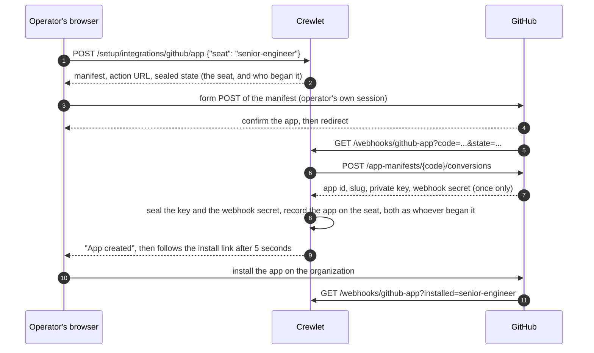

# GitHub Integration

GitHub is a **served code host**: a delivery from github.com or a GitHub
Enterprise Server wakes the seat it concerns, and `crewlet github provision`
registers the webhooks that carry it. A company can run it beside
[GitLab](gitlab.md), for a migration or an open-source presence.

Three separate surfaces:

- **Inbound**: `integrations.github` plus `POST /webhooks/github`. A review
  request, assignment, comment or red workflow run reaches an agent here.
- **Tools**: the [GitHub MCP server](https://github.com/github/github-mcp-server),
  a `shared: false` entry in `mcp_servers` with each agent's token in
  `role.mcp_env.github`. An agent reads, reviews and tracks with it.
- **Identity.** One GitHub App per agent, in `role.integrations.github`. An app
  has exactly one bot identity, so each agent has its own, created and
  installed from the dashboard and bounded by the GitHub App permissions set on
  the integration's Agents tab. The agent acts as that app everywhere through
  one token the engine issues, `${GITHUB_APP_TOKEN_<HANDLE>}`. See
  [One GitHub App per agent](#one-github-app-per-agent) and
  [Acting as the app](#acting-as-the-app-the-seats-token).

GitHub tools are for **reading, reviewing and tracking** code: diffs,
comments, reviews, run status. **Authoring** code changes is the seat's
executor run's, with its own shell and git in its
[box](../concepts/code-sandbox.md), which clones, pushes and opens a pull
request as the agent's own app.

---

## Setting it up from the dashboard

Connect GitHub in Company › Integrations. The engine generates the webhook
secret and the reconcile loop registers the hook on its next tick, running the
same pass `crewlet github provision` runs with the same secret store. The
connect step asks only for the organization, never a personal access token.

One coverage question, *which GitHub activity should reach your agents*:

- **repositories where an agent's app is installed** (the default, what most
  companies want): nothing further. Each app carries its own webhook, so
  connecting and installing is the whole setup.
- **every repository in your organization including new ones**: needs an
  organization token with `admin:org_hook`, asked for and required only under
  this answer.

See [What a company hears about](#what-a-company-hears-about-said-out-loud).

The loop keeps checking, so a grant changed at GitHub shows on the screen
within a tick. Giving each agent its own bot identity is a separate per-seat
flow the loop cannot run, because it needs your GitHub session: see
[One GitHub App per agent](#one-github-app-per-agent).

See [Running the provisioning pass](../reference/api-endpoints.md#running-the-provisioning-pass).

## Configuration

```yaml
integrations:
  github:
    enabled: true
    # Omit url for github.com. An Enterprise Server names itself here.
    url: "https://github.example.com"
    webhook_secret: "${GITHUB_WEBHOOK_SECRET}"   # required when enabled
    token: "${GITHUB_ENGINE_TOKEN}"              # read credential; see below
    provisioning:                                # read by the engine's pass and the CLI
      org: acme
      repos: [acme/api, acme/web]
      org_webhook: auto
```

- **`url` is optional.** Unset means github.com, whose API is on a different
  host (`api.github.com`). An Enterprise Server names itself and the REST base
  is derived as `<url>/api/v3`; pasting the API base instead of the instance
  URL is accepted, not doubled.
- **`webhook_secret` is required** when enabled. It is the *organization's*: it
  verifies the bare route and any seat with no app of its own. A company whose
  agents all hold apps still sets one, because enabling this block turns on the
  organization route. Every delivery to `POST /webhooks/github` is verified as
  HMAC-SHA256 over the raw body against `X-Hub-Signature-256`; a route with
  nothing to verify with answers **503**. Unlike GitLab's, this secret has no
  required shape: GitHub signs with any string verbatim.
- **`POST /webhooks/github/{handle}`** is the same route addressed to one seat,
  and is what a [per-agent GitHub App](#one-github-app-per-agent) delivers to.

  **It verifies against that seat's own secret.** GitHub generates a signing
  secret per app at conversion time and returns it once. The route reads the
  seat's own `webhook_secret` first, then falls back to
  `integrations.github.webhook_secret` (what a single organization app pointed
  at one seat signs with). With neither it answers **503**.

  GitHub delivers to **every** app installed on a repository, each delivery with
  its own `X-GitHub-Delivery`: a repository five agents work produces five
  deliveries of one comment. These are five agents being told, not duplicates
  to collapse; without the seat in the path nothing downstream could tell them
  from a redelivery. The handle travels on the published event as `handle`.

  The bare `POST /webhooks/github` stays for a single app serving a whole
  organisation, where a delivery names no seat and only the organization's
  secret could have signed it. The handle selects which credential a delivery is
  checked against, never whether it is checked.
- **`token` (optional)** is the credential the **organization-level** reconcile
  reads and registers hooks with, and
  [`crewlet github provision`](#provisioning--crewlet-github-provision)
  requires it. A company whose agents each hold an app needs none: each app
  carries its own hook, and participant fan-out is read through those apps (see
  [Participants](#participants-are-computed-not-read)). With no token the
  organization pass reads nothing and says so as a note, not a fault.

  **Installing an agent's App is not a substitute.** An organization-wide hook
  needs the `admin:org_hook` scope, which only a user token carries; no App
  installation grants it at any permission. A card never prescribes an install
  as the remedy for *no webhook on `<org>`*, and a company whose agents carry apps is
  not blocked: it has coverage narrower than the whole organization, reported
  [as such](#what-a-company-hears-about-said-out-loud).

  It is **offered but never on the connect step**, required by an ANSWER:
  choosing organization-wide coverage makes it required; the other answer never
  uses it. The form hides it until that choice and then requires it, and the API
  refuses the same submission, so a caller skipping the form cannot store a
  choice the engine cannot carry out.
- **`provisioning:`** says where hooks are registered and which organization
  these agents work in, read by the engine's own pass and the harness. `org` is
  the GitHub organization holding the repositories and the account a
  [per-agent app](#one-github-app-per-agent) is registered under; `repos` are
  `owner/repo` entries to hook individually; `org_webhook` is `auto` / `true` /
  `false`, described under [Webhooks](#webhooks). The config default is `auto`;
  the **dashboard form** opens on `true`, because an unannounced fallback
  leaves a company believing it has one hook when it has several.

### Seat identity is derived, never declared

A GitHub delivery names people by **login**, and the org chart does not say
which account a seat holds. At boot the engine calls `GET /user` with each
seat's own credential and registers the account that answers. A declared login
could disagree with the credential, a misroute nothing detects. The credential
is read from `role.mcp_env.github` under whichever key the seat's tool stack
uses: `GITHUB_TOKEN`, `GITHUB_PERSONAL_ACCESS_TOKEN`, `GH_TOKEN`, or an
`Authorization` header (`Bearer` and `token` schemes both stripped).

The lookup is **cached against the credential**: a config apply changing
something else costs no requests, a rotated token exactly one.

A seat whose lookup fails (GitHub may be rate-limiting) is left unresolved
rather than failing the boot, said per seat as
`github_seat_identity_unresolved`; it receives no GitHub events until the next
apply re-resolves it. A company with **no** resolved seats logs
`github_has_no_seat_identities`, since the integration is then inert.

A seat has one of three outcomes:

| Outcome | Meaning |
|---|---|
| **resolved** | A token named an account. |
| **unclaimed** | No `mcp_env.github` credential, which is expected: the seat acts through its own [GitHub App](#one-github-app-per-agent). The provisioning command prints it under "act through their own GitHub App", not as something to fix. |
| **refused** | A token this run could not turn into an account; the only one that becomes a finding. |

**A seat's own app token is never looked up.** A seat acting as its app names
`Bearer ${GITHUB_APP_TOKEN_<HANDLE>}` for its GitHub tool server
([Acting as the app](#acting-as-the-app-the-seats-token)). GitHub answers
`GET /user` for no installation token, and the app's account is its slug, so
the scan skips that key, the seat counts as unclaimed, and its identity is its
app's (see [How a seat's app is recognised](#how-a-seats-app-is-recognised)).
Until the app exists, a company whose only identities are such seats logs
`github_seat_identities_waiting` naming them, at info, instead of
`github_has_no_seat_identities`. A scheme with nothing after it (`Bearer ${TOKEN}`
with `TOKEN` unset) is no credential and is never sent.

### Human seats

A human seat holds no tool credential. It is addressed by
`contact.github_login` in the org chart, which the party registry registers
directly, so a person can be mentioned in a comment and reached by the engine's
notification spine without a token here.

A human seat carries no `integrations.github` block either: that block is a
seat's own app, and nothing creates, installs or reconciles an app for a
person. A document giving one to a human seat is refused at that block; the
rule is an [admission
rule](../concepts/configuration.md#what-a-stored-revision-is-held-to), so a
revision being applied that carries one still runs.

## One GitHub App per agent

A GitHub App has exactly one bot identity, derived from its slug; nothing varies
it. **Agents cannot share one app and keep distinct identities**: a company-wide
app would have every agent comment, review and commit as the same account, and
an `@mention` would not say which agent was meant. So the engine creates one app
**per seat**.

### What an operator does

Two acts, both by a person signed in to GitHub; the second can be a day after
the first.

1. **Create the app.** Company › Integrations asks the engine for a manifest
   and submits it to GitHub as a form POST carrying the operator's own GitHub
   session. GitHub shows what will be created and, on approval, sends the
   browser back to the engine with a one-time code. The engine converts the
   code, seals the returned private key, and records the app on the seat.
2. **Install the app.** An app with no installation sees no repository. The page
   after creation links to the install page for the new app, where the
   repositories are chosen.

**Neither act can be automated**: GitHub offers no server-to-server equivalent
of a manifest submitted with a browser session. This is the one part of any
integration here that a [reconcile pass](../concepts/integration-reconcile.md)
cannot do.



### When a creation doesn't finish

The page GitHub returns you to says what went wrong and what to do; the step
that stopped decides which. Crewlet's log has the detail as
`github_app_create_failed`.

| What stopped | What the page tells you to do |
|---|---|
| The link expired or isn't one Crewlet made, or Crewlet couldn't check it | Start again from Company › Integrations |
| The link was already used, and the agent has its app | Nothing: the creation is done, and the install button is still there |
| The link was already used, and the agent has no app yet | Give the app a minute to show in Company › Integrations. If it doesn't, delete it on GitHub if it's there, then start again |
| No company is set up | Set the company up, then start again |
| The company's settings couldn't be read just now | Wait a moment, then start again |
| The company's settings can't be read at all | Ask an admin to check Crewlet's logs, then start again |
| The agent is no longer one of the company's | Add it back, then start again |
| The company's settings are managed outside Crewlet | Ask whoever manages them to add the app |
| GitHub's code was already used or expired | If the app shows up on GitHub, delete it there, then start again |
| GitHub didn't finish creating the app | If it shows up on GitHub anyway, delete it there, then start again |
| GitHub created the app but its key couldn't be saved | Delete the app on GitHub, then start again: GitHub never sends the key twice |
| The key was saved but the app's webhook secret couldn't be | Delete the app on GitHub, then start again: GitHub never sends the secret twice either |
| The key was saved but the app couldn't be added to the agent | Delete the app on GitHub, then start again |
| The key was saved, but whether the app was added to the agent isn't known yet | Refresh the page in a minute to find out, or check the agent in Company › Integrations: delete the app on GitHub and start again only if it still shows Create app on GitHub |

A link is spent when used, so refreshing, or coming Back from GitHub's install
page, runs nothing: the page looks at the agent the link names, giving the two
"already used" rows. Once GitHub has created the app, the heading reads "App
created, but not finished" rather than "App not created", and the log line names
the app (id, slug and address, never its key) so whoever is asked can find the
one to delete. Its status says whose the stop was: see
[`GET /webhooks/github-app`](../reference/api-endpoints.md#get-webhooksgithub-app).

Adding the app to the agent is a settings change, and the coordination store can
take it and lose its answer. The page reads the agent back once first: an agent
with the app gets the ordinary "App created" page; otherwise the page is headed
"App created, confirming it was added to" and says the outcome isn't known yet,
never that the app wasn't added. A refresh a minute later answers from the
agent's record, as one of the "already used" rows.

A cancellation or other refusal from GitHub is said in the page's own words.
GitHub's description is logged as `github_app_create_refused` and never printed,
because anyone can send a browser to this page with any text in its address.

### The card catches up immediately, not on a cadence

An agent's App is **private**, so GitHub sends nothing when you install it; the
reconcile loop finds the installation by listing the App's own installations
with its own key. Its admin backoff runs from fifteen seconds to **ten
minutes**, longest just after an install, so a card could keep asking for an
install that had worked. Two things close the gap:

- **GitHub's return brings the next pass forward.** The install redirect lands
  at `/webhooks/github-app` and asks the loop to look now. It is not a write and
  nothing in the redirect is believed (no installation id travels with it), so
  the pass is the same verified listing. See [the cadence](../concepts/integration-reconcile.md#the-cadence-follows-who-has-to-act) for the route's rate limit.
- **Company › Integrations re-asks when you come back to the tab**, since
  returning from GitHub is a stronger signal than any poll interval.

If the page is still stale (an engine built without the loop wired, or a second
install inside the rate-limited window), the return page says so, and **Check
now** on GitHub's Agents tab, or `POST /setup/integrations/github/check`, asks
the loop to look at once.

### What has to be in place first

- **The webhook address**: `api.public.external_url` when the deployment has
  a [public listener](../guides/deployment.md#exposing-webhooks-without-the-admin-api)
  (`api.public`), and `api.external_url` otherwise. Three addresses are baked
  into an app at creation (deliveries, return after creation, return after
  install) and only a person at GitHub can change them, so the engine refuses to
  begin with no address (`409 no_external_url`, naming the key in
  `config_path`). The reconcile loop reports the same gap for the org- and
  repository-level hooks: the integration is **degraded** naming that key, not
  **ready** with nothing registered. An address that is set but unreachable by
  GitHub is a different, working case: see [Running locally, with no public
  address](#running-locally-with-no-public-address).
- **`integrations.github.provisioning.org`.** It names the account the app is
  registered under; an app registered under a person's own account cannot be
  installed on the organization that owns the repositories. With no
  organization set, the operator is sent to their personal app registration
  page.
- **`integrations.github.url`**, when the company runs Enterprise Server. Unset
  means github.com.

### The manifest the engine builds

| Manifest field | What the engine puts in it |
|---|---|
| `name` | The company name and the seat's role name, joined and cut to 34 runes |
| `url` | `https://crewlet.ai` |
| `public` | `false`. The app is the company's own |
| `hook_attributes` | `{"url": "<webhook address>/webhooks/github/<handle>", "active": true}`. Left out, with `default_events`, where GitHub cannot reach the webhook address: GitHub validates a hook whether or not it is active, and refuses one with no url, one it cannot reach, and events with no hook |
| `redirect_url` | `<webhook address>/webhooks/github-app` |
| `setup_url` | `<webhook address>/webhooks/github-app?installed=<handle>` |
| `default_events` | `issues`, `issue_comment`, `pull_request`, `pull_request_review`, `pull_request_review_comment` |
| `default_permissions` | The seat's [permissions](#access-in-githubs-own-terms), plus `metadata: read`, and nothing wider |

`<webhook address>` is the one above. With `api.public` set, the return and
deliveries are served only there and `api.external_url` answers `404` for them.

**The events are named, never `*`**: an app with a delivery address and no
events receives nothing yet reports itself healthy. `push` is absent: it is the
highest-volume event and the router drops every one. `workflow_run` is not in an
app's set either, so a failed-run notice reaches a seat through the organization
or repository hook the [provisioning pass](#provisioning--crewlet-github-provision)
registers, not through the seat's own app.

### Access in GitHub's own terms

GitHub has no roles for an app, only permissions, each at **No access**,
**Read-only** or **Read and write**; a seat stores and the Agents tab offers
exactly these, under GitHub's names. A seat's `code.access`
(`role.code.access`) reaches nothing here: it caps only what the seat may do on
[Gitlet](../concepts/gitlet.md#who-may-read-and-push).

| Permission (key) | Levels offered | What it is for |
|---|---|---|
| Contents (`contents`) | Read-only, Read and write | Reading code; Read and write pushes branches and commits |
| Issues (`issues`) | Read-only, Read and write | Reading and writing issues and their comments |
| Pull requests (`pull_requests`) | Read-only, Read and write | Reading, opening and reviewing pull requests |
| Checks (`checks`) | Read-only, Read and write | Reading check runs; Read and write reports them |
| Actions (`actions`) | Read-only, Read and write | Reading workflow runs and job logs; Read and write re-runs, cancels and dispatches them |
| Deployments (`deployments`) | Read-only, Read and write | Reading deployments and their statuses; Read and write creates them |
| Workflows (`workflows`) | Read and write | Pushing a change to a file under `.github/workflows` |

- **A permission left out is No access.** `metadata: read` is added to every
  app and token, because GitHub requires it to resolve a repository.
- **The app is registered at exactly these**, so a leaked app key reaches only
  what the seat may do.
- **Narrowing applies on the next token.** Every token is minted with the seat's
  permissions and repositories, so lowering a level or removing a repository
  needs nothing at GitHub.
- **The app may hold more than the agent uses.** A permission the app holds that
  the agent's grant omits or holds lower is never drift, since tokens are
  narrowed to the grant. The Agents tab says so under the agent's row ("The app
  also holds Workflows; this agent does not use it"); the agent gets it only once
  an administrator adds it to the grant there.
- **A raise past the registration waits for two people.** The app's owner adds
  the permission on the app's permissions page, then GitHub asks an organization
  owner to accept it on the installation. The Agents tab shows the waiting step
  with its link; **Done, check again** reads GitHub again. Until the
  installation holds a permission the seat asks for, GitHub refuses every token
  the seat requests.
- **Read and write on Contents or Workflows is an administration grant.**
  Raising a seat to either needs a fresh step-up from the person saving it.
- **Workflows needs Contents (Read and write).** A workflow change is a push,
  and GitHub refuses a push from a token that cannot write contents, so the
  document refuses the pair half set. The grant also lets the agent's branch run
  a workflow it rewrote with the secrets the repository hands its runs, so pair
  it with branch protection on the default and release branches and keep
  deployment credentials in environment-scoped secrets.
- **A merge or deploy request reads GitHub as the agent's own app.** Merging
  through `ask_to_merge` needs Contents (Read and write), and the base branch's
  protection or rulesets must still let the app merge. A required check counts
  only as a check run the app may read (Checks, Read-only) or a commit status,
  and only where an app other than one of the company's own agents reported it,
  so an agent never reports its own change as passing. Agent apps are not
  offered Commit statuses, so a required check that external CI reports as a
  commit status reads as unread in a private repository, and the merge or deploy
  goes to people rather than a delegate. A private repository on a plan without
  branch protection requires no check of its own, so a delegation rule names the
  check runs its merges and deploys need ([Checks a rule requires](../guides/delegated-decisions.md#checks-a-rule-requires)).
- **Seats migrated from tiers** keep exactly what their tier granted:
  `read_only` holds Contents, Issues, Pull requests, Checks, Actions and
  Deployments at Read-only; `review` raises Issues and Pull requests to Read and
  write; `full_access` raises Contents and Checks too, plus Workflows where the
  seat had opted in.

### On, off and remove

`enabled` is stored on the seat's block; a seat is off until turned on.

| Action | What happens at GitHub |
|---|---|
| Turn on, first time | A person creates the app from the prepared manifest and installs it. The engine seals the app's key and webhook secret when GitHub returns them. |
| Turn off | The engine suspends the seat's installation as the app. The app, its key and the installation are kept, and every token is refused from that moment. |
| Turn back on | The engine lifts the suspension it placed, at the seat's current permissions and repositories: anything the installation must still grant or cover waits for a person, as a raise does. A suspension an organization owner placed at GitHub is lifted there: the Agents tab links to the installation's settings page and checks again once it is lifted. |
| Remove (only when off) | The engine uninstalls the app. A person deletes the app registration from its settings (GitHub has no API for it), and once GitHub reports it deleted the engine clears the sealed key and webhook secret. |
| Rotate | Not offered: tokens last an hour and are never stored. |

An installation suspended or uninstalled by somebody at GitHub is never turned
back on automatically, in case it was incident response: the Agents tab offers
**Turn back on** or **Keep off**. Each pass reads the app's registration and
installation back, so a permission an owner removed at GitHub shows as a waiting
step rather than silently failing tokens.

### What no seat is granted

None of these is offered, so no app is registered with one and no token carries
one; each is a way out of a seat's limits: administration (deleting a
repository, dropping branch protection), secrets and variables (every
credential the repository holds), and membership and organization settings (how
an agent would widen its own access).

`administration` · `organization_administration` · `organization_secrets` ·
`organization_self_hosted_runners` · `organization_user_blocking` · `members` ·
`organization_plan` · `secrets` · `actions_variables` ·
`organization_actions_variables` · `environments`

**What an app holds differs from what a token carries.** A manifest can be
edited in the browser before submission and an installation widened by a person
afterwards; neither is the engine's to decide. The mint is: a token carries the
seat's own permissions only, so a Read-only seat cannot write on an installation
that could. Where the seat names `repos`, the token is narrowed to those; an
empty list means every repository the installation covers, as the operator chose
at install.

### What lands where

The app is recorded on the seat, addressed by handle, so ten agents keep ten
records:

```yaml
roles:
  - name: Senior Engineer
    integrations:
      github:
        enabled: true             # off until turned on; off suspends the installation
        permissions:              # GitHub App permissions; a key left out is No access
          contents: read
          issues: write
          pull_requests: write
        repos: [acme/api]         # empty means every repository the installation covers
        # Written by the engine, never typed in:
        app_id: 1234567
        app_slug: acme-senior-engineer
        installation_id: 87654321
        private_key: "${GITHUB_APP_KEY_SENIOR_ENGINEER}"
        webhook_secret: "${GITHUB_APP_WEBHOOK_SECRET_SENIOR_ENGINEER}"
```

`enabled`, `permissions` and `repos` are written by a person, from the Agents
tab. `app_id`, `app_slug`, `private_key` and `webhook_secret` are written when
the app is created; the slug is what the bot login derives from, so what an
`@mention` of this agent resolves through. `installation_id` is written as `0`
then, since creating and installing are two acts and an app installed nowhere is
a real state. A seat's app can mint tokens only once app id, installation id and
key are all present.

The credentials never enter the document. Two entries are sealed in the
[secret store](../concepts/secret-store.md):

| Sealed name | What it is |
|---|---|
| `GITHUB_APP_KEY_<HANDLE>` | The app's PEM private key |
| `GITHUB_APP_WEBHOOK_SECRET_<HANDLE>` | The webhook secret GitHub generated for the app, when it returned one |

`<HANDLE>` is the seat's handle upper-cased, every character outside `A-Z`,
`0-9` and `_` replaced by an underscore: `senior-engineer` becomes
`SENIOR_ENGINEER`. The vendor leads the name so a handle beginning with a digit
(`7th-engineer`) still makes a name a `${VAR}` can reference. A third name
follows the same rule and is never sealed: `GITHUB_APP_TOKEN_<HANDLE>`, the
token the agent acts with ([Acting as the
app](#acting-as-the-app-the-seats-token)). Names are per seat because one shared
name would let the second agent's key overwrite the first's.

### How a seat's app is recognised

An app has two names: the **slug**, which a person types in a mention
(`@acme-sre-lead`), and the **account**, the slug with `[bot]` appended, which
every payload reporting what the app did carries. Both are registered against
the seat (the slug where mentions resolve, the account in the companion
namespace a payload's sender resolves through), so an agent is routable under
either.

Neither costs a request: a seat holding a personal access token still has its
account learned with one `GET /user`, but an app's account is its slug, written
down at creation. **The app wins** where a seat has both, since the app is what
the agent acts as; a stale credential left in `mcp_env` would otherwise take the
mapping and the app's deliveries would reach a stranger.

Logins are folded to lower case, because GitHub treats them as case-insensitive.

### Deliveries from a seat's app

An app created this way delivers to `POST /webhooks/github/<handle>`, the
ordinary route addressed to one seat (see [Configuration](#configuration)).
GitHub signs with **that app's own** webhook secret, returned once at
conversion; the engine seals it as `GITHUB_APP_WEBHOOK_SECRET_<HANDLE>`, writes
the `${VAR}` onto the seat, and the route verifies against it. Nothing is set at
GitHub by hand and no two apps share a secret.

A seat with no secret of its own falls back to
`integrations.github.webhook_secret`; with neither the route answers `503`
rather than accepting the delivery.

### Acting as the app: the seat's token

What GitHub accepts from an app is an **installation token**, minted from the
app's private key against its installation, valid for one hour. A `git push`, a
`gh pr create`, a review and every GitHub MCP server call carry one, so the
engine issues each agent's app a token. In the agent's coding box Crewlet puts
it itself, with no line in the company document, while the agent is on at GitHub
and the company runs GitHub: as `GITHUB_TOKEN`, and in the file
`.config/crewlet/github-token` under the box's home, which the completion poll
keeps current ([An agent's own integration credentials](../concepts/code-sandbox.md#an-agents-own-integration-credentials)). Elsewhere the
configuration names it where the seat's credentials are read:

```yaml
providers:
  sandbox:
    setup:
      - name: git-auth            # the recipe in the code sandbox guide
        # ...

mcp_servers:
  - name: github
    transport: http
    shared: false
    url: "https://api.githubcopilot.com/mcp/"

roles:
  - name: Senior Engineer
    handle: senior-engineer
    mcp_env:
      github: { Authorization: "Bearer ${GITHUB_APP_TOKEN_SENIOR_ENGINEER}" }
    integrations:
      github:
        enabled: true
        permissions: { contents: write, issues: write, pull_requests: write, checks: write, actions: read }
        repos: [acme/api]
```

`${GITHUB_APP_TOKEN_<HANDLE>}` is answered in three places only: the seat's own
tool servers (`role.mcp_env`), its coding box's environment and setup files, and
the servers rendered into that box (`role.sandbox.mcp`). The box's `GITHUB_TOKEN`
and token file are Crewlet's: a line of the seat's own, or of a provider-wide
step, that sets `GITHUB_TOKEN` or writes that file is ignored for an agent on at
GitHub, and reported as an advisory at that line. Named anywhere else in a
provider-wide step, the variable resolves for one seat alone, and every other
seat's run starts without it and logs `sandbox_env_unresolved` at warning, on
every launch.

- **Each seat reads only its own.** The token is laid in front of the company's
  secret store for that seat's reads alone. A seat naming another seat's
  variable is told it is not set; a shared server never sees any of them
  ([ADR-0058](https://github.com/crewlet/crewlet/blob/main/adr/0058-a-seats-github-app-token-is-issued-at-use-and-read-only-by-that-seat.md)).
- **Scoped at mint time.** The token carries the seat's permissions (and
  `metadata: read`) only, narrowed to the seat's `repos` where it names any. A
  seat at Contents Read-only cannot push, whatever the installation allows. A
  seat that is off is issued no token.
- **Never sealed, never logged.** The token lives in the engine's memory, one per
  installation and scope, and is minted again by any node holding the app's key.
  It is not written to the secret store, a revision, a log line or an error. In
  a box it is in the run's environment and the files that name it.
- **Issued only while GitHub is enabled.** Switching `integrations.github` off
  stops every token at the next read: the seat's tool servers stop for want of
  their credential, the executor's next launch starts without one (said as
  `sandbox_env_unresolved`), and a running launch's token file is no longer
  renewed.
#### How long a token lasts where it is used

GitHub issues a token for one hour and offers no way to ask for longer, so the
engine renews it wherever something holds one:

| Where | What it is handed | How it stays good |
|---|---|---|
| The seat's tool servers on the engine host | a token with at least 10 minutes left | the seat's servers are passed again at 10 minutes left, and each one carrying it is restarted with a fresh token, as a rotated secret restarts it |
| An executor's environment (`$GITHUB_TOKEN` in the box) | a token with at least 50 minutes left | it does not: a process's environment cannot change under it, so a launch longer than 50 minutes reads the token from a file |
| The box's token file (`~/.config/crewlet/github-token`), and any other setup file whose whole body is the token | the same token, at launch | the completion poll that drives the box (its launching node's) rewrites the file whenever the token is renewed, while the launch runs; a launch continuing in its turn's kept box (no setup runs; no poll reached it while paused) rewrites it before starting. Each rewrite replaces the file whole, and each renewed token is recorded before it is written, so a [kept session](../concepts/code-sandbox.md#each-launchs-session-kept) taken after the job is scrubbed of it. The file always holds a token with at least 10 minutes left, except: (a) the file cannot be written (replaced with a link or directory, read-only directory, disk full): it keeps its token until that expires, the poll says so once per file (`sandbox_token_refresh_failed`, with the box's error) and writes the current token at the first successful write; (b) the coordination store did not answer, so the renewed token cannot be recorded first: it is not written, the poll retries every 15 seconds and says so once (`sandbox_token_refresh_failed`, with the store's error) |
| A tool server rendered into the box | the launch's token | it does not: the server is started inside the box once. Past 50 minutes GitHub refuses its calls; the seat's executor reaches the seat's own (renewed) GitHub server through the [tool bridge](../concepts/llm-backends.md#the-tool-bridge) instead |

The [git-auth recipe](../concepts/code-sandbox.md#the-git-auth-recipe) reads the
file at every git and `gh` call, which lets an executor work for hours as the
agent's own app.

#### When there is no token to give

| The seat's app | What a value naming the token does |
|---|---|
| Not created, not installed, or its key does not resolve | **Waits.** The variable is the GitHub integration's to issue, so a tool server naming it is held back as waiting for the app's installation (or as stopped until a person acts, by what the seat-app pass last recorded). An executor's launch starts without it, said as `sandbox_env_unresolved`: the environment lacks the token and a setup file whose whole body is the token is not written. The reconcile records the installation within a tick, which applies a revision, and every read runs again; a running launch's token file is written by the first poll after the app can issue a token, and the wait before that is said once per launch (`sandbox_token_waiting`) |
| Installed, and GitHub refuses the mint (a suspended installation, a revoked key, an installation that has not approved a permission the seat asks for) | **Fails, with GitHub's reason**, until somebody fixes the agent's app (key, installation or permissions), which the failure says. GitHub is asked again on the restart schedule (15 seconds, doubling to 5 minutes), so the first ask after the fix issues a token. The engine holds GitHub's answer for each wait for every reader of the installation, so a lasting refusal costs one request a wait, not one per read; a key sealed in place of a revoked one is asked about at once. The seat's tool servers are passed again on that schedule, a running launch's token file is written by the first poll after GitHub issues a token, and an executor's environment carries one from the next launch. A running launch says the refusal once per reason (`sandbox_token_refresh_failed`): one holding a token keeps it until it expires; one launched without is told the first poll after issue writes it |
| Installed, and GitHub can't be reached or answers that it can't issue one just now (408, its rate limit, a 5xx) | **Fails, with GitHub's reason**, and says the token is asked for again, which it is: on the same restart schedule, the answer held per wait as a refusal's is, so the first ask after GitHub answers issues it; a running launch says the failure as it says a refusal |
| `integrations.github` is off | **Nothing will issue it**, and it is reported as a variable nothing sets |

### Running locally, with no public address

GitHub cannot deliver to an engine reached at `http://localhost:8200`. Its
agents still do everything on GitHub, because pushing, opening pull requests
and reviewing are outbound, and the two acts that build an app need only the
operator's browser, which reaches the engine.

- **The app is created with no webhook.** The begin route builds the manifest
  without `hook_attributes` or `default_events` (`webhook_active: false` in its
  answer), because GitHub validates a manifest's hook whether or not it is
  active and refuses one with no url, one it cannot reach ("isn't reachable over
  the public Internet"), and events with no hook ("Hook url cannot be blank").
  Once the engine has a public address, add the webhook and its events on the
  app at GitHub. The browser returns to `api.external_url` as usual.
- **No hook is registered** on the organization or a repository, for the same
  reason.
- **The card says so and stays ready**, with one note on the webhook address's
  key, **GitHub can't reach this engine**: no GitHub event arrives at the
  address, agents still push, open pull requests and review through their apps,
  and which setting makes events arrive.

What is reachable depends on where GitHub runs. github.com reaches only the
public internet: not reachable are an address it does not route (loopback,
private, link-local, unspecified, carrier-grade NAT such as a tailnet's `100.x`
addresses, documentation and other reserved ranges), a single-label name, and
the `localhost`, `.local`, `.internal`, `.lan` and `.home.arpa` names. An
Enterprise Server runs inside the company's network, so there only the
server's own loopback, an unspecified address and `localhost` are refused.

**Hearing back later.** Give the deployment a stable public address (an
`api.public` listener behind a hostname that does not change; a quick tunnel's
address changes every run and would have to be written into every app again),
then, for each agent's app, open its settings at GitHub, set the webhook URL to
`<webhook address>/webhooks/github/<handle>`, tick **Active**, and check the
events listed under [The manifest the engine
builds](#the-manifest-the-engine-builds). GitHub offers no API that switches an
app's webhook on, so this is a person's step, once per app.

**The webhook secret for such an app is the organization's.** GitHub gave an
app created with no webhook no signing secret, so the engine sealed none and
verifies its deliveries against `integrations.github.webhook_secret`. Set the
app's webhook secret at GitHub to that same value; a secret of the app's own
would fail every delivery's signature check. To give each agent its own secret,
delete the app at GitHub and create it again from the seat's card once the
engine has its public address: the manifest then carries the hook, GitHub
generates the secret, and the engine seals it.

### The two routes

| Route | Called by | What it does |
|---|---|---|
| `POST /setup/integrations/github/app` | The dashboard, authenticated | Answers with one seat's manifest, the address to POST it to, and a state sealed under the fleet keyring naming the seat and who began the creation |
| `GET /webhooks/github-app` | GitHub's redirect, unauthenticated | Converts the one-time code, seals the key, records the app, each written as whoever began the creation; also the page an install returns to |

The created-app page counts down five seconds and follows the install link itself; the button stays for anyone who would rather not wait, and is the whole flow with scripting off (the countdown is hidden until the script owns it).

The callback carries no engine credential, because a browser redirect from GitHub has none. The **state** stands in: a token naming the seat and whoever began the creation, minted by the begin route, valid for 15 minutes, opened before anything else. The key, the webhook secret and the seat's record are written as that person. It is scoped to this flow: nothing else the keyring seals (a sign-in's flight, a stored secret) opens as one. It is **sealed** under the Tier A keyring (`secrets.keys`) rather than signed, because it travels through GitHub, the browser's history and every ingress log, and who began a creation is this company's business. Every node holds the keyring (the API is not served without one), so a creation begun on one node can be finished on another, including one that has already made the next key active during a rotation.

Request and response shapes are in
[API Endpoints](../reference/api-endpoints.md#one-agents-own-github-app).

### What the reconcile loop heals

Both acts that build a seat's app happen at GitHub, in a browser, and GitHub
tells the engine about neither. So the loop reads the app back on every pass
and corrects the document from what it finds.

| What it reads | What it writes | What the screen then says |
|---|---|---|
| An installation the app has and the seat does not name | `installation_id` on the seat | The seat is finished |
| A stored `installation_id` GitHub answers 404 to | `installation_id: 0` | Install it, with the link |
| An app id GitHub answers 404 to | Clears `app_id`, `app_slug`, `installation_id`, `private_key` and `webhook_secret` | Create an app for this seat |
| A **disconnect** uninstalled the app | `installation_id: 0` | Install it, with the link |

**An agent with no app at all is reported too** (it used to give `phase: ready`, `findings: []`), as **one** `approval_required` naming the count and up to three handles, with the whole list beside the sentence (creating an app is the same act for every one). It is not `identity_missing`: the engine can never create an app (a form POST from a page carrying your own GitHub session), so a card reading *Setting up agents* would wait for an act nobody performs.

**The card is not Connected while no agent can act**: one GitHub App is one bot identity. The satisfaction check asks only about seats that have *started* (a company running GitHub for three of ten agents is finished when those three are), but `satisfied: true` with `seats_required: true` is no longer possible when nobody has started.

Every one of these reads as **Action needed**, waiting on a person at GitHub:
the engine cannot create or install an app for anybody, both being acts in a
browser carrying the operator's own session.

The last row needs an extra call: an app installed nowhere and a deleted app both answer `404` from the installation endpoints, so the app's own identity (`GET /app`, signed with its own key) is asked for before an operator is sent to an install page GitHub itself 404s. The sealed key stays in the store when a record is cleared: it is named per seat, so the next conversion overwrites it, and deleting a credential on one remote `404` is destructive.

A **check** (`POST /setup/integrations/github/check`) writes none of this. It
reads and reports; the loop corrects on its next pass.

**An applied revision makes every surface due, now**: the loop's wait is for asking GitHub again, not the company document, so a change is reconciled immediately, not at the settled cadence.

### The constraints that shape all of this

- **The private key and the webhook secret come back exactly once.** GitHub has
  no endpoint that reissues either, so the callback seals both before anything
  else that can fail. A failure after the seal costs a retry; a failure before
  it costs the app, and the only way forward is to delete it at GitHub and
  create it again. So an error here is worded by the engine and never quotes
  GitHub's response body, which carries the key.
- **The delivery address is baked in at creation.** An app's hook attributes,
  redirect and setup URLs are set from the manifest and changed afterwards only
  by a person editing the app at GitHub, so the begin route refuses to run
  before the engine knows its own public base.
- **An app name is globally unique and capped at 34 characters.** The company
  name leads and the seat's role name follows, so two companies both having an
  `sre-lead` do not collide. A name past the limit shortens the company, keeps
  the seat whole, and ends in six hex characters of a digest of the full name,
  so two seats of a company whose name alone fills the limit never share one
  (every shortening lands on a character boundary; a name sliced through a
  multi-byte character is refused as malformed, not as too long). GitHub then
  slugifies the name and disambiguates a collision itself, so the app that
  exists may not carry the name asked for; the install link is therefore built
  from the slug the conversion returned.
- **Permissions are fixed at creation.** Raising a seat past what its app is
  registered with means its owner editing the app's permissions at GitHub and
  an organization owner accepting the change on the installation; GitHub
  refuses the seat's tokens until both have. Set a seat's permissions before
  the app is created.
- **The creation code is single use and lives one hour.** A converted or
  expired code is reported as exactly that, and the flow starts again from the
  begin route. The engine's own state is shorter, at 15 minutes, so an
  abandoned attempt fails on the state rather than on a code nobody can act on.

---

## What the atlas reads

The engine reads the organization for the company's [atlas](../concepts/atlas.md#what-integrations-read) once an hour unless `atlas.refresh_interval_seconds` says otherwise, through the installations of the agents' own apps, the only GitHub access it holds (the organization token of `integrations.github.token` is never used). Every call is a `GET`; nothing at GitHub changes. For each agent whose GitHub access is switched on, it mints one token carrying Read-only of what that agent's installation holds among the three permissions below, and revokes it when the read ends. An agent's own tokens are not involved, and the read's token never writes, whatever the agent may.

| Part | Calls | Permission | What the atlas gains |
|---|---|---|---|
| Repositories | `GET /installation/repositories`, 100 a page | Metadata, which every app holds | each repository the installation covers, belonging to the organization's account, with its default branch, whether it is archived, and its visibility on GitHub (`public`, `private` or `internal`) |
| Workflows | `GET /repos/{owner}/{repo}/actions/workflows`, then one page of `GET /repos/{owner}/{repo}/actions/runs` for the default branch | Actions (Read-only) | each workflow under `.github/workflows` as a pipeline built from the repository, with its name, whether GitHub still runs it, and the result of its newest completed run on the default branch |
| Deployments | `GET /repos/{owner}/{repo}/deployments`, newest first for at most three pages, then `GET .../deployments/{id}/statuses` for the newest deployment of each environment | Deployments (Read-only) | each lasting environment as a pipeline built from the repository, with its name, the state of its newest deployment, and the address and host name that deployment says it put the code behind, which the environment deploys |

**A repository several agents' installations cover is read once**, as the first agent, in handle order, whose installation holds the part's permission. A repository Gitlet mirrors is the same entry as the one GitHub lists: they meet on the exact address the mirror pulls from, so the map never shows it twice.

**Visibility is each host's own.** A repository private on GitHub and mirrored on Gitlet for the whole company shows both, "Visibility on GitHub" and "Visibility in Gitlet", each in its host's words. They are never compared, so a mirror does not wait in Review for them; correcting one corrects that host's alone.

**Keys are exact.** A repository is `github.com/<owner>/<name>` (the Enterprise Server's host where `integrations.github.url` names one). A workflow is its repository, `#workflow:` and its file's name; an environment is its repository, `#environment:` and its name, where a character outside letters, digits and `. _ + -` is written as `~` and its two hexadecimal digits (`eu west` is `eu~20west`). An environment named `production` or `prod`, `staging`, `development` or `dev`, or `test`, in any case, suggests that environment for the entry; a person confirms it.

**A failing pipeline is the health of what it deploys.** A workflow whose newest completed run on the default branch failed, and an environment whose newest deployment failed, each show as Needs a look on the atlas, as does every address and name the environment deployed. The result is read with the listing, so the atlas follows a change within one refresh interval.

**Each part takes its own permission, and a missing one never fails the read.** Where no installation covering a repository holds Actions or Deployments, or GitHub refuses that listing, the part is left out for that repository, the source's standing on the atlas names the part with the permission to grant, and what an earlier read recorded stays. Grant the permission to an agent that works in the repository ([access in GitHub's own terms](#access-in-githubs-own-terms)) and the next read includes it.

**An installation the engine cannot read through is a finding too.** An agent whose app is not installed on the organization yet, whose installation somebody suspended, or whose key does not resolve is counted on the source's standing, and everything of a repository the other installations did not list stays as an earlier read left it, since what that installation covers cannot be known. An agent switched off is not read through and is no finding: its installation is suspended on purpose. With no agent's app switched on, GitHub is not read for the atlas at all.

**What is never read.** Who did anything: a run's actor, a deployment's or status's creator, a commit's author, every login, name and email address. A deployment's payload, description and task, a status's description and log address, a run's title and commit message, a repository's description, topics and homepage. Secrets, variables, and environments' protection rules and reviewers, which no seat's app is granted ([what no seat is granted](#what-no-seat-is-granted)). An address is kept without its user information, query and fragment. A value shaped like a credential is refused and counted on the source's standing, never stored.

**What is left out on purpose.** An archived repository's workflows and environments (it runs and deploys nothing). A transient environment, which GitHub marks on a preview deployment. A workflow GitHub runs for a feature of its own (Pages, Dependabot, code scanning), which has no file under `.github/workflows`. An environment nothing was deployed to within the repository's 300 newest deployments, and one past the 20 most recently deployed of its repository.

A read costs one call per installation, one for its token and one to revoke it, one per hundred repositories, and for each non-archived repository two to three calls plus one per environment. It spends the installation's own hourly allowance (5,000 requests, more for a larger organization), which the agent's work shares. On GitHub's rate limit the read stops and records nothing, and the engine reads again five minutes later; a read that fails part way never retires anything. A repository, workflow or environment that two complete reads at least a day apart both miss is retired from the atlas.

### The files the atlas reads

Where Gitlet does not mirror a repository, the engine also reads its deploy and dependency files through GitHub, for [what a repository's files declare](../concepts/atlas.md#what-a-repositorys-files-declare). The closed list of files, what is decoded from each and what is never read are the ones Gitlet's repositories are read by: GitHub is asked for a tree and for the listed files on it, and nothing else.

| Call | Permission | Why |
|---|---|---|
| `GET /installation/repositories` | Metadata | the repositories, and when anything was last pushed to each |
| `GET /repos/{owner}/{repo}/git/ref/heads/{branch}` | Contents (Read-only) | where the default branch is, asked only after a push |
| `GET /repos/{owner}/{repo}/git/trees/{commit}?recursive=1` | Contents (Read-only) | the tree at that commit, asked only when the branch moved |
| `GET /repos/{owner}/{repo}/git/blobs/{sha}` | Contents (Read-only) | one listed file whose content changed, by the object the tree names |

It reads as each agent's installation that holds Contents, under one token minted for the pass with Read-only of Metadata and Contents, revoked when the pass ends. An agent's own tokens are not involved, and the token never writes. A repository several installations cover is read as the first, in handle order, that holds Contents.

**An `.env` file is never asked for.** Neither is a values file, a variable or state file, a manifest named for secrets, a workflow under `.github`, or anything else off the list. A `Dockerfile` and a `Procfile` say what they say by being there and are not read. A symbolic link is never read as a file. A file past 64 KiB is counted and not read.

**Bounds.** One pass reads at most 50 files and a mebibyte of them and lists at most 100 trees; the rest is read five minutes later. A repository nothing was pushed to costs no request beyond the listing. A tree GitHub truncates (a repository of some hundred thousand files) has none of its files read. The calls spend the installation's shared hourly allowance; on GitHub's rate limit the pass stops and runs again five minutes later.

**What is not read.** An archived repository, an empty one, and a repository Gitlet mirrors (Gitlet's own scan reads it). A repository only an installation without Contents covers: grant an agent that works in it Contents ([access in GitHub's own terms](#access-in-githubs-own-terms)). While an installation cannot be read through, nothing its repositories' files declared is withdrawn.

---

## Webhooks

`POST /webhooks/github` verifies HMAC-SHA256 over the raw body against
`X-Hub-Signature-256`, and dedupes on `X-GitHub-Delivery`, a per-delivery uuid
that is the same on every retry and on a manual redelivery, so a redelivery
does not wake the seat again.

The event name arrives in the **`X-GitHub-Event` header**, not the body: the
payload holds only the action (`{"action": "created"}`), not created *what*.

### The subscribed events

The hooks the provisioner registers subscribe to exactly what the parser
reads, never `*`:

`issues` · `pull_request` · `issue_comment` · `pull_request_review` ·
`pull_request_review_comment` · `workflow_run`

A wildcard hook delivers every push, star and fork, each verified, stored,
deduped and routed to nobody. `check_run` is deliberately excluded: it reports
the same failing Actions run as `workflow_run`, once per job, so subscribing to
both would wake one seat once per job.

### One organization hook, or one per repository

An **organization** hook covers every repository in the org, including ones
created after the run, so a new repository routes on day one. It needs the
`admin:org_hook` scope, which a fine-grained token cannot carry and a classic
token carries only if whoever minted it ticked the box.

| `org_webhook` | Behaviour |
|---|---|
| `auto` (config default) | Try one org hook; fall back to per-repository hooks if the credential may not, saying so in the run's notes |
| `true` | Demand the org hook. A credential that cannot register it **fails the run**: an operator who asked for this must not silently get the other arrangement |
| `false` | Register no org hook. Every repository in `repos` is hooked; with `repos` empty, each agent's own app carries its own webhook |

A working org hook means the `repos` list is **not** hooked separately: two
hooks on one repository deliver every event twice.

**The dashboard form asks what should *reach your agents*, and offers two of
these three:**

| Answer on the form | Writes | Needs |
|---|---|---|
| Repositories where an agent's app is installed *(default)* | `org_webhook: false` | nothing |
| Every repository in your org, including new ones | `org_webhook: true` | `integrations.github.token` with `admin:org_hook`, **required for this answer** |

`auto` is not offered because "try for the whole organization and quietly
take less" leaves a company believing it has one hook when it has several.
`false` **with a `repos` list** is not offered: it is rare and needs a list a
form cannot build. YAML keeps both: `org_webhook` accepts all three values, and
the pass still hooks every repository a company names.

**`org_webhook: true` with no token does not block a company whose agents
carry their own apps.** Events arrive through those apps, which can never carry
`admin:org_hook`, so it is no `ingress_blocked` finding. It reports as coverage on a **ready** card (below), and only
the token widens it.

**A company already holding `org_webhook: "true"` is not migrated.** The form's
default is a suggestion, never a stored value, so it moves nobody who already
answered; the engine does not overrule an explicit answer.

---

## Routing

Two layers: what a seat is being asked for differs between them.

**Directed** events name their recipient in the payload. They route from the
payload alone, need no reads, and survive a lapsed credential:

| Event | Reaches | Reason stamped |
|---|---|---|
| `pull_request` `review_requested` | The requested reviewer | `pull_request.review_requested` |
| `pull_request` `opened` | Every reviewer the pull request already requests, every assignee, and anyone the body `@`-mentions, each under its own reason, so an opener who assigned and mentioned one person wakes them once | `pull_request.review_requested` / `.assigned` / `.mention` |
| `pull_request` / `issues` `assigned` | The named assignee | `pull_request.assigned` / `issue.assigned` |
| `pull_request_review` `submitted`, changes requested | The pull request's author | `pull_request.changes_requested` |
| `pull_request_review` `submitted`, approved | The author | `pull_request.approved` |
| `pull_request` `closed` with `merged: true` | The author and assignees | `pull_request.merged` |
| `pull_request` `closed` without it | The author and assignees | `pull_request.close` |
| `pull_request` `reopened` | The author and assignees | `pull_request.reopened` |
| `pull_request` `ready_for_review` | The author and assignees | `pull_request.ready_for_review` |
| `pull_request` `converted_to_draft` | The author and assignees | `pull_request.converted_to_draft` |
| `issues` `closed` | The assignees | `issue.close` |
| A `@login` in any body | Whoever was named | `…mention` |
| `workflow_run` `completed`, conclusion `failure` | **The run's own actor** | `workflow_run.failed` |

The four state changes (`closed`, `reopened`, `ready_for_review`,
`converted_to_draft`) take the **author first**: the outcome is news to whoever
opened the pull request before anyone else, and GitHub gives the login, so no
lookup or credential is needed. `closed` splits on `merged` because to the
author those are opposite outcomes: the work landed, or somebody decided it
would not.

**Thread activity** (a comment, a close, a merge) concerns everyone taking
part, which the payload lacks. It costs one read per issue event and two per
pull request; without a `token` it degrades to the author and assignees the
payload carries, costing reach only on the watching layer, never the directed
one.

Where several reasons name one person, **the first wins**, and the list arrives
in priority order, so a mentioned author is woken once, as a mention, the
stronger claim, which the prompt renders differently.

### What deliberately does not route

- **Bookkeeping.** A label, a milestone, a `synchronize` (new commits pushed),
  an auto-merge toggle: each changes the item without asking anyone for
  anything.
- **An edit, beyond the names it added.** GitHub's rule: re-saving a body does
  not re-notify the people it already named. Only newly-added mentions route,
  so a typo fix pings nobody.
- **A deleted comment.** A notification pointing at it sends the recipient to
  a 404.
- **A green, cancelled or timed-out run.** A cancel means the run was
  unnecessary; a timeout is usually the runner rather than the diff.
- **A team review request.** `@acme/reviewers` names no person, and the `acme`
  half is not one either: reading it as a login would wake whichever seat
  shares the organization's name on every team ping. Expanding the team would
  need a members lookup on the inbound path for a fan-out GitHub treats as
  weaker than a direct request. It is logged
  (`github_team_review_request_not_routed`) rather than dropped silently.
- **Anyone who is not a seat here.** The registry is the single gate every
  fan-out passes through.

### The one event addressed to its own actor

A seat is never told about its own actions, with one exception on GitHub (the
self-hosted host's failed pipeline is another, and Worklet's `unblocked`, news
that a task of yours became workable, reaches you even on a record you wrote).
A **failed workflow run** names the person whose push triggered it, and when it
goes red they are the only one who can fix it. A build runs asynchronously,
minutes after the push, with a result nobody could predict, so suppressing it
would leave the person who can act uninformed.

The prompt says so, so a seat that has learned "I am not told about my own
actions" does not read its own name as a routing mistake.

### Participants are computed, not read

GitHub has no participants endpoint. You are subscribed once you author, are
assigned, are mentioned, comment or review; three of those five are in the
webhook payload and one is in the text. The engine reads the two only in the
API:

- `GET /repos/{owner}/{repo}/issues/{n}/comments`: who has commented.
- `GET /repos/{owner}/{repo}/pulls/{n}/reviews`: who has reviewed, on a pull
  request. A reviewer who approved without writing anything appears in neither
  the other, and is exactly the person who should hear that the author pushed
  again.

Both are one page of 100, read concurrently, never a cursor walk: a thread with
more than a hundred commenters is one where notifying all is wrong anyway, and
the call sits on the inbound consumer's hot path.

**They are read through the agents' own apps.** A seat holding Issues and Pull
requests at Read-only or more can read a thread's participants. The first
installed seat whose token mints is asked, and the next is tried when one
refuses, which keeps the answer available while an operator is mid-rollout.
Tokens are cached per installation for the hour GitHub issues them for.

A pull request's *conversation* comments arrive as `issue_comment` (GitHub
models a pull request as an issue with a diff). The engine reads that from the
payload, not the event name, so a pull-request comment is never filed as an
issue, which would lose every reviewer.

---

## Pull request previews in chat

A link in a [Chatlet](../concepts/chatlet.md) message to a pull request on
github.com is drawn with a preview: the repository and number, the title, the
state (open, draft, merged or closed) and its size in lines added and removed.
Nothing else is read: no description, no comments, nothing about its author.

- **Only github.com, and only the company's own code.** A preview is read for
  `https://github.com/{owner}/{repo}/pull/{number}` (or a tab of that page)
  and only when `{owner}` is an owner the GitHub configuration names: the
  provisioning `org`, or the owner of a repository a seat works in. A link to
  any other pull request, to an Enterprise Server, or to anything else is a
  plain link, and nothing is fetched. The address in the message is never
  fetched itself: the engine reads the pull request from GitHub's API by owner,
  repository and number.
- **Read with the company's credential.** The read goes through the agents'
  own apps, the same walk that reads a thread's participants: the first app
  installed on the repository answers. With none installed there, the link is
  plain.
- **Who sees it.** A preview is answered only to a person who can read the
  message, and they see the title and state whether or not they have access to
  the repository on GitHub. Leave a repository out of the GitHub configuration,
  or out of every agent's app, to keep its pull requests' titles out of chat.
- **Briefly cached, gently read.** A node keeps each preview for a minute
  (failures too), at most 512 at once, and reads at most four from GitHub at a
  time, so a busy room does not spend an installation's rate limit. A read that
  fails or times out is a plain link.
## Provisioning — `crewlet github provision`

```bash
crewlet github provision company.yaml \
  -public-url https://crewlet.example.com \
  -env-file .env
```

**It reports more than it changes.** GitHub has no API that creates a user or mints a token for someone else (the latter was withdrawn in 2020), so the command does the two things GitHub allows:

1. **Reports which account each seat's credential authenticates as.** A seat with no login receives nothing; its inbound routing is silent.
2. **Registers the webhooks**, on the organization where the credential may and on each named repository where it may not.

| Flag | Effect |
|---|---|
| `-public-url URL` | This deployment's public base. Without it no webhook is registered: a hook at the wrong host looks like a healthy integration delivering into the void |
| `-secret-store` / `-env-file PATH` / `-print` | Where a minted webhook secret goes. **Required for a real run**: a run with nowhere to put what it mints creates a live secret and prints none of it. With `-env-file` or `-print`, a run that would mint the secret (it resolves to nothing, or `-recreate-webhooks` asks for a fresh one) is refused before it reaches GitHub where the company's store holds its `${VAR}`: the engine reads the store's value over anything recorded there, so the hooks would sign with a key the engine does not hold ([a sink the store outranks](../reference/cli.md#a-sink-the-store-outranks)) |
| `-recreate-webhooks` | Delete and remake every hook to mint a fresh secret. **Destructive**: it invalidates the secret every other deployment of this company holds. A literal `webhook_secret` has no variable to mint into, so the run is refused: point the field at a whole `${VAR}`, or run without the flag to register the literal as it is |
| `-config PATH` / `-api URL` | Where the company's values are read (the org token, the seats' credentials, the webhook secret). Through the running engine holding the store `-config` names (default `./crewlet.yaml`), with one of its Tier A tokens in `CREWLET_API_TOKEN`, or through the node `-api` names. With this node's engine stopped, from the fleet's store itself, through the node's own broker or the external one. With neither a file nor `-api`, from the environment alone. A `-secret-store` sink records the same way. On a member of a cluster whose engine is stopped the run is refused before it reads or registers anything, `-recreate-webhooks` included. See [where a command reads the company's values](../reference/cli.md#where-a-command-reads-the-companys-values) |
| `-dry-run` | Read and report; register nothing. The sink is not opened, but values are still read through the run's route, and refused where a real run would be |

**A hook the company demanded and could not get is reported; the fallback is not.** `integrations.github.token` is optional, and the connect form asks for it only when coverage is every repository in the organization: routing needs nothing from it, because each agent's own app answers who is participating in a thread. With no token the pass reads and writes nothing at the organization. A live connect once reported `ready` (`phase: ready`, `routes: true`) with an empty finding list, though the organization's only webhook belonged to another deployment and never fired. It is now `ingress_blocked` against `integrations.github.token`.

This applies only where the company asked for a hook this credential must register and has no other coverage:

- `org_webhook: true` (no fallback) or a non-empty `repos` list (no agent's own app covers a named repository). The form requires `provisioning.org` because that is where the agents' apps are installed, so a block naming an organization does not mean the company wants an organization-wide webhook.
- **An agent's own app is a registrar too.** A company that asked for an organization-wide hook is receiving events if its agents carry their own apps, so the report there is coverage, not a block. No App installation carries `admin:org_hook` at any permission, so installing the per-agent app could never clear a "no webhook" warning.

### What a company hears about, said out loud

A company whose events arrive through its agents' own apps gets one note on a **ready** card, **Events from your agents' repositories only**: *GitHub sends events for the repositories your agents' apps are installed on, and none for the rest of `<org>`*, with the option beneath it, *to cover every repository, set `integrations.github.token` and Crewlet adds one organization-wide hook.*

It is a `coverage_partial` finding with verdict ready and actor the **operator**: nothing is broken, and widening coverage is a value in the company's own configuration, not a grant someone at GitHub must make. `ingress_blocked` would read as Action required over working agents; a plain note would be discarded, because the engine's pass returns findings and drops notes. The same sentence covers a company that chose this arrangement and one left on `org_webhook: true` with no token: they are the same arrangement. It never prescribes installing an app, which cannot widen coverage.

**A working secret is never reminted.** Re-registering with a fresh secret would have GitHub sign every delivery with a key the running engine does not hold, and every webhook would be refused, from a command meant to be safe to re-run. A secret that resolves is used as it is. One that resolves to nothing is minted into the `${VAR}` the config points at, and the run says where it went, **unless this deployment has already sealed** a value under that variable: that value is read back and reused. A `${VAR}` resolves from a snapshot taken at apply time, so between a pass sealing a secret and the snapshot being rebuilt the resolver answers empty for a variable the fleet holds; without the read-back the reconcile loop would mint again on every tick.

**A repository that cannot be hooked is reported, not raised.** A renamed, archived or team-private repository does not fail the run and leave every other one unhooked. GitHub answers **404 for both "absent" and "invisible to this credential"**, so the report says both.

---

## MCP tools

Declare the GitHub MCP server once as a `shared: false` `http` server; each agent acts through its own app's token:

```yaml
mcp_servers:
  - name: github
    transport: http
    shared: false
    url: "https://api.githubcopilot.com/mcp/"

roles:
  - name: Senior Engineer
    handle: senior-engineer
    mcp_env:
      github:
        Authorization: "Bearer ${GITHUB_APP_TOKEN_SENIOR_ENGINEER}"   # its own app
    goal: "Implement backend features"
  - name: Tech Lead
    goal: "Coordinate the team"           # no github creds, so no GitHub tools
```

A seat may name a personal access token there instead, for an account it holds no app for; the engine then resolves the seat's login from it. Where a seat holds both, the app is its identity. See [Tools & MCP](../guides/tools-and-mcp.md#per-agent-identity).

| Category | Tools |
|----------|-------|
| **Issues** | `issue_read`, `issue_write`, `add_issue_comment`, `list_issues`, `search_issues` |
| **Pull Requests** | `create_pull_request`, `list_pull_requests`, `pull_request_read`, `merge_pull_request`, `update_pull_request` |
| **Repositories** | `get_file_contents`, `create_or_update_file`, `push_files`, `search_code`, `list_branches` |
| **Actions** | `actions_list`, `actions_run_trigger`, `get_job_logs` |
| **Code Security** | `list_code_scanning_alerts`, `list_secret_scanning_alerts` |

The remote server (not a self-hosted one) also exposes Copilot tools (`create_pull_request_with_copilot`, `assign_copilot_to_issue`, `request_copilot_review`); an agent may call any of them. Crewlet's own code-authoring path is the seat's executor run in its box ([code sandbox](../concepts/code-sandbox.md)), with its own shell and git.

---

## How code authoring works

Every agent seat authors code through the [code sandbox](../concepts/code-sandbox.md): its executor is its harness's [own run in a box](../concepts/llm-backends.md#the-executors-run-in-a-box), which opens a pull request **as the agent's own GitHub App**. Crewlet puts the app's token in the box as `GITHUB_TOKEN` and in a file it keeps current, which the git-auth recipe reads ([Acting as the app](#acting-as-the-app-the-seats-token)).

- Commits are made as `$CREWLET_AGENT_HANDLE` with `$CREWLET_AGENT_EMAIL`. Set the seat's `email` to the app's bot noreply address, `<bot user id>+<slug>[bot]@users.noreply.github.com`, for GitHub to attribute them to the app. The bot user id is not the app id: it is the `id` GitHub answers for `GET /users/<slug>[bot]` once the app exists.
- Each commit also credits Crewlet as co-author (`Co-authored-by: Crewlet
  <noreply@crewlet.com>`, with the run's `Crewlet-Run:`), shown beside the app among the commit's participants. A person's commit the agent amends or rebases is left alone. `providers.sandbox.commit_attribution:
  false` turns it off ([Commit attribution](../concepts/code-sandbox.md#commit-attribution)).
- The run is detached: the turn suspends at launch and resumes with the run's report, so the agent reports the pull request in the same turn.

An issue assigned to the agent says in its prompt (`issue.assigned`) that any code change is the agent's own to make, in its own checkout, and it opens the pull request under its own identity. An assigned pull request already exists, so its prompt says only that the assignment is declined here: reassign it.

GitHub stays on the read/review/track side. Once the pull request exists, its `review_requested` event wakes the reviewer through the same path as any other.

### Tracking context across async work

An agent that starts async work whose result returns later should capture the context with `reflect_and_persist(ttl_days=30)`: what was started, the repository and number, and where the request came from. That is the SHORT-tier personal memory shape ([agent-learning.md](../concepts/agent-learning.md#2-diary-and-reflect_and_persist-in-flight-personal-memory)). When the review request arrives, the turn-start prefetch filters that diary against the trigger, so the original ask shows up in the agent's `## Personal memory` block and it can report back to whoever asked.

Roles with GitHub credentials also see the bundled `mcp:github` [Tool Skill](../concepts/tool-skills.md) in their executor prompt, which frames the GitHub tools as read/review/track tools, with authoring done in the run's own checkout with its shell and git.

Team-shared conventions ("Engineering uses semantic commits") belong in the knowledge-base page, the single source of truth for shared procedure; a diary entry is private to one seat.

---

## Example

```yaml
integrations:
  github:
    enabled: true
    webhook_secret: "${GITHUB_WEBHOOK_SECRET}"
    token: "${GITHUB_ENGINE_TOKEN}"
    provisioning:
      org: acme
      repos: [acme/api]
      org_webhook: auto

mcp_servers:
  - name: github
    transport: http
    shared: false
    url: "https://api.githubcopilot.com/mcp/"

units:
  - name: Backend
    id: backend                 # the unit's key; `name` above is display
    type: team
    lead: tech-lead             # the lead seat's handle
    roles:
      - name: Tech Lead
        goal: "Ship backend features on time with high quality"
        manages: [senior-engineer, junior-engineer]   # handles, not display names
      - name: Senior Engineer
        mcp_env:
          github: { Authorization: "Bearer ${GITHUB_TOKEN_SENIOR}" }
        goal: "Implement complex backend features"
      - name: Junior Engineer
        mcp_env:
          github: { Authorization: "Bearer ${GITHUB_TOKEN_JUNIOR}" }
        goal: "Implement straightforward features and write tests"
```

---

## Limitations

- **Team mentions and team review requests reach nobody.** Both name a team, not a person; see [What deliberately does not route](#what-deliberately-does-not-route).
- **The provisioner creates no accounts.** Machine users and their tokens are made by hand; the command reports which account each turned out to be.
- **Agents cannot share one GitHub App and keep distinct identities.** An app has one bot identity, so a shared app makes every agent the same account. One app per agent is the only arrangement that works.
- **Creating and installing an app is a person's job, twice per agent.** The manifest is submitted with an operator's own GitHub session; there is no server-to-server equivalent.
- **An app's private key cannot be recovered.** GitHub returns it once, at conversion, and never reissues it. A key lost between conversion and seal means deleting the app at GitHub and creating it again.
- **An installation token cannot hold a seat's identity.** It authenticates as an app, so `GET /user` names nobody and the seat is reported unresolved.
- **Code authoring is the executor run's job.** The executor is the harness's own run with a shell and git in its box; a pull request is opened from there with the agent's own app token, which Crewlet puts in the box of an agent on at GitHub, plus a git-auth setup step. A seat off at GitHub can declare a personal access token in its `role.sandbox.env` instead; one with neither can still read, review and track through the GitHub tools, and pushes nothing.
- **A tool server inside a box keeps the token it started with.** It is handed one good for 50 minutes and is not restarted; past that GitHub refuses its calls. git and `gh` read the file the engine keeps current, and the seat's executor reaches its own renewed GitHub server through the tool bridge.
- **An app created with no webhook has one added by a person.** GitHub has no API for it; see [Running locally, with no public address](#running-locally-with-no-public-address).
