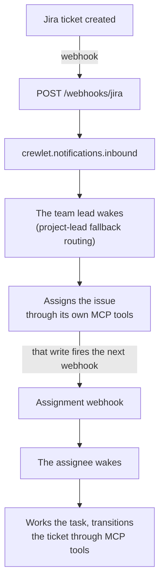

# Jira Integration

Crewlet integrates with Jira in two directions: agents control Jira via MCP tools, and Jira pushes events to agents via webhooks.

> **Jira is one of two trackers, and it is not the default.** The engine ships
> its own, Worklet (`tracker.backend: worklet`, which is what a company that says
> nothing gets), and it needs no site, no project and no per-seat account. Set
> `tracker.backend: jira` (or declare this block, which derives it) to run
> Jira instead. Take that path when your *people* already live in Jira or you
> have a backlog there; the agents cannot tell the difference. There is
> deliberately no migration between the two — see
> [The Tracker](../concepts/task-engine.md).

> **Prerequisites — the Atlassian side is set up by hand.** Atlassian offers no API for provisioning users, so the operator creates the Atlassian site (Cloud or Data Center) and each agent's Atlassian account and API token manually, then wires the tokens into `mcp_env` as shown below. Webhooks are registered the same way on both deployments (see [Webhooks](#webhooks-jira-pushes-to-agents)); the [Crewlet Forge app](https://github.com/crewlet/forge) is an optional alternative on Cloud.

---

## Setting it up from the dashboard

Atlassian is one connection in Company › Integrations, listed as Jira under
work tracking and Confluence under docs and knowledge, each with its own
state; both open the one Atlassian page, whose settings form carries Jira and
Confluence as sections, because one Atlassian account serves both. The first
field asks which Atlassian you run, and it decides every question after it:

**Atlassian Cloud** takes an organization id and an unscoped organization API
key, and nothing else about your sites. The engine reads them from the
organization: the site, its cloud id and its address are all discovered and
written into the config, so it does not ask you to copy values out of a
console it is already reading. It also creates one service account per agent
seat and mints that seat's token.

**A brand-new account takes about a minute to start working, and the card says so.** Atlassian accepts the product-access grant immediately and applies it over the next minute or so, and until it has, Jira refuses the credential the engine just minted with its own `401 Client must be authenticated to access this resource`. That is reported as `grant_pending` — *the provider is working on it* — rather than as an agent somebody has to fix, on the Atlassian surface for the seat it just granted and on the Jira surface for a credential sealed within the last five minutes. Outside that window a refusal is what it looks like and is owed by an admin. This window is hit on **every** reconnect, because disconnecting with *Also remove the accounts* means the next connect creates new ones.

An address typed here would be worse than redundant. The config uses a site
address *instead of* the API gateway, and a service account's token
authenticates only at the gateway, so naming a site is what stops the seats
working. On Cloud the form does not offer the field at all.

**Atlassian Data Center** has no organization, no cloud id and no service
accounts, so there the address of each product is the only way in and it is
required, alongside that product's own token.

The engine generates the webhook credential each deployment needs (a signing
secret on Data Center, a URL token on Confluence Cloud) and the reconcile loop
registers the hook on its next tick, running the same pass
`crewlet jira provision` runs.

```yaml
integrations:
  atlassian:
    deployment: cloud            # or data_center; the form opens on cloud
    org_id: ${ATLASSIAN_ORG_ID}  # Cloud only, from admin.atlassian.com/o/<id>
    api_key: ${ATLASSIAN_ORG_API_KEY}
```

See [Running the provisioning pass](../reference/api-endpoints.md#running-the-provisioning-pass).

## Configuration

The `integrations.jira` block is **non-tool config** — the admin/service account for org-level REST calls (watcher lookups) and the inbound webhook secret. The Jira MCP *tool* server is a separate `mcp_servers` entry shared with Confluence (name it `atlassian`):

```yaml
integrations:
  jira:
    url: "${JIRA_URL}"                    # a Data Center instance, or a Cloud site
    # cloud_id: "${JIRA_CLOUD_ID}"        # an Atlassian Cloud id — give this OR url
    # site_url: "https://acme.atlassian.net"  # with cloud_id: the base for links people open
    token: "${JIRA_API_TOKEN}"            # API token (org read account)
    email: "${JIRA_EMAIL}"                # Cloud only — the account's email, for Basic auth
    webhook_secret: "${JIRA_WEBHOOK_SECRET}"  # Data Center: required, HMAC-SHA256
    # webhook_name: crewlet              # which hook on the instance is this deployment's

mcp_servers:
  - name: atlassian                     # shared by Jira + Confluence (one mcp-atlassian)
    shared: false                       # per-agent: each role supplies its own token
    command: uvx
    args: ["mcp-atlassian==0.23.1"]
    env:
      JIRA_URL: "${JIRA_URL}"           # declare explicitly — the engine does not inject it
```

> **Human-clickable links agents share:** with `cloud_id`, the `mcp-atlassian` tools return `api.atlassian.com/ex/jira/{cloud_id}/...` gateway URLs, which colleagues can't open. To have agents share a clickable `…atlassian.net/browse/{ISSUE-KEY}` link, set a [skill variable](../concepts/tool-skills.md#skill-variables) (`skill_variables.jira_base_url: "https://mycompany.atlassian.net"`) for your mention/link Tool Skill to reference. (The bundled `examples/tool-skills/platform-mentions.md` does not: it links to Worklet and Doclet through `${crewlet_base_url}`, so a company on Jira gives its link rule a skill of its own.) Note what the server hands back itself: every issue `mcp-atlassian` 0.23.1 returns carries a `browse_url` built from the server's own `JIRA_URL`, so it opens in a browser when that is the site and sits under the gateway when it is the gateway, and on a gateway this prompt-layer variable is the only clickable base an agent has.

`url` and `cloud_id` are two ways to name one instance, so config validation refuses both together rather than resolving the ambiguity silently — the engine reads through the Cloud gateway when both are set, so the `url` would end up used for links only.

**Which REST version the engine speaks is derived from the address, and declared only where the address cannot say.** Cloud serves `/rest/api/3` and names people by `accountId`; Data Center serves `/rest/api/2` — v3 is a 404 there — and names them by username. A host of one of Atlassian's own Clouds is Cloud: a site under `atlassian.net`, `jira.com` or Atlassian Government Cloud's `atlassian-us-gov-mod.net`, or the gateway a `cloud_id` is read through — `api.atlassian.com`, or Government Cloud's `api.atlassian-us-gov-mod.com`. Other `atlassian.com` hosts are not Cloud sites — `jira.atlassian.com` is Atlassian's own self-hosted Jira. **Any other host is what `integrations.atlassian.deployment` declares**, and Data Center when the company declares nothing; the form's default of `cloud` is not a declaration, so a company that never wrote the field keeps Data Center for a host Atlassian does not serve. That is how an [Atlassian Isolated Cloud](https://support.atlassian.com/organization-administration/docs/ip-addresses-and-domains-for-atlassian-cloud-products/) site is configured: Isolated Cloud gives each customer a base domain of its own, which no list of hosts can name, so declare `deployment: cloud` and give the site's own address as `url` (not a `cloud_id`, whose gateway is on that same base domain). A declaration never overrules one of Atlassian's own hosts: validation refuses `data_center` beside an `atlassian.net` url or a `cloud_id`. A site's [custom domain](https://support.atlassian.com/organization-administration/docs/update-your-product-and-site-url/) serves browsers only, not the REST API, so `url` stays the `atlassian.net` address and the custom domain belongs in `site_url`. Config validation, this client and the [Confluence](confluence.md) client decide by the one rule from the same declaration, so a `url` validation admitted as Cloud is never served as Data Center. Both identity fields are read wherever a person appears, so the same routing works on either.

**A `cloud_id` is read through the gateway of its site's Cloud.** A cloud id says nothing about which Cloud issued it, and the commercial gateway does not serve a Government Cloud site, so the engine reads it through `api.atlassian-us-gov-mod.com` when `site_url` is a Government Cloud site (`…atlassian-us-gov-mod.net`) and through `api.atlassian.com` otherwise. A Government Cloud company that names its site by `cloud_id` gives `site_url` beside it — or gives the gateway address itself, `https://api.atlassian-us-gov-mod.com/ex/jira/{cloud_id}`, as `url`.

**Which authentication scheme is used is decided by `email`.** With one, the engine sends `Basic base64(email:token)`, which is what Cloud requires; without one it sends a bearer token, which is what a Data Center personal access token wants. The same credential is rejected purely on which scheme carried it, so this field is not cosmetic.

**`site_url` is the base for links a person opens.** With a `cloud_id`, the REST base is a gateway — `api.atlassian.com/ex/jira/{cloud_id}` on the commercial Cloud — which is not somewhere a browser can go — so without `site_url` the engine omits the link from a notification rather than printing one that looks right and opens nothing. With a plain `url` it defaults to that.

**`webhook_name` says which hook on the instance is this deployment's.** The reconcile converges the hook carrying that name whatever address it currently points at, which is what stops a change of public base leaving a live orphan behind — one per change, all enabled, all delivering somewhere that no longer answers. A hook that shares the name but points at anything other than a `/webhooks/jira` path was not registered by this engine and is left alone. It defaults to `crewlet`, and **two deployments watching one instance must set two names**: staging and production of one company share this document, so with a single name each pass would repoint the other's hook and only the last to run would receive anything. `crewlet jira decommission` removes the hook by the same name, so the two halves cannot disagree about which hook is yours.

On **Cloud**, `webhook_secret` is used exactly as it is on Data Center: the engine registers an admin webhook signed with it. Validation still does not *require* it for a Cloud config, because a company on the Forge relay has no HMAC in its path at all; what stops that being a silent gap is that the reconcile refuses to register a hook it cannot sign, and says so. The same holds for a `url` whose host is a `${VAR}`, in a company that declares no deployment: validation cannot see the host, so it judges the deployment unknown rather than Data Center, and the reconcile names `webhook_secret` once the address resolves to a Data Center instance. Declare `deployment: data_center` and validation asks for it up front; a reference only in the path (`https://jira.example.com/${JIRA_CONTEXT}`) leaves the host it follows judged as written. The Forge route remains available and is verified by the app's invocation token against `integrations.forge_app_id`.

---

## MCP Server (Agents Control Jira)

The `atlassian` MCP server gives agents full Jira capabilities — creating issues, transitioning statuses, adding comments, managing assignees. Set `JIRA_URL` in the server's `env` — the engine does not derive it from `integrations.jira.url`. Naming the server `atlassian` is also what lets the engine find each seat's credential: it reads `mcp_env.atlassian` to learn [which account each seat is](#seat-identity) and to run the [Confluence knowledge search](confluence.md) as that seat.

**The server is pinned, and five of its tools read the engine host's files.**
The entry names `mcp-atlassian==0.23.1`, the newest release, because what
these pages say about it — the tools agents call, the variables a seat sets —
was read from that release, and `uvx` with no version runs whatever was
published last. One change is already announced: with `TOOLSETS` unset, 0.23.1
serves every toolset and warns at each start that a later release will serve
only its six core ones, which leave out `jira_get_user_profile` among others.
Five tools post a file from the node the seat runs on: `jira_update_issue`
attaches the paths its `attachments` names, `confluence_upload_attachment` and
`confluence_upload_attachments` upload a `file_path`, and
`confluence_create_page` and `confluence_update_page` read a page body from a
`content_file`. The server refuses a path outside its working directory, and
it inherits that from the engine: the directory the engine was started in,
which is where the default `store.path` puts `crewlet.db`, and in the published
image the engine user's home, where harness agents keep their sign-ins
(`~/.crewlet/llm-harness`). Start the engine in a directory that holds none of its
own files, with `store.path` outside it, or every seat that runs this server
can attach the engine's database to an issue.

### Per-Unit Jira Projects

Declare the unit's Jira project under `project` (its integration identity), and put each agent's token in `mcp_env.atlassian`:

```yaml
units:
  - name: Core
    id: core                     # the unit's key; `name` above is display
    type: team
    lead: cto                    # the lead seat's handle
    project: "ENG"               # the unit's Jira project (integration identity)
    roles:
      - name: CTO
        mcp_env:
          atlassian: { JIRA_USERNAME: "${CTO_JIRA_USER}", JIRA_API_TOKEN: "${CTO_JIRA_TOKEN}" }
      - name: Engineer
        mcp_env:
          atlassian: { JIRA_USERNAME: "${ENG_JIRA_USER}", JIRA_API_TOKEN: "${ENG_JIRA_TOKEN}" }
```

(`mcp_env.atlassian` carries the `mcp-atlassian` server's env vars directly — `JIRA_USERNAME`, `JIRA_API_TOKEN`, the matching Confluence creds, and `JIRA_PROJECTS_FILTER` / `CONFLUENCE_SPACES_FILTER` for scoping — for any var the server reads. The unit's Jira project / Confluence space *identity* lives in the unit's `project` / `space`, not in `mcp_env`.)

The project identity is set once on the unit's `project`. It is integration identity (webhook routing + write home), not a tool credential, and it does not scope knowledge reads. An agent seat's `mcp_env.atlassian` is layered over its unit's, variable by variable, with the seat's own values winning, so each agent still authenticates as itself. Only the unit's direct agent seats inherit the unit's block; a human seat inherits none.

---

## Webhooks (Jira Pushes to Agents)

Both deployments register a webhook the same way, through the admin webhook API. On Cloud the **Crewlet Forge app** is an optional alternative.

### Jira Cloud — an admin webhook (the default)

**Cloud registers an ordinary webhook, exactly as Data Center does.** `crewlet jira provision -public-url https://your-engine.example.com` creates it, signs it with the secret in `integrations.jira.webhook_secret`, and the `/webhooks/jira` route verifies the `X-Hub-Signature` it sends.

This used to say Cloud needed the Forge app, on the premise that a Cloud webhook belongs to an app and refuses an API token. That is true of the **dynamic** webhook API (`/rest/api/3/webhook`), which answers `403 Only Connect and OAuth 2.0 apps can use this operation`. It is not true of the **admin** webhook API (`/rest/webhooks/1.0/webhook`), which is what the engine calls: a Jira administrator authenticates there with an ordinary API token, the hooks never expire, and every event and JQL filter is available.

The account whose token is in `integrations.jira.token` needs the **Administer Jira** global permission to register one.

Jira Cloud requires the URL to be **HTTPS with a certificate from a trusted CA**, and permits only a fixed set of ports (443 among them; **port 80 is rejected**). A tunnel such as `cloudflared` satisfies both; a self-signed certificate does not.

### Jira Cloud — the Forge app (optional)

The [Crewlet Forge app](https://github.com/crewlet/forge) remains supported and is the alternative when you would rather not expose an inbound URL to Jira directly, or you are already running it. It forwards these Jira issue events:

- `avi:jira:created:issue` — new ticket created
- `avi:jira:updated:issue` — ticket field changed (status, assignee, priority, etc.)
- `avi:jira:deleted:issue` — ticket deleted

Events are delivered via Forge Remote to `POST /webhooks/forge`. The Forge platform handles authentication automatically.


### Jira Data Center — Direct Webhook Registration

1. In Jira, go to **Settings** > **System** > **WebHooks**
2. Set URL to `https://your-server.com/webhooks/jira`
3. Select events: issue created / updated / deleted, and comment created / updated / deleted
4. Set a **Secret** for HMAC-SHA256 signature verification

Or let `crewlet jira provision -public-url https://your-server.com` register it for you — see [Provisioning](#provisioning).

Inbound requests are verified using **HMAC-SHA256** against the `X-Hub-Signature` header, at the route, before the delivery is recorded or published — the same point at which the GitHub and GitLab webhooks verify theirs. `POST /webhooks/jira` is exempt from the API's bearer token precisely *because* it authenticates by provider HMAC, so the check belongs there. Invalid or missing signatures are rejected with `401`.

**The webhook address is what a hook points at** — `api.public.external_url` when the deployment has a [public listener](../guides/deployment.md#exposing-webhooks-without-the-admin-api) (`api.public`), and `api.external_url` otherwise. With none set, the reconcile registers nothing and the instance has nowhere to deliver to — so on Data Center that is reported as **degraded**, naming whichever of the two keys this deployment reads, rather than as a ready integration with no hook anywhere. Cloud is exempt: its events can arrive through the Forge app at an address this engine never registered, so silence there is a working company rather than a gap.

`webhook_secret` is therefore **required** for Data Center webhooks: without one the endpoint answers **503** with a `Retry-After`, exactly as its peers do, rather than accepting deliveries it cannot verify. That is deliberately not a 4xx — the sender's request is fine, what is missing is on this side, and a 4xx would tell it to discard a delivery nobody else has a copy of. The delivery waits at Jira and flows once the secret is set. Cloud is unaffected — those events arrive through the Forge app on `/webhooks/forge` and carry a JWT instead.

### Delivery deduplication

Jira states a per-delivery identifier on both deployments (`X-Atlassian-Webhook-Identifier`) and repeats it on its own retries, so the webhook edge claims each delivery fleet-wide before publishing it. A retry — Jira's own, or a replay an operator triggers from the admin page — is answered `200 {"status":"duplicate"}` and wakes nobody. The claim lasts five minutes. A Cloud event relayed through Forge carries no such header and is claimed on a **hash of the raw body** instead — the payload is what stays identical across a retry, and byte identity is deliberately preferred to derived coordinates, which can collapse two *different* events into one.

### Routing strategy

Once an event passes signature verification and the delivery claim, the parser fans it out by the STRENGTH OF THE CLAIM ON THE RECIPIENT'S ATTENTION — because the first reason found for a person is the one that wins, and it is what the prompt renders. The actor is excluded from every step: they already know about their own change.

1. **@mentions** — every account named in a `mention` node inside the comment's [ADF](https://developer.atlassian.com/cloud/jira/platform/apis/document/structure/) body gets a copy with `routed_via = "mention"`. Jira's watcher list does not auto-include mentioned users, so this step is also the only one that covers a non-watcher who got @'d.
2. **Assignee** — the issue's assignee, if not already reached, gets `routed_via = "assignee"`.
3. **Watchers** — fetched from the Jira REST API with the `integrations.jira` org credential; each watcher not already reached gets `routed_via = "watcher"`. Without an org token this step is skipped and the integration still routes what the payload names.
4. **Project-lead fallback** — if steps 1–3 reached nobody in the org chart, the lead of the unit that owns the project (its `project`) gets `routed_via = "project_lead_fallback"`. It does NOT fire when the actor is the issue's own assignee: somebody took the work in the open, so nothing has been lost.

Mentions lead deliberately. Jira adds a mentioned user to the watcher list, so both reasons are true on nearly every comment — and a fan-out that walked the watchers first would tell a colleague who was asked a direct question that they are merely "watching this issue".

A copy is only produced for somebody the engine can actually resolve: an agent seat whose Jira account is registered (see [Seat identity](#seat-identity)), or a human seat reached by the assignee's email address or by `contact.atlassian_account_id`. An ordinary Jira user who is not in the org chart is dropped rather than turned into an undeliverable notification.

The lead-fallback exists because a tracker's worst failure is not a misroute — it is a ticket filed into a project nobody watches, which produces no error anywhere and is discovered weeks later. A project with no lead in the org chart routes to nobody rather than to a guess, and logs `jira_project_has_no_lead` at boot.

### Lead-fallback prompt hint

When a lead receives an event via `project_lead_fallback`, the Jira notification prompt adds a `## Why you received this` section that names the project, tells the lead it owns the issue by fallback and that no one else is following it, and lays out three explicit decisions:

- **Delegate** — look the right teammate up on the team for their Jira account ID, then set the assignee (later updates route to them, not back to the lead).
- **Take it yourself** — only if the work clearly falls to the lead: assign the issue to yourself.
- **Escalate** — if the issue is out of scope or the lead can't tell whose it is, hand it to their own manager by mentioning them in a comment on the issue or reassigning it to them.

The hint is suppressed for `watcher` / `assignee` / `mention` routings — those carry their own signal of personal involvement and don't need the extra framing. The block deliberately describes the CAPABILITY ("set the assignee") rather than naming a tool, because the deployed MCP server's tool names are not knowable by the engine — see [Tool capabilities](../concepts/tool-capabilities.md).

The `## How to handle this` section follows the routing too, in the same two rules as [Worklet's](../guides/worklet.md#what-wakes-a-seat):

- **Staying out is for a routing nobody is waiting on.** "If its assignee is neither you nor on your team, stay silent" is rendered for a `watcher` (or a routing with no reason), never for `assignee` or `mention`, the two the prompt reads as addressed: the turn engine holds those to an answer, and a mentioned seat is ordinarily asked about somebody else's issue.
- **Reassigning is for the issue's holder.** Only an `assignee` routing is told how an issue is declined here — reassigned to the right teammate, looked up for their Jira account id, or to the seat's manager if it cannot tell. A mentioned seat is asked about an issue that is not its to move, and a watcher is not asked at all.

That an addressed wake may not end in silence, and that a decline names the right owner on the surface the ask came from, are not in the Jira prompt at all: the executor's contract states both, and the turn engine [enforces the first](../concepts/turn-engine.md#who-is-waiting-and-how-they-get-an-answer).

---

## Per-agent access

Each agent seat that works in Jira or Confluence gets one Atlassian service
account in the organization, created by the engine with the organization's
unscoped API key (`integrations.atlassian`). Jira and Confluence are two lanes
over that one account, each set on the seat and edited on the integration's
Agents tab:

```yaml
roles:
  - name: SRE
    integrations:
      jira:
        enabled: true          # off until turned on
        project_role: "10101"  # a project role id from the site (GET /rest/api/3/role)
        projects: [GOP]        # empty: every project the company names
```

Project keys are compared as Jira matches them, in any case: `gop` is `GOP`,
within the company's reach and never read as a change.

| What the seat holds | How the engine applies it |
|---|---|
| Product access | One grant per product, the same for every agent: Jira's product member role on the site. What an agent may do comes from the role below and each project's permission scheme. |
| The project role | The seat's account is an actor of that role in each listed project, and of no other role in any project the company or a seat names. The roles offered are the site's own, read live, under their own names. Administrators is an administration role: a raise to it carries a warning and asks for a fresh step-up. |
| Product access only | The first level offered: the account has Jira and holds no project role, so each project's permission scheme alone decides what it sees. Leave `project_role` and `projects` out. Moving a seat from a role to product access only removes its project roles; a `projects` list needs a role. |
| The token | One API token for the account, with the scopes of the products the seat is on: Jira's `read:jira-work`, `write:jira-work` and `read:jira-user`, and Confluence's when that lane is on too. Its label, `crewlet-<handle>-<lanes>-<time>`, records which products it reaches, because Atlassian lists a token's label and not its scopes. |
| Off | The seat's project roles are removed and its token is replaced with one without Jira's scopes, or revoked when the seat is off on Confluence too. Atlassian offers no route that removes one product's access from a service account, so the account keeps its product grant and the Agents tab says so. |
| Remove | A separate, confirmed action, allowed only while the seat is off on both Jira and Confluence: one account serves both. The service account is deleted. |
| Rotate | A new token with the same scopes is minted and sealed, then the previous one is revoked. A token made by hand on the account is never touched. |

The token is sealed under `ATLASSIAN_TOKEN_<HANDLE>` and the address Atlassian
assigned the account under `ATLASSIAN_EMAIL_<HANDLE>`; no document names
either. The project roles are managed with the site credential in
`integrations.jira`, whose account needs Administer Projects on the company's
projects (or Jira administration).

Every pass reads each account back: whether it exists, which products its live
token reaches, and which role it holds in each project. A role changed by hand
is restored to the document's setting and reported; the Agents tab offers Keep
the vendor's setting instead.

---

## Seat identity

A Jira webhook names people by account id, and nothing in the org chart declares which account a seat holds. Without that mapping every event names a stranger, every routing target is dropped, and the integration is silently inert.

So the engine **asks**: at boot and on every config apply it calls `/myself` with each seat's OWN credential and registers whatever account answers. The credential is the one the engine sealed for the seat (`ATLASSIAN_TOKEN_<HANDLE>` with `ATLASSIAN_EMAIL_<HANDLE>`, see [Per-agent access](#per-agent-access)); for a document written before per-seat access it is read from `mcp_env.atlassian` or `mcp_env.jira`. [`mcp-atlassian`](https://github.com/sooperset/mcp-atlassian), the community server these pages run, covers both products, so the documented entry is named `atlassian`; a Jira-only server is named `jira`. Write it as that server reads it: `JIRA_USERNAME` and `JIRA_API_TOKEN` on Cloud, or `JIRA_PERSONAL_TOKEN` alone on Data Center. `mcp-atlassian` reads no other spelling, and given a token without its username it starts with no Jira tool at all. The engine names no variable of its own in such a document: it reads the ones the seat's tools use, so for a server that spells them differently it also takes the token under `JIRA_TOKEN`, `ATLASSIAN_API_TOKEN` or `Authorization`, and the address under `JIRA_EMAIL` or `ATLASSIAN_EMAIL`. Declaring the account id beside the token would be cheaper and is the wrong shape: a declaration that disagrees with the credential is a misroute nothing can detect.

Lookups are cached on the credential, so a config apply that changed something else costs nothing; a rotated token is a cache miss and costs exactly one request. A seat whose lookup fails is left unresolved rather than failing the boot, and logs `jira_seat_identity_unresolved` — it receives no Jira events until the next apply re-resolves it. A company where no seat resolved logs `jira_has_no_seat_identities`.

A **human** seat holds no tool credential and is never probed for one. Give them `contact.atlassian_account_id` (one id covers Jira and Confluence) and they are registered from config; failing that, an issue assigned to them still routes by the assignee's email address.

---

## Provisioning

```bash
crewlet jira provision company.yaml -secret-store -public-url https://engine.example.com
```

Jira issues no credentials on a provisioner's behalf — a Cloud API token is created by the person it belongs to, and a Data Center personal access token can only be minted for the calling user — so this command reports far more than it changes. It does the three things Jira genuinely allows, each of which answers a question that is otherwise invisible until an issue reaches nobody:

- **Which account each seat's credential authenticates as**, and which seats have none. A seat with no account id receives nothing, and nothing else in the engine says so. A lookup the instance did not *answer* — a timeout, a 5xx, a host that does not resolve — is a **fault** the reconcile loop retries rather than a report that the seat has no account: only a credential the instance actually refused is the seat's problem, and reporting the two the same way sent operators to rotate keys that were fine.
- **Whether every project the org chart names exists**, and whether Jira's own project lead agrees with the org chart's. A disagreement is reported, never failed: a human manager owning a project while an agent triages it is an ordinary arrangement. A project the instance does not have is almost always a typo, and the typo is a routing gap nothing else reports.
- **The inbound webhook**, on Data Center: registered at `<public-url>/webhooks/jira`, subscribed to exactly the events the parser routes, with the whole body and an HMAC secret. If `webhook_secret` resolves to nothing, a fresh secret is minted into the `${VAR}` it points at and recorded in the sink you chose — unless this deployment has **already sealed** a value under that variable, which is read back and reused instead. That read-back matters to the reconcile loop rather than to this command: a `${VAR}` resolves from a snapshot taken at apply time, so in the window between a pass sealing a secret and something rebuilding that snapshot, the resolver answers empty for a variable the fleet already holds — and without the read-back the loop minted again on every tick, rotating the secret the instance signs with until the snapshot caught up. A secret that already resolves is used as-is — re-registering with a fresh one would make the instance sign every delivery with a key the running engine does not hold. `-recreate-webhook` forces a rotation, which invalidates the secret every other deployment of this company holds — and is refused over a literal `webhook_secret`, which has no variable to mint into: point the field at a whole `${VAR}`, or run without the flag to register the literal as it is.

On **Cloud** the webhook is registered exactly as it is on Data Center, through the admin webhook API. The account needs the *Administer Jira* global permission. If you are on the Forge relay instead, leave `-public-url` off and the step is skipped.

Without `-public-url` nothing is registered and the run says so. A hook pointing at the wrong host is worse than no hook, because the instance then reports a healthy integration that delivers into the void. A hook somebody else registered is reported and never touched.

Flags: `-secret-store` / `-env-file PATH` / `-print` (where a minted secret goes — exactly one is required; with `-env-file` or `-print` a run that would mint the secret, under `-recreate-webhook` or where it resolves to nothing, is refused before it reaches Jira where the company's store holds its `${VAR}`, which the engine reads over anything recorded there — see [a sink the store outranks](../reference/cli.md#a-sink-the-store-outranks)), `-public-url URL`, `-recreate-webhook`, `-dry-run` (read and report, register nothing), `-config PATH` and `-api URL` (where the company's values are read and a `-secret-store` sink records).

The run reads the company's `${VAR}`s — the instance, the org account, the webhook secret and each seat's credential — through the running engine, with one of its Tier A tokens in `CREWLET_API_TOKEN`, or through the node `-api` names, and with this node's engine stopped from the fleet's store itself, through the node's own broker or the external one; on a member of a cluster whose engine is stopped it is refused before it reads or registers anything, `-dry-run` and `-recreate-webhook` included ([where a command reads the company's values](../reference/cli.md#where-a-command-reads-the-companys-values)).

---

## How It Works

Task state lives in Jira — the engine mirrors nothing. Webhooks become `ExternalNotification` inbox events for the routed agents (watchers, assignee, @-mentions, project-lead fallback), and every write back to Jira happens through the agents' own MCP tools:



There is no engine-side sync layer, no completion-comment automation, and no reconciliation poller: each MCP-tool action an agent takes fires the next webhook, which wakes the next participant — the same loop a human teammate drives. A webhook delivery that is lost is recovered the way it would be for a human: the issue's next activity (a comment, a transition, a nudge from a colleague) re-notifies the routed agents.

See [The Tracker](../concepts/task-engine.md) for why the engine keeps no state of its own on this backend, and for Worklet, the one it ships, which is the default.
