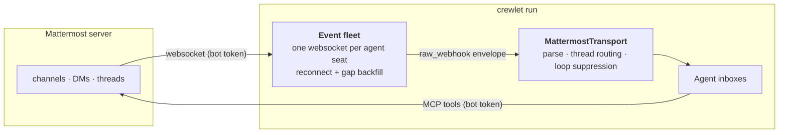
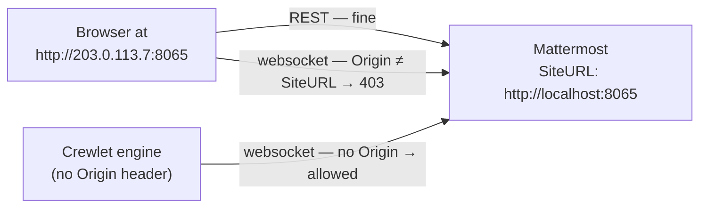

# Mattermost Integration

Mattermost is the **self-hosted, open-source** chat backend: one bot account
per agent, on a server you run. The alternative to [Slack](slack.md).

> **This is one of three chat backends, and the axis is exclusive.** Declaring
> `integrations.mattermost` puts this company on `chat.backend: vendor`; the
> engine's own chat ([Chatlet](../concepts/chatlet.md)) is what a company gets when
> it declares no vendor chat surface. Naming `chat.backend: chatlet`
> beside this block is **refused at validation**: a reply in one of two live chat
> homes would answer a thread the agents read only half of. Mattermost and
> [Slack](slack.md) together are fine: two workspaces with different people.

> **Prerequisites.** A Mattermost server you administer, and a **team** the
> agents will live in. Crewlet never creates top-level tenancy: create the
> server and the team yourself, then turn each agent on in the
> integration's [Agents tab](#each-agents-access-roles-and-channels), which
> fills it with agent bots.
>
> Unlike Slack, the engine needs **no** public address, tunnel, webhook secret or
> inbound route: it dials out and holds one websocket per seat, on every node
> (see [Running on a fleet](#running-on-a-fleet)). The Mattermost **server**
> still has to know the address browsers reach it on: read [The Site
> URL](#the-site-url) before deploying anywhere but localhost; a wrong one costs
> every human live updates while the agents keep working.

---

## Setting it up from the dashboard

Connect Mattermost in Company › Integrations with the instance address, the
team and a system administrator token, then turn each agent on in the
integration's Agents tab. The reconcile loop creates each agent's bot account
on its next tick. The administrator token is sealed in the fleet's secret
store and kept, because turning the bots off again needs the same authority
that created them.

On a first boot the engine claims its seats before that pass has minted their
tokens, so each agent's `mcp-server-mattermost` is **waiting**, not failing,
for a token this integration mints
(`mcp_server_awaiting_credential` in the log, and *Waiting* on
Settings › MCP & tools). The pass seals
the tokens and re-activates the revision; once the seal reaches a seat's
node it starts the seat's server with its token, with no engine restart. That holds only where
the company provisions its bots (`integrations.mattermost.provisioning`) and
the pass can make them. Where its last pass reports it cannot until
somebody acts (no administrator token, bot accounts or tokens switched off
in the System Console, a bot somebody else deactivated), the server reads as
failed, with that finding. A company whose bots were made by hand seals
each bot token itself, and a server whose token is unset is a failure naming
the variable. See
[Tools & MCP](../guides/tools-and-mcp.md#shared-vs-per-role-servers).

A disconnect finishes while agents are still turned on at Mattermost: the
revision that removes `integrations.mattermost` turns every agent's
`integrations.mattermost.enabled` off in the same write and keeps its roles
and channels, so connecting again and turning the agent on restores them.

Disconnecting with **"also remove the accounts this engine created"** revokes
each seat's bot token and then disables its bot, in that order: a disabled account keeps its username and tokens, so a token left behind works again the moment anything
re-enables the bot, this engine's reconnect included. Only tokens this
tool minted are taken (matched on the `crewlet-<handle>` description),
so an administrator's own token on the same account is left alone. A token that
cannot be revoked fails the disconnect with the bot left **enabled**; repeating
the disconnect resumes there. The sealed `${VAR}` stays in the secret store
holding the dead value, which the next connect overwrites.

It also **records that this engine is the one disabling the bot**, in
Mattermost's `description` field on the bot record, written before the
disable. A later connect reads that marker to tell its own disconnect
from an administrator switching an agent off (see below, and
[three apps disable rather than delete](../concepts/integration-reconcile.md#three-apps-disable-rather-than-delete-and-one-rule-covers-all-three)
for Datadog and GitLab).

See [Running the provisioning pass](../reference/api-endpoints.md#running-the-provisioning-pass).

## How this differs from Slack

**Mattermost has no usable inbound webhook.** Its outgoing webhooks fire only
in *public* channels (the server returns early for anything that is not
`ChannelTypeOpen`), so DMs and private channels are never delivered. Their
payload carries no `root_id` (no thread attribution), no channel type and no
mention list.

The supported path is the **WebSocket event API**, authenticated per user: the
engine holds **one connection per Mattermost-enabled agent seat**, each
republishing onto the same internal envelope every webhook route uses.



Compared with Slack:

| | Slack | Mattermost |
|---|---|---|
| Credentials per agent | 2 (bot token + signing secret) | **1** (bot token) |
| Manual steps per agent | An OAuth **Allow** click, per app | **none** |
| Engine must be publicly reachable | yes (Events API) | **no** [^siteurl] |
| Mention detection | inferred from text markup | **server-computed** list |
| Channel vs DM | inferred (`channel_type`, `D`-prefix) | **server-stamped** |
| Working-status text | free text, per phase | fixed *"is typing…"* |

The last row is the one real regression: see
[Working status](#working-status).

[^siteurl]: The *engine* needs no public URL. The *server* still needs its
    [Site URL](#the-site-url) set to the address browsers use.

---

## The Site URL

This setting decides whether Mattermost works for humans, and fails silently. Get it right first.

`ServiceSettings.SiteURL` must be **the address people type into their
browser**: scheme, host and port exactly, and no port the scheme already
implies (`:443` for https, `:80` for http), since no browser sends one. Not
`localhost` because the server runs there, nor an internal DNS name.

Two things read it, and both break when it is wrong:

- **The websocket origin check.** Mattermost accepts a browser's websocket
  upgrade only when its `Origin` header matches SiteURL's host *and*
  scheme ([`App.OriginChecker`](https://github.com/mattermost/mattermost/blob/master/server/channels/app/server.go)).
  A mismatch is answered `403`, the web app gives up and falls back to
  fetching messages on navigation. Nothing is reported broken; the symptom is
  *"I have to refresh to see the reply"*. With
  `AllowCorsFrom` set, the `Origin` must instead equal SiteURL (path
  removed) or one of its entries **character for character**, so a SiteURL
  written with capitals stops matching the lower-case `Origin` browsers
  send. With no SiteURL, the check compares the `Origin` with the
  request's `Host` header, which a reverse proxy must forward as the
  browser sent it: Mattermost's documented nginx configuration does
  (`proxy_set_header Host $http_host`); nginx's default sends the
  upstream's name.
- **Every absolute URL the server and its plugins build.** Email links,
  OAuth redirects and prepackaged plugins use SiteURL. A browser
  loading `http://203.0.113.7:8065` with SiteURL on localhost requests
  `http://localhost:8065/plugins/…` against the *reader's*
  machine, which refuses. Unset, per Mattermost's documentation: email
  notifications carry broken links, email batching does not
  run, and OAuth sign-in fails.



**The engine is exempt.** The origin check passes any client sending no
`Origin` header (every non-browser client), so the agents keep answering while the humans' web app is blind until reload. It looks like an engine bug but is a server setting.

### The address the engine dials

`integrations.mattermost.url` is where the **engine** reaches the server,
and it need not be the Site URL. On Kubernetes the engine dials the
in-cluster Service (`http://mattermost.chat.svc.cluster.local:8065`)
while people browse `https://chat.example.com`, which is correct:

- **The origin check never applies to the engine.** Its sockets carry no
  `Origin`, so neither the Site URL nor `AllowCorsFrom` has to name the
  address it dials.
- **Nothing a person opens is built from it.** The engine composes no
  Mattermost link: permalinks, notification links and plugin URLs
  come from the server's Site URL.

Only the **path** has to be the server's. Mattermost serves every route under
its Site URL's path, whatever host a request arrives on: a Site URL of
`https://example.com/chat` needs
`url: http://mattermost.chat.svc.cluster.local:8065/chat`.

**The engine follows no redirect** (Go's client resends a write as a body-less `GET`, answered `200`, and the agents' MCP server follows none, so the engine would hear messages its agents could not answer). A `url` the server redirects therefore fails every call, with
an error naming where the server sent it and the `url` to set: one outside
the Site URL's path, or `http://` behind
a proxy that sends it to `https://`. A `url` under a path with no
route (any path, on a server whose Site URL has none) is
answered with the web app's page, and the error says so.

The engine reads the server's configuration once when the transport starts
and warns about what the server cannot use, never about the Site URL
differing from the address it dials:

| Event | When | What breaks |
|---|---|---|
| `mattermost_site_url_unset` | SiteURL is empty | Mattermost's email links, email batching and OAuth sign-in. Browsers keep their live feed wherever what is in front of the server forwards the `Host` they typed |
| `mattermost_site_url_refuses_browsers` | SiteURL is not an absolute http(s) address (`localhost:8065` and `/mattermost` pass Mattermost's own validation) or spells out a default port | Every person's live feed, and every link the server builds; the agents keep working |
| `mattermost_instance_unread` | The configuration could not be read through `url`. A redirect, or a web page where the API's JSON should be, is named in its `error` with the `url` to set | When it is the `url`: every call the engine makes, so no seat connects |

Each carries the same sentence [`crewlet mattermost doctor`](#checking-an-install-crewlet-mattermost-doctor)
prints for it.

### Getting it right

The compose stack reads `MATTERMOST_PUBLIC_URL`, and
[`scripts/mattermost-dev-bootstrap.sh`](#local-testing) settles it:
it derives the address (explicit variable → the address you reached the host
on over SSH → `localhost`), makes the server agree, persists it to `.env`,
and refuses to finish while the two disagree.

```bash
MATTERMOST_PUBLIC_URL=http://203.0.113.7:8065 \
  docker compose --profile mattermost up -d --wait
scripts/mattermost-dev-bootstrap.sh
```

Verify it from anywhere, with no credential; this must print the address
you browse to:

```bash
curl -s "http://203.0.113.7:8065/api/v4/config/client?format=old" \
  | python3 -c 'import sys,json; print(json.load(sys.stdin)["SiteURL"])'
```

Or let the engine's own check do it, which also sends a browser's websocket
upgrade to that address and opens every seat's socket:

```bash
crewlet mattermost doctor my_company.yaml -browser-url http://203.0.113.7:8065
```

`-browser-url` is the address people type, and only you can give it: the
server reports where it *believes* it is browsed, and the engine's `url`
may be any route to it. Left out, it is read from `MATTERMOST_PUBLIC_URL`
(which a shell that sourced the compose stack's `.env` has); with
neither, the doctor judges the Site URL alone and says it did not ask
whether people browse there.

Three things that do **not** work:

- **Changing it in the System Console.** An `MM_*` environment variable
  outranks the stored config and is re-applied on every write, so the field
  is read-only and `PUT /api/v4/config/patch` silently reverts. For the
  compose stack, recreate the container with the new value.
- **Setting `AllowCorsFrom: "*"`.** It restores live updates by disabling
  the origin check, which grants credentialed cross-origin access
  to the whole REST API from any site a signed-in user visits. It also
  leaves SiteURL wrong, so links and plugins stay broken. Use it only to
  name additional legitimate origins explicitly, never `*`.
- **Listing the engine's address in `AllowCorsFrom`.** The engine needs no
  entry (no `Origin`), and any entry switches the server to comparing origins character for character (see
  above) and grants that origin credentialed cross-origin access to the
  REST API.

---

## Configure in YAML

`integrations.mattermost` enables the transport and the websocket fleet. The
Mattermost **MCP tool** server is a separate `mcp_servers` entry
(`shared: false`). Each agent's bot token is one credential with three readers
(websocket, REST, MCP): the engine seals it under the agent's own name and binds
it to the agent's instance of the tool server, so the document names it
nowhere. The REST reader makes two kinds of read: the backfill a seat runs over a websocket reconnect gap, and
`GET /api/v4/posts/{root}/thread` at the start of a turn woken in a thread, so
the agent is handed the conversation
(see [the thread block](../concepts/agent-runtime.md#the-thread-a-turn-was-woken-in)).
Both read as that bot: a channel it is not in answers an
error and the turn runs without the block.

```yaml
integrations:
  mattermost:
    enabled: true
    url: "https://chat.nimbus.example"    # instance base URL (required)
    team: nimbus                          # team slug (required)
    typing_status: always                 # always (default) | addressed
    provisioning:              # read by the reconcile loop AND by the CLI
      username_prefix: ""      # e.g. "agent-" if humans share the server
      channels: [town-square, engineering]   # the channels agents may be given
      display_name_suffix: " (AI)"

mcp_servers:
  - name: mattermost
    shared: false                        # per-agent identity
    command: uvx
    args: ["mcp-server-mattermost==0.6.1"]
    env:
      MATTERMOST_URL: "https://chat.nimbus.example"
    tool_prefix: "mattermost_"

units:
  - name: Core
    id: core                             # the unit's key; `name` above is display
    type: team
    lead: engineer                       # the lead seat's handle
    roles:
      - name: Engineer
        integrations:                              # this agent's own Mattermost bot
          mattermost:
            enabled: true
            roles: [system_user]
            channels: [engineering]                # within provisioning.channels
```

**The server is pinned, and two of its tools reach the engine host's disk.**
The entry names `mcp-server-mattermost==0.6.1` because the bundled tool
skills trigger on its tool names (`mattermost_post_message` among them), and
a release that renamed one would silently disarm them (see
[trigger width](../concepts/tool-skills.md#controlling-the-cost--keep-enforced-triggers-narrow-broad-bodies-tiny)).
Two tools act on the filesystem of the node the seat runs on, as the
engine's user: `upload_file` sends Mattermost any file that user can
read, and `download_file` (new in 0.6.0) saves an attachment into any directory
that user can write, replacing an existing file when asked. Every
seat running this server can call both, so run the engine as a user whose
files you would let an agent post and overwrite.

Write this block **first**, with `${VAR}` placeholders: the provisioner
reads the placeholder names from the YAML and mints exactly those
variables. A whole-value placeholder is required
(`"${MATTERMOST_TOKEN_ENGINEER}"`, not a literal token) so the provisioner
knows which variable to write; a literal marks a manually managed bot,
which is reported and left untouched.

### Fields

| Field | Meaning |
|---|---|
| `url` | The address the engine reaches the server at. Required when enabled. Any route works (Site URL or in-cluster Service); only its path has to be the Site URL's (see [The address the engine dials](#the-address-the-engine-dials)). |
| `team` | Team slug agents belong to. Required (channels are team-scoped). |
| `typing_status` | `always` (default) / `addressed`. See [Working status](#working-status). |
| `provisioning.username_prefix` | Prepended to each seat's [handle](../concepts/integration-reconcile.md#a-seats-account-is-named-after-its-handle) to form the bot username. |
| `provisioning.channels` | The company's channels: the list each agent's own `channels` must be within. Empty lets a seat name any channel in the team. |
| `provisioning.display_name_suffix` | Appended to each bot's display name. |

Per role, under `integrations.mattermost`:

| Field | Meaning |
|---|---|
| `bot_token` | The bot's personal access token. `${VAR}` ⇒ provisionable. One whole reference or the token itself; a reference inside other text is refused. |
| `username` | Bot username, or one whole `${VAR}` naming it (resolved where the transport is built, like the token). Defaults to the handle (with the prefix applied). |
| `channel` | Optional channel name this seat's bot is added to at provisioning, on top of `provisioning.channels`. It aims nothing: the engine's transport posts no message. |

Per role, the seat's access (see [Each agent's access: roles and channels](#each-agents-access-roles-and-channels)):

| Field | Meaning |
|---|---|
| `enabled` | Whether the agent has a bot at all. Required in every block; a seat with no block is off, and a new agent seat is off until somebody turns it on. |
| `roles` | The bot's Mattermost roles, by Mattermost's own names: one of the four sets below. |
| `channels` | The channels the bot is a member of, each within `provisioning.channels` where that list is set. |

There is no `status_phrases` here: Mattermost's indicator
wording belongs to the client, so engine-supplied text would never be
rendered. The setting exists only under `integrations.slack`.

## Each agent's access: roles and channels

Each agent seat is turned on or off, and given its access, on the integration's
**Agents** tab (or the agent's own page, same control). The tab
writes one revision of the company document, under the seat's
`roles[].integrations.mattermost` block:

```yaml
roles:
  - handle: sre
    integrations:
      mattermost:
        enabled: true
        roles: [system_user, system_post_all_public]
        channels: [town-square, incidents]
```

**Access is the bot's own Mattermost roles**, under the names
the System Console gives them, in its order:

| Shown as | `roles` | What the bot may do |
|---|---|---|
| Member | `[system_user]` | Read and post in the channels it has joined. |
| Member with post:channels | `[system_user, system_post_all_public]` | Also post in every public channel without joining it. |
| Member with post:all | `[system_user, system_post_all]` | Also post in every channel, private ones included, without joining it. |
| System Admin | `[system_admin, system_user]` | Every System Admin privilege, including users, teams and settings. |

Any other set is refused on save. Moving a seat to
**System Admin** carries a review warning and asks for a fresh step-up;
lowering a seat, or keeping it, never does.

**Scope is channels.** A bot hears only the channels it is a member of, so a
seat's `channels` is exactly where it can be spoken to. Each must be in
`provisioning.channels` where the company lists any, so a seat never reaches
further than the company. An empty list means the bot is in no managed
channel and can only be messaged directly.

### What each change does at Mattermost

| You do | Crewlet does at Mattermost |
|---|---|
| Turn a seat on | Creates the bot, adds it to the team with its roles and to its channels, then mints its access token and seals it. |
| Change its roles | Sets the bot's roles (`PUT /api/v4/users/{id}/roles`) to the seat's whole set. |
| Change its channels | Adds it to channels the seat gained and removes it from the company's channels the seat no longer names. Where the company lists channels, one outside that list (a room a person invited the bot into) is never touched; where it lists none, the seat's channels are the whole of what the bot is in. A direct message is never touched. |
| Turn it off | Records in the bot's description that this engine turned it off and deactivates it (so the agent stops at once), then revokes the tokens this engine minted and clears the sealed token. A failed revoke is retried every pass until no such token is left. Mattermost keeps the bot and everything it posted. |
| Turn it back on | Clears the marker, reactivates the bot, and mints and seals a new token. No person is needed. |
| Remove it (only while off) | Nothing at Mattermost: deleting a bot deletes everything it posted, so it stays deactivated and Crewlet stops managing it. Remove is a separate, confirmed action and never follows from editing the document. |
| Rotate its token | Mints a new token, seals it, then revokes the token it replaced. A token an administrator minted on the bot by hand is never revoked. A seat given a token because none was sealed for it follows the same order: seal the new token before revoking an older one. |

The token is sealed under one name the engine derives for the seat,
`MATTERMOST_BOT_TOKEN_<HANDLE>` (for example `MATTERMOST_BOT_TOKEN_SRE`). **If a minted token cannot be sealed it is revoked again** at once:
Mattermost shows a token's value once, so an unsealed token would be live and held by nobody.

### Every pass reads each bot back

Each pass reads every bot this engine manages, including the bot of a seat
that left the document: its roles, channels, whether it is
deactivated and by whom, and whether it still holds a token. A bot is adopted
by its username only if it is a bot; a person holding the name is
never taken for an agent.

- **Roles or channels changed at Mattermost** by somebody else are restored to
  the seat's and reported as `drift_restored`, with the before and after. The
  tab offers **Keep the vendor's setting**, which writes Mattermost's value
  into the document instead.
- **A bot somebody else deactivated** is never turned back on by a pass (it may
  be incident response). The tab offers **Turn back on** or **Keep
  off**. Only a bot carrying this engine's marker is reactivated
  unasked.
- **A bot deleted at Mattermost** is dropped from the engine's records, and the
  next pass creates a fresh one if the seat is on.
- **A seat that leaves the document** is treated as off: its bot is
  deactivated, kept, and listed on the tab with **Remove**.

A refusal names the failed step, Mattermost's reason, what to do
and who does it, with a System Console users link. The step
is retried every pass and on **Retry**. The provisioning token must belong
to a System Admin, and `ServiceSettings.EnableBotAccountCreation` and
`ServiceSettings.EnableUserAccessTokens` must be on.

---

## The admin token and the instance's switches

The engine provisions each agent's bot as a **system admin**: creating bot
accounts, minting their access tokens and setting their roles all require
it. Generate a token under **Profile → Security → Personal Access Tokens** on a
system-admin account, and name it under
`integrations.mattermost.provisioning.admin_token`. The bots' own tokens are
what the engine *mints*, so it cannot bootstrap from them.

Every pass checks three things a config cannot show against the live
instance, and reports each on the integration's card naming the setting:
that the provisioning token holds `system_admin`, and that
`ServiceSettings.EnableBotAccountCreation` and
`ServiceSettings.EnableUserAccessTokens` are on. Otherwise the first bot
creation fails with a 403 naming an endpoint, not what an
administrator has to change. A setting is reported only when the server
says it is off: the config endpoint's key set varies by server version, so
an absent key means "this server did not say".

A `team` the instance does not have is reported once on the integration,
naming the team, and no agent's bot is created, changed or turned off until
it is fixed: channels are team-scoped, so every seat would fail the same
way.

`crewlet mattermost provision` is retired: each agent's bot, roles, channels
and token are managed from the Agents tab and applied by the reconcile loop.
The command says so and changes nothing.

### Seats and licensing

Mattermost's unlicensed server enforces a hard **active-user** cap. **Bot
accounts are excluded from that count**, so agents never consume it. The exclusion is an implementation detail, not a licensing commitment, and the cap has been lowered
several times; watch the human count.

---

## Checking an install: `crewlet mattermost doctor`

```
crewlet mattermost doctor my_company.yaml [-browser-url URL] [-admin-token TOKEN]
```

Reads the company YAML the engine boots from and checks the whole
inbound path, in the order it breaks. `-browser-url` (or
`MATTERMOST_PUBLIC_URL`) is the address people type into their browser,
the one fact about browsers the configuration cannot give it,
because `integrations.mattermost.url` may be any route to the server:

| Check | Why it is here |
|---|---|
| `/system/ping`, unauthenticated | Reachability (a bad credential must not make a healthy server look dead), and that `url` is where the server answers its API: a redirect, or a web page in its place, stops the run and names the `url` to set (see [The address the engine dials](#the-address-the-engine-dials)) |
| `SiteURL` | The [one setting](#the-site-url) whose failure has no error message: unset, not an absolute http(s) address, a default port spelled out, or (given `-browser-url`) not the address people type, scheme and host. A Site URL on another address than `url` is not a finding (see [The address the engine dials](#the-address-the-engine-dials)). Without `-browser-url` the line says that question was not asked |
| A **browser-shaped** websocket upgrade | *With* a browser's `Origin`, the only difference between a browser and the engine: what a human's live feed does, `AllowCorsFrom` included, which no unprivileged read can show. Given `-browser-url`, it is sent to that address under the Site URL's path, through whatever is in front of the server, so a proxy that drops `Upgrade` fails it too. Without it, it carries the Site URL's own `Origin` and is sent to `url`, so it only finds an `AllowCorsFrom` that refuses the server's own browsers. With no Site URL, it stands in for a browser at `url` itself |
| The configured team | Channels are team-scoped, so a team that does not resolve is a company where no bot can be placed |
| Per seat: its own credential, a real socket, its channels | A token can be valid for REST and still not open a socket, and a bot receives nothing from channels it has not joined. The socket is opened exactly as the engine opens it, with no `Origin` |

**No admin credential is needed and nothing is written.** The seat tokens
in the config do the work, resolved as the engine resolves them
(secret store, then environment). A literal
token is used as-is (managing a seat's credential by hand is supported).
Pass `-admin-token` to run the shared checks as somebody else.
The exit code is non-zero when any check fails, so it drops into a deploy
script.

**Checked-and-bad is distinguished from never-checked.** An unreachable
server, an unreadable server configuration or a missing credential *stops*
the run, and the report says so, so one failing line is not read as
"one thing is wrong" when it means "nothing else was
asked". The same holds per seat: a seat whose token did not resolve is
never dialled, and one whose credential is refused is never asked about its
channels. Everything that *can* be answered still is: a team that does not
resolve leaves the per-seat socket checks intact.

```
ok    reachable        http://203.0.113.7:8065 answers
ok    site url         people browse the server at http://203.0.113.7:8065, and its Site
                       URL, http://203.0.113.7:8065, agrees.
ok    credential       authenticates as agent-pm
ok    team             team "nimbus" resolves (kx8f...)
ok    browser socket   an upgrade carrying Origin http://203.0.113.7:8065 — what a browser
                       at http://203.0.113.7:8065 sends, sent where it sends it — was
                       accepted at ws://203.0.113.7:8065/api/v4/websocket
ok    seat pm          agent-pm authenticates, opens a socket, and is in 3 channel(s)
FAIL  seat swe         agent-swe authenticates and opens a socket but has joined no
                       channel, so it will only ever hear direct messages. Give the agent
                       its channels in the Mattermost integration's Agents tab
```

---

## How Mattermost Routing Works

### Inbound

1. A human posts in a channel the bot is a member of, or DMs it.
2. Mattermost pushes a `posted` event down that bot's websocket.
3. The fleet republishes it onto `crewlet.notifications.inbound`.
4. the Mattermost transport parses it, applies thread routing and loop
   suppression, and produces a notification.
5. NotificationService resolves handle → agent and publishes to
   `crewlet.agent.{seat-id}.inbox`.

#### Which events wake an agent

Only `posted` events carrying user-visible content; **edits do not**, as in the
[Slack](slack.md) transport (an edit of a triaged message is not a new request, and re-answering costs
a full turn). Skipped posts wake no one and are logged at debug as
`mattermost_post_skipped` with the reason, not recorded as a
`NotificationSkipped` event (as for every integration's parser: a skip row for each would bury the drops
that matter, such as a seat no recipient matches, the routing gate or the rate valve):

- **`system_*` posts**: joins, leaves, header/purpose changes, channel
  renames. Their text is *about* the channel, not addressed to anyone.
- **Deleted posts** (`delete_at` set).
- **The agent's own posts**, compared against its resolved user id. Its own
  thread replies still record participation, so replying subscribes it to
  what comes back.
- **Empty posts**: an upload with no comment renders as
  `(shared 2 files)`, so a genuine post is never delivered empty.

### Reconnects and the gap

A connection that drops has missed what happened meanwhile; the fleet covers
the gap by re-reading, not by asking the server to replay.

Each seat records the newest post it has seen and, on reconnect,
re-reads every channel it is a member of since then and replays the gap
in order within each channel (across channels, in the channel list's order, which does not matter because each replayed post becomes its own agent turn). Every channel is read, not only ones with prior traffic, so a message
in a channel the bot was invited to *during* the outage is not lost. Duplicates across the boundary are caught by a per-seat
de-duplication ring and by the fleet-wide claim in
[Running on a fleet](#running-on-a-fleet).

The replay is what the live socket would have delivered, and nothing more.
Mattermost's `since=` is *update*-based, and an update is not new content (a
reaction touches a post; deleting a reply touches its thread root), so a
👍 during a reconnect would otherwise wake the agent to re-answer. Only posts **created** in the gap are
replayed. A seat that reconnects before it has seen any post still gets a
cursor from the moment it connected.

The window is bounded at **15 minutes**. Backfill covers a blip (a
network drop, a rolling Mattermost restart, a brief engine pause), not an
outage: every replayed message costs a full agent turn, and
an hour of replayed conversation would be expensive and wrong, since
those conversations have moved on. A wider gap is logged with the amount
skipped:

```
mattermost_backfill_window_exceeded handle=engineer gap=1h0m12.4s window=15m0s
```

Reconnect backoff is capped at 5 minutes and jittered by up to a quarter of
the delay: every seat drops at once when the server restarts,
and each reconnect is a backfill walking the seat's channels. A seat that cannot connect is a configuration problem an operator
has to see, so the retry stays visible in the logs. The schedule resets only after a connection that stayed *live*
for a minute: Mattermost closes without a close frame, so an ordinary
disconnect and a server hanging up on sight look identical otherwise.

> **Not yet used: Mattermost's reliable websockets.** The server can replay
> missed events from a 128-event queue when the client reconnects with
> `connection_id` + `sequence_number`, but only when the upgrade request is
> already authenticated; this fleet authenticates *after* the handshake, so
> adopting it means moving every seat to an `Authorization` header on the upgrade.

### Running on a fleet

**Every node opens every seat's socket**, not only the seats it holds.
A node that restarts, drains or loses a seat's lease
leaves the seat heard by every other node, so there is no handover
and no gap for a backfill to cover. Each post arrives
once per node, and the fleet decides which delivers it:

1. A node reading a post **claims** it fleet-wide in the coordination store,
   under `mattermost|<handle>|<post id>` (per seat, because one post is a
   delivery to every bot in its channel).
2. The winner publishes it onto `crewlet.notifications.inbound`
   and records the delivery (a `socket:posted` row, below). Every other node drops
   it.
3. A claim store that cannot answer **fails open**: the post is delivered,
   because a message suppressed by a store blink is one nobody answers.
   A post two nodes both deliver is caught by the second layer: its wake's id
   is derived from the seat and the post, so the inbox and the completion
   ledger recognise the pair and the seat takes one turn.
4. A publish that fails gives the post back: the claim is released and the
   seat's cursor is held before the post, so the seat reconnects and replays
   it, on this node or whichever peer gets there first. A post is never
   spent before it is queued.

**The claim lasts 30 minutes**, twice the 15-minute replay window. A peer
whose socket dropped re-reads up to 15 minutes behind its reconnect,
which may itself have waited out the 5-minute backoff ceiling;
the margin also covers server/node clock difference. A claim that lapsed first would let the peer deliver the post again.
The webhook routes claim for 5 minutes, and the coordination store holds each
claim to its own deadline ([Retention is a bucket's age](../concepts/coordination.md#retention-is-a-buckets-age)).

**The cost is N sockets and N backfills per bot on an N-node fleet.**
Every node authenticates every bot, holds its socket open and pings it every
30 seconds, and every reconnecting node walks the bot's channels, so a
Mattermost restart is N times a single node's reconnect traffic, spread by the backoff's jitter. For tens of bots on a handful of
nodes that is a small number of idle connections, the one cost of a
seat never going deaf while placement moves it.

**Each delivery is counted once.** The node that wins a post's claim publishes
an `inbound_delivery` record beside the wake, so Company › Integrations
counts Mattermost's deliveries like any other surface's (one post presented
to one seat, whichever node read it), listed in its row as
`socket:posted` with the post id as the provider's id. The record is
published rather than written, so a node without `data` reaches a data node's
event log through custody like everything else it publishes.
### Outbound

All Mattermost capabilities (messaging, threading, search, reactions) come from **MCP tools** on the agent's own bot token; messages post as the agent's own bot.

The engine's transport never creates a post. It holds the same per-seat bot token for **reads** (the seat's identity, the instance's typing cadence and Site URL, the REST re-read a reconnecting socket backfills from) and for one write: the [typing indicator](#working-status).

---

## What the atlas reads

Once an hour (unless `atlas.refresh_interval_seconds` says otherwise) the engine reads the team the agents' bots belong to, for the company's [atlas](../concepts/atlas.md#what-integrations-read). It adds the team's id and display name to the server account the atlas already shows. Nothing at Mattermost is changed.

| Part | Calls | Permission | What the atlas gains |
|---|---|---|---|
| Team | `GET /api/v4/teams/name/{team}`, once | membership of the team, or a system administrator | the team's id and its display name |

- **Credential.** The bot token of the first agent, by handle, whose Mattermost bot is on. If Mattermost refuses it (`401`, `403` or `404`: bot deactivated, or not a team member), the next agent's is tried, then `provisioning.admin_token` last. An agent whose bot is off is never asked.
- **Nobody is read.** The team's contact address and invite id are not read; no member, channel or post is listed.
- **A refusal is a finding, not a failed read.** If no credential is shown the team, the source's standing on the atlas says to check `integrations.mattermost.team` and the bots' membership, and what an earlier read recorded stays. Any other failure stops the read, records nothing, and is retried five minutes later.

## Thread Routing

Same shape as Slack's, on Mattermost's primitives. Top-level channel messages are always delivered; thread replies only reach agents **following** that thread.

Two signals decide:

- **Whether the bot was addressed** is the server's answer. Mattermost rewrites the `mentions` list *per connection* (`addMentionsBroadcastHook`): present only when that connection's user was mentioned, and then exactly that one id. It is authoritative and catches group mentions, notification keywords, and `@all` / `@channel` / `@here` resolved against real membership.
- **Why** is the message text's answer alone. A bare `@channel` expands into every member's id, so by the list a broadcast looks like being named, and treating a broadcast as personal address is what [`typing_status: addressed`](#working-status) must not do.

**Follow triggers:**

1. **Direct mention**: the server says this bot is a target and the text names it (`@agent-swe`). Also the reason when the server says it is a target for something the text cannot show, such as a group mention.
2. **Collective address**: the server says this bot is a target and the text shows only `@all` / `@channel` / `@here`; recorded as `collective`, weaker than being named.
3. **DM**: a direct or group-DM channel always follows.
4. **Participation**: the agent posts in the thread.

The thread key is `root_id` (immutable, equals the parent post's id), so the follow model maps 1:1 onto Slack's. State persists in the fleet's [coordination store](../concepts/coordination.md), keyed `backend = 'mattermost'`, across restarts, including the 90-day inactivity horizon in [the Slack analog](slack.md#thread-routing) (backend-neutral because the record is).

**Backfilled** posts are re-read over REST and carry no mention list, so the text alone decides, with the same `@username` grammar.

---

## Working status

Mattermost's only working indicator is the composer typing line, with client-fixed wording. The engine can raise it but say nothing with it, so there are no per-phase phrases as on Slack.

`typing_status` **defaults to `always`**, as on Slack, and on this backend that default is the expensive one:

- It conveys only *busy*, where Slack's line carries the phase; a fixed "is typing…" over a five-minute turn tells less.
- It is re-asserted every few seconds rather than every 45, so a multi-minute turn costs one to two orders of magnitude more requests for less information.

Set `typing_status: addressed` to raise it only where somebody is waiting on the agent; most Mattermost deployments want this. The heartbeat interval is **derived from the server's `TimeBetweenUserTypingUpdatesMilliseconds`**, not hardcoded: faster than the throttle is silently dropped, much slower leaves a gap. It is read at transport start, from the first bot token the server accepts, before any websocket attaches. An unreachable server is asked once, not once per bot, and the indicator then runs at Mattermost's default of five seconds until the next start (`mattermost_instance_unread`).

| Mode | Shows the status when… |
|---|---|
| `always` *(default)* | every Mattermost-triggered turn |
| `addressed` | a DM, a direct mention, or a thread the agent is in because it was named there; a thread it merely spoke in, or one a broadcast started, does not count |

The lifecycle (where the indicator is raised, held, released and cleared) is the same on every chat backend and lives only in [Turn Engine § The working status](../concepts/turn-engine.md#the-working-status). What differs here: a phase change does **nothing**. The engine tracks phases, but with no text to move, a phase boundary costs no request (on Slack it redraws the line).

> **There is no `off`.** It bought agents thinking in silence for minutes, the state this feature exists to remove. `addressed` is the same judgement made per message, and here also the cheaper one.

---

## Reaching humans on Mattermost

An agent escalating to a [human seat](../concepts/humans-in-the-org.md) DMs the human with **its own** bot token. There is no org-level "system" account; the engine never sends as itself.

Give the human seat a `contact.mattermost_user_id`: the **username**, not the 26-character user id, because mentions address a person by name and an agent must write the name for the mention to render. It is lowercased (Mattermost stores usernames so), so `Jane` and `jane` name one person, and two seats giving either are refused as one account claimed twice:

```yaml
roles:
  - name: Jane Founder
    kind: human
    manages: [ceo]        # by handle
    contact:
      mattermost_user_id: jane
```

### How a person's post is recognised

A post names its author by **user id**, never username. The transport asks the server which account holds each human seat's name (`POST /api/v4/users/usernames`, all names in one request, on a seat's bot token) and registers **that account's user id** for the seat. A post from it then reaches agents as the chart's colleague, `Jane Founder (jane-founder, human colleague)`, in the trigger, in the thread a turn reads back and in what the agent remembers, not as a stranger with an opaque id.

The name is asked in lowercase, so `Jane` and `@jane` both find `jane`. It is asked again:

| When | Why |
|---|---|
| At connect, before any socket is attached | so the first post a socket hears is already attributed |
| On every apply | an apply names a new person or corrects a name. The new party registry is first filled from the last answer, with no request, so nobody recognised a moment ago becomes a stranger while the server is asked again |
| Every **minute** (`mattermost.PeopleRefresh`) | a person joining under the name the chart already gives them, and a rename, happen **at the server** and reach the engine no other way. One request per node per minute, however many people are named |

The minute is how long a new joiner waits to be recognised. A rename keeps the account id, so the person stays recognised until the next ask, which notices the chart's name is stale. The engine deliberately does not listen for Mattermost's `new_user` and `user_updated` websocket events: every seat's socket hears each, nothing replays one missed while down, and the answer they would prompt is the same request.

**A name that holds no person is reported, never guessed at.** Whatever is registered is attributed with the person's authority, so nothing is registered when the name holds no account of the person's own. The `reason` says which:

| `reason` | The name… |
|---|---|
| `no_account` | is one the server answers without: nobody holds it, or nobody the bots may see |
| `agent_account` | holds the account one of this company's own seats posts as, bot or not; registered, every post that agent made would reach colleagues as the person's word |
| `bot_account` | holds another bot's account |
| `shared_account` | holds the account another human seat's name holds too. The duplicate check compares the contact as written, so two `${VAR}` references resolving to one name pass it; one account is not two people, so it is registered for neither |

For each:

- the engine logs `mattermost_person_unknown` once, with the seat's handle, the name and the `reason`, and `mattermost_person_found` when the name holds the person again;
- the integration's status carries a `contact_unknown` [finding](../concepts/integration-reconcile.md#what-a-pass-reports) for that seat: *degraded*, owed by the **operator**, since the fix is the name in the company document (the one the person's profile shows) or the person joining the server. Reported whether or not the engine provisions the bots.

A request that **fails** changes nothing: `mattermost_people_unread` is logged and the last answer stands.

**Whoever holds the name is the person.** Anyone who can take a name on the server (signing up under it, or renaming to it once free) is treated as the seat that names it, with that seat's authority. Keep usernames in the company document current, and treat a server whose members you would not trust with each other's names accordingly.

A name that comes to hold a **different** account (the person renamed and somebody took the name, or the account was deleted and remade) moves the seat to that account on every node alike, since each asks the same server. The move is **said**, not refused:

- the engine logs `mattermost_person_account_changed` with both ids;
- the status carries a `contact_moved` finding for that seat, naming the account the name held at the last apply and the one it holds now: *degraded*, owed by the **operator**, until the next **apply**. If the account is not the person's, correct the name. If it is, re-apply the company unchanged (`POST /config/reload`); any apply states the names again and clears it, including the re-activation a provisioning pass makes after sealing a credential it minted. Only an apply clears it: the registry the identity directory rebuilds on suspend or reinstate states nobody's name. A node started after the move has nothing to compare with and reports nothing; every node running when it happened sees it within the minute.

A bot holding the built-in `system_user` role sees every account. If the bots' role lost `view_members`, the server answers only for people a bot shares a team or channel with, and anyone else reads as a name nobody holds.

**A person the identity directory withholds gets no account.** Whether the holder may be reached is the [directory's](../concepts/humans-in-the-org.md#a-suspended-holder-is-withdrawn-with-no-configuration-change) to say. A seat whose holder is suspended, retired or removed has every contact identity left out of the party registry, the resolved account included, so a suspended person's posts reach agents as a stranger's, with no configuration change. Such a seat is not reported as `contact_unknown` or `contact_moved` and contends for no account: an account it shares with another person's is that person's. Its name is still asked, so the registry attributes their next post at once on reinstatement.

---

## Local testing

Mattermost is in this repo's `docker-compose.yml` behind a profile, like GitLab; `docker compose up` leaves it out:

```bash
docker compose --profile mattermost up -d --wait
scripts/mattermost-dev-bootstrap.sh
```

The bootstrap waits for the server, creates the admin account (the **first** user on a fresh install is auto-promoted to system admin; the provisioner authenticates as it), mints its personal access token, writes `MATTERMOST_URL`, `MATTERMOST_PUBLIC_URL` and `MATTERMOST_ADMIN_TOKEN` into `.env`, reconciles the [Site URL](#the-site-url) with the address browsers use, creates the `nimbus` team and its channels, and proves a websocket upgrade succeeds. Credentials are written the moment they exist, before any check that can abort, since Mattermost returns a token's value once. Every step is idempotent; re-run freely.

For the same reason a re-run *stops* rather than minting a second token when it finds its `crewlet-dev-bootstrap` token on the server but no working `MATTERMOST_ADMIN_TOKEN` in `.env` (missing, revoked, or another server's): a duplicate would be an unreadable live system-admin credential. Revoke the old token under **Profile → Security → Personal Access Tokens**, delete the stale `.env` line, and re-run. It also stops when it cannot *read* the token list (usually personal access tokens are off under **System Console → Integrations → Integration Management**) or the list comes back a full page long, since the answer may be on the next.

Credentials never travel in process arguments (`/proc/<pid>/cmdline` is world-readable): the admin password and both tokens reach `curl` through its config on stdin and the env-file writer through the environment (`/proc/<pid>/environ` is owner-only). The env file and its temp copy are created `0600` at creation, never by a later `chmod`.

The agents' bots are not the script's: once the engine runs the company, turn each agent on in the Mattermost integration's Agents tab, and the engine creates its bot and seals its token.

### First run, end to end

The example org in [`examples/nimbus.company.yaml`](https://github.com/crewlet/crewlet/blob/main/examples/nimbus.company.yaml), with Tier A file [`examples/nimbus.config.yaml`](https://github.com/crewlet/crewlet/blob/main/examples/nimbus.config.yaml), runs with no outside account: its chat is [Chatlet](../concepts/chatlet.md), the engine's own. This walkthrough moves a **copy** onto Mattermost. Its model is still a harness you already subscribe to, and nothing has to reach the engine from outside: Mattermost has no inbound webhook, so the engine dials out.

**Chat is one axis, so Mattermost replaces Chatlet.** A company naming `chat.backend: chatlet` beside an `integrations.mattermost` block is refused (with two live chat homes a person replies where agents are not reading), so the edit changes the backend as it adds the vendor. Earlier Chatlet rooms stay readable there; nothing carries over.

Copy the pair, then make five edits to the company copy:

```bash
cp examples/nimbus.company.yaml nimbus.mattermost.company.yaml
```

**1. The axis.** Set `chat.backend: vendor` and delete the `chat.chatlet` block (a Chatlet policy on a vendor company is refused). `typing_status: addressed` moves to the Mattermost block below.

**2. The workspace.** Add the block the bootstrap prints, under a new `integrations:` key:

```yaml
integrations:
  mattermost:
    enabled: true
    url: "${MATTERMOST_URL}"          # the bootstrap writes it
    team: nimbus
    typing_status: addressed
    provisioning:
      admin_token: "${MATTERMOST_ADMIN_TOKEN}"
      username_prefix: ""           # the handles already start agent-
      channels: [leadership, product, engineering]
      display_name_suffix: " (AI)"
```

Leave `username_prefix` empty: handles already start with `agent-`, and a prefix would give `@agent-agent-ceo`. The three channels are those the copy's units name (`channel:` on Leadership, Product and Engineering), which on a vendor surface name that workspace's channels.

**3. How a seat sends.** Add the Mattermost tool server under a new `mcp_servers:` key; the websocket fleet only receives, so without it an agent has no tool to answer with:

```yaml
mcp_servers:
  - name: mattermost
    shared: false                   # each agent's own instance, on its own bot token
    command: uvx
    args: ["mcp-server-mattermost==0.6.1"]
    tool_prefix: "mattermost_"
    env:
      MATTERMOST_URL: "${MATTERMOST_URL}"
```

It is pinned because the bundled tool skills trigger on its tool names ([Configure in YAML](#configure-in-yaml)).

**4. Each agent's bot.** On every agent seat, the bot the engine creates, in the channels its unit talks in:

```yaml
integrations:
  mattermost:
    enabled: true
    roles: [system_user]
    channels: [leadership, product, engineering]
```

**5. The founder.** On Chatlet she was reached as her seat; on Mattermost by the account she signs in as, so give her seat a `contact`:

```yaml
contact:
  mattermost_user_id: founder       # what the bootstrap creates
```

The Chatlet tools leave the seats' surface with the backend; policies, schedules and briefs say "chat", not a product, so nothing else changes.

Two things the config expects, once:

- **The bots.** The engine creates each once the agent is on in the Agents tab; see [Each agent's access](#each-agents-access-roles-and-channels).
- **A model.** `providers.llm.default` is a [Claude Code entry](../concepts/llm-backends.md) driving the `claude` harness on your Claude subscription, so the binary must be on the machine running `crewlet run` and Crewlet needs its own copy of the login. Set its `auth.mode: api-key` to spend a metered key (`ANTHROPIC_API_KEY`, from the secret store or environment), or point it at OpenCode, the other harness that runs a seat's executor ([Picking a harness](../concepts/llm-backends.md#picking-a-harness)).

Then, from the repo root:

```bash
# 1. Mattermost and its own database (every service is profile-gated,
#    so a bare `docker compose up` starts nothing). The engine needs no
#    companion service of its own: the store is two local files and the
#    stream is embedded.
docker compose --profile mattermost up -d --wait

# 2. Admin account, PAT, team, and the units' channels -> .env.
MATTERMOST_CHANNELS="leadership product engineering" scripts/mattermost-dev-bootstrap.sh

# 3. Prove the whole path. .env carries MATTERMOST_PUBLIC_URL, so the
#    doctor holds the Site URL to the address you browse and sends its
#    browser probe there. Its seat checks pass once the engine has created
#    the agents' bots, after step 5 and the Agents tab.
set -a; . ./.env; set +a
crewlet mattermost doctor nimbus.mattermost.company.yaml

# 4. Authenticate the model — once, on this machine. `-from-host` copies
#    the login `claude` already has here into Crewlet's own directory; plain
#    `crewlet llm login default` brokers `claude auth login` instead if this
#    machine has none. Both load the Tier A file, so export what it reads
#    first: the keyring (`crewlet secrets keygen -key-id 2026-01` prints
#    the line) and this node's own API token.
export CREWLET_SECRET_KEY_2026_01="<the base64 key it printed>"
export CREWLET_API_TOKEN_FOUNDER="$(openssl rand -hex 32)"
crewlet llm login default -from-host \
    -company nimbus.mattermost.company.yaml -config examples/nimbus.config.yaml
crewlet llm doctor default \
    -company nimbus.mattermost.company.yaml -config examples/nimbus.config.yaml

# 5. Boot — one websocket per agent seat. Every seat's executor runs in
#    a direct box on this host and dials this node's own api.port on
#    loopback for its tools, and checks the company's code out of Gitlet
#    at the address CREWLET_BOX_GIT_URL names.
export OPENAI_API_KEY="<for-embeddings>"
export CREWLET_BOX_GIT_URL="http://localhost:8000/box/git"
crewlet run -config examples/nimbus.config.yaml \
            -company nimbus.mattermost.company.yaml
```

Step 2 wrote `MATTERMOST_URL`, `MATTERMOST_PUBLIC_URL` and `MATTERMOST_ADMIN_TOKEN` into `.env` and step 3 sourced it, so step 5 inherits them in the same shell; a new shell sources `.env` again first, since the engine reads no `.env` itself, only its environment ([Environment variables](../reference/environment-variables.md)). The agents' bot tokens are not in it: the engine mints and seals each as its agent is turned on. Every step is idempotent.

`examples/nimbus.config.yaml` works as the Tier A file as-is. Its `api.port` is 8000, since a company whose chat dials out registers no webhook and gets nothing for a privileged bind ([Deployment](../guides/deployment.md)).

Step 4 runs before step 5's first boot, so `-config` reaches the fleet's store itself: the doctor starts the node's broker under `nimbus-data/stream`, creates the store there as the first boot would, reads it and stops the broker. Once step 5 has started the engine, run `crewlet llm doctor` beside it with `CREWLET_API_TOKEN` set to `$CREWLET_API_TOKEN_FOUNDER`, since the store is read through the running engine; with the engine stopped, the doctor reaches the store itself ([where a command reads the company's values](../reference/cli.md#where-a-command-reads-the-companys-values)).

Step 4 is what a company's first model always needs, and `crewlet llm doctor` is the half that matters: a `providers.llm` entry can be configured perfectly and still fail on a missing binary, flags drifted from the installed harness, an expired login, or the failure nothing else catches, a harness that never reaches the seat's tools (MCP configuration ignored, tools unallowed, a model answering prose instead of calling one). Only a real run with a real tool proves that last one, so `doctor` runs one; running it before the first turn is the difference between one error now and every phase spending corrective runs and ending without its submission.

`-capture-token` mints a headless `CLAUDE_CODE_OAUTH_TOKEN` (avoiding the shared refresh token `-from-host` leaves) and writes into the [encrypted secret store](../concepts/secret-store.md), sealed under the Tier A keyring `examples/nimbus.config.yaml` declares (every node needs one: `crewlet secrets keygen -key-id 2026-01` prints the key to export). Worth doing before running this anywhere but a laptop. See [LLM Backends](../concepts/llm-backends.md#authentication) for the other login shapes (token on stdin, username/password where the harness has one, a bundle moved to another host).

To watch it work, sign in as `founder` / `crewlet-dev-password` at the URL the bootstrap printed (<http://localhost:8065> on a laptop; otherwise the public address it settled on, since anything else fails the [Site URL](#the-site-url) check), open `~product`, and post `@agent-pm what are you working on?`. Three things should follow, in order:

1. The working-status indicator appears under `@agent-pm` (`typing_status: addressed`).
2. `@agent-pm` replies **in a thread** on your message. Reply in that thread without mentioning anyone and it answers again, because it now follows the thread.
3. The engine's dashboard shows the turn. `examples/nimbus.config.yaml` serves it on <http://localhost:8000>: the **Event log** carries the inbound notification with its source, and **Turns** the turn it woke: each phase, its rounds, and the tools each round called.

A subscription harness is **slower to first token** than an API call: each phase launches a process, so the indicator sits a few seconds first.

If a bot stays silent, check in this order:

0. `crewlet mattermost doctor nimbus.mattermost.company.yaml`; it automates checks 1 and 2 below. It never starts the tool server, so check 3 is yours.
1. The Mattermost integration's Agents tab: is the agent on, is its bot created, did the last sync succeed?
2. The engine log, for one `mattermost_ws_connected` line per seat. `mattermost_ws_auth_rejected` instead means that seat's token is wrong, revoked, or its bot deactivated; **Rotate** on the Agents tab mints a fresh one.
3. Whether `uvx mcp-server-mattermost==0.6.1` resolves. A missing MCP server leaves the agent reasoning about a reply with no tool to send it, so the logs show a complete turn and the channel stays quiet.
4. `crewlet llm doctor default -company nimbus.mattermost.company.yaml -config examples/nimbus.config.yaml`, with `CREWLET_API_TOKEN` set to `$CREWLET_API_TOKEN_FOUNDER` (the engine is running, so the doctor reads through it): the other half of the same symptom, since a turn that never reached a model, or whose harness never called the seat's tools, ends with nothing posted.

Two settings the compose service sets are load-bearing; both default to `false` in the server's config:

| Setting | Needed by |
|---|---|
| `ServiceSettings.EnableBotAccountCreation` | The engine creating the agents' bot accounts |
| `ServiceSettings.EnableUserAccessTokens` | The engine minting their tokens |

`TeamSettings.EnableOpenServer` is deliberately **not** set: Mattermost always allows the first account on an empty install, and enabling it would leave public signup on permanently, since an `MM_*` variable cannot be switched off from the System Console.

For a Mattermost you host yourself, enable both under **System Console → Integrations → Integration Management**; the integration's card names each that is off.

Unlike the GitLab loop (which POSTs webhooks in and needs `host.docker.internal` and a reachable address), **nothing has to reach the engine**: the loop works behind NAT with no tunnel.

**On a remote host, set `MATTERMOST_PUBLIC_URL`** to the address browsers use; see [The Site URL](#the-site-url), the one thing that must be right before anything a human sees works:

```bash
MATTERMOST_PUBLIC_URL=http://203.0.113.7:8065 docker compose --profile mattermost up -d --wait
scripts/mattermost-dev-bootstrap.sh
```

The bootstrap defaults it to the address you reached the host on over SSH, so the second line is usually enough; it prints which address it chose and why, makes the server agree, opens a websocket to prove the upgrade, and stops with the fix if either check fails.

It writes the address to **both** `MATTERMOST_PUBLIC_URL` (read by `docker compose`, so a later `up -d` keeps it) and `MATTERMOST_URL` (read by the company config and provisioner), the same value because the engine and browsers reach the server the same way. Point `MATTERMOST_URL` elsewhere only when the engine's route differs from people's (an internal DNS name, say); never point `MATTERMOST_PUBLIC_URL` anywhere but the address in the address bar.

---

## Troubleshooting

| Symptom | Cause | Fix |
|---|---|---|
| Messages only appear when you refresh; the console shows `WebSocket connection to 'ws://…/api/v4/websocket…' failed` and `disconnect_err_code=1006` | `ServiceSettings.SiteURL` does not match the browser's address bar, so the [origin check](#the-site-url) rejects the upgrade | Set `MATTERMOST_PUBLIC_URL` and recreate the container |
| A plugin bundle requests `http://localhost:8065/plugins/…` and gets `ERR_CONNECTION_REFUSED` | The same wrong SiteURL; plugins build URLs from it. (`mattermost-ai` is prepackaged and enabled by default, so seeing it is normal.) | Same fix |
| Agents reply, but nobody sees it live | Both above at once: the engine's sockets are exempt from the origin check, browsers are not | Same fix |
| The websocket fails and the Site URL *is* correct | Something in front of Mattermost drops the `Upgrade` header | Forward `Upgrade` / `Connection` in the reverse proxy (`proxy_set_header Upgrade $http_upgrade; proxy_set_header Connection "upgrade";`) |
| The engine logs `mattermost_site_url_refuses_browsers` | SiteURL is not an absolute http(s) address (`localhost:8065`, `chat.example.com:8065` and `/mattermost` all pass Mattermost's validation), or spells out its scheme's default port; no browser `Origin` matches it | Set it to the address in the address bar, scheme included, default port left out |
| The engine logs `mattermost_site_url_unset` | SiteURL is empty. Live updates still work; Mattermost's email links, email batching and OAuth sign-in do not | Set it, as above |
| The engine logs `the server redirects it to …` and no seat connects | `integrations.mattermost.url` is not where the server serves its API: outside the Site URL's path, or `http://` where a proxy sends `https://`. Neither the engine nor the agents' MCP server follows a redirect | Set `url`, and the MCP server's `MATTERMOST_URL` (same variable in the examples), to the address the error names; the host may stay whatever reaches the server |
| The engine logs `answered with text/html rather than the API's JSON` | `url` carries a path the server has no route for, so Mattermost answers its web app's page | Give `url` the Site URL's path |
| One bot stays silent while others work | Its token was revoked, or its account disabled | `crewlet mattermost doctor <company.yaml>`, then re-run the provisioner |
| A person's messages reach the agents as a stranger's; the engine logs `mattermost_person_unknown` and the integration reports `contact_unknown` | The human seat's `contact.mattermost_user_id` names no account the bots can see (typo, rename, person not joined), or names an agent's or bot's account, or the account another human seat's name holds too | Write the username their profile shows; see [How a person's post is recognised](#how-a-persons-post-is-recognised) |
| The engine logs `mattermost_person_account_changed` and the integration reports `contact_moved` | The username now holds another account than at the last apply: they renamed and somebody took the name, or the account was remade | If the account is theirs, `POST /config/reload`; if not, write the username their profile shows now |
| An agent receives messages but never answers in Mattermost | The `mcp-server-mattermost` MCP server is missing, so the turn completes with no tool to send with | Check `uvx mcp-server-mattermost==0.6.1` resolves |
| An agent that answered earlier now has its sends refused, classed `unavailable`, saying the server is not running, and the log has `server_exited` | That seat's `mcp-server-mattermost` child exited; the engine is [restarting it](../guides/tools-and-mcp.md#a-server-that-dies-or-will-not-start) and its tools refuse until it is back | Nothing, if `server_restarted` follows. If `server_exited` recurs, or `server_restart_failed` repeats, fix what the `stderr_tail` names |
| Every agent is deaf after a restart, and the log has `mattermost_ws_auth_rejected` | Personal access tokens were disabled server-wide, or the tokens were revoked | Re-enable under System Console → Integrations, re-run the provisioner |

`crewlet mattermost doctor <company.yaml> -browser-url <address people type>` checks all of the above but the tool server in one pass: reachability (and that `url` is answered without a redirect), the Site URL against the address people type, a **browser-shaped** websocket upgrade sent there (with a browser's `Origin`, which distinguishes it from the engine), and one real authenticated socket per seat, opened as the engine opens it. It exits non-zero when any check fails. Without `-browser-url` or `MATTERMOST_PUBLIC_URL` it cannot tell a Site URL from the address people type, nor see what stands in front of the server, and its `site url` line says so.
