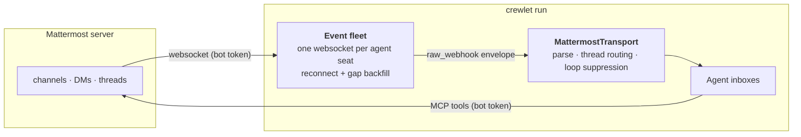
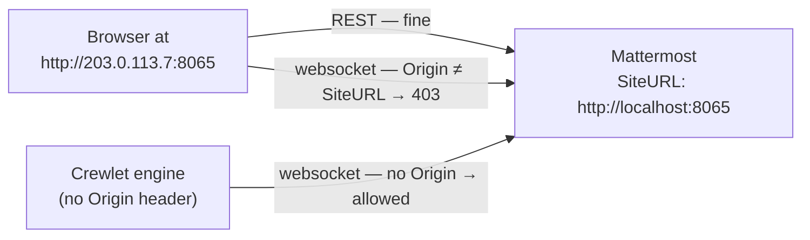

# Mattermost Integration

Mattermost is the **self-hosted, open-source** chat backend: one bot account
per agent, on a server you run. It is the alternative to
[Slack](slack.md) for orgs that want the conversational surface inside their
own infrastructure.

> **Prerequisites.** A Mattermost server you administer, and a **team** the
> agents will live in. Crewlet never creates top-level tenancy — create the
> server and the team yourself, then let
> [`crewlet mattermost provision`](#automated-setup-crewlet-mattermost-provision)
> fill it with agent bots.
>
> Unlike Slack, the engine does **not** need to be reachable from the chat
> server: it opens outbound websockets rather than receiving webhooks, so a
> Crewlet running on a laptop against a self-hosted Mattermost needs no
> tunnel and no public URL.
>
> That is a statement about the **engine**. The Mattermost **server** still
> has to know the address browsers reach it on — read [The Site
> URL](#the-site-url) before you deploy anywhere but localhost; getting it
> wrong costs every human live updates while the agents keep working.

---

## Setting it up from the dashboard

Connect Mattermost in Company › Integrations with the instance address, the
team and a system administrator token. The reconcile loop creates each agent's
bot account on its next tick, running the same pass
`crewlet mattermost provision` runs. The administrator token is sealed in the
fleet's secret store and kept, because disabling those bots again on
disconnect needs the same authority that created them.

On a first boot the engine claims its seats before that pass has minted their
tokens, so each agent's `mcp-server-mattermost` is not started yet: it is
**waiting**, not failing, for a token this integration mints
(`mcp_server_awaiting_credential` in the log, and *Waiting for credentials* on
Settings › MCP Tools, both naming it). The pass seals
the tokens and re-activates the revision, and once the seal reaches a seat's
node it starts the seat's server with its token, so the agents get the tools
they answer through without a restart of the engine. That holds only where
the company provisions its bots (`integrations.mattermost.provisioning`) and
the pass can make them: where its last pass reports that it cannot until
somebody acts — no administrator token, bot accounts or tokens switched off
in the System Console, a bot somebody else deactivated — the server reads as
failed, with that same finding. A company whose bots were made by hand seals
each bot token itself, and a server whose token is unset is a failure naming
the variable. See
[Tools & MCP](../guides/tools-and-mcp.md#shared-vs-per-role-servers).

Disconnecting with **"also remove the accounts this engine created"** revokes
each seat's bot token and then disables its bot, in that order. The revoke is
what makes the disable stand up: a disabled account keeps its username and its
tokens, so a token left behind starts working again the moment anything
re-enables the bot, this engine's own reconnect included. Only tokens this
tool minted are taken (matched on the `crewlet-<handle>` description),
so an administrator's own token on the same account is left alone. A token that
cannot be revoked fails the disconnect with the bot left **enabled**, rather
than leaving a disabled account quietly holding a live credential; repeating
the disconnect resumes there. The sealed `${VAR}` is left in the secret store
holding the now-dead value, which the next connect overwrites.

It also **records that this engine is the one disabling the bot**, in
Mattermost's own `description` field on the bot record, written before the
disable. That marker is what a later connect reads to tell its own disconnect
apart from an administrator switching an agent off — see below, and
[three apps disable rather than delete](../concepts/integration-reconcile.md#three-apps-disable-rather-than-delete-and-one-rule-covers-all-three)
for why the same rule holds at Datadog and GitLab.

This is the one integration that needs **no public address at all**. The
engine dials out to your server and holds one websocket per seat — on every
node, see [Running on a fleet](#running-on-a-fleet) — so nothing
has to reach the engine and there is no webhook secret, no shared token and no
inbound route to expose.

See [Running the provisioning pass](../reference/api-endpoints.md#running-the-provisioning-pass).

## How this differs from Slack

One structural difference shapes the whole integration: **Mattermost has no
usable inbound webhook.**

Its outgoing webhooks fire only in *public* channels — the server returns
early for anything that is not `ChannelTypeOpen` — so DMs and private
channels would never be delivered at all. And their payload carries no
`root_id` (no thread attribution), no channel type and no mention list, so
even public-channel traffic could not be routed the way Slack's is.

The supported path for an external service is the **WebSocket event API**,
authenticated per user. So the engine holds **one connection per
Mattermost-enabled agent seat**, and each connection republishes what it
receives onto the same internal envelope every webhook route uses — which is
what lets coalescing, the prompt registry and the dashboard stay unaware that
this source arrived over a socket.



What this buys you, compared with Slack:

| | Slack | Mattermost |
|---|---|---|
| Credentials per agent | 2 (bot token + signing secret) | **1** (bot token) |
| Manual steps per agent | An OAuth **Allow** click, per app | **none** |
| Engine must be publicly reachable | yes (Events API) | **no** [^siteurl] |
| Mention detection | inferred from text markup | **server-computed** list |
| Channel vs DM | inferred (`channel_type`, `D`-prefix) | **server-stamped** |
| Working-status text | free text, per phase | fixed *"is typing…"* |

The last row is the one real regression — see
[Working status](#working-status).

[^siteurl]: The *engine* needs no public URL. The *server* still needs its
    [Site URL](#the-site-url) set to the address browsers use.

---

## The Site URL

One Mattermost setting decides whether the product works for the humans in
it, and it fails silently in both directions. Get this right first.

`ServiceSettings.SiteURL` must be **the address people type into their
browser** — scheme, host and port, exactly, and no port the scheme already
implies (`:443` for https, `:80` for http), since no browser sends one. Not
`localhost` because the server runs there; not an internal DNS name because
the engine uses it. The address in the address bar.

Two things read it, and both break when it is wrong:

- **The websocket origin check.** Mattermost accepts a browser's websocket
  upgrade only when its `Origin` header matches SiteURL's host *and*
  scheme ([`App.OriginChecker`](https://github.com/mattermost/mattermost/blob/master/server/channels/app/server.go)).
  A mismatch is answered `403`, the web app retries and gives up, and it
  falls back to fetching messages when you navigate. Nothing is reported as
  broken — the symptom is *"I have to refresh to see the reply"*. With
  `AllowCorsFrom` set, the `Origin` must instead equal SiteURL (path
  removed) or one of its entries **character for character**, so a SiteURL
  written with capitals stops matching the lower-case `Origin` every browser
  sends. With no SiteURL at all, the check compares the `Origin` with the
  request's `Host` header, which a reverse proxy has to forward as the
  browser sent it: Mattermost's documented nginx configuration does
  (`proxy_set_header Host $http_host`), while nginx's own default sends the
  upstream's name instead.
- **Every absolute URL the server and its plugins build.** Email links,
  OAuth redirects and the prepackaged plugins all use SiteURL. A browser
  loading `http://203.0.113.7:8065` with SiteURL still on localhost issues
  requests to `http://localhost:8065/plugins/…` — against the *reader's*
  machine, which refuses them. Unset, Mattermost's own documentation lists
  the rest: email notifications carry broken links, email batching does not
  run, and OAuth sign-in fails.



**The engine is exempt.** The origin check passes any client that sends no
`Origin` header, which every non-browser client does — Mattermost's own Go
client included — so Crewlet's per-seat sockets keep working while the
humans' web app is blind. An agent answers your message; you just cannot see
it until you reload. That asymmetry is what makes this look like an engine
bug when it is a server setting.

### The address the engine dials

`integrations.mattermost.url` is where the **engine** reaches the server,
and it need not be the Site URL. On Kubernetes the engine naturally dials the
server's in-cluster Service — `http://mattermost.chat.svc.cluster.local:8065`
— while people browse `https://chat.example.com`, and that is correct:

- **The origin check never applies to the engine.** Its sockets carry no
  `Origin`, so neither the Site URL nor `AllowCorsFrom` has to name the
  address it dials.
- **Nothing a person opens is built from it.** The engine composes no
  Mattermost link: a permalink, a notification's link and a plugin's URL all
  come from the server's own Site URL. So does every link in the web app,
  which people reach at the Site URL anyway.

Only the **path** has to be the server's. Mattermost serves every route under
its Site URL's path, whatever host a request arrives on: a Site URL of
`https://example.com/chat` needs
`url: http://mattermost.chat.svc.cluster.local:8065/chat`.

**The engine follows no redirect.** Go's HTTP client follows one by
resending a write as a `GET` without its body — a bot's rename arrives as a
read of the bot and is answered `200` — and the agents' Mattermost MCP
server, which the examples give the same address, follows none at all, so
an engine that followed one would hear every message while its agents could
answer none. A `url` the server redirects therefore fails every call, with
an error naming where the server sent it and the `url` to set: one outside
the Site URL's path, which Mattermost redirects into it, or `http://` behind
a proxy that sends it to `https://`. A `url` under a path the server has no
route for at all — any path, on a server whose Site URL has none — is
answered with the web app's page, and the error says that instead of
failing to decode it.

The engine reads the server's configuration once when the transport starts,
and warns about what the server itself cannot use — never about the Site URL
differing from the address it dials:

| Event | When | What breaks |
|---|---|---|
| `mattermost_site_url_unset` | SiteURL is empty | Mattermost's email links, email batching and OAuth sign-in. Browsers keep their live feed wherever what is in front of the server forwards the `Host` they typed |
| `mattermost_site_url_refuses_browsers` | SiteURL is not an absolute http(s) address — `localhost:8065` and `/mattermost` pass Mattermost's own validation — or spells out a default port | Every person's live feed, and every link the server builds; the agents keep working |
| `mattermost_instance_unread` | The configuration could not be read through `url`. A redirect, or a web page where the API's JSON should be, is named in its `error` with the `url` to set | When it is the `url`: every call the engine makes, so no seat connects |

Each carries the same sentence [`crewlet mattermost doctor`](#checking-an-install-crewlet-mattermost-doctor)
prints for it.

### Getting it right

The compose stack reads `MATTERMOST_PUBLIC_URL`, and
[`scripts/mattermost-dev-bootstrap.sh`](#local-testing) settles it for you:
it derives the address (explicit variable → the address you reached the host
on over SSH → `localhost`), makes the server agree, persists it to `.env`,
and refuses to finish while the two disagree.

```bash
MATTERMOST_PUBLIC_URL=http://203.0.113.7:8065 \
  docker compose --profile mattermost up -d --wait
scripts/mattermost-dev-bootstrap.sh
```

Verify it from anywhere, with no credential — this must print the address
you browse to:

```bash
curl -s "http://203.0.113.7:8065/api/v4/config/client?format=old" \
  | python3 -c 'import sys,json; print(json.load(sys.stdin)["SiteURL"])'
```

Or let the engine's own check do it, which also sends a browser's websocket
upgrade to that address and opens every seat's socket:

```bash
crewlet mattermost doctor my_company.yaml -browser-url http://203.0.113.7:8065
```

`-browser-url` is the address people type, and only you can give it: the
server reports where it *believes* it is browsed, and the engine's own `url`
may be any route to it. Left out, it is read from `MATTERMOST_PUBLIC_URL`,
which a shell that sourced the compose stack's `.env` already has; with
neither, the doctor judges the Site URL on its own and says it did not ask
whether people browse there.

Three things that do **not** work, and cost an afternoon each:

- **Changing it in the System Console.** An `MM_*` environment variable
  outranks the stored config and is re-applied on every write, so the field
  is read-only and `PUT /api/v4/config/patch` silently reverts. For the
  compose stack the container has to be recreated with the new value.
- **Setting `AllowCorsFrom: "*"`.** It restores live updates by disabling
  the origin check, and in doing so grants credentialed cross-origin access
  to the whole REST API from any site a signed-in user visits. It also
  leaves SiteURL wrong, so the links and plugins stay broken. Use it only to
  name additional legitimate origins, explicitly, never `*`.
- **Listing the engine's address in `AllowCorsFrom`.** The engine needs no
  entry, because its sockets carry no `Origin`, and any entry at all
  switches the server to comparing origins character for character (see
  above) and grants that origin credentialed cross-origin access to the
  REST API.

---

## Configure in YAML

`integrations.mattermost` enables the transport and the websocket fleet. The
Mattermost **MCP tool** server is a separate `mcp_servers` entry
(`shared: false`). Per agent, the same `${VAR}` names the token in both
places — one credential, three readers (websocket, REST, MCP), no secret
duplicated. The REST reader makes two kinds of call on that token, both reads:
the backfill a seat runs over a websocket reconnect gap, and
`GET /api/v4/posts/{root}/thread` at the start of a turn woken in a thread, so
the agent is handed the conversation instead of being told to go and fetch it
(see [the thread block](../concepts/agent-runtime.md#the-thread-a-turn-was-woken-in)).
Both read as that bot account, so a channel it is not in simply answers an
error and the turn runs without the block.

```yaml
integrations:
  mattermost:
    enabled: true
    url: "https://chat.nimbus.example"    # instance base URL (required)
    team: nimbus                          # team slug (required)
    typing_status: always                 # always (default) | addressed
    provisioning:              # read by the reconcile loop AND by the CLI
      username_prefix: ""      # e.g. "agent-" if humans share the server
      channels: [town-square, engineering]   # channels every bot joins
      display_name_suffix: " (AI)"

mcp_servers:
  - name: mattermost
    shared: false                        # per-agent identity
    command: uvx
    args: ["mcp-server-mattermost==0.6.1"]
    env:
      MATTERMOST_URL: "https://chat.nimbus.example"
    tool_prefix: "mattermost_"

units:
  - name: Core
    id: core                             # the unit's key; `name` above is display
    type: team
    lead: engineer                       # the lead seat's handle
    roles:
      - name: Engineer
        integrations:                              # per-agent transport identity
          mattermost:
            bot_token: "${MATTERMOST_TOKEN_ENGINEER}"
            channel: engineering                   # optional — a channel this bot is added to
        mcp_env:
          mattermost:
            MATTERMOST_TOKEN: "${MATTERMOST_TOKEN_ENGINEER}"   # same token
```

**The server is pinned, and two of its tools reach the engine host's disk.**
The entry names `mcp-server-mattermost==0.6.1` because the bundled tool
skills trigger on its tool names (`mattermost_post_message` among them), and a
release that renamed one would disarm them without a sound — see
[trigger width](../concepts/tool-skills.md#controlling-the-cost--keep-enforced-triggers-narrow-broad-bodies-tiny).
Two of its tools act on the filesystem of the node the seat runs on, as the
user the engine runs as: `upload_file` sends Mattermost any file that user can
read, and `download_file`, new in 0.6.0, saves an attachment into any directory
that user can write, replacing an existing file when the call asks it to. Every
seat that runs this server can call both, so run the engine as a user whose
files you would let an agent post and overwrite.

Write this block **first**, with `${VAR}` placeholders — the provisioner
reads the placeholder names out of the YAML and mints exactly those
variables. A whole-value placeholder is required
(`"${MATTERMOST_TOKEN_ENGINEER}"`, not a literal token) so the provisioner
knows which variable to write into; a literal marks a manually managed bot,
which is reported and left untouched.

### Fields

| Field | Meaning |
|---|---|
| `url` | The address the engine reaches the server at. Required when enabled. Any route to the server works, the Site URL or an in-cluster Service alike; only its path has to be the Site URL's (see [The address the engine dials](#the-address-the-engine-dials)). |
| `team` | Team slug agents belong to. Required — channels are team-scoped. |
| `typing_status` | `always` (default) / `addressed`. See [Working status](#working-status). |
| `provisioning.username_prefix` | Prepended to each seat's [handle](../concepts/integration-reconcile.md#a-seats-account-is-named-after-its-handle) to form the bot username. |
| `provisioning.channels` | Channels every agent bot is added to. |
| `provisioning.display_name_suffix` | Appended to each bot's display name. |

Per role, under `integrations.mattermost`:

| Field | Meaning |
|---|---|
| `bot_token` | The bot's personal access token. `${VAR}` ⇒ provisionable. One whole reference or the token itself — a reference inside other text is refused, since the transport would send it as written. |
| `username` | Bot username, or one whole `${VAR}` naming it (resolved where the transport is built, like the token). Defaults to the handle (with the prefix applied). |
| `channel` | Optional channel name this seat's bot is added to at provisioning, on top of `provisioning.channels`. It aims nothing: the engine's transport posts no message. |

There is deliberately **no `status_phrases`** here: Mattermost's indicator
wording belongs to the client, so no text the engine supplied would ever be
rendered. The setting exists only under `integrations.slack`.

---

## Automated Setup: `crewlet mattermost provision`

**A preflight runs before the first write.** Three things a config cannot show
are checked against the live instance: that the provisioning credential really
holds `system_admin`, and that `ServiceSettings.EnableBotAccountCreation` and
`ServiceSettings.EnableUserAccessTokens` are on. Each is reported as a note
naming the setting — without them the run fails on its first bot creation with
a 403 that names an endpoint rather than the thing an administrator has to
change. They are notes rather than refusals because the settings are read from
a config endpoint whose exact key set varies by server version: an absent key
means "this server did not say", not "it is off".


```
export MATTERMOST_ADMIN_TOKEN="..."      # a system-admin personal access token
export CREWLET_API_TOKEN="..."           # one of the running node's Tier A tokens carrying admin
crewlet mattermost provision company.yaml -secret-store
```

`-secret-store` records each bot's token where every node reads it; one of
`-secret-store`, `-env-file PATH` and `-print` is required, so a run never
mints a credential it has nowhere to put. With the engine running, the run
reads what it needs of the company's values — the instance's `url`, and with
`-secret-store` (no `-rotate`) each planned bot's token, which decides whether
that bot keeps it — through the engine, as `CREWLET_API_TOKEN`: one of its
Tier A tokens carrying `admin`, since that read is the node's break-glass
reveal and refuses a machine token. With the engine stopped, the run reads the
fleet's store itself, through this node's own broker or the external one; on a
member of a cluster whose engine is stopped it is refused before it changes
anything, naming `-api URL`. See
[where a command reads the company's values](../reference/cli.md#where-a-command-reads-the-companys-values).
A running engine reads the tokens at its next apply and not before, so a run
that minted one says what is left on its `Next:` line: for `-secret-store`,
re-activating the current revision (`POST /config/reload` to a node that is
up). Where the block itself is new to the running company, the
`crewlet config import` that applies it is that apply. A re-run that kept
every token prints no `Next:` line.

For every Mattermost-enabled agent seat the command:

1. **finds or creates the bot account** at a deterministic username
   (`{username_prefix}{handle}`, or an explicit `username`) — see
   [A seat's account is named after its handle](../concepts/integration-reconcile.md#a-seats-account-is-named-after-its-handle);
2. **re-enables it if this engine's own disconnect disabled it**, and only
   then — a disabled bot still owns its username, so creating over it fails
   with a conflict nothing else would explain. The test is the
   `crewlet:disconnected` marker the teardown writes on the bot's
   `description`: with it, the bot is enabled and the marker cleared; without
   it, the bot is **left alone** and the seat reported as `identity_failed`
   for an administrator to decide about. It used to re-enable anything it
   found disabled, so switching an agent off in the System Console lasted
   until the next reconcile tick — the engine overruling an administrator on a
   timer, with no way for them to make it stick. Clearing the marker is best
   effort and noted rather than fatal: the bot is already working again, and
   failing a pass over a cosmetic field would be worse than the stale marker
   it avoids. Bots disabled before this shipped carry no marker and stay
   manual;
3. keeps its **display name** current (`{role name}{display_name_suffix}`) — read from the bot record rather than its user, because the display name lives on the bot and comparing against the user's nickname would report drift on every run;
4. adds it to the **team** and to every configured **channel** — a bot only
   receives messages from channels it is a member of, so this is the step
   that makes the integration work at all. Membership is **read first**, so a
   bot already in a team or a channel costs no request: this ran
   unconditionally once, three writes per seat on every pass for ever, each
   one answered with a duplicate error and discarded;
5. mints its **personal access token** into the config's own `${VAR}`,
   write-through (Mattermost returns a token's value exactly once).

There is no app manifest, no local ledger and no OAuth click. Mattermost can
enumerate its own bots, so reconcile is stateless — delete nothing, re-run
freely. One seat failing is recorded as a `FAILED` line and the remaining
agents still provision; the command then exits non-zero, and re-running
resumes exactly the failed seats.

Before it writes anything, a preflight refuses the run when it cannot
finish: a credential that is not a system admin, a team that does not exist,
`ServiceSettings.EnableBotAccountCreation` or
`ServiceSettings.EnableUserAccessTokens` switched off (both default to
**false** on a fresh install, and both fail *late* — every bot created and
joined, then nothing minted). The [Site URL](#the-site-url) is not part of it:
no bot depends on it, and the address the run reaches the server at says
nothing about the address people browse. Membership is **read**, never
inferred from a status code. The second half
of that sentence used to say Mattermost answers an add for an existing
member with success, so a 4xx there is a real failure — which was never
true: it answers `400 "This user is already a team member."` and the code
swallowed it, which is exactly why nothing noticed the pass was writing on
every run. The membership lists are now read and compared, so a duplicate
add is not sent at all.

A configured channel that **does not exist** is the one case that is a note
rather than a failure. Half a fleet of bots joined and the run stopped is a
worse state than every bot joined to the channels that do exist and a line
naming the one that did not — especially since the usual cause is a typo an
operator fixes in seconds. **Read the notes**: a bot hears nothing from a
channel it is not in, so a missing channel is silent at run time and visible
only here.

"Already provisioned" is checked against the server as well as the env file.
"Already provisioned" is **proven by using the credential**, not inferred.
The reconcile takes the value the `${VAR}` actually holds and authenticates
with it: only a token that answers as *this seat's bot* counts. A `${VAR}`
holding a token that has since been revoked — by `--decommission`, by an
admin, by a restore from an older `.env` — is re-minted, so the documented
recovery below actually recovers; so is one that authenticates as a
different account, which is how a copy-pasted var gets caught.

The weaker test — "the bot has *some* live `crewlet-engine` token" — reads
as provisioned in exactly the case that matters. A run whose mint reached
the server but whose response was lost leaves a live token this tool never
saw; that token would then vouch for the dead value in the env file, on
every run, forever. A 5xx or a network failure during the check is *not* a
rejection: the seat is left exactly as it was, with a note, because
re-minting on "cannot tell" destroys a credential that works.

A seat's own `${VAR}`s are the only ones written. `MATTERMOST_ADMIN_TOKEN`
is excluded from the scan outright — it is the operator's credential, the
bootstrap writes it into the same `.env`, and a config that points a seat's
`mcp_env` credential key at it would otherwise have a bot token silently
replace a system-admin one.

A mint is **all or nothing for the seat**. When a seat names its token in
two different `${VAR}`s, a fresh token is written to *both*, and the token
it supersedes is revoked: a seat split across two credentials is a seat
where one consumer works and the other does not, with nothing in the report
to say which, and an unreferenced token left live on a bot account is one
nothing can ever name again. If a value cannot be persisted everywhere, the
new token is revoked *and* every `${VAR}` already written is cleared —
because a var holding a revoked token is indistinguishable, to the engine,
from a working one, and the seat's socket simply never opens. If it can be
persisted neither everywhere nor revoked, the report names the token id and
tells you to revoke it by hand.

That same promise is why a seat is **refused** rather than minted when its
bot's token list cannot be read at all — a 403 on the admin credential,
personal access tokens switched off, a proxy rewriting the path. A mint that
cannot enumerate what is already there cannot revoke what it supersedes, so
it would leave a live, non-expiring token referenced by no `${VAR}`, carrying
the same `crewlet-engine` description as the good one, invisible to
[`doctor`](#checking-an-install-crewlet-mattermost-doctor) and never revisited
— the next run finds every var populated and returns early. The seat fails
with the underlying cause, the rest of the fleet still provisions, and the
seat resumes on a re-run once the read works.

Two deliberate exceptions to that refusal:

- **A bot this run created.** Its token list is empty by construction, so
  nothing can be stranded, and refusing would abort a first-ever provision
  over a hazard that cannot exist. The mint proceeds with a note.
- **A seat whose recorded token already works.** It is proven directly, so
  the listing was only ever going to report surplus tokens; nothing is
  minted and nothing can be stranded.

If the mint call itself fails *after* the server created the token — a read
timeout on the response, a proxy that drops it — the value is live on the
account and readable by nobody. The reconcile takes an inventory before
minting precisely so it can identify that token by difference, and revokes
it; if even that cannot be done, the report says so with the id.

When the list *is* readable and shows more than one live `crewlet-engine`
token on a fully provisioned seat, the report says so. Nothing revokes them
automatically — only one is referenced by the config and the provisioner
cannot tell which of the others some other operator is relying on — but they
carry the same description as the live one, so this listing is the only thing
that distinguishes them.

### The admin token

The reconcile authenticates as a **system admin** — creating bot accounts and
minting their access tokens both require it. Generate one under
**Profile → Security → Personal Access Tokens** on a system-admin account.
An admin must first enable personal access tokens in
**System Console → Integrations → Integration Management**.

The token is an *operator* credential and is never read from the company
config: pass `-admin-token` or export `MATTERMOST_ADMIN_TOKEN`. The bots' own
tokens are what this run *mints*, so it cannot bootstrap itself from them.

### Flags

| Flag | Description |
|------|-------------|
| `-admin-token TOKEN` | System-admin PAT (default: `$MATTERMOST_ADMIN_TOKEN`). |
| `-secret-store` / `-env-file PATH` / `-print` | Where minted credentials go — exactly one, and there is no default: a run with nowhere to put what it mints creates live credentials on the server and prints none of them. `-print` writes `export VAR=…` lines and, when a run rolls back, `unset VAR` for each — the stream is meant to be sourced, and a comment is a no-op to a shell, so an operator who piped it into `source` would otherwise keep a revoked token exported. With `-env-file` or `-print` a real run is refused before it touches the server where the company's store holds a planned bot's token variable: the engine reads the store's value over anything recorded there, so a minted token would never be read. Record with `-secret-store`, or remove the stored value first ([a sink the store outranks](../reference/cli.md#a-sink-the-store-outranks)). |
| `-rotate` | Mint a fresh token for every bot, including bots whose current one still works. |
| `-handles a,b` | Provision only these seat handles. It narrows the provisioning loop **only** — a `-handles` run with `-decommission` does not read the seats it skipped as departed. |
| `-decommission` | Revoke the tokens of, and then disable, managed bot accounts whose seats have left the config. Disable, never delete: a deleted bot takes its posts with it, silently rewriting the history of every channel it spoke in. The token goes because the account does not: a departed colleague whose credential outlived them starts working again the moment the bot is re-enabled. |
| `-dry-run` | Print the plan; create and modify nothing. It reads no stored value, so it runs on any node, a stopped one included — and so does a run with nothing to provision. |
| `-config PATH` / `-api URL` | Where a real run reads the company's values (the instance URL, and with `-secret-store` each bot's token it reads back) and where `-secret-store` records: through the running engine holding the store `-config` names (default `./crewlet.yaml`), with one of its Tier A tokens in `CREWLET_API_TOKEN`, or through the node `-api` names; with this node's engine stopped, from the fleet's store itself; with neither a file nor `-api`, from the environment alone. On a member of a cluster whose engine is stopped a real run is refused before it touches the server, `-rotate` included — see [where a command reads the company's values](../reference/cli.md#where-a-command-reads-the-companys-values). |

Afterwards, do what the run's `Next:` line says. With `-secret-store` that is
`POST /config/reload` to a node that is up — or the `crewlet config import`
that adds the block, where it is new to the running company — and each seat's
websocket is rebuilt from its new token at that apply, while a node that has
not started yet reads the tokens as it starts. With `-env-file` or `-print` it
is the values into the engine's environment and a restart. A re-run that kept
every token prints no `Next:` line.

### Why a re-run does not rotate

Mattermost returns an access token's value **once**, so the reconcile cannot
verify that what it recorded last time still matches. Minting every run
would be an outage: the engine is running with the *old* value, and rotating
revokes the credential every bot's websocket is currently authenticated
with — an operator adding a tenth seat would take the other nine down, from
a command whose whole promise is that it is safe to re-run.

So a bot is left alone when **both** halves hold: the variable holding its
token still has a value (answered by the sink the run is writing to, and an
*unreadable* sink stops the run rather than being read as empty), and the
account still has a token under this tool's description,
`crewlet-<handle>`.
Either alone is wrong — a recorded value whose token was revoked leaves a
bot 401ing for ever, and a live token nobody wrote down cannot be deployed.

`-rotate` mints for every bot regardless, retiring the previous one *after*
recording the new: never before, or a failed record leaves the seat with
nothing. Only this tool's own description is retired — an administrator may
have minted a token on the bot by hand, and revoking it would break whatever
is using it, silently.

### When a run cannot finish

Everything it minted is undone. A bot this run **created** is rolled back by
revoking every token on it, because nothing else has ever minted there; on a
bot that already **existed**, only the token this run minted is revoked —
sweeping the account would take an administrator's own token with no way to
tell that it had. The rollback runs through a detached context, because the
failure is often the cancellation itself.

### Seats and licensing

Mattermost's unlicensed server enforces a hard **active-user** cap. **Bot
accounts are excluded from that count**, so an agent fleet of any size does
not consume it — the provisioner reports the current human headroom in its
preflight so you can see where you stand:

```
note: server user limit: 12/250 active human users. Bot accounts are
      excluded from this count, so agent seats do not consume it.
```

Worth knowing that the exclusion is an implementation detail of the seat
query rather than a licensing commitment, and that the cap itself has been
lowered several times across releases. If your org approaches the human
limit, that is the number to watch — not the agent count.

---

## Checking an install: `crewlet mattermost doctor`

```
crewlet mattermost doctor my_company.yaml [-browser-url URL] [-admin-token TOKEN]
```

Reads the same company YAML the engine boots from and checks the whole
inbound path, in the order it breaks. `-browser-url` (or
`MATTERMOST_PUBLIC_URL`) is the address people type into their browser —
the one fact about browsers the company's configuration cannot give it,
because `integrations.mattermost.url` may be any route to the server:

| Check | Why it is here |
|---|---|
| `/system/ping`, unauthenticated | Reachability — a bad credential must not make a healthy server look dead — and that `url` is where the server answers its API: a redirect, or a web page in its place, stops the run and names the `url` to set (see [The address the engine dials](#the-address-the-engine-dials)) |
| `SiteURL` | The [one setting](#the-site-url) whose failure has no error message: unset, not an absolute http(s) address, a default port spelled out, or — given `-browser-url` — not the address people type, scheme and host. A Site URL on another address than `url` is not a finding — see [The address the engine dials](#the-address-the-engine-dials). Without `-browser-url` the line says that question was not asked |
| A **browser-shaped** websocket upgrade | *With* a browser's `Origin`, which is the only difference between a browser and the engine — what a human's live feed does, `AllowCorsFrom` included, which no unprivileged read can show. Given `-browser-url`, it is a browser there: sent to that address under the Site URL's path, through whatever is in front of the server, so a proxy that drops `Upgrade` fails it too. Without it, it carries the Site URL's own `Origin` and is sent to `url`, so it can only find an `AllowCorsFrom` that refuses the server's own browsers. With no Site URL, it stands in for a browser at `url` itself |
| The configured team | Channels are team-scoped, so a team that does not resolve is a company where no bot can be placed |
| Per seat: its own credential, a real socket, its channels | A token can be valid for REST and still not open a socket, and a bot receives nothing from channels it has not joined. The socket is opened exactly as the engine opens it, with no `Origin` |

**No admin credential is needed and nothing is written.** The seat tokens
already in the config do the work, resolved the way the engine resolves them
(secret store, then environment) — they are the credentials the engine
authenticates with, so they are the honest thing to check with. A literal
token is used as-is: managing a seat's credential by hand is a supported
choice, and refusing to check it would report a working seat as
unconfigured. Pass `-admin-token` to run the shared checks as somebody else.
The exit code is non-zero when any check fails, so it drops into a deploy
script.

**Checked-and-bad is distinguished from never-checked.** An unreachable
server, an unreadable server configuration or a missing credential *stops*
the run, and the report says so: one failing line with nothing after it
would otherwise read as "one thing is wrong" when it means "nothing else was
even asked". The same holds per seat — a seat whose token did not resolve is
never dialled, and one whose credential is refused is never asked about its
channels. Everything that *can* still be answered is: a team that does not
resolve leaves the per-seat socket checks intact, because whether each agent
authenticates is worth knowing either way.

```
ok    reachable        http://203.0.113.7:8065 answers
ok    site url         people browse the server at http://203.0.113.7:8065, and its Site
                       URL, http://203.0.113.7:8065, agrees.
ok    credential       authenticates as agent-pm
ok    team             team "nimbus" resolves (kx8f...)
ok    browser socket   an upgrade carrying Origin http://203.0.113.7:8065 — what a browser
                       at http://203.0.113.7:8065 sends, sent where it sends it — was
                       accepted at ws://203.0.113.7:8065/api/v4/websocket
ok    seat pm          agent-pm authenticates, opens a socket, and is in 3 channel(s)
FAIL  seat swe         agent-swe authenticates and opens a socket but has joined no
                       channel, so it will only ever hear direct messages. Name channels
                       under integrations.mattermost.provisioning or on the seat itself,
                       and run `crewlet mattermost provision`
```

---

## How Mattermost Routing Works

### Inbound

1. A human posts in a channel the bot is a member of, or DMs it.
2. Mattermost pushes a `posted` event down that bot's websocket.
3. The fleet republishes it onto `crewlet.notifications.inbound`.
4. the Mattermost transport parses it, applies thread routing and loop
   suppression, and produces a notification.
5. NotificationService resolves handle → agent and publishes to
   `crewlet.agent.{seat-id}.inbox`.

#### Which events wake an agent

Only `posted` events carrying user-visible content — **edits do not**, the
same call the [Slack](slack.md) transport makes: an edit of a message the
agent has already triaged is not a new request, and re-answering it costs
a full turn. Skipped without waking anyone, and logged at debug as
`mattermost_post_skipped` with the reason rather than recorded as a
`NotificationSkipped` event — those concern nobody, the same rule every
integration's parser follows, and a skip row for each would bury the drops
that do matter (a seat no recipient matches, the routing gate, the rate valve)
under the ordinary traffic of a busy channel:

- **`system_*` posts** — joins, leaves, header/purpose changes, channel
  renames. They carry text, but the text is *about* the channel rather than
  addressed to anyone.
- **Deleted posts** (`delete_at` set).
- **The agent's own posts** — compared against its resolved user id. Its own
  thread replies still record participation, so replying subscribes it to
  what comes back.
- **Empty posts** — an upload with no comment renders as
  `(shared 2 files)` rather than a blank body, so a genuine post is never
  delivered empty.

### Reconnects and the gap

A connection that drops and comes back has missed whatever happened in
between, and this fleet covers the gap by re-reading rather than by asking
the server to replay it.

Each seat therefore records the newest post it has seen and, on reconnect,
re-reads every channel it is a member of since that point and replays the gap
in order within each channel — across channels the order is the channel list's,
which does not matter because each replayed post becomes its own agent turn. Every channel is read, not only ones with prior traffic — a message
in a channel the bot was invited to *during* the outage would otherwise be
invisible forever. Duplicates across the boundary are caught by a per-seat
de-duplication ring, and by the fleet-wide claim described in
[Running on a fleet](#running-on-a-fleet).

The replay is what the live socket would have delivered, and nothing more.
Mattermost's `since=` is *update*-based, and an update is not new content: a
reaction touches a post, and deleting a reply touches its thread root — so a
👍 landing during a reconnect would otherwise wake the agent to re-answer a
message it had already answered. Only posts **created** in the gap are
replayed. A seat that reconnects before it has seen any post still gets a
cursor from the moment it connected, so its first outage is replayable like
any other.

The window is bounded at **15 minutes**. Backfill exists to cover a blip — a
network drop, a rolling Mattermost restart, a brief engine pause — not to
catch up after an outage: every replayed message costs a full agent turn, and
an hour of replayed conversation would be both expensive and wrong, because
those conversations have moved on. A wider gap is logged with the amount
skipped rather than silently truncated:

```
mattermost_backfill_window_exceeded handle=engineer gap=1h0m12.4s window=15m0s
```

Reconnect backoff is capped at 5 minutes and jittered by up to a quarter of
the delay — every seat drops at the same instant when the server restarts,
and each reconnect is a backfill walking that seat's channels, not one
request. A seat that cannot connect is a configuration problem an operator
has to see, so the retry stays visible in the logs rather than backing off
into silence. The schedule resets only after a connection that stayed *live*
for a minute: Mattermost closes without a close frame, so an ordinary
disconnect and a server hanging up on sight look identical otherwise.

> **Not yet used: Mattermost's reliable websockets.** The server can replay
> a dropped connection's missed events from a 128-event queue when the
> client reconnects with `connection_id` + `sequence_number` — exact, where
> a time-windowed re-read is approximate. It honours those parameters only
> when the upgrade request is already authenticated, and this fleet
> authenticates *after* the handshake, so adopting it means moving every
> seat to an `Authorization` header on the upgrade — a change to how every
> seat connects, and to how a revoked token surfaces.

### Running on a fleet

**Every node opens every seat's socket**, not only the seats it holds. That is
deliberate redundancy: a node that restarts, drains or loses a seat's lease
leaves the seat heard by every other node meanwhile, so there is no handover
to get wrong and no gap for a backfill to cover. Each post therefore arrives
once per node, and the fleet decides which one delivers it:

1. A node reading a post **claims** it fleet-wide in the coordination store,
   under `mattermost|<handle>|<post id>` — per seat, because one post is a
   delivery to every bot in its channel.
2. The node that wins publishes it onto `crewlet.notifications.inbound` and
   records the delivery (a `socket:posted` row, below). Every other node drops
   it.
3. A claim store that cannot answer **fails open**: the post is delivered,
   because a message suppressed by a store blink is a message nobody answers.
   A post two nodes both deliver is caught by the second layer — its wake's id
   is derived from the seat and the post, so the inbox and the completion
   ledger recognise the pair and the seat takes one turn.
4. A publish that fails gives the post back: the claim is released and the
   seat's cursor is held before the post, so the seat reconnects and replays
   it — on this node, or on whichever peer gets to it first. A post is never
   spent before it is queued.

**The claim lasts 30 minutes** — twice the 15-minute replay window. A peer
whose socket dropped re-reads up to 15 minutes behind the moment it
reconnects, so a post can come round again that long after it was written,
and the reconnect itself may have waited out the 5-minute backoff ceiling;
the margin covers that and the clock difference between the server and the
nodes. A claim that lapsed first would let the peer deliver the post again.
The webhook routes claim for 5 minutes, and the coordination store holds each
claim to its own deadline ([Retention is a bucket's age](../concepts/coordination.md#retention-is-a-buckets-age)).

**What it costs is N sockets and N backfills per bot on an N-node fleet.**
Every node authenticates every bot, holds its socket open and pings it every
30 seconds, and every node that reconnects walks the bot's channels — so a
Mattermost restart is N times the reconnect traffic a single node would send,
spread by the backoff's jitter. For a company of tens of bots on a handful of
nodes that is a small number of idle connections; it is the one cost of a
seat never going deaf while placement moves it.

**Each delivery is counted once.** The node that wins a post's claim publishes
an `inbound_delivery` record beside the wake, so Company › Integrations
counts Mattermost's deliveries like any other surface's — one post presented
to one seat, whichever node read it — and its row lists them as
`socket:posted`, with the post id as the provider's id. The record is
published rather than written, so a node without `data` reaches a data node's
event log through custody like everything else it publishes.

### Outbound

All Mattermost capabilities — messaging, threading, search, reactions — come
from **MCP tools** powered by the agent's own bot token. Messages post with
the agent's own bot identity.

The engine's own transport never creates a post. It holds the same per-seat
bot token for its own **reads** — the seat's identity, the instance's typing
cadence and Site URL, and the REST re-read a reconnecting socket backfills
from — and for exactly one write: the [typing indicator](#working-status).

---

## Thread Routing

Identical in shape to Slack's, on Mattermost's own primitives. Top-level
channel messages are always delivered; thread replies only reach agents
**following** that thread.

Two signals decide, and each answers a different question.

**Whether the bot was addressed** is the server's answer. Mattermost
rewrites the `mentions` list *per connection*
(`addMentionsBroadcastHook`): the field is present only when that
connection's user was mentioned, and its value is then exactly that one
id. So it is authoritative and catches what no regex could — group
mentions, notification keywords, `@all` / `@channel` / `@here` resolved
against real membership.

**Why** is the message text's answer, and only the text's. A bare
`@channel` expands into every member's id, so by the list alone a
broadcast is indistinguishable from being named — and treating a
broadcast as a personal address is exactly what
[`typing_status: addressed`](#working-status) must not do.

**Follow triggers:**

1. **Direct mention** — the server says this bot is a target, and the text
   names it (`@agent-swe`). Also the reason when the server says it is a
   target for something the text cannot show, such as a group mention.
2. **Collective address** — the server says this bot is a target, and the
   text shows only `@all` / `@channel` / `@here`; recorded as
   `collective`, which is weaker than being named.
3. **DM** — a direct or group-DM channel always follows. There is nobody
   else the message could be for.
4. **Participation** — the agent posts in the thread.

The thread key is `root_id`, which is immutable and equals the parent post's
id — so the follow model maps 1:1 onto the one Slack uses. State is persisted
in the fleet's [coordination store](../concepts/coordination.md), keyed
`backend = 'mattermost'`, and survives engine restarts — including the 90-day
inactivity horizon described in
[the Slack analog](slack.md#thread-routing), which is backend-neutral because
the record is.

For **backfilled** posts the mention list is unavailable (they are re-read
over REST), so the text alone decides — the same `@username` grammar, doing
both jobs.

---

## Working status

Mattermost's only working indicator is the composer typing line, whose
wording is fixed by the client. The engine can raise it, but cannot say
anything with it, so unlike Slack there are no per-phase phrases.

`typing_status` **defaults to `always`**, the same as Slack, and on this
backend that default is the expensive one. Know what it costs before you
leave it:

- It conveys only *busy*, where Slack's line carries the phase the agent is
  in. A fixed "is typing…" held for a five-minute turn tells a reader less
  than Slack's would.
- It has to be re-asserted every few seconds rather than every 45, so a
  multi-minute turn costs one to two orders of magnitude more requests for
  strictly less information.

Set `typing_status: addressed` to raise it only where somebody is waiting on
that agent, which is the setting most Mattermost deployments want. The
heartbeat interval is **derived from the server's own
`TimeBetweenUserTypingUpdatesMilliseconds`** setting rather than hardcoded:
re-asserting faster than the server's throttle is silently dropped, and much
slower leaves a visible gap. Tune the server setting and the engine follows.
It is read when the transport starts, from the first bot token the server
accepts, beside each bot's identity and before any bot's websocket attaches.
A server that cannot be reached is asked once rather than once per bot — the
next token would only meet the same outage — and the indicator then runs at
Mattermost's default of five seconds until the next start
(`mattermost_instance_unread`).

| Mode | Shows the status when… |
|---|---|
| `always` *(default)* | every Mattermost-triggered turn |
| `addressed` | a DM, a direct mention, or a thread the agent is in because it was named there — a thread it merely spoke in does not count |

The lifecycle is the turn's, and it is the same on both chat backends: every
point the indicator is raised, held, released and cleared at is the table in
[Turn Engine § The working status](../concepts/turn-engine.md#the-working-status),
and that table is the only copy of it — a second one here would be a second
thing to keep true, which is exactly what this page's own point argues against.

What differs here is what a phase change does: **nothing**. The engine still
tracks which phase a turn is in, but this indicator has no text to move, so a
phase boundary costs no request at all — where on Slack it redraws the line.

> **There is no `off`.** What it bought was a company whose agents think in
> silence for minutes at a time, which is the state this feature exists to
> remove. `addressed` is the same judgement made per message rather than once
> for the deployment, and on this backend it is also the cheaper one.

---

## Reaching humans on Mattermost

When an agent escalates to a [human seat](../concepts/humans-in-the-org.md),
it DMs the human with **its own** bot token — the same credential it uses for
every other message. There is no org-level "system" account: the engine never
sends as itself.

Give the human seat a `contact.mattermost_user_id` — the **username**, not
the 26-character user id, because Mattermost mentions address a person by
name and the name is what an agent has to write for the mention to render.
It is lowercased, as Mattermost stores every username, so `Jane` and `jane`
name one person — and two seats giving either are refused as one account
claimed twice:

```yaml
roles:
  - name: Jane Founder
    kind: human
    manages: [ceo]        # by handle
    contact:
      mattermost_user_id: jane
```

### How a person's post is recognised

A post names its author by the **user id**, never by the username — so the
name in the chart cannot attribute anything on its own. The Mattermost
transport asks the server which account holds each human seat's name
(`POST /api/v4/users/usernames`, every name in one request, on a seat's bot
token) and registers **that account's user id** for the seat. A post from
it then reaches the agents as the colleague the chart describes —
`Jane Founder (jane-founder, human colleague)` — in the trigger, in the thread
a turn reads back and in what the agent remembers about who it spoke with,
rather than from a stranger with an opaque id.

The name is asked about in lowercase, the only case Mattermost stores a
username in, so `Jane` and `@jane` both find the account `jane`. It is asked
again:

| When | Why |
|---|---|
| At connect, before any socket is attached | so the first post a socket hears is already attributed |
| On every apply | an apply is what names a new person or corrects a name. The new party registry is filled from the last answer first, with no request, so nobody recognised a moment ago is a stranger while the server is asked again |
| Every **minute** (`mattermost.PeopleRefresh`) | the two changes that happen **at the server** — a person joining under the name the chart already gives them, and a rename — reach the engine no other way. One request per node per minute, however many people the company names |

The minute is what a person who has just joined waits to be recognised. A
rename keeps the account's id, so the person stays recognised until the next
ask — and that ask is what notices that the chart's name for them is stale.
Mattermost does broadcast `new_user` and `user_updated` on its websocket, and
the engine deliberately does not listen for them: every seat's socket would
hear each one, nothing replays one a socket missed while it was down, and the
answer they would prompt is the same request.

**A name that holds no person is reported, never guessed at.** Whatever is
registered for a person is attributed to them with their authority, so
nothing is registered for the seat when the name holds no account of the
person's own. The `reason` says which:

| `reason` | The name… |
|---|---|
| `no_account` | is one the server answers without: nobody holds it, or nobody the bots may see |
| `agent_account` | holds the account one of this company's own seats posts as, bot or not — registered, every post that agent made would reach its colleagues as the person's word |
| `bot_account` | holds another bot's account |
| `shared_account` | holds the account another human seat's name holds too. The duplicate check compares the contact as written, so two `${VAR}` references that resolve to one name pass it; one account is not two people, so it is registered for neither |

And for each one:

- the engine logs `mattermost_person_unknown` with the seat's handle, the
  name and the `reason`, once, when it happens — and
  `mattermost_person_found` when the name holds the person again;
- the integration's status carries a `contact_unknown`
  [finding](../concepts/integration-reconcile.md#what-a-pass-reports) about
  that seat: *degraded*, owed by the **operator**, because the fix is the
  name in the company document — the one the person's profile shows — or the
  person joining the server. Reported whether or not the engine provisions
  the bots.

A request that **fails** changes nothing: `mattermost_people_unread` is
logged and the last answer stands, because a server mid-restart says nothing
about who anybody is.

**Whoever holds the name is the person.** That is what the chart says when
it names a person by username, and it is the rule the rest of the
integration already follows: an agent mentions and messages whoever holds
`@jane`, and a person who joins after boot is recognised by it. So anyone
who can take a name on the server — by signing up under it, or renaming
themselves to it once it is free — is treated as the seat that names it,
with that seat's authority. Keep a person's username in the company
document current, and treat a Mattermost server whose members you would not
trust with each other's names accordingly.

A name that comes to hold a **different** account — the person renamed
themselves and somebody else took the name, or the account was deleted and
made again — moves the seat to that account on every node alike, because
each one asks the same server: a node that kept the old account would
attribute a post differently from a node started after the move. The move is
**said** instead of refused:

- the engine logs `mattermost_person_account_changed` with both ids, when
  it sees it;
- the integration's status carries a `contact_moved` finding about that
  seat, naming the account the name held when the company was last applied
  and the one it holds now: *degraded*, owed by the **operator**, until the
  next **apply**. If the account is not the person's, correct the name. If
  it is, re-apply the company unchanged (`POST /config/reload`) — any apply
  states the names again and clears it, the re-activation a provisioning
  pass makes on its own after sealing a credential it minted included, so
  the log line is the record that outlasts the finding. Only an apply: the
  registry the identity directory rebuilds when somebody is suspended or
  reinstated states nobody's name, and leaves the finding where it is. A
  node started after the move has no earlier account to compare with and
  reports nothing; every node running when it happened sees it within the
  minute.

A bot holding the built-in `system_user` role can see every account. If the
bots' role has had `view_members` taken away, the server answers only for
the people a bot shares a team or a channel with, and anyone else reads as a
name nobody holds.

**A person the identity directory withholds gets no account.** Whether the
person holding a seat may still be reached is the
[directory's](../concepts/humans-in-the-org.md#a-suspended-holder-is-withdrawn-with-no-configuration-change)
to say, and a seat whose holder is suspended, retired or removed has every
contact identity left out of the party registry — the account its name
resolves to included, so a suspended person's posts reach the agents from a
stranger, with no configuration change. Such a seat is not reported as
`contact_unknown` or `contact_moved` either, and contends for no account: an
account a withheld seat's name shares with another person's is that
person's. Its name is still asked about, so the registry that reinstates
the person attributes their next post at once.

---

## Local testing

Mattermost ships in this repo's `docker-compose.yml` behind a profile, like
GitLab — one compose file for everything, and `docker compose up` leaves it
out:

```bash
docker compose --profile mattermost up -d --wait
scripts/mattermost-dev-bootstrap.sh
```

The bootstrap waits for the server, creates the admin account (the **first**
user on a fresh install is auto-promoted to system admin — that is the
account the provisioner authenticates as), mints its personal access token
and writes `MATTERMOST_URL`, `MATTERMOST_PUBLIC_URL` and
`MATTERMOST_ADMIN_TOKEN` straight into `.env`, reconciles the [Site
URL](#the-site-url) with the address browsers will use, creates the `nimbus`
team and its channels, and proves a websocket upgrade succeeds. Credentials
are written the moment they exist, before any check that can abort —
Mattermost returns a token's value exactly once. Every step is idempotent,
so re-run it freely.

That same write-once rule is why a re-run *stops* rather than minting a
second token when it finds its `crewlet-dev-bootstrap` token on the server
but no working `MATTERMOST_ADMIN_TOKEN` in `.env` — because the value in
the file is missing, was revoked, or belongs to another server. A duplicate
minted there would be a live system-admin credential nobody can read. Revoke
the old token under **Profile → Security → Personal Access Tokens**, delete
the stale line from `.env`, and re-run; the script mints a fresh one. It
stops for the same reason when it cannot *read* the token list at all —
usually because personal access tokens are turned off under **System Console
→ Integrations → Integration Management** — or when the list comes back a
full page long, since the answer may be on the next one.

Credentials never travel through a process's arguments. `/proc/<pid>/cmdline`
is readable by every account on the machine, so the admin password and both
tokens reach `curl` through its config on stdin and reach the env-file writer
through the environment (`/proc/<pid>/environ` is owner-only). The env file
and its temp copy are created `0600` — the mode goes on at creation, never
by a `chmod` after the token is already on disk.

Provision the agent bots in the same run by pointing it at a company config:

```bash
COMPANY=my_company.yaml scripts/mattermost-dev-bootstrap.sh
```

### First run, end to end

The example org in [`examples/nimbus-claude-cli.company.yaml`](https://github.com/crewlet/crewlet/blob/main/examples/nimbus-claude-cli.company.yaml)
**is** the shortest way to try this. It is the same seven-seat company as
[`examples/nimbus.company.yaml`](https://github.com/crewlet/crewlet/blob/main/examples/nimbus.company.yaml)
beside it — the full-stack reference, on GitLab and a metered key — with
everything but chat taken out.

Its only integration is Mattermost and its only model is a coding CLI you
already subscribe to, so there is no code host to stand up, no metered API
key, and nothing that has to reach the engine from outside. It still has a
work tracker and a knowledge base: both are the engine's own, so its seats
file work and publish pages from the first turn with nothing to sign up
for. Its three engineering seats still run code: their executor *is* the
coding CLI's own agentic loop, in a [sandbox](../concepts/code-sandbox.md)
box on the engine host that reuses the same CLI login — so that costs nothing
extra to set up either, beyond one environment variable in step 5.

Add a code host afterwards, once you have seen the loop work; it has its own
page, `examples/nimbus.company.yaml` shows it already wired, and nothing here
has to be undone first. Moving the tracker or the wiki to Atlassian is the
one change that is not purely additive: [Jira](jira.md) and
[Confluence](confluence.md) REPLACE Worklet and Doclet rather than joining
them, so each means changing the matching `backend` in the same edit.

Two things the config expects of you, both once:

- **The bot tokens.** Every `${MATTERMOST_TOKEN_*}` in the file is a
  placeholder the provisioner mints — see [Automated
  Setup](#automated-setup-crewlet-mattermost-provision). Leave
  `provisioning.username_prefix` unset: the handles already start with
  `agent-`, and a prefix would produce `@agent-agent-ceo`.
- **A model.** `providers.llm.default` is a
  [Claude Code entry](../concepts/llm-backends.md) driving the
  `claude` CLI on your own Claude subscription, so the binary has to be on
  the machine running `crewlet run` and Crewlet needs its own copy of the
  login. Set its `auth.mode: api-key` if you would rather spend a metered
  key — `ANTHROPIC_API_KEY`, read from the secret store or the environment —
  or point it at another CLI ([Picking a
  CLI](../concepts/llm-backends.md#picking-a-cli)).

Then, from the repo root:

```bash
# 1. Mattermost and its own database (every service is profile-gated,
#    so a bare `docker compose up` starts nothing). The engine needs no
#    companion service of its own: the store is a file and the stream is
#    embedded.
docker compose --profile mattermost up -d --wait

# 2. Admin account, PAT, team, channels -> .env, then the seven bots and
#    their tokens into the same file. (Drop COMPANY= to do the bots in a
#    separate `crewlet mattermost provision` run.)
COMPANY=examples/nimbus-claude-cli.company.yaml scripts/mattermost-dev-bootstrap.sh

# 3. Check the plan before it touches the server again, and prove the
#    whole path before booting. .env carries MATTERMOST_PUBLIC_URL, so the
#    doctor holds the Site URL to the address you browse and sends its
#    browser probe there
set -a; . ./.env; set +a
crewlet mattermost provision examples/nimbus-claude-cli.company.yaml --dry-run --print
crewlet mattermost doctor examples/nimbus-claude-cli.company.yaml

# 4. Authenticate the model — once, on this machine. `-from-host` copies
#    the login `claude` already has here into Crewlet's own directory; plain
#    `crewlet llm login default` brokers `claude auth login` instead if this
#    machine has none. Both load the Tier A file, so export what it reads
#    first: the keyring (`crewlet secrets keygen -key-id 2026-01` prints
#    the line) and this node's own API token.
export CREWLET_SECRET_KEY_2026_01="<the base64 key it printed>"
export CREWLET_API_TOKEN_FOUNDER="$(openssl rand -hex 32)"
crewlet llm login default -from-host \
    -company examples/nimbus-claude-cli.company.yaml -config examples/nimbus-claude-cli.config.yaml
crewlet llm doctor default \
    -company examples/nimbus-claude-cli.company.yaml -config examples/nimbus-claude-cli.config.yaml

# 5. Boot — one websocket per agent seat. CREWLET_MCP_BRIDGE_URL is what
#    the engineering seats' box-mode runs dial back on for their tools:
#    the node serving the API, so it has to match api.port in the Tier A
#    file.
export CREWLET_MCP_BRIDGE_URL="http://127.0.0.1:8000"
crewlet run -config examples/nimbus-claude-cli.config.yaml \
            -company examples/nimbus-claude-cli.company.yaml
```

Step 3's `--dry-run --print` prints one line per seat — handle, bot
username, and the variables it would mint. Step 2 already wrote
`MATTERMOST_TOKEN_CEO`, `…_CTO`, `…_PM`, `…_DEVREL`, `…_SWE`, `…_FE` and
`…_AI` into `.env`, and step 3 sourced that file into this shell, so the
engine step 5 starts from it inherits them: nothing has to be re-sourced as
long as step 5 runs in the same shell. A new shell sources `.env` again
first — the engine reads no `.env` file itself, only its own environment
([Environment variables](../reference/environment-variables.md)). Every step
is idempotent, so re-run any of them freely.

Step 4 runs before step 5's first boot, so `-config` reaches the fleet's
store itself: the doctor starts the node's own broker under
`nimbus-data/stream`, creates the store there as the engine's first boot
would, reads it and stops the broker again. Once step 5 has started the
engine, run `crewlet llm doctor` beside it with `CREWLET_API_TOKEN` set to
`$CREWLET_API_TOKEN_FOUNDER`, since the store is read through the running
engine then; with that engine stopped again, the doctor reaches the store
itself as it did the first time ([where a command reads the company's
values](../reference/cli.md#where-a-command-reads-the-companys-values)).

Step 4 is the one a company's first model always needs, and
`crewlet llm doctor` is the half that matters: a `providers.llm` entry can be
configured perfectly and still not work — a missing binary, a profile whose
flags drifted from the installed CLI, an expired login, or the one nothing
else catches, a CLI that never reaches the seat's tools — its MCP server
configuration ignored, its tools left unallowed, a model that answers prose
instead of calling one. Only a real run with a real tool proves the last one,
so `doctor` runs one, and running it before the first turn is the difference
between one error now and every phase spending corrective runs — and ending
without its submission whenever the model never makes the call.

`-capture-token` — which mints a headless `CLAUDE_CODE_OAUTH_TOKEN` and
avoids the shared refresh token `-from-host` leaves you with — writes into
the [encrypted secret store](../concepts/secret-store.md), sealed under the
Tier A keyring `examples/nimbus-claude-cli.config.yaml` already declares
(every node needs one: `crewlet secrets keygen -key-id 2026-01` prints the
key to export). Worth doing before you run this anywhere but a laptop. See [LLM
Backends](../concepts/llm-backends.md#authentication) for the
other login shapes (a token on stdin, a username/password where the CLI has
one, a bundle moved onto another host).

To watch it work, sign in as `founder` / `crewlet-dev-password` at the URL
the bootstrap printed (<http://localhost:8065> on a laptop; the public
address it settled on otherwise — anything else and the [Site
URL](#the-site-url) check will have already stopped you), open
`~engineering`, and post `@agent-pm what are you working on?`. Three things
should follow, in order:

1. The working-status indicator appears under `@agent-pm` (that is
   `typing_status: addressed`).
2. `@agent-pm` replies **in a thread** on your message. Reply in that thread
   without mentioning anyone — it answers again, because it is now following
   the thread.
3. The engine's dashboard shows the turn. `examples/nimbus-claude-cli.config.yaml`
   serves it on <http://localhost:8000> — the **Event log** carries the
   inbound notification with its source, and **Turns** carries the
   turn it woke: each phase, the rounds it took, and the tools each round
   called.

Expect a subscription CLI to be **slower to first token** than an API call:
each phase launches a process, so the indicator sits there for a few seconds
before anything happens. That is what it is for.

If a bot stays silent, check in this order:

0. `crewlet mattermost doctor examples/nimbus-claude-cli.company.yaml` — this is what it
   is for; checks 1 and 2 below are what it automates. It never starts the
   tool server, so check 3 is yours.
1. `crewlet mattermost provision examples/nimbus-claude-cli.company.yaml --dry-run` —
   does the seat exist, and is its token minted?
2. The engine log, for one `mattermost_ws_connected` line per seat. A
   `mattermost_ws_auth_rejected` line instead means that seat's token is
   wrong, revoked, or its bot is disabled — re-run the provisioner.
3. Whether `uvx mcp-server-mattermost==0.6.1` resolves. A missing MCP server
   is the one failure mode where the agent reasons about a reply and then has
   no tool to send it with, so the logs show a complete turn and the channel
   stays quiet.
4. `crewlet llm doctor default -company examples/nimbus-claude-cli.company.yaml -config examples/nimbus-claude-cli.config.yaml`,
   with `CREWLET_API_TOKEN` set to `$CREWLET_API_TOKEN_FOUNDER` — the engine is
   running, so the doctor reads the company's values through it — on a
   coding-CLI entry this is the other half of the same symptom: a turn
   that never reached a model, or one whose CLI never called the seat's
   tools, ends with nothing posted.

Two settings the compose service sets are load-bearing rather than
convenience. Both default to `false` in the server's own config defaults,
and the paved path needs each:

| Setting | Needed by |
|---|---|
| `ServiceSettings.EnableBotAccountCreation` | `crewlet mattermost provision` — creating the bot accounts |
| `ServiceSettings.EnableUserAccessTokens` | `crewlet mattermost provision` — minting their tokens |

`TeamSettings.EnableOpenServer` is deliberately **not** set. The bootstrap
creates its admin over the API without it — Mattermost always allows the
first account on an empty install — and turning it on would leave public
signup enabled permanently, since an `MM_*` variable cannot be switched off
from the System Console.

If you point Crewlet at a Mattermost you host yourself, enable both under
**System Console → Integrations → Integration Management**;
`crewlet mattermost provision` refuses to start without them rather than
half-provisioning the fleet.

Unlike the GitLab loop, **nothing has to reach the engine**. GitLab POSTs
webhooks into it, so it needs `host.docker.internal` and a reachable
address; Mattermost never calls the engine at all. The whole loop
works behind NAT with no tunnel.

**On a remote host, set `MATTERMOST_PUBLIC_URL`** to the address browsers
use — see [The Site URL](#the-site-url), which is the one thing that has to
be right before anything a human sees works:

```bash
MATTERMOST_PUBLIC_URL=http://203.0.113.7:8065 docker compose --profile mattermost up -d --wait
scripts/mattermost-dev-bootstrap.sh
```

The bootstrap defaults it to the address you reached the host on over SSH,
so the second line is usually enough on its own; it prints which address it
chose and why. It then makes the server agree, opens a websocket to prove
the upgrade works, and stops with the fix if either check fails.

It writes the address it settled on to **both** `MATTERMOST_PUBLIC_URL` (read
by `docker compose`, so a later `up -d` keeps it) and `MATTERMOST_URL` (read
by the company config and the provisioner). They are the same value here
because the engine and the browsers reach the server the same way. Point
`MATTERMOST_URL` somewhere else only when the engine has a different route
to the server than people do — an internal DNS name, say — and never point
`MATTERMOST_PUBLIC_URL` anywhere but the address in the address bar.

---

## Troubleshooting

| Symptom | Cause | Fix |
|---|---|---|
| Messages only appear when you refresh; the console shows `WebSocket connection to 'ws://…/api/v4/websocket…' failed` and `disconnect_err_code=1006` | `ServiceSettings.SiteURL` does not match the address in the browser's address bar, so the [origin check](#the-site-url) rejects the upgrade | Set `MATTERMOST_PUBLIC_URL` and recreate the container |
| A plugin bundle requests `http://localhost:8065/plugins/…` and gets `ERR_CONNECTION_REFUSED` | The same wrong SiteURL — plugins build their URLs from it. (`mattermost-ai` is prepackaged and enabled by Mattermost's own defaults, so seeing it is normal.) | Same fix; these errors go away with it |
| Agents reply, but nobody sees it live | Both of the above at once: the engine's sockets are exempt from the origin check, browsers are not | Same fix |
| The websocket fails and the Site URL *is* correct | Something in front of Mattermost drops the `Upgrade` header | Forward `Upgrade` / `Connection` in the reverse proxy (`proxy_set_header Upgrade $http_upgrade; proxy_set_header Connection "upgrade";`) |
| The engine logs `mattermost_site_url_refuses_browsers` | SiteURL is not an absolute http(s) address (`localhost:8065`, `chat.example.com:8065` and `/mattermost` all pass Mattermost's own validation), or spells out its scheme's default port; no browser's `Origin` matches it | Set it to the address in the address bar, scheme included and default port left out |
| The engine logs `mattermost_site_url_unset` | SiteURL is empty. Live updates still work; Mattermost's email links, email batching and OAuth sign-in do not | Set it, as above |
| The engine logs `the server redirects it to …` and no seat connects | `integrations.mattermost.url` is not where the server serves its API: outside the Site URL's path, or `http://` where a proxy sends it to `https://`. Neither the engine nor the agents' MCP server follows a redirect | Set `url` — and the MCP server's `MATTERMOST_URL`, the same variable in the examples — to the address the error names; its host may stay whatever reaches the server |
| The engine logs `answered with text/html rather than the API's JSON` | `url` carries a path the server has no route for, so Mattermost answers its web app's page there | Give `url` the Site URL's path |
| One bot stays silent while others work | Its token was revoked, or its account disabled | `crewlet mattermost doctor <company.yaml>`, then re-run the provisioner |
| A person's messages reach the agents as a stranger's; the engine logs `mattermost_person_unknown` and the integration reports `contact_unknown` | The human seat's `contact.mattermost_user_id` names no account the bots can see — a typo, a rename, a person who has not joined — or names an agent's or a bot's account, or the account another human seat's name holds too | Write the username their profile shows; see [How a person's post is recognised](#how-a-persons-post-is-recognised) |
| The engine logs `mattermost_person_account_changed` and the integration reports `contact_moved` | The person's username now holds another account than when the company was last applied: they renamed and somebody took the name, or the account was made again | If the account is theirs, `POST /config/reload`; if not, write the username their profile shows now |
| An agent receives messages but never answers in Mattermost | The `mcp-server-mattermost` MCP server is missing, so the turn completes with no tool to send with | Check `uvx mcp-server-mattermost==0.6.1` resolves |
| An agent that answered earlier now has its sends refused, classed `unavailable`, saying the server is not running, and the log has `server_exited` | That seat's `mcp-server-mattermost` child exited; the engine is [restarting it](../guides/tools-and-mcp.md#a-server-that-dies-or-will-not-start) and its tools refuse until it is back | Nothing, if `server_restarted` follows. If `server_exited` keeps recurring, or `server_restart_failed` repeats, fix what the `stderr_tail` names |
| Every agent is deaf after a restart, and the log has `mattermost_ws_auth_rejected` | Personal access tokens were disabled server-wide, or the tokens were revoked | Re-enable under System Console → Integrations, re-run the provisioner |

`crewlet mattermost doctor <company.yaml> -browser-url <address people type>`
checks all of the above but the tool server in one pass: reachability (and that `url` is answered
without a redirect), the Site URL against the address people type, a
**browser-shaped** websocket upgrade sent there (with the `Origin` a browser
sends, which is what distinguishes a browser from the engine), and one real
authenticated socket per seat, opened as the engine opens it. It exits
non-zero when any check fails. Without `-browser-url` or
`MATTERMOST_PUBLIC_URL` it cannot tell a Site URL from the address people
type, nor see what stands in front of the server, and its `site url` line
says so.

