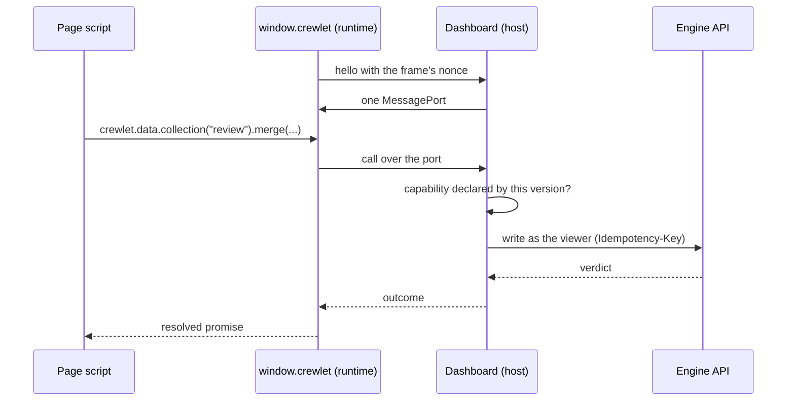

# Artifact Runtime

The `window.crewlet` contract, version **1.0**: what an `html`
[artifact](../concepts/artifacts.md) page can ask its host for, and how each
call maps onto the engine. Writing pages is
[Authoring Artifacts](../guides/artifact-authoring.md).

---

## How a page reaches the engine

A page never talks to the engine. It runs in a sandboxed frame on the artifact
origin, which holds no credential, and the runtime installs `window.crewlet`,
which talks to the **host** (the dashboard that embedded the frame) over a
`MessagePort`. The host makes every call to the engine as the signed-in viewer,
and the engine decides each one again.



Four rules hold whatever a page does:

1. **A page never names its own artifact.** The host binds every call to the
   artifact it embedded, so a page cannot address another artifact's data or
   room.
2. **A page never holds a credential.** No token, cookie or session id crosses
   the port, and `identity` answers display facts only.
3. **Capabilities are checked twice.** The host refuses a call the version did
   not declare (a fast, readable error), and the engine authorizes every call
   against the viewer's share and the collection rules (the real boundary).
4. **Every message is validated** on both sides. An unknown call is refused;
   an unknown field in a value is preserved.

---

## Versions of the contract

A version pins the contract it was written against at publish (`contract:
"latest"` resolves to the newest this engine serves and is stored exactly).
The engine serves every contract any published version pins. Within a major
version everything is **additive**: new methods, new optional fields, new
refusal codes. Treat a refusal code you do not recognise as a generic failure.

`crewlet.version` is the exact contract the page is running.

---

## The surface

```ts
interface Crewlet {
  readonly version: string;
  readonly ready: Promise<void>;             // resolves once the host handshake completes
  readonly capabilities: {
    has(name: Capability): boolean;
    list(): Capability[];
  };
  readonly connection: Connection;
  readonly identity: IdentityApi;            // capability "identity"
  readonly data: DataApi;                    // capability "db"
  readonly state: StateApi;                  // capability "state"
  readonly presence: PresenceApi;            // capability "presence"
  readonly assets: AssetsApi;                // capability "assets"
  openLink(url: string): Promise<boolean>;   // always available
  readonly theme: ThemeApi;                  // always available
}

type Capability = "db" | "state" | "identity" | "presence" | "assets";
type Unsubscribe = () => void;
type Json = null | boolean | number | string | Json[] | { [k: string]: Json };
```

A namespace whose capability the version did not declare exists, and every
call on it rejects with `capability_not_declared`.

### Connection

```ts
type ConnectionState = "live" | "reconnecting" | "offline";

interface Connection {
  readonly state: ConnectionState;
  subscribe(cb: (state: ConnectionState) => void): Unsubscribe;
}
```

`reconnecting` means the host lost its socket and is re-establishing it; reads
answer from what the page already holds, and writes wait. On reconnect the
host rejoins the artifact's room and the runtime re-reads anything the pushes
it missed would have changed.

### Identity

```ts
interface Viewer {
  seat: string;                              // the viewer's seat handle
  kind: "human" | "agent";
  displayName: string;
  role: "viewer" | "commenter" | "contributor" | "editor" | "owner";
}

interface IdentityApi {
  me(): Promise<Viewer>;
  subscribe(cb: (me: Viewer) => void): Unsubscribe;   // the viewer's role changed
}
```

Never a token, a login or an email address. When the viewer's share is removed
while the page is open, the host withdraws the page's room and every later
call rejects with `forbidden`.

### Data

A collection is read and written by name. Every write is one engine write: a
batch of ops applied all or nothing, decided by the engine in the store's log
order, identically on every node.

```ts
interface Doc<T = Record<string, Json>> {
  id: string;
  data: T;
  version: number;                           // the document's version; pass it as ifVersion to guard a write
  createdBy: string; createdAt: string;      // seat handle, RFC 3339
  updatedBy: string; updatedAt: string;
  pending: boolean;                          // a local write on it is not yet decided
}

interface Page<T> { docs: Doc<T>[]; cursor?: string }

interface Query {
  where?: [field: string, op: "eq" | "ne" | "lt" | "lte" | "gt" | "gte" | "in", value: Json][];
  order?: [field: string, dir: "asc" | "desc"][];
  limit?: number;                            // at most 500
  cursor?: string;
}

interface WriteOptions { ifVersion?: number }

type Verdict = "applied" | "conflict" | "invalid" | "forbidden" | "quota" | "gone";

interface WriteOutcome {
  verdict: Verdict | "pending";              // pending: accepted, this node has not applied it yet
  seq?: number;                              // the write's place in the store's history
  reason?: string;                           // why, for every verdict but applied
  conflict?: Doc[];                          // the current documents, on a conflict
}

interface Collection<T = Record<string, Json>> {
  readonly name: string;
  get(id: string): Promise<Doc<T> | null>;
  list(opts?: { cursor?: string; limit?: number }): Promise<Page<T>>;
  query(q: Query): Promise<Page<T>>;
  subscribe(cb: (docs: Doc<T>[], change: { changed: string[]; removed: string[] }) => void): Unsubscribe;

  set(id: string, fields: Partial<T>, opts?: WriteOptions): Promise<WriteOutcome>;     // replace, creating it
  merge(id: string, fields: Partial<T>, opts?: WriteOptions): Promise<WriteOutcome>;   // set the named fields
  delete(id: string, opts?: WriteOptions): Promise<WriteOutcome>;
  increment(id: string, field: string, by: number, opts?: WriteOptions): Promise<WriteOutcome>;
  append(id: string, field: string, value: Json, opts?: WriteOptions): Promise<WriteOutcome>;
  add(id: string, field: string, value: Json, opts?: WriteOptions): Promise<WriteOutcome>;
  remove(id: string, field: string, value: Json, opts?: WriteOptions): Promise<WriteOutcome>;
}

interface Batch {
  set(collection: string, id: string, fields: Record<string, Json>, opts?: WriteOptions): Batch;
  merge(collection: string, id: string, fields: Record<string, Json>, opts?: WriteOptions): Batch;
  delete(collection: string, id: string, opts?: WriteOptions): Batch;
  increment(collection: string, id: string, field: string, by: number, opts?: WriteOptions): Batch;
  append(collection: string, id: string, field: string, value: Json, opts?: WriteOptions): Batch;
  add(collection: string, id: string, field: string, value: Json, opts?: WriteOptions): Batch;
  remove(collection: string, id: string, field: string, value: Json, opts?: WriteOptions): Batch;
  commit(): Promise<WriteOutcome>;           // one write, all or nothing
}

interface DataApi {
  collection<T = Record<string, Json>>(name: string): Collection<T>;
  batch(): Batch;
  schema(): Promise<CollectionSchema[]>;     // the collections and their columns, as declared
}
```

Each method is one op of the engine's write:

| Method | Op | Effect |
|---|---|---|
| `set` | `set` | Replaces the document's fields, creating the document |
| `merge` | `merge` | Sets the named top-level fields and leaves the rest |
| `delete` | `delete` | Tombstones the document, so a client catching up sees the delete |
| `increment` | `increment` | Adds a number to a numeric field |
| `append` | `append` | Grows a long-text field, or adds an element to an array field |
| `add`, `remove` | `add`, `remove` | Adds an element to, or removes one from, an array field (a multiselect) |

Without `ifVersion` a write is blind, which is what a click on a checkbox
should be. With it, the whole batch is refused as a `conflict` when any guarded
document has moved, and `conflict` carries the current documents.

| Verdict | Means |
|---|---|
| `applied` | Every op took effect |
| `conflict` | A guarded document moved since the version the page passed |
| `invalid` | A name, a value or a type broke the grammar or the schema |
| `forbidden` | A collection or column rule refused the viewer's role or kind |
| `quota` | A store bound or the company's datastore quota |
| `gone` | The store was purged or the artifact trashed |
| `pending` | Accepted, and not yet applied on the node that answered; the runtime resolves it from the push that follows |

A write may also reject before it reaches the log: `rate_limited` (with how
long to wait), `capability_not_declared`, `forbidden` (no share that writes
data) and `unavailable` (the engine could not be reached; nothing was written
unless a later read shows it).

Reads honour the collection's read rule on every path, the subscription
included: a page reading an `own_rows` collection receives the viewer's rows
and nothing else, unless the viewer is an editor.

`subscribe` delivers the collection's current documents, then every change as
the engine applies it, with the documents a remote write changed listed in
`changed`. In contract 1.0 a subscription is to a whole collection and a page
filters on its side; a collection holds at most 50 000 documents.

### State

Per-viewer state that follows the viewer across devices and is invisible to
everybody else, in the artifact's private store. The method names are the ones
Claude's artifact storage uses, so a page written for it moves with small
changes.

```ts
interface StateApi {
  get(key: string): Promise<Json | null>;
  set(key: string, value: Json): Promise<void>;
  delete(key: string): Promise<void>;
  list(prefix?: string): Promise<string[]>;
}
```

A value is at most 64 KiB of JSON and is written whole, last write wins. A
page written for Claude's `window.storage` may opt in to an adapter that maps
that object onto `crewlet.state`; there is no `window.claude` alias, and no
synchronous `localStorage` emulation.

### Presence

```ts
interface Focus { version?: number; region?: string; collection?: string; doc?: string; field?: string }

interface Member {
  session: string;                           // one per tab
  seat: string;
  kind: "human" | "agent";
  activity: "viewing" | "editing" | "idle";
  focus: Focus;
  at: string;
}

interface Roster {
  members: Member[];
  counts?: { human: number; agent: number }; // members past the fifty presented
  truncated: boolean;
}

interface PresenceApi {
  roster(): Roster;
  subscribe(cb: (roster: Roster) => void): Unsubscribe;
  set(state: { activity?: Member["activity"]; focus?: Focus }): void;   // throttled to 10 a second
}
```

Presence is best effort: a member disappears 45 seconds after their last
frame, a room past 50 members presents the 50 most recently active plus
counts, and agents working on the artifact appear like people. `region` is a
name the page chooses for where the viewer is (a tab, a chart), at most 64
characters.

### Assets

```ts
interface Asset { id: string; name: string; contentType: string; size: number }

interface AssetsApi {
  list(): Promise<Asset[]>;
  url(id: string): string;                   // a URL the page may use in src or href
}
```

Assets are uploaded by the artifact's editors from the dashboard, the CLI or
an agent's tool, never by a page.

### Opening links

```ts
crewlet.openLink(url: string): Promise<boolean>
```

The frame cannot open a window. `openLink` asks the host, which shows the
viewer the destination and opens it in a new tab with no opener if they
confirm. It resolves `true` when the viewer opened it and `false` when they
did not. Only `https:` and `http:` URLs are accepted.

### Theme

```ts
interface ThemeApi {
  readonly mode: "light" | "dark";
  subscribe(cb: (mode: "light" | "dark") => void): Unsubscribe;
}
```

An artifact follows its reader's own appearance setting. The kit's `theme.js`
applies it before first paint; `crewlet.theme` is for a page that draws its
own charts.

---

## Errors

Every call returns a promise. A rejection carries `{ code, message }`, with
`code` one of:

| Code | Means |
|---|---|
| `capability_not_declared` | The version did not declare the capability this call needs |
| `forbidden` | The viewer's share does not allow it |
| `not_found` | No such collection, document or asset |
| `invalid` | The call's arguments are malformed |
| `rate_limited` | Too many writes; the message says how long to wait |
| `unavailable` | The host could not reach the engine |

Data writes resolve with a `WriteOutcome` rather than rejecting for every
verdict the engine decided, so a page handles `conflict` and `invalid` as
answers, not exceptions.
